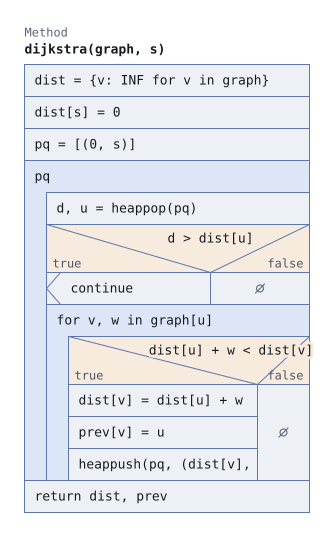
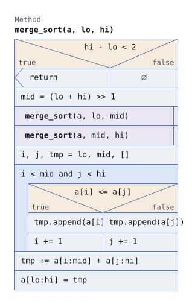

English | [한국어](README.ko.md)

<p align="center">
  
</p>

<h1 align="center">
  
</h1>

An editor for NS charts ([Nassi-Shneiderman diagrams](https://en.wikipedia.org/wiki/Nassi%E2%80%93Shneiderman_diagram)). You draw a chart by **structural editing**: you select blocks and wrap them, and the layout adjusts itself. The saved file (`.ns.svg`) is a plain SVG, so it shows as a picture when you put it in a README or a blog post, and the editor can open the same file again to edit it. There is no separate picture and source file to keep in sync.

<p align="center" style="display:flex;justify-content:center;align-items:flex-start;gap:16px;flex-wrap:wrap">
  
  
</p>
<p align="center"><sub>NS charts drawn with AriadneNSD: Dijkstra's shortest path (left) and merge sort (right)</sub></p>

> [!TIP]
> **You can try the web beta right in your browser:**<br>
> <a href="https://ariadnensd.com/" target="_blank" rel="noopener"></a><br>
> This is the web beta. It opens without installing anything and saves to files on your own computer, with no server involved (Chrome and Edge; Firefox and Safari download the file instead). The manual is at [ariadnensd.com/manual/](https://ariadnensd.com/manual/), and the keys are listed under Help › Keyboard Shortcuts (`?`).<br>
> The [algorithm gallery](https://ariadnensd.com/gallery/) collects well-known algorithms drawn as NS charts.<br>
> If you use Claude, install the [AriadneNSD skill](https://ariadnensd.com/manual/#claude-skill) to make diagrams, draw code, and edit diagrams you receive, all within a conversation.<br>
> This is still before 1.0, so files you save now may not open in later versions.

## Claude skill

Ask Claude to "draw this function as an NS chart" and it makes a `.ns.svg` file and a share link. It can also turn code into a diagram, and read and edit a diagram you give it. Once installed, Claude uses it on its own when it fits; you don't need to call it.

**Claude Code:** Run these two commands in a terminal, in order (add the marketplace, then install). You can also type `/plugin marketplace add …` in the chat. In the desktop app, `/plugin` opens the plugin window, where you add `reddiana/AriadneNSD`.

```sh
claude plugin marketplace add reddiana/AriadneNSD
claude plugin install ariadne-nsd@ariadne-nsd
```

**claude.ai:** Download `ariadne-nsd.zip` from the [latest release](https://github.com/reddiana/AriadneNSD/releases) and upload it in Settings › Capabilities › Skills ("Code execution and file creation" must be turned on).

See the [AI section of the manual](https://ariadnensd.com/manual/#claude-skill) for details.

> [!NOTE]
> **This is the web beta.** The code is being written in [`src/`](src/README.md) from the requirements, architecture and detailed design, and each build goes up at the address above. The Obsidian plugin and the desktop app are still in the design stage.

## How to read this repository

<!-- site:skip -->
The documents in this repository are written in Korean, and they are made to be written and read in [Obsidian](https://obsidian.md/). They use `[[wikilinks]]`, block IDs, tags and callouts, so on GitHub the links between documents don't work and some of the markup shows as plain text. Please read them in one of these two ways.

> [!TIP]
> **1. Read on the website (no install):** **https://ariadnensd.com/about** (in Korean)
> The site publishes the design documents (`docs/`), the atelier (`atelier/`) and what was learned (`til/`, Today I Learned). Links and diagrams work as they do in Obsidian. It is republished on every push to `main`.
>
> **2. Read in Obsidian:** Get the repository (`git clone`, or Code → Download ZIP), then in Obsidian use **Open folder as vault** on the repository folder. Start from [`docs/README.md`](docs/README.md). You can also read the journey notes (most of `journal/`), which are not on the site.
<!-- /site:skip -->

| Folder                                | Contents                                                |
| ------------------------------------- | ------------------------------------------------------- |
| [`docs/`](docs/README.md)             | Application documents: requirements, architecture, UX design, detailed design, file format specification |
| [`src/`](src/README.md)               | Code: a pnpm monorepo (`core` for the model, layout and file format, `fonts` for fonts, `editor` for the editing UI, and the web app). How to start developing is in [`src/README.md`](src/README.md) |
| [`atelier/`](atelier/README.md)       | The atelier: current status, to-dos, items awaiting an answer, prototypes, decision records (ADRs for architecture, DRs for everything else), session notes, inbox |
| [`journal/`](journal/README.md)       | Journey notes: a timeline, and what a Claude Code beginner learned along the way |
| [`til/`](til/README.md)               | Today I Learned: notes from a backend developer learning frontend |
| [`site/`](site/)                      | Configuration and build scripts for the published site (GitHub Pages, Quartz) |

## Roadmap

The web version gets polished first, then the same editor extends to an Obsidian plugin and a desktop app. The web version goes through MVP, beta and 1.0.

| Stage | Version | What | Saved files |
| --- | --- | --- | --- |
| Web MVP | 0.1 · 0.2 | Structural editing by selecting and wrapping blocks, Event · Method headers and call blocks, examples, PNG export (0.1). 0.2 brought in some of the 1.0 features below early. Tried by people who know the link | May not open in later versions |
| **Web beta** (now) | from 0.3 | Starts spreading the word. Adds a manual and a channel for reporting problems, and adds the 1.0 features below release by release | May not open in later versions |
| Obsidian beta | 0.x | Starts alongside the web beta. Installed straight from GitHub with the BRAT plugin | May not open in later versions |
| Web 1.0 | 1.0 | Folding, extract to Method, expanding call blocks, syntax highlighting, themes, share URLs, PDF and printing, high-contrast display. The key layout is fixed | **Opens in all later versions** |
| Obsidian 1.0 | | Listed in Obsidian's community plugins | Opens in all later versions |
| Desktop app | | Opens and edits `.ns` and `.ns.svg` files on your computer directly | |
| After that | | Google Drive integration, a Confluence app, IDE plugins (VS Code, IntelliJ), Claude skill | |

There are no dates. How the stages were decided is in [DR-0018](atelier/decisions/dr-0018-release-stages.md) (in Korean), and the priority of each feature is in the [requirements](docs/01-requirements/01-requirements.md) (in Korean).

## How it's being made

This project is also the story of a **backend developer using Claude Code for the first time** to build a frontend app together with AI. The mistakes and lessons along the way are kept as they happened. I hope anyone who follows these notes comes away thinking "I could do this too."

1. **Design:** Everything from requirements through UX, architecture and detailed design was written down first. The reasons behind decisions are kept as decision records (ADRs and DRs), and what was discussed in each session is kept in session notes.
2. **Mockups and prototypes:** Things that were hard to compare in words were drawn out first and then chosen, and the requirements were tried out on throwaway prototypes. Each page says what was compared and why one was chosen: [`atelier/sketchbook.md`](atelier/sketchbook.md) (in Korean)
3. **MVP:** The code was written fresh in [`src/`](src/README.md) following that design and released as [v0.1.0](https://github.com/reddiana/AriadneNSD/releases/tag/v0.1.0), followed by [v0.2.0](https://github.com/reddiana/AriadneNSD/releases/tag/v0.2.0) with some web 1.0 features added.
4. **Web beta:** From [v0.3.0](https://github.com/reddiana/AriadneNSD/releases/tag/v0.3.0) on, it is being shared widely and refined through use.

The whole story from the start is in [`journal/timeline.md`](journal/timeline.md), and the notes on learning to work with AI are in [`journal/learning-claude-code.md`](journal/learning-claude-code.md) (both in Korean).

## Name

`AriadneNSD` means "Ariadne's NS chart". In Greek myth, [Ariadne](https://en.wikipedia.org/wiki/Ariadne) gave Theseus a ball of thread as he went into the labyrinth, so that he could follow it back out. That is why "Ariadne's thread" means something that keeps you from getting lost in a complicated place. The idea is that an NS chart (NSD) is the thread through the labyrinth of code, and so the wordmark reads `Ariadne’s NSD`. In text, the name is always written `AriadneNSD`.

The longer story is in [`journal/name-story.md`](journal/name-story.md) (in Korean).

## Logo

The logo is traced from the woman in the middle of "Ladies in Blue", a fresco from the palace of Knossos. Ariadne was a princess of Knossos, and the one who handed over the thread so that no one would get lost in the labyrinth.
The base image is a photo of Emile Gilliéron's reproduction, released under CC0 by the Metropolitan Museum of Art. Details are in [`journal/logo-source.md`](journal/logo-source.md) (in Korean).

## License

Anyone may take it, use it, change it and sell it. Please let us know if you use it.

| What                                                                              | License                                                                                      |
| --------------------------------------------------------------------------------- | -------------------------------------------------------------------------------------------- |
| Code (source code, prototypes, scripts)                                           | [Apache License 2.0](LICENSE). Please include the text of the [`NOTICE`](NOTICE) file in anything you distribute that uses it |
| Writing (documents in `docs/`, `atelier/`, `journal/` and `til/`, this README and the other documents at the top of the repository, mockup and spike pages) | [CC BY 4.0](LICENSE-docs). Please credit the source as `AriadneNSD (https://github.com/reddiana/AriadneNSD)` |
| Logo (image files of the logo and the wordmark)                                   | Not licensed. It may be used only to refer to this project                                   |
| Name (`AriadneNSD`)                                                               | Not licensed. You may not give this name to a product you build from it. You may use it to say that you used AriadneNSD |

The two licenses above grant rights to use the code and the writing only. They do not grant any right to use the name or the logo. The Metropolitan Museum of Art photo the logo is based on was released under CC0.
