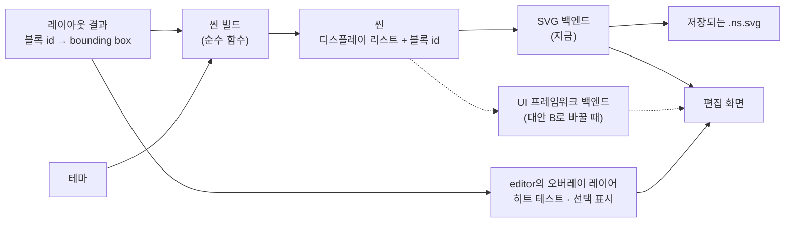

# ADR-0030: 화면도 저장되는 SVG와 같은 렌더러로 그리고, 렌더링 백엔드는 교체할 수 있게 둔다

> [!NOTE] 이후 변경
> - 2026-10-25: 레이아웃은 두 단계의 순수 함수이고 고칠 때마다 문서 전체를 다시 센다(증분 없음) → [[0037-two-pass-full-layout|ADR-0037]]
> - 2026-10-22: 용어를 SW 엔지니어의 말로 고치고 렌더링 파이프라인 그림을 더했다(뜻은 그대로). "장면 만들기"는 씬 빌드, "그리기"는 렌더링 백엔드(지금은 SVG 출력)다. → [[03-architecture]]

## 배경

저장되는 그림(`.ns.svg`)은 `core`의 렌더러가 만든다([[0005-model-embedded-svg|ADR-0005]], [[0018-save-as-shown|ADR-0018]]). 편집 화면의 그림을 무엇으로 렌더링할지가 남았다. 이것이 정해지면 UI 프레임워크([[0010-ui-framework|ADR-0010]])가 맡을 범위가 정해진다. [[03-architecture]]의 초안(2026-10-13)에 Claude가 "화면도 렌더러의 SVG를 그대로 쓴다"고 적었고, 2026-10-17에 시안 M20의 A5로 물었다.

## 결정 기준

- 화면에 렌더링된 그림과 저장된 그림이 어긋나지 않는다
- 블록 500개에서 편집 한 번 뒤 100ms 안에 화면이 갱신된다([[02-layout#4. 성능]])
- 나중에 방식을 바꿔도 비용이 크지 않다

## 검토한 대안

그림은 시안 M20의 A5에 있다: https://claude.ai/artifact/R8RJxg8V1qweiMfusMKk87

### 대안 A: 화면도 렌더러의 SVG를 그대로 쓰고, 편집 중의 표시만 위에 덧그린다

- 장점: 렌더링 코드가 한 벌이라 화면과 파일이 어긋날 수 없다. UI 프레임워크는 도구 모음 · 메뉴 · 설정 창에만 쓴다
- 단점: 한 글자를 고쳐도 SVG 전체를 다시 생성한다. 성능은 구현하며 측정한다

### 대안 B: 화면은 UI 프레임워크로 블록마다 부품을 만들어 따로 그린다

- 장점: 바뀐 블록만 다시 렌더링하기 쉽다
- 단점: 렌더링 코드가 두 벌이라 화면과 저장된 그림의 1px 차이를 늘 맞춰야 한다

## 결정

**지금은 대안 A로 하되, 나중에 대안 B로 바꿔도 비용이 적은 구조로 짠다.** 메인테이너: "지금은 1번으로 결정하지만 나중에 결정을 2번으로 바꾸더라도 비용이 많이 발생하지 않는 아키텍처를 구성합니다." (2026-10-17)

그 구조는 Claude가 제안했다(확인받지 못함):

1. 렌더러를 두 단계 파이프라인으로 나눈다.
	- **씬 빌드**(순수 함수): 레이아웃 결과와 테마 → 씬. 씬은 그릴 사각형 · 선 · 글자의 목록(디스플레이 리스트)이고, 요소마다 어느 블록의 것인지(블록 id)가 붙는다. 색과 모양의 판단은 모두 여기서만 한다.
	- **렌더링 백엔드**: 씬 → 출력. 지금은 SVG 문자열 출력 하나뿐이고 화면과 파일이 함께 쓴다.
2. `editor`는 "씬을 화면에 렌더링한다"는 인터페이스 하나로만 화면에 그린다.
3. `editor`는 화면의 SVG DOM을 조회하지 않는다. 히트 테스트(클릭한 곳의 블록)와 선택 오버레이의 위치는 레이아웃 결과(블록 id → bounding box)로 계산한다.

> [!note] 범례 (UML이 아닌 데이터 흐름 그림)
> 사각형은 단계나 데이터, 실선 화살표는 지금의 데이터 흐름(꼬리의 출력이 머리의 입력이 된다), 점선 화살표는 대안 B로 바꿀 때 생기는 흐름이다.

대안 B로 바꿀 때는 같은 씬을 받아 UI 프레임워크의 컴포넌트로 렌더링하는 백엔드를 하나 더 구현해 2의 구현체만 교체한다. 씬에 블록 id가 있으니, 이전 씬과 비교(diff)해 바뀐 블록만 다시 렌더링할 수도 있다. 색과 모양의 판단은 씬 빌드 한 곳에 남으므로 두 벌이 되지 않는다.

## 결과

- 좋아지는 점: 화면과 파일이 같은 씬에서 나온다. ADR-0010의 고민이 작아진다(도구 모음과 메뉴만).
- 감수하는 점: 씬이라는 중간 표현이 하나 더 생긴다. 지금은 쓰는 곳이 SVG 백엔드 하나뿐이라 조금 돌아가는 셈이다.
- 후속 작업: 씬의 자료 구조와 블록 id를 붙이는 단위, 성능 측정 → [[02-layout]], 화면에 놓는 방법 → [[03-editor]]
