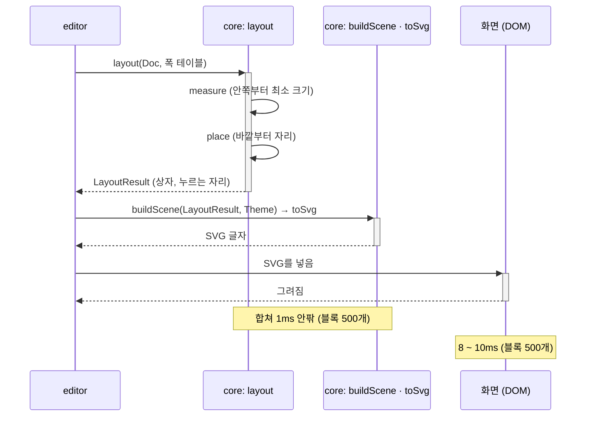

# ADR-0037: 레이아웃은 두 단계의 순수 함수로 하고, 고칠 때마다 문서 전체를 다시 센다

> [!info] 누가 무엇을 정했나
> 레이아웃 규칙의 물음(시안 M33 ~ M38)은 메인테이너가 골랐다. 이 ADR의 세 결정(두 단계, 전체를 다시 셈, 폭 테이블과 없는 글자)은 Claude가 프로토타입과 스파이크(D2Coding 폭 표, M39)를 보고 제안했고, 메인테이너가 승인했다(2026-10-25: "승인").

## 배경

[[02-layout]]은 문서 모델([[01-model]])에서 블록마다의 bounding box를 계산하는 레이아웃을 정한다. 레이아웃 설계의 규칙과 물음(시안 M33 ~ M38)과 스파이크 둘을 마친 뒤(2026-10-25), 코드의 구조에 닿는 결정 셋을 이 ADR에 모은다.

1. 레이아웃 알고리즘의 짜임: 갈래 폭을 자동으로 나누고([[01-requirements#^lay-branch-width]]), 짧은 갈래는 남는 높이를 블록마다 고르게 나눈다([[ux-decisions#SB1. 짧은 갈래|SB1]]). 부모의 크기가 자식의 크기에 달려 있고, 자식의 실제 크기는 부모가 받은 크기에 달려 있다.
2. 다시 계산하는 범위: 블록 500개 문서에서 편집 한 번이 100ms 안에 화면에 반영되어야 한다([[03-quality-attribute-scenarios#QA-07 편집 반응 시간|QA-07]]). QA-07은 증분 레이아웃을 할지 "측정해서 정한다"고 적었다.
3. 텍스트 폭: [[0026-bundled-font-metrics|ADR-0026]]과 [[0034-default-block-font|ADR-0034]]는 번들한 D2Coding의 advance 폭으로 `core`가 폭을 계산한다고 정했다. 그 폭 테이블을 어떻게 싣는지, 테이블에 없는 글자(한자, 이모지)를 어떻게 셀지는 정하지 않았다.

## 결정 기준

- 같은 모델이면 같은 좌표, 같은 SVG([[01-requirements#^fmt-deterministic]], QA-03)
- 블록 500개에서 편집 응답 100ms 이내(QA-07)
- `core`는 DOM과 브라우저 API를 쓰지 않는다([[03-architecture#3.3 의존 규칙]]). Node에서 그대로 시험할 수 있어야 한다
- 이해하고 고치기 쉬울 것. 메인테이너는 프론트엔드가 처음이다

## 검토한 대안

### 짜임

**A. 한 번에 위에서 아래로 놓기.** 부모가 폭을 먼저 정해 자식에게 준다.
- 장점: 코드가 가장 짧다.
- 단점: 부모가 자식의 최소 크기를 모른 채 폭을 정하므로, 갈래 폭을 내용에 맞게 나눌 수 없다.

**B. 두 단계: 크기 재기(상향식) → 자리 잡기(하향식).** 먼저 안쪽부터 최소 크기를 재고, 바깥부터 실제 자리와 크기를 나눠 준다. 프로토타입이 이렇게 한다.
- 장점: 갈래 폭 분배와 짧은 갈래의 높이 분배가 자연스럽다. 두 단계 모두 순수 함수라 시험하기 쉽다.
- 단점: 트리를 두 번 지나간다(재 보니 문제가 되지 않음).

**C. 제약 풀이기(constraint solver, 예: Cassowary).**
- 장점: 복잡한 배치 규칙을 선언적으로 적을 수 있다.
- 단점: NS 차트의 규칙은 트리 모양이라 풀이기가 필요 없다. 라이브러리가 늘고, 정수 px로 반올림하는 결과를 결정적으로 맞추기 어렵다.

### 다시 계산하는 범위

**A. 고칠 때마다 문서 전체를 다시 센다.**
- 장점: 캐시가 없어 캐시가 틀리는 버그가 없다. 결과가 입력에만 달려 있어 결정성을 지키기 쉽다.
- 단점: 문서가 아주 크면 느려질 수 있다.

**B. 증분 레이아웃: 바뀌지 않은 하위 트리의 크기 재기 결과를 다시 쓴다.** 불변 문서의 구조적 공유([[0029-immutable-document-undo|ADR-0029]])로 바뀌지 않은 노드를 객체 동일성으로 가려낼 수 있다.
- 장점: 큰 문서에서 크기 재기를 줄인다.
- 단점: 자리 잡기는 위에서 내려오므로 조상의 폭이 바뀌면 결국 다시 해야 한다. 캐시를 무효화하는 규칙(뷰 상태의 접힘, 펴 보기, 설정)이 늘어난다.

### 테이블에 없는 글자의 폭

**A. 전각(1000/1000 em)으로 센다.**
- 장점: 넓게 세므로 글자가 블록 밖으로 나가지 않는다. 한자와 이모지는 대개 전각이다. 규칙이 한 줄이다.
- 단점: 테이블에 없는 반각 글자는 블록이 조금 넓어진다.

**B. 반각으로 센다.**
- 단점: 한자와 이모지가 블록 밖으로 나간다.

**C. 유니코드 East Asian Width 표로 전각 · 반각을 가린다.**
- 장점: 더 정확하다.
- 단점: 표를 하나 더 싣는다. 그래도 실제로 그리는 글꼴(운영체제의 대체 글꼴)의 폭은 알 수 없다.

## 결정

1. **레이아웃은 두 단계의 순수 함수다(짜임 B).** 크기 재기(`measure`, 안쪽부터)는 블록 id → 최소 크기를, 자리 잡기(`place`, 바깥부터)는 블록 id → bounding box를 만든다. 결과(`LayoutResult`)에는 다이어그램의 자리, 블록의 상자와 함께 블록마다의 **누르는 자리**(제어 블록은 머리, 띠가 있는 것은 띠, 갈래 이름 줄)를 담아 `editor`가 히트 테스트에 쓴다. 규칙의 세부는 [[02-layout#1. 레이아웃 알고리즘]]에 있다.
2. **고칠 때마다 문서 전체를 다시 센다(범위 A).** 스파이크 M39에서 블록 500개 문서를 다시 세고(0.2 ~ 0.3ms) SVG 글자를 만드는 데(0.2 ~ 0.4ms) 1ms가 안 걸렸고, 화면(DOM)에 넣기까지 합쳐 중앙값 9 ~ 11ms, 느린 5% 16 ~ 29ms였다(Edge / Windows). 시간의 대부분은 DOM에 넣는 단계라, 빨라져야 하면 손볼 곳은 레이아웃이 아니라 화면 갱신이다 → [[02-layout#4. 성능]]
3. **폭 테이블은 "기본 폭이 아닌 코드 포인트 구간"의 목록으로 `core`에 싣는다.** D2Coding의 폭은 반각 500과 전각 1000 둘뿐이고, 기본 폭(1000)이 아닌 구간은 50개, JSON으로 약 0.8 KB다. 굵게(Bold)의 폭도 같으므로 테이블 하나로 센다. **테이블에 없는 글자는 전각으로 센다(A).** → [[02-layout#2.1 advance 폭 테이블]]

*UML 시퀀스 다이어그램. 편집 한 번 뒤에 다시 그리는 흐름이고, 시간은 M39의 중앙값이다.*

## 결과

- 좋아지는 점: 레이아웃에 캐시가 없어 같은 입력이면 늘 같은 결과다. 두 단계가 모두 순수 함수라 Node에서 골든 파일과 속성 기반 시험으로 확인할 수 있다. 폭 테이블이 작아 `core`의 크기에 거의 보태지 않는다.
- 감수하는 점: 블록이 아주 많은 문서(수천 개)는 문서 전체를 다시 세는 비용이 커질 수 있다. 다만 그때도 레이아웃보다 DOM 갱신이 먼저 문제가 된다. 테이블에 없는 반각 글자는 블록이 조금 넓게 그려진다.
- 남은 확인: 기준 기기(4년 된 보급형 노트북)에서 다시 재기. 스파이크에 없던 접기 영역의 테두리 · 펴 보기 · 구문 강조를 더한 뒤의 시간
- 후속 작업: 개발에서 같은 재기를 성능 벤치마크로 자동화한다(QA-07의 시험). 서브셋 글꼴의 형식(TTF · woff2)은 따로 정한다 → [[02-layout#미결정 사항]]
