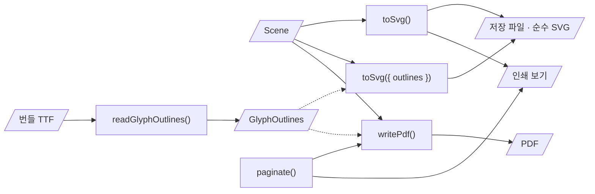

# ADR-0042: 내보내기는 한 장면에서: 자체 PDF 작성기, 번들 글꼴의 글리프 외곽선, 그림 지문

> [!info] 번호
> 2026-11-03 밤에 다섯 레인이 나란히 개발했습니다. 다른 레인도 0042를 받았을 수 있어, 합치는 사람이 번호를 다시 매깁니다.

## 배경

P1 요구사항 넷을 한 번에 구현합니다. 메인테이너가 "나의 선택이 필요한 부분은 일단 달님의 추천안을 수용하겠습니다"(2026-11-03)라고 해서, 구조의 선택을 Claude의 추천안으로 정하고 여기에 적습니다.

- 모델을 뺀 순수 SVG 내보내기([[01-requirements#^r-exp|R-EXP-02]])
- PDF 내보내기와 인쇄, 큰 다이어그램은 여러 페이지로([[01-requirements#^r-exp|R-EXP-03]])
- 다른 도구로 그림 부분만 고친 파일을 알아보고 알리기([[01-requirements#^r-fmt|R-FMT-09]])
- 텍스트를 외곽선(path)으로 저장하는 옵션([[01-requirements#^r-fmt|R-FMT-10]])

이미 정한 것: 저장되는 그림은 화면 그대로이고([[0018-save-as-shown|ADR-0018]]), 장면(`Scene`)을 거쳐 출력 단계만 바꿀 수 있으며([[0030-swappable-drawing|ADR-0030]]), 텍스트 폭은 번들 글꼴의 폭 테이블로 셉니다([[0026-bundled-font-metrics|ADR-0026]]). 번들 TTF와 서브세팅 wasm은 처음 저장할 때 내려받습니다([[0039-woff-subset-font|ADR-0039]]). 첫 방문의 내려받기는 212 KB(gzip) 안이어야 합니다(QA-09).

## 결정 기준

- 같은 모델이면 같은 바이트([[01-requirements#^r-fmt|R-FMT-03]]): 외곽선 파일과 PDF도
- 화면 · 저장 파일 · PNG · PDF · 인쇄가 같은 모습
- 첫 방문의 번들 크기를 거의 늘리지 않음. 무거운 것은 쓸 때 불러옴
- 거짓 경보가 없을 것: 앱이 저장한 그대로의 파일을 "고쳐졌다"고 하지 않음
- 제품에 들어가는 의존성을 늘리지 않음(라이선스 · 판 고정 → [[07-coding-guide#12. 의존성 추가]])

## 검토한 대안

### PDF를 만드는 법

- **A. jsPDF + svg2pdf.js:** 저장 파일의 SVG를 그대로 넣음. 압축해도 수백 KB이고 글꼴을 넣으려면 TTF 전체(1.3 MB)를 PDF에 넣거나 따로 서브세팅해야 함. 출력의 결정성을 라이브러리 판에 맡김.
- **B. pdf-lib:** 글꼴 서브세팅을 하지만 번들에 수백 KB(fontkit 포함), 그림은 우리가 그려야 함.
- **C. 브라우저의 "PDF로 저장"(인쇄 보기 + `window.print()`)만:** 코드가 가장 적음. 그러나 "PDF 내보내기" 명령이 아니고, 파일을 바로 받지 못하며, 브라우저마다 결과가 다름.
- **D. 장면에서 PDF를 직접 쓰는 작은 작성기(채택):** 장면의 요소는 다섯 가지(사각형, 꺾은선, 베지어 경로, 원, 텍스트)뿐이라 PDF 연산자로 바로 옮겨짐. 텍스트는 번들 글꼴의 글리프 외곽선을 글리프마다 폼 XObject로 한 번 두고 부름. 코드 약 400줄, gzip 3 KB(나중에 불러옴). 압축은 이미 쓰는 fflate(WOFF와 같은 설정).

### 텍스트 외곽선을 얻는 법

- **A. harfbuzzjs의 셰이핑 wasm(`glyphToPath`):** 이미 쓰는 패키지지만 서브세팅 wasm과 다른 wasm이 하나 더 필요(수백 KB).
- **B. 외곽선을 미리 뽑아 번들에 싣기:** 12,824자의 경로는 MB 단위.
- **C. 번들 TTF의 `glyf` 표를 TypeScript로 읽기(채택):** TTF는 저장을 위해 이미 내려받음. 읽기 코드는 gzip 2 KB이고(`fonts`의 `readGlyphOutlines`, 나중에 불러옴), 필요한 글자만 그때 읽어 둠. 순수 함수라 Node 테스트 · 골든 파일에도 같음.

### 그림이 고쳐졌는지 아는 법

- **A. 열 때 모델에서 다시 그려 파일의 그림과 비교(정규화 뒤):** 파일 형식을 바꾸지 않음. 그러나 렌더러가 바뀐 판(웹 1.0 전에는 자주)이 연 옛 파일을 모두 "고쳐졌다"고 함. 서브셋 글꼴의 바이트도 서브세터의 판에 따라 바뀜. 외곽선 파일은 비교하려면 TTF를 먼저 받아야 함.
- **B. 저장할 때 그림 부분의 지문을 모델 요소에 적고, 열 때 비교(채택):** "이 앱이 쓴 뒤로 누가 그림을 바꿨는가"를 정확히 답함. 렌더러의 판과 상관없음. 열 때 그리기 없이 SHA-256 한 번. 모델 요소에 속성 하나(`drawing-sha256`)를 더함.
- **C. 지문 없이 모양만 검사(요소 수 등):** 손으로 고친 색 · 글자를 놓침.

### 텍스트 외곽선 옵션의 자리

- **A. 내보내기의 선택지:** 저장 파일은 그대로. 그러나 R-FMT-10은 "저장"의 옵션이고, 저장 파일을 다른 뷰어(GitHub 등)에 둘 때가 필요한 곳.
- **B. 사용자 설정(환경 설정):** 같은 모델이라도 저장하는 사람에 따라 파일이 달라짐(R-FMT-03, [[0041-drawing-locale-in-document|ADR-0041]]이 피한 것).
- **C. 문서 설정(채택):** 파일과 함께 가고, 누가 저장해도 같은 파일. 화면 그대로 저장한다는 [[0018-save-as-shown|ADR-0018]]과도 맞음(모습은 같고 적는 방식만 다름).

## 결정

1. **한 장면, 출력 셋.** `core`의 장면을 `toSvg`(화면 · 저장), `toSvg(scene, { outlines })`(텍스트 외곽선), `writePdf`(PDF)가 각각 옮깁니다. 인쇄는 웹 셸이 장면의 SVG를 페이지로 잘라 인쇄 전용 보기에 넣습니다.
2. **PDF는 대안 D.** `@ariadne-nsd/core/pdf`(따로 된 진입점: 주 진입점에서 내보내면 번들러가 나중에 불러올 조각과 나누려고 첫 내려받기에 넣음)의 `writePdf`. PDF 1.4, 페이지마다 그 부분만 그림, 글리프는 폼 XObject, 스트림은 fflate(level 9, mem 8). 날짜를 넣지 않아 결정적입니다. 페이지 나누기는 `core`의 `paginate`(인쇄와 같음) → [[02-layout#5. 인쇄와 PDF의 페이지]]
3. **외곽선은 대안 C.** `fonts`의 `readGlyphOutlines(ttf)`(cmap 4 · 12, 단순 · 합성 글리프, 2차 곡선)가 읽고, `core`의 `placeGlyphs`가 advance대로 놓습니다(커닝 · 셰이핑 없음, 레이아웃의 폭과 같음). 굵은 글자는 브라우저의 합성 굵게와 같은 두께의 획을 더합니다. 번들 글꼴에 없는 문자가 든 줄은 SVG에서는 텍스트로 남기고, PDF에서는 빈 상자로 그립니다.
4. **그림 지문은 대안 B.** 모델 요소의 `drawing-sha256`에 순수 SVG(저장 파일에서 `<metadata>`만 뺀 것)의 SHA-256을 적습니다. 열 때 같은 텍스트를 만들어(LF로 바꾸고) 비교합니다. SHA-256은 `core`에 순수 TypeScript로 둡니다(동기, DOM · Node 없음). 지문이 없는 파일은 확인하지 않습니다.
5. **텍스트 외곽선은 문서 설정**(대안 C): 모델의 `settings.textOutlines`, 켰을 때만 파일에 적습니다.
6. **순수 SVG는 저장 파일에서 `<metadata>`만 뺀 것**(`assembleImageSvg`). 그래서 그림 지문이 가리키는 텍스트와 같습니다.

> [!note] 범례 (UML 액티비티 다이어그램에 가까운 flowchart)
> 사각형 = 처리(순수 함수), 평행사변형 = 데이터. 실선 = 주 데이터 흐름, 점선 = 보조 입력. `toSvg({ outlines })`는 문서 설정 `textOutlines`가 켜졌을 때의 저장입니다.

## 결과

- 좋아지는 점:
  - 첫 방문의 내려받기는 약 3.5 KB(gzip) 늘었습니다(185.5 KB / 212 KB). PDF 작성기(3 KB)와 글리프 읽기(1.7 KB)는 쓸 때 불러옵니다.
  - PDF · 외곽선 파일 · 순수 SVG가 모두 결정적이라 골든 파일로 지킵니다(`src/packages/core/golden/export/`, `text-outlines*.ns.svg`).
  - 그림 지문은 렌더러가 바뀌어도 옛 파일에 거짓 경보를 내지 않습니다.
- 감수하는 점:
  - PDF의 텍스트는 도형이라 선택 · 검색이 되지 않고, 번들 글꼴에 없는 문자(한자, 이모지)는 빈 상자입니다. 그런 문서는 인쇄 보기에서 브라우저의 "PDF로 저장"을 쓰면 대체 글꼴로 나옵니다.
  - 모든 저장 파일의 모델 요소에 속성이 하나 늘었습니다(형식 v1 안, 웹 1.0 전이라 버전을 올리지 않음 → [[dr-0018-release-stages|DR-0018]]).
  - 지문은 모양만 바꾼 저장(다른 도구가 줄 바꿈 말고 공백만 바꿈)도 "고쳐짐"으로 봅니다.
- 후속 작업:
  - PDF에 보이지 않는 텍스트 층(선택 · 검색용)을 더할지는 써 보고 정합니다.
  - 데스크톱 · Obsidian 셸의 인쇄와 PDF는 그 셸을 만들 때 같은 `paginate` · `writePdf`를 씁니다.
