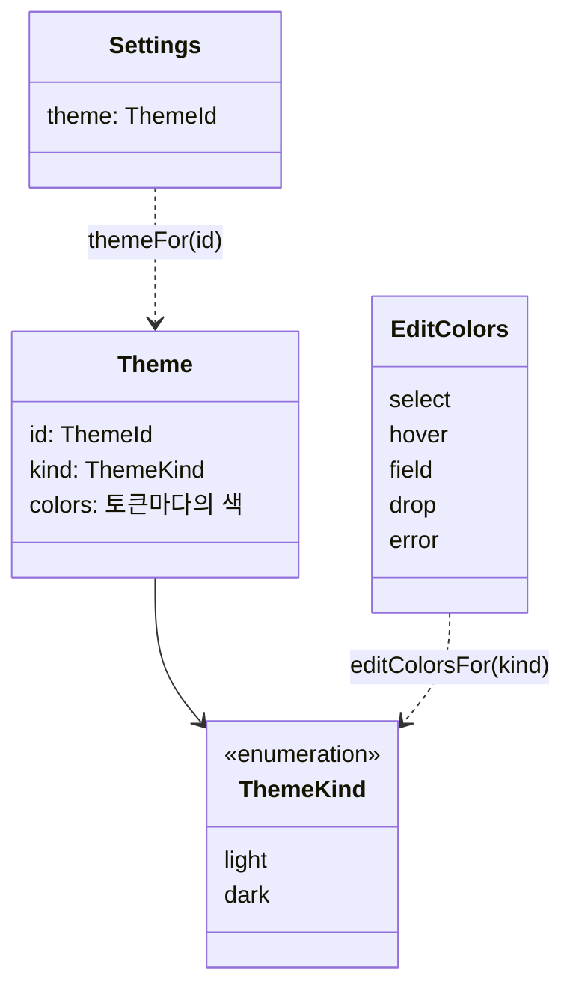

# ADR-0044: 문서에는 테마의 이름만 적고, 테마는 종이의 종류를 가진다

## 배경

테마([[01-requirements#^r-lay|R-LAY-08]])는 그림의 색 묶음이고, 문서마다 골라 파일에 저장한다. 고대비 화면([[01-requirements#^r-nfr|R-NFR-07]])도 그림 쪽은 테마 하나(고대비)로 한다 → [[ux-decisions#TM1. 테마는 넷 (밝은 · 어두운 · 고대비 · 흑백 인쇄)|TM1]], [[ux-decisions#TM5. 고대비는 화면 색과 테마로 나눈다|TM5]]

모델의 `settings.theme`은 처음부터 문자열(`ThemeId`)이었고, 파일 형식 v1은 `"default"` 하나만 썼다. 모르는 값은 기본 테마로 그리고 값은 그대로 두었다. 테마가 넷(`default` · `dark` · `high-contrast` · `print`)이 되면서 두 가지를 정해야 한다.

1. 파일에 테마를 무엇으로 적는가: 이름만, 아니면 색 값까지([[04-visual-design#12. 미결정 사항|시각 디자인의 미결정]]에 있던 물음). 다른 사람에게 없는 테마(뒤 버전의 테마)로 그린 문서를 열 때가 갈린다.
2. 편집 레이어(`editor`의 오버레이와 인라인 에디터)는 테마를 얼마나 알아야 하는가. 편집 레이어는 종이 위에 그리므로, 어두운 종이에서는 밝은 종이와 다른 색이 필요하다.

## 결정 기준

- 같은 모델이면 같은 파일([[01-requirements#^r-fmt|R-FMT-03]]). 테마를 바꿔도 레이아웃은 그대로(원칙 6)
- 저장되는 그림은 화면 그대로([[0018-save-as-shown|ADR-0018]]). 그림 부분은 이미 색 값을 담고 있다
- 테마를 고치거나 더할 때 바꾸는 곳이 적을 것. 색과 모양의 판단은 씬 빌드에만([[0030-swappable-drawing|ADR-0030]])
- 편집 레이어가 문서 레이어의 토큰에 매이지 않을 것(레이어 분리, [[04-visual-design#2. 레이어와 출력]])

## 검토한 대안

### 대안 A: 이름만 적는다

- 장점: 모델이 작고, 테마의 색을 고치면 다음 저장부터 모든 문서가 따라간다. 파일의 모델 부분이 테마의 색에 매이지 않는다.
- 단점: 모르는 이름의 문서는 다른 색(기본 테마)으로 보인다. 다만 그 파일의 저장된 그림 부분은 원래 색 그대로라 다른 뷰어에서는 원래 색이다.

### 대안 B: 이름과 색 값(토큰 → 값의 표)을 함께 적는다

- 장점: 어느 버전에서 열어도 같은 색으로 다시 그린다. 사용자 정의 테마로 이어지기 쉽다.
- 단점: 모델에 토큰 22개의 표가 늘고, 테마의 색을 고치면 옛 파일은 옛 색에 머문다. 토큰이 늘면(구문 강조의 토큰 등) 파일 형식이 함께 바뀐다.

### 대안 C: 편집 레이어가 테마마다의 색 표를 가진다

- 장점: 테마마다 가장 알맞은 선택 색을 고를 수 있다.
- 단점: 테마를 더할 때마다 `editor`도 고쳐야 한다. 테마 넷에 쓰이는 색은 밝은 종이용과 어두운 종이용 둘이면 충분하다(모두 3:1 이상, [[04-visual-design#3.4 화면 색]]).

## 결정

**파일에는 테마의 이름만 적는다(대안 A).** 모르는 이름은 기본 테마로 그리고, 이름은 그대로 두어 다시 저장해도 사라지지 않는다. `core`의 `isKnownTheme`이 아는 이름인지 알려 주고, 편집기는 아는 이름만 고르게 한다.

**테마는 종류(`kind: 'light' | 'dark'`)를 가진다. 편집 레이어는 테마의 토큰이 아니라 이 종류로 색을 고른다(대안 C가 아님).** `core`의 `Theme`은 `{ id, kind, colors }`이고, `editor`의 `editColorsFor(kind)`가 밝은 종이용 · 어두운 종이용 편집 색을 준다. 인라인 에디터의 바탕 · 글자 · 자리 표시 글자만 테마의 `paper` · `text.primary` · `text.muted`를 CSS 변수로 받는다. 종이 위에 텍스트를 적는 칸이라 종이와 같은 색이어야 하기 때문이다.

## 결과

- 좋아지는 점: 파일 형식은 바뀌지 않는다(`settings.theme`의 값이 늘 뿐). 테마를 더하는 일은 `core/src/render/theme.ts`에 표 하나와 `themes`에 한 줄이다. 대비 테스트가 `themes`를 모두 돌므로 새 테마도 바로 검사된다.
- 감수하는 점: 뒤 버전의 테마로 그린 문서를 앞 버전에서 고치면 기본 테마의 색으로 다시 저장된다(이름은 남는다). 테마마다 편집 색을 따로 둘 수 없다.
- 후속 작업: 사용자 정의 테마를 둔다면 그때 대안 B를 다시 본다([[04-visual-design#12. 미결정 사항]]).
