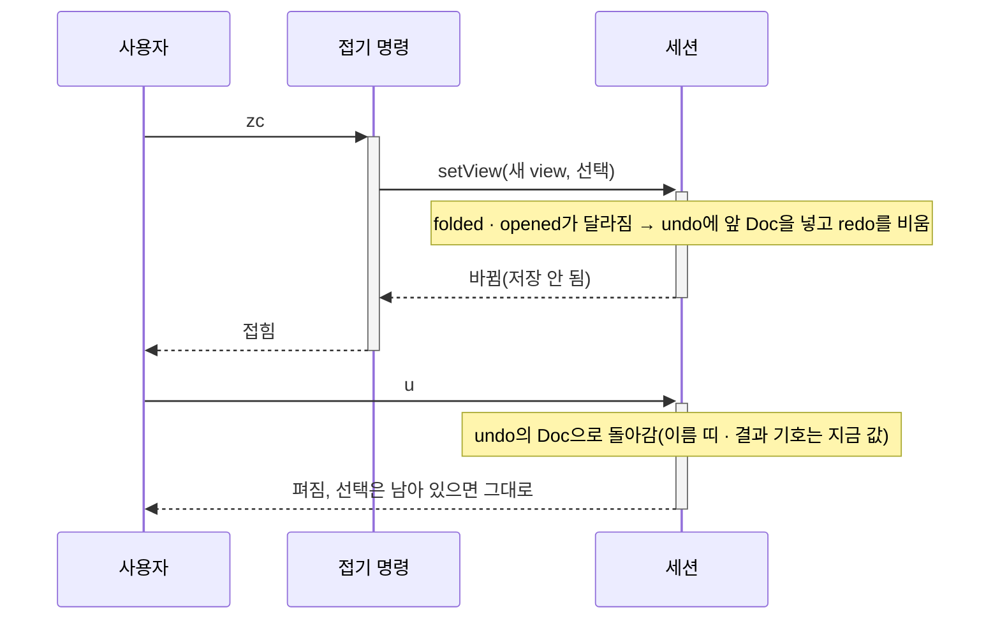

# ADR-0048: 접고 펴기도 실행 취소의 단계로 하고, undo 스택에는 내용과 접힘을 함께 저장한다

> [!NOTE] 이후 변경
> - 2026-11-28: 이름 띠 보기(`bands`)도 실행 취소의 대상으로 정했다. 되돌릴 때 지금 값을 두는 것은 없어졌다(코드에 반영) → [[ux-decisions#UN2. 이름 띠 보기도 실행 취소의 대상|UN2]]

## 배경

2026-10-13부터 실행 취소의 대상은 내용(`Content`)뿐이었다. 뷰 상태(`View`: 접힘 · 펴 보기 · 이름 띠 · 결과 기호)는 파일에 저장되지만 실행 취소의 대상이 아니었다([[0018-save-as-shown|ADR-0018]], 그때의 UX 결정 [[ux-decisions#Q9. 실행 취소의 대상 (R7)|Q9]]). 그래서 undo 스택(`editor`의 `EditorState.undo` · `redo`)은 `Content`의 스냅숏만 저장했다([[0029-immutable-document-undo|ADR-0029]]).

써 보니 접고 편 것은 그림을 크게 바꾸는데 실행 취소가 듣지 않았다(독립 검토도 "처음 읽는 눈에 놀라운 곳"으로 꼽았다). 펴 보인 호출 블록을 처음 펼 때 Method의 접기 영역을 복사하게 되면서([[0047-copy-method-folds-at-first-open|ADR-0047]]) 펴 보기의 일부(복사)만 실행 취소되는 어긋남도 생겼다: 실행 취소하면 복사한 접기 영역만 사라지고 호출 블록은 펴진 채로 남았다.

메인테이너(2026-11-21): "모두 접고 펴기를 대상으로 합시다". 접기 영역과 제어 블록의 안쪽(If · Case의 분기, 반복 블록의 본문), 호출 블록 펴 보기를, 펴 보인 곳과 그 밖 모두에서, 키(`f` · `zo` · `zc` · `za`), 펼침 삼각형의 클릭, 보기 메뉴 어느 것으로 접고 펴든 실행 취소의 대상으로 한다 → [[ux-decisions#UN1. 접고 펴기도 실행 취소의 대상|UN1]]

관련 요구사항: [[01-requirements#^r-edit|R-EDIT-02]], [[01-requirements#^r-edit|R-EDIT-13]], [[01-requirements#^r-edit|R-EDIT-15]], [[01-requirements#^r-fmt|R-FMT-11]].

## 결정 기준

- 실행 취소 한 번은 그 앞의 그림으로 정확히 돌아간다. 내용과 접힘이 서로 다른 때로 돌아가 섞이지 않는다.
- 모델과 파일의 구조를 바꾸지 않는다(`Doc = { content, view }` 그대로).
- 명령을 더할 때 실행 취소 때문에 더 구현할 것이 없다([[0029-immutable-document-undo|ADR-0029]]의 기준 그대로).
- 저장한 때의 모습으로 실행 취소해 돌아오면 저장 안 됨(●)이 꺼진다.
- 메인테이너가 정한 범위만 바꾼다: 이름 띠 보기와 결과 기호는 지금처럼 실행 취소의 대상이 아니다.

## 검토한 대안

### 대안 A: undo 스택에 `Doc`(내용 + 뷰 상태)의 스냅숏을 저장하고, 되돌릴 때 이름 띠와 결과 기호는 지금 값을 둔다

- 장점: 단계 하나가 "그때의 문서" 하나라 내용과 접힘이 늘 함께 돌아간다. 내용을 바꾸는 명령이 접힘도 함께 바꾸는 경우(새 접기 영역을 만들면 바로 접힘, 호출 블록을 처음 펴면 접기 영역을 복사함)가 저절로 한 단계다. 스냅숏은 불변 객체의 참조라 메모리가 거의 늘지 않는다. 저장한 `Doc` 객체로 돌아오면 같은 객체라 저장 안 됨 판정(`saved.content === doc.content && saved.view === doc.view`)이 그대로 듣는다.
- 단점: 내용을 바꾸는 명령을 실행 취소해도 그 명령 전의 접힘으로 돌아간다(명령 뒤에 접힘을 바꾸지 않았으면 같은 접힘이다).

### 대안 B: 접고 펴기만 별도의 "뷰 단계"로 스택에 넣는다(`{ kind: 'content' | 'view', … }`)

- 장점: 내용 단계는 지금과 똑같다.
- 단점: 두 종류를 오가는 경우(내용 단계 → 뷰 단계 → 내용 단계)의 되돌리기 순서와, 한 명령이 둘을 함께 바꾸는 경우(ADR-0047의 복사)를 따로 다뤄야 한다. 내용 단계를 되돌릴 때 접힘은 지금 것을 두므로 기준 1이 깨질 수 있다.

### 대안 C: 지금대로 둔다(접고 펴기는 대상이 아님)

- 메인테이너가 바꾸기로 정했다.

## 결정

**대안 A.** `EditorState.undo` · `redo`는 `Doc`의 스냅숏 목록이다(500단계까지, [[03-editor#2. 상태와 선택]]).

1. 접힘이나 펴 보기(`view.folded` · `view.opened`)를 바꾸는 일은 실행 취소 한 단계다. 세션의 `setView`가 바뀌기 전의 `Doc`을 undo에 넣고 redo를 비운다. 접힌 것과 펴 보인 것이 같으면(값 비교) 단계를 만들지 않는다.
2. 내용을 바꾸는 명령(`apply`)도 바뀌기 전의 `Doc`을 넣는다. 그래서 한 명령이 내용과 접힘을 함께 바꾸면 한 단계로 함께 돌아간다. 호출 블록을 처음 펼 때 접기 영역을 복사하는 것은 펴 보기와 한 단계다(ADR-0047의 "복사만 따로 한 단계"를 바꿈).
3. 실행 취소 · 다시 실행은 스냅숏의 내용과 접힘 · 펴 보기를 되돌리고, 이름 띠(`bands`)와 결과 기호(`resultSymbol`)는 지금 값을 둔다. 둘 다 지금 값과 같으면 스냅숏 객체를 그대로 쓴다.
4. 저장 안 됨(●)은 지금처럼 뷰 상태가 바뀌어도 켜진다. 실행 취소로 저장한 때의 `Doc`에 돌아오면 꺼진다.
5. 보기 모드(읽기 전용)에서 접고 펴는 것은 단계를 만들지 않고 저장 안 됨도 바꾸지 않는다(지금 그대로). 실행 취소도 보기 모드에서는 거절된다.
6. 명령 하나가 한 단계다. 잇달아 접고 펴도 합치지 않는다.

## 결과

- 좋아지는 점: 접고 편 것도 `u` · `Ctrl`+`Z`로 돌아간다. 실행 취소 한 번이 늘 그 앞의 그림이다. 새 접기 영역을 만들고 실행 취소하면 영역이 사라지면서 펴진 그림으로 돌아온다. 펴 보기와 그 복사가 한 단계라, 실행 취소하면 호출 블록이 접히고 복사한 접기 영역도 사라진다.
- 감수하는 점: 살펴보느라 많이 접고 편 뒤에 편집한 것을 되돌리려면 실행 취소를 여러 번 해야 한다(Q9가 처음에 피하려던 것). 500단계 한도가 접고 펴기로도 찬다.
- 후속 작업: 모두 접기 · 모두 펴기([[01-requirements#^r-edit|R-EDIT-17]], 아직 없음)를 만들면 명령 하나가 한 단계다.

UML 시퀀스 다이어그램: 접기 명령이 한 단계를 만들고, 실행 취소가 그것을 되돌린다. 실선 화살표는 호출, 점선 화살표는 반환, 세로 막대는 실행 중(activation)이다.

