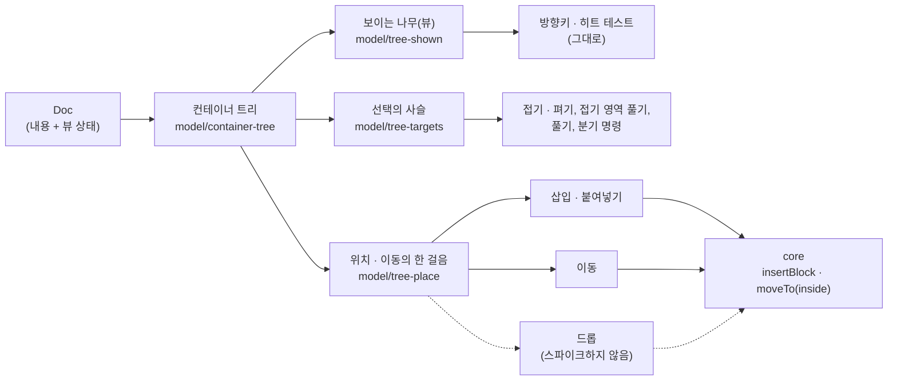

# 컨테이너 트리 스파이크

> [!abstract] 이 문서는
> [[interaction-abstraction-review#5.2 단계]]의 1단계와 1′(컨테이너 트리, 대상 해석, 삽입 위치, 이동 명령을 `moveTo`로)을 실제 코드로 확인한 결과다. 물음은 셋이다: 조작 규칙의 개념 하나에 구성 요소 하나로 코드를 다시 짤 수 있는가, 비용은 얼마인가, 위험은 무엇인가.
> - 브랜치 `claude/spike-container-tree-ca300b`(main `efd1a07`, 0.6.5를 merge한 상태). 코드는 이 브랜치에만 있다.
> - 방법: 새 구조를 기존 코드 옆에 두고, 기존 구현을 기준(oracle)으로 결과를 견주는 차등 테스트(T-1750 ~ T-1755)를 임의 문서와 임의 명령으로 실행했다. 이동 명령 하나는 실제로 새 경로로 바꿔 기존 테스트 전체를 실행했다.
> - 결정은 [[0054-command-target-resolution|ADR-0054]]에 있다(2026-11-28, 메인테이너가 승인). 스파이크 코드는 문서만 merge하고 브랜치에 둔다(메인테이너).
> - 승인 뒤에 검증을 한 번 더 해서 3.1의 결함 D-가의 재현 조건을 바로잡고 D-다를 추가했다(2026-11-28). 결론과 ADR의 결정은 그대로다.

## 1. 결론

1. **다시 짤 수 있다.** 컨테이너 트리 하나에서 방향키의 보이는 나무, 접기 · 펴기의 대상, 풀기의 대상, 분기 명령의 대상, 이동의 목적지, 삽입 위치가 모두 계산되고, 결과가 기존 구현과 같다(아래 2장). 펴 보인 호출 블록 안(두 겹 포함)과 이름 띠를 끈 상태를 포함한다.
2. **1′의 가설이 확인됐다.** 이동 명령(위 · 아래)은 `editor`가 트리에서 한 걸음의 목적지를 구하고 core의 `moveTo`가 실행하는 것으로 충분하다. core `move`의 접기 영역 경로(`stepOutOfFold` · `swapWithNeighbour` · `stepOutOfHidden`)와 인자 `hiddenFolds`는 필요 없다. 실제 명령을 이 경로로 바꾼 상태에서 `editor` 1386개 · core 544개 테스트가 통과한다(main `efd1a07` 기준, 표 대조 테스트 T-1700 ~ T-1721 포함).
3. **삽입 위치는 값 하나다.** 지금 core에 있는 다섯 가지 표현(`Range.join`, `Range.keepOut`, 인자 `outsideFolds` · `outsideFold`, `Target`의 종류)은 "어느 블록의 어느 쪽, 그리고 그 블록을 받는 가장 안쪽 접기 영역"(`inside`) 하나로 표현된다. 이것은 컨테이너 트리의 위치(컨테이너와 그 안의 순서)를 core에 전달하는 타입이다.
4. **비용은 중간이고, 위험이 큰 곳은 드롭 하나다.** 스파이크의 새 코드는 약 1,030줄(`editor` 4개 파일 880줄, core 150줄)이고, 대체되는 기존 코드는 약 1,050줄이다(4장). 드롭의 구역 판정과 명령의 표(`when` · 컨텍스트 메뉴 · 알림의 생성)는 스파이크하지 않았다.
5. **추상화가 지금의 main에 있는 결함 셋과 규칙이 다른 칸 둘을 드러냈다**(3장). 결함은 1단계와 관계없이 고칠 수 있다.

## 2. 확인한 것

| 가설 | 방법 | 결과 | 테스트 |
| --- | --- | --- | --- |
| 이동(위 · 아래)의 한 걸음을 트리에서 구해 `moveTo`로 실행하면 core `move`와 같다 | 임의 문서 300개 × 대상 30개, 이름 띠 켬 · 끔, 접힌 영역 임의 | 화면에 보이는 선택에서는 모두 같음(이동 5,905 · 영역에서 나오기 64 · 거절 311). 접힌 영역 안에 숨은 선택(D-다) 2,720건에서는 7건이 다르고, 그 가운데 3건은 core `move`가 불변식 5를 위반한다. 새 경로는 모든 경우에 불변식을 지킨다 | T-1750 |
| 같은 것을 앱의 엔진이 도달하는 상태에서 | 시드 6개 × (임의 명령 1,500개 + 펴 보인 호출 블록 안으로 가는 걸음 300개): 이동 · 접기 · 펴 보기 · 접기 영역 만들기 · 삽입 · 감싸기 · 풀기 · 삭제 · 실행 취소 | 모두 같음. 이동 비교 약 15,000회, 그 가운데 이름 띠를 끈 상태 약 8,500회 | T-1752 |
| 접기 · 펴기의 대상(`foldTargets`: `outward` · `peekOutward`와 그 쌍 다섯)이 선택의 사슬 하나에서 나온다 | 같은 걸음의 모든 상태(10,800개)에서 대상 목록 전체를 비교 | 모두 같음. 대상이 있는 상태 약 5,400개, 그 가운데 펴 보인 곳 약 300개(호출 경로가 두 겹인 곳 약 30개, 호출 자리의 접기 영역을 선택한 곳 약 80개) | T-1752 |
| 풀기의 대상(`unwrapHolder`), 분기 명령의 대상(`branchOfSelection`)이 같은 사슬에서 나온다 | 위와 같음 | 모두 같음 | T-1752 |
| 방향키의 보이는 나무가 컨테이너 트리의 뷰다 | 트리에서 만든 `ShownIndex`를 세션의 것과 비교(내용, `meanings`, `hiddenBy`, `opened`) | 10,800개 상태에서 모두 같음 | T-1752 |
| 키보드 삽입의 위치(블록 곁, [[ux-decisions#MD1. 접기 영역의 끝에 넣은 블록\|MD1]])가 트리의 위치와 같다 | 임의 문서 200개 × 20회 | 모두 같음 | T-1751 |
| 드롭이 "밖"을 전달하는 세 방법(접기 영역 곁 `outsideFold`, 본문의 맨 앞 · 맨 끝 `outsideFolds`, 영역 안쪽의 끝)이 위치 하나다 | 임의 문서 150개의 모든 접기 영역 · 다이어그램 | 모두 같음 | T-1753 |
| 성능: 트리를 문서가 바뀔 때마다 만들 수 있다 | 블록 500개 · 접기 영역 66개, 200회 평균(다른 세션이 실행 중인 상태) | 트리 2.9ms, 트리에서 보이는 나무 1.1ms, 사슬 0.03ms. 기존 보이는 나무는 3.0ms | 측정만 |

확인하지 않은 것:

- 드롭의 구역 판정(`findDrop`)을 트리 위에서 다시 구현하지 않았다. 확인한 것은 "드롭이 만드는 결과가 위치 하나로 표현된다"까지다.
- 명령의 표(표 2에서 `when` · 컨텍스트 메뉴 · "어디에 적용했는지"의 알림을 생성)는 구현하지 않았다. 사슬(`chainOf`)이 그 입력이 된다는 것까지 확인했다.
- 복사 · 삭제 · 감싸기 · 새 Method로 빼기는 바꾸지 않았다. 이 명령들은 상위로 올라가지 않으므로 사슬의 맨 앞만 쓴다.

## 3. 스파이크가 드러낸 것

### 3.1 결함

셋 모두 지금의 main에서 재현된다. 재현은 앱의 엔진(세션 · 명령 레지스트리, DOM 없음)에서 했고, D-가는 레이아웃 → `findDrop` → `runDrop`의 실제 드롭 경로로 했다.

| # | 무엇 | 재현 | 처리 |
| --- | --- | --- | --- |
| D-가 | **안쪽 접기 영역의 곁에 같은 줄의 블록을 드롭하면 접기 영역 하나가 제거될 수 있다.** `moveTo`가 "빼기 → 넣기" 두 단계라, 중간 상태에서 바깥 영역의 범위가 안쪽 영역과 같아지면 불변식 5의 정리(`cleanFolds`)가 둘 가운데 하나를 제거한다 | 접기 영역 f1 = b1 ~ b3, 그 안에 f2 = b1. b2 · b3을 선택해 f2의 이름 띠에 드롭한다(f2의 앞, f2의 밖). 기대: 순서 b2 b3 b1, f1은 셋 모두, f2는 b1. 실제: 접기 영역 배열에서 뒤에 있는 것이 제거된다(f2가 없어지거나, f1이 없어지고 b2 · b3이 어느 영역에도 속하지 않는다) | 결함. 같은 줄 안의 이동을 한 번에 계산하면 해결된다(`moveWithin`, T-1755가 지금의 동작과 고친 동작을 함께 기록). 드롭이 위치를 전달하는 묶음 1-6에서 해결되고, 그 전에 고치려면 core `moveTo`가 기존 인자를 `inside`로 변환해 한 번에 계산한다 |
| D-나 | **접기 영역 풀기가 선택한 것 안쪽의 영역을 푼다.** 본문 전체가 접기 영역 하나인 반복 블록을 선택했거나 블록 전체가 접기 영역 하나인 분기의 라벨을 선택했을 때, 그것을 포함하는 영역이 아니라 안쪽의 그 영역이 풀린다. 표 1 · 표 2와 매트릭스는 "그것을 포함하는 가장 작은 접기 영역"이다. `regionToRemove`가 접기 대상의 목록(본문 전체가 영역이면 그 영역을 접는다)을 재사용해서 생긴다 | f1 = b1 ~ b2(b2는 While), While의 본문 전체가 f2. b2를 선택하고 접기 영역 풀기 → f2가 풀린다. If의 분기 r1 전체가 f2이고 If가 f1 안에 있을 때 r1의 라벨에서도 f2가 풀린다 | 규칙의 표와 앱이 다른 칸. 사슬에서는 "선택한 것을 포함하는 접기 영역"만 나오므로 1-4에서 표대로 된다. 지금의 동작이 맞다면 표를 고친다 |
| D-다 | **실행 취소가 접힘을 되돌리면 접힌 접기 영역 안의 블록이 선택된 채로 남고, 화면에 보이지 않는 그 블록에 명령이 적용된다.** 이름 띠를 끈 상태에서 그 블록이 제어 블록의 본문 끝에 있고, 그 제어 블록이 접힌 영역의 끝이면서 그것을 포함하는 펴진 영역의 끝이면, 이동 명령이 "내부 오류"가 된다(core `move`가 접힌 영역만 넓혀 두 영역이 교차한다. 문서는 유지된다) | f1 = b1 ~ b3, f2 = b2 ~ b3, b3은 While(본문 b4 · b5). f2를 접고 → 다시 펴고 → b5를 선택하고 → 실행 취소(f2가 다시 접힘, 선택은 b5) → 이름 띠 끄기 → 아래로 이동 → "내부 오류". 접힌 영역이 하나뿐일 때는 오류 없이 보이지 않는 블록이 영역 안에서 이동한다 | 결함 후보(원칙 ② "보이지 않는 요소는 조작에 영향을 주지 않는다"). 실행 취소 · 다시 하기와 뷰 상태 변경 뒤에, 접힌 것 안에 숨은 선택을 그 접힌 칸이나 접힌 줄의 선택으로 바꾸면 해결된다. 내부 오류는 새 이동 경로(1-3)에서도 없어진다 |

D-가에서 b2 · b3을 b1의 위쪽 띠(영역 안의 맨 앞)에 드롭했을 때 영역 하나가 없어지는 것은 결함이 아니다. 그 위치는 f2의 안이라([[ux-decisions#MD1. 접기 영역의 끝에 넣은 블록|MD1]]) f2와 f1의 범위가 같아지고, 불변식 5가 범위가 같은 영역 둘을 허용하지 않는다.

### 3.2 규칙이 다른 칸

트리로 표현하면 한 규칙인데 진입점이나 명령에 따라 지금 다르게 동작하는 칸이다. [[interaction-abstraction-review#6. 추상화가 드러낸 칸]]의 U10 · U11로 추가했다. 1단계는 지금의 동작을 유지한 채로 진행할 수 있고(위치의 타입이 둘 다 표현한다), 정하면 한 곳을 고친다.

| # | 칸 | 지금 | 트리의 규칙 |
| --- | --- | --- | --- |
| U10 | 접기 영역(이름 띠 · 접힌 칸)을 선택하고 삽입 · 붙여넣기. 그 영역과 그것을 포함하는 영역의 끝이 같을 때 | 키보드: 포함하는 영역의 밖에도 놓인다. 드롭(그 영역의 아래쪽 가장자리 · 접힌 칸의 아래 반): 포함하는 영역의 안에 놓인다. 둘 다 메인테이너가 이 경우를 정한 것이 아니다: 키보드는 [[ux-decisions#MD1. 접기 영역의 끝에 넣은 블록\|MD1]]의 구현에서, 드롭은 [[ux-decisions#DF1. 접기 영역 곁에 놓기\|DF1]]을 구현할 때 에이전트가 정했다(DF1에 "확인받지 않음"으로 기록) | T1 "대표 요소의 곁은 그 컨테이너의 밖"이면 그 영역의 밖이고, 그 영역을 포함하는 영역의 안이다(드롭과 같음) |
| U11 | 이름 띠를 끈 상태에서, 보이지 않는 접기 영역의 끝 블록 곁에 놓기 | 삽입 · 붙여넣기 · 드롭: 그 영역에 포함된다(MD1). 이동: 포함되지 않는다([[ux-decisions#FM1. 이름 띠를 끈 접기 영역에서의 이동\|FM1]], "끝을 지나면 나온다") | T4 "보이지 않는 컨테이너는 없는 것과 같다"는 포함 여부를 정하지 않는다. 한 규칙으로 정할 수 있다 |

U10은 키보드와 드롭을, U11은 삽입과 이동을 앱의 엔진에서 확인했다(U11의 드롭은 블록의 위 · 아래 띠에 놓는 것이라 삽입과 같은 core 호출이다). T-1754가 U10의 범위를 정확히 기록한다: 키보드 삽입과 트리의 위치가 다른 경우는 "포함하는 영역이 같은 끝을 공유할 때"뿐이다.

## 4. 설계와 비용

### 4.1 구성

범례: 상자는 구성 요소, 실선 화살표는 "왼쪽을 입력으로 오른쪽을 계산한다 · 호출한다"이고 스파이크로 확인한 것이다. 점선 화살표는 설계만 하고 확인하지 않은 것이다.

- **컨테이너 트리**(`ContainerNode`): 노드는 다이어그램, 블록, 분기, 접기 영역 넷이다. 반복 블록 · 분기 · 다이어그램 · 펴 보인 호출 블록은 줄을 가진 노드이고, 접기 영역은 그 안에 중첩된 노드다. 노드는 모델의 id와 화면 id, 호출 경로, 줄 안의 범위, `isShown`(이름 띠를 끈 펴진 접기 영역은 `false`), `isFolded`, `isReadOnly`, `isSite`, `isOpened`를 가진다. core의 `shownItems`를 "모든 영역을 항목으로" 호출해 만들므로 레이아웃과 같은 구조를 본다. 트리는 지금의 보이는 나무와 같은 위치(`editor`의 `model/`)에 둔다. 대표 요소 · 읽기 전용 · 보이는지는 조작 규칙의 개념이고, core의 공개 API가 늘지 않으며, 보이는 나무를 그 자리에서 교체할 수 있다. core의 `layout/shown.ts`에 두면 레이아웃과 순회 한 번을 공유하지만 줄어드는 시간은 블록 500개에서 3ms다.
- **보이는 나무**: 트리에서 `isShown`이 `false`인 영역을 건너뛰고 접힌 것을 블록 하나로 변환한 뷰다. `navigate`와 히트 테스트는 수정하지 않는다.
- **선택의 사슬**(`chainOf`): 조작 규칙의 표 1이다. 선택한 것과 그것을 포함하는 컨테이너를 가까운 것부터 반환한다(`range` · `block` · `region` · `body` · `call` · `diagram`). 명령은 받는 종류의 첫 항목을 대상으로 한다. 펴 보인 곳에서도 같은 함수다(펴 보기용 사본이 없다).
- **위치**(`Place`): `{ to, side, inside }`. `inside`는 놓인 블록을 포함하는 가장 안쪽 접기 영역이고, 그것을 포함하는 영역은 함께 넓어지며 그 안쪽 · 옆의 영역은 넓어지지 않는다. 블록 사이에 놓이면 그 사이를 포함하는 영역은 `inside`와 관계없이 포함한다. 접기 영역의 중첩에서 "컨테이너와 그 안의 순서"로 지정할 수 있는 위치는 모두 이 세 값으로 표현된다. "빈 블록은 교체"는 위치가 아니라 명령의 성질이라 따로 전달한다(`besideEmpty`).
- **이동의 한 걸음**(`moveStep`): 옮기는 블록을 포함하는 가장 가까운 "보이는" 컨테이너 안에서 (1) 옆 항목이 있으면 그것을 지나고(블록 하나, 보이는 영역은 통째로) (2) 보이는 영역의 끝이면 그 영역의 밖으로 (3) 본문 · 분기의 끝이면 그 블록의 밖으로 (4) 다이어그램의 끝이면 거절한다. FM1(보이지 않는 영역은 블록 사이에 있는 동안만 포함)은 `inside`에 보이는 컨테이너를 지정하는 것만으로 성립한다.

### 4.2 줄 수

| 새 코드(스파이크) | 줄 | 대체되는 기존 코드 | 줄 |
| --- | --- | --- | --- |
| `model/container-tree.ts` | 294 | `model/shown-index.ts`(만드는 부분) | 약 180 |
| `model/tree-shown.ts` | 145 | | |
| `model/tree-targets.ts`(사슬, 접기 대상, 풀기 · 분기의 대상) | 302 | `fold-commands.ts`의 대상 계산(`outward` · `peekOutward` · `wholeRegion` · `wholeRegionAt` · `siteRangesAt` · `bodyTarget` · `regionPlace` · `peekTargets` 등), `unwrapHolder`, `branchAround` | 약 420 |
| `model/tree-place.ts`(위치, 이동의 한 걸음) | 138 | core `move.ts`의 위 · 아래 경로, `permute`, `shrinkCrossing`, `hiddenFolds`, `keepingOut` · `foldsWithin`, `join` · `keepOut` · `outsideFolds` · `outsideFold` | 약 250 |
| core `moveWithin` · `insertInside` · `inside` 인자 | 약 150 | (드롭을 옮기면) `drop.ts`의 접기 영역 · 펴 보인 호출 블록 가장자리의 대상 계산 | 약 200(추정) |
| 합 | 약 1,030 | 합 | 약 1,050 |

줄 수는 비슷하다. 달라지는 것은 구조다: 상위 컨테이너를 찾는 구현 4개가 1개, 펴 보인 곳을 위한 사본 다섯 쌍이 0, "보이지 않는 요소"의 구현 4개가 1개(`isShown`), core의 편집 명령이 뷰 상태에서 나온 인자(`hiddenFolds`)를 받지 않는다.

### 4.3 확인하지 않은 두 묶음의 출발점

스파이크에서 드러난 것만 기록한다. 타입은 그 묶음을 시작할 때의 스파이크로 정한다(ADR-0054의 미결정).

- **명령의 표(1-7).** 표 2의 한 줄은 "사슬의 항목을 받아 그 명령의 대상으로 바꾸는 함수"와 "상위로 올라가는가"다. 접기 · 펴기, 풀기, 분기 명령의 대상은 이미 이 모양으로 구현했다(`foldTargetsOf` · `unwrapHolderOf` · `branchOf`). `when`은 "대상이 있는가", "어디에 적용했는지"의 알림(U7)은 "대상이 선택한 것이 아닌가"에서 나온다. 타입이 구분해야 하는 것 셋이 드러났다.
	- 사슬의 항목이 선택한 것인지, 포함하는 것인지. 빈 default 칸은 표 1에서 사슬의 첫 항목이 그 Case인데 선택한 것은 아니다. 올라가지 않는 명령(복사 · 감싸기)은 거절하고, 올라가는 명령(풀기 · 접기)은 그 Case를 받는다.
	- 읽기 전용인 항목을 받는지는 명령마다 다르다(C5). 차등 테스트가 검출했다: 펴 보인 곳의 접기 영역을 선택했을 때 분기 명령이 펴 보인 분기를 대상으로 받았다.
	- "본문 전체가 접기 영역 하나이면 그 영역이 본문을 대신한다"는 접기 · 펴기만의 규칙이다. 접기 영역 풀기가 이것을 공유해서 D-나가 생겼다.
- **드롭(1-6).** 구역 판정의 결과를 "노드와 구역"으로 반환하면 위치는 삽입과 같은 함수에서 나온다. 블록의 위 · 아래 띠는 그 블록의 곁, 대표 요소(이름 띠 · 접힌 칸 · 펴 보인 호출 블록의 띠)의 앞 · 뒤는 그 컨테이너의 곁, 컨테이너의 아래 가장자리는 밖 8px이 컨테이너의 곁이고 안 8px이 컨테이너 안의 끝, 헤더 아래와 본문 아래는 다이어그램 안의 맨 앞과 맨 끝이다. 이 넷이 지금의 `outsideFold` · `outsideFolds` · 안쪽의 끝과 같은 결과를 내는 것은 확인했다(T-1753). 분기 라벨 위는 [[ux-decisions#BL5. 분기 라벨 위에 놓기|BL5]]대로 그 분기다(대표 요소).

## 5. 위험

| 위험 | 크기 | 대응 |
| --- | --- | --- |
| 접기 영역이 얽힌 경우의 회귀(영역의 끝, 중첩된 영역, 영역의 경계에 걸친 선택 범위) | 중간 | 스파이크에서 실제로 차이 넷을 차등 테스트가 검출했다: 빈 블록 곁으로 옮길 때의 교체, 두 단계 이동의 중간 상태에서 영역 제거(D-가와 같은 원인), 접힌 영역 안에 숨은 선택에서의 차이(D-다), 펴 보인 곳에서 분기 명령의 대상. 묶음마다 기존 구현을 기준으로 견준 뒤 기존 구현을 제거한다 |
| 접힌 영역 안에 숨은 선택(D-다)에서 새 이동 경로와 기존 경로의 결과가 다르다 | 작음 | 화면에 보이는 선택에서는 차이가 없다. 숨은 선택에서 기존 경로는 불변식을 위반하거나, 영역에서 나온 블록을 보이지 않는 영역의 끝에 한 걸음 더 남긴다(FM1의 문장과 다름). 새 경로는 FM1대로다. D-다를 먼저 고치면 이 상태가 없어진다 |
| 드롭의 구역 판정 이전(레이아웃의 상자 → 트리의 노드 + 구역) | 큼 | 마지막 묶음으로 둔다. 표 대조 테스트(T-1700 ~ T-1721)와 `drop-ends` · `drop-folds` 테스트가 안전망이다. 드롭의 대상(`DropAction`)을 `Place`로 바꾸는 것과 구역 판정을 옮기는 것을 두 걸음으로 나눈다 |
| core `move`의 테스트 12개(T-0156 ~ T-0163, T-1638 ~ T-1641)의 위치 | 작음 | 규칙이 `editor`로 가므로 테스트도 `editor`의 이동 테스트로 옮긴다. Node에서 실행되는 순수 함수라 테스트의 종류는 같다 |
| 명령의 표의 모양(표 2에서 `when` · 메뉴 · 알림을 생성) | 중간 | 확인하지 않았다. 접기 · 풀기 두 명령부터 표로 기술해 모양을 정한 뒤 넓힌다(4.3) |
| 접기 영역 배열의 순서가 달라진다(이동한 영역이 뒤로) | 작음 | 동작은 같고 파일의 순서만 다르다. 테스트는 순서를 정렬해 비교했다. 순서를 유지하도록 구현할 수 있다 |
| 문서가 바뀔 때마다 트리와 보이는 나무를 만든다 | 작음 | 블록 500개에서 합 4ms. 세션이 지금 보이는 나무를 보관하는 방식 그대로 보관한다 |

## 6. 단계와 순서

BL3 · BL4 · UN3, 표 대조 테스트, BL5 · NP1은 main에 들어왔고(2026-11-28, 0.6.5), 이 브랜치는 그 main을 merge한 상태에서 통과한다. 그래서 아래 순서는 바로 시작할 수 있다. 묶음 하나가 커밋 하나 이상이고, 묶음마다 동작이 같다.

| 묶음 | 내용 | 크기 | 스파이크 |
| --- | --- | --- | --- |
| 1-1 | core: `inside`(위치 하나)와 `moveWithin`. `moveTo`가 기존 인자를 `inside`로 변환해 같은 줄 안의 이동을 한 번에 계산하면 D-가가 여기서 해결된다 | 작음 | `inside`를 준 경우의 코드 있음. 기존 인자의 변환은 없음 |
| 1-2 | `editor`: 컨테이너 트리. 보이는 나무를 그 뷰로 교체(`shownIndexOf` 제거). 방향키 · 히트 테스트는 그대로 | 작음 | 코드 있음 |
| 1-3 | 이동: `moveStep` → `moveTo`. core `move`의 위 · 아래 경로, `hiddenFolds`, `permute`, `shrinkCrossing` 제거. 테스트를 `editor`로 이동 | 중간 | 코드 있음(명령 교체까지) |
| 1-4 | 대상 해석: 사슬에서 접기 · 펴기, 접기 영역 풀기(D-나), 풀기, 분기 명령, 좌우 이동의 대상. "어디에 적용했는지"의 알림(U7)을 사슬의 항목에서 생성 | 중간 | 대상 계산의 코드 있음. 알림은 없음 |
| 1-5 | 삽입 · 붙여넣기 · 호출 블록 삽입: `placeBeside`. core의 `join` · `keepOut` · `outsideFolds` · `outsideFold` 제거. U10 · U11을 정했으면 여기서 반영 | 중간 | 블록 곁 · 영역 곁 · 선택 없음의 코드 있음 |
| 1-6 | 드롭: `DropAction`을 `Place`로, 실행을 명령 레지스트리로. 그 뒤 구역 판정을 트리의 노드로 | 큼 | 없음(출발점은 4.3) |
| 1-7 | 명령의 표: 표 2를 명령마다 기술하고 `when` · 컨텍스트 메뉴(U8)를 생성. 복사 · 삭제 · 감싸기 · 새 Method로 빼기 | 중간 | 없음(출발점은 4.3) |

1-1 ~ 1-3은 스파이크 코드를 정리해 그대로 옮길 수 있다. 1-6 · 1-7은 시작할 때 작은 스파이크를 한 번 더 한다. D-다(숨은 선택)는 1단계와 별개인 세션의 수정이고, 1-3보다 먼저 하면 이동의 차등 비교에서 예외가 없어진다.

## 7. 스파이크 코드

브랜치 `claude/spike-container-tree-ca300b`: 커밋 `7a09c01`(코드), `165fe18`(차등 테스트 보강), main의 merge `6ec712f`.

- `src/packages/editor/src/model/`: `container-tree.ts`, `tree-shown.ts`, `tree-targets.ts`, `tree-place.ts`, 테스트 `tree-place.test.ts`(T-1750 · T-1751 · T-1753 ~ T-1755), `tree-targets.test.ts`(T-1752), `tree-test-support.ts`
- `src/packages/core/src/commands/`: `seq-edit.ts`(`insertInside` · `moveWithin`), `insert.ts` · `move-to.ts` · `common.ts`(`inside`, `besideEmpty`)
- `src/packages/editor/src/commands/cursor-commands.ts`: `edit.move.up` · `edit.move.down`이 새 경로를 쓴다

테스트 목록(`pnpm test-list`)과 설계 문서는 맞추지 않았다. 차등 테스트는 기존 구현이 있는 동안만 의미가 있으므로, 묶음을 옮길 때 "기존 구현과 같다"를 확인한 뒤 규칙의 테스트(표 대조 테스트와 기존 이동 · 접기 테스트)로 대체한다.
