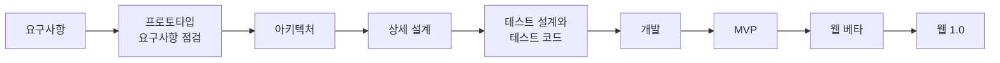
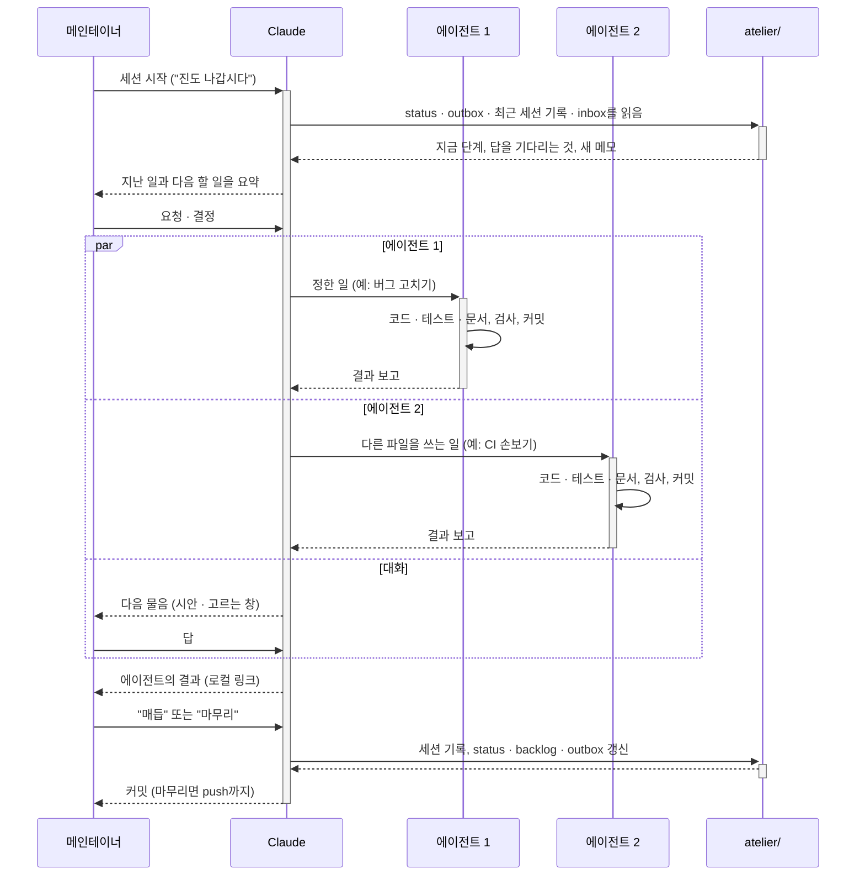
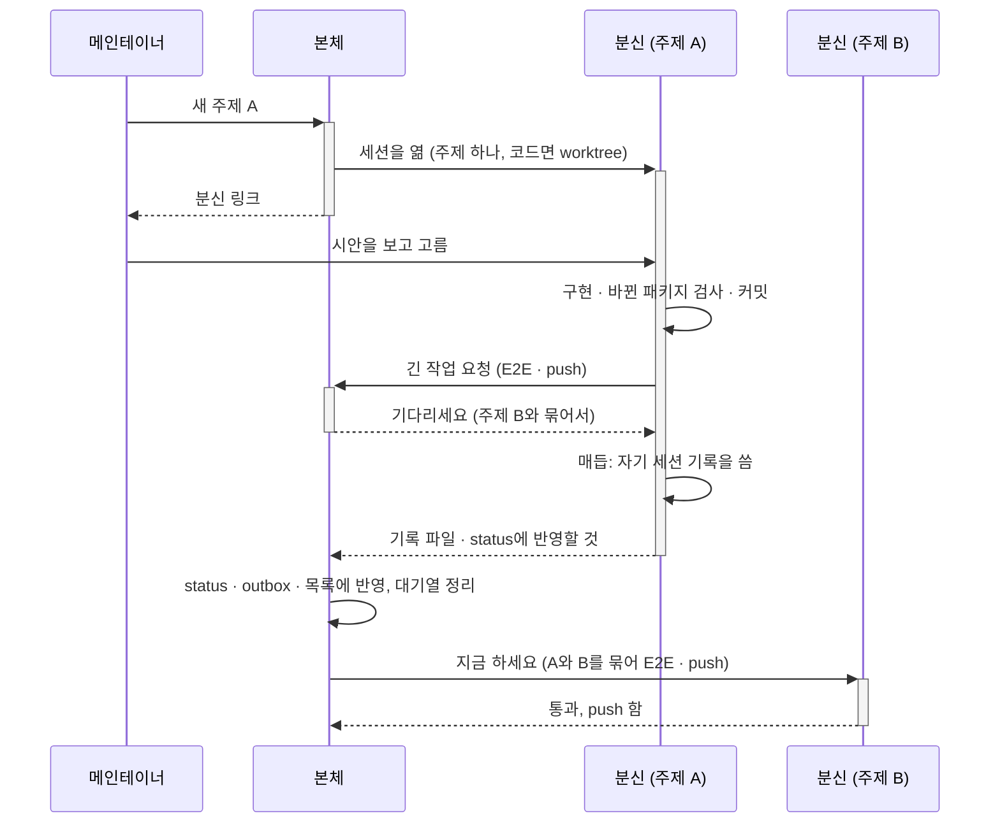
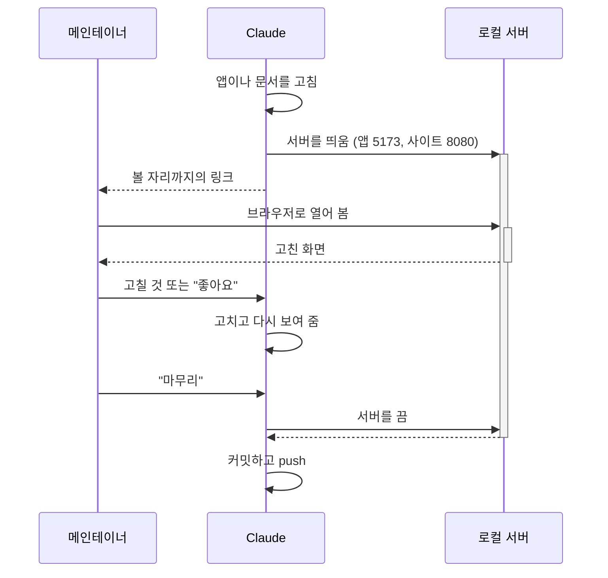

# 일하는 방식

> [!abstract] 이 문서는
> AriadneNSD를 **어떻게 만들고 있는지**를 한곳에서 보여 줍니다. 만드는 사람은 둘입니다. 메인테이너(백엔드 개발자, 프론트엔드는 처음)와 Claude(Claude Code)입니다. 메인테이너가 무엇을 만들지 정하고 확인하며, Claude가 설계 · 코드 · 테스트 · 문서를 씁니다.
> - 규칙 하나하나의 원본은 그 규칙이 사는 문서입니다(아래의 링크). 이 문서는 흐름을 보여 주고 원본을 가리킵니다. 단, [[#7. 올리기 전에 로컬에서 보기]]는 이 문서가 원본입니다.
> - Claude가 세션마다 따르는 지시는 저장소 맨 위의 `CLAUDE.md`에 있습니다. 이 문서는 그것을 사람이 읽기 좋게 풀어 둔 것입니다.
> - 따라 해 보려는 분께: 대부분은 도구가 아니라 습관입니다. 혼자 AI와 일할 때도 그대로 쓸 수 있습니다.
> - 메인테이너는 Claude를 "달"(Daedalus, 미궁을 지은 장인의 가운데 음절)이라 부르고, Claude는 메인테이너를 호(號)인 "홍월(紅月)님"으로 부릅니다(2026-10-22).

## 1. 큰 순서

공학의 순서를 따릅니다. 앞 단계의 결과가 다음 단계의 입력입니다.

- 아키텍처 · 상세 설계는 프로토타입 리뷰와 나란히 갔습니다. 앞 문서를 고칠 일이 생기면 그 자리에서 고치지 않고 [[backlog]]에 적어 둔 뒤 차례로 반영합니다.
- 스파이크(기술 질문 하나에 답하는 실험) · 프로토타입(요구사항이 맞는지 보려고 만들고 버림) · MVP(처음 내놓는 제품)를 나눠 씁니다 → [[spike-prototype-mvp]]
- 배포 대상의 순서는 웹 → Obsidian → 데스크톱입니다 → [[dr-0002-development-order|DR-0002]]. MVP 뒤의 단계와 문턱은 [[dr-0018-release-stages|DR-0018]]에 있습니다.

## 2. 세션의 리듬

일은 **세션** 단위로 합니다. 세션은 Claude Code와 나누는 대화 하나입니다. Claude는 세션이 끝나면 기억을 잃기 때문에, 이어 가는 데 필요한 것은 모두 저장소의 문서에 남깁니다.

- **시작:** Claude가 [[status]](지금 어디인가), [[outbox]](메인테이너의 답을 기다리는 것), 가장 최근의 세션 기록, [[inbox]]를 읽고 요약합니다.
- **inbox와 outbox:** 세션 사이에 떠오른 생각은 메인테이너가 [[inbox]]에 적습니다(메인테이너 → Claude). Claude가 묻고 답을 받지 못한 것은 [[outbox]]에 남습니다(Claude → 메인테이너). inbox 항목은 함께 검토하고, 처리하면 원문을 세션 기록으로 옮긴 뒤 지웁니다. 처리를 마친 항목은 Claude가 묻지 않고 판단해 옮깁니다(2026-10-31, 메인테이너: "처리한 inbox는 항상 스스로 판단해서 옮겨주세요."). 2026-10-17부터 이날까지는 마무리 때마다 물었습니다. inbox의 1레벨 제목은 고정이며, `6. 결함`은 2026-11-17에 메인테이너가 더했습니다.
- **매듭과 마무리:** "마무리"는 세션을 닫는 정리, "매듭"은 세션을 이어 가면서 하는 같은 정리입니다. 아리아드네의 실을 끊지 않고 그 자리에 매듭만 짓는다는 뜻입니다(2026-10-25). 정리할 때는 세션 기록(`sessions/`)을 쓰고, 누적 토큰과 세션 시간([[usage|토큰과 세션 시간]])을 집계하고(2026-11-19, 메인테이너: "비용은 빼고 누적 토큰과 누적 세션 시간만 합시다"), 상태 · 할 일 · 답을 기다리는 것을 갱신하고, 연표와 배운 것을 더한 뒤 커밋합니다. push는 마무리 때만 합니다(2026-11-27, 메인테이너: "앞으로 매듭할 때는 push하지 마세요."). 정리는 돌고 있는 에이전트가 모두 끝난 뒤에 시작하고, 마치면 대화를 비웁니다(`/clear`). 다만 다음 할 일이 분명하면(정한 일이라 묻지 않고 시작할 수 있으면) 비우는 대신 그 일을 맡은 새 세션을 시작하고 지금 세션은 보관합니다. 비운 대화는 메인테이너의 첫 메시지를 기다리지만, 새 세션은 시작하자마자 일을 하기 때문입니다(2026-11-28, 메인테이너: "다음 할 일이 분명하면 새로운 세션 시작, 현 세션은 종료. 분명하지 않으면 현 세션 clear"). 비운 뒤의 대화는 새 세션으로 치고, 세션 기록도 그날의 다음 번호로 새로 씁니다. 다음 대화는 상태 문서와 세션 기록으로 이어 가므로, 긴 맥락을 끌고 가지 않습니다(2026-11-21, 메인테이너: "앞으로 매듭짓기가 완료되면 /clear 해주세요. 마무리는 매듭을 포함하므로 역시 마찬가지입니다."). 정리는 에이전트가 끝난 뒤에 시작하는데, 그 커밋이 검사와 push에 들어가야 하고, 시간 테스트는 홀로 돌 때만 믿을 수 있으며, 비운 뒤에 끝난 에이전트의 보고는 받을 대화가 없기 때문입니다.
- **정한 것이 어디까지 갔나:** [[status]]에 결정마다 결정 · 구현 중 · 로컬 앱에 있음 · 사이트에 있음을 적고, 결정하거나 에이전트가 커밋할 때마다 Claude가 바로 고칩니다. 사이트에 올라가 메인테이너가 확인한 줄은 마무리 때 지웁니다(2026-11-21).
- **일은 에이전트가, 대화는 멈추지 않게:** 메인테이너가 정한 일(코드 수정, 테스트, 문서 정리)은 Claude가 백그라운드 에이전트에게 맡기고, 그동안 메인테이너와 다음 물음으로 넘어갑니다. 같은 파일을 쓰는 일은 한 에이전트에 차례로 묶습니다. 에이전트는 커밋만 하고, push와 상태 문서(status · outbox · 세션 기록)는 Claude가 합니다(2026-11-03, 메인테이너: "에이전트에게 시키세요. 달님은 계속 나랑 대화하면서 진도 나갑니다.").
- **주제가 크면 분신으로:** 따로 열어 보고 지시할 주제는 에이전트 대신 분신에 맡기고, 대화하는 세션(본체)은 조율만 합니다 → [[#본체와 분신]]
- **정리는 하자고 할 때:** 정한 일은 눈에 보이는 변경(코드 · 테스트)만 먼저 해서 빨리 보여 드립니다. 정리(설계 문서 · ADR · DR · UX 결정 · 테스트 목록에 반영하고, 쓰지 않게 된 코드와 형식을 걷어 내기)는 메인테이너가 하자고 할 때 합니다. 매듭은 정리를 포함하고, 마무리는 매듭을 포함하므로 늦어도 매듭 때는 합니다. 그 전의 커밋은 함께 바뀌는 곳의 훅을 `Co-change-skip`으로 넘기고, 미룬 정리는 상태 문서에 남깁니다(2026-11-21, 호출 블록 변경 하나에 문서 열 곳까지 한 번에 맡겨 오래 걸리자 메인테이너: "다음에는 정리는 내가 하자고 할 때 해주세요. 매듭은 정리를 포함합니다. 마무리는 매듭을 포함합니다.").
- **전체 검사는 push 전에 한 번:** 에이전트는 바뀐 패키지의 테스트 · 타입 검사 · lint만 돌립니다. 전체 검사(`pnpm check` 전체, `pnpm e2e`)는 마무리 때 push하기 전에 Claude가 한 번 돌립니다(2026-11-27부터 매듭은 push하지 않으므로 검사도 마무리로 옮김). 테스트 목록의 한국어 번역도 그때 한 번에 채웁니다(`pnpm test-list:strict`). 그 전에는 목록에 영어가 보입니다(2026-11-21, 메인테이너와 지속 가능한 방식을 검토하고 정함). 지난 push 뒤로 코드가 바뀌지 않았으면 테스트 · E2E는 돌리지 않습니다. 문서만 바뀌었으면 문서 검사, 설정만 바뀌었으면 그 설정의 검사(lint · 포맷 등)만 합니다(2026-11-22 메인테이너: "앞으로 매듭이나 마무리 때 코드 변경이 없다면 테스트를 하지 말아주세요."). E2E는 편집기의 동작이 바뀐 때만 돌립니다. 실제 사이트에서만 도는 스크립트, 문구, 정적 HTML의 덧붙임에는 돌리지 않습니다(2026-11-23 메인테이너: "내 시간을 절약해주세요. 앞으로 필요하지 않으면 E2E를 돌리지 말아주세요."). 같은 세션에서 지금의 코드로 이미 돌린 검사(Claude나 에이전트가 마지막 코드 변경 뒤에 돌린 E2E 등)는 push 전에 다시 돌리지 않고, 그 뒤에 바뀐 것만 검사합니다(2026-11-27 메인테이너: "잠깐 전체검사는 방금 하지 않았나요?", "앞으로도 그 기준으로 해주세요."). 나란히 돌 에이전트에게는 테스트 ID · 번호 · 포트의 범위를 미리 나눠 줍니다. 시간 예산을 재는 테스트(T-1126)는 다른 일이 돌 때 로컬에서 skip하고(`SKIP_TIMING=1`), 판정은 push 뒤 GitHub Actions(CI)에 맡깁니다. 백엔드에서 부하 테스트를 CI에서만 돌리는 것과 같습니다(2026-11-28, 메인테이너가 고름). 2026-11-10에 이것을 지키지 않아 하루가 길어졌습니다(메인테이너: "오늘 작업이 너무 오래 걸렸는데 어느 부분에서 오래 걸렸나요?").
- **맥락을 짧게:** Claude Code는 매 턴 대화 전체와 `CLAUDE.md`를 다시 읽으므로, 토큰은 맥락 길이 × 턴 수로 늘어납니다. 그래서 주제가 바뀌면 `/clear`를 추천하고, 기계적인 일은 Sonnet 에이전트에게 맡기고, 검사 출력은 실패만 걸러 읽고, 화면은 스크린숏 대신 글로 읽고, 시안 HTML은 고칠 곳만 Edit하고, 매 턴 따라다니는 `CLAUDE.md` · [[status]] · [[outbox]]는 짧게 유지합니다(2026-11-21). 그래서 `CLAUDE.md`에는 지시만 두고, 그 까닭과 경위는 이 문서에 둡니다.
- **한 항목은 한 곳에만:** 아뜰리에의 문서는 질문 하나에 문서 하나이고, 같은 것을 두 곳에 적지 않습니다 → [[atelier/README#구성|아뜰리에의 구성]]

### 본체와 분신

Claude Code 데스크톱 앱에서는 세션이 다른 세션을 열 수 있습니다. 2026-11-28부터 이것을 **본체(허브 세션)와 분신(서브 세션)**으로 씁니다(2026-11-28, 메인테이너: "허브세션을 본체, 서브세션을 분신으로 부르겠습니다."). 메인테이너와 대화하는 세션 하나가 본체이고, 주제마다 연 세션이 분신입니다. AI 에이전트를 부리는 흔한 구조인 orchestrator-workers(hub-and-spoke)와 같습니다 → [[orchestrator-and-sub-sessions]]. 정한 과정은 [[dr-0023-hub-and-side-sessions|DR-0023]]에 있습니다.

까닭은 둘입니다. 에이전트가 도는 세션은 매듭지을 수 없고, 기다리기 아까워 계속 진도를 나가면 한 세션에 여러 주제가 뒤섞입니다(메인테이너: "서브 세션은 주제별로 실행하겠습니다."). 그래서 주제 일은 분신이 하고, 본체는 대화와 조율만 해서 언제든 매듭지을 수 있게 둡니다.

| 일 | 본체 | 분신 |
| --- | --- | --- |
| 세션 열기 | 연다(분신은 본체만 엶). 모델은 일에 맞춰 정함: 구조에 영향이 큰 설계 · UX 결정 · 시안 · 디버깅은 Opus(더 깊게는 Fable), 구조에 큰 영향이 없는 질문 · 선택과 그 시안은 Sonnet, 정한 대로 하는 구현 · 문서 정리 · 테스트 고치기는 Sonnet, 읽기만 하는 조사 · 상태 확인은 Haiku나 Sonnet(2026-11-28 메인테이너가 정함) | 열지 않음. 필요하면 보고에 "새 세션 추천" |
| 주제 | 분신 관리만: 열기 · 보고 받기 · 메인테이너의 말을 맞는 분신에 넘기기 · inbox 검토. 주제 일은 하지 않음(2026-11-28, 메인테이너: "허브 세션은 서브세션 관리에만 집중하는게 좋겠습니다."). 한두 번 고치면 끝나는 작은 일은 분신을 열지 않고 본체가 백그라운드 에이전트(Sonnet)에 맡김(세션을 여는 고정비가 일보다 커서) | 주제 하나(시안 · 구현 · 그 주제의 문서 정리) |
| 바뀐 패키지의 테스트 · 타입 검사 · lint | | 허락 없이 |
| push · E2E · 전체 검사 · 커버리지 · 사이트 빌드 | 언제 어느 세션이 할지 정함 | "긴 작업 요청"을 보내 허락받고 돌림 |
| 로컬 서버(앱 `pnpm dev` · 사이트 serve) 띄우기 · 끄기 | 띄우고 끔(어느 폴더 · 포트인지 정하고, 다 보면 끔) | 띄우지 않고 "로컬 서버 요청: 폴더 · 볼 주소"를 본체에 보냄(2026-11-28, 메인테이너: "로컬서버 기동 중지는 본체가 합시다. 분신이 본체에 요청을 하구요.") |
| 세션 기록 | 본체의 것 | 자기 주제의 것을 직접 |
| 끝낼 때 | 분신이 모두 보관된 뒤에만 비우거나 넘김 | 메인테이너가 작별 인사를 하거나 소임을 다 하면(merge 답을 받았거나 merge할 것이 없음) 기록 커밋 · 본체 보고 뒤 스스로 보관(2026-11-28, 메인테이너: "분신이 자신의 소임을 다 하면 스스로 보관으로 들어가는 것으로 합시다."). 작별 인사는 그 브랜치의 merge 승인이라 보고에 "merge 하세요"를 넣고, 본체가 merge · push(2026-11-28, 메인테이너: "앞으로 인사를 고할 때 머지도 합시다.")(2026-11-28, 메인테이너: "앞으로 서브 세션에서 안녕을 고하면 세션을 보관해주세요.") |
| `status` · `outbox` · 세션 목록 · 토큰 집계 · 연표 | 씀 | 쓰지 않음(반영할 것을 본체에 보냄) |
| worktree 브랜치 합치기 | 분신이 받은 답대로 merge | 자기 브랜치에 커밋만 |
| 결정 요청 | 메인테이너에게 묻지 않고, 분신의 질문도 옮겨 적지 않음("답을 기다립니다"와 링크만. 2026-11-28, 메인테이너: "또 분신이 물어본 것을 본체에 출력했네요. 이러면 제가 너무 혼란스러워요.") | 그 주제의 결정(merge할지 포함)을 메인테이너에게 직접 묻고 답을 본체에 보냄(2026-11-28, 메인테이너: "앞으로 결정 요청은 서브세션에서 하도록 해주세요. 허브세션에 보내지 마세요.") |

- **분신이 고친 md 보기:** Obsidian은 점(.)으로 시작하는 폴더를 보여 주지 않아 worktree(`.claude/worktrees/`)의 md가 보관함에 안 보입니다. 분신이 고친 md를 Obsidian으로 보려면 본체에 `/vault <분신>`(`vault` 스킬이 `.claude/scripts/open-worktree-vault.ps1`로 worktree를 보관함으로 등록. Obsidian이 켜져 있으면 경로를 클립보드에 복사하니 보관함 전환기 → "Open folder as vault"에 붙여넣기). merge · 보관 때 본체가 등록을 뺍니다.
- **한 단만:** 분신이 다시 세션을 열면 보고가 본체에 닿지 않습니다. 2026-11-28에 M86 분신이 UX 점검 세션을 열어 3단이 되고, 세 세션이 한 폴더를 나눠 쓰게 된 뒤 정했습니다(메인테이너: "지금 세션의 서브세션에서 다시 서브세션이 실행됐습니다. 구조가 이건 좀 아니다 싶네요.").
- **상태 한 줄:** 분신은 턴을 마칠 때마다 보고의 첫 줄에 "상태: 에이전트 도는 중 / 메인테이너의 답 기다림 / 끝"을 적습니다. 본체가 받는 자동 보고는 400자에서 잘리고, 세션 목록의 "멈춤(idle)"은 그 안의 백그라운드 에이전트가 도는지를 알려 주지 않기 때문입니다. 본체는 메인테이너에게 "그 세션에서 보세요"라고 넘기기 전에 세션 목록 · git · 대화 기록을 먼저 봅니다(2026-11-28, 메인테이너: "서브세션의 상태를 아는데 한계가 있나요? 이런거 잘 모르면 컨트롤을 어떻게 하지요?").
- **긴 작업 대기열:** 본체는 긴 작업이 겹쳐 돌지 않게, 여러 변경을 한 번에 묶어 시간과 토큰이 덜 드는 쪽으로 정하고 [[status#긴 작업 대기열]]에 적습니다. 본체가 바뀌어도 이 표로 이어 갑니다. 나란히 돈 검사가 CPU를 다투어 시간 테스트가 거짓으로 실패한 일이 있었습니다(메인테이너: "푸시나 e2e 테스트 등 시간이 오래 걸리는 작업은 허브 세션이 통제를 합니다.").
- **같은 파일:** 코드를 쓰는 분신은 자기 worktree와 브랜치에서 일합니다. 같은 폴더를 쓰는 분신끼리는 같은 문서를 고치는 순서를 본체가 정하고, 고치기 직전에 다시 읽어 고칠 문장만 고칩니다.
- **본체의 세션 id:** 본체는 분신을 열 때 첫 지시에 자기 세션 id(`local_…`)를 적고, 분신은 보고를 그 id로 `SendMessage`합니다. 연결이 끊겨도 보고가 닿습니다.
- **본체는 비우지 않음:** 분신이 하나라도 살아 있으면 본체는 비우거나(`/clear`) 새 본체로 넘기지 않고, 맥락이 길어지면 매듭(커밋)을 지은 직후 `/compact`로 대화를 요약으로 줄입니다. 같은 세션이라 분신과의 연결이 남습니다. 본체의 요약에는 살아 있는 분신과 지킬 규칙 · 남은 일만 남기고 끝난 주제의 대화는 뺍니다(분신의 `/compact`는 해당 없음). 메인테이너가 메시지 창에 입력하고, Claude는 그때를 추천합니다. 비우거나 넘기면 본체가 연 세션과의 연결과 맥락이 사라져 보고가 닿지 않습니다. 2026-11-28에 M87 분신이 마무리하는 것을 본체가 몰랐던 일로 정했습니다(메인테이너: "허브세션을 clear하면 내가 생각했던 허브가 세션을 컨트롤하는 구조가 깨지는 것 같네요."). 같은 날 측정해 보니 본체가 쓴 토큰은 하루의 8%쯤이었습니다.
- **본체를 넘길 때:** 분신이 모두 끝나 보관된 뒤에만, 마무리 뒤 다음 일이 분명해 새 세션을 열면 그 세션을 맨 위로 떼어 새 본체로 삼고 지금 본체는 보관합니다.

## 3. 문서

- **문서와 애플리케이션은 서로의 더블입니다.** 회계장부의 대변과 차변처럼, `docs/`의 내용은 애플리케이션과 하나씩 대응합니다. 애플리케이션에 대응하지 않는 것(일하는 방식, 작업 기준)은 `docs/`에 두지 않고 `atelier/`에 둡니다. 거꾸로 디자인과 설계 문서는 애플리케이션을 빠짐없이 표현해야 합니다(2026-10-17에 나누는 기준을 정하고, 2026-11-18 메인테이너: "내가 생각하는 문서화의 중요한 원칙입니다.", 2026-11-19 메인테이너: "디자인과 설계는 어플리케이션을 충분히 표현해야합니다.").
- **`docs/`는 결과, `atelier/`는 과정입니다.** `docs/`는 개발된 애플리케이션과 같은 것(지금의 요구사항 · 설계 · 명세)이고, 왜 그렇게 정했는지와 지금 하는 일은 `atelier/`에 있습니다 → [[atelier/README#`docs/`와의 차이|`docs/`와의 차이]]
- **결정은 기록으로 남깁니다.** 코드의 구조 · 모델 · 파일 형식 · 기술 선택은 ADR([[atelier/adr/README|ADR 목록]]), 그 밖의 결정(일하는 순서, 조작과 모습, 이름 · 라이선스)은 DR([[atelier/decisions/README|DR 목록]])입니다 → [[dr-0001-split-decision-records|DR-0001]]. 승인한 기록은 고치지 않고, 바뀌면 새 기록을 씁니다. 작은 조작 · 화면 결정은 따로 기록을 쓰지 않고 [[ux-decisions|UX 결정 모음]]의 한 항목과 설계 문서의 한 줄로 끝냅니다. ADR은 코드 구조 · 모델 · 파일 형식 · 기술 선택이 바뀔 때만 씁니다(2026-11-21, 변경 하나가 끌고 다니는 문서의 양을 줄이려고).
- **요구사항은 ID를 받습니다.** `R-WEB-02`처럼 영역과 번호를 붙이고, ID는 바뀌지 않습니다. 철회한 것은 [[requirement-changes|요구사항 변경 기록]]으로 옮깁니다(2026-10-25) → [[dr-0016-requirement-ids|DR-0016]]. 우선순위 `P0`~`P3`은 표의 칸에 그냥 글자로 적습니다. 2026-10-25부터 2026-11-01까지는 Obsidian 태그(`#P0`)로 달았는데, 메인테이너가 "옵시디언 태그는 문서에 속하는 것이거든요."라고 해 바꿨습니다.
- **정하지 않은 것도 밝힙니다.** `docs/`에는 아직 설계하지 않은 자리와 정하지 않은 물음을 콜아웃이나 "미결정 사항" 절에 적어, 읽는 사람이 어디까지 정해졌는지 알게 합니다.
- **사람이 읽는 형식:** 메인테이너는 모든 문서를 Obsidian으로 읽습니다. 그림은 Mermaid나 이미지로 그리고, 상자 그리기 문자의 텍스트 그림은 쓰지 않습니다. 한글 · 이모지의 폭이 Obsidian · GitHub · 사이트마다 달라 줄이 어긋나기 때문입니다(2026-11-01, 메인테이너: "텍스트 그림을 이래서 나는 싫어합니다"). Sequence Diagram에는 activation bar를 넣어 누가 언제 일하는지 보이게 합니다. 그림의 기호와 색의 뜻은 "범례"라고 씁니다(2026-11-18, 메인테이너: "앞으로 문서에 "표기법"은 "범례"로 해주세요."). 문서의 이름에는 제품 이름이나 상위 폴더의 말머리를 붙이지 않습니다. 사이트가 이 이름을 목록과 탭에 쓰기 때문입니다(2026-10-25). 그리고 같은 문서를 사이트(https://ariadnensd.com/about)에도 펴냅니다 → [[dr-0013-publish-docs-github-pages|DR-0013]]
- **문서의 도구:** 제품과 상관없이 이 저장소의 문서를 쓰고 펴내는 데 쓰는 도구입니다.

| 할 일 | 도구 | 자리 |
| --- | --- | --- |
| 문서 읽기 · 편집 | Obsidian(속성, 위키링크, 콜아웃), Mermaid | `docs/` `atelier/` `journal/` `til/` |
| 노테이션이 정해진 그림(C&C 뷰) | draw.io. 원본을 내장한 SVG(`*.drawio.svg`) 하나가 그림이면서 원본이라, draw.io나 Obsidian의 `drawio-obsidian` 플러그인으로 열어 고칩니다. 처음 그림은 스크립트(`journal/assets/2026-11-17-cc-view-build.mjs`)로 만들었고 다시 돌리지 않습니다. 노테이션과 배치를 고른 과정은 시안 M58 → [[sketchbook]] | `docs/03-architecture/assets/` |
| 문서 사이트 | Quartz v4.5.2 (Node 22에서 빌드) | `site/`, `.github/workflows/pages.yml` → [[dr-0013-publish-docs-github-pages\|DR-0013]] |
| 문서 검사 훅(2026-11-01부터) · 스파이크 스크립트 | Python 3 | `.claude/hooks/doc-check.py`, `journal/assets/` |

### 문서에서 쓰는 말

`docs/`는 아키텍트와 프로그래머의 언어로 씁니다(2026-11-18, 메인테이너: "전체 문서에서 용어의 사용이 어색합니다. 아키텍트나 프로그래머의 언어가 아닙니다."). 아래 원칙은 대화와 저장소의 모든 문서(`docs/` · `atelier/` · `journal/` · `til/`)에 적용합니다(2026-11-28, 메인테이너: "어설픈 한국어 번역은 오히려 혼란스럽습니다."). 지난 세션 기록은 그때의 말 그대로 두고, 다른 문서는 고칠 때 맞춥니다. 처음에는 말마다 대응표를 두었는데 54줄로 늘어, 2026-11-28 원칙과 짧은 목록으로 바꿨습니다(메인테이너: "이렇게 매핑표를 넣기 보다 원칙을 정하는 것이 더 좋지 않을까요?").

1. **업계에서 쓰는 말로.** 한국 SW 엔지니어가 회의 · 코드 리뷰에서 실제로 쓰는 말을 씁니다. 대개 한자어 기술 용어(호출 · 전달 · 반환 · 교체 · 검증 · 측정 · 배포)거나 영어 그대로(skip · payload · chunk · idle)입니다. 쓰기 전에 "개발자가 회의에서 이렇게 말하나?"를 대 봅니다.
2. **번역해 짓지 않습니다.** 영어 용어를 순한국어로 옮긴 말을 새로 만들지 않습니다(skip → 가르다 ✗, layer → 겹 ✗, cover → 덮다 ✗, publish → 펴내다 ✗). 마땅한 한국어가 없으면 영어 그대로 씁니다.
3. **코드의 동작에 일상어를 빌려 쓰지 않습니다.** 사람의 행동을 빌린 동사(붙다 · 닿다 · 부르다 · 들고 있다 · 묻다 · 내놓다 · 돌리다 · 돌려주다 · 알다 · 모르다 · 걸다 · 잡다 · 듣다) 대신 연동 · 전달 · 호출 · 보유 · 조회 · 제공 · 실행 · 반환 · 지원 · 의존하지 않다 · 등록 · 검출 · 처리로 씁니다. 명사도 같습니다(판 → 버전, 덩어리 → 모듈, 꼴 → 타입, 짝 → 쌍, 길 → 경로, 바깥 → 외부, 시험 → 테스트).
4. **제품 고유의 말과 화면 문구는 그대로.** 블록, 분기, 접기 영역, 줄, 그림 지문 · 그림 부분 · 그림 요소 · 그림 카탈로그처럼 [[06-glossary|용어집]]에 있는 제품의 말과 사용자에게 보이는 문구는 바꾸지 않습니다.
5. **정한 말은 그 말로.** 메인테이너가 고른 말이 있으면 그 말을 씁니다(아래 목록, 그 밖에 "표기법" 대신 "범례" → [[#3. 문서]]). 애매하면 메인테이너에게 묻고, 정하면 목록에 더합니다.

원칙만으로는 하나로 정해지지 않아 메인테이너와 정한 말입니다. 괄호 안의 뜻으로 쓸 때만 바꿉니다. "설계 문서"는 아키텍처 · 상세 설계 문서(`03-architecture` · `04-design` · `05-spec` · `07-coding-guide`)입니다.

| 쓰지 않는 말 | 쓰는 말 | 적용 범위 |
| --- | --- | --- |
| 가르다 | 구분(나누는 뜻) · skip · 건너뛰기(건너뛰는 뜻) | 전체 |
| 조각 | 슬라이스(글꼴) · 청크(번들) | 전체 |
| 몫 | 페이로드 · 영역 | 전체 |
| 글(화면 · 데이터의) | 레이블 · 텍스트 | 전체 |
| 가짜 · 진짜(테스트의) | 테스트 더블 · 실제 구현 | 전체 |
| 막다 | 차단(메인 스레드는 블로킹) | 전체 |
| 모르는(unknown 값 · 키 · id) | 지원하지 않는 · 정의되지 않은 | 전체 |
| 낡다 | 최신 상태가 아님 | 전체 |
| 겹치다 | 중복 · 충돌 | 전체 |
| 그림 · 그리다 | 렌더링 결과 · 렌더링 | 설계 문서 |
| 글자 | 문자 · 텍스트(글자 폭 → 문자 폭) | 설계 문서 |
| 자리 | 위치 · 슬롯 | 설계 문서 |
| 적다 | 기록 · 기술 · 직렬화(문맥에 따라) | 설계 문서 |
| 허브 세션 · 서브 세션 | 본체 · 분신 | 전체(2026-11-28부터. 지난 세션 기록은 그대로) |
| 상자 · 담은 것 · 자리 · 입구 · 묻다 · 흐리게 · 적다(텍스트를) · 그대로 두다 | 컨테이너 · 상위 컨테이너 · 위치 · 진입점 · 확인을 요청하다 · 비활성 · 입력하다 · 유지하다 | UX 설계 문서(`docs/02-ux-design`, 2026-11-28. 전체 대응은 [[ux-decisions#UP5. 원칙의 이름은 UX 용어로\|UP5]]) |

## 4. 그림으로 묻기

말로 견주기 어려운 결정은 글로 묻지 않고 그림으로 묻습니다.

- **시안:** 선택지마다 그림과 번호를 붙인 HTML 페이지를 만들어 보여 주고, 메인테이너가 번호로 고릅니다. 기술적으로 될지 모르는 일은 **스파이크**로, 조작 전체를 써 봐야 아는 일은 **프로토타입**으로 확인합니다. Claude는 이런 페이지가 필요해 보이면 묻지 않고 먼저 만듭니다. 그림으로 본 시안이 결정에 도움이 됐기 때문입니다(2026-10-09 색상 시안, 2026-10-10 영역 강조 시안).
- 모든 시안 · 스파이크 · 프로토타입은 `M01`, `M02` … 의 ID를 받아 [[sketchbook]]에 있고, 저장소에 사본을 둡니다. 고른 과정은 시안 페이지에 남기고, 문서에는 결과만 적습니다.
- 짧은 선택은 Claude Code의 고르는 창(선택지와 미리보기)으로 묻고, 추천하는 것을 첫째에 둡니다.

## 5. 코드

- 코드는 `src/` 아래의 pnpm 모노레포입니다 → [[0036-code-layout|ADR-0036]]. 시작하는 법은 `src/README.md`, 규칙은 [[07-coding-guide]]입니다.
- 설계와 코드가 다르면 둘 중 하나가 틀린 것입니다. 코드를 바꾸면서 설계가 달라지면 `docs/`도 함께 고칩니다.
- `pnpm check`가 타입 검사 · ESLint · Prettier · 의존 방향 · 테스트 · 테스트 목록을 한 번에 봅니다. 통과하지 않으면 커밋하지 않습니다.

## 6. 테스트

- 테스트를 먼저 설계하고 코드를 썼습니다. 층(단위 · 통합 · E2E)과 무엇을 어디서 확인하는지는 [[02-test-architecture]]에 있습니다.
- 테스트마다 ID(`T-0001`)를 붙이고, 이름 앞에 확인하는 요구사항 · 품질 속성 시나리오 · 결함의 ID를 적습니다 → [[dr-0022-test-ids|DR-0022]]. 그래서 요구사항이나 시나리오에서 그것을 확인하는 테스트를 찾아갈 수 있습니다. 지금의 테스트 전부는 [[99-test-list]](코드에서 만드는 한국어 목록)에 있습니다.
- 버그를 고치면 그 버그를 다시 일으키는 테스트를 먼저 더합니다. 결함은 [[defects]]에 ID(`BUG-01`)로 남깁니다.
- 커버리지(테스트가 실행한 코드 줄의 비율)는 단위 테스트와 E2E를 합쳐 잽니다 → 재는 법은 [[02-test-architecture#5. 도구와 CI]], 지금의 값은 [[coverage]]

## 7. 올리기 전에 로컬에서 보기

고친 앱과 문서 사이트는 **push하기 전에 메인테이너의 PC에서 먼저 봅니다.** push하면 사이트에 반영되기까지 몇 분 기다려야 하고, 잘못된 것이 그대로 공개됩니다. 로컬에서 보면 바로 보이고, 고칠 것을 그 자리에서 고칩니다(2026-11-03, 메인테이너).

| 무엇 | 띄우는 법 (`src/` 또는 저장소 맨 위에서) | 주소 |
| --- | --- | --- |
| 웹 앱 | `cd src && pnpm dev` (고치면 바로 반영) | http://localhost:5173/ |
| 문서 사이트 | `bash site/build.sh`로 앱 · 사용법까지 빌드한 뒤 `npx --yes serve@14.2.4 -l 8080 site/.quartz/public` | http://localhost:8080/about |
| 문서만 빨리 | `bash site/build.sh --serve` (웹 앱은 빠짐) | http://localhost:8080/ |

- **Claude가 띄웁니다.** 메인테이너의 확인이 필요하면 Claude가 서버를 띄우고, 페이지 전체가 아니라 **볼 자리까지의 링크**(절의 앵커, 예: `http://localhost:8080/docs/03-architecture/02-test-architecture#12-유형과-구성-요소`)를 줍니다.
- **Mermaid 그림은 빌드한 사이트에서 확인합니다.** Obsidian과 사이트(Quartz)가 그림을 다르게 그리는 일이 있어서입니다.
- **마무리 때 끕니다.** 띄운 서버는 "마무리"할 때 Claude가 끕니다. 테스트와 측정이 쓰는 서버(E2E의 4173, 프로파일의 4174, 커버리지의 4175)는 그 일이 끝나면 저절로 닫히지만, 남아 있으면 그것도 끕니다.
- 고친 것이 앱의 코드라면 테스트(`pnpm check`, E2E)를 먼저 통과시킨 뒤 보여 줍니다. 메인테이너는 테스트가 볼 수 없는 것(보기에 어떤지, 쓰기에 편한지)을 봅니다.

## 8. 커밋과 push

- 커밋은 Claude가 필요할 때마다 묻지 않고 합니다(예: 결정 하나를 반영한 뒤, inbox의 원문을 지키려고). 커밋하지 않은 것은 git으로 되살릴 수 없습니다.
- **push는 마무리 때만** 합니다. push하면 사이트가 다시 빌드되어 공개되기 때문입니다. 매듭은 커밋까지만 합니다(2026-11-27).
- 커밋 메시지는 Conventional Commits 꼴의 머리에 한국어 본문입니다 → [[dr-0017-code-language-and-commits|DR-0017]]

## 9. 정합성 지키기

일이 커지면 같은 사실이 코드와 여러 문서에 흩어집니다. 어긋나지 않게 사람이 기억하는 대신 도구가 알리게 합니다(2026-11-10, 메인테이너: "작업이 커져서 앞으로 문서나 `/llms.txt`의 정합성이 안 맞을 것이 걱정됩니다.").

- **원본은 하나:** 같은 사실은 한 곳에만 적고, 다른 곳은 빌드가 그것에서 만듭니다.
- **예제는 테스트로:** 문서 속 예제는 테스트가 꺼내 실제로 돌립니다. 틀리면 `pnpm test`가 실패합니다.
- **함께 바뀌는 곳은 짝으로:** 함께 바뀌어야 하는 코드와 문서의 짝을 표로 두고, 한쪽만 바뀌면 검사가 알립니다.
- **사용자처럼 시험:** 출시 전에 새 LLM에게 안내서만 주고 써 보게 합니다.

방법마다의 규칙과 대상은 [[07-coding-guide#13. 문서와 코드의 정합성]]이 원본입니다. 문서의 표와 링크는 문서 검사 훅이 따로 봅니다([[#3. 문서]]의 도구). Claude와 에이전트가 커밋할 때는 함께 바뀌는 곳의 훅이 돌아, 짝이 되는 문서를 고치지 않은 커밋을 막습니다(일부러 넘길 때는 커밋 메시지에 까닭을 적음).

## 10. 함께 일하며 배운 것

- 메인테이너가 Claude Code와 AI와 일하는 법에 대해 배운 것은 [[learning-claude-code]]에, 프론트엔드 기술을 묻고 배운 것은 `til/`([[til/README|TIL 목록]])에 있습니다.
- 지나온 전환점은 [[timeline]]에 있습니다.
