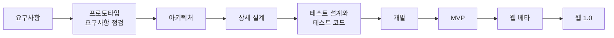
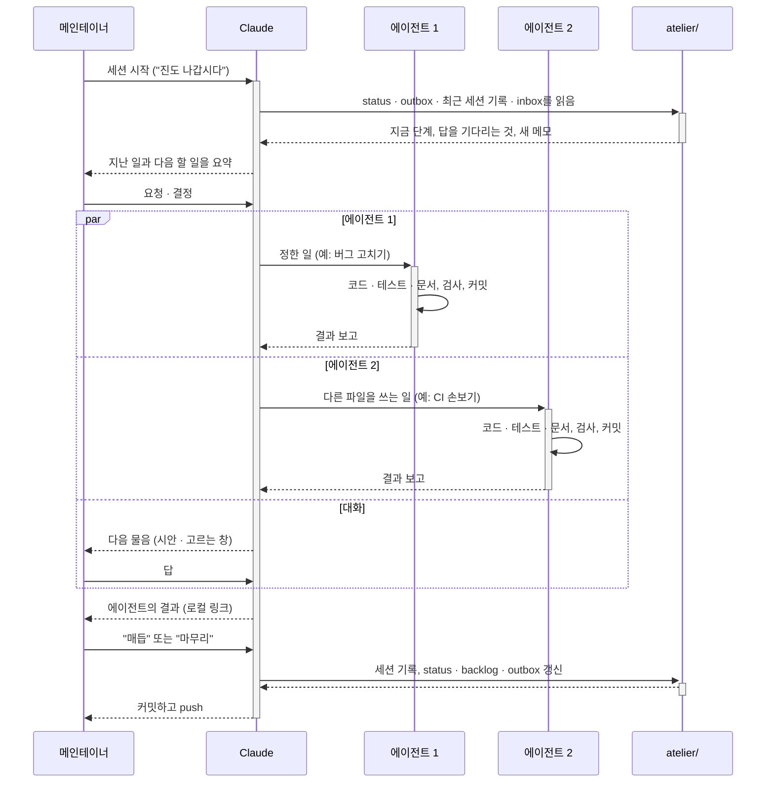
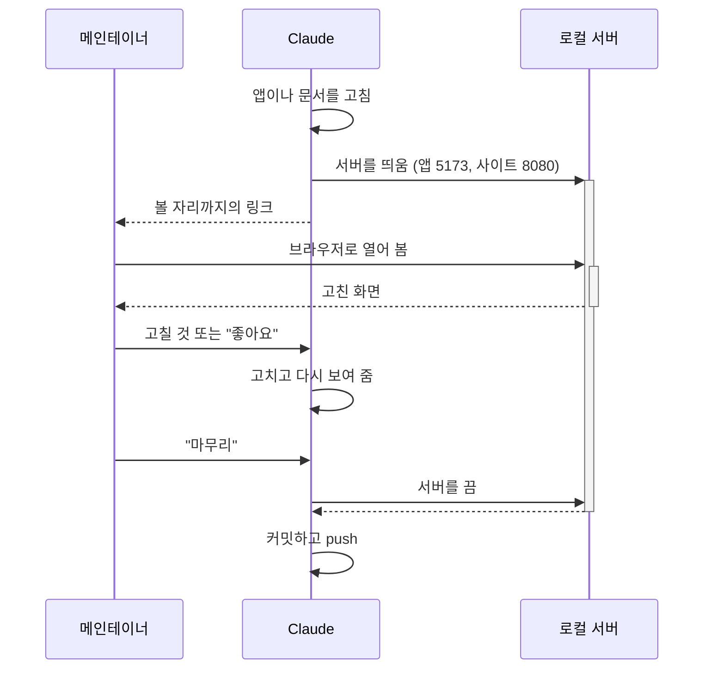

# 일하는 방식

> [!abstract] 이 문서는
> AriadneNSD를 **어떻게 만들고 있는지**를 한곳에서 보여 줍니다. 만드는 사람은 둘입니다. 메인테이너(백엔드 개발자, 프론트엔드는 처음)와 Claude(Claude Code)입니다. 메인테이너가 무엇을 만들지 정하고 확인하며, Claude가 설계 · 코드 · 테스트 · 문서를 씁니다.
> - 규칙 하나하나의 원본은 그 규칙이 사는 문서입니다(아래의 링크). 이 문서는 흐름을 보여 주고 원본을 가리킵니다. 단, [[#7. 올리기 전에 로컬에서 보기]]는 이 문서가 원본입니다.
> - Claude가 세션마다 따르는 지시는 저장소 맨 위의 `CLAUDE.md`에 있습니다. 이 문서는 그것을 사람이 읽기 좋게 풀어 둔 것입니다.
> - 따라 해 보려는 분께: 대부분은 도구가 아니라 습관입니다. 혼자 AI와 일할 때도 그대로 쓸 수 있습니다.

## 1. 큰 순서

공학의 순서를 따릅니다. 앞 단계의 결과가 다음 단계의 입력입니다.

- 아키텍처 · 상세 설계는 프로토타입 리뷰와 나란히 갔습니다. 앞 문서를 고칠 일이 생기면 그 자리에서 고치지 않고 [[backlog]]에 적어 둔 뒤 차례로 반영합니다.
- 스파이크(기술 질문 하나에 답하는 실험) · 프로토타입(요구사항이 맞는지 보려고 만들고 버림) · MVP(처음 내놓는 제품)를 나눠 씁니다 → [[spike-prototype-mvp]]
- 배포 대상의 순서는 웹 → Obsidian → 데스크톱입니다 → [[dr-0002-development-order|DR-0002]]. MVP 뒤의 단계와 문턱은 [[dr-0018-release-stages|DR-0018]]에 있습니다.

## 2. 세션의 리듬

일은 **세션** 단위로 합니다. 세션은 Claude Code와 나누는 대화 하나입니다. Claude는 세션이 끝나면 기억을 잃기 때문에, 이어 가는 데 필요한 것은 모두 저장소의 문서에 남깁니다.

- **시작:** Claude가 [[status]](지금 어디인가), [[outbox]](메인테이너의 답을 기다리는 것), 가장 최근의 세션 기록, [[inbox]]를 읽고 요약합니다.
- **inbox와 outbox:** 세션 사이에 떠오른 생각은 메인테이너가 [[inbox]]에 적습니다(메인테이너 → Claude). Claude가 묻고 답을 받지 못한 것은 [[outbox]]에 남습니다(Claude → 메인테이너). inbox 항목은 함께 검토하고, 처리하면 원문을 세션 기록으로 옮긴 뒤 지웁니다.
- **매듭과 마무리:** "마무리"는 세션을 닫는 정리, "매듭"은 세션을 이어 가면서 하는 같은 정리입니다. 아리아드네의 실을 끊지 않고 그 자리에 매듭만 짓는다는 뜻입니다. 정리할 때는 세션 기록(`sessions/`)을 쓰고, 상태 · 할 일 · 답을 기다리는 것을 갱신하고, 연표와 배운 것을 더한 뒤 커밋하고 push합니다.
- **일은 에이전트가, 대화는 멈추지 않게:** 메인테이너가 정한 일(코드 수정, 테스트, 문서 정리)은 Claude가 백그라운드 에이전트에게 맡기고, 그동안 메인테이너와 다음 물음으로 넘어갑니다. 같은 파일을 쓰는 일은 한 에이전트에 차례로 묶습니다. 에이전트는 커밋만 하고, push와 상태 문서(status · outbox · 세션 기록)는 Claude가 합니다.
- **한 항목은 한 곳에만:** 아뜰리에의 문서는 질문 하나에 문서 하나이고, 같은 것을 두 곳에 적지 않습니다 → [[atelier/README#구성|아뜰리에의 구성]]

## 3. 문서

- **`docs/`는 결과, `atelier/`는 과정입니다.** `docs/`는 개발된 애플리케이션과 같은 것(지금의 요구사항 · 설계 · 명세)이고, 왜 그렇게 정했는지와 지금 하는 일은 `atelier/`에 있습니다 → [[atelier/README#`docs/`와의 차이|`docs/`와의 차이]]
- **결정은 기록으로 남깁니다.** 코드의 구조 · 모델 · 파일 형식 · 기술 선택은 ADR([[atelier/adr/README|ADR 목록]]), 그 밖의 결정(일하는 순서, 조작과 모습, 이름 · 라이선스)은 DR([[atelier/decisions/README|DR 목록]])입니다 → [[dr-0001-split-decision-records|DR-0001]]. 승인한 기록은 고치지 않고, 바뀌면 새 기록을 씁니다.
- **요구사항은 ID를 받습니다.** `R-WEB-02`처럼 영역과 번호를 붙이고, ID는 바뀌지 않습니다. 철회한 것은 [[requirement-changes|요구사항 변경 기록]]으로 옮깁니다 → [[dr-0016-requirement-ids|DR-0016]]
- **정하지 않은 것도 밝힙니다.** `docs/`에는 아직 설계하지 않은 자리와 정하지 않은 물음을 콜아웃이나 "미결정 사항" 절에 적어, 읽는 사람이 어디까지 정해졌는지 알게 합니다.
- **사람이 읽는 형식:** 메인테이너는 모든 문서를 Obsidian으로 읽습니다. 그림은 Mermaid나 이미지로 그리고, 같은 문서를 사이트(https://ariadnensd.com/about)에도 펴냅니다 → [[dr-0013-publish-docs-github-pages|DR-0013]]

## 4. 그림으로 묻기

말로 견주기 어려운 결정은 글로 묻지 않고 그림으로 묻습니다.

- **시안:** 선택지마다 그림과 번호를 붙인 HTML 페이지를 만들어 보여 주고, 메인테이너가 번호로 고릅니다. 기술적으로 될지 모르는 일은 **스파이크**로, 조작 전체를 써 봐야 아는 일은 **프로토타입**으로 확인합니다. Claude는 이런 페이지가 필요해 보이면 묻지 않고 먼저 만듭니다.
- 모든 시안 · 스파이크 · 프로토타입은 `M01`, `M02` … 의 ID를 받아 [[sketchbook]]에 있고, 저장소에 사본을 둡니다. 고른 과정은 시안 페이지에 남기고, 문서에는 결과만 적습니다.
- 짧은 선택은 Claude Code의 고르는 창(선택지와 미리보기)으로 묻고, 추천하는 것을 첫째에 둡니다.

## 5. 코드

- 코드는 `src/` 아래의 pnpm 모노레포입니다 → [[0036-code-layout|ADR-0036]]. 시작하는 법은 `src/README.md`, 규칙은 [[07-coding-guide]]입니다.
- 설계와 코드가 다르면 둘 중 하나가 틀린 것입니다. 코드를 바꾸면서 설계가 달라지면 `docs/`도 함께 고칩니다.
- `pnpm check`가 타입 검사 · ESLint · Prettier · 의존 방향 · 테스트 · 테스트 목록을 한 번에 봅니다. 통과하지 않으면 커밋하지 않습니다.

## 6. 테스트

- 테스트를 먼저 설계하고 코드를 썼습니다. 층(단위 · 통합 · E2E)과 무엇을 어디서 확인하는지는 [[07-testing]]에 있습니다.
- 테스트마다 ID(`T-0001`)를 붙이고, 이름 앞에 확인하는 요구사항 · 품질 속성 시나리오 · 결함의 ID를 적습니다 → [[dr-0022-test-ids|DR-0022]]. 그래서 요구사항이나 시나리오에서 그것을 확인하는 테스트를 찾아갈 수 있습니다. 지금의 테스트 전부는 [[08-test-list]](코드에서 만드는 한국어 목록)에 있습니다.
- 버그를 고치면 그 버그를 다시 일으키는 테스트를 먼저 더합니다. 결함은 [[defects]]에 ID(`BUG-01`)로 남깁니다.
- 커버리지(테스트가 실행한 코드 줄의 비율)는 단위 테스트와 E2E를 합쳐 잽니다 → 재는 법은 [[07-testing#5. 도구와 CI]], 지금의 값은 [[07-testing#6. 지금의 커버리지]]

## 7. 올리기 전에 로컬에서 보기

고친 앱과 문서 사이트는 **push하기 전에 메인테이너의 PC에서 먼저 봅니다.** push하면 사이트에 반영되기까지 몇 분 기다려야 하고, 잘못된 것이 그대로 공개됩니다. 로컬에서 보면 바로 보이고, 고칠 것을 그 자리에서 고칩니다(2026-11-03, 메인테이너).

| 무엇 | 띄우는 법 (`src/` 또는 저장소 맨 위에서) | 주소 |
| --- | --- | --- |
| 웹 앱 | `cd src && pnpm dev` (고치면 바로 반영) | http://localhost:5173/ |
| 문서 사이트 | `bash site/build.sh`로 앱 · 사용법까지 빌드한 뒤 `npx --yes serve@14.2.4 -l 8080 site/.quartz/public` | http://localhost:8080/about |
| 문서만 빨리 | `bash site/build.sh --serve` (웹 앱은 빠짐) | http://localhost:8080/ |

- **Claude가 띄웁니다.** 메인테이너의 확인이 필요하면 Claude가 서버를 띄우고, 페이지 전체가 아니라 **볼 자리까지의 링크**(절의 앵커, 예: `http://localhost:8080/docs/04-design/07-testing#12-유형과-구성-요소`)를 줍니다.
- **Mermaid 그림은 빌드한 사이트에서 확인합니다.** Obsidian과 사이트(Quartz)가 그림을 다르게 그리는 일이 있어서입니다.
- **마무리 때 끕니다.** 띄운 서버는 "마무리"할 때 Claude가 끕니다. 테스트와 측정이 쓰는 서버(E2E의 4173, 프로파일의 4174, 커버리지의 4175)는 그 일이 끝나면 저절로 닫히지만, 남아 있으면 그것도 끕니다.
- 고친 것이 앱의 코드라면 테스트(`pnpm check`, E2E)를 먼저 통과시킨 뒤 보여 줍니다. 메인테이너는 테스트가 볼 수 없는 것(보기에 어떤지, 쓰기에 편한지)을 봅니다.

## 8. 커밋과 push

- 커밋은 Claude가 필요할 때마다 묻지 않고 합니다(예: 결정 하나를 반영한 뒤, inbox의 원문을 지키려고). 커밋하지 않은 것은 git으로 되살릴 수 없습니다.
- **push는 매듭과 마무리 때만** 합니다. push하면 사이트가 다시 빌드되어 공개되기 때문입니다.
- 커밋 메시지는 Conventional Commits 꼴의 머리에 한국어 본문입니다 → [[dr-0017-code-language-and-commits|DR-0017]]

## 9. 함께 일하며 배운 것

- 메인테이너가 Claude Code와 AI와 일하는 법에 대해 배운 것은 [[learning-claude-code]]에, 프론트엔드 기술을 묻고 배운 것은 `til/`([[til/README|TIL 목록]])에 있습니다.
- 지나온 전환점은 [[timeline]]에 있습니다.
