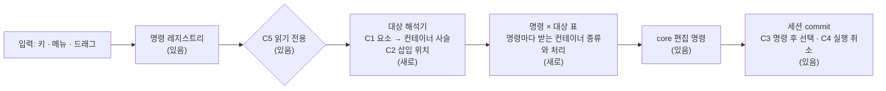

# 조작 규칙에 비춘 아키텍처 · 설계 검토

> [!abstract] 이 문서는
> 2026-11-28에 조작 규칙을 디자인 원칙 다섯, 모든 명령의 규칙 C1 ~ C5, 명령 × 대상 매트릭스로 추상화했다([[02-interaction-rules#공통 규칙]], [[ux-decisions#CR1. 공통 규칙은 바탕 규칙 넷과 명령 × 대상 표|CR1]]). 그 추상화가 아키텍처([[01-architecture]]) · 상세 설계([[01-model]] · [[03-editor]]) · 코드(`src/packages/core` · `src/packages/editor`)의 추상화와 1:1로 맞는지 검토하고, 개선안을 견준다.
> - 요청(메인테이너): "ux interaction rules의 정의에 비추어 아키텍처와 설계를 개선할 수 있는지 깊게 생각해서 검토해주세요. 아키텍처와 설계는 추상화를 얼마나 훌륭하게 하느냐에 결정되는데, 오늘 우리는 ux interaction rules의 추상화를 했거든요."
> - 그림으로 견준 시안: M91(https://claude.ai/artifact/FpRECNt8rHaVQRF45dve4S, 사본 `journal/assets/2026-11-28-interaction-abstraction-study.html`, 목록 [[sketchbook]]). 정할 것은 [[#5. 정할 것]].
> - 코드는 고치지 않았다. 기준 커밋 `3308941`(0.6.3).

## 1. 결론

- **잘 맞는 곳(1:1):** 명령(③ "진입점이 달라도 명령은 하나") = 명령 레지스트리 · `CommandSpec`. C4 실행 취소 단위 = 세션의 `commit` · `setView` 한 곳. C5 읽기 전용 = `spec()`의 `edits` · `onPeek` 검사 한 곳. 오늘의 UN2(이름 띠 보기도 실행 취소)가 세션과 상태 두 파일만 고치고 끝난 것이 그 증거다.
- **맞지 않는 곳:** 조작 규칙의 두 기둥인 **대상**(선택한 요소와 그것이 대표하는 컨테이너)과 **C1 대상 결정 · C2 삽입 위치**, 그리고 **명령 × 대상 매트릭스**에 대응하는 요소가 아키텍처에도 상세 설계에도 코드에도 없다. 대신 명령마다 `when` · `run` · `context` 세 곳에서 선택의 종류를 `if`로 갈라 매트릭스의 한 행을 손으로 다시 만든다. 선택의 종류를 가르는 분기가 `editor`의 21개 파일에 약 200곳 있다.
- **어휘가 일곱 벌이다:** 같은 "가리키는 것"을 히트 테스트(`Hit`), 화면 트리(`ShownMeaning`), 선택(`Selection`), core의 대상(`Target`), 접기 대상(`FoldTarget`), 삽입 자리(`Placement`), 편집 필드(`EditField`)가 저마다 다른 종류로 나눈다. 매트릭스의 열 여섯과 같은 것은 하나도 없다.
- **추천:** 매트릭스를 코드의 한 표로 세우고(대상 해석기: 요소 → 컨테이너 사슬, 명령은 받는 컨테이너의 종류와 칸마다의 처리만 적음), 그 전에 매트릭스를 테스트로 대조해 지금의 어긋남부터 드러낸다(안 A → B). 새 ADR [[0054-command-target-resolution|ADR-0054]](제안됨).

## 2. 개념 대응표

조작 규칙의 개념마다 아키텍처 · 상세 설계 · 코드에서 무엇이 그것인지. "흩어짐"은 한 개념을 여러 곳이 따로 구현한 것이다.

| 조작 규칙의 개념 | 아키텍처 | 상세 설계 | 코드 | 판정 |
| --- | --- | --- | --- | --- |
| 명령(진입점 여럿, 명령 하나) | 명령 레지스트리, 커넥터 C-02 ~ C-04 | `CommandSpec`([[03-editor#5. 명령 목록과 메뉴]]) | `commands/spec.ts` · `registry.ts` | 1:1 |
| 대상(선택한 요소: 블록 · 분기 라벨 · 헤더 · 접기 영역 · 펴 보인 블록 · 선택 없음) | 없음 | `Selection` 6종(`missingDefault`가 더 있고 "선택 없음"은 `null`), core의 `Target` 3종(`blocks` · `fold` · `diagramEnd`) | 위 둘 + `Hit` · `ShownMeaning` · `FoldTarget` · `Placement` · `EditField` | 어휘가 다름 |
| 컨테이너와 그 대표 요소(분기 라벨 → 분기, 이름 띠 · 접힌 칸 → 접기 영역, 헤더 → 다이어그램, 접힌 줄 → 그 줄의 블록) | 없음 | 산문으로만 | `branchTarget` · `targetOf` · `diagramOf` · `focusBlock` · `rowId`가 경우마다 | 흩어짐 |
| C1 대상 결정(적용할 수 없으면 가장 가까운 상위 컨테이너, 알림) | 없음 | 산문 | `unwrapHolder`(풀기), `foldTargets` · `outward`(접기 · 펴기), `branchOfSelection`(분기 명령), `copyTarget`(복사), `extractTarget`(빼기), `fieldOfSelection`(텍스트 편집), `oneBlock` | 명령마다 따로, 7곳 |
| C2 삽입 위치(선택한 요소의 바로 옆, 같은 레벨의 형제) | 없음 | `Target` + `side`, [[01-model#4.3 규칙 F: 접기 영역의 범위가 줄 밖으로 나갈 때\|4.3]] | `runInsert` · `runPaste` · `runInsertBranch` · `headStart` · `currentDiagram` · `intoMissingDefault` · `besideEmpty`, 드롭은 `input/drop.ts`가 따로 | 명령마다 따로 |
| C3 명령 후 선택 | "touched로 다음 선택" | [[03-editor#2.3 명령 뒤의 선택]] | `session.commit(result, after)` 한 길 + `after` 함수 여섯(`selectTouched` · `selectionAfterDelete` · `afterBranchDelete` · `afterHead` · `afterInsert` …) | 반쯤 한곳 |
| C4 실행 취소 단위 | 5.1 · 6장의 글이 옛 규칙(아래 3.4) | [[0048-folding-is-undoable\|ADR-0048]] | `session.commit` · `setView` | 1:1 (문서만 낡음) |
| C5 읽기 전용 | 6.4 | `edits` | `spec()`의 `isInsidePeek` · `onPeek` | 1:1 |
| 명령 × 대상 매트릭스(12행 × 6열) | 없음 | 없음 | 명령마다 `when` · `run` · `context`의 분기 | 없음 |
| ② 보이는 단위가 조작의 단위, 보이지 않는 요소는 영향 없음 | 없음 | 화면 트리([[03-editor#2.2 이동]]) | 이동 키는 화면 트리(`shown-index`), 이동 명령은 인자 `hiddenFolds`(FM1), 드롭은 `drop.ts`가 따로 | 진입점마다 따로 |
| 트레이드오프(헤더의 열은 의도한 예외) | 없음 | 없음 | 명령마다 `kind === 'head'` | 흩어짐 |

## 3. 근거

### 3.1 선택의 종류를 가르는 분기

`editor/src`의 테스트가 아닌 파일에서 `selection.kind`를 가르는 곳(2026-11-28, `3308941`):

| 셈 | 값 |
| --- | --- |
| 분기가 있는 파일 | 21 |
| `kind === '…'` · `case '…'` | 약 200(`branchLabel` 29, `fold` 22, `head` 21, `missingDefault` 15, `peek` 15, `blocks` 14 + `case`) |
| 그 가운데 컴파일러가 빠진 종류를 잡는 `switch` | 15 |
| 잡지 못하는 `if` 사슬 | 77 |
| 선택의 한 종류를 아는 `commands/` 파일 | 6 ~ 8(종류마다) |

`if` 사슬이 많아서, 선택의 종류(매트릭스의 열)를 하나 더하면 컴파일러가 알려 주지 않는 곳까지 사람이 찾아 고쳐야 한다. `missingDefault`(default가 없는 Case의 빈 default 칸, [[ux-decisions#CD1. default가 없는 Case|CD1]])는 매트릭스에 열이 없는데 18개 파일이 안다.

### 3.2 매트릭스의 한 행이 코드에서는 세 곳

붙여넣기를 예로 들면, 매트릭스의 한 행("붙여넣기")이 `clipboard-commands.ts`에서 셋으로 나뉜다.

- `run`: `diagram`(복사한 다이어그램) → `branchLabel` → `missingDefault` → `head`(위는 거절) → `null`(지금 다이어그램의 끝) → 그 밖의 `targetOf`. `if` 사슬 여섯.
- `when`: 선택의 종류로 이유를 고르던 사슬이 있었고, 오늘 `peek`만 남기고 걷어 냈다(`run`이 이유를 알림).
- `context`: `['blocks', 'missingDefault', 'branchLabel', 'head']`. 컨텍스트 메뉴에 보일 종류를 따로 적는다. 매트릭스와 대조할 규칙이 문서에 없다.

풀기(`block.unwrap`)는 `when`이 core의 `unwrap`의 사전 조건을 다시 적는다(주석: "same checks as core's `unwrap`, read from the index"). Method 풀어 넣고 지우기도 같다([[03-editor#5.1 메뉴 구성]]의 "`core`와 같은 검사로"). 같은 사전 조건이 두 곳에 있다.

### 3.3 오늘의 조작 변경 여덟이 얹힌 곳

매트릭스의 칸이나 바탕 규칙 하나를 바꾼 변경이 코드의 몇 곳을 고쳤는지.

| 변경 | 조작 규칙에서 | 코드에서 고친 곳 | 한곳에서 끝났나 |
| --- | --- | --- | --- |
| UN2 이름 띠 보기도 실행 취소 | C4의 범위 | `session.ts` · `editor-state.ts` · 모델 타입 한 줄 | 예(C4가 한곳) |
| PS1 선택 없을 때 붙여넣기 | "선택 없음" 열의 칸 하나(C2의 예외) | 붙여넣기의 `when` · `run`, `CommandDeps`, `create-editor.ts`, 대화상자, 문구 셋 | 아니오: 삽입은 이미 같은 규칙을 따로 갖고 있었다(`runInsert`의 `currentDiagram`) |
| HC1 헤더에서 복사하면 다이어그램 | "헤더" 열의 칸 둘 | core `pasteDiagram`, 클립 형식, 복사의 `when` · `run` · `context`, 붙여넣기의 `run` | 아니오: 칸 하나에 세 곳 |
| BL2 분기 라벨에서 붙여넣기 | "분기 라벨" 열의 칸 하나(C2: 분기 옆에는 분기) | 붙여넣기의 `run`, `runInsertBranch`에 `fill` 인자 | 반쯤: 분기 삽입의 길을 다시 썼다 |
| FM1 이름 띠를 끈 접기 영역에서의 이동 | ② 보이지 않는 요소는 영향 없음 | core `move`의 인자 `hiddenFolds`, 커서 명령 | 아니오: ②가 이동 명령만의 인자가 됐다. 드롭과 이동 키는 다른 길(화면 트리)로 같은 규칙을 지킨다 |
| DF4 접힌 줄 드래그 | ② 컨테이너 하나가 한 단위 | `canvas-input.ts` · `canvas-drag.ts`의 `startRowDrag` | 예(드래그 시작점 하나) |
| WH1 · PH1 휠 · 병렬 분기 호버 | 입력의 진입점 | `canvas-input.ts` · `overlay.ts` | 예(입력만) |

C4 · C5처럼 바탕 규칙이 코드의 한 요소일 때는 변경도 한곳이고, C1 · C2와 매트릭스처럼 요소가 없을 때는 칸 하나에 서너 곳이다.

### 3.4 문서끼리 어긋난 곳(낡은 문장)

- [[01-architecture#5.1 편집]]: "접고 펴기 같은 뷰 명령도 같은 경로를 지나지만 undo 스택에는 남지 않는다." → [[0048-folding-is-undoable|ADR-0048]] · UN1 · UN2와 반대다.
- [[01-architecture#6. 공통 관심사]]의 Undo 줄: "뷰 상태는 대상이 아니다." → C4와 반대다.
- [[01-model#4. 편집 명령]]: "접힘 · 펴 보기가 바뀌었을 때만 앞의 `Doc`을 undo 스택에 push" → 이름 띠(UN2)가 빠졌다.
- [[03-quality-attribute-scenarios]]의 변경 용이성(QA-10 ~ 13)에 "새 명령 · 새 대상(매트릭스의 행 · 열)을 더할 때 고치는 곳"이 없다. 조작 규칙은 "새 명령이나 새 대상이 생기면 행이나 열을 추가하고 칸을 채웁니다"라고 하는데, 아키텍처에는 그것을 재는 시나리오가 없다.

셋은 정리 때 고칠 문장이다(→ [[#6. 정리 때 할 것]]).

### 3.5 추상화가 드러낸 매트릭스의 구멍

C2를 한 규칙("선택한 요소의 바로 옆, 같은 레벨의 형제")으로 구현하면, 분기 라벨에서의 삽입은 종류와 상관없이 "옆에 새 분기를 만들어 그 안에 넣기"가 된다. 처리 블록을 넣으면 빈 블록 하나를 담은 새 분기(지금과 같음), 붙여넣기는 블록을 담은 새 분기(BL2, 지금과 같음)인데, **제어 블록 삽입만 거절**이다(매트릭스 "삽입(제어 블록) × 분기 라벨 = 거절", 코드 `insertWhen`의 `reason.notOnBranchLabel`). 원칙 ③의 체크리스트 2("같은 명령이 대상에 따라 다른 결과를 내는가")에 걸린다. 이 칸을 고칠지는 UX 결정이라 [[#5. 정할 것]]의 Q2로 묻는다.

## 4. 개선안

### 4.1 목표 모양

매트릭스를 코드의 요소로 세운다. 바탕 규칙을 어디에 두는지:

범례: 사각형은 `editor`의 요소, 마름모는 통과 · 거절을 가르는 검사. "(새로)"가 이 검토에서 더하자는 것, "(있음)"은 지금 있는 것.

- **요소 → 컨테이너 사슬**(C1): 선택한 요소가 무엇을 대표하는지와 그 위의 컨테이너들을 한 함수가 순서대로 준다. 예: 분기 라벨 → 분기 → If 블록 → 담은 줄 → 다이어그램. 접힌 칸 → 접기 영역 → 담은 블록 → …. 헤더 → 다이어그램.
- **명령은 받는 컨테이너의 종류만 적는다:** 풀기는 "제어 블록 · 호출 블록", 접기 · 펴기는 "제어 블록의 안쪽 · 분기 · 접기 영역 · 호출 블록", 복사는 "블록 범위 · 분기 · 접기 영역 · 다이어그램". 해석기가 사슬을 따라 올라가며 처음 받는 종류에 적용하고, 올라갔으면 어디에 적용했는지 알린다(C1의 "가장 가까운 상위 컨테이너"가 코드 한곳).
- **삽입 위치(C2)는 한 타입:** "어느 줄의 몇째 사이" 또는 "어느 분기 블록의 몇째 분기 사이". 삽입 · 붙여넣기 · 드롭 · 분기 삽입이 같은 타입을 받는다. 헤더(본문의 맨 앞)와 선택 없음(맨 끝)은 해석기의 예외 두 줄.
- **헤더의 열(트레이드오프)은 표의 예외 칸으로:** 명령마다 `kind === 'head'`를 쓰지 않고, 표에 "헤더: 헤더만 제거" 같은 명시된 예외로 둔다. 조작 규칙의 "헤더의 열은 규칙이 아니라 의도한 예외"와 같은 모양이다.
- **`when` · `run` · `context`는 표에서 나온다:** 받는 종류가 없으면 `when`이 이유를 돌려주고, 컨텍스트 메뉴의 종류(`context`)도 표에서 뽑는다. 사전 조건은 core 명령을 한 번 돌려 보는 것(dry run)으로 읽어 두 번 적지 않는다(아래 위험).

### 4.2 대안

| 안 | 무엇 | 효과 | 비용 | 위험 |
| --- | --- | --- | --- | --- |
| A | **매트릭스 대조 테스트 + 문서 정합.** 지금 구조는 그대로. 매트릭스의 72칸을 픽스처(선택의 종류마다 문서 하나)로 돌려 "거절인가 아닌가"를 표와 대조하는 테스트 하나. 아키텍처에 "대상"과 C1 ~ C5의 자리를 적고, 낡은 문장 셋을 고치고, QA 시나리오 "새 명령 · 새 대상"을 더함 | 어긋남이 생기면 테스트가 잡는다. 매트릭스가 코드의 명세가 된다. 고칠 곳의 수는 그대로 | 작음(테스트 1파일, 문서 4곳) | 낮음. 표의 칸이 "거절 / 실행"보다 섬세한 곳(최소 개수, If의 분기)은 픽스처가 늘어남 |
| B | **대상 해석기(추천).** A에 더해, `editor/src/commands/target.ts`(가칭)에 요소 → 컨테이너 사슬(C1)과 삽입 위치(C2)를 한곳에 두고, 명령은 "받는 종류 → 처리"만 적는다. 명령 묶음마다 한 단계씩 옮김 | 매트릭스의 행 = 명령 하나의 표, 열 = 사슬의 종류. 칸 하나를 바꾸면 한곳. 새 열(선택의 종류)은 `commands/`에서 해석기 하나만. C1의 "알림"과 C2의 예외가 한 번만 구현됨. 3.5의 구멍 같은 것이 저절로 드러남 | 중간(명령 묶음 여섯, 단계마다 커밋. 기존 테스트 · E2E가 안전망) | 중간. 미묘한 칸(FM1의 그리지 않는 영역, `missingDefault`를 채우며 삽입, 펴 보인 곳의 접기 영역)을 옮기다 동작이 바뀔 수 있음. A의 대조 테스트를 먼저 두면 낮아짐 |
| C | **표를 데이터로.** B의 표를 `Record<명령, Record<대상 종류, 처리 \| 거절 이유>>` 하나로 두고, 조작 규칙의 매트릭스를 테스트 목록처럼 코드에서 생성 | 문서와 코드가 같은 원본. 72칸을 한눈에 | 큼(생성 스크립트, 문서 형식의 약속) | 중간. 문서의 칸은 사람이 읽는 말이라 코드에서 만들면 글이 딱딱해짐. B로 충분할 수 있음 |
| D | **core로 내림.** core의 `Target`을 분기 · 다이어그램 · 컨테이너까지 넓히고 C1을 core의 순수 함수로 | core만으로 테스트됨 | 큼 | 높음. 선택 · 펴 보기 · 빈 default 칸은 화면의 개념이라 core가 UI를 알게 됨([[01-architecture#4.3 의존 규칙]]). 추천하지 않음 |

### 4.3 추천과 단계

**A → B.** A는 지금의 어긋남을 드러내는 안전망이고, B는 그 위에서 매트릭스를 코드의 한 요소로 만든다. C는 B를 해 보고 표가 저절로 데이터 모양이 되면 그때 정한다.

1. A: 매트릭스 대조 테스트를 쓰고, 지금 어긋난 칸을 목록으로 낸다(고치지는 않음). 낡은 문장 셋과 QA 시나리오는 정리 때.
2. B-1: 해석기와 삽입 위치 타입. 삽입 · 붙여넣기 · 분기 삽입을 옮긴다(C2를 공유하는 셋, 오늘 PS1 · BL2가 같은 규칙을 두 번 쓴 곳).
3. B-2: 복사 · 잘라내기 · 삭제 · 감싸기(C1에서 대표 요소 → 컨테이너).
4. B-3: 풀기 · 접기 · 펴기(C1에서 가장 가까운 상위 컨테이너 + 알림. `unwrapHolder` · `foldTargets`).
5. B-4: 텍스트 편집 · 새 Method로 빼기 · 이동. `context`를 표에서 뽑고 `when`의 사전 조건 사본을 걷어 냄.
6. ②(보이지 않는 요소는 영향 없음)는 B 뒤에 따로 본다. 해석기가 화면 트리에서 사슬을 만들면 `hiddenFolds` 같은 명령마다의 인자가 필요 없어질 수 있으나, 이동 명령의 의미가 core에 걸쳐 있어 B와 묶지 않는다.

잴 것(QA 시나리오 후보): 매트릭스의 칸 하나를 바꿀 때 고치는 `commands/` 파일 **1개**, 선택의 종류 하나를 더할 때 고치는 `commands/` 파일 **1개**(지금은 6 ~ 8개).

위험과 줄이는 법:

- **동작이 바뀜:** 단계마다 대조 테스트 · 기존 단위 테스트 · E2E. 한 단계 = 한 명령 묶음 = 한 커밋.
- **`when`의 비용(QA-07):** dry run으로 사전 조건을 읽으면 메뉴를 그릴 때 명령 수만큼 core를 돌린다. `commandViewSource`가 이미 상태가 바뀔 때 한 번만 계산하므로(→ [[03-editor#5. 명령 목록과 메뉴]]) 큰 부담은 아닐 것이나, B-4에서 재 본다. 비싸면 지금처럼 가벼운 검사를 남긴다.
- **과한 추상화:** 표의 칸이 "처리 함수 하나"로 안 맞는 곳(If에 분기 삽입은 Case로 바꿈, M87 F6)은 처리 함수 안에 둔다. 표는 "어느 컨테이너에 적용되는가"까지만 책임진다.

## 5. 정할 것

메인테이너께 직접 묻는다(이 세션). 답을 받으면 여기에 적는다.

- **Q1. 어느 안으로 갈까:** A → B(추천) / A만 / A → B → C / 지금은 하지 않음.
- **Q2. 분기 라벨에서 제어 블록 삽입(3.5):** 거절을 그대로 둘까, "옆에 새 분기를 만들어 그 안에 그 블록"으로 바꿀까(붙여넣기 BL2와 같게).

## 6. 정리 때 할 것

정한 뒤 정리 때(지금은 하지 않음):

- [[01-architecture]] 5.1 · 6장의 낡은 문장, [[01-model]] 4장의 한 문장을 C4에 맞춘다.
- [[01-architecture]] 3.3 컴포넌트 표에 "대상 해석"을 더하고(B를 고르면), [[03-editor]] 2장 · 5장에 해석기와 표를 적는다.
- [[03-quality-attribute-scenarios]]에 "새 명령 · 새 대상" 시나리오를 더한다.
- 승인된 ADR 가운데 영향받는 것: [[0033-command-list-for-shells|ADR-0033]](명령 레지스트리) · [[0008-contiguous-selection|ADR-0008]](선택)의 "이후 변경"에 ADR-0054를 단다(승인되면).
