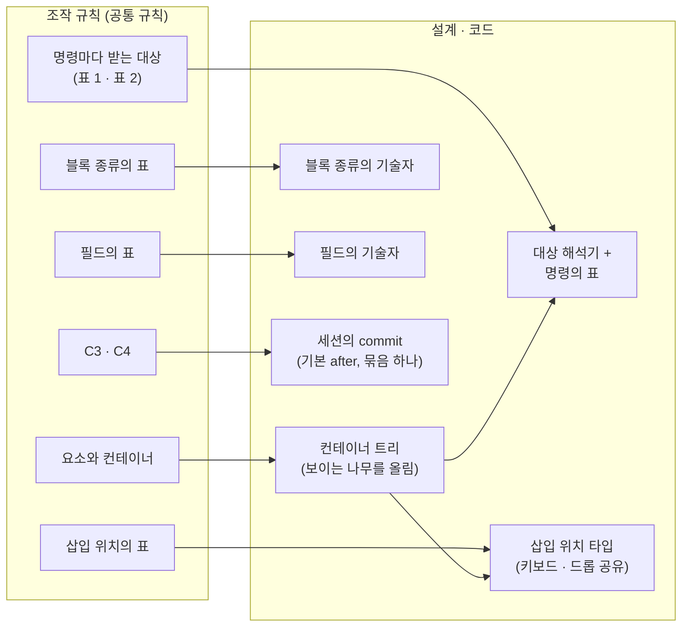

# 조작 규칙 · 아키텍처 · 설계의 추상화 검토

> [!abstract] 이 문서는
> 조작 규칙([[02-interaction-rules]])의 추상화와, 그것을 구현한 아키텍처([[01-architecture]]) · 상세 설계([[01-model]] · [[03-editor]]) · 코드의 추상화를 함께 검토한 결과다.
> - 요청(메인테이너, 2026-11-28): "ux interaction rules의 정의에 비추어 아키텍처와 설계를 개선할 수 있는지 깊게 생각해서 검토해주세요. 아키텍처와 설계는 추상화를 얼마나 훌륭하게 하느냐에 결정되는데, 오늘 우리는 ux interaction rules의 추상화를 했거든요." 이어서 "ux interaction rules에서 오늘 변경한 것만 검토했나요? 전체를 검토해야해요.", "interaction rules가 추상화가 훌륭했다면, 그것을 구현한 아키텍처와 설계도 추상화가 훌륭해질 것이라는 신념입니다. 그래서 interaction rules와 아키텍처와 설계를 함께 검토해달라 요청드리는 것입니다."
> - 범위: 조작 규칙 전체(디자인 원칙, 공통 규칙, 1 ~ 9장), 아키텍처, 상세 설계, `src/packages/core` · `src/packages/editor`. 기준 커밋 `3308941`(0.6.3). 코드는 수정하지 않았다.
> - 방법: 규칙을 장마다 읽어 개념을 추출하고, 개념마다 설계 문서와 코드에서 대응하는 요소를 찾았다. 코드의 사실 확인은 읽기 전용 에이전트 여섯이 나눠 했고, 인용한 수치는 다시 세어 확인했다(→ [[#부록: 조사 방법과 수치]]).
> - 시안: M91(https://claude.ai/artifact/FpRECNt8rHaVQRF45dve4S, 사본 `journal/assets/2026-11-28-interaction-abstraction-study.html`, 목록 [[sketchbook]]). 정할 것은 [[#8. 정할 것]].

## 1. 결론

1. **전제가 데이터로 확인된다.** 규칙이 개념 하나로 서 있는 곳은 코드도 요소 하나다(명령 레지스트리, 실행 취소, 읽기 전용, 이동 키). 규칙이 사례의 나열이나 "X는 Y처럼 다룬다"로 적힌 곳은 코드도 종류마다 분기한다(선택의 종류 약 200곳, 블록 종류 380곳, 드롭 표 17행 가운데 13행이 자기 분기) → [[#2. 규칙의 추상화 수준과 코드의 모습]]
2. **조작 규칙에는 이름 없이 되풀이되는 개념이 여섯 있다:** 컨테이너와 대표 요소, 명령마다 받는 대상, 삽입 위치, 블록 종류의 분류, 텍스트 필드, 실행 취소 단계의 묶음. 장마다 "접기 영역도 제어 블록처럼", "펴 보인 호출 블록은 반복 블록처럼", "이름 띠는 분기 라벨처럼", "For는 While과 같다"로 두 개씩 견주어 적힌 것이 그 신호다 → [[#3. 숨은 개념 여섯]]
3. **공통 규칙 C1 · C2 · C4의 문장은 실제 규칙과 범위가 다르다.** C1의 "가장 가까운 상위 컨테이너에 적용"은 모든 명령의 규칙으로 적혀 있지만 명령 넷에만 해당하고, C2의 "예외는 둘"은 여섯이며, C4의 "생성하면서 입력한 이름은 한 단계"는 셋에만 해당한다.
4. **명령 × 대상 매트릭스 72칸은 작은 표 둘과 예외 세 묶음으로 생성된다:** 요소 → 컨테이너 사슬(6줄), 명령 → 받는 대상과 올라가는지(13줄). 이 두 표가 그대로 코드의 두 요소(대상 해석기, 명령의 표)가 된다 → [[#3.2 명령마다 받는 대상 (C1과 매트릭스)]]
5. **코드가 먼저 가진 추상화가 있다: 보이는 나무.** 이동 키는 접기 영역 · 펴 보인 호출 블록 · 접힌 줄을 블록 모양의 노드로 변환한 트리 위에서 계산하고, 그래서 종류별 분기가 거의 없다. 규칙이 이 개념을 "컨테이너"로 받아들이고, 설계가 이것을 이동 키만이 아니라 히트 테스트 · 드롭 · 명령의 대상 · 이동 명령까지 넓히는 것이 가장 큰 개선이다.
6. **추천:** 규칙과 설계를 한 쌍으로 고친다. 규칙의 표를 먼저 세우고(0단계), 표를 테스트로 대조한 뒤, 코드를 단계별로 맞춘다(1 ~ 3단계) → [[#5. 개선안]]

## 2. 규칙의 추상화 수준과 코드의 모습

조작 규칙의 문장을 추상화 수준 넷으로 나누고, 각 수준이 코드에서 어떤 모습인지 견준 표다.

| 수준 | 규칙에서의 모습 | 예 | 설계 · 코드에서의 모습 |
| --- | --- | --- | --- |
| A. 개념 하나 | 한 문장의 규칙, 문장 밖의 예외 없음 | 명령은 하나 · 진입점은 여럿(③), C4 실행 취소 단위, C5 읽기 전용, 선택은 연속 범위, 유효한 구조만(①), 보이는 대로 저장(②), 방향키는 그림에 보이는 순서 | 요소 하나: 명령 레지스트리, `session.commit` · `setView`, `spec()`과 레지스트리의 읽기 전용 검사, `Selection`의 `blocks`, core의 불변식 검사, 화면과 파일이 같은 렌더러, 보이는 나무 위의 `navigate`(블록 종류 분기 10곳) |
| B. 한 문장 + 문장 밖의 예외 | C1 대상 결정, C2 삽입 위치, C3 명령 후 선택 | 문장의 범위가 실제 규칙보다 넓거나 좁음 | 상위 컨테이너를 찾는 함수 4벌(`outward` · `peekOutward` · `branchAround` · `unwrapHolder`), 삽입 위치의 구현 2벌(키보드 · 드롭), `commit`의 `after`를 명령마다 작성(41곳) |
| C. "X는 Y처럼 다룬다"의 반복 | 컨테이너, 블록 종류의 분류에 이름이 없음 | 접기 영역 ≈ 제어 블록 ≈ 펴 보인 호출 블록, 이름 띠 ≈ 분기 라벨, For ≈ While, Case ≈ If, 탈출 ≈ 처리 | 이동 키만 통일(보이는 나무). 그 밖은 종류마다 평행한 코드: core `move`의 접기 영역 경로, 드롭의 접기 영역 · 펴 보인 호출 블록 분기, 접기 대상 사슬의 펴 보기용 사본. 블록 종류 분기 core 237곳 · editor 143곳, 종류의 표 없음 |
| D. 사례나 별도의 표 | 공통 규칙과 연결되지 않음 | 드롭 표 17행, 만들자마자 입력한 이름의 실행 취소 묶음(FD4 · 새 Method로 빼기 · CD1), 새 다이어그램의 위치 셋, 필드마다의 기본값 | 드롭 전용 구현(13행이 자기 분기, 키보드 규칙의 사본 넷), 묶음 메커니즘 셋, 필드 → 기본값의 표 없음(core 명령마다), 만든 직후 여는 필드를 정하는 곳 8곳 |

수준 A의 규칙은 오늘의 변경에서도 한 곳만 고쳤다(UN2: 세션과 상태 두 파일). 수준 B ~ D의 규칙은 칸 하나에 서너 곳을 고쳤다(PS1 · HC1 · BL2 · FM1).

## 3. 숨은 개념 여섯

### 3.1 컨테이너와 대표 요소

**규칙에서.** 가이드라인 ②의 "컨테이너 하나가 조작의 한 단위다 … 그 경계(이름 띠, 가장자리)를 가리키면 컨테이너의 밖이고, 안의 블록을 가리키면 컨테이너의 안이다"가 정의에 가장 가깝다. 그러나 컨테이너의 목록, 대표 요소, 공통 규칙이 한곳에 없고 장마다 둘씩 견주어 적는다.

- 2장: "펴진 접기 영역의 이름 띠는 분기 라벨처럼 한 칸이다", "접힌 줄 · 접힌 칸은 방향키에서 블록 하나로 취급한다"
- 3장 이동: "접기 영역도 제어 블록처럼 다룬다"
- 4장: "제어 블록의 안쪽은 이름 없는 접기 영역처럼 본다", "호출 블록과 접기 영역은 펼침 · 접힘에서 같은 UX 기준을 따른다", "펴 보인 호출 블록은 방향키에서 반복 블록처럼 다룬다"
- 7장: "펴진 접기 영역과 접힌 칸은 드롭에서 블록 하나처럼 취급한다", "펴 보인 호출 블록도 접기 영역처럼 취급한다", "키보드의 MD1과 같은 생각이다"

결정도 따로 있다: [[ux-decisions#MD1. 접기 영역의 끝에 넣은 블록|MD1]](키보드 삽입), [[ux-decisions#DF1. 접기 영역 곁에 놓기|DF1]](드롭), [[ux-decisions#DF3. 펴 보인 호출 블록 곁에 놓기|DF3]](펴 보인 호출 블록의 드롭), [[ux-decisions#FD5. 키보드로 지나가는 접힌 것과 이름 띠|FD5]](방향키), [[ux-decisions#FM1. 이름 띠를 끈 접기 영역에서의 이동|FM1]](이동), [[ux-decisions#BL1. 분기 라벨에서 복사 · 잘라내기 · 감싸기|BL1]](분기 라벨). 여섯 결정이 규칙 둘의 사례다: "대표 요소는 컨테이너 전체이고 그 곁은 컨테이너의 밖이다", "화면에 보이지 않는 컨테이너는 조작에서 없는 것과 같다".

**설계 · 코드에서.** 이동 키만 이 개념을 한 번의 변환으로 구현했다. 보이는 나무([[03-editor#2.2 이동]], `model/shown-index.ts`)는 접힌 줄과 접힌 칸을 블록 하나로, 펴진 접기 영역과 펴 보인 호출 블록을 본문을 가진 반복 블록으로 변환한다. 그래서 `navigate.ts`에는 접기 영역 · 펴 보기 · 반복 종류에 대한 분기가 없다. 그 밖의 조작은 같은 개념을 각자 구현한다.

| 조작 | 컨테이너를 표현하는 방법 |
| --- | --- |
| 방향키 · 클릭 | 보이는 나무(`ShownIndex`) |
| 이동 명령 | core `move.ts`: 제어 블록의 경로(`holder` · `leaving`)와 접기 영역의 경로(`stepOutOfFold` · `swapWithNeighbour` · `stepOutOfHidden`)가 평행하고 공유 코드가 없다 |
| 드롭 | 모델의 색인 + 레이아웃의 클릭 영역: `foldEdgeOf` · `dropAtFoldEdge` · `dropAtInsideEnd`, `openedCallOf` · `dropAtOpenedCall` |
| 접기 · 펴기의 대상 | `FoldItem`(`seq` · `fold` · `call`)과 `outward`. 펴 보인 곳은 사본 `peekOutward`(`wholeRegion` ↔ `wholeRegionAt` 등 쌍 다섯) |
| 풀기 · 분기 명령 | `unwrapHolder`, `branchAround` |

- "보이지 않는 요소는 조작에 영향을 주지 않는다"(이름 띠를 끈 펴진 접기 영역)의 구현이 넷이다: `shownItems`(방향키 · 레이아웃), 인자 `hiddenFolds`(이동 명령), 레이아웃에 그 영역이 없다는 사실(드롭), `!view.bands` 검사(접기 명령).
- 문서의 색인이 다섯이다: core `ContentIndex`, editor `DocIndex`(같은 순회의 사본이고 `childSeqs` · `isEmptyBlock`도 두 벌), `ShownIndex`, `LayoutResult`의 맵, `placeSiteFolds`.

**제안.**

- 규칙: 공통 규칙에 "요소와 컨테이너" 절을 둔다. 컨테이너의 표(다이어그램 · 반복 블록 · 분기 · 접기 영역 · 펴 보인 호출 블록마다 대표 요소, 안, 접힌 모습, 편집할 수 있는지)와 규칙 넷: ① 대표 요소를 선택하거나 가리키면 컨테이너 전체이고 그 곁은 컨테이너의 밖이다. ② 접힌 컨테이너는 블록 하나다. ③ 방향키에서 대표 요소는 한 칸이다. ④ 화면에 보이지 않는 컨테이너는 조작에서 없는 것과 같다(접고 펴는 명령과 접기 영역 풀기는 적용하고 알린다). 장마다의 "X처럼" 문장은 이 절의 링크로 대체한다.
- 설계: 보이는 나무를 **컨테이너 트리**로 올려, 방향키만이 아니라 히트 테스트 · 드롭 · 대상 해석 · 이동 명령이 함께 쓴다. 노드는 대신하는 모델 요소(지금의 `ShownMeaning`), 대표 요소, 읽기 전용 여부, 보이는지 여부를 가진다. 보이지 않는 접기 영역도 노드로 두되 표시해, 이동 · 드롭은 보이는 노드만 보고 접기 명령은 전부를 본다. 펴 보인 곳은 호출 경로가 노드의 id에 들어 있어 사본 함수가 필요 없다.

### 3.2 명령마다 받는 대상 (C1과 매트릭스)

**규칙에서.** C1은 규칙 셋을 한 문장에 담았다: (a) 대표 요소를 선택하면 컨테이너 전체에 적용, (b) 적용할 수 없으면 가장 가까운 상위 컨테이너에 적용하고 알림, (c) 대상이 없으면 거절하고 이유를 알림. (b)는 모든 명령의 규칙으로 적혀 있지만 실제로 올라가는 명령은 넷이다: 풀기, 접기 · 펴기, 접기 영역 풀기, 좌우 이동([[ux-decisions#Q8. 고른 것을 담은 것에 듣는 명령|Q8]]. 3장 "감싸기 · 풀기"의 마지막 항목은 정확히 그렇게 적었다). 복사 · 삭제 · 감싸기 · 새 Method로 빼기는 올라가지 않고 거절한다. 그래서 "매트릭스의 칸은 C1 ~ C5에서 나옵니다"([[02-interaction-rules#명령 × 대상 매트릭스]])는 C1의 문장만으로는 성립하지 않는다. 명령마다 "무엇을 받는가, 올라가는가"가 규칙에 없다.

매트릭스는 아래 표 둘로 생성된다(초안. 0단계의 대조 테스트로 확인한다).

표 1. 요소 → 컨테이너 사슬(가까운 것부터)

| 선택한 요소 | 사슬 |
| --- | --- |
| 블록(하나, 연속 범위, 접힌 줄) | 블록 범위 → (하나이고 제어 블록 · 호출 블록이면 그 블록) → 그것을 담은 접기 영역(작은 것부터) → 분기 · 본문 → 상위 제어 블록 → … → 다이어그램 |
| 분기 라벨(병렬 처리는 분기 칸) | 분기 → 그 If · Case · 병렬 처리 블록 → … |
| 헤더 | 다이어그램 |
| 접기 영역(이름 띠 · 접힌 칸) | 접기 영역 → 분기 · 본문 → 상위 제어 블록 → … |
| 펴 보인 블록(읽기 전용) | 펴 보인 범위 → 그 위치의 접기 영역 → 그 위치의 분기 · 본문 → … → 펴 보인 호출 블록 |
| 선택 없음 | 없음(삽입 · 붙여넣기만 지금 다이어그램의 끝) |

표 2. 명령 → 받는 대상

| 명령 | 받는 대상 | 상위로 올라가는가 |
| --- | --- | --- |
| 텍스트 편집 | 요소의 필드(→ 3.5) | 아니오 |
| 삽입 · 붙여넣기 | 삽입 위치(→ 3.3) | 해당 없음 |
| 복사 | 블록 범위 · 분기(그 블록 전체) · 접기 영역 · 다이어그램 · 펴 보인 범위 | 아니오 |
| 잘라내기 | 복사와 같은 대상을 복사하고 삭제(다이어그램은 거절) | 아니오 |
| 삭제 | 블록 범위 · 분기 · 접기 영역(그 블록 전체) | 아니오 |
| 이동(위 · 아래) | 블록 범위 · 접기 영역 · 다이어그램(순서) | 아니오 |
| 이동(왼쪽 · 오른쪽) | 분기 | 예 |
| 감싸기 | 블록 범위 · 분기(그 블록 전체) · 접기 영역(그 블록 전체) | 아니오 |
| 풀기 | 제어 블록 · 호출 블록 | 예 |
| 접기 · 펴기 | 제어 블록의 안쪽 · 분기 · 접기 영역 · 호출 블록(펴 보기) | 예 |
| 접기 영역 풀기 | 접기 영역 | 예 |
| 접기 영역 만들기 | 블록 범위(펴 보인 범위는 그 위치의 접기 영역) | 아니오 |
| 새 Method로 빼기 | 블록 범위 · 접기 영역 | 아니오 |

표 둘로 설명되지 않는 칸은 예외 세 묶음이다.

- **헤더의 열:** 삭제는 헤더만 제거, 삽입은 본문의 맨 앞, 잘라내기는 거절([[02-interaction-rules#트레이드오프]]에 있음).
- **분기 라벨에서 블록 범위를 받는 명령:** 복사 · 감싸기는 그 분기의 블록 전체를 받는데([[ux-decisions#BL1. 분기 라벨에서 복사 · 잘라내기 · 감싸기|BL1]]), 새 Method로 빼기 · 접기 영역 만들기 · 제어 블록 삽입은 거절한다(→ 6장 U1 · U2).
- **빈 블록:** 제어 블록 삽입 · 붙여넣기 · 드롭은 교체, 처리 삽입은 곁에([[ux-decisions#KP2. 빈 블록에서도 o · O는 삽입|KP2]]).

매트릭스에 없는 열과 행도 있다. 빈 default 칸은 선택할 수 있는 요소인데 열이 없고(코드에서는 `missingDefault`를 18개 파일이 다룬다), 펴 보인 곳의 접기 영역은 접기 영역의 열과도 펴 보인 블록의 열과도 다르다(만들기 · 풀기 · 이름 편집이 된다). 접기 영역 만들기 · 풀기는 대상에 따라 달라지는 명령인데 행이 없다.

**설계 · 코드에서.**

- 선택의 종류를 구분하는 분기가 `editor`의 21개 파일에 약 200곳이고, 그 가운데 컴파일러가 누락을 검출하는 `switch`는 15곳, 검출하지 못하는 `if` 사슬이 77곳이다.
- 매트릭스의 한 행이 명령의 `when` · `run` · `context` 세 곳으로 나뉜다. 풀기와 Method 풀어 넣고 지우기의 `when`은 core 명령의 사전 조건을 다시 기술한다.
- 상위 컨테이너를 찾는 구현이 넷이다: `outward`(접기), `peekOutward`(펴 보인 곳의 접기), `branchAround`(분기 명령), `unwrapHolder`와 `seqOfBlock(…).holder`(풀기). 공유하는 "종류 X의 가장 가까운 상위 컨테이너" 함수가 없다.
- 그 결과 생긴 차이: 접기 · 펴기의 알림은 "접었습니다." · "폈습니다."뿐이라 무엇에 적용했는지 알리지 않는다(풀기와 접기 영역 풀기는 알린다. 규칙은 셋 모두 알린다고 한다). 컨텍스트 메뉴의 `context` 목록은 손으로 기술해, 접기 영역을 선택하면 삽입 · 붙여넣기가 없고 헤더를 선택하면 삽입이 없다(규칙: "항목은 지금 선택한 요소에 적용되는 명령이다" → [[02-interaction-rules#컨텍스트 메뉴]]).

**제안.**

- 규칙: C1을 (a) · (b) · (c)로 나눠 기술하고, 표 1 · 표 2를 공통 규칙에 추가한다. 매트릭스는 그 결과를 보이는 표로 유지한다. 열에 빈 default 칸, 행에 접기 영역 만들기 · 풀기를 추가한다.
- 설계: 대상 해석기(표 1: 컨테이너 트리를 올라가는 함수 하나)와 명령의 표(표 2: 명령마다 받는 대상과 처리). `when`, 컨텍스트 메뉴의 항목, "어디에 적용했는지"의 알림이 여기서 생성된다 → [[0054-command-target-resolution|ADR-0054]]

### 3.3 삽입 위치(C2)와 드롭

**규칙에서.** C2 "선택한 요소의 바로 옆에, 같은 레벨의 형제로 … 예외는 둘이다"는 삽입 · 붙여넣기 · 드롭을 함께 말한다. 그러나 문장과 실제 규칙 사이에 차이가 있다.

- 예외가 문장 밖에 넷 더 있다: 빈 블록(교체), 빈 default 칸(default 분기를 만들고 그 안에 → [[ux-decisions#CD1. default가 없는 Case|CD1]]), 분기 라벨의 제어 블록 삽입(거절), 드롭의 "블록 위"(감싸기).
- 드롭은 [[02-interaction-rules#7. 드래그 앤 드롭]]의 표 17행으로 따로 정의된다. 그 가운데 여섯 행은 C2와 3.1의 규칙의 사례다: 이름 띠(영역 밖의 앞), 접힌 칸의 위 반 · 아래 반(밖의 앞 · 뒤), 펴 보인 호출 블록의 띠(호출 블록 앞), 헤더 안쪽 아래(본문의 맨 앞), 빈 블록(교체), 빈 default 칸.
- **진입점에 따라 결과가 다르다(분기 라벨).** 키보드에서 분기 라벨은 "그 분기"다: 삽입은 옆에 새 분기, 감싸기는 그 분기의 블록 전체. 드롭에서 분기 라벨은 "그 If · Case 블록"이다: 아이콘은 If · Case 전체를 감싸고, 블록은 If · Case의 위나 아래로 이동한다. 분기는 드래그로 옮길 수 없고 분기 사이에 드롭할 수도 없다(이동 명령만). 원칙 ③의 체크리스트 2와 원칙 ②의 체크리스트 1에 해당한다.
- 새 다이어그램의 위치가 셋이다: 새 Event · Method는 그 종류의 맨 뒤, 붙여넣은 다이어그램은 선택한 요소가 있는 다이어그램의 바로 뒤([[ux-decisions#HC1. 헤더에서 복사하면 다이어그램|HC1]]), 새 Method로 빼기는 원래 Method의 바로 뒤([[ux-decisions#XM1. 새 Method의 자리|XM1]]).

**설계 · 코드에서.**

- 키보드: `targetOf` → core `Target`(`blocks` · `fold` · `diagramEnd`)과 `side`, `headStart`(→ `Placement`), `currentDiagram`, `intoMissingDefault`, `runInsertBranch`, `besideEmpty`.
- 드롭: `findDrop` → `DropAction`(`insert` · `wrap` · `move` · `intoMissingDefault`, `to` · `side` · `outsideFolds` · `outsideFold`). 키보드의 도우미를 쓰지 않는다([[03-editor#3.2 드래그 앤 드롭]]). 같은 규칙의 사본이 넷이다.

| 규칙 | 키보드의 구현 | 드롭의 구현 |
| --- | --- | --- |
| 헤더에서는 본문의 맨 앞 | `headStart` | `dropAtBodyEnd` |
| 빈 default 칸에는 default 분기를 만들고 그 안에 | `intoMissingDefault`(도우미) | `drop-command.ts`의 `intoMissingDefault` 분기 |
| 다이어그램의 맨 끝 | `Target`의 `diagramEnd` | 마지막 블록 + `outsideFolds` |
| 만든 직후 인라인 에디터를 열기 | `afterInsert`(무한 반복은 제외) | `afterDrop`(제외 없음. 열기가 거절되어 결과는 같다) |

- "접기 영역의 안인가 밖인가"를 전달하는 방법이 둘이다: 키보드는 `Target`의 종류(`fold`면 밖, `blocks`면 안), 드롭은 core 명령의 인자(`outsideFolds` · `outsideFold` → `Range.keepOut`).
- 드롭은 명령 레지스트리를 거치지 않는다(`runDrop` → `session.commit`). 읽기 전용 검사와 거절의 알림을 따로 구현한다. 규칙은 "드래그 앤 드롭은 이동과 붙여넣기의 마우스 진입점이다"라고 하고, 구현은 평행한 경로다.

**제안.**

- 규칙: C2를 삽입 위치의 표로 기술한다(선택하거나 가리킨 요소 × 앞 · 뒤 → 위치, 예외 여섯을 표의 줄로). 7장은 "포인터의 구역 → 요소와 앞 · 뒤 · 위"의 규칙(8px, 위 반 · 아래 반)과 드롭에만 있는 줄(접기 영역 안쪽의 끝, 드롭할 수 없는 곳)만 남긴다.
- 설계: 삽입 위치의 타입 하나(줄의 사이 · 분기의 사이 · 다이어그램의 사이, 영역의 안 · 밖)를 키보드(요소 + 방향)와 드롭(히트 + 구역)이 함께 만든다. 삽입 · 붙여넣기 · 이동 · 드롭이 같은 타입을 받고, core의 안 · 밖 인자는 하나로 한다. 드롭은 명령 레지스트리의 명령(위치를 인자로 받는 삽입 · 감싸기 · 이동)으로 실행한다.

### 3.4 블록 종류의 분류

**규칙에서.** 종류마다의 규칙을 다른 종류에 견주어 적는다: "For: 조작(선택, 이동, 접기, 감싸기, 풀기)은 While과 같다", "Case: 이동, 접기, 풀기는 If와 같은 규칙을 따른다(분기가 둘보다 많을 뿐이다)", "병렬 처리의 분기도 이 절의 If · Case의 분기와 같이 움직인다. 다만 분기 라벨 대신 …", "탈출 … 처리 블록처럼 감쌀 수 없다". 분류의 이름은 문서 안에서 일정하지 않다("제어 블록", "반복 블록", "분기가 여러 개인 블록", "드래그하는 것이 담을 수 있는 블록"). 종류마다의 성질(텍스트가 있는지, 본문 하나인지 분기 여럿인지, 분기 라벨과 최소 분기 수, 감싸면 선택이 들어가는 곳, 만든 직후 여는 것)은 1장, 3장의 감싸기 표, 7장에 나뉘어 있다.

**설계 · 코드에서.** 종류마다의 성질을 모은 표가 없다. 블록 종류로 분기하는 곳이 core 20개 파일 237곳, editor 20개 파일 143곳이다. 같은 성질의 정의가 여러 곳에 있다.

| 성질 | 정의된 곳 |
| --- | --- |
| 안의 줄 | `childSeqs`가 core `tree.ts`와 editor `doc-index.ts`에 한 벌씩(반환 타입이 다름) |
| 제어 블록인가 | core `isControlBlock`(처리 · 탈출 · 호출이 아님), editor `isControl`(안의 줄이 있음) |
| 감쌀 수 있는가 | 타입 `WrapKind`, core `wrap`의 거절, editor `wrapKinds`, UI `canWrap` |
| 종류의 목록 | `blockKinds`가 둘(파일 형식의 10종, 툴바 순서의 9종. 이름이 같음) |
| 화면 이름 | `kindNames`(5종), 종류별 알림 키 둘, 메시지 카탈로그 |

변경 용이성의 근거: 2026-11-28에 블록 종류 셋(무한 반복 · 탈출 · 병렬 처리)을 추가한 커밋 둘이 core 24개 파일(`c35a824`)과 editor 18개 · core 2개 파일(`c51c252`)을 수정했다(테스트 제외). editor 18개 가운데 키 표 · 아이콘 · 이름은 6개이고 12개는 로직이다(`clip-format` · `command-helpers` · `insert-wrap-commands` · `contracts` · `canvas-input` · `inline-editor` · `overlay` · `drop` · `doc-index` · `shown-index` · `session` · `text-editing`). [[03-quality-attribute-scenarios#QA-12 블록 종류 추가|QA-12]]의 응답 "바뀌는 곳은 `core`의 그 블록에 대한 부분과 키 표뿐이다" 가운데 지켜진 것은 셸 0줄이다.

**제안.**

- 규칙: 1장에 블록 종류의 표를 둔다. 분류(처리류: 처리 · 탈출, 반복류: While · For · Do-While · 무한 반복, 분기류: If · Case · 병렬 처리, 호출)와 성질의 열. 조작 규칙은 종류가 아니라 분류에 대해 기술하고, 종류의 절에는 그 종류만의 것(Case의 default, 병렬 처리의 분기 둘, 호출 블록의 필드)만 남긴다.
- 설계: core에 종류의 기술자 하나를 둔다: 분류, 텍스트 유무, 안의 줄, 분기의 규칙, 감쌀 때의 슬롯, 만든 직후 여는 필드, 텍스트로 복사할 때의 형식. 레이아웃 · 씬 · 파일 형식의 종류별 분기는 모양과 직렬화가 종류마다 달라 유지한다. 줄일 대상은 명령과 `editor`의 동작 분기다. QA-12의 응답 측정을 "기술자 한 항목 + 모양 + 직렬화 + 키 · 아이콘"으로 다시 기술한다.

### 3.5 텍스트 필드

**규칙에서.** "텍스트가 있는 요소는 모두 같은 명령으로 편집한다", "필수 필드를 비우면 그 필드의 기본값으로 복원한다"는 공통 규칙이다. 필드마다의 값(편집할 수 있는지, 비우면 무엇이 되는지, 알리는지, 한 줄인지, 만든 직후 여는지)은 [[02-interaction-rules#텍스트 편집]]의 한 문장에 모여 있고, 1장의 종류마다 다시 적혀 있다(Event 헤더, If, Case, 호출 블록, 병렬 처리, 무한 반복, 접기 영역). 표가 없다.

**설계 · 코드에서.** `EditField`는 여섯 종류다([[03-editor#2.4 인라인 에디터의 상태]]).

- 비웠을 때의 규칙은 core의 명령마다 따로 있다: `editText`(If의 라벨 제거, Case의 `emptyLabel`), `editHead`(`emptyHeadName`), `editCall`(`filledArgs`, `emptyCallName`), `renameFold`. 필드 → 기본값의 표나 함수가 없다. `editor`가 복원하는 것이 아니라, 명령이 거절해 내용이 그대로인 것이 "복원"이다.
- 편집할 수 없는 요소의 판정이 두 벌이다(`editor`의 `fieldText`, core의 `editText`).
- 만든 직후 여는 필드를 정하는 곳이 8곳이다: `afterInsert`, `afterDrop`, `afterHead`, 새 Method로 빼기, `afterCall`, `afterNamed`, 분기 라벨(3곳), 접기 영역.
- 헤더 이름의 중복으로 인라인 에디터를 다시 여는 로직이 두 번 있다(헤더 편집, 뺀 Method의 이름).

**제안.**

- 규칙: "텍스트 편집" 절에 필드의 표(요소 · 필드 · 편집 가능 · 비우면 · 알림 · 줄 수 · 만든 직후 열기)를 두고, 1장의 절들은 표를 가리킨다.
- 설계: 필드의 기술자 하나(읽기, 쓰기, 비웠을 때, 편집할 수 있는지와 이유, 한 줄 여부). "만든 직후 여는 필드"는 블록 종류의 기술자와 명령의 결과에서 읽는다.

### 3.6 실행 취소 단계의 묶음과 명령 후 선택 (C4 · C3)

**규칙에서.** C4의 "생성하면서 바로 입력한 이름은 생성과 한 단계로 묶인다"는 일반 문장인데, 본문에서 그렇게 정한 것은 셋이다: 접기 영역의 이름([[ux-decisions#FD4. 만들 때 적은 이름은 만들기와 한 단계|FD4]]), 새 Method로 빼기의 이름, 빈 default 칸에 입력(CD1). 새 블록의 조건, 새 분기의 라벨, 새 헤더의 이름, 새 호출 블록의 인자는 "바로 인라인 에디터를 연다"만 있고 단계에 대한 문장이 없다. C3은 "생성되거나 변경된 요소를 선택한다"이고, 명령마다의 규칙이 장마다 더 있다(풀기, 접기 · 펴기, 접기 영역 풀기, 새 Method로 빼기, 다이어그램 삭제).

**설계 · 코드에서.**

- 여러 변경을 실행 취소 한 단계로 만드는 메커니즘이 셋이다: (a) core 명령 둘을 합성해 한 번 `commit`(`intoMissingDefault`와 드롭의 사본, `runInsertBranch`의 `fill`, 새 Method를 만들고 호출), (b) 내용과 뷰 상태를 함께(`After.view`), (c) 앞 단계에 합치기(`Editing.joinsLast`는 접기 영역 만들기 한 곳, 뺀 Method의 이름은 `extracted`로 따로).
- 지금의 동작: 접기 영역을 만들고 이름을 입력하면 실행 취소 한 번이다. If를 삽입하고 조건을 입력하면 실행 취소 두 번이다(첫 번째는 조건만 지운다). 새 분기의 라벨, 새 헤더의 이름, 새 호출 블록의 인자도 두 번이다.
- `session.commit(result, after)`는 `after`를 필수 인자로 받는다. `commands/`의 `commit` 41곳이 공유 도우미 다섯(`selectTouched` · `afterInsert` · `afterHead` · `afterBranchDelete` · `selectionAfterDelete`)이나 그 자리의 함수(약 17곳)를 전달한다. core 명령의 결과가 `touched`를 반환하는 목적이 C3인데([[01-model#4. 편집 명령]]), "`touched`를 선택한다"가 기본 동작이 아니다.

**제안.**

- 규칙: C4의 문장을 범위와 함께 다시 기술한다(모든 생성에 적용할지는 6장 U5). C3은 기본 규칙과 예외의 목록으로 나눈다.
- 설계: 묶음의 메커니즘을 하나로 한다("만든 직후 연 인라인 에디터를 닫을 때의 편집은 앞 단계에 합친다"를 `After.edit`의 기본 동작으로). `commit`의 기본 `after`는 `touched`에서 계산하고(삭제는 같은 레벨의 다음 요소), 명령은 예외만 전달한다.

## 4. 잘 서 있는 곳과 코드가 먼저 가진 추상화

그대로 둘 것이다.

- **명령 레지스트리**([[0033-command-list-for-shells|ADR-0033]]): 키 · 메뉴 · 툴바 · 컨텍스트 메뉴 · 커맨드 팔레트 · 블록 아이콘의 클릭 · 펼침 삼각형 · 휠이 같은 명령 id로 실행된다. 거치지 않는 입력은 [[03-editor#3. 입력에서 명령까지]]가 기술한 셋(드롭, 더블클릭 편집, 문서 설정 창)이고, 내용을 바꾸는 것은 드롭뿐이다. [[01-architecture#3.2 자세히]]의 "입력은 단일 경로로 모입니다"는 이 예외 없이 적혀 있다.
- **C4 · C5:** `session.commit` · `setView`, `spec()`과 레지스트리의 검사. 거절의 알림도 두 곳(`when`이 반환한 이유, `commit`의 `ok: false`)에서 한다.
- **불변식 검사**(원칙 ①): 내용이 바뀔 때마다 한 곳(`apply`)에서 한다.
- **방향키:** 보이는 나무 위의 `navigate`.

코드가 먼저 가진 추상화이고, 규칙이 받아들일 것이다.

| 코드의 요소 | 규칙에서 대응하는 것 |
| --- | --- |
| 보이는 나무(펴진 접기 영역 · 펴 보인 호출 블록은 본문을 가진 블록, 접힌 것은 블록 하나) | 컨테이너(3.1). 규칙은 쌍마다 "X처럼"으로 적음 |
| `ShownMeaning`(`row` · `fold` · `peek`: 노드가 대신하는 것) | 대표 요소와 접힌 모습 |
| core `Range`의 `join` · `keepOut` | "영역의 안인가 밖인가"(MD1 · DF1을 한 규칙으로) |
| `isBranching`, `childSeqs` | 블록 종류의 분류(3.4) |
| `callParts`(인자 → 결과 → 이름의 순서) | 필드의 표(3.5) |
| `Result`의 `touched` | C3의 기본 규칙(3.6) |

## 5. 개선안

### 5.1 방향

규칙을 먼저 고치고(표가 명세), 표를 테스트로 대조하고, 코드를 표에 맞춘다. 규칙의 표 하나에 설계의 요소 하나가 대응한다.

범례: 왼쪽 상자는 조작 규칙의 절(새로 두거나 다시 기술할 것), 오른쪽 상자는 설계 · 코드의 요소, 화살표는 "이 규칙을 이 요소가 구현한다"와 "이 요소가 저 요소를 쓴다"다.

### 5.2 단계

| 단계 | 조작 규칙에서 | 설계 · 코드에서 | 효과 | 비용 · 위험 |
| --- | --- | --- | --- | --- |
| 0 | 공통 규칙을 다시 세운다: 요소와 컨테이너, 명령마다 받는 대상(표 1 · 2), 삽입 위치의 표, 블록 종류의 표, 필드의 표. C1 · C2 · C4의 문장을 실제 범위에 맞춘다. 동작은 바꾸지 않는다. 장마다의 "X처럼"과 반복을 링크로 대체한다 | 표 대조 테스트: 매트릭스 · 삽입 위치 · 필드 · 블록 종류의 표를 앱의 동작과 대조한다. 최신 상태가 아닌 문장을 고치고 QA 시나리오를 추가한다 | 규칙이 명세가 된다. 표와 앱이 다른 칸의 목록이 나온다 | 중간(조작 규칙의 절반쯤을 다시 기술). 위험 낮음 |
| 1 | 0의 표가 기준 | 컨테이너 트리, 대상 해석기, 삽입 위치의 타입. 명령 묶음을 차례로 이전한다(삽입 · 붙여넣기 · 분기 → 복사 · 삭제 · 감싸기 → 풀기 · 접기 → 나머지). 드롭을 같은 위치 타입과 명령으로 | 상위 컨테이너 찾기 4벌 → 1, 삽입 위치 2벌 → 1, 펴 보기용 사본 제거, 칸 하나를 바꿀 때 한 곳 | 중간 ~ 큼. 드롭과 접기 대상은 미묘한 경우가 많다. 0의 테스트가 안전망 |
| 1′ | | 이동 명령을 컨테이너 트리에서 목적지를 구해 `moveTo`로 실행한다. core `move`의 접기 영역 경로와 `hiddenFolds`를 제거한다 | "보이지 않는 요소"의 규칙이 한 곳 | 가설이다. 스파이크로 확인한 뒤 정한다 |
| 2 | 0의 블록 종류의 표가 기준 | core의 종류 기술자. 명령과 `editor`의 종류 분기를 이전한다 | 블록 종류 추가 = 기술자 한 항목 + 모양 + 직렬화 + 키 · 아이콘 | 중간. 기계적인 변경이 많다 |
| 3 | C3 · C4를 6장 U5의 답에 맞춰 기술 | 필드의 기술자, 묶음의 메커니즘 하나, `commit`의 기본 `after` | 필드 · 묶음 · 명령 후 선택이 한 곳 | 작음 ~ 중간 |

잴 것(QA 시나리오 후보): 매트릭스의 칸 하나를 바꿀 때 수정하는 `commands/` 파일 1개(지금 3 ~ 4곳), 선택의 종류 하나를 추가할 때 수정하는 `commands/` 파일 1개(지금 6 ~ 8개), 블록 종류 하나를 추가할 때 수정하는 `editor`의 로직 파일 0개(지금 12개).

### 5.3 대안

| 안 | 무엇 | 평가 |
| --- | --- | --- |
| 가 | 규칙과 설계를 함께(0 → 1 → 2 → 3) | 추천. 규칙의 표와 코드의 요소가 1:1이 된다 |
| 나 | 0단계와 1단계까지 | 가장 큰 불일치(대상 · 삽입 위치 · 드롭)를 해소한다. 블록 종류와 필드는 규칙의 표만 생긴다 |
| 다 | 0단계만(규칙을 다시 세우고 대조 테스트까지) | 비용이 가장 작다. 코드의 구조는 그대로이고, 어긋나면 테스트가 검출한다 |
| 라 | 코드만(앞서 드린 A → B: 매트릭스 대조 테스트와 대상 해석기) | 규칙의 문장(C1 · C2 · C4)이 그대로라, 코드의 표가 다시 규칙과 달라진다 |

### 5.4 하지 않을 것

- C1을 core로 옮기지 않는다. 선택, 펴 보기, 빈 default 칸은 화면의 개념이다([[01-architecture#4.3 의존 규칙]]).
- 레이아웃 · 씬 · 파일 형식의 종류별 분기는 줄이지 않는다(모양과 직렬화가 다르다).
- 방향키(`navigate`)는 수정하지 않는다.
- 조작 규칙의 장 번호(1 ~ 9)는 바꾸지 않는다(링크와 코드 주석이 참조한다). 새 절은 지금의 공통 규칙처럼 번호 없이 앞에 둔다.

## 6. 추상화가 드러낸 칸

규칙을 표로 세우면 다른 칸과 다르게 정해진 칸이 보인다. 동작이 바뀌는 것이라 하나씩 정한다(→ 8장).

| # | 칸 | 지금 | 규칙을 고르게 하면 | 추천 |
| --- | --- | --- | --- | --- |
| U1 | 분기 라벨에서 처리가 아닌 블록(제어 블록 · 탈출 · 호출) 삽입 | 거절. 처리 삽입은 새 분기, 붙여넣기는 새 분기에 그 블록([[ux-decisions#BL2. 분기 라벨에서 붙여넣기\|BL2]]). 이 칸은 [[ux-decisions#Q10의 세부와 Q5. 갈래 이름 고르기, 갈래 넣기와 지우기\|Q5]]의 세부로 Claude가 정했다 | 옆에 새 분기를 만들어 그 안에 그 블록 | 바꾼다 |
| U2 | 분기 라벨에서 새 Method로 빼기 · 접기 영역 만들기 | 거절. 복사 · 감싸기는 그 분기의 블록 전체 | 그 분기의 블록 전체를 받는다 | 바꾼다 |
| U3 | 분기 라벨 위에 블록 아이콘을 드롭 | 그 If · Case 전체를 감싼다. 키보드의 감싸기는 그 분기의 블록을 감싼다 | 그 분기의 블록을 감싼다 | 바꾼다(확신은 중간) |
| U4 | 분기를 드래그로 옮기기, 분기 사이에 드롭 | 없음(이동 명령만) | 분기 라벨을 드래그하면 분기를 옮긴다 | 백로그. 그때까지 트레이드오프에 기술 |
| U5 | 만든 직후 입력한 텍스트의 실행 취소 | 접기 영역의 이름, 뺀 Method의 이름, 빈 default 칸만 만들기와 한 단계. 새 블록의 조건 · 분기 라벨 · 헤더 이름 · 호출의 인자는 두 단계 | 모든 생성에서 한 단계(Vim의 `o` + 입력 + `Esc`가 한 단계인 것과 같다: 원칙 ④) | 바꾼다 |
| U6 | 새 Event · Method 다이어그램의 위치 | 그 종류의 맨 뒤. 붙여넣은 다이어그램과 뺀 Method는 지금 다이어그램의 바로 뒤 | 지금 다이어그램의 바로 뒤(종류가 다르면 그 종류의 맨 뒤) | 메인테이너의 판단 |
| U7 | 접기 · 펴기의 알림 | "접었습니다." · "폈습니다." | 무엇을 접고 폈는지 알린다(규칙 C1 · Q8대로) | 규칙에 맞춘다(결함) |
| U8 | 컨텍스트 메뉴의 항목 | 접기 영역을 선택하면 삽입 · 붙여넣기가 없고, 헤더를 선택하면 삽입이 없다 | 그 요소에 적용되는 명령 전부(규칙대로) | 규칙에 맞춘다(1단계에서 표에서 생성) |
| U9 | 병렬 처리의 분기에서 텍스트 편집 | 키보드는 거절, 그 분기 위의 띠를 더블클릭하면 블록의 텍스트 편집(규칙에 있는 차이) | 진입점이 달라도 같은 결과 | 유지하고 트레이드오프에 기술 |

## 7. 규칙 · 문서 · 앱이 서로 다른 곳

검토에서 확인한 차이다. 이 세션에서는 고치지 않았다.

- 공통 규칙의 문장과 본문의 범위: C1의 (b), C2의 "예외는 둘", C4의 묶음(3.2 · 3.3 · 3.6).
- 매트릭스에 빈 default 칸의 열, 접기 영역 만들기 · 풀기의 행이 없다(3.2).
- 접기 · 펴기의 알림이 대상을 알리지 않는다(U7). 컨텍스트 메뉴의 항목이 규칙의 문장과 다르다(U8).
- [[01-architecture#5.1 편집]]의 "접고 펴기 같은 뷰 명령도 같은 경로를 지나지만 undo 스택에는 남지 않는다"와 [[01-architecture#6. 공통 관심사]]의 "뷰 상태는 대상이 아니다"는 [[0048-folding-is-undoable|ADR-0048]] · C4와 반대다. [[01-model#4. 편집 명령]]의 "접힘 · 펴 보기가 바뀌었을 때만"에는 이름 띠(UN2)가 없다.
- [[01-architecture#3.2 자세히]]의 "입력은 단일 경로로 모입니다"에 드롭 · 더블클릭 편집의 예외가 없다([[03-editor#3. 입력에서 명령까지]]에는 있다).
- [[03-quality-attribute-scenarios#QA-12 블록 종류 추가|QA-12]]의 응답 측정이 실제 변경 범위와 다르다(3.4). 변경 용이성 시나리오에 "새 명령 · 새 대상"이 없다.
- 드롭으로 만든 블록의 인라인 에디터 열기(`afterDrop`)에 무한 반복의 제외가 없다. 열기가 거절되어 결과는 키보드와 같다(3.3).
- 조작 규칙의 3장 "편집 명령"에 선택한 요소에 적용하지 않는 문서 수준의 흐름(열기 · 저장 창, 다른 문서를 열 때, 내보내기와 인쇄, 공유 링크)이 함께 있다. 아키텍처에서는 셸의 명령이다. 장 번호를 바꾸지 않으므로 그대로 두되, 3장 머리말에 "선택한 요소에 적용하는 명령"과 "문서와 파일의 명령"의 구분을 기술할 수 있다.

## 8. 정할 것

메인테이너께 이 세션에서 직접 묻는다. 답을 받으면 여기에 기록한다.

- **앞서 받은 답(2026-11-28):** 매트릭스 대조 테스트와 대상 해석기(A → B)에 "1번". 그 뒤 "전체를 검토해야 한다"는 말씀으로 범위를 넓혔고, A → B는 아래 가 · 나 안의 0단계 일부와 1단계 일부에 해당한다.
- **Q-가. 어느 범위로 갈까 → 정함(2026-11-28, 메인테이너, M91의 Q 1번): 가. 규칙과 설계를 함께, 0 → 1 → 2 → 3.** 0단계(조작 규칙의 공통 규칙을 표로 다시 세우기)는 이 세션에서 초안을 시안으로 먼저 보이고, 1 ~ 3단계의 구현은 단계마다 따로 한다.
- **0단계의 초안(시안 M92) → 정함(2026-11-28, 메인테이너):** Q1 1번 "이대로"(공통 규칙에 절 넷과 표 1 · 2를 추가하고 C1 ~ C5를 고치며, 1 ~ 7장의 견줌 문장과 반복을 그 절의 링크로 대체한다). Q2 1번 "분기 블록"(If · Case · 병렬 처리를 함께 부르는 새 용어. 제어 블록 = 반복 블록 + 분기 블록). 이 문서와 M91의 "처리류 · 반복류 · 분기류"는 그 전에 쓴 임시 이름이다.
- **U1 ~ U9:** 0단계의 초안에 칸으로 표시했고 하나씩 묻는다.

## 9. 정리 때 할 것

정한 뒤, 단계마다의 정리 때 한다.

- 0단계가 조작 규칙의 수정이다: [[02-interaction-rules#공통 규칙]]에 절과 표를 추가하고, 결정은 [[ux-decisions]]에 한 항목으로 남긴다.
- 7장의 문서 차이(아키텍처 5.1 · 6장 · 3.2, 모델 4장, QA-12, 새 QA 시나리오)를 고친다.
- [[01-architecture#3.3 컴포넌트]]에 컨테이너 트리와 대상 해석을 추가하고, [[03-editor]] 2장 · 3장 · 5장에 기술한다(1단계를 하면).
- [[0054-command-target-resolution|ADR-0054]]를 승인하면 영향받는 승인 ADR을 확인한다. [[0033-command-list-for-shells|ADR-0033]]의 인터페이스와 [[0008-contiguous-selection|ADR-0008]]의 선택은 그대로라 "이후 변경"에 추가할 것이 없을 것으로 본다.

## 부록: 조사 방법과 수치

- 조작 규칙 744줄을 모두 읽었다. 상세 설계는 [[03-editor]] 2 ~ 5장과 [[01-model]] 1 · 4장, 아키텍처는 3 ~ 6장을 읽었다.
- 코드의 사실 확인은 읽기 전용 에이전트 여섯(Sonnet)이 주제별로 했다: 텍스트 필드, 보이는 나무와 방향키, 드래그 앤 드롭, 접기 대상 사슬, 블록 종류, 진입점과 실행 취소. 보고의 근거는 `파일:줄`이다.
- 아래 수치는 보고를 받은 뒤 `grep`과 `git show --name-only`로 다시 세었다. 보고 가운데 한 건(풀기의 알림이 무한 반복 · 병렬 처리에서 종류의 id를 그대로 보인다)은 코드를 읽어 보니 사실이 아니어서 제외했다(전용 알림 키가 있다).

| 수치 | 값 | 세는 법 |
| --- | --- | --- |
| 선택의 종류를 구분하는 분기 | `editor` 21개 파일, 약 200곳(`switch` 15, `if` 77) | `kind === '…'` · `case '…'`의 선택 종류 여섯, 테스트 제외 |
| 블록 종류를 구분하는 분기 | core 20개 파일 237곳, `editor` 20개 파일 143곳, 웹 셸 0곳 | `case '<종류>'` · `kind === '<종류>'` · `kind !== '<종류>'`의 종류 열, 테스트 제외 |
| 블록 종류 셋을 추가한 커밋의 파일 | `c35a824` core 24개, `c51c252` `editor` 18개 + core 2개, `src/apps` 0개 | `git show --name-only`, 테스트 제외 |
| 상위 컨테이너를 찾는 구현 | 4(명령) + 2(방향키) + 1(포함 여부) | 접기 대상 사슬 조사 |
| 드롭 표의 행 가운데 자기 분기 | 17행 중 13행 | 드래그 앤 드롭 조사 |
| `commands/`의 `session.commit` 호출 | 41 | `grep -c` |
| 앞 단계에 합치는 곳 | 2(`text-editing.ts`의 `apply(…, true)`), `joinsLast`를 설정하는 곳 1 | `grep` |
| `navigate.ts`의 블록 종류 관련 줄 | 10(`isBranching`과 default 없는 Case) | `grep` |
| 만든 직후 여는 필드를 정하는 곳 | 8 | 텍스트 필드 조사 |
