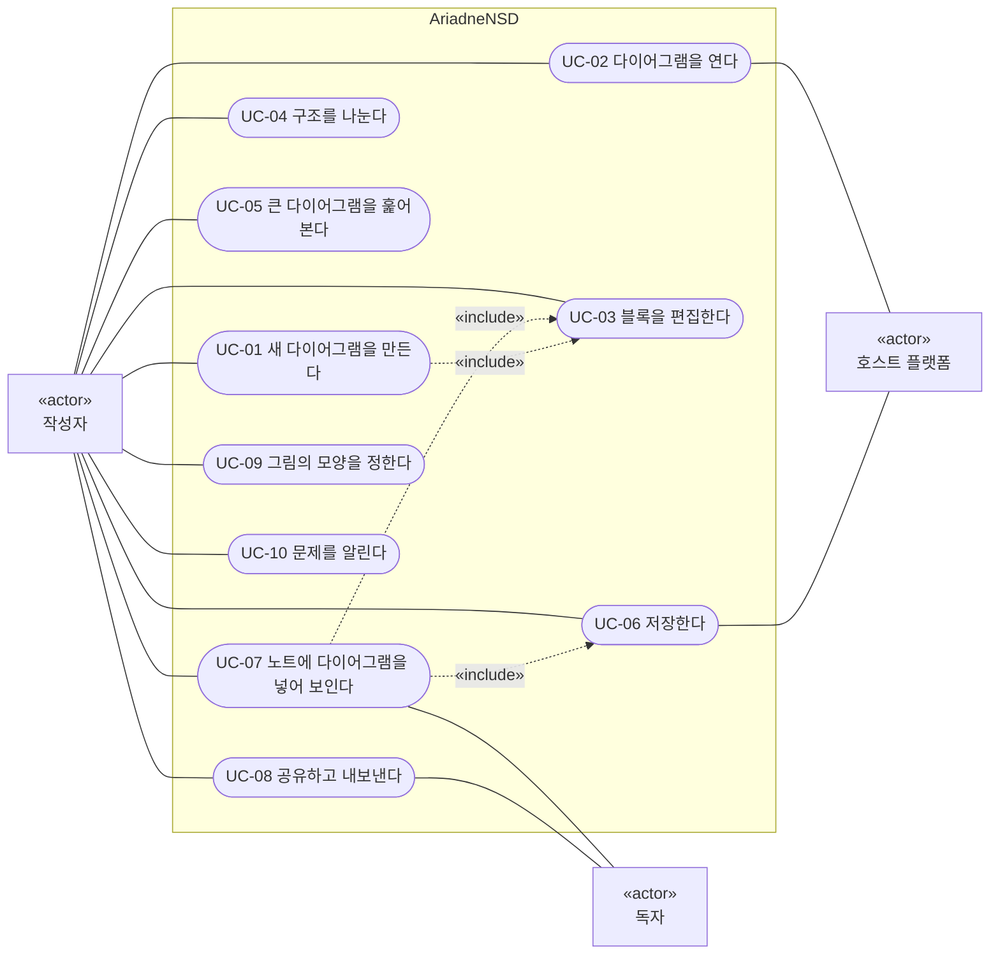

# AriadneNSD 유즈케이스

사용자가 **무엇을 이루려고** AriadneNSD를 쓰는지를 유즈케이스로 적습니다. [[01-requirements|요구사항 명세]]가 기능의 목록이라면, 이 문서는 그 기능들이 이어지는 **흐름**입니다. 흐름은 그대로 인수 시험의 시나리오가 됩니다.

> [!info] 읽는 법
> - 유즈케이스는 사용자 목표 수준으로, 기본 흐름과 예외 흐름 몇 줄로 씁니다([[dr-0014-light-use-cases|DR-0014]]). 세부 규칙(어떤 키, 어떤 모습)은 UX 설계([[02-interaction-rules]])에 있고 여기서는 되풀이하지 않습니다.
> - 각 유즈케이스 끝의 "요구사항"은 그 흐름이 기대는 요구사항의 블록 ID입니다. 우선순위(#P0 …)는 요구사항 쪽에 있습니다.
> - 흐름의 번호에 붙은 `a`, `b`는 그 단계에서 갈라지는 예외 흐름입니다(예: 3a는 3단계의 예외).

## 1. 액터

| 액터 | 누구 | 하는 일 |
| --- | --- | --- |
| 작성자 | 설계 문서를 쓰는 실무자([[01-requirements#1. 핵심 원칙]]) | 다이어그램을 만들고 고치고 저장하고 공유한다 |
| 독자 | 문서 · 노트 · 저장소에서 그림을 보는 사람. AriadneNSD가 없을 수 있다 | 저장된 그림을 본다 |
| 호스트 플랫폼 | Obsidian, Google Drive, 브라우저, OS | 파일을 보관하고, 그림을 미리 보여 주고, AriadneNSD를 부른다 |

## 2. 유즈케이스 다이어그램

> [!note] 범례 (Mermaid에 UML 유즈케이스 다이어그램이 없어 flowchart로 그림)
> - 사각형 «actor» = 액터, 둥근 칸 = 유즈케이스, 큰 테두리 = 시스템 경계.
> - **실선(화살표 없음)**: 액터가 그 유즈케이스에 참여한다(UML의 연관). 왼쪽이 주 액터, 오른쪽이 보조 액터.
> - **점선 «include»**: 화살표 꼬리의 유즈케이스가 머리의 유즈케이스를 흐름 안에 포함한다.

## 3. 목록

MVP 열은 [[01-requirements#5. MVP 범위|MVP 범위]](웹, #P0)에서 그 유즈케이스의 기본 흐름이 되는지입니다.

| ID | 유즈케이스 | 주 액터 | MVP |
| --- | --- | --- | --- |
| UC-01 | 새 다이어그램을 만든다 | 작성자 | 됨 |
| UC-02 | 다이어그램을 연다 | 작성자 | 됨(웹의 로컬 파일) |
| UC-03 | 블록을 편집한다 | 작성자 | 됨(블록 4종) |
| UC-04 | 구조를 나눈다 | 작성자 | 아님(#P1) |
| UC-05 | 큰 다이어그램을 훑어본다 | 작성자 | 확대 · 이동만 |
| UC-06 | 저장한다 | 작성자 | 됨 |
| UC-07 | 노트에 다이어그램을 넣어 보인다 | 작성자 | 아님(Obsidian) |
| UC-08 | 공유하고 내보낸다 | 작성자 | PNG 내보내기만 |
| UC-09 | 그림의 모양을 정한다 | 작성자 | 아님(#P1) |
| UC-10 | 문제를 알린다 | 작성자 | 아님(#P3) |

## 4. 유즈케이스

### UC-01 새 다이어그램을 만든다

- **액터:** 작성자
- **사전 조건:** AriadneNSD를 열 수 있다(웹 페이지, 데스크톱 앱, Obsidian 플러그인, Drive 연동 가운데 하나)

**기본 흐름**

1. 작성자가 새 다이어그램을 만든다.
2. 편집기가 다이어그램 하나와 빈 블록 하나가 든 새 문서를 연다.
3. 작성자가 블록을 편집한다 → UC-03

**예외 흐름**

- 1a. Obsidian에서 노트 안에 바로 넣으려면 → UC-07
- 1b. Obsidian 파일 탐색기의 우클릭 메뉴에서 만들면 노트에 넣지 않고 파일만 생긴다
- 1c. Google Drive의 "새로 만들기"에서 만들면 Drive에 파일이 생긴다

**요구사항:** [[01-requirements#^obs-new]], [[01-requirements#^gd-new]], [[01-requirements#^nfr-integrity]]

### UC-02 다이어그램을 연다

- **액터:** 작성자, 호스트 플랫폼
- **사전 조건:** AriadneNSD가 저장한 파일(`.ns` 또는 `.ns.svg`)이나 공유 URL이 있다

**기본 흐름**

1. 작성자가 파일을 연다(웹 · 데스크톱은 파일 열기, Obsidian은 파일 탐색기, Drive는 "AriadneNSD로 열기").
2. 편집기가 파일 안의 모델만 읽고, 그림은 모델에서 다시 그린다.
3. 저장할 때의 보기 상태(접힘, 펴 보인 호출 블록)대로 보인다.
4. 작성자가 블록을 편집한다 → UC-03

**예외 흐름**

- 1a. Obsidian에서 일반 `.svg`를 열면 AriadneNSD가 아니라 Obsidian의 기본 동작으로 열린다
- 1b. Obsidian에서 이름이 바뀌어 `.ns`가 빠진 파일도 모델이 들어 있으면 편집 메뉴가 생긴다
- 1c. 공유 URL을 열면 보기 모드로 시작하고, 버튼 하나로 편집으로 넘어간다
- 1d. 데스크톱에서 `.ns` 파일을 더블클릭하면 앱으로 열린다
- 2a. 모델이 없거나 깨진 파일: 편집할 수 없다고 알리고, 원본은 건드리지 않는다
- 2b. 옛 형식 버전의 파일: 지금 형식으로 바꿔 읽는다
- 2c. 다른 도구로 그림 부분만 고친 파일: 그림이 모델과 달라졌다고 알린다

**요구사항:** [[01-requirements#^web-file]], [[01-requirements#^dsk-file]], [[01-requirements#^dsk-open-nssvg]], [[01-requirements#^dsk-assoc]], [[01-requirements#^obs-open]], [[01-requirements#^obs-plain-svg]], [[01-requirements#^obs-detect]], [[01-requirements#^gd-open-with]], [[01-requirements#^web-share-url]], [[01-requirements#^web-view-mode]], [[01-requirements#^fmt-model]], [[01-requirements#^fmt-model-source]], [[01-requirements#^fmt-invalid]], [[01-requirements#^fmt-external-edit]], [[01-requirements#^nfr-compat]]

### UC-03 블록을 편집한다

- **액터:** 작성자
- **사전 조건:** 다이어그램이 편집기에 열려 있다(UC-01, UC-02)

**기본 흐름**

1. 작성자가 블록을 하나 또는 여럿 고른다.
2. 작성자가 블록을 넣거나, 지우거나, 글자를 고치거나, 제어 블록으로 감싸거나 푼다.
3. 편집기가 그림을 다시 그린다. 블록의 크기와 갈래의 너비는 글자에 맞춰 저절로 정해진다.
4. 작성자가 마음에 들지 않으면 실행 취소한다.

**예외 흐름**

- 1a. 다른 깊이의 블록을 함께 고르면, 둘을 함께 품는 가장 가까운 범위로 넓혀 고른다
- 2a. 구조가 깨지는 편집(예: 반복의 본문을 비우기)은 일어나지 않는다. 빈 갈래는 빈 블록으로 채워진다
- 2b. 키보드만으로도 1~4를 모두 할 수 있다
- 2c. 끌어 놓기, 복사 · 붙여넣기로 블록을 옮긴다
- 2d. If의 갈래를 바꾸거나, Case의 갈래를 더하고 빼고 순서를 바꾼다

**요구사항:** [[01-requirements#^edit-basic]], [[01-requirements#^edit-undo]], [[01-requirements#^edit-keyboard]], [[01-requirements#^edit-key-hint]], [[01-requirements#^edit-multiselect]], [[01-requirements#^edit-wrap]], [[01-requirements#^edit-unwrap]], [[01-requirements#^edit-dnd]], [[01-requirements#^edit-clipboard]], [[01-requirements#^edit-branch]], [[01-requirements#^edit-if-label]], [[01-requirements#^blk-case]], [[01-requirements#^lay-autosize]], [[01-requirements#^lay-branch-width]], [[01-requirements#^nfr-integrity]], [[01-requirements#^nfr-perf]]

### UC-04 구조를 나눈다

- **액터:** 작성자
- **사전 조건:** 다이어그램이 편집기에 열려 있다

**기본 흐름**

1. 작성자가 따로 떼어 낼 블록들을 고른다.
2. 작성자가 "새 Method로 빼기"를 한다.
3. 고른 블록들이 새 Method 다이어그램이 되고, 그 자리에는 그 Method를 부르는 호출 블록이 남는다.
4. 작성자가 Method 머리의 이름을 고치면, 그 Method를 부르는 호출 블록이 모두 따라 바뀐다.

**예외 흐름**

- 1a. 처음부터 Event나 Method 다이어그램을 새로 만들어 나란히 둔다
- 2a. 거꾸로, 호출 블록을 풀어 Method의 블록들로 바꾼다
- 3a. 부를 것이 문서에 없으면(라이브러리 함수 등) 이름을 적어 부른다
- 4a. 호출 블록이 부르던 Method를 지우면 그 호출 블록은 "이어진 곳 없음"이 된다
- 4b. 다른 문서의 Method를 부른다(#P2)

**요구사항:** [[01-requirements#^edit-multi-diagram]], [[01-requirements#^edit-extract]], [[01-requirements#^edit-call-inline]], [[01-requirements#^blk-event]], [[01-requirements#^blk-method]], [[01-requirements#^blk-call]], [[01-requirements#^blk-call-named]], [[01-requirements#^blk-call-external]]

### UC-05 큰 다이어그램을 훑어본다

- **액터:** 작성자
- **사전 조건:** 한 화면에 다 보이지 않는 다이어그램이 열려 있다

**기본 흐름**

1. 작성자가 확대 · 축소하고 화면을 옮긴다.
2. 작성자가 지금 보지 않을 제어 블록이나 갈래를 접는다.
3. 작성자가 여러 블록을 묶어 이름을 붙인 접기 영역으로 접는다.
4. 작성자가 호출 블록을 펴서 그 자리에서 Method의 블록을 본다.

**예외 흐름**

- 2a. 모두 접기 · 모두 펴기 · 깊이 n까지 펴기(#P2)
- 4a. 펴 보인 호출 블록 안에서도 접기 영역을 만든다. 그 자리에만 있고 Method에는 없다

**요구사항:** [[01-requirements#^lay-zoom]], [[01-requirements#^edit-fold]], [[01-requirements#^edit-fold-range]], [[01-requirements#^edit-call-open]], [[01-requirements#^edit-fold-site]], [[01-requirements#^edit-fold-all]]

### UC-06 저장한다

- **액터:** 작성자, 호스트 플랫폼
- **사전 조건:** 편집한 문서가 있다

**기본 흐름**

1. 작성자가 저장한다.
2. 편집기가 모델과 그림과 쓰인 글자의 글꼴을 SVG 파일 하나로 만든다.
3. 호스트 플랫폼(디스크, 볼트, Drive)에 그 파일이 저장된다.
4. 같은 내용이면 어디서 저장해도 같은 파일이 된다.

**예외 흐름**

- 1a. 다른 이름으로 저장한다
- 1b. 웹에서는 작성 중인 내용이 브라우저에 임시로 남아, 새로고침해도 되살아난다
- 3a. 원래 파일에 덮어쓰지 못하는 브라우저 → [[06-web]]에서 정함

**요구사항:** [[01-requirements#^fmt-svg]], [[01-requirements#^fmt-model]], [[01-requirements#^fmt-deterministic]], [[01-requirements#^fmt-escape]], [[01-requirements#^fmt-text]], [[01-requirements#^fmt-color]], [[01-requirements#^web-file]], [[01-requirements#^dsk-file]], [[01-requirements#^gd-save]], [[01-requirements#^web-draft]], [[01-requirements#^exp-autosave]], [[01-requirements#^nfr-compat]]

### UC-07 노트에 다이어그램을 넣어 보인다

- **액터:** 작성자, 독자
- **사전 조건:** Obsidian 볼트에 플러그인이 켜져 있다

**기본 흐름**

1. 작성자가 노트 편집 화면의 우클릭 메뉴에서 "Insert new NS diagram"을 고른다.
2. 볼트에 `.ns.svg` 파일이 생기고, 노트의 커서 자리에 그 파일을 넣는 `![[…]]`가 들어간다.
3. 편집 탭이 열린다 → UC-03
4. 작성자가 저장한다 → UC-06
5. 노트의 그림이 새 그림으로 바뀐다.
6. 독자가 노트를 열면 그림이 보인다.

**예외 흐름**

- 1a. 명령 팔레트에서 실행해도 같다
- 1b. 이미 넣은 그림의 우클릭 메뉴에서 "Edit NS diagram"을 고르면 3으로 간다
- 5a. 노트가 이미 열려 있으면 다시 열지 않고 그림만 바뀐다
- 6a. 독자에게 플러그인이 없어도 그림은 보인다(편집 메뉴만 없다)

**요구사항:** [[01-requirements#^obs-insert]], [[01-requirements#^obs-insert-command]], [[01-requirements#^obs-edit-embed]], [[01-requirements#^obs-refresh]], [[01-requirements#^obs-embed]], [[01-requirements#^fmt-text]], [[01-requirements#^obs-theme]]

### UC-08 공유하고 내보낸다

- **액터:** 작성자, 독자
- **사전 조건:** 다이어그램이 편집기에 열려 있다

**기본 흐름**

1. 작성자가 내보낼 형식을 고른다: PNG(배율), 모델을 뺀 SVG, PDF.
2. 편집기가 그 파일을 만든다.
3. 작성자가 그 파일을 문서 · 슬라이드 · 이슈에 붙인다. 독자는 그 파일을 본다.

**예외 흐름**

- 1a. 공유 URL을 만든다. 다이어그램 전체가 URL에 담기고, 독자는 링크만으로 연다(보기 모드)
- 1b. 인쇄한다. 큰 다이어그램은 여러 페이지로 나뉜다
- 3a. 저장 파일(`.ns.svg`) 그대로 GitHub · Drive · 문서 도구에 두어도 그림으로 보인다 → UC-06
- 3b. 다른 뷰어에서도 글꼴이 똑같이 보이게 글자를 외곽선으로 바꿔 저장한다(#P2)

**요구사항:** [[01-requirements#^exp-png]], [[01-requirements#^exp-plain-svg]], [[01-requirements#^exp-pdf]], [[01-requirements#^web-share-url]], [[01-requirements#^web-view-mode]], [[01-requirements#^gd-preview]], [[01-requirements#^fmt-outline]]

### UC-09 그림의 모양을 정한다

- **액터:** 작성자
- **사전 조건:** 다이어그램이 편집기에 열려 있다

**기본 흐름**

1. 작성자가 문서의 테마(그림의 색 묶음)를 고른다.
2. 작성자가 블록 글자의 종류(문장 / C / Java / Python / Bash 등)를 고르면, 블록 글자가 그 문법으로 강조된다.
3. 작성자가 Event · Method 머리의 모양을 고른다.
4. 고른 것은 문서에 저장되어, 누가 어디서 열어도 같은 모양이다.

**예외 흐름**

- 1a. 편집 화면의 밝기(밝음 · 어두움)는 문서의 테마와 따로다. 저장되는 그림은 문서의 테마를 따른다
- 1b. 화면의 언어는 사용자의 설정이다. 그림에 적히는 글자("참", "거짓" 등)는 저장할 때의 언어를 따른다

**요구사항:** [[01-requirements#^lay-theme]], [[01-requirements#^lay-text-kind]], [[01-requirements#^lay-syntax]], [[01-requirements#^lay-head-style]], [[01-requirements#^lay-default-style]], [[01-requirements#^obs-theme]], [[01-requirements#^fmt-color]], [[01-requirements#^nfr-i18n]]

### UC-10 문제를 알린다

- **액터:** 작성자
- **사전 조건:** 없음

**기본 흐름**

1. 작성자가 문제 알리기를 연다.
2. 편집기가 보고서를 만든다.
3. 작성자가 보고서를 보낸다.

**예외 흐름**

- 1a. 예상하지 못한 오류가 나면 편집기가 먼저 "이 문제를 알리시겠어요?"를 묻는다

**요구사항:** [[01-requirements#^rep-issue]], [[01-requirements#^rep-prompt]]

## 5. 나중에 붙는 유즈케이스

배포 대상이 더해질 때 씁니다. 지금은 이름과 요구사항만 둡니다.

| 유즈케이스 | 요구사항 |
| --- | --- |
| 코드와 다이어그램을 오간다 (IDE) | [[01-requirements#^ide-reverse]], [[01-requirements#^ide-codegen]], [[01-requirements#^ide-fold-region]], [[01-requirements#^ide-live-sync]], [[01-requirements#^code-dsl]], [[01-requirements#^code-gen]], [[01-requirements#^code-parse]] |
| 말로 다이어그램을 그린다 (AI) | [[01-requirements#^web-ai-chat]], [[01-requirements#^skill-claude]] |
| Confluence 페이지에 넣어 보인다 | [[01-requirements#^cf-app]] (UC-07과 같은 흐름) |
| 다른 도구의 파일을 가져온다 | [[01-requirements#^imp-structorizer]] |
| 실행을 따라가며 본다 (교육용) | [[01-requirements#^code-anim]] |

## 6. 미결정 사항

유즈케이스를 쓰다가 드러난, 요구사항에 답이 없는 물음입니다. 자세한 형식(시안 M26의 2번)으로 UC-07을 써 보며 찾았습니다.

> [!question] 미결정
> - UC-07 2: 새 파일의 이름과 둘 폴더는 어떻게 정하나? 같은 이름의 파일이 있으면 번호를 붙이나, 묻나?
> - UC-07 3: 작성자가 아무것도 그리지 않고 탭을 닫으면 빈 파일과 `![[…]]`를 남기나, 지우나?
> - UC-07: 편집 중 오류가 나면 이미 있던 그림 파일은 그대로 남는가(최소 보장)?
