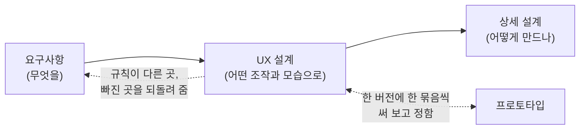

# UX 개요

> [!abstract] 이 문서는
> UX 설계의 첫 문서입니다. **누구를 위해, 어떤 원칙으로** 조작과 모습을 설계했는지와, UX 설계의 문서가 각각 무엇을 담당하는지를 적습니다.
> - **입력:** [[01-requirements]]. 요구사항이 "무엇을 할 수 있어야 하는가"를 적으면, UX 설계는 "그 일이 사용자에게 어떤 조작과 모습으로 보이는가"를 정합니다.
> - **이 설계를 쓰는 곳:** 상세 설계(편집기 [[03-editor]], 레이아웃 · 렌더링 [[02-layout]], 배포 대상의 셸), 프로토타입 리뷰([[prototype#리뷰 순서]]).

## 1. 누구를 위한 편집기인가

- **실무에서 설계 문서를 쓰는 사람**이 주 사용자다. 그림은 코드 옆, 위키, PDF, 인쇄물에서 읽히는 **남는 문서**다 → [[01-requirements#1. 핵심 원칙]]
- 키보드로 빠르게 다루는 사람을 먼저 본다. 표준 키 위에 Vim 키를 더했다 → [[dr-0009-vim-keys|DR-0009]]
- 화면의 텍스트는 영어가 기본이고 한국어와 독일어를 지원한다. 고르지 않았으면 브라우저 언어를 따르고, 목록에 없는 언어면 영어다 → [[01-requirements#^r-nfr|R-NFR-04]]

## 2. UX 원칙

조작의 원칙입니다. 모습의 원칙은 [[04-visual-design#1. 원칙]]에, 화면 배치의 원칙은 [[05-screen-layout]]에 따로 있습니다. 조작 규칙([[02-interaction-rules]])의 절마다 첫머리에 그 절이 따르는 대원칙의 번호를 답니다. 원칙을 이렇게 세운 까닭 → [[dr-0025-five-grand-principles|DR-0025]]

### 2.1 제품의 약속

> AriadneNSD는 구조 편집기다. 사용자는 키보드로 로직의 구조를 말하고, 그림은 편집기가 그린다. 그 그림은 남는 문서다.

대원칙 다섯은 이 문장에서 나옵니다: 구조(①), 그림(②), 말하는 법(③ · ④), 일하는 흐름(⑤). 문장의 근거는 [[#1. 누구를 위한 편집기인가]]와 [[01-requirements#1. 핵심 원칙]]입니다.

### 2.2 대원칙 다섯

| # | 대원칙 | 뜻 |
| --- | --- | --- |
| ① | **구조를 말하면 그림이 따라온다** | 편집기는 구조를 책임지고, 구조만 책임진다. 좌표 · 크기 · 정렬은 사용자가 다루지 않고, 편집 명령은 올바른 구조만 만든다. 텍스트의 뜻은 사용자의 것이라 편집기가 판정하지 않는다 |
| ② | **보이는 대로 다룬다** | 화면에 하나로 보이는 것은 조작에서도 하나다. 명령의 이름과 차례는 그림의 방향을 따른다. 화면에 보이는 그대로 저장된다 |
| ③ | **고르고, 명령한다** | 먼저 선택하고, 그다음 명령한다. 명령은 적고, 선택한 것이 무엇이든 같은 뜻으로 적용된다. 입구(키, 메뉴, 툴바, 커맨드 팔레트, 드래그)가 달라도 명령은 하나다 |
| ④ | **손에 익은 대로** | 이미 널리 쓰는 약속이 있으면 새로 만들지 않는다. 캔버스의 키는 Vim, 창과 파일은 운영체제의 표준, 마우스는 파일 탐색기와 IDE의 관례를 따른다. 다르게 만들 때는 이유를 적는다 |
| ⑤ | **멈춰 세우지 않는다** | 묻는 대신 되돌릴 수 있게 하고, 차단하는 대신 알린다. 할 일은 미리 보이고, 한 일과 할 수 없는 일은 이유와 함께 알린다. 묻는 것은 되돌릴 수 없는 일뿐이다 |

원칙마다 **점검 질문**과 **따름 규칙**이 있습니다. 새 기능이나 새 규칙은 점검 질문에 먼저 대 봅니다. 따름 규칙은 그 원칙에서 나온, 여러 곳에 적용되는 규칙입니다.

#### ① 구조를 말하면 그림이 따라온다

점검 질문(셋 다 "아니오"여야 한다):

1. 사용자가 좌표 · 크기 · 간격을 정하는 곳이 있는가?
2. 편집 명령으로 표준에 없는 구조를 만들 수 있는가?
3. 편집기가 텍스트의 뜻을 판정해 차단하거나 고치는가?

따름 규칙:

- **좌표를 다루지 않는다.** 블록을 삽입하고 감싸고 이동하면 그림은 자동으로 다시 그려진다. 다이어그램의 배치도 자동이다 → [[0004-structure-editor|ADR-0004]], [[02-interaction-rules#5. 여러 다이어그램의 배치]]
- **편집 명령은 올바른 구조만 만든다.** 선택은 같은 부모 아래의 이어진 범위이고([[0008-contiguous-selection|ADR-0008]]), 줄이 비면 빈 블록 하나가 남고, default 분기는 늘 맨 오른쪽이고, 분기와 다이어그램은 남겨야 하는 수 아래로 줄지 않는다([[ux-decisions#MD3. Case 갈래의 최소 수|MD3]]) → [[01-requirements#^r-core|R-CORE-02]]
- **받아들이기는 넓게, 만들기는 좁게.** 파일에 든 모양(default가 없는 Case, 분기 하나인 병렬 처리, 이름이 중복되는 헤더, 다른 도구로 고친 그림)은 그대로 열고 그리고 편집할 수 있다. 편집 명령은 그런 모양을 새로 만들지 않는다 → [[ux-decisions#CD1. default가 없는 Case|CD1]], [[0052-endless-exit-parallel-blocks|ADR-0052]], [[ux-decisions#DC1. 다른 도구로 고친 그림은 열 때 상태 표시줄에 경고|DC1]]
- **텍스트의 뜻은 판정하지 않는다.** 탈출 블록의 위치를 검사하지 않고([[ux-decisions#XB1. 탈출 블록|XB1]]), 호출 블록의 인자 개수가 헤더와 달라도 알리지 않고, For의 조건 칸을 나누지 않고([[ux-decisions#FB1. For 블록의 모양|FB1]]), 이름만 적은 호출 블록은 잘못이 아니고([[ux-decisions#CB6. 이름을 적어 호출하기|CB6]]), 분기를 맞바꾸거나 If ↔ Case로 바꿔도 조건 텍스트는 그대로 두고 알리기만 한다. 편집기가 텍스트 안을 읽는 곳은 하나다: Method 헤더의 첫 `(` 앞까지가 이름이다 → [[0022-call-name-follows-head|ADR-0022]]

#### ② 보이는 대로 다룬다

점검 질문:

1. 상자 하나로 보이는 것을 하나로 선택 · 이동 · 복사 · 드래그할 수 있는가?
2. 보이지 않는 것이 조작의 결과를 바꾸는가? ("아니오"여야 한다)
3. 명령 이름의 위 · 아래 · 왼쪽 · 오른쪽이 그림의 방향과 같은가?
4. 화면과 저장된 그림이 같은가?

따름 규칙:

- **상자 하나가 조작의 한 단위다.** 접기 영역, 접힌 칸, 접힌 줄, 펴 보인 호출 블록, 분기는 조작에서도 하나다. 그 경계(이름 띠, 가장자리)를 가리키면 그 밖이고, 안의 블록을 가리키면 그 안이다 → [[ux-decisions#MD1. 접기 영역의 끝에 넣은 블록|MD1]], [[ux-decisions#DF1. 접기 영역 곁에 놓기|DF1]], [[ux-decisions#DF4. 접힌 줄을 끌어 옮기기|DF4]], [[ux-decisions#FD5. 키보드로 지나가는 접힌 것과 이름 띠|FD5]]
- **보이지 않는 것은 없는 것으로 다룬다.** 이름 띠를 끈 접기 영역은 드롭 · 방향키 · 이동에서 접기 영역이 없는 것과 같다. 접기 · 펴기와 접기 영역 풀기가 그 영역에 적용되면 무엇에 적용했는지 알린다 → [[ux-decisions#FM1. 이름 띠를 끈 접기 영역에서의 이동|FM1]]
- **이름과 차례는 그림의 방향을 따른다.** 블록은 위 · 아래, 분기는 왼쪽 · 오른쪽, `Shift`는 늘 위 · 왼쪽이다 → [[ux-decisions#NM1. 위에 · 아래에, 왼쪽에 · 오른쪽에|NM1]]
- **화면에 보이는 그대로 저장된다.** 접힘, 이름 띠, 펴 보기는 파일과 그림에 그대로 들어간다. 선택 표시와 펼침 삼각형 같은 편집 표시는 넣지 않는다 → [[0018-save-as-shown|ADR-0018]], [[04-visual-design#원칙 3. 문서의 표시와 편집의 표시는 다른 레이어다|시각 디자인의 원칙 3]]

#### ③ 고르고, 명령한다

점검 질문:

1. 이미 있는 명령을 이 대상에 적용해 해결할 수 있는데 새 명령을 만들었는가? ("아니오"여야 한다)
2. 같은 명령이 대상이나 입구에 따라 다른 결과를 내는가? ("아니오"여야 한다)
3. 마우스 없이 끝까지 할 수 있는가?
4. 명령 뒤에 다음 명령을 바로 이을 수 있게 선택이 남는가?

따름 규칙:

- **명령은 적게, 대상은 여럿.** 블록 · 분기 · 다이어그램 · 접기 영역에 같은 종류의 일은 한 명령으로 한다. 그 규칙이 [[#3. 공통 규칙]]이다
- **명령은 하나, 입구는 여럿.** 키, 메뉴, 컨텍스트 메뉴, 툴바, 커맨드 팔레트, 드래그 어느 것으로 실행해도 결과가 같다 → [[0033-command-list-for-shells|ADR-0033]]
- **키보드만으로 모두.** 마우스로 할 수 있는 일은 모두 키로도 할 수 있다 → [[01-requirements#^r-nfr|R-NFR-05]]

#### ④ 손에 익은 대로

점검 질문:

1. 이 조작에 이미 널리 쓰는 약속이 있는가(Vim, 표준 단축키, 파일 탐색기, IDE)?
2. 있다면 그대로인가? 다르다면 이유가 문서에 있는가?
3. 두 약속이 다르면 어느 쪽을 따르는지 정해져 있는가?

따름 규칙:

- **캔버스의 키는 Vim.** 키와 그 동작은 "Vim에서 그 키가 실제로 어떻게 움직이는가"를 먼저 본다 → [[03-keymap]], [[dr-0009-vim-keys|DR-0009]]
- **창 · 파일 · 클립보드는 운영체제와 브라우저의 표준.** `Ctrl`+`Z` · `C` · `V` · `S` · `P`, 모달의 `Enter`(기본 버튼)와 `Esc`(취소), 컨텍스트 메뉴의 `Shift`+`F10`
- **마우스는 파일 탐색기와 IDE의 관례.** 드롭의 사이와 위([[ux-decisions#W2. 블록 아이콘을 쓰는 법|W2]]), 더블클릭은 편집([[ux-decisions#Q1 · Q2. 고치기를 시작하는 방법과 더블클릭|Q2]]), `Shift`+클릭은 범위, `Ctrl`+휠은 확대 · 축소, 감싸기(IDE의 Surround With), 커맨드 팔레트([[ux-decisions#W6. 명령 찾기|W6]])

#### ⑤ 멈춰 세우지 않는다

점검 질문:

1. 되돌릴 수 있는 일인데 묻는가? ("아니오"여야 한다)
2. 묻는 일을 되돌릴 수 있게 만들 방법은 없는가?
3. 명령이 아무 일도 하지 않을 때 이유를 알리는가?
4. 결과를 하기 전에 볼 수 있는가(드롭 표시, 키 힌트, 툴팁)?
5. 그림이 바뀌는 일이 모두 실행 취소 한 번으로 돌아오는가?

따름 규칙:

- **실행 취소 한 번으로 돌아온다.** 그림이 바뀌는 일(내용, 문서 설정, 접고 펴기, 이름 띠 보기)은 명령 하나가 실행 취소 한 단계다 → [[02-interaction-rules#6. 실행 취소]], [[ux-decisions#UN1. 접고 펴기도 실행 취소의 대상|UN1]], [[ux-decisions#UN2. 이름 띠 보기도 실행 취소의 대상|UN2]]
- **되돌릴 수 있으면 묻지 않는다.** 묻는 것은 되돌릴 수 없는 일뿐이다: 저장하지 않은 새 문서를 두고 다른 문서 열기([[ux-decisions#US1. 저장하지 않은 새 문서를 두고 다른 문서를 열 때|US1]]), 브라우저 문서 삭제([[ux-decisions#BS3. 브라우저의 문서 목록|BS3]]), 붙여넣은 텍스트를 새 문서로 열기([[ux-decisions#JP2. 알아본 뒤의 동작|JP2]])
- **차단하지 않고 알린다.** 입력을 차단하는 자리(모드, 모달)를 늘리지 않는다. 할 수 없는 일은 아무 일도 하지 않고 이유를 상태 표시줄에 알린다 → [[ux-decisions#4.1 호출 블록 펴 보기 (R6)|Q14-a]]
- **미리 보인다.** 드롭 위치([[ux-decisions#DI1. 드롭 표시와 선택|DI1]]), 두 키 조합의 키 힌트([[ux-decisions#K3. 두 키 조합의 안내 자리 (다시)|K3]]), 툴팁의 키, 흐린 항목의 이유([[ux-decisions#TB3. 감쌀 것이 없을 때의 감싸기 ▾|TB3]])

### 2.3 원칙이 충돌한 곳

원칙끼리 충돌해 한쪽을 우선한 결정입니다. 아래의 규칙은 원칙에 어긋난 것이 아니라 정한 것입니다. 새로 충돌하면 정하고 한 줄 더합니다.

| 결정 | 충돌한 원칙 | 우선한 쪽 | 진 쪽을 보완한 것 |
| --- | --- | --- | --- |
| 헤더의 이름이 중복되면 받아들이지 않고 칸을 다시 연다([[02-interaction-rules#Event 헤더]]) | ① 올바른 구조만 ↔ ⑤ 차단하지 않는다 | ① | 다시 열린 칸의 `Esc`는 편집 전으로 되돌린다. 입력을 차단하는 유일한 곳이다 |
| 텍스트를 편집하다 누른 `Esc`는 적은 대로 편집 완료다([[ux-decisions#Q3. `Esc`의 뜻 (R1)\|Q3]]) | ④ 안에서 Vim ↔ 표준(`Esc`는 취소) | Vim | 잘못 적은 것은 실행 취소로 되돌린다(⑤). 모달과 목록의 `Esc`는 표준대로 취소다 |
| 푸는 명령은 둘이다: 풀기와 접기 영역 풀기([[ux-decisions#Q7. 푸는 명령을 하나로 (R5)\|Q7]]) | ④ Vim의 `ds`와 `zd`는 다른 계열 ↔ ③ 명령 하나 | ④ | 접기 영역을 선택하고 풀기를 쓰면 그것을 담은 제어 블록에 적용하고, 무엇에 적용했는지 알린다 |
| 빈 블록에서 처리 삽입(`o` · `O`)은 삽입이고, 제어 블록 삽입과 붙여넣기는 빈 블록을 교체한다([[ux-decisions#KP2. 빈 블록에서도 o · O는 삽입\|KP2]]) | ④ Vim의 `o`는 늘 새 줄 ↔ ③ 같은 명령은 같은 결과 | ④ | 없음 |
| 포인터가 다이어그램 위에 있고 블록을 선택했으면 마우스 휠은 선택을 옮긴다([[ux-decisions#WH1. 마우스 휠\|WH1]]) | ④ 휠은 스크롤 ↔ 검토할 때 블록을 따라가기 | 선택 이동 | 빈 캔버스 위, 맨 위 · 맨 아래 선택, `Shift`+휠은 스크롤이다 |
| 헤더를 선택하고 삭제하면 다이어그램이 아니라 헤더만 제거한다([[ux-decisions#HC1. 헤더에서 복사하면 다이어그램\|HC1]]) | ② 헤더는 다이어그램 전체를 대표 ↔ 정한 키([[03-keymap]]) | 정한 키 | 다이어그램 삭제는 다른 키다. 이동과 복사는 다이어그램 전체다 |

기록에서 나오는 순서는 둘입니다: ①은 ⑤보다 먼저이고, 캔버스의 키에서는 ④(Vim)가 ③보다 먼저입니다. 나머지 쌍은 충돌한 적이 없어 순서를 정하지 않았습니다.

## 3. 공통 규칙

대원칙 ③ "고르고, 명령한다"의 본문입니다. 요구사항의 편집 규칙은 60개쯤이고 대부분 블록 종류마다 따로 적혀 있었습니다. 모든 명령에 적용되는 **바탕 규칙** 넷과 **명령마다의 한 줄**로 묶으면 그 가운데 절반쯤이 "공통 규칙을 따른다" 한 줄로 줄어듭니다. 명령이 대상마다 어떻게 적용되는지는 [[#3.3 명령 × 대상]]의 표 한 장에 있습니다. 이렇게 묶은 까닭 → [[ux-decisions#CR1. 공통 규칙은 바탕 규칙 넷과 명령 × 대상 표|CR1]]

### 3.1 바탕 규칙

| # | 바탕 규칙 | 문장 | 대원칙 | 근거 |
| --- | --- | --- | --- | --- |
| K1 | **대상** | 명령은 선택한 것에 적용된다. 선택한 것이 상자의 이름(분기 라벨, 이름 띠, 접힌 칸)이면 그 상자 전체에 적용된다. 선택한 것에 적용할 수 없으면 그것을 담은 가장 가까운 것에 적용하고 무엇에 적용했는지 알린다. 그것도 없으면 아무 일도 하지 않고 이유를 알린다 | ② ③ ⑤ | [[ux-decisions#Q8. 고른 것을 담은 것에 듣는 명령\|Q8]], [[ux-decisions#BL1. 분기 라벨에서 복사 · 잘라내기 · 감싸기\|BL1]] |
| K2 | **자리** | 새로 들어오는 것(삽입, 붙여넣기, 드롭, 새 분기)은 선택한 것 아래에, `Shift`는 위에 놓인다. 분기는 오른쪽 · 왼쪽이다. 상자 전체를 선택했으면 상자 밖에, 헤더에서는 본문의 맨 앞에, 선택한 것이 없으면 지금 다이어그램의 맨 끝에 놓인다 | ② ③ | [[ux-decisions#Q10의 세부와 Q5. 갈래 이름 고르기, 갈래 넣기와 지우기\|Q5]], [[ux-decisions#MD1. 접기 영역의 끝에 넣은 블록\|MD1]], [[ux-decisions#HD1. 헤더에서 아래에 삽입\|HD1]], [[ux-decisions#PS1. 선택한 것이 없을 때의 붙여넣기\|PS1]] |
| K3 | **명령 뒤** | 명령이 끝나면 만들거나 바뀐 것을 선택한다. 새로 만든 것에 텍스트가 있으면 바로 편집 칸을 연다. 삭제한 뒤에는 다음 블록, 없으면 앞 블록, 둘 다 없으면 담고 있던 블록을 선택한다 | ③ | [[ux-decisions#Q19. 명령 뒤에 고르는 것\|Q19]] |
| K4 | **되돌림** | 명령 하나가 실행 취소 한 단계다. 그림이 바뀌는 일은 모두 대상이다. 만들면서 바로 적은 이름은 만들기와 한 단계다 | ⑤ | [[ux-decisions#UN1. 접고 펴기도 실행 취소의 대상\|UN1]], [[ux-decisions#UN2. 이름 띠 보기도 실행 취소의 대상\|UN2]], [[ux-decisions#FD4. 만들 때 적은 이름은 만들기와 한 단계\|FD4]] |

### 3.2 명령마다의 한 줄

| 명령 | 한 줄 | 상세 |
| --- | --- | --- |
| **선택** | 선택할 수 있는 것은 블록(이어진 범위), 분기 라벨, 헤더, 접기 영역, 빈 default 칸, 펴 보인 블록이다. 방향키는 그림에 보이는 순서를 따른다 | [[02-interaction-rules#2. 이동과 선택]] |
| **텍스트 편집** | 텍스트가 있는 것은 같은 명령과 더블클릭으로 편집한다. `Enter`와 `Esc`는 적은 대로 완료한다. 비울 수 없는 칸을 비우면 그 칸의 기본 텍스트로 돌아가고 닫힌다 | [[02-interaction-rules#텍스트 편집]] |
| **삽입 · 붙여넣기** | 놓이는 자리는 K2를 따른다 | [[02-interaction-rules#키보드로 이동하고 삽입하기]], [[02-interaction-rules#붙여넣기]] |
| **복사 · 잘라내기 · 삭제** | 대상은 K1을 따른다. 줄이 비면 빈 블록 하나가 남는다. 남겨야 하는 수(다이어그램 하나, Case의 분기 하나, 병렬 처리의 분기 둘)보다 줄이는 삭제는 거절한다 | [[02-interaction-rules#복사 · 잘라내기]], [[02-interaction-rules#삭제]] |
| **이동** | 이동 명령 하나가 블록은 위 · 아래로, 분기는 좌우로, 접기 영역은 통째로, 헤더에서는 다이어그램의 순서를 바꾼다. 드래그는 이동과 붙여넣기를 마우스로 하는 방법이다 | [[02-interaction-rules#이동]], [[02-interaction-rules#7. 드래그 앤 드롭]] |
| **감싸기 · 풀기** | 감싸기는 선택한 블록들을 제어 블록 하나의 안에 넣는다. 풀기는 선택한 제어 블록이나 호출 블록을 그 안의 블록들로 바꾼다. 접기 영역은 접기 영역 풀기로 없앤다 | [[02-interaction-rules#감싸기 · 풀기]] |
| **접기 · 펴기** | 접기 · 펴기 명령 하나가 제어 블록의 안쪽, 분기, 접기 영역, 호출 블록 펴 보기에 적용된다. 대상은 K1을 따른다 | [[02-interaction-rules#4. 접기와 펴기]] |

### 3.3 명령 × 대상

행은 명령, 열은 선택한 것입니다. "블록"은 블록 하나, 이어진 범위, 접힌 줄을 포함합니다. "거절"은 아무 일도 하지 않고 이유를 알리는 것입니다. 새 명령이나 새 대상이 생기면 행이나 열을 더하고 칸을 채웁니다.

| 명령 | 블록 | 분기 라벨 | 헤더 | 접기 영역(이름 띠 · 접힌 칸) | 펴 보인 블록 | 선택 없음 |
| --- | --- | --- | --- | --- | --- | --- |
| 텍스트 편집 | 텍스트 | 라벨(default 분기와 병렬 처리의 분기는 거절) | 이름 | 이름 | 거절 | 거절 |
| 삽입(처리) | 아래 · 위 | 분기를 오른쪽 · 왼쪽에 | 본문의 맨 앞(위는 거절) | 영역 밖의 아래 · 위 | 거절 | 맨 끝 |
| 삽입(제어 블록) | 아래 · 위(빈 블록은 교체) | 거절 | 본문의 맨 앞(위는 거절) | 영역 밖의 아래 · 위 | 거절 | 맨 끝 |
| 붙여넣기 | 아래 · 위(빈 블록은 교체) | 새 분기를 오른쪽 · 왼쪽에 만들어 그 안에 | 본문의 맨 앞(위는 거절). 다이어그램을 복사했으면 새 다이어그램 | 영역 밖의 아래 · 위 | 거절 | 맨 끝 |
| 복사 | 블록 | 분기의 블록 전체 | 다이어그램 | 영역 전체 | Method의 블록 | 거절 |
| 잘라내기 | 블록 | 블록을 복사하고 분기를 삭제 | 거절 | 영역 전체 | 거절 | 거절 |
| 삭제 | 블록 | 분기(If와 남겨야 하는 수는 거절) | 헤더만 제거 | 영역 전체 | 거절 | 거절 |
| 이동 | 위 · 아래(좌우는 담은 분기) | 분기를 좌우로 | 다이어그램의 순서 | 영역 전체 | 거절 | 거절 |
| 감싸기 | 블록 | 분기의 블록 전체 | 거절 | 영역 전체 | 거절 | 거절 |
| 풀기 | 제어 블록 · 호출 블록(그 밖은 담은 제어 블록) | 그 If · Case | 거절 | 영역을 담은 제어 블록 | 거절 | 거절 |
| 접기 · 펴기 | 제어 블록 · 호출 블록(그 밖은 담은 것) | 그 분기 | 거절 | 그 영역 | 그 자리에서만 | 거절 |
| 새 Method로 빼기 | 블록 | 거절 | 거절(키 `m`은 Method로 바꾸기) | 영역이 Method가 된다 | 거절 | 거절 |

> [!info] 미완성: 표의 세 칸
> 아직 앱에 없는 칸이 셋입니다. 지금의 앱은 분기 라벨에서 붙여넣기를 거절하고, 헤더에서 복사를 거절하고, 선택한 것이 없을 때 붙여넣기를 거절합니다 → [[ux-decisions#BL2. 분기 라벨에서 붙여넣기|BL2]], [[ux-decisions#HC1. 헤더에서 복사하면 다이어그램|HC1]], [[ux-decisions#PS1. 선택한 것이 없을 때의 붙여넣기|PS1]]

## 4. 문서 지도

| 문서 | 답하는 질문 | 이런 때 읽는다 |
| --- | --- | --- |
| **01-ux-overview** (이 문서) | 누구를 위해, 어떤 원칙으로? 새 기능에 대 볼 점검 질문은? 명령은 대상마다 어떻게 적용되나? | 처음 읽을 때, 새 기능이나 규칙을 정할 때 |
| [[02-interaction-rules]] | 기능 하나하나가 어떻게 움직이나? | "이걸 선택하고 이 명령을 쓰면?" |
| [[03-keymap]] | 어떤 키가 어떤 명령인가? | "키는?" |
| [[04-visual-design]] | 어떻게 보이나? 색 · 선 · 타이포그래피 · 치수는? | 화면이나 저장되는 그림을 만들 때 |
| [[05-screen-layout]] | 편집 화면에 무엇이 어디에 있나? 메뉴 바 · 툴바 · 캔버스 · 상태 표시줄 | 화면의 배치를 볼 때 |

- 한 항목은 한 문서에만 적는다. 조작 규칙에는 명령의 이름만 적고 키는 [[03-keymap]]에, 모습의 값은 [[04-visual-design]]에만 적는다.
- 아직 정하지 않은 질문은 [[02-interaction-rules#9. 미결정 사항]]에 있다. 정한 것의 이유는 아뜰리에의 [[ux-decisions|UX 결정 모음]]에 있다.
- 비교한 안과 장면 그림은 시안 페이지에 있다 → [[sketchbook]]

## 5. 어떻게 정했나

- 공통 규칙은 요구사항에서 **같은 일을 곳마다 다르게 다루는 곳**을 모아 세웠고, 2026-11-28에 바탕 규칙 넷과 명령 × 대상 표로 다시 적었다. 요구사항만 전달받은 다른 검토자(독립 검토)가 따로 읽어 비교했다 → [[requirements-rework]]
- 질문은 프로토타입을 버전마다 써 보며 한 묶음씩 정한다 → [[prototype#리뷰 순서]]
- 문서를 나눈 방법의 비교한 안은 [[sketchbook]]의 "UX 문서 구조 시안"에 있다.
