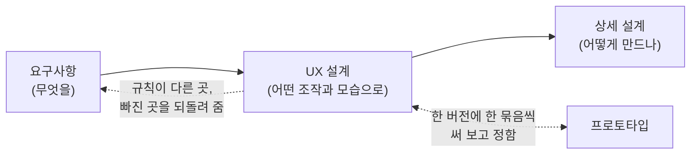

# UX 개요

> [!abstract] 이 문서는
> UX 설계의 첫 문서입니다. **누구를 위해, 어떤 제품으로 정의하고** 조작과 모습을 설계했는지와, UX 설계의 문서가 각각 무엇을 담당하는지를 적습니다.
> - **입력:** [[01-requirements]]. 요구사항이 "무엇을 할 수 있어야 하는가"를 적으면, UX 설계는 "그 일이 사용자에게 어떤 조작과 모습으로 보이는가"를 정합니다.
> - **이 설계를 쓰는 곳:** 상세 설계(편집기 [[03-editor]], 레이아웃 · 렌더링 [[02-layout]], 배포 대상의 셸), 프로토타입 리뷰([[prototype#리뷰 순서]]).

## 1. 누구를 위한 편집기인가

- **실무에서 설계 문서를 쓰는 사람**이 주 사용자다. 그림은 코드 옆, 위키, PDF, 인쇄물에서 읽히는 **남는 문서**다 → [[01-requirements#1. 핵심 원칙]]
- 키보드로 빠르게 다루는 사람을 먼저 본다. 표준 키 위에 Vim 키를 더했다 → [[dr-0009-vim-keys|DR-0009]]
- 화면의 텍스트는 영어가 기본이고 한국어와 독일어를 지원한다. 고르지 않았으면 브라우저 언어를 따르고, 목록에 없는 언어면 영어다 → [[01-requirements#^r-nfr|R-NFR-04]]

## 2. 제품 정의와 디자인 원칙

> AriadneNSD는 구조 편집기다. 사용자는 키보드로 로직의 구조를 말하고, 그림은 편집기가 그린다. 그 그림은 남는 문서다.

위가 제품 정의입니다. UX 설계의 디자인 원칙은 이 문장에서 나옵니다. 원칙은 그것을 따르는 규칙과 같은 문서에 있습니다.

| 원칙 | 있는 곳 | 내용 |
| --- | --- | --- |
| 조작 | [[02-interaction-rules#디자인 원칙]] | 구조 편집, 직접 조작, 선택 후 명령, 외적 일관성, 관용성과 피드백. 원칙마다의 휴리스틱 체크리스트와 가이드라인, 원칙 간 트레이드오프. 모든 명령에 적용되는 규칙은 [[02-interaction-rules#공통 규칙]] |
| 모습 | [[04-visual-design#1. 원칙]] | 원칙 여섯 |
| 화면 배치 | [[05-screen-layout]] | 화면은 다이어그램에게 |

문장의 근거는 [[#1. 누구를 위한 편집기인가]]와 [[01-requirements#1. 핵심 원칙]]입니다. 정한 과정 → [[dr-0025-five-grand-principles|DR-0025]]

## 3. 문서 지도

| 문서 | 답하는 질문 | 이런 때 읽는다 |
| --- | --- | --- |
| **01-ux-overview** (이 문서) | 누구를 위한 어떤 제품인가? 디자인 원칙은 어느 문서에 있나? | 처음 읽을 때 |
| [[02-interaction-rules]] | 조작의 디자인 원칙은? 새 기능을 평가할 휴리스틱 체크리스트는? 명령은 대상별로 어떻게 적용되나? 기능 하나하나가 어떻게 동작하나? | "이걸 선택하고 이 명령을 쓰면?", 새 기능이나 규칙을 정할 때 |
| [[03-keymap]] | 어떤 키가 어떤 명령인가? | "키는?" |
| [[04-visual-design]] | 어떻게 보이나? 색 · 선 · 타이포그래피 · 치수는? | 화면이나 저장되는 그림을 만들 때 |
| [[05-screen-layout]] | 편집 화면에 무엇이 어디에 있나? 메뉴 바 · 툴바 · 캔버스 · 상태 표시줄 | 화면의 배치를 볼 때 |

- 한 항목은 한 문서에만 적는다. 조작 규칙에는 명령의 이름만 적고 키는 [[03-keymap]]에, 모습의 값은 [[04-visual-design]]에만 적는다.
- 아직 정하지 않은 질문은 [[02-interaction-rules#9. 미결정 사항]]에 있다. 정한 것의 이유는 아뜰리에의 [[ux-decisions|UX 결정 모음]]에 있다.
- 비교한 안과 장면 그림은 시안 페이지에 있다 → [[sketchbook]]

## 4. 어떻게 정했나

- 공통 규칙([[02-interaction-rules#공통 규칙]])은 요구사항에서 **같은 일을 곳마다 다르게 다루는 곳**을 모아 세웠고, 2026-11-28에 모든 명령의 규칙 다섯(C1 ~ C5)과 명령 × 대상 매트릭스로 다시 적었다. 요구사항만 전달받은 다른 검토자(독립 검토)가 따로 읽어 비교했다 → [[requirements-rework]]
- 질문은 프로토타입을 버전마다 써 보며 한 묶음씩 정한다 → [[prototype#리뷰 순서]]
- 문서를 나눈 방법의 비교한 안은 [[sketchbook]]의 "UX 문서 구조 시안"에 있다.
