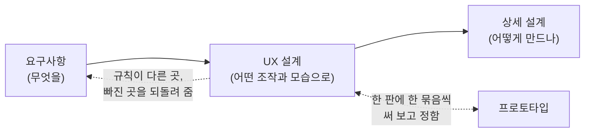

# UX 개요

> [!abstract] 이 문서는
> UX 설계의 첫 문서입니다. **누구를 위해, 어떤 원칙으로** 조작과 모습을 설계했는지와, UX 설계의 네 문서가 각각 무엇을 맡는지를 적습니다.
> - **입력:** [[01-requirements]]. 요구사항이 "무엇을 할 수 있어야 하는가"를 적으면, UX 설계는 "그 일이 사용자에게 어떤 조작과 모습으로 보이는가"를 정합니다.
> - **이 설계를 쓰는 곳:** 상세 설계(편집기 [[03-editor]], 레이아웃 · 렌더링 [[02-layout]], 배포 대상의 셸), 프로토타입 리뷰([[prototype#리뷰 순서]]).

## 1. 누구를 위한 편집기인가

- **실무에서 설계 문서를 쓰는 사람**이 주 사용자다. 그림은 코드 옆, 위키, PDF, 인쇄물에서 읽히는 **남는 문서**다 → [[01-requirements#1. 핵심 원칙]]
- 키보드로 빠르게 다루는 사람을 먼저 본다. 표준 키 위에 Vim 키를 더했다 → [[dr-0009-vim-keys|DR-0009]]
- 화면의 글자는 영어가 기본이고 한국어를 지원한다 → [[01-requirements#^nfr-i18n]]

## 2. UX 원칙

조작의 원칙입니다. 모습의 원칙은 [[04-visual-design#1. 원칙]]에 따로 있습니다.

| 원칙 | 뜻 | 근거 |
| --- | --- | --- |
| **구조를 고치면 그림이 따라온다** | 사용자는 좌표를 다루지 않는다. 블록을 넣고 감싸고 옮기면 그림은 저절로 다시 그려진다 | [[0004-structure-editor\|ADR-0004]] |
| **같은 일은 같은 방법으로** | 블록 · 갈래 · 다이어그램 · 접기 영역에 같은 종류의 일(고치기, 넣기, 옮기기, 풀기)은 한 규칙으로 한다. 3장의 공통 규칙이 그 규칙이다 | 3장 |
| **키보드만으로 모두** | 마우스로 할 수 있는 일은 모두 키로도 할 수 있다 | [[01-requirements#^nfr-a11y]] |
| **Vim의 손에 맞게** | 키와 그 동작은 "Vim에서 그 키가 실제로 어떻게 움직이는가"를 먼저 본다. 다르게 만들 때는 까닭을 적는다 | [[03-keymap]], [[dr-0009-vim-keys\|DR-0009]] |
| **보기와 내용을 가른다** | 접고 펴기처럼 보기만 바꾸는 일은 실행 취소의 대상이 아니고 잘못 눌러도 한 번 더 누르면 돌아온다. 내용을 바꾸는 일은 실행 취소 한 번으로 되돌린다 | [[02-interaction-rules#6. 실행 취소]] |
| **막지 않고 알린다** | 입력을 막는 자리를 늘리지 않는다. 할 수 없는 일은 아무 일도 하지 않고 까닭을 알린다 | [[ux-decisions#4.1 호출 블록 펴 보기 (R6)\|Q14-a]] |

## 3. 공통 규칙

요구사항의 편집 규칙은 60개쯤이고 대부분 블록 종류마다 따로 적혀 있었습니다. 아래 일곱 개로 묶으면 그 가운데 절반쯤이 "공통 규칙을 따른다" 한 줄로 줄어듭니다. 물음마다의 결정과 까닭은 [[ux-decisions]]에 있습니다.

| # | 공통 규칙 | 한 줄 | 물음 | 상태 |
| --- | --- | --- | --- | --- |
| R1 | **고치기** | 글자가 있는 것은 모두 같은 방법으로 고치기 시작하고 끝낸다 | Q1, Q2, Q3 | Q3만 정함 |
| R2 | **빈 글자** | 비울 수 없는 칸을 비우면 어디서나 같은 일이 일어난다 | Q4 | 정하지 않음 |
| R3 | **넣는 자리** | 새로 생기는 것은 고른 것 뒤에, `Shift`는 앞에 | Q5 | 정하지 않음 |
| R4 | **옮기기** | 블록 · 갈래 · 다이어그램의 순서를 명령 하나로 바꾼다 | Q6 | 정하지 않음 |
| R5 | **묶기와 풀기** | 묶는 명령은 셋, 푸는 명령은 둘 (껍데기 풀기, 접기 영역 풀기) | Q7, Q16, Q17 | 정함 → [[ux-decisions#Q7. 푸는 명령을 하나로 (R5)\|Q7]], [[ux-decisions#4.2 호출 블록을 Method의 블록들로 바꾸기 (R5)\|Q16 · Q17]] |
| R6 | **접기 · 펴기** | 보기만 바꾸는 명령은 하나이고, 무엇에나 같은 식으로 듣는다 | Q8, Q11, Q13~Q15, Q20 | 호출 블록 펴 보기와 모습(Q13~Q15)만 정함 |
| R7 | **실행 취소** | 내용을 바꾸면 대상이고, 보기만 바꾸면 대상이 아니다 | Q9 | 정함 → [[ux-decisions#Q9. 실행 취소의 대상 (R7)\|Q9]] |

## 4. 문서 지도

| 문서 | 답하는 물음 | 이런 때 읽는다 |
| --- | --- | --- |
| **01-ux-overview** (이 문서) | 누구를 위해, 어떤 원칙으로? | 처음 읽을 때 |
| [[02-interaction-rules]] | 기능 하나하나가 어떻게 움직이나? | "이걸 고르고 이 명령을 쓰면?" |
| [[03-keymap]] | 어떤 키가 어떤 명령인가? | "키는?" |
| [[04-visual-design]] | 어떻게 보이나? 색 · 선 · 글자 · 치수는? | 화면이나 저장되는 그림을 만들 때 |

- 한 항목은 한 문서에만 적는다. 조작 규칙에는 명령의 이름만 적고 키는 [[03-keymap]]에, 모습의 값은 [[04-visual-design]]에만 적는다.
- 아직 정하지 않은 물음은 [[02-interaction-rules#9. 미결정 사항]]에 있다. 정한 것의 까닭은 작업 공간의 [[ux-decisions|UX 결정 모음]]에 있다.
- 견준 안과 장면 그림은 시안 페이지에 있다 → [[sketchbook]]

## 5. 어떻게 정했나

- 공통 규칙은 요구사항에서 **같은 일을 곳마다 다르게 다루는 곳**을 모아 세웠다. 요구사항만 건네받은 다른 검토자(독립 검토)가 따로 읽어 견주었다 → [[requirements-rework]]
- 물음은 프로토타입을 판마다 써 보며 한 묶음씩 정한다 → [[prototype#리뷰 순서]]
- 문서를 나눈 방법의 견준 안은 [[sketchbook]]의 "UX 문서 구조 시안"에 있다.
