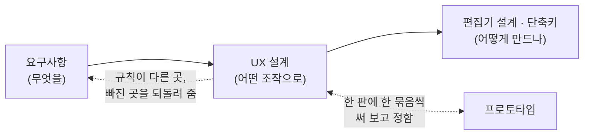

# UX 설계

> [!abstract] 이 문서는
> **사용자가 편집기를 다루는 규칙**을 설계한 문서입니다. 무엇을 고를 수 있고, 명령이 고른 것에 어떻게 듣고, 글자를 어떻게 고치고, 접고 펴는 것이 어떻게 보이는지를 정합니다.
> - **입력:** [[01-requirements]]. 요구사항이 "무엇을 할 수 있어야 하는가"를 적으면, 이 문서는 "그 일이 사용자에게 어떤 조작으로 보이는가"를 정합니다.
> - **출력:** 공통 규칙 일곱 개(2장)와, 규칙마다 정한 것 · 아직 정하지 않은 것(3~6장). 7장에 표 하나로 모았습니다.
> - **이 문서가 쓰이는 곳:** 요구사항 3.1 · 3.2를 다시 짤 때, 편집기 설계([[03-editor]])와 단축키 설계를 할 때의 기준입니다.
> - **짝이 되는 문서:** 지금의 규칙을 하나하나 적은 것은 [[01-interaction-rules]]입니다. 아래 물음의 "**지금**"과 "요구사항에 적힌"은 그 문서의 규칙을 가리킵니다(2026-10-12에 요구사항에서 그리로 옮겼습니다). 물음이 정해지면 그 문서를 고칩니다.
> - **지금 상태:** 초안입니다. 물음 스물다섯 가운데 일곱을 정했고 열여덟이 남았습니다. 남은 물음은 프로토타입의 판마다 한 묶음씩 써 보고 정합니다.

> [!info] 읽는 법
> - 바쁘면 **2장**(공통 규칙)과 **7장**(결정 모음)만 보면 됩니다.
> - 물음에는 번호(`Q1` …)가 붙어 있습니다. 번호는 시안 페이지의 카드 딱지(`Q2 · 1번`)와 같습니다. 중간에 빠진 번호(Q18, Q22, Q23)는 UX가 아니라 요구사항 문서에 대한 물음이어서 [[requirements-review]]에 있습니다.
> - 물음은 "지금 → 장면 → 고를 것 → 추천" 순서로 적었습니다. **추천**은 설계안이고, 정한 것에는 **정함**이라고 적었습니다.
> - 이 문서에서는 **어떤 키를 쓸지는 정하지 않습니다.** 키는 [[03-editor#4. 단축키]]의 표에 있습니다(2026-10-13에 Vim 키를 들인 초안). 이 문서에서 키를 적은 곳은 "그때의 프로토타입이 이랬다"는 뜻입니다.

> [!example] 물음을 그림으로 보기
> 물음마다 선택지를 그림으로 그린 시안이 있습니다.
> - **UX 규칙 시안** (Q1~Q12, Q17~Q23): https://claude.ai/artifact/A7sWbwCA4NFC8qSZg58d3y · 사본 `journal/assets/2026-10-11-ux-rules-study.html`
> - **호출 블록 펴 보기 시안** (Q13~Q16): https://claude.ai/artifact/SRXMaLyK5KFCbFiRw7iwwL · 사본 `journal/assets/2026-10-11-call-expand-study.html`

## 1. 입력과 출력

| | 무엇 | 어디 |
| --- | --- | --- |
| 입력 | 블록의 종류와 편집 기능, 접근성(키보드만으로 조작) | [[01-requirements#3.2 편집]], [[01-requirements#^nfr-a11y]] |
| 입력 | 프로토타입을 써 보며 확인한 동작 | [[status#바로 가기]]의 프로토타입 |
| 방법 | 요구사항을 처음부터 다시 읽고 **같은 일을 곳마다 다르게 다루는 곳**을 모은 뒤, 하나로 묶을 규칙을 세웠습니다. 요구사항만 건네받은 다른 검토자(독립 검토)가 따로 읽어 견주었습니다 | [[requirements-review]] |
| 출력 | 공통 규칙 R1~R7, 물음마다의 결정 | 이 문서 |
| 출력 | 기능마다의 모습과 조작 규칙 (지금의 설계) | [[01-interaction-rules]] |
| 되돌려 주는 것 | 요구사항 문서의 짜임새, 모순, 빠진 곳 | [[requirements-review]] |

## 2. 공통 규칙

지금 요구사항의 편집 규칙은 60개쯤이고, 대부분 블록 종류마다 따로 적혀 있습니다. 아래 **공통 규칙 일곱 개**를 세우면 그 가운데 절반쯤이 "공통 규칙을 따른다" 한 줄로 줄어듭니다.

| # | 공통 규칙 | 한 줄 | 물음 | 상태 |
| --- | --- | --- | --- | --- |
| R1 | **고치기** | 글자가 있는 것은 모두 같은 방법으로 고치기 시작하고 끝낸다 | Q1, Q2, Q3 | Q3만 정함 |
| R2 | **빈 글자** | 비울 수 없는 칸을 비우면 어디서나 같은 일이 일어난다 | Q4 | 정하지 않음 |
| R3 | **넣는 자리** | 새로 생기는 것은 고른 것 뒤에, `Shift`는 앞에 | Q5 | 정하지 않음 |
| R4 | **옮기기** | 블록 · 갈래 · 다이어그램의 순서를 명령 하나로 바꾼다 | Q6 | 정하지 않음 |
| R5 | **묶기와 풀기** | 묶는 명령은 셋, 푸는 명령은 둘 (껍데기 풀기, 접기 영역 풀기) | Q7, Q16, Q17 | 정함 (2026-10-13) |
| R6 | **접기 · 펴기** | 보기만 바꾸는 명령은 하나이고, 무엇에나 같은 식으로 듣는다 | Q8, Q11, Q13~Q15, Q20 | 호출 블록 펴 보기만 정함 |
| R7 | **실행 취소** | 내용을 바꾸면 대상이고, 보기만 바꾸면 대상이 아니다 | Q9 | 정하지 않음 |

## 3. 규칙마다의 설계

### Q1. 고치기를 시작하는 방법 (R1)

**지금.** 글자가 있는 것마다 적힌 방법이 다릅니다.

| 무엇 | 요구사항에 적힌 방법 |
| --- | --- |
| 블록 글자 | 더블클릭, `F2` |
| 호출 블록의 인자와 결과 | `Enter`, `F2`, 더블클릭 |
| 접기 영역의 이름 (접힌 칸, 이름 띠) | `Enter`, `F2` |
| Case 갈래의 이름 | 더블클릭, "단축키"(프로토타입은 `L`) |
| 머리의 이름 | 적혀 있지 않음 |

프로토타입은 이미 블록 글자도 `Enter`로 고칩니다. 요구사항이 뒤처진 것입니다.

**고를 것.**

1. **글자가 있는 것은 모두 `Enter` · `F2` · 더블클릭으로 고친다.** Case 갈래의 이름만 예외로 남는다(갈래 이름은 고를 수 없는 것이라서. → Q10)
2. 지금처럼 곳마다 적는다

**추천: 1.**

### Q2. 더블클릭의 뜻 (R1)

**지금.** 더블클릭은 곳에 따라 뜻이 셋입니다.

| 더블클릭한 곳 | 일어나는 일 | 같은 곳에서 `Enter` |
| --- | --- | --- |
| 블록, 머리, 호출 블록 | 글자 고치기 | 글자 고치기 |
| 접힌 칸 (접힌 접기 영역) | **펼치기** | 이름 고치기 |
| 접힌 줄 ("⋯ 블록 n개") | **펼치기** | (고칠 글자가 없음) |
| 이름 띠 (펴진 접기 영역) | **접기** | 이름 고치기 |

**장면.** 접힌 칸에 "입력 검사"라고 적혀 있습니다. 이름을 "입력값 검사"로 고치려고 더블클릭하면 펼쳐집니다. 블록에서는 더블클릭이 고치기였으므로 놀랍니다.

**고를 것.**

1. **더블클릭은 어디서나 `Enter`와 같다(고치기).** 접고 펴는 것은 접기 · 펴기 명령과, 접힌 칸 · 이름 띠 · 접힌 줄의 왼쪽 끝에 붙는 작은 세모(▸ 접힘, ▾ 펴짐)를 한 번 눌러서 한다. 접힌 줄은 고칠 글자가 없으므로 더블클릭해도 아무 일도 없다
2. 지금대로 둔다. "접힌 것과 이름 띠에서는 더블클릭이 접기 · 펴기"라는 예외를 하나 적는다

**추천: 1.** 세모는 코드 편집기에서 익숙한 모양이고, 접을 수 있는 곳이 어디인지도 눈에 보이게 됩니다. 다만 저장되는 그림에 세모가 들어가는지를 정해야 합니다(추천: 들어가지 않음. 선택 테두리처럼 편집 중에만 뜨는 표시로 봄). 2를 골라도 규칙은 서고, 예외가 하나 남을 뿐입니다.

### Q3. `Esc`의 뜻 (R1)

**지금.** 새 머리와 새 접기 영역의 이름을 적을 때 "`Enter`나 `Esc`를 누르면 기본 이름 그대로 둔다"고 적혀 있습니다. 두 키가 같은 뜻입니다. 다른 곳에서 `Esc`가 무슨 뜻인지는 적혀 있지 않습니다.

**고를 것.**

1. **`Enter`는 적은 대로 받아들이고, `Esc`는 고치기 전의 글자로 되돌린다. 어디서나 같다.** 새로 만든 것의 이름을 묻는 자리에서는 "고치기 전의 글자"가 곧 기본 이름이므로, 지금 동작과 결과가 같다. `Esc`는 만든 것 자체를 없애지 않는다(없애려면 실행 취소)
2. 새로 만든 것의 이름을 묻는 자리에서 `Esc`는 만들기까지 취소한다

3. `Enter`와 `Esc` 모두 적은 대로 받아들인다. 고치기 전으로 되돌리려면 실행 취소를 한다. 받아들일 수 없어 다시 연 칸(겹친 머리 이름)에서만 `Esc`가 고치기 전으로 되돌린다

**정함 (2026-10-13): 3.** 단축키에 Vim 키를 들이면서 정했습니다(→ [[0025-vim-keys|ADR-0025]]). Vim에서 `Esc`는 적은 것을 남기고 나가는 키라서, 1대로 두면 Vim에 익은 손이 적은 글자를 매번 잃습니다. 처음의 추천은 1이었습니다. 어느 쪽이든 `Esc`는 만든 것 자체를 없애지 않고, 고치는 중에 다른 곳을 누르면 받아들입니다.

### Q4. 비울 수 없는 칸을 비웠을 때 (R2)

**지금.** 곳마다 다릅니다.

| 무엇 | 비우고 `Enter`를 누르면 |
| --- | --- |
| 머리의 이름 | 받아들이지 않고 고치던 칸을 다시 연다 |
| 호출 블록의 인자 (받는 것이 있는 Method) | 머리의 괄호 안 글자가 다시 들어간다 |
| 접기 영역의 이름 | 이름이 없는 것으로 보고 "첫 블록 글자 외 n개"를 보여 준다 |
| 처리 블록 · 조건 | 비워 둘 수 있다 (빈 블록) |

머리의 이름은 **겹칠 때도** 받아들이지 않고 칸을 다시 엽니다.

**장면.** 머리 `sort(a)`를 고치다가 다 지우고 `Enter`를 눌렀습니다. 칸이 다시 열립니다. `Esc`를 눌러야 빠져나옵니다. 호출 블록에서 같은 일을 하면 조용히 원래 글자가 들어갑니다.

**고를 것.**

1. **비울 수 없는 칸을 비우면 그 칸의 기본 글자가 들어간다. 칸을 다시 열지 않는다.** 기본 글자는 칸마다 하나씩 정해 둔다: 머리는 고치기 전의 이름, 호출 블록의 인자는 머리의 괄호 안 글자(지금대로), 접기 영역의 이름은 "첫 블록 글자 외 n개"(지금대로). 머리의 이름이 **겹칠 때만** 칸을 다시 열고 겹친다고 알린다
2. 지금대로 둔다

**추천: 1.** 바뀌는 것은 "머리의 이름을 비웠을 때" 하나뿐입니다.

> [!question]- 더 줄일 수도 있습니다: 겹친 이름도 받아들이기 (Q4-b)
> 지금도 이름이 겹친 파일은 "그대로 열고, 겹친 머리에 표시를 붙여 알린다"고 정해져 있습니다. 편집 중에 겹친 이름을 적었을 때도 **받아들이고 같은 표시를 붙이면**, "받아들이지 않고 칸을 다시 연다"는 규칙이 통째로 없어집니다. 편집기에 "입력을 막는 자리"가 하나도 남지 않습니다.
> 걸리는 것: 호출 블록의 목록에 같은 이름이 둘 보입니다. 호출 블록이 Method를 이름이 아닌 것(id)으로 가리킨다면 동작은 문제없습니다(이것은 아직 쓰지 않은 ADR의 일입니다).
> **추천: 지금은 하지 않음.** 2026-10-10에 "겹칠 수 없다"로 확인한 것이고, 가리키는 방식이 정해진 뒤에 다시 볼 수 있습니다.

### Q5. 새로 생기는 것의 자리 (R3)

**지금.**

| 무엇 | 자리 |
| --- | --- |
| 새 블록 | 고른 블록 뒤. `Shift`는 앞 |
| 붙여넣기 | 고른 블록 뒤 (앞에 붙이는 방법 없음) |
| 새 Case 갈래 | 지금 갈래 뒤 (앞에 넣는 방법 없음. 첫 갈래 앞에는 넣을 수 없음) |
| 새 다이어그램 | 그 종류의 맨 뒤 |
| 감싼 제어 블록, 빼고 남은 호출 블록 | 고른 것이 있던 자리 |

**고를 것.**

1. **새로 생기는 것은 고른 것 뒤에 놓인다. `Shift`를 함께 누르면 앞에 놓인다. 블록 · 붙여넣기 · 갈래 모두 같다.** 고른 것을 바꿔 놓는 명령(감싸기, 빼기)은 고른 것이 있던 자리에 놓인다. 새 다이어그램은 지금대로 그 종류의 맨 뒤(다이어그램은 "고른 것"이 블록일 때가 많아서 뒤 · 앞을 말하기 어렵다)
2. 지금대로 둔다

**추천: 1.** Vim의 `p`(뒤에 붙이기) · `P`(앞에 붙이기)가 바로 이 규칙입니다. 키를 정할 때 그대로 들어맞습니다.

### Q6. 순서 바꾸기를 명령 하나로 (R4)

**지금.** 순서를 바꾸는 일이 넷인데 방법이 제각각이고, 둘은 방법이 정해지지 않았습니다.

| 무엇 | 지금 |
| --- | --- |
| 블록 (하나, 선택 영역) | 드래그만. **키보드로 옮기는 방법이 없음** |
| If의 참 · 거짓 | "갈래 바꾸기" 명령 |
| Case의 갈래 | "옆 갈래와 맞바꾸기". 방법 미정 |
| 다이어그램 | "순서를 바꿀 수 있다". 방법 미정 |

요구사항 4장의 접근성 항목은 "키보드 전용 조작"인데, 블록을 키보드로 옮길 수 없습니다(잘라내고 붙이면 되기는 합니다).

**고를 것.**

1. **"옮기기" 명령 하나를 둔다: 위로 · 아래로 · 왼쪽으로 · 오른쪽으로.** 고른 것에 따라 듣는다.
	- 블록이나 선택 영역을 골랐으면: 위 · 아래로 옮기면 같은 줄의 앞 · 뒤 블록과 자리를 바꾼다. 줄의 끝에서 더 옮기면 담고 있는 제어 블록의 밖으로 나온다
	- If · Case 안에서 왼쪽 · 오른쪽으로 옮기면: 지금 갈래를 옆 갈래와 통째로 맞바꾼다. If의 "참 · 거짓 바꾸기"는 이것과 같은 일이 된다. default는 지금대로 움직이지 않는다
	- 머리를 골랐으면: 그 다이어그램의 순서를 앞 · 뒤로 바꾼다(같은 종류 안에서)
	- 드래그는 같은 일을 마우스로 하는 방법이다
2. 블록은 드래그와 잘라내기 · 붙이기로만 옮긴다. 갈래와 다이어그램의 순서만 명령을 둔다
3. 시안으로 본 뒤 정한다

**추천: 1.** 정하지 못하고 있던 "순서를 바꾸는 방법"(다이어그램, Case 갈래)이 여기서 함께 풀립니다. 블록을 옆 제어 블록 **안으로** 옮겨 넣는 것은 이 명령에 넣지 않았습니다(드래그나 잘라내기 · 붙이기로). 넣으면 "위로 한 번"의 결과를 내다보기 어려워집니다.

### Q7. 푸는 명령을 하나로 (R5)

**지금.** 블록들을 묶는 명령이 셋이고, 푸는 명령이 둘이며, 하나는 짝이 없습니다.

| 묶기 | 풀기 |
| --- | --- |
| 감싸기: 블록들 → 제어 블록 | 제어 블록 풀기 (`U`) |
| 접기 영역 만들기: 블록들 → 접기 영역 (`Shift`+`F`) | 접기 영역 풀기 (`Ctrl`+`Shift`+`F`) |
| Method로 빼기: 블록들 → Method와 호출 블록 (`M`) | **없음** |

호출 블록을 부르는 Method의 블록들로 바꾸는 기능(치환, 4.2)이 바로 빠져 있던 셋째 짝입니다.

**고를 것.**

1. **"풀기" 명령 하나를 둔다. 고른 것에 따라 듣는다.**
	- 제어 블록을 골랐으면: 제어 블록만 없애고 안의 블록을 남긴다 (지금대로)
	- 접기 영역을 골랐으면(접힌 칸이나 이름 띠): 영역과 이름만 없애고 블록을 남긴다
	- 호출 블록을 골랐으면: 호출 블록을 부르던 Method의 블록들로 바꾼다 (새 기능. 세부는 4.2)
	- 그 밖의 것을 골랐으면 아무 일도 하지 않는다
2. 지금처럼 푸는 명령을 따로 둔다 (치환을 넣으면 셋이 됨)

3. **껍데기를 없애고 안의 것을 남기는 "풀기"는 제어 블록과 호출 블록에 듣고, 접기 영역 풀기는 따로 둔다.** Vim에서 접기(`zd`)와 둘레 지우기(vim-surround의 `ds`)가 서로 다른 가족인 것을 따른다.
	- 제어 블록을 골랐으면: 제어 블록만 없애고 안의 블록을 남긴다
	- 호출 블록을 골랐으면: 호출 블록을 부르던 Method의 블록들로 바꾼다 (세부는 4.2)
	- 그 밖의 것을 골랐으면: 그것을 담은 가장 가까운 제어 블록을 벗긴다 (vim-surround처럼 안쪽에서도 듣는다). 담은 제어 블록이 없으면 아무 일도 하지 않는다
	- 접기 영역 풀기는 지금대로 고른 것을 담은 가장 안쪽 접기 영역에 듣는다 (Vim의 `zd`와 같다)

**정함 (2026-10-13): 3.** 처음의 추천은 1이었습니다. 메인테이너가 "vim 단축키를 도입한 이유는 vim 사용자에게 친숙한 환경을 제공하기 위함입니다. 그점도 고려가 되면 좋겠습니다"라고 해, Vim에서 그 키가 실제로 움직이는 대로 다시 보았습니다. 1은 접기 영역 풀기를 "접힌 칸이나 이름 띠를 골라야 풀린다"로 바꾸는 것이라 Vim의 `zd`에서 멀어집니다. 3에서는 푸는 키가 둘(`ds`, `zd`)이고, 안쪽에서 누른 `ds`는 고르지 않은 제어 블록을 바꿉니다(Q8의 추천 1과 어긋나는 곳. 실행 취소로 되돌린다).

처음의 추천 1에 적었던 말: 달라지는 것이 하나 있습니다. 지금 접기 영역 풀기는 "고른 것을 담는 가장 작은 접기 영역"에 듣습니다(안쪽 블록 하나만 골라도 됨). 1에서는 **접힌 칸이나 이름 띠를 골라야** 풀립니다. 내용을 바꾸는 명령이 고르지 않은 것에 듣지 않게 하려는 것입니다(→ Q8).

### Q8. 고른 것이 명령의 대상이 아닐 때 (R6)

**지금.** 명령마다 다릅니다.

- 접기 · 펴기: 고른 것이 접을 수 있는 것이 아니면 "고른 것을 담는 가장 작은 접기 영역"을 찾아 올라간다
- 접기 영역 풀기: 마찬가지로 찾아 올라간다
- 제어 블록 풀기, 호출 블록의 명령(부를 Method 바꾸기, 따라가기): 고른 것에만 듣는다
- 붙여넣기: 고른 것이 없으면 붙이지 않는다

**고를 것.**

1. **보기만 바꾸는 명령(접기 · 펴기)은 고른 것을 담는 가장 가까운 대상을 찾아 올라간다. 내용을 바꾸는 명령은 고른 것에만 듣고, 대상이 아니면 아무 일도 하지 않는다**
2. 모든 명령이 고른 것에만 듣는다 (접기 · 펴기도 접힌 칸 · 이름 띠 · 제어 블록을 골라야 함)
3. 지금대로 둔다

**추천: 1.** 접기 · 펴기는 잘못 눌러도 한 번 더 누르면 돌아오므로 너그러워도 됩니다. 내용을 바꾸는 명령이 고르지 않은 것을 바꾸면 놀랍니다.

### Q9. 실행 취소의 대상 (R7)

**지금.** "접고 펴기는 대상이 아니다, 접기 영역을 만들고 푸는 것은 대상이다"만 적혀 있습니다. 나머지는 적혀 있지 않습니다.

**고를 것.**

1. **파일의 내용(블록, 글자, 구조, 접기 영역과 그 이름, 머리와 종류, 다이어그램의 순서)을 바꾸면 실행 취소의 대상이다. 보기 상태를 바꾸면 대상이 아니다.** 보기 상태는 접힘 · 펴짐, 호출 블록 펴 보기(4.1), 이름 띠 켜고 끄기, 결과 기호(`←` / `=`), 확대와 화면 이동이다
2. 결과 기호는 내용으로 본다 (대상)

**추천: 1.** 결과 기호는 "같은 내용을 어떻게 보여 주는가"이고 설정 화면에서 바꾸는 것이라 보기 상태 쪽에 넣었습니다. 이 구분은 [[0018-save-as-shown|ADR-0018]]이 이미 파일 안에서 나눠 둔 "내용"과 "보기 상태"와 같은 금입니다.

### Q10. 고를 수 있는 것의 목록

**지금.** 무엇을 고를 수 있는지가 한곳에 적혀 있지 않습니다. 흩어진 문장을 모으면 이렇습니다.

| 고를 수 있는 것 | 여럿을 함께 | 적힌 곳 |
| --- | --- | --- |
| 블록 (빈 블록 포함) | 됨 (선택 영역) | 3.2 |
| 머리 | 안 됨 | 3.2 여기저기 |
| 접힌 칸 (접힌 접기 영역) | 블록 하나처럼 | 접기 |
| 접힌 줄 ("⋯ 블록 n개") | 블록 하나처럼 | 접기 |
| 이름 띠 | 고르면 접기 영역 전체가 골라짐 | 접기 |
| **Case 갈래의 이름, 갈래** | **고를 수 없음** | — |
| **다이어그램** | **고를 수 없음** (머리로 대신함) | — |

갈래를 고를 수 없어서 갈래에 듣는 명령(넣기, 빼기, 이름 고치기, 순서 바꾸기)은 모두 "지금 갈래"(고른 블록이 든 갈래)에 듣고, 키도 따로 씁니다(`+` `-` `L`). 머리가 없는 다이어그램은 지우거나 순서를 바꿀 때 가리킬 것이 없습니다.

**고를 것.**

1. **목록을 요구사항에 표로 적는다. 갈래는 지금처럼 고를 수 없는 것으로 두고, "지금 갈래 = 고른 블록이 든 갈래"라고 한 번 정의한다.** 머리가 없는 다이어그램에서는 "첫 블록을 고른 것"이 머리를 고른 것을 대신한다고 적는다
2. 갈래의 이름도 고를 수 있게 한다 (방향키가 갈래 이름에 멈추고, `Enter`로 고치고, 지우기 · 옮기기가 갈래에 듣는다). 갈래 전용 키 셋(`+` `-` `L`)이 없어진다
3. 2를 시안으로 본 뒤 정한다

**추천: 1.** 2는 규칙으로는 가장 깔끔하지만, 방향키가 멈추는 곳이 늘어 If · Case를 지나가기가 번거로워집니다. If의 "참" · "거짓"에도 멈춰야 하는지도 새로 정해야 합니다.

### Q11. 좌우 이동을 한 겹 줄이기

**지금.** 좌우로 가는 키가 세 겹입니다.

| 키 | 하는 일 |
| --- | --- |
| `←` `→` | 옆 갈래의 첫 블록으로. 맨 왼쪽 갈래에서 `←`는 그 제어 블록으로, 맨 오른쪽 갈래에서 `→`는 제어 블록의 다음 블록으로. 머리에서는 옆 다이어그램으로 |
| `Ctrl`+`←` `→` | 옆 갈래의 첫 블록으로. 갈래가 더 없으면 **한 겹 바깥** If · Case의 옆 갈래로. If · Case 밖에서는 위 · 아래 블록으로 |
| `Ctrl`+`Shift`+`←` `→` | 옆 다이어그램으로 |

`←` `→`와 `Ctrl`+`←` `→`는 갈래의 끝에서만 다릅니다. 그리고 If · Case 밖에서 `←` `→`가 무엇을 하는지는 요구사항에 없습니다.

**고를 것.**

1. **`Ctrl`+`←` `→`를 없앤다.** `←` `→`는 지금대로 두고, If · Case 밖에서는 아무 일도 하지 않는다고 적는다. 좌우 키는 두 겹이 된다: 갈래를 건너기, 다이어그램을 건너기
2. 지금대로 세 겹을 둔다. If · Case 밖에서의 `←` `→`만 적는다
3. 한 겹으로 줄인다: `←` `→`는 옆 갈래로, 갈래가 더 없으면 바깥의 옆 갈래로, 그것도 없으면 옆 다이어그램으로 간다

**추천: 1.** 다만 지금의 세 겹은 2026-10-10에 프로토타입을 써 보며 하나씩 정한 것이라, 써 본 느낌이 이 추천보다 무겁습니다. `Ctrl`+`←` `→`가 실제로 쓰였다면 2가 맞습니다. `Ctrl`+`↑` `↓`(제어 블록을 한 덩어리로 건너뛰기)는 그대로 둡니다.

### Q12. "빼기"라는 말

**지금.** "빼기"가 두 가지 뜻으로 쓰입니다: **갈래 빼기**(갈래를 안의 블록과 함께 지움)와 **Method로 빼기**(블록을 새 Method로 옮기고 호출 블록을 남김). 지우는 말도 셋입니다: 지우기, 빼기, 떼기(머리).

**고를 것.**

1. **"갈래 빼기"를 "갈래 지우기"로 바꾼다.** "빼기"는 Method로 빼기에만 쓴다. "머리 떼기"는 그대로 둔다(머리만 없어지고 다이어그램은 남으므로 지우기와 다름)
2. 지금대로 둔다

**추천: 1.**

## 4. 호출 블록

호출 블록에 더하는 두 기능입니다. 둘 다 공통 규칙에 들어맞습니다. 요구사항은 [[01-requirements#^edit-call-open]]에 있습니다.

### 4.1 호출 블록 펴 보기 (R6)

호출 블록은 호출 이름을 보여 주는 모습(지금 모습)과, 부르는 Method의 블록들을 그 자리에 보여 주는 모습이 있습니다. 실제로 바꾸는 것이 아니라 접기 영역을 접고 펴듯이 보기만 바꿉니다.

접기 · 펴기 명령이 듣는 것에 호출 블록을 더하면 됩니다. 접을 수 있는 것이 셋이 됩니다: 제어 블록의 안쪽, 접기 영역, **호출 블록**. 호출 블록은 처음에 접힌 모습이고, 펴면 부르는 Method의 블록들이 그 자리에 보입니다.

공통 규칙에서 저절로 정해지는 것:

- 펴고 접는 것은 보기 상태다. 실행 취소의 대상이 아니다 (R7)
- 저장되는 그림은 화면 그대로이므로 펴진 채로 저장된다. 펴짐 상태도 파일에 저장된다 ([[0018-save-as-shown|ADR-0018]])
- 접기 · 펴기 명령과, Q2에서 1을 고르면 세모로 펴고 접는다

> [!example] 시안: 호출 블록 펴 보기
> https://claude.ai/artifact/SRXMaLyK5KFCbFiRw7iwwL (저장소의 사본: `journal/assets/2026-10-11-call-expand-study.html`)
> 퀵소트로 그렸습니다. Q13~Q16의 안이 그림으로 나란히 있습니다.

정한 과정은 [[2026-10-11-03-ux-review]]에 있습니다.

- **펴 보인 안쪽에서 접기 · 펴기. → 정함 (2026-10-13): 그것을 담은 가장 가까운 펴 보인 호출 블록이 접힌다.** 접기 영역의 안쪽 블록을 고르고 접는 것과 같다. 그 전에는 호출 블록(맨 위의 띠)을 골라야 접혔다
- **Q13. 펴 보인 블록을 고칠 수 있는가. → 정함 (2026-10-11): 고칠 수 없다 (E1).** 고르면 Method의 원래 블록으로 따라갈 수 있을 뿐이다. 여기서 고치면 그 Method를 부르는 모든 곳이 함께 바뀌는데, 그것이 화면에서 보이지 않는다
- **Q14. 재귀. → 정함 (2026-10-11): 펴 보인 안쪽의 호출 블록도 펼 수 있다 (D2). 재귀로 세 번 이상 펴면 펼 때마다 사용자에게 경고한다.**
	- "세 번 이상"의 풀이(확인 필요): **같은 Method가 펴 보인 겹 안에 세 번째로 펴지는 때부터**다. 다이어그램 자신을 첫 번째로 센다. `quicksort` 안에 `quicksort`를 펴고(두 겹) 그 안의 `quicksort`를 또 펴면 세 겹째이고, 그때부터 펼 때마다 경고한다. 서로 다른 Method를 차례로 펴는 것(`a` → `b` → `c`)은 재귀가 아니므로 경고하지 않는다. 서로를 부르는 재귀(`a` → `b` → `a` → `b` → `a`)는 `a`가 세 번째로 펴질 때 경고한다
	- **Q14-a. 경고의 모양. → 정함 (2026-10-11): 펴고 나서 알림 한 줄을 띄운다 (1). 막지 않는다.** 편집기에 입력을 막는 자리를 늘리지 않는다. 펴기는 한 번 더 누르면 돌아온다
- **Q15. 펴 보인 모습. → 정함 (2026-10-11): 왼쪽 세로 막대 + 위의 이름 띠.** 펴진 접기 영역도 같은 모습으로 바꾼다(EasyCODE의 방식). 이 모습은 폐기한 [[0015-highlight-region-border|ADR-0015]]가 "A안"으로 견주었던 것이다(그때는 강조 영역의 모양으로)
	- 막대는 **속을 채운 좁은 막대(8px)**이고 영역의 끝까지 내려간다. 이름 띠의 높이(18px)와 색(옅은 파랑 바탕, 파란 글자)은 2026-10-10의 프로토타입 그대로다. 그때 영역 둘레에 있던 가는 파란 선은 없앴다(A안에 없으므로. 확인 필요)
	- **Q15-a. 펴 보인 호출 블록을 접기 영역과 무엇으로 가르는가. → 정함 (2026-10-11): 접기 영역과 똑같이 그리고 색만 호출 블록 색으로 한다 (C1).** 견준 안 C2는 호출 블록 줄(양옆 이중선)을 그대로 띠로 쓰고 왼쪽 이중선이 아래로 내려와 막대가 되는 것이었다. C1은 흑백 인쇄에서 띠의 글자로만 갈린다
	- **Q15-b. While과 가르는 법. → 정하지 않음.** "위의 줄 + 왼쪽 띠"는 While의 모양이기도 하다. 시안에서는 막대를 좁고 짙게(While의 띠는 22px이고 옅은 색, 막대는 8px이고 짙게 채운 색), 이름 띠를 얇게(▾가 붙은 작은 파란 글자) 그렸다. 이것으로 충분한지 프로토타입에서 본다
	- **Q15-c. 이름 띠를 끄면. → 정함 (2026-10-11): 막대도 함께 사라진다 (2).** 견준 안 1은 막대를 남기는 것이었다. 띠를 끄면 펴진 영역을 화면에서 알아볼 방법이 없다
	- **Q15-d. 막대의 색. → 정함 (2026-10-11): 띠와 같은 계열의 짙은 파랑 (1).** 견준 안 2는 영역 강조 시안 A의 주황이었다. 막대와 이름 띠의 색은 테마 값으로 둔다 → [[01-requirements#^lay-theme]]

### 4.2 호출 블록을 Method의 블록들로 바꾸기 (R5)

Q7의 "풀기"가 호출 블록에 듣는 경우입니다. Method로 빼기의 반대입니다. 요구사항은 [[01-requirements#^edit-call-inline]]에 있습니다.

- 호출 블록이 있던 자리에 Method의 블록들이 **복사되어** 들어간다. Method는 그대로 남는다(다른 곳에서 부를 수 있으므로). 부르는 곳이 없어져도 저절로 지우지 않는다
- 실행 취소 한 번으로 되돌린다 (R7)
- **Q16. 인자와 결과. → 정함 (2026-10-13): 글자는 그대로 복사한다.** `p ← partition(a, lo, mid)`를 풀면, Method 안의 글자는 머리에 적힌 이름(`a, lo, hi`)으로 되어 있습니다. 편집기는 글자 안을 검사하지 않으므로([[0022-call-name-follows-head|ADR-0022]]) 바꿔 적을 수 없습니다. 추천: **글자는 그대로 복사한다.** 호출 블록에 적혀 있던 인자와 결과는 사라진다. 사용자가 손으로 맞춘다
- **Q17. 이어진 곳이 없는 호출 블록. → 정함 (2026-10-13): 풀 수 없다.** 아무 일도 하지 않고 알려 준다

## 5. 고르기 · 접기 · Method

독립 검토(요구사항 문서와 용어집만 건네받은 다른 검토자가 따로 읽은 것)에서 새로 나온 설계 물음입니다. 독립 검토는 Q1~Q9와 Q11에서도 같은 곳을 짚었습니다(→ [[requirements-review#독립 검토와 같은 결론에 닿은 것]]).

### Q19. 언제나 무언가 골라져 있게 하기

**지금.** "고른 것이 없을 때"를 명령마다 따로 정해야 합니다(붙여넣기는 붙이지 않는다, `E` · `M`은 …). 그리고 지운 뒤 · 푼 뒤 · 실행 취소한 뒤에 무엇이 골라지는지가 없습니다.

**고를 것.**

1. **화면에 포커스가 있으면 언제나 무언가 골라져 있다.** 처음에는 첫 다이어그램의 머리(없으면 첫 블록). 명령이 끝나면 그 명령이 만들거나 바꾼 것이 골라진다. 지운 뒤에는 지운 자리의 다음 블록(없으면 앞 블록, 그것도 없으면 남은 빈 블록)이 골라진다. "고른 것이 없을 때" 규칙은 모두 없어진다
2. 지금대로 둔다

**추천: 1.** 빈 곳을 눌러 선택을 푸는 일이 없어집니다.

### Q20. 접기 · 펴기가 듣는 곳을 한 문장으로 (R6)

**지금.** 다섯 갈래입니다(접힌 칸 / 접을 수 있는 제어 블록 / 가장 작은 접기 영역 / 한 갈래를 모두 고름 / 갈래 전체가 접기 영역 하나). 독립 검토는 여기서 놀랄 일 셋을 짚었습니다: 깊은 곳의 블록을 고르고 접으면 **먼 바깥이 접히고**, 제어 블록 하나로 만든 접기 영역은 **그 블록을 골라서는 접을 수 없고**, 안에 큰 If 하나만 든 반복문은 **접을 수 없습니다**.

**고를 것.**

1. **접기 · 펴기는 고른 것이 접을 수 있는 것이면 그것에, 아니면 그것을 담는 가장 가까운 접을 수 있는 것(접기 영역이든 제어 블록의 안쪽이든)에 듣는다.** 제어 블록의 안쪽은 "이름 없는 접기 영역"으로 본다. 그러면 접힌 줄과 접힌 칸의 규칙이 하나가 된다. "블록이 하나뿐이면 접지 않는다"는 처리 블록 하나일 때만 남긴다(제어 블록 하나가 든 반복문은 접을 수 있다)
2. 지금대로 둔다

**추천: 1.** 달라지는 곳: 깊은 곳의 블록을 고르고 접으면 지금은 접기 영역까지 올라가지만, 1에서는 **바로 바깥의 제어 블록**이 먼저 접힙니다. 2026-10-11에 "접기 영역 안의 제어 블록에서는 제어 블록이 먼저"로 확인한 것과 같은 방향입니다.

### Q21. Method가 없어질 때

**지금.** 부를 수 없게 되는 길이 셋인데 태도가 둘입니다.

| 하는 일 | 지금 |
| --- | --- |
| 부르는 곳이 있는 Method를 Event로 바꾸기 | **막는다** |
| 그 Method의 머리를 떼기 | 허용. 호출 블록은 끊긴 채 남는다 |
| 그 다이어그램을 지우기 | 허용. 호출 블록은 끊긴 채 남는다 |

**고를 것.**

1. **셋 다 허용한다.** 호출 블록은 글자 그대로 남고 이어진 곳이 없다는 표시가 붙는다. 막는 규칙이 없어진다
2. 지금대로 둔다 (2026-10-11에 "이대로 둔다"로 확인한 것)

**추천: 1.** 편집기에 "막는 자리"가 하나 줄고, 실행 취소로 되돌릴 수 있습니다. 다만 이미 확인한 것을 뒤집는 것이라, 그대로 두어도 예외 한 줄로 설 수 있습니다.

## 6. 이미 정한 것 가운데 처음 읽는 눈에 놀라웠던 곳

독립 검토가 다시 물은 것입니다. 까닭을 알고 정한 것이므로 **그대로 두는 것이 기본**입니다. 설계가 바뀌는 것은 아니고, 사용자가 처음 만났을 때 놀랄 수 있는 곳의 목록으로 남깁니다.

- **숨긴 인자를 파일 밖(사용자 환경)에 기억하는 것.** "같은 파일이 기기에 따라 다르게 되살아난다. 모델에 둔 채 보이지만 않게 하면 경우 셋(사용자 환경에 기억 / 다른 기기 / 환경을 비운 뒤)이 사라지고, '파일 하나가 원본'이라는 원칙과도 맞는다." 2026-10-11에 "숨겨서 저장하는 곳은 모델이 아니라 사용자 환경의 어딘가로"라고 정한 것입니다 → [[01-requirements#^blk-call]]
- **인자 칸을 비울 수 없는 것.** "지웠는데 글자가 다시 들어온다. '인자는 자유롭게 적는 글자이고 검사하지 않는다'와 결이 다르다." Q4에서 공통 규칙의 한 경우가 되므로 놀라움은 줄어듭니다
- **접고 펴기가 실행 취소의 대상이 아닌 것.** "그림이 바뀌었는데 `Ctrl`+`Z`가 듣지 않는다." 이것과 이어진 물음이 하나 있습니다: **접기만 했을 때 "저장 안 됨" 표시가 뜨는가.** 추천: 뜬다(파일에 저장되는 것이 바뀌었으므로). 정하지 않음
- **붙여넣기가 선택 영역을 바꿔 놓지 않고 뒤에 붙는 것.** 글자 편집기와 다릅니다. 구조 편집기에서는 뒤에 붙는 쪽이 안전하다고 보아 그대로 둡니다
- **새 Method가 맨 뒤에 생기고 화면이 그리로 가는 것.** 블록을 뺀 사용자가 보던 자리를 잃습니다
- **머리에서 `←` `→`가 옆 다이어그램으로 가는데, 다이어그램은 위에서 아래로 쌓이는 것.** 키의 방향과 화면의 방향이 맞지 않을 때가 있습니다. 단축키를 설계할 때 함께 봅니다

## 7. 결정 모음

| 물음 | 무엇 | 상태 |
| --- | --- | --- |
| Q1 | 고치기를 시작하는 방법을 하나로 (`Enter` · `F2` · 더블클릭) | 정하지 않음. 추천 1 |
| Q2 | 더블클릭은 어디서나 고치기, 접고 펴기는 세모로 | 정하지 않음. 추천 1 |
| Q3 | 고치다 누른 `Esc`의 뜻 | **정함 (2026-10-13):** 3 `Enter`와 `Esc` 모두 받아들임 ([[0025-vim-keys\|ADR-0025]]) |
| Q4 | 비울 수 없는 칸을 비우면 기본 글자 (겹친 이름만 칸을 다시 엶) | 정하지 않음. 추천 1 |
| Q5 | 새로 생기는 것은 고른 것 뒤, `Shift`는 앞 (붙여넣기, 갈래 포함) | 정하지 않음. 추천 1 |
| Q6 | "옮기기" 명령 하나 (블록, 갈래, 다이어그램) | 정하지 않음. 추천 1 |
| Q7 | 푸는 명령 | **정함 (2026-10-13):** 3 껍데기 풀기(제어 블록, 호출 블록. 안쪽에서도 들음)와 접기 영역 풀기를 따로 |
| Q8 | 보기 명령은 찾아 올라가고, 내용 명령은 고른 것에만 | 정하지 않음. 추천 1 |
| Q9 | 내용을 바꾸면 실행 취소의 대상, 보기 상태는 아님 | 정하지 않음. 추천 1 |
| Q10 | 고를 수 있는 것의 표. 갈래는 고를 수 없는 것으로 둠 | 정하지 않음. 추천 1 |
| Q11 | `Ctrl`+`←` `→`를 없앰 | 정하지 않음. 추천 1 |
| Q12 | "갈래 빼기"를 "갈래 지우기"로 | 정하지 않음. 추천 1 |
| Q13 | 펴 보인 블록을 고칠 수 있는가 | **정함:** E1 고칠 수 없다 |
| Q14 | 펴 보인 안쪽의 호출 블록도 펼 수 있는가 | **정함:** D2 펼 수 있다. 재귀로 세 겹째부터는 펼 때마다 경고 ("세 겹째"의 풀이는 확인 필요) |
| Q14-a | 경고의 모양 | **정함:** 1 먼저 펴고 알림 한 줄 (막지 않음) |
| Q15 | 펴 보인 모습 | **정함:** 왼쪽 세로 막대 + 위의 이름 띠 (접기 영역도) |
| Q15-a | 펴 보인 호출 블록을 접기 영역과 가르는 법 | **정함:** C1 접기 영역과 똑같이, 색만 다르게 |
| Q15-b | While과 가르는 법: 좁은 막대와 얇은 띠로 충분한가 | 정하지 않음. 프로토타입에서 봄 |
| Q15-c | 이름 띠를 끄면 | **정함:** 2 띠도 막대도 사라진다 |
| Q15-d | 막대의 색 | **정함:** 1 파랑. 테마에서 바꿀 수 있음 |
| Q16 | 호출 블록을 풀면 글자를 그대로 복사 | **정함 (2026-10-13):** 그대로 복사. 인자와 결과는 사라짐 |
| Q17 | 이어진 곳이 없는 호출 블록은 풀 수 없다 | **정함 (2026-10-13):** 풀 수 없다 |
| Q19 | 언제나 무언가 골라져 있다 | 정하지 않음. 추천 1 |
| Q20 | 접기 · 펴기가 듣는 곳을 한 문장으로 | 정하지 않음. 추천 1 |
| Q21 | Method가 없어지는 길 셋을 모두 허용 | 정하지 않음. 추천 1 |

Q18(요구사항 문서의 짜임새), Q22(우선순위 태그와 MVP 범위), Q23(낱말 둘)은 [[requirements-review]]에 있습니다.
