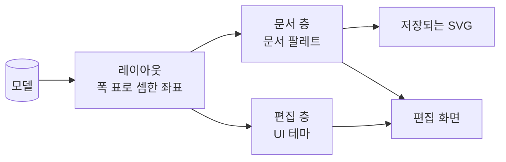

# UX 설계: 시각 디자인

> [!abstract] 이 문서는
> **AriadneNSD가 어떻게 보이는가**를 정한 명세입니다. 원칙, 디자인 토큰(색 · 글자 · 치수), 블록의 해부도, 상태마다의 모습, 테마, 렌더링 규칙, 접근성 검증을 담습니다.
> - **입력:** [[01-requirements]]의 [[01-requirements#1. 핵심 원칙|핵심 원칙]](주 사용자는 실무의 설계 문서 작성자), [[01-requirements#3.3 레이아웃 · 렌더링|3.3 레이아웃 · 렌더링]], [[01-requirements#^fmt-color|저장되는 그림의 색]], [[01-requirements#^nfr-a11y|접근성]]. 결정의 근거는 [[0013-default-visual-style|ADR-0013]](기본 스타일), [[0018-save-as-shown|ADR-0018]](화면 그대로 저장), [[0026-bundled-font-metrics|ADR-0026]](글꼴 번들)입니다.
> - **짝이 되는 문서:** 무엇을 누르면 어떻게 되는지는 [[01-interaction-rules]], 조작의 열린 물음은 [[02-ux-design]]에 있습니다. 이 문서는 그 규칙이 **어떤 모습으로** 보이는지를 맡습니다. 색 · 선 굵기 · 글자 크기의 값은 이 문서에만 적고, 다른 문서는 이 문서를 가리킵니다.
> - **이 문서를 쓰는 곳:** 렌더러의 테마 구조([[02-layout#3. SVG 렌더링]]), 편집기 화면([[03-editor]]), 배포 대상마다의 테마 연동([[04-obsidian-plugin#5. 테마 연동]]).
> - **지금 상태:** 초안입니다. 값은 프로토타입 53번째 판과 같습니다. 2026-10-17에 독립 검토(디자인 시스템 관점)를 받아 대비와 층 구분을 고쳤습니다. 프로토타입에 아직 없는 상태(마우스 올림, 끌어 놓기, 오류)는 7장에 명세만 있습니다.

> [!info] 읽는 법
> - 바쁘면 **1장**(원칙), **7장**(상태 표), **10장**(접근성 검증)을 보세요.
> - 그림은 모두 프로토타입에서 찍거나 스크립트로 그린 것이고, 언제든 다시 만들 수 있습니다: `journal/assets/2026-10-16-visual-design-shots.mjs`(화면), `2026-10-17-visual-anatomy.py`(해부도), `2026-10-17-color-check.py`(대비 · 색각 · 명도 계산)
> - **용어.**
> 	- **대비율**은 WCAG 2.2의 contrast ratio(상대 휘도의 비)입니다. 글자는 4.5:1(AA, 1.4.3), 뜻을 가진 선과 도형은 3:1(1.4.11)이 기준입니다.
> 	- **문서 팔레트**는 저장되는 그림의 색, **UI 테마**는 편집 화면의 색입니다(2장).
> 	- **토큰**은 값 대신 쓰는 이름입니다(`line.structure` → `#5b77ad`). 코드와 문서는 값이 아니라 이름을 씁니다.

![[visual-design-code.png|500]]

*기본 문서 팔레트로 그린 코드식 예제. Event 머리, 처리, If, 펴진 접기 영역("센서 읽기"), 접힌 접기 영역("로그 남기기"), Do-While, 구문 강조.*

## 1. 원칙

이 제품의 그림은 화면의 장식이 아니라 **남는 문서**입니다. 주 사용자는 실무에서 설계 문서를 쓰는 사람이고, 그림은 코드 옆, 위키, PDF, 인쇄물에서 읽힙니다. 아래 여섯 원칙은 거기서 나오며, 서로 부딪치면 앞의 것이 이깁니다. 원칙마다 **어떻게 지키는지 확인하는 방법**을 붙였습니다.

### 원칙 1. 로직이 상자보다 먼저 읽힌다

NS 차트를 읽는 사람이 알고 싶은 것은 조건과 처리입니다. 블록의 바탕은 흰 종이와 1.1 ~ 1.3:1밖에 벌어지지 않는 옅은 색으로 두고, 글자는 그 위에서 13.9:1 이상입니다. 그림에서 가장 진한 것은 언제나 글자입니다.

- 근거: 종류별 진한 색(Scratch식)과 옅은 단색(EasyCODE식)을 같은 그림으로 견주었고, 진한 색은 "글자보다 상자가 먼저 보인다"는 까닭으로 떨어졌습니다 → [[0013-default-visual-style|ADR-0013]]
- 확인: 글자의 대비율이 바탕의 대비율보다 열 배 이상 높은가(10.1절).

### 원칙 2. 뜻은 모양이 나르고, 색은 거들기만 한다

블록 종류는 색이 없어도 모양만으로 가려집니다. 흑백으로 인쇄해도, 색을 구분하지 못하는 사람이 보아도 뜻이 같아야 합니다(WCAG 1.4.1).

| 블록 | 모양 (뜻을 나름) | 바탕 (거듦) |
| --- | --- | --- |
| 처리 | 직사각형 | `block.process` |
| If | 머리에 V자 빗금, 아래 양쪽 구석에 "참" · "거짓" | `block.branch` |
| Case | 머리에 긴 빗금과 짧은 빗금, 갈래마다 세로선과 갈래 이름 | `block.branch` |
| While / Do-While | 왼쪽 띠 안에 본문. 머리가 위(While)인지 아래(Do-While)인지 | `block.loop` |
| 호출 블록 | 양옆 안쪽의 세로 이중선. 부를 Method가 없으면 이중선이 점선 | `block.call` |
| Event 머리 | 왼쪽에 솟은 모자 | `block.event` |
| Method 머리 | 폭 전체에 걸친 낮은 아치 | `block.call` ("부르는 것과 불리는 것"이라 같은 색) |

- If · Case · 반복 · 처리의 모양은 표준(DIN 66261, Nassi와 Shneiderman의 원 논문)을 따릅니다. Event · Method 머리와 접기 표시는 표준에 없는 어휘라, 표준의 모양과 겹치지 않게 골랐습니다 → [[0021-event-and-method|ADR-0021]]
- 확인: 흑백과 색각 이상 세 가지로 본 그림에서 모든 블록 종류가 가려지는가(10.2절). 적색맹으로 보면 If와 Event의 바탕은 거의 같은 색(ΔE 1.1)이 되지만, 모양이 다르므로 원칙은 지켜집니다.

### 원칙 3. 문서의 표시와 편집의 표시는 다른 층이다

그림 위의 모든 표시는 **문서 층**(파일에 저장됨)과 **편집 층**(화면에만 있음) 가운데 하나에 속합니다. 사용자는 화면을 보고 언제나 "이것이 파일에 들어가는가"를 알 수 있어야 합니다. 그래서 두 층은 세 가지로 갈립니다.

| 가르는 것 | 문서 층 | 편집 층 |
| --- | --- | --- |
| 색의 계열 | 무채색과 옅은 파스텔. 진한 색은 무채색 잉크(`ink.700`)뿐 | 채도 높은 파랑(`blue.600`) 하나 |
| 밝기 | 접기 영역의 테두리 L* 25 | 고른 표시 L* 40. 흑백으로 보아도 다름 |
| 모양 | 이름 띠가 붙음(접기 영역), 점선(펴 보기) | 띠 없는 실선 상자 |

- 근거: 52번째 판까지는 접기 영역의 테두리(`#4f74d6`)와 고른 표시(`#2c55c9`)가 같은 파랑이었고, 접기 영역 이름 글자는 코드에서 고른 표시의 색을 그대로 썼습니다. 고른 상자가 저장되는 테두리처럼 보였습니다.
- 확인: 저장된 SVG에 편집 층의 색(`blue.600`)이 한 번도 나오지 않는가. 프로토타입 시험이 확인합니다.

### 원칙 4. 문서는 종이다

편집 화면이 어두워도 그림은 흰 종이에 그립니다. 같은 파일은 GitHub에서도, Obsidian의 어두운 테마에서도, 인쇄물에서도 같은 색이어야 하기 때문입니다([[01-requirements#^fmt-color]]). 종이 둘레의 그림자와 바깥 바탕의 점 무늬가 "여기부터 종이다"를 알립니다. 어두운 화면에서 흰 종이가 밝은 것은 감수합니다.

> [!example] 밝은 UI 테마와 어두운 UI 테마
> 도구 막대와 옆 창은 UI 테마를 따르고, 가운데의 종이는 그대로입니다.
>
> ![[visual-design-screen-light.png|640]]
> ![[visual-design-screen-dark.png|640]]

### 원칙 5. 두드러짐은 지금의 중요도 순서를 따른다

화면에서 눈에 띄는 순서는 "사용자가 지금 다루는 것 → 사용자가 이름을 붙여 묶은 것 → 잠시 들여다보는 것 → 구조"입니다. 두드러짐은 색의 채도, 선 굵기, 선 모양을 함께 써서 만듭니다. 같은 두드러짐의 표시가 다른 뜻을 갖지 않습니다. 선 굵기의 표는 6장에 있습니다.

- 펴 보인 호출 블록이 접기 영역보다 가벼운 것은, 그것이 강조가 아니라 "다른 곳에 있는 것을 여기서 잠깐 본다"이기 때문입니다 → [[02-ux-design#4.1 호출 블록 펴 보기 (R6)|Q15-a]]
- 펴 보인 곳 안의 접기 영역은 보통 접기 영역과 **똑같이** 그립니다. 그래서 점선 상자 안에 그보다 진한 테두리가 들어갈 수 있습니다. 같은 것은 어디서나 같게 보여야 한다는 메인테이너의 결정(2026-10-13, 접기 영역 테두리 시안의 P1)이 위계보다 앞섭니다.
- 확인: 그림을 흐리게 보았을 때(블러 테스트) 고른 것 → 접기 영역 → 나머지 순서로 보이는가.

### 원칙 6. 테마는 색만 바꾸고 기하는 바꾸지 않는다

테마를 바꿔도 블록의 크기와 자리는 한 픽셀도 바뀌지 않습니다. 그래서 테마는 git 기록에 그림의 이동을 남기지 않고, 다른 사람이 다른 테마로 열어도 그림의 모양은 같습니다([[01-requirements#^nfr-compat]]).

- 그래서 **글꼴은 테마에 넣지 않습니다.** 블록의 폭은 번들한 글꼴의 글자 폭 표로 셈하므로, 글꼴이 바뀌면 레이아웃이 바뀝니다([[0026-bundled-font-metrics|ADR-0026]]). 글꼴은 문서 설정인 "블록 글자의 종류"([[01-requirements#^lay-text-kind]])가 고릅니다. 요구사항 [[01-requirements#^lay-theme]]은 테마에 글꼴을 넣었으므로 고쳐야 합니다.
- 테마가 바꿀 수 있는 것: 3장의 색 토큰. 선 굵기도 테두리가 안쪽으로 그려지므로 바꿀 수 있지만, 기본 테마 밖에서는 바꾸지 않기를 추천합니다.

## 2. 층과 출력

| | 문서 층 | 편집 층 |
| --- | --- | --- |
| 무엇 | 블록, 선, 글자, 펴진 접기 영역의 테두리와 이름 띠, 펴 보인 호출 블록, 접힌 칸 | 고른 블록과 범위, 글자를 고치는 칸, 마우스 올림, 끌어 놓을 자리, 오류, 캔버스 포커스 |
| 저장 | 된다. 저장되는 그림은 지금 화면 그대로 → [[0018-save-as-shown\|ADR-0018]] | 되지 않는다 |
| 색을 정하는 것 | 문서 팔레트 (파일과 함께 감) | UI 테마 (사용자 설정) |

**저장되는 SVG에 들어가는 것:**

- 흰 바탕 사각형(`fill.paper`) 하나. 투명하게 두지 않습니다. 어두운 뷰어에서도 원칙 4가 지켜집니다.
- 그림 둘레 여백 24px.
- 쓰인 글자만 추린 번들 글꼴과 대체 글꼴 목록 → [[01-requirements#^fmt-text]]
- 기호(`▾` `▶` `⋯` `←`)는 **도형(path)으로** 그립니다. 글자로 두면 글꼴에 그 기호가 없는 뷰어에서 깨집니다. 프로토타입은 `▶`만 도형이고 나머지는 아직 글자입니다(11장).
- 편집 층의 표시는 하나도 들어가지 않습니다.

## 3. 디자인 토큰

### 3.1 세 단계

토큰은 세 단계로 둡니다. 코드와 다른 문서는 **의미 토큰이나 구성 요소 토큰**만 씁니다. 원시 토큰은 팔레트의 재료이고, 테마는 의미 토큰이 어느 원시 토큰을 가리킬지를 바꿉니다.

| 단계 | 예 | 뜻 |
| --- | --- | --- |
| 원시 (primitive) | `ink.700 = #343b48` | 색 자체. 뜻이 없다 |
| 의미 (semantic) | `text.primary → ink.900` | 역할. 테마가 바꾸는 곳 |
| 구성 요소 (component) | `fold.edge → ink.700` | 한 구성 요소의 한 부분 |

### 3.2 원시 팔레트

| 토큰 | 값 | 흑백 명도 L* | 토큰 | 값 | 흑백 명도 L* |
| --- | --- | --- | --- | --- | --- |
| `ink.900` | `#151a22` | 9 | `fill.paper` | `#ffffff` | 100 |
| `ink.700` | `#343b48` | 25 | `fill.snow` | `#fbfcfe` | 99 |
| `ink.600` | `#4b5567` | 36 | `fill.slate` | `#edf0f5` | 95 |
| `ink.550` | `#555e70` | 40 | `fill.sand` | `#f6ebdc` | 94 |
| `ink.500` | `#5a6476` | 42 | `fill.mist` | `#eceef2` | 94 |
| `slate.500` | `#5b77ad` | 50 | `fill.mint` | `#e2efdf` | 93 |
| `blue.700` | `#1f45d6` | 37 | `fill.lilac` | `#ebe7f4` | 92 |
| `blue.600` | `#2c55c9` | 40 | `fill.sky` | `#dce6f6` | 91 |
| `violet.500` | `#7a5fb8` | 47 | `fill.lilac-strong` | `#ddd4ef` | 86 |
| `green.700` | `#22702a` | 41 | `red.700` | `#b42318` | 40 |
| `amber.800` | `#8a5a00` | 42 | | | |

### 3.3 문서 팔레트 (기본)

대비율은 블록 바탕 다섯과 종이에 대어 본 가장 낮은 값 ~ 가장 높은 값입니다. 전부 기준을 넘습니다.

| 의미 · 구성 요소 토큰 | → 원시 | 역할 | 대비율 | 기준 |
| --- | --- | --- | --- | --- |
| `block.process` | `fill.slate` | 처리 블록 바탕 | | |
| `block.branch` | `fill.sand` | If · Case 머리 바탕 | | |
| `block.loop` | `fill.sky` | 반복 블록의 띠와 머리 | | |
| `block.event` | `fill.mint` | Event 머리 | | |
| `block.call` | `fill.lilac` | 호출 블록, Method 머리 | | |
| `block.folded` | `fill.snow` | 접힌 칸 | | |
| `line.structure` | `slate.500` | 블록의 경계와 빗금 | 3.56 ~ 4.48 | 3:1 |
| `text.primary` | `ink.900` | 블록 글자 | 13.88 ~ 17.46 | 4.5:1 |
| `text.secondary` | `ink.600` | 갈래 이름("참" · "거짓", Case 갈래) | 5.97 ~ 7.51 | 4.5:1 |
| `text.muted` | `ink.500` | "⋯ 블록 n개", 이름 없는 접기 영역 | 4.74 ~ 5.97 | 4.5:1 |
| `syntax.keyword` | `blue.700` | 키워드 | 5.80 ~ 7.29 | 4.5:1 |
| `syntax.comment` | `green.700` | 주석 | 4.88 ~ 6.14 | 4.5:1 |
| `syntax.literal` | `amber.800` | 숫자, 문자열 | 4.71 ~ 5.93 | 4.5:1 |
| `fold.edge` | `ink.700` | 펴진 접기 영역의 테두리 | 8.95 ~ 11.26 | 3:1 |
| `fold.band` | `fill.mist` | 이름 띠 바탕 | | |
| `fold.name` | `ink.700` | 이름 띠 글자 | 9.69 (띠 위) | 4.5:1 |
| `peek.edge` | `violet.500` | 펴 보인 호출 블록의 점선 | 4.02 ~ 5.05 | 3:1 |
| `peek.band` | `fill.lilac-strong` | 펴 보인 호출 블록의 띠 바탕 | | |
| `peek.text` | `ink.550` | 펴 보인 블록의 글자(고칠 수 없음, 구문 강조 없음) | 5.18 ~ 6.52, 띠 위 4.58 | 4.5:1 |

- 갈래 이름은 구문 강조의 색(`blue.700`)을 쓰지 않습니다. 구조의 글자가 코드의 일부처럼 보이지 않게 하려는 것입니다.
- 펴 보인 블록의 글자는 흐리게 하되 4.5:1을 지킵니다. "고칠 수 없다"는 것은 점선과 띠가 알리고, 글자는 들여다보려고 편 것이라 읽혀야 합니다.

### 3.4 UI 테마

| 토큰 | 밝은 테마 | 어두운 테마 | 역할 |
| --- | --- | --- | --- |
| `ui.bg` | `#eef1f6` | `#12151b` | 종이 바깥의 바탕 |
| `ui.dots` | `#d3d9e4` | `#262c37` | 바탕의 점 무늬 (18px 간격) |
| `ui.panel` | `#ffffff` | `#1a1e26` | 도구 막대, 옆 창, 메뉴 |
| `ui.text` | `#1c2230` | `#e5e8ee` | 화면 글자 |
| `ui.muted` | `#5a6476` | `#9aa3b3` | 보조 글자 |
| `ui.line` | `#d4dbe6` | `#2b313c` | 화면의 구분선 |
| `ui.accent` | `#2c55c9` | `#8ba7ff` | 단추의 포커스, 상태 줄의 모드, 캔버스 포커스 |
| `ui.accent-soft` | `#e4eafb` | `#232c45` | 단추에 마우스가 올라감 |
| `ui.warn` | `#b35a10` | `#f0a560` | 안내 상자의 왼쪽 줄 |

편집 층의 표시는 종이 위에 그려지므로, 어두운 테마에서도 종이에 맞는 같은 값을 씁니다.

| 토큰 | → 원시 | 역할 |
| --- | --- | --- |
| `edit.select` | `blue.600` | 고른 블록 · 범위의 테두리 |
| `edit.hover` | `blue.600`, 불투명도 40% | 마우스가 올라간 블록 |
| `edit.field` | `blue.600` | 글자를 고치는 칸의 테두리 |
| `edit.drop` | `blue.600` | 끌어 놓을 자리의 줄 |
| `edit.error` | `red.700` | 받아들일 수 없는 입력 (종이 위 5.23 ~ 6.57:1) |

## 4. 글자

### 4.1 크기 단계

글자 크기는 **두 단계**뿐입니다. 크기가 많을수록 위계가 흐려지고, 테마와 배율마다 맞출 값이 늘어납니다.

| 단계 | 크기 / 줄 높이 | 인쇄 (96dpi 기준) | 쓰는 곳 |
| --- | --- | --- | --- |
| 본문 | 13px / 18px | 9.75pt | 블록 글자, 호출 블록 |
| 보조 | 12px | 9pt | 갈래 이름, 이름 띠(굵게 600), 접힌 칸, 화면의 보조 글자 |

- 한글은 획이 많아 같은 크기의 영문보다 작게 읽힙니다. 그래서 그림 안의 가장 작은 글자를 **12px(인쇄 9pt)**로 둡니다. 52번째 판까지 있던 11px(인쇄 8.25pt)은 없앴습니다.
- 굵기는 보통(400)과 굵게(600)만 씁니다. 굵게는 이름(호출 블록의 Method 이름, 접기 영역의 이름)에만 씁니다. 이름이 없으면 기울임으로 "아직 이름이 없다"를 보입니다.

### 4.2 글꼴

| 자리 | 글꼴 | 정하는 것 |
| --- | --- | --- |
| 블록 글자 | 고정폭 또는 비례폭 | 문서 설정 "블록 글자의 종류": 코드 종류면 고정폭, 문장이면 비례폭 |
| 갈래 이름, 이름 띠, 접힌 칸 | 비례폭 | 고정 |
| 화면 | 배포 대상의 기본 글꼴 | 배포 대상 (Obsidian이면 Obsidian의 글꼴) |

- 프로토타입은 IBM Plex Mono · IBM Plex Sans KR을 씁니다. **번들할 글꼴은 아직 정하지 않았습니다**([[01-requirements#6. 미결정 사항]]). 정하면 크기 단계를 다시 확인합니다.
- 블록 글자의 공백은 그대로 둡니다(`white-space: pre`). 코드의 들여쓰기가 그림에서도 보여야 합니다.
- 폭은 번들한 글꼴의 폭 표로 셈합니다. 커닝을 끄고, 정수 px로 올립니다 → [[0026-bundled-font-metrics|ADR-0026]]

## 5. 기하와 해부도

![[visual-design-anatomy.svg|720]]

*블록마다의 치수. 주황 선은 치수선이고 그림에는 들어가지 않는다.*

| 토큰 | 값 | 무엇 |
| --- | --- | --- |
| `space.pad-x` / `space.pad-y` | 10 / 7px | 블록 안 글자의 왼쪽 · 위 여백 |
| `space.line` | 18px | 블록 글자 한 줄 |
| `size.block-min-w` | 52px | 블록의 가장 좁은 폭 |
| `size.loop-strip` | 22px | 반복 블록 왼쪽 띠의 폭 |
| `size.if-label` / `size.case-label` | 16 / 28px | If · Case 머리 아래 갈래 이름 줄 |
| `size.label-inset` | 6px | 갈래 이름과 블록 구석 사이 |
| `size.hat` | 16px | Event · Method 머리가 솟은 높이 |
| `size.hat-w` | min(110px, 폭 × 0.45) | Event 모자의 폭 |
| `size.call-bar` | 7px | 호출 블록 세로 이중선의 안쪽 거리 |
| `size.band` | 18px | 이름 띠의 높이 |
| `size.nest-gap` | 1px | 테두리 안에 테두리가 들어갈 때의 틈 |
| `space.diagram` | 44px | 다이어그램 사이 |
| `size.column-min` | 420px | 여러 다이어그램을 줄로 놓을 때 한 줄의 가장 좁은 폭 |
| `space.paper` | 24px | 그림 둘레의 여백 |

**배치 규칙:**

- 블록은 서로 맞붙습니다(NS 차트의 표기). 블록 사이에 틈을 두지 않습니다.
- If · Case 머리의 조건 글자는 빗금의 꼭짓점 위 가운데에 두되, 블록 안 여백(`space.pad-x`)을 넘지 않게 밉니다. 글자는 빗금과 겹치지 않아야 합니다. 머리의 높이를 늘려 빗금이 글자 아래로 지나가게 합니다(프로토타입은 겹칠 수 있음, 11장).
- 펴진 접기 영역의 안쪽 블록은 테두리에 붙습니다. 테두리 안에 다른 테두리(겹친 접기 영역, 펴 보인 호출 블록)가 들어가면 `size.nest-gap`만큼 띄웁니다. 겹치거나 이어져도 상자가 따로 보입니다 → [[01-interaction-rules#접기 · 펼치기]]

## 6. 선

| 두드러짐 | 무엇 | 층 | 선 | 인쇄 |
| --- | --- | --- | --- | --- |
| 1 (가장 강함) | 글자를 고치는 칸 | 편집 | 2px 실선 `edit.field` + 흰 바탕 + 커서 | — |
| 1 | 고른 블록 · 범위 | 편집 | 2px 실선 `edit.select`. 바탕은 칠하지 않음 | — |
| 2 | 펴진 접기 영역 | 문서 | 2px 실선 `fold.edge` + 이름 띠 | 1.5pt |
| 3 | 펴 보인 호출 블록 | 문서 | 1px 점선(6 긋고 4 띄움) `peek.edge` + 띠. 블록의 바깥 선에서 1px 안 | 0.75pt |
| 4 | 구조: 블록의 경계, 빗금 | 문서 | 1px 실선 `line.structure` | 0.75pt |
| — | 마우스 올림 | 편집 | 1px 실선 `edit.hover` | — |

- 고른 표시에 바탕을 칠하지 않는 까닭: 옅은 파랑을 덮으면 블록 바탕의 색조가 흐려지고(원칙 2), 구조선의 대비가 2:1 아래로 떨어집니다(원칙 1).
- 고른 표시를 블록 **안쪽**에 그리는 까닭: NS 차트의 블록은 서로 맞붙어 있어서, 바깥에 두르면 이웃 블록과 접기 영역의 테두리를 덮습니다.

## 7. 상태

### 7.1 상태 표

| 상태 | 모습 | 층 | 토큰 | 프로토타입 |
| --- | --- | --- | --- | --- |
| 기본 | 2 ~ 6장 그대로 | 문서 | | 있음 |
| 펴진 접기 영역 | 테두리 + 이름 띠(`▾ 이름`, 굵게). 이름 띠를 끄면 접기 영역이 없는 것과 똑같음 | 문서 | `fold.*` | 있음 |
| 접힌 접기 영역 | 한 줄 칸 + `▶` + 이름 | 문서 | `block.folded` | 있음 |
| 접힌 제어 블록의 갈래 | 한 줄 칸 + "⋯ 블록 n개" (기울임) | 문서 | `block.folded`, `text.muted` | 있음 |
| 펴 보인 호출 블록 | 점선 + 띠(`▾` + 호출 블록의 글자). 안의 글자는 회색이고 구문 강조 없음. 띠가 있는 동안 세로 이중선은 그리지 않음 | 문서 | `peek.*` | 있음 |
| 부를 Method가 없는 호출 블록 | 세로 이중선이 점선(3 · 3) | 문서 | `line.structure` | 있음 |
| 이름 없는 접기 영역 | 이름 자리에 기본 글자를 기울여 씀 | 문서 | `text.muted` | 있음 |
| 마우스 올림 | 블록 안쪽 1px 테두리. 고른 블록에는 그리지 않음 | 편집 | `edit.hover` | **없음** |
| 블록 하나를 고름 | 블록 안쪽 2px 테두리 | 편집 | `edit.select` | 있음 |
| 여러 블록을 고름 | 고른 블록들을 감싸는 상자 하나. 블록 하나와 같은 모습 | 편집 | `edit.select` | 있음 |
| 글자를 고치는 중 | 블록 자리에 흰 입력 칸 + 2px 테두리 + 커서. 상태 줄 왼쪽에 `-- 고치기 --` | 편집 | `edit.field` | 있음 |
| 받아들일 수 없는 입력 | 입력 칸의 테두리가 `edit.error`로 바뀌고, 상태 줄에 까닭을 적음. 색에만 기대지 않음 | 편집 | `edit.error` | **없음** (규칙은 [[02-ux-design#Q4. 비울 수 없는 칸을 비웠을 때 (R2)\|Q4]]에서 정하는 중) |
| 고른 것이 없음 | 그림에는 표시가 없음. 키보드로 캔버스에 왔으면 캔버스 안쪽에 2px 테두리(WCAG 2.4.7) | 편집 (UI) | `ui.accent` | 있음 |
| 끄는 중 | 끌고 있는 블록은 제자리에서 불투명도 40%. 커서 곁에 블록의 글자 첫 줄 | 편집 | | **없음** |
| 놓을 자리 | 블록 사이에 2px 가로줄 + 양 끝 4px 세로 눈금 | 편집 | `edit.drop` | **없음** |
| 놓을 수 없는 곳 | 줄을 그리지 않고, 커서가 금지 모양 | 편집 | | **없음** |

**겹칠 때의 규칙:**

- 편집 층은 언제나 문서 층 위에 그립니다. 고른 상자는 접기 영역의 테두리와 펴 보기의 점선 위에 옵니다.
- 고치는 칸이 열리면 그 블록의 고른 표시는 그리지 않습니다(같은 자리에 두 테두리를 겹치지 않음).
- 펴 보인 블록도 고를 수 있고 모습은 같습니다. 고칠 수 없다는 것은 점선과 회색 글자가 이미 알립니다 → [[01-interaction-rules#호출 블록 펴 보기]]

### 7.2 그림

> [!example] 문서 층: 호출 블록 · Method · 펴 보기 · 접기 영역
> 왼쪽 quicksort에서 partition 호출 블록을 펴 보았습니다(보라 점선과 띠, 회색 글자). 오른쪽 partition의 접기 영역 "준비"는 펴 보인 곳에도 같은 모습입니다. 아래 두 블록은 접힌 호출 블록(세로 이중선)입니다.
>
> ![[visual-design-document-marks.png|560]]

> [!example] 접힌 모습과 Case
> 왼쪽은 If의 "참" 갈래를 접은 모습입니다(아래에 접힌 접기 영역 "로그 남기기"). 오른쪽은 갈래가 넷인 Case입니다.
>
> ![[visual-design-folded.png|330]] ![[visual-design-case.png|500]]

> [!example] 편집 층: 블록 하나를 고름 · 여러 블록을 고름 · 고치는 중
> 고른 상자는 파랑, 접기 영역의 테두리는 진회색입니다. 고른 상자가 파일에 들어가는 표시와 섞이지 않습니다.
>
> ![[visual-design-select-one.png|320]] ![[visual-design-select-range.png|320]] ![[visual-design-editing.png|320]]

> [!example] 고른 것이 없을 때의 키보드 포커스
> ![[visual-design-focus-none.png|480]]

## 8. 테마

- **문서 팔레트**는 저장되는 그림의 색을 정합니다. 기본 팔레트는 3.3절입니다.
- **흑백 인쇄 팔레트**([[01-requirements#^lay-theme]]의 흑백 인쇄 모드)는 문서 팔레트 하나로 만듭니다. 모든 바탕은 흰색, 선과 글자는 검정, 구문 강조는 끄고, 점선과 테두리 굵기는 그대로 둡니다. 원칙 2 덕분에 뜻은 그대로입니다. 값은 9.3절에 있습니다.
- **UI 테마**는 사용자의 설정이고 파일에 저장되지 않습니다. 밝은 테마와 어두운 테마가 있고, Obsidian에서는 Obsidian의 밝기를 따릅니다([[01-requirements#^obs-theme]]).
- **고대비**([[01-requirements#^nfr-a11y]])는 두 곳에 나뉩니다. UI는 고대비 UI 테마로, 그림은 흑백 인쇄 팔레트를 화면에서도 고를 수 있게 하는 것으로 합니다. 문서 팔레트를 화면에서 바꾸면 저장되는 그림도 바뀌므로, 화면에서만 바꾸는 "보기 전용" 선택을 따로 둡니다.
- 테마가 바꿀 수 없는 것: 5장의 치수, 블록의 모양, 글꼴(원칙 6).

## 9. 렌더링 규칙

### 9.1 픽셀에 맞추기

설계 문서는 확대해서 보고 인쇄합니다. 100% 배율에서 곧은 선은 픽셀 격자에 맞춥니다.

- 그림 전체를 반 픽셀 옮깁니다(`translate(.5 .5)`). 그러면 정수 좌표에 놓은 1px 선이 한 픽셀 줄을 꼭 채웁니다.
- **홀수 굵기**(1px)의 선은 가운데가 반 픽셀에, **짝수 굵기**(2px)의 선은 가운데가 정수 픽셀에 오게 놓습니다. 그래서 2px 테두리는 블록의 경계에서 반 픽셀 안에 놓습니다.
- 가로세로 사각형에만 `shape-rendering="crispEdges"`를 씁니다. 빗금과 곡선은 안티앨리어싱 그대로 둡니다.
- 테두리 안의 테두리는 1px 틈을 두므로, 겹치거나 이어져도 선이 한 덩어리로 뭉개지지 않습니다.

### 9.2 배율과 출력

| 어디서 | 1px은 | 규칙 |
| --- | --- | --- |
| 편집 화면 100% | 화면의 1 CSS px | 9.1의 규칙으로 곧음 |
| 편집 화면 40 ~ 300% | 배율만큼 굵어짐 | 벡터로 다시 그리므로 흐려지지 않음. 선 굵기도 함께 커짐(그림의 비례를 지킴) |
| 고해상도 화면 (2배) | 물리 2픽셀 | 반 픽셀 문제가 사라짐 |
| Obsidian 노트에 넣은 SVG | 노트 폭에 맞춰 줄어들 수 있음 | 50%까지 줄면 1px 선이 옅어짐. 선은 0.5px까지, 글자는 6.5px까지 내려감 |
| PDF와 인쇄 | 0.75pt (96dpi 기준) | 가장 가는 선 0.75pt, 가장 작은 글자 9pt |

### 9.3 흑백 인쇄 팔레트의 값

| 의미 토큰 | 값 |
| --- | --- |
| 모든 `block.*`, `fold.band`, `peek.band` | `#ffffff` |
| `line.structure`, `text.*`, `fold.edge`, `fold.name`, `peek.edge` | `#000000` |
| `peek.text` | `#404040` (대비율 10.4:1) |
| `syntax.*` | `text.primary`와 같음 (강조 끔) |

### 9.4 움직임

움직임은 두지 않습니다. 접기와 펴기, 펴 보기, 고르기는 바로 바뀝니다. 편집기는 키보드로 빠르게 다루는 도구라, 움직임이 입력을 기다리게 해서는 안 됩니다.

- 예외 하나: 상태 줄의 알림 글자가 1.6초 동안 `ui.accent`로 보였다가 돌아옵니다. 색만 바뀌고 자리는 움직이지 않습니다.
- 키나 휠로 고른 블록이 화면 밖으로 나가면 캔버스가 따라 움직입니다. 이것은 바로 옮깁니다(부드러운 스크롤 없음).
- 운영체제의 "움직임 줄이기" 설정(`prefers-reduced-motion`)을 따릅니다.

## 10. 접근성 검증

방법: 대비율은 WCAG 2.2의 상대 휘도로 셈했습니다. 색각 이상은 Machado(2009) 행렬로 색 차이 ΔE(CIE76)를 셈하고, Chrome의 시각 결함 에뮬레이션으로 그림을 찍었습니다. 흑백 명도는 CIELAB의 L*입니다. 계산은 `journal/assets/2026-10-17-color-check.py`가 합니다.

### 10.1 대비율

3.3절의 표가 결과입니다. 기본 문서 팔레트의 모든 글자와 뜻을 가진 선이, 쓰이는 모든 바탕에서 기준을 넘습니다. 기준에 닿지 않는 짝은 실제로 함께 쓰이지 않는 짝뿐입니다. 예를 들어 펴 보인 띠 위의 구문 강조는 없습니다(펴 보인 글자는 강조하지 않음).

| 짝 | 대비율 | 쓰임 |
| --- | --- | --- |
| `syntax.comment` / `peek.band` | 4.31 | 쓰이지 않음 |
| `syntax.literal` / `peek.band` | 4.16 | 쓰이지 않음 |
| `text.muted` / `peek.band` | 4.19 | 쓰이지 않음 |

### 10.2 색각 이상과 흑백

> [!example] 같은 그림을 흑백 · 녹색맹 · 적색맹 · 청색맹으로 봄
> 네 그림 모두에서 블록 종류가 모양으로 가려집니다(원칙 2).
>
> ![[visual-design-vision-grayscale.png|300]] ![[visual-design-vision-deuteranopia.png|300]]
> ![[visual-design-vision-protanopia.png|300]] ![[visual-design-vision-tritanopia.png|300]]

| 색이 가까워지는 짝 | 보통 ΔE | 가장 가까울 때 | 그래도 가려지는 까닭 |
| --- | --- | --- | --- |
| If 바탕 / Event 바탕 | 8.7 | 적색맹 1.1 | 빗금과 모자 |
| 반복 바탕 / 호출 바탕 | 5.2 | 적색맹 2.5 | 왼쪽 띠와 세로 이중선 |
| 주석 / 숫자 | 56 | 적색맹 9.2 | 주석은 `//`로 시작하고 줄 끝까지 감 |

### 10.3 키보드와 포커스

- 고른 블록의 테두리가 키보드 포커스의 자리입니다. 고른 것이 없으면 캔버스 안쪽 테두리가 포커스를 보입니다(WCAG 2.4.7). 마우스로 누를 때는 보이지 않습니다(`:focus-visible`).
- 편집 층의 모든 표시는 색과 함께 모양(테두리, 줄, 커서, 상태 줄의 글자)으로도 알립니다.

## 11. 지금 프로토타입과 다른 곳

명세가 앞서 있고 프로토타입이 따라오지 못한 곳입니다. 프로토타입은 버리는 코드이므로, 개발에서는 이 문서를 따릅니다.

- `▾` `⋯` `←` 기호가 글자로 들어갑니다(2장: 도형으로 그릴 것).
- If · Case 머리의 조건 글자가 빗금과 겹칠 수 있습니다(5장의 배치 규칙). 문서 층 그림의 `a[j] <= pivot`이 그 예입니다.
- 마우스 올림, 끌어 놓기, 받아들일 수 없는 입력의 모습이 없습니다(7장).
- 글꼴은 IBM Plex를 웹 글꼴로 불러오며, 번들하지 않습니다.
- 토큰의 이름은 코드에 아직 없습니다. 코드는 짧은 이름(`COL.edge` 등)을 씁니다.

## 12. 미결정 사항

- 번들할 글꼴과 그에 따른 크기 단계의 확인 ([[01-requirements#6. 미결정 사항]])
- 문서 팔레트의 이름을 파일에 저장할지 ([[01-file-format]])
- 화면의 나머지(도구 막대, 메뉴, 대화 상자, 설정 화면, 아이콘). 배포 대상마다 그 앱의 모습을 따를지, 공통 모습을 둘지. 프로토타입의 도구 막대는 단추 서른 개가 같은 무게로 놓여 위계가 없습니다
- 이름이 겹친 머리에 붙이는 표시의 모양 ([[01-requirements#^blk-event]])
- 어두운 UI 테마에서 종이를 화면에서만 조금 어둡게 할지 (저장되는 색은 그대로)
