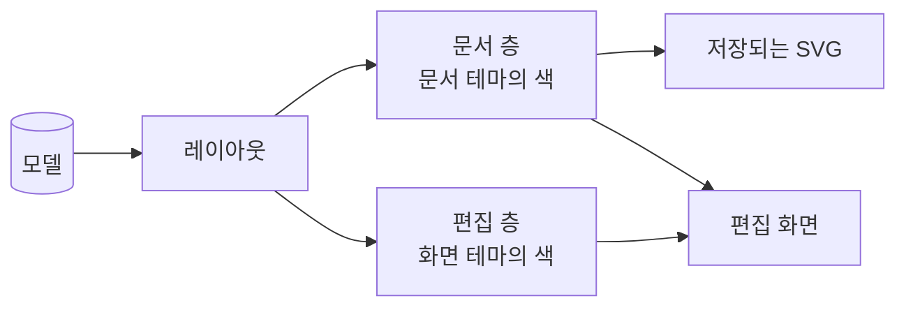

# UX 설계: 시각 디자인

> [!abstract] 이 문서는
> **AriadneNSD가 어떻게 보이는가**를 정합니다. 색, 선, 글자, 치수, 상태마다의 모습, 그리고 그렇게 정한 원칙입니다.
> - **입력:** [[01-requirements]]의 [[01-requirements#3.3 레이아웃 · 렌더링|3.3 레이아웃 · 렌더링]], [[01-requirements#^fmt-color|저장되는 그림의 색]], [[01-requirements#^nfr-a11y|접근성]]. 근거가 된 결정은 [[0013-default-visual-style|ADR-0013]](기본 스타일), [[0018-save-as-shown|ADR-0018]](화면 그대로 저장), [[0026-bundled-font-metrics|ADR-0026]](글꼴 번들)입니다.
> - **짝이 되는 문서:** 무엇을 누르면 어떻게 되는가는 [[01-interaction-rules]]에, 열린 물음은 [[02-ux-design]]에 있습니다. 이 문서는 그 규칙이 **어떤 모습으로** 보이는지를 맡습니다.
> - **이 문서가 쓰이는 곳:** 렌더러의 테마 구조([[02-layout#3. SVG 렌더링]]), 편집기 화면([[03-editor]]), 배포 대상별 테마 연동([[04-obsidian-plugin#5. 테마 연동]]).
> - **지금 상태:** 초안입니다. 값은 프로토타입 52번째 판의 실제 값이고, 2026-10-09 ~ 10-13의 시안에서 고른 것입니다. 원칙에 비추어 점검한 결과, 고칠 곳 일곱이 드러났습니다(7장).

> [!info] 읽는 법
> - 바쁘면 **1장**(원칙)과 **7장**(점검)만 보면 됩니다.
> - 그림은 모두 프로토타입에서 찍은 것입니다. 다시 찍는 스크립트: `journal/assets/2026-10-16-visual-design-shots.mjs`
> - 색 값 옆의 `4.5:1` 같은 숫자는 WCAG 2.2의 명도 대비입니다. 글자는 4.5:1(AA), 뜻을 가진 선과 도형은 3:1(1.4.11)이 기준입니다.

![[visual-design-code.png|500]]

*기본 스타일로 그린 코드식 예제. Event 머리, 처리, If, 펴진 접기 영역("센서 읽기"), 접힌 접기 영역("로그 남기기"), Do-While, 구문 강조가 한 그림에 있다.*

## 1. 원칙

일곱 원칙은 이 제품의 주 사용자에서 나옵니다. 주 사용자는 **실무에서 설계 문서를 쓰는 사람**이고, 그 그림은 코드 옆, 위키, PDF, 인쇄물에서 읽힙니다([[01-requirements#1. 핵심 원칙]]). 그래서 이 편집기의 그림은 화면의 장식이 아니라 **남는 문서**입니다. 아래 원칙은 서로 부딪칠 때 위의 것이 이깁니다.

### 원칙 1. 로직이 상자보다 먼저 읽힌다

NS 차트를 읽는 사람이 알고 싶은 것은 조건과 처리이지 상자가 아닙니다. 블록의 바탕은 흰 종이에서 1.14 ~ 1.26:1밖에 벌어지지 않는 옅은 색이고, 글자는 그 위에서 14 ~ 15:1입니다. 상자가 글자를 이기는 일은 없습니다.

- 근거: 2026-10-09의 색상 시안에서 Scratch식(종류별 진한 색)과 EasyCODE식(옅은 단색)을 같은 그림으로 견주었고, Scratch식은 "글자보다 상자가 먼저 보인다"는 까닭으로 떨어졌습니다 → [[0013-default-visual-style|ADR-0013]]

### 원칙 2. 뜻은 모양이 나르고, 색은 거들기만 한다

블록 종류는 색이 없어도 모양만으로 가려집니다. 흑백으로 인쇄해도, 색을 구분하지 못하는 사람이 보아도 그림의 뜻은 같아야 합니다(WCAG 1.4.1 "색에만 기대지 않기").

| 블록 | 모양으로 가르는 곳 | 색 (거듦) |
| --- | --- | --- |
| 처리 | 직사각형 | 회청 `#edf0f5` |
| If | 머리에 V자 빗금, 아래 양쪽 구석에 "참" · "거짓" | 살구 `#f6ebdc` |
| Case | 머리에 긴 빗금과 짧은 빗금, 갈래마다 세로선과 갈래 이름 | 살구 `#f6ebdc` |
| While / Do-While | 왼쪽 띠(22px) 안에 본문. 머리가 위(While)인지 아래(Do-While)인지 | 하늘 `#dce6f6` |
| 호출 블록 | 양옆 7px 안쪽의 세로 이중선. 부를 Method가 없으면 이중선이 점선 | 연보라 `#ebe7f4` |
| Event 머리 | 왼쪽에 솟은 모자 | 연두 `#e2efdf` |
| Method 머리 | 폭 전체에 걸친 낮은 아치 | 연보라 `#ebe7f4` (호출 블록과 같은 색: "부르는 것과 불리는 것") |

- If · Case · 반복 · 처리의 모양은 표준(DIN 66261, 원 논문)을 따릅니다. Event · Method 머리와 접기 표시는 표준에 없는 어휘라, 표준의 모양과 겹치지 않는 모양을 골랐습니다 → [[0021-event-and-method|ADR-0021]]

### 원칙 3. 문서의 표시와 편집의 표시는 다른 층이다

그림 위에 보이는 것은 두 층으로 나뉩니다. 이 구분이 이 문서에서 가장 중요한 약속입니다.

| | 문서 층 | 편집 층 |
| --- | --- | --- |
| 무엇 | 블록, 선, 글자, 펴진 접기 영역의 테두리와 이름 띠, 펴 보인 호출 블록, 접힌 칸 | 고른 블록, 고른 범위, 글자를 고치는 칸, 마우스가 올라간 곳, 끌어 놓을 자리 |
| 저장되는가 | 저장된다. 저장되는 그림은 지금 화면 그대로 → [[0018-save-as-shown\|ADR-0018]] | 저장되지 않는다 |
| 색을 정하는 것 | **문서의 색**(문서 테마). 편집 화면이 어두워도 같다 | **화면의 색**(화면 테마). 밝은 화면과 어두운 화면에서 다르다 |
| 사용자에게 주는 뜻 | "그림이 이렇다" | "지금 내가 여기를 다룬다" |

사용자가 화면을 보고 **"이것이 파일에 들어가는가"를 언제나 알 수 있어야** 합니다. 그래서 두 층은 색의 계열로도 갈라야 합니다. 지금 값은 이 약속을 지키지 못하는 곳이 있습니다(7장의 점검 3 · 4).

### 원칙 4. 문서는 종이다

편집 화면이 어두워도 그림은 흰 종이에 그립니다. 같은 파일은 GitHub에서도, Obsidian의 어두운 테마에서도, 인쇄물에서도 같은 색이어야 하기 때문입니다([[01-requirements#^fmt-color]]). 어두운 화면에서 흰 종이가 눈부신 것은 감수하고, 종이 둘레의 그림자와 바깥 바탕의 점 무늬로 "이것이 종이다"를 보여 줍니다.

> [!example] 밝은 화면과 어두운 화면
> 왼쪽 위의 단추와 오른쪽의 안내는 화면 테마를 따르고, 가운데의 종이는 그대로입니다.
>
> ![[visual-design-screen-light.png|640]]
> ![[visual-design-screen-dark.png|640]]

### 원칙 5. 무게는 중요도의 순서를 따른다

선의 굵기와 모양은 "얼마나 눈에 띄어야 하는가"의 순서로 정했습니다. 같은 무게의 선이 다른 뜻을 갖지 않습니다.

| 무게 | 무엇 | 선 |
| --- | --- | --- |
| 1 (가장 무거움) | 편집 층: 고른 것, 고치는 칸 | 2px 실선 + 옅은 바탕 |
| 2 | 사용자가 이름을 붙여 묶은 것: 펴진 접기 영역 | 3px 실선 + 이름 띠 |
| 3 | 잠시 들여다보는 것: 펴 보인 호출 블록 | 1.5px 점선(6 긋고 4 띄움) + 띠 |
| 4 | 구조: 블록의 경계, 빗금 | 1px 실선 |

- 펴 보인 호출 블록이 접기 영역보다 가벼운 것은, 그것이 강조가 아니라 "다른 곳에 있는 것을 여기서 잠깐 본다"이기 때문입니다 → [[02-ux-design#4.1 호출 블록 펴 보기 (R6)|Q15-a]]

### 원칙 6. 테마는 색만 바꾸고 기하는 바꾸지 않는다

테마를 바꿔도 블록의 크기와 자리는 한 픽셀도 바뀌지 않습니다. 그래서 테마는 git 기록에 그림의 이동을 남기지 않고, 다른 사람이 다른 테마로 열어도 그림의 모양은 같습니다([[01-requirements#^lay-theme]], [[01-requirements#^nfr-compat]]). 글꼴도 테마에 들지만, 폭은 번들한 글꼴의 글자 폭 표로 셈하므로 레이아웃은 그대로입니다 → [[0026-bundled-font-metrics|ADR-0026]]

### 원칙 7. 픽셀은 곧아야 한다

설계 문서는 확대해서 보고 인쇄합니다. 선은 픽셀 격자에 맞춰 그립니다.

- 그림 전체를 반 픽셀 옮겨, 1px 선과 3px 테두리가 같은 픽셀 줄에서 시작합니다. 바깥 선은 위에서 아래까지 곧습니다.
- 테두리 안에 다른 테두리가 들어가면 1px의 틈을 두고 들어갑니다. 겹치거나 이어진 테두리가 한 덩어리로 뭉개지지 않습니다 → [[01-interaction-rules#접기 · 펼치기]]

## 2. 색

색은 **이름 → 값**의 표(테마)로 렌더러에 넘깁니다([[03-architecture]]). 아래는 기본 테마의 값입니다. 이름은 역할을 뜻하게 붙였고, 값이 아니라 이름으로 가리킵니다.

### 2.1 문서의 색 (문서 테마, 저장됨)

| 이름 | 값 | 역할 | 대비 (흰 종이에서 / 블록 바탕에서) |
| --- | --- | --- | --- |
| `paper` | `#ffffff` | 종이 | |
| `block.process` | `#edf0f5` | 처리 블록 바탕 | 종이에서 1.14:1 |
| `block.branch` | `#f6ebdc` | If · Case 머리 바탕 | 1.18:1 |
| `block.loop` | `#dce6f6` | 반복 블록 바탕 (띠와 머리) | 1.26:1 |
| `block.event` | `#e2efdf` | Event 머리 바탕 | 1.19:1 |
| `block.call` | `#ebe7f4` | 호출 블록, Method 머리 바탕 | 1.22:1 |
| `block.folded` | `#fbfcfe` | 접힌 칸 바탕 | 1.03:1 |
| `line` | `#7e9ccf` | 블록의 경계와 빗금 (1px) | 2.78:1 / 2.21 ~ 2.44:1 ⚠ |
| `text` | `#151a22` | 블록 글자 | 17.5:1 / 13.9 ~ 15.3:1 |
| `text.label` | `#1f45d6` | 갈래 이름 ("참" · "거짓", Case 갈래) | 7.3:1 / 5.8 ~ 6.4:1 |
| `text.muted` | `#5a6476` | 접힌 칸의 "⋯ 블록 n개", 이름 없는 접기 영역 | 6.0:1 / 4.7 ~ 5.2:1 |
| `syntax.keyword` | `#1f45d6` | 구문 강조: 키워드 | `text.label`과 같음 |
| `syntax.comment` | `#2e8b2e` | 구문 강조: 주석 | 4.3:1 / 3.4 ~ 3.8:1 ⚠ |
| `syntax.literal` | `#a1531b` | 구문 강조: 숫자, 문자열 | 5.6:1 / 4.4 ~ 4.9:1 |
| `fold.edge` | `#4f74d6` | 펴진 접기 영역의 테두리 (3px) | 4.37:1 / 3.48 ~ 3.83:1 |
| `fold.band` | `#e6ecfb` | 펴진 접기 영역의 이름 띠 바탕 | |
| `fold.name` | `#2c55c9` | 이름 띠의 글자 (11.5px, 굵게) | 5.5:1 (띠 위에서) |
| `peek.edge` | `#8a72c4` | 펴 보인 호출 블록의 점선 (1.5px) | 3.97:1 / 3.16 ~ 3.48:1 |
| `peek.band` | `#ddd4ef` | 펴 보인 호출 블록의 띠 바탕 | |
| `peek.text` | `#6b7386` | 펴 보인 블록의 글자 (고칠 수 없음, 구문 강조 없음) | 4.7:1 / 3.3 ~ 4.2:1 ⚠ |

⚠는 기준에 못 미치는 곳입니다. 7장에서 다룹니다.

### 2.2 화면의 색 (화면 테마, 저장되지 않음)

| 이름 | 밝은 화면 | 어두운 화면 | 역할 |
| --- | --- | --- | --- |
| `ui.bg` | `#eef1f6` | `#12151b` | 종이 바깥의 바탕 |
| `ui.dots` | `#d3d9e4` | `#262c37` | 바탕의 점 무늬 (18px 간격) |
| `ui.panel` | `#ffffff` | `#1a1e26` | 도구 막대, 옆 창 |
| `ui.text` | `#1c2230` | `#e5e8ee` | 화면 글자 |
| `ui.muted` | `#5a6476` | `#9aa3b3` | 보조 글자 |
| `ui.line` | `#d4dbe6` | `#2b313c` | 화면의 구분선 |
| `ui.accent` | `#2c55c9` | `#8ba7ff` | 단추의 포커스, 상태 줄의 모드 |
| `ui.accent-soft` | `#e4eafb` | `#232c45` | 단추에 마우스가 올라감 |
| `ui.warn` | `#b35a10` | `#f0a560` | 안내 상자의 왼쪽 줄 |
| `edit.select` | `#2c55c9` | (종이 위라 같음) | 고른 블록 · 범위의 테두리(2px)와 바탕(10%) |
| `edit.caret` | `#2c55c9` | (종이 위라 같음) | 글자를 고치는 칸의 테두리(2px)와 그림자 |

편집 층의 표시는 종이 위에 그려지므로, 어두운 화면에서도 종이에 맞는 값을 씁니다.

## 3. 글자

| 자리 | 글꼴 | 크기 / 줄 높이 | 굵기 · 모양 |
| --- | --- | --- | --- |
| 블록 글자 | 문서마다 고름: 고정폭(IBM Plex Mono) 또는 비례폭(IBM Plex Sans KR) | 13px / 18px | 보통 |
| 호출 블록의 Method 이름 | 블록 글자와 같음 | 13px | 굵게 (인자와 결과는 보통) |
| 갈래 이름 ("참" · "거짓", Case 갈래) | 비례폭 | 11px | 보통 |
| 이름 띠 (접기 영역, 펴 보인 호출 블록) | 비례폭 / 블록 글자 | 11.5px | 굵게(600). 이름이 없으면 기울임 |
| 접힌 칸 | 비례폭 | 12.5px | 이름 없음 · "⋯ 블록 n개"는 기울임 + `text.muted` |
| 화면 (단추, 옆 창) | 비례폭 | 13 ~ 14px | |

- 프로토타입은 IBM Plex를 쓰지만, **번들할 글꼴은 아직 정하지 않았습니다**([[01-requirements#6. 미결정 사항]]). 글꼴이 정해지면 크기와 줄 높이를 다시 봅니다.
- 블록 글자의 공백은 그대로 둡니다(`white-space: pre`). 코드의 들여쓰기가 그림에서도 보여야 합니다.
- 한글과 영문이 섞인 글자의 폭은 번들한 글꼴의 폭 표로 셈합니다. 커닝을 끄고, 정수 px로 올립니다 → [[0026-bundled-font-metrics|ADR-0026]]

## 4. 치수

| 이름 | 값 | 무엇 |
| --- | --- | --- |
| `pad.x` / `pad.y` | 10 / 7px | 블록 안 글자의 왼쪽 · 위 여백 |
| `line.height` | 18px | 블록 글자 한 줄 |
| `block.min-width` | 52px | 블록의 가장 좁은 폭 |
| `loop.strip` | 22px | 반복 블록 왼쪽 띠의 폭 |
| `if.label` | 16px | If 머리 아래 갈래 이름 줄의 높이 |
| `case.label` | 28px | Case 머리 아래 갈래 이름 줄의 높이 |
| `event.hat` | 16px | Event · Method 머리가 솟은 높이 |
| `call.bar` | 7px | 호출 블록 세로 이중선의 안쪽 거리 |
| `band` | 18px | 이름 띠의 높이 |
| `fold.edge-width` | 3px | 펴진 접기 영역의 테두리 |
| `nest.gap` | 1px | 테두리 안에 테두리가 들어갈 때의 틈 |
| `diagram.gap` | 44px | 다이어그램 사이 |
| `column.min` | 420px | 여러 다이어그램을 줄로 놓을 때 한 줄의 가장 좁은 폭 |
| `paper.margin` | 24px | 그림 둘레의 여백 |

## 5. 상태마다의 모습

### 5.1 문서 층

> [!example] 호출 블록 · Method · 펴 보기 · 접기 영역
> 왼쪽 quicksort에서 partition 호출 블록을 펴 보았습니다(보라 점선과 띠, 회색 글자). 오른쪽 partition의 접기 영역 "준비"는 펴 보인 곳에도 같은 모습(파란 3px 테두리와 이름 띠)으로 보입니다. 아래 두 블록은 접힌 호출 블록(세로 이중선)입니다.
>
> ![[visual-design-document-marks.png|560]]

| 상태 | 모습 | 저장되는가 |
| --- | --- | --- |
| 펴진 접기 영역 | `fold.edge` 3px 실선 테두리 + 맨 위 이름 띠(`▾ 이름`) | 된다 (이름 띠를 켜 두었을 때) |
| 이름 띠를 끈 접기 영역 | 접기 영역이 없는 것과 똑같음 | — |
| 접힌 접기 영역 | 한 줄 칸(`block.folded`) + `▶` + 이름 | 된다 |
| 접힌 제어 블록의 갈래 | 한 줄 칸 + "⋯ 블록 n개" (기울임, `text.muted`) | 된다 |
| 펴 보인 호출 블록 | `peek.edge` 1.5px 점선(블록 선에서 1px 안) + 띠(`▾` + 호출 블록의 글자, 이름은 굵게). 안의 블록 글자는 `peek.text`, 구문 강조 없음. 띠가 있는 동안 세로 이중선은 그리지 않음 | 된다 |
| 부를 Method가 없는 호출 블록 | 세로 이중선이 점선(3 · 3) | 된다 |

> [!example] 접힌 모습
> If의 "참" 갈래를 접었습니다. 아래에는 접힌 접기 영역 "로그 남기기"가 있습니다.
>
> ![[visual-design-folded.png|360]]

> [!example] Case
> ![[visual-design-case.png|560]]

### 5.2 편집 층

| 상태 | 모습 |
| --- | --- |
| 블록 하나를 고름 | 블록 둘레에 `edit.select` 2px 실선 + 같은 색 10% 바탕 |
| 여러 블록을 고름 (`v` · `Shift`) | 고른 블록들을 감싸는 상자 하나. 모습은 블록 하나와 같음 |
| 글자를 고치는 중 | 블록 자리에 흰 입력 칸. `edit.caret` 2px 테두리 + 옅은 파란 그림자 |
| 키보드 포커스 | 캔버스 둘레에는 그리지 않음. 고른 블록의 테두리가 "지금 여기"다 → [[01-interaction-rules#키보드로 이동하고 넣기]] |
| 고른 것이 없음 | 아무 표시도 없음 (`Esc` 두 번, 빈 캔버스 클릭) |

> [!example] 여러 블록을 고름 / 글자를 고치는 중
> 왼쪽은 위의 세 블록을 고른 모습, 오른쪽은 `tick++;`를 고치는 모습입니다. 고른 상자와 접기 영역의 테두리가 같은 파랑이라 경계가 섞여 보입니다(7장 점검 3).
>
> ![[visual-design-select-range.png|420]] ![[visual-design-editing.png|420]]

## 6. 테마

- 테마는 2장의 이름마다 값을 정한 표 하나입니다. 문서 테마와 화면 테마는 따로입니다([[03-architecture]]의 "색과 테마").
- **문서 테마**는 저장되는 그림의 색을 정합니다. 테마의 이름을 파일에 저장할지는 정하지 않았습니다(8장). 기본 테마는 이 문서의 2.1입니다. 요구사항에 있는 흑백 인쇄 모드는 문서 테마 하나로 만듭니다([[01-requirements#^lay-theme]]).
- **화면 테마**는 사용자의 설정이고 파일에 저장되지 않습니다. Obsidian에서는 Obsidian의 밝기를 따릅니다([[01-requirements#^obs-theme]]).
- 고대비 테마([[01-requirements#^nfr-a11y]])를 문서 테마와 화면 테마 가운데 어디에 둘지는 정하지 않았습니다(8장).
- 테마가 바꿀 수 없는 것: 4장의 치수, 블록의 모양, 글꼴의 폭(원칙 6).

## 7. 원칙에 비춘 점검

지금 값을 1장의 원칙과 WCAG 2.2에 비추어 점검했습니다. 고칠 방향은 추천이고, 정하는 것은 8장의 물음입니다.

| | 무엇 | 원칙 | 지금 | 추천 |
| --- | --- | --- | --- | --- |
| 점검 1 | 구조선이 옅다 | 2, 4 | `line` `#7e9ccf`는 블록 바탕 위에서 2.2 ~ 2.8:1. 뜻을 나르는 선의 기준 3:1에 못 미친다. 흑백 인쇄에서는 옅은 회색이 된다 | 모든 블록 바탕에서 3:1 이상으로 진하게(예: `#5b77ad`는 3.6 ~ 4.5:1). 차분함은 굵기(1px)로 지킨다 |
| 점검 2 | 주석이 흐리다 | 1 | `syntax.comment` `#2e8b2e`는 3.4 ~ 3.8:1. 설계 문서에서 주석은 설명이라 읽혀야 한다 | 4.5:1 이상의 초록(예: `#22702a`는 블록 바탕에서 4.9 ~ 5.4:1) |
| 점검 3 | 고른 표시와 접기 영역의 테두리가 같은 파랑 | 3 | `edit.select` `#2c55c9`와 `fold.edge` `#4f74d6`의 대비 1.48:1, 같은 색상. 고른 상자가 저장되는 테두리처럼 보인다(5.2의 그림) | 두 층을 색의 계열로 가른다. 접기 영역은 문서의 색 계열(예: 남색 · 회청), 편집 층만 밝은 파랑 |
| 점검 4 | 고른 표시와 고치는 칸이 같은 모습 | 3, 5 | 둘 다 2px `#2c55c9`. 바탕만 다르다 | 고치는 칸은 커서와 흰 바탕이 있어 덜 급하다. 고른 표시를 바탕 10%로 두고 고치는 칸의 그림자를 뺀다 |
| 점검 5 | 갈래 이름과 키워드가 같은 색 | 2 | "참" · "거짓"과 `if` `return`이 같은 `#1f45d6`. 갈래 이름이 코드의 일부처럼 보인다 | 갈래 이름은 `text.muted` 계열로, 구문 강조와 겹치지 않는 색으로 |
| 점검 6 | 펴 보인 블록의 글자가 흐리다 | 1 | `peek.text`는 3.3 ~ 4.2:1. "고칠 수 없다"는 표시지만, 들여다보려고 편 글자다 | 4.5:1을 지키고, 고칠 수 없음은 점선과 띠가 알린다 |
| 점검 7 | 블록 종류의 색조가 거의 안 보인다 | 2 | 처리와 If 바탕의 차이 1.03:1. 흑백 인쇄에서는 84 ~ 87% 회색으로 같아진다 | 원칙 2대로 모양이 뜻을 나르므로 그대로 둔다. ADR-0013이 감수한 점이다 |

## 8. 미결정 사항

- 7장 점검 1 ~ 6의 값을 바꿀지, 바꾼다면 어떤 값으로 할지. 시안 페이지로 견주어 정한다.
- 번들할 글꼴과 그에 따른 글자 크기 · 줄 높이 ([[01-requirements#6. 미결정 사항]])
- 흑백 인쇄 테마와 고대비 테마의 값. 고대비 테마를 문서 테마로 둘지(저장되는 그림이 바뀜), 화면 테마로 둘지
- 문서 테마의 이름을 파일에 저장할지 ([[01-file-format]])
- 마우스가 올라간 블록, 끌어 놓을 자리, 오류(비울 수 없는 칸을 비웠을 때)의 모습. 프로토타입에 아직 없다
- 이름이 겹친 머리에 붙이는 표시의 모양 ([[01-requirements#^blk-event]])
- 화면 테마의 나머지(메뉴, 대화 상자, 설정 화면). 배포 대상마다 그 앱의 모습을 따를지
- 아이콘. 지금은 글자 단추뿐이다
