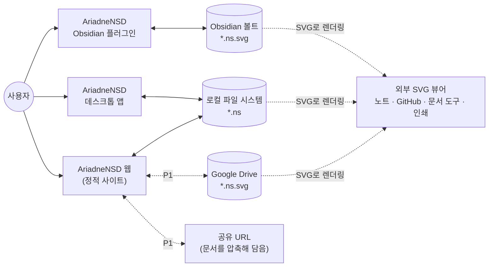
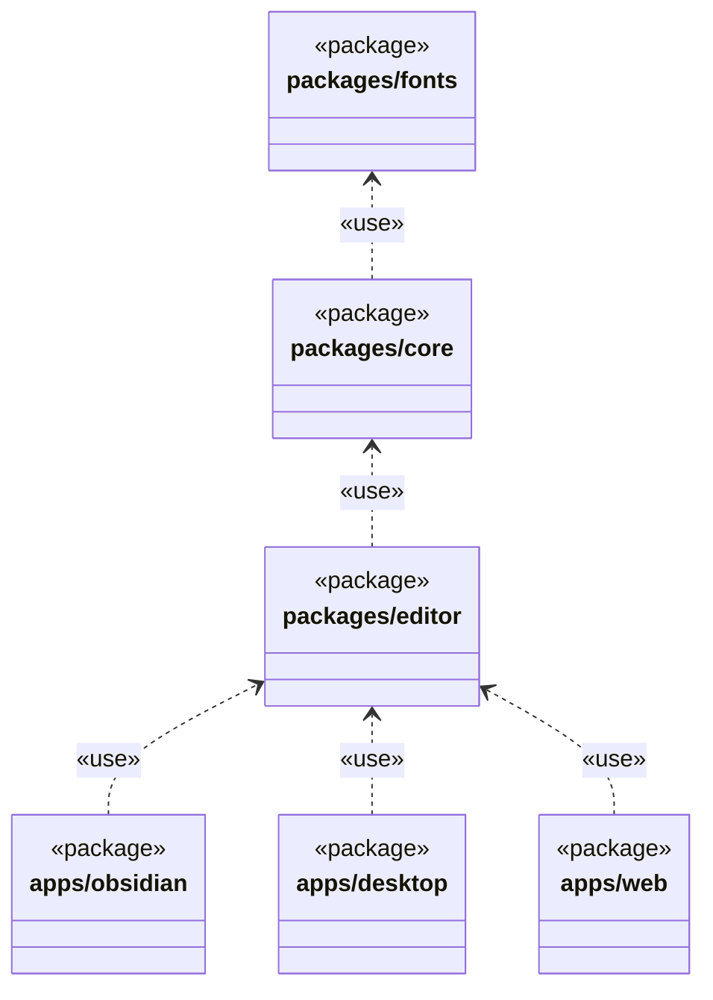
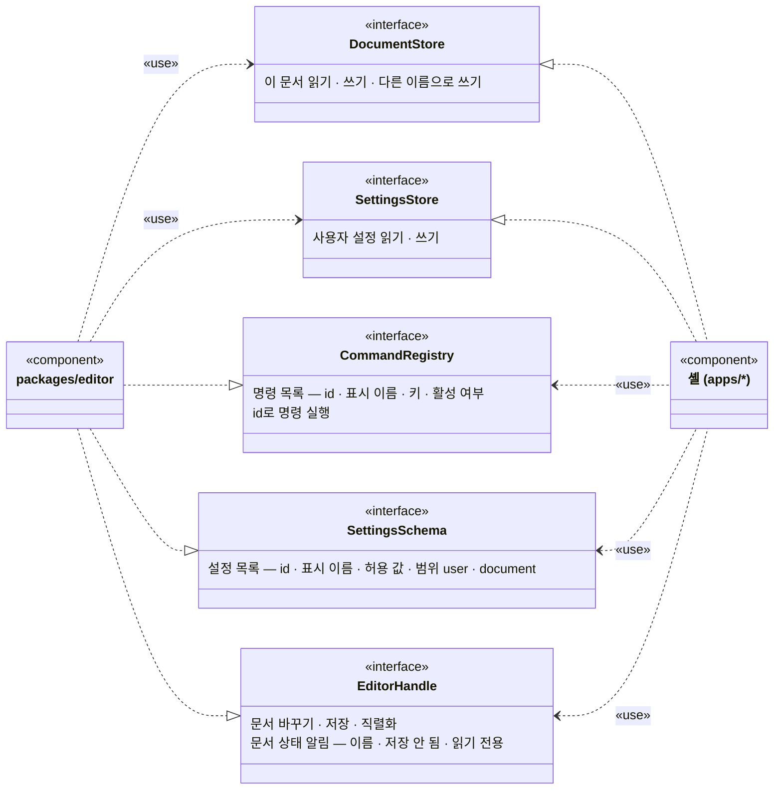
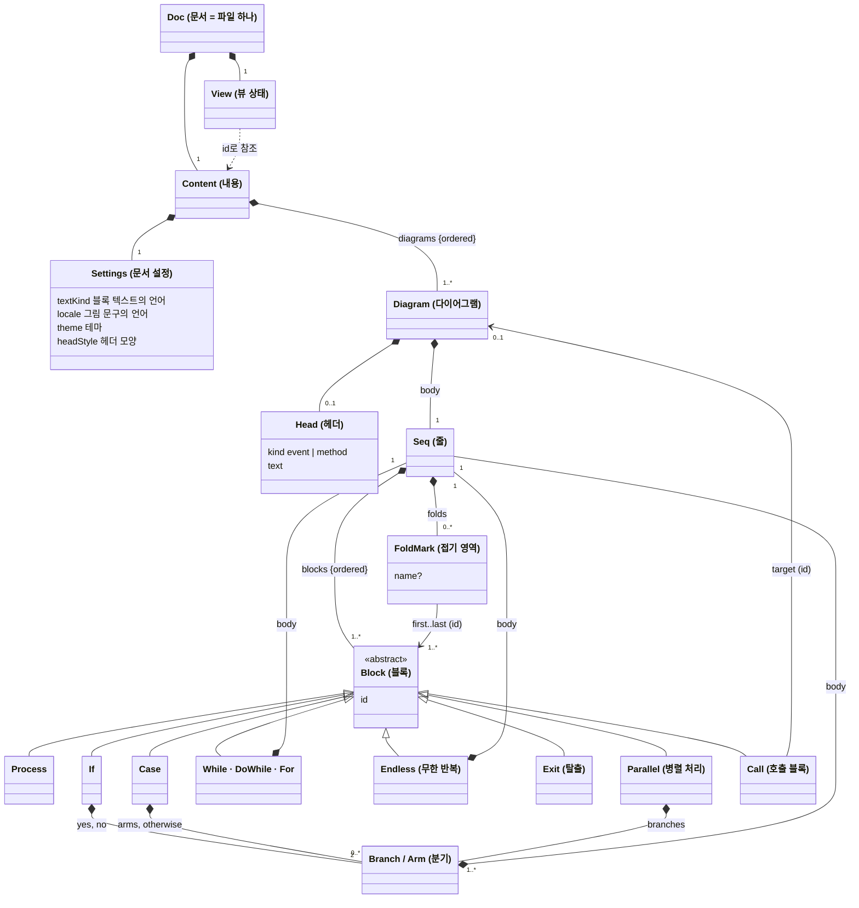
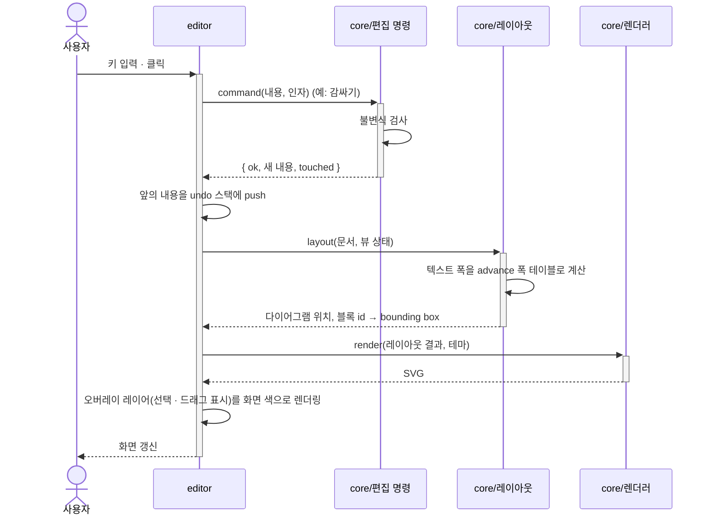
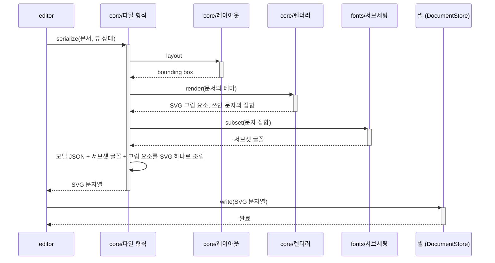
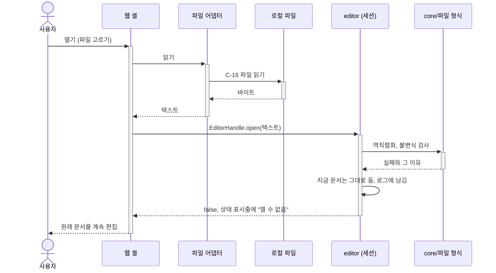
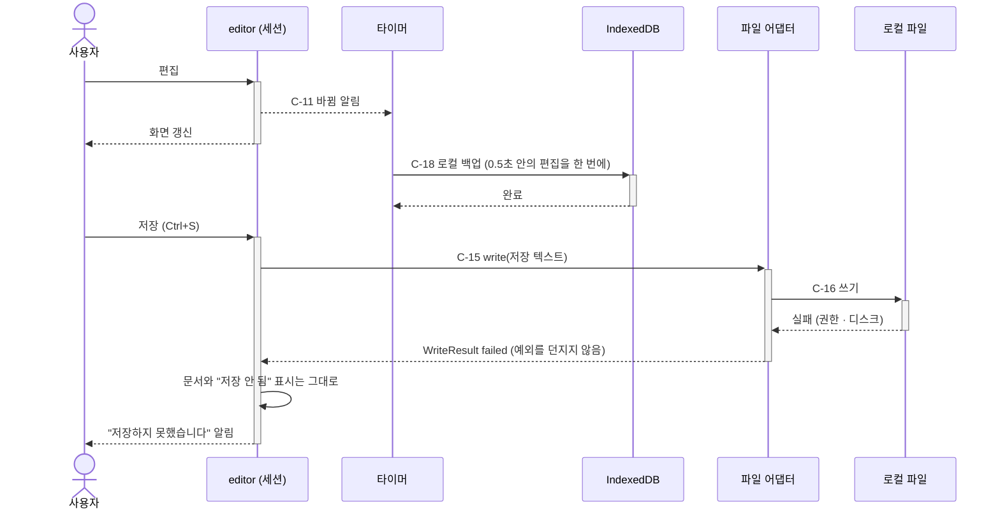
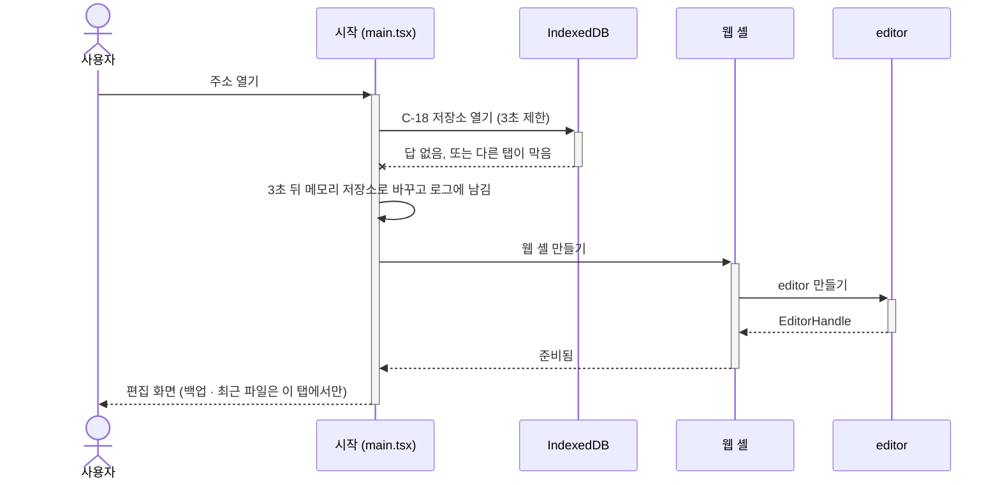

# 아키텍처 개요

현재 아키텍처를 한눈에 보여 주는 문서입니다. 각 결정의 근거는 ADR에 있고, 세부 설계는 설계 문서에 있습니다. → [[docs/README|문서 색인]]

> [!info] 이 버전은
> 초안입니다. 여러 다이어그램, Event와 Method, 호출 블록, Case, 접기 영역, 저장되는 뷰 상태, 다국어, 글꼴 번들을 담고 있습니다.

> [!note] 용어와 표기
> - 이 문서와 ADR, 설계 문서는 **SW 엔지니어의 용어**로 씁니다. 블록 · 분기 · 헤더 · 접기 영역 같은 **도메인 용어**는 [[06-glossary|용어집]]을 따르고, 처음 나올 때 코드의 식별자(`Seq`, `FoldMark` …, [[01-model]])를 붙입니다.
> - 그림은 UML을 씁니다(Mermaid의 `classDiagram` · `sequenceDiagram`). UML이 아닌 그림에는 그림 바로 아래에 범례를 둡니다.

## 1. 목표와 제약

**누구를 위한 것인가.** 주 사용자는 실무에서 설계 문서를 쓰는 사람입니다([[01-requirements#1. 핵심 원칙]]). 다이어그램은 문서에 삽입되고, 인쇄되며, git 같은 버전 관리 시스템으로 관리되기도 합니다. 그래서 "어디서 저장해도 같은 파일(결정적 출력)", "어디서 열어도 같은 그림"이 품질 목표의 앞자리에 옵니다.

**품질 목표** ([[01-requirements#4. 비기능 요구사항|비기능 요구사항]])

1. **정합성:** 문서는 어떤 편집 후에도 불변식(invariant)을 만족한다. [[01-requirements#^r-nfr|R-NFR-01]] (QA-01, QA-02)
2. **호환성 · 결정성:** 배포 대상들이 같은 파일을 주고받고, 같은 모델과 같은 뷰 상태는 바이트 단위로 같은 SVG가 된다. [[01-requirements#^r-nfr|R-NFR-02]], [[01-requirements#^r-fmt|R-FMT-03]] (QA-03~05)
3. **이식성:** 저장된 다이어그램은 플러그인도 글꼴도 없는 SVG 뷰어에서 그대로 렌더링된다. [[01-requirements#^r-fmt|R-FMT-01]], [[01-requirements#^r-fmt|R-FMT-07]] (QA-06)
4. **테스트 가능성:** 도메인 로직(모델 · 레이아웃 · 렌더링)은 DOM 없이 단위 테스트할 수 있다. [[01-requirements#^r-nfr|R-NFR-06]] (QA-14)
5. **성능:** 블록 500개에서 편집 응답 100ms 이내. [[01-requirements#^r-nfr|R-NFR-03]] (QA-07~09)
6. **변경 용이성:** 새 배포 대상, 렌더링 백엔드, 블록 종류, 화면 언어를 추가할 때 수정하는 곳이 정해진 한 곳이다. 조작 규칙의 개념(명령, 대상, 삽입 위치, 블록 종류, 필드)도 구성 요소 하나씩에 대응시켜, 규칙을 바꿀 때 수정하는 곳이 한 곳이게 한다(→ 4.6). [[0002-three-targets-shared-core|ADR-0002]], [[0030-swappable-drawing|ADR-0030]] (QA-10~13, QA-22)

품질 목표마다 그것을 만든 결정은 [[#10.1 품질 목표별 결정 지도]]에, 민감점과 상충점은 [[#8.1 민감점]] · [[#8.2 상충점]]에 있습니다. 품질 목표마다 측정할 수 있는 시나리오와 합격 기준, 그것을 만족시키는 이 문서의 구조, 확인할 테스트는 [[03-quality-attribute-scenarios|품질 속성 시나리오(QAS)]]에 있습니다. 구조를 바꿀 때는 그 문서에서 영향받는 시나리오를 찾아 봅니다. 테스트를 어떤 유형으로 나누고 무엇을 실제 구현으로 두며 CI에서 어떻게 실행하는지는 [[02-test-architecture|테스트 아키텍처]]에 있습니다.

**제약**

| 제약 | 근거 |
| --- | --- |
| 구현 언어는 TypeScript | [[0003-typescript\|ADR-0003]] |
| 웹 · Obsidian 플러그인 · 데스크톱을 먼저 만든다. Google Drive는 웹에 통합하고, Confluence · IDE 플러그인 · Claude skill은 이후에 추가한다(→ 7장) | [[0002-three-targets-shared-core\|ADR-0002]], [[0012-google-drive-integration\|ADR-0012]], [[0036-code-layout\|ADR-0036]] |
| 개발 순서는 웹 → Obsidian → 데스크톱. Google Drive 연동은 이 셋을 모두 만든 뒤에 만든다 | [[dr-0002-development-order\|DR-0002]] |
| 저장 형식은 모델을 내장한 SVG, 모델의 직렬화 형식은 JSON | [[0005-model-embedded-svg\|ADR-0005]], [[0007-json-serialization\|ADR-0007]] |
| 웹은 백엔드 서버 없는 정적 사이트 | [[01-requirements#^r-web\|R-WEB-01]] |
| 구조 편집기: 사용자는 좌표를 다루지 않는다. 트리를 편집하면 자동 레이아웃이 다이어그램을 다시 렌더링한다 | [[0004-structure-editor\|ADR-0004]] |
| 글꼴을 번들하고, 텍스트 폭은 그 글꼴 파일의 메트릭으로 계산한다 | [[0026-bundled-font-metrics\|ADR-0026]] |

## 2. 시스템 컨텍스트



> [!note] 범례 (UML이 아닌 컨텍스트 그림)
> - 모양: 원 = 사람(액터), 사각형 = 시스템(AriadneNSD의 배포 대상마다 따로 실행되는 앱, 외부 시스템), 원통 = 저장소.
> - **실선 화살표** `-->`: 사용자가 그 앱을 쓴다. **실선 양방향** `<-->`: 앱이 그 저장소의 파일을 읽고 쓴다.
> - **점선 양방향(`P1`)**: 같은 읽기 · 쓰기이지만 `P1`이라 MVP 이후에 추가한다.
> - **점선 "SVG로 렌더링"**: 우리 코드 없이, 그 저장소의 파일을 외부 뷰어가 일반 SVG로 표시한다(데이터 흐름이지 호출이 아니다).

AriadneNSD의 앱 셋은 따로 설치하고 따로 실행하는 프로그램입니다. 하나의 서버나 인스턴스가 셋을 함께 처리하지 않습니다(웹도 서버 없이 사용자의 브라우저 안에서만 실행됩니다). 사용자는 그 가운데 자기 환경에 맞는 것을 쓰고, 셋은 같은 코드(`core` · `editor` → 4장)와 같은 파일 형식을 나눠 씁니다. 그래서 한 앱에서 저장한 파일을 다른 앱에서 열 수 있습니다.

오른쪽의 "외부 SVG 뷰어"가 이 제품에서 특별한 대상입니다. 우리 코드가 전혀 실행되지 않는 곳에서 파일이 렌더링되어 표시됩니다. 그래서 렌더링에 필요한 것(색, 서브셋 글꼴)은 모두 파일 안에 자기 완결적으로 들어 있어야 합니다.

## 3. 실행 중의 모습

> [!info] 웹만 그렸습니다
> 이 장의 다이어그램은 지금 있는 앱인 **웹**만 다룹니다. Obsidian 플러그인과 데스크톱은 아직 만들지 않았고, 만들 때 그 앱의 다이어그램을 더합니다.
> Claude skill은 셸이 아니라 이 장에 없습니다 → [[07-claude-skill]]

웹 앱이 브라우저 탭 하나에서 실행될 때, 어떤 컴포넌트가 활성 상태이고 컴포넌트끼리 어떤 방식으로 통신하는지를 보여 주는 C&C 뷰(Component & Connector View)입니다. 웹 셸을 기준으로 그렸습니다. 다른 셸(Obsidian · 데스크톱)에서는 웹 셸 모듈과 외부(회색) 상자만 바뀌고, 셸과 `editor` 사이의 커넥터(C-11 · C-12 · C-15)는 같습니다.

실행 중의 모습이라, 외부와 통신하는 셸을 외부에 가까운 아래쪽에 둡니다. 의존의 방향은 4.1의 그림을 보세요.

### 3.1 한눈에

![[cc-view-web-overview.drawio.svg]]

- `editor`가 사용자의 입력을 받아 `core`의 순수 함수를 호출하고, `core`는 문자 폭과 서브셋을 `fonts`에 조회합니다. 모두 같은 스레드의 함수 호출입니다.
- 웹 셸이 `editor`를 생성하고 문서를 전달합니다. `editor`는 문서의 상태를 셸에 알립니다.
- 브라우저 저장소와 정적 호스팅에 접근하는 것은 셸과 `fonts`뿐이고, 모두 기다리는 비동기 호출입니다. 사용자 설정(C-19, localStorage)만 동기입니다.

### 3.2 자세히

![[cc-view-web.drawio.svg]]

문서 하나를 편집하는 동안 브라우저 탭 안에서 일어나는 일 전체입니다. 가운데 줄의 `editor`가 편집을 이끌고, 오른쪽의 `core` · `fonts`가 계산을 담당하며, 아래의 웹 셸이 외부와의 연동을 담당합니다. 이 구조의 특징은 다음과 같습니다.

- **입력은 단일 경로로 모입니다.** 키보드 · 마우스와 메뉴 · 툴바 · 커맨드 팔레트가 모두 같은 명령 id로 명령 레지스트리를 거쳐 세션에 전달됩니다(C-02 ~ C-04). 명령 레지스트리를 거치지 않는 입력은 셋입니다: 드롭, 더블클릭 편집, 문서 설정 창은 세션을 직접 호출합니다 → [[03-editor#3. 입력에서 명령까지]]
- **상태는 세션 한곳에 있고, 계산은 순수 함수가 합니다.** 세션이 문서 · undo 스택 · 선택을 보유하고 `core`의 편집 명령 · 레이아웃 · 렌더러를 호출합니다(C-05 · C-07 · C-09).
- **편집은 한 스레드에서 동기로 처리됩니다.** 세션이 편집 명령 바로 뒤에 레이아웃과 렌더링 결과를 생성하고, 캔버스 뷰는 알림(C-06)을 받아 다음 프레임에 그 렌더링 결과를 DOM에 반영하기만 합니다(C-10). 이 경로의 소요 시간이 곧 편집 반응 시간입니다(→ 3.5).
- **외부와의 I/O는 경계에 모입니다.** 파일 · 브라우저 저장소 · 네트워크에 접근하는 것은 웹 셸 모듈과 서브세팅뿐이고, 사용자 설정(C-19)을 빼면 모두 비동기입니다.
- **셸을 교체할 수 있습니다.** `editor`와 셸 사이의 커넥터는 C-11 · C-12 · C-15 셋뿐이어서, 다른 셸도 이 세 커넥터만 구현하면 연동됩니다.
- **저장이 실패해도 편집한 내용이 남습니다.** 로컬 백업(C-18)은 파일 저장(C-16)과 다른 경로로 IndexedDB에 별도로 저장됩니다.
- **무거운 자원은 필요할 때 받습니다.** 글꼴 슬라이스 · 서브세팅 wasm · 저장용 TTF는 처음 쓰는 순간에 정적 호스팅에서 가져옵니다(C-23 ~ C-25).

### 3.3 컴포넌트

코드의 경로는 `src/`에서 본 것입니다.

| 컴포넌트 | 유형 | 코드 | 생명주기 | 하는 일 |
| --- | --- | --- | --- | --- |
| 웹 셸 | 수동 · 조립 | `apps/web/src/shell/web-shell.ts`와 그 부분(`status.ts` · `opening.ts` · `shell-commands.ts` …) | 항상 | `editor`를 생성하고 문서를 전달, 셸 명령(새로 · 열기 · 내보내기), 알림. 부분들은 함께 쓰는 상태(`ShellContext`)로 이어진다 → [[06-web#10. 모듈과 시작 순서]] |
| 타이머 | 능동 | `apps/web/src/shell/timers.ts` | 편집한 뒤 | 자동 저장(2초 뒤), 로컬 백업(0.5초 안의 편집을 한 번에) |
| 공유 링크 | 능동 | `apps/web/src/files/share-link.ts`, `main.tsx` | 시작할 때 · `hashchange` | fragment를 디코딩해 문서로 엶 |
| 탭 잠금 | 능동 | `apps/web/src/shell/tab-lock.ts` | 문서를 열 때 | 같은 문서를 연 탭이 있으면 나중 탭은 보기만 |
| 파일 어댑터 | 수동 | `apps/web/src/files/web-document-store.ts` | 열기 · 저장 | `DocumentStore` 구현: File System Access, 내려받기, 브라우저 문서 |
| 화면 글꼴 로더 | 수동 | `apps/web/src/fonts/screen-font.ts` | 그 문자가 처음 나올 때 | 글꼴 슬라이스(woff2)를 `FontFace`로 등록 → [[0040-screen-font-slices\|ADR-0040]] |
| 저장 글꼴 로더 | 수동 | `apps/web/src/fonts/save-font.ts` | 처음 저장 · PDF | 서브셋을 떠낼 TTF를 받음 |
| 입력 | 능동 | `packages/editor/src/dom/canvas-input.ts` · `canvas-drag.ts` · `inline-editor.ts`, `session/key-reader.ts`, `input/` | 항상 | DOM 이벤트 → 키맵 → 명령 id. 캔버스 뷰의 부분으로, 이벤트를 옮기기만 하고 정하는 것은 명령 레지스트리 · 세션을 거침 → [[03-editor#1. 화면 구성]] |
| 주변 UI | 수동 | `packages/editor/src/ui/` (React) | 항상 | 메뉴 · 툴바 · 모달 · 상태 표시줄 |
| 명령 레지스트리 | 수동 | `packages/editor/src/commands/` | 항상 | id로 실행. 셸 명령도 같은 목록 → [[0033-command-list-for-shells\|ADR-0033]] |
| 세션 | 수동 · 상태 | `packages/editor/src/session/` | 문서 하나 | 지금 문서, undo 스택, 선택. 문서가 바뀌면 레이아웃과 렌더링 결과를 생성해 보유함(`renderDoc`) |
| 캔버스 뷰 | 수동 | `packages/editor/src/dom/canvas-view.ts`, `overlay.ts` | 바뀔 때마다 | 세션이 생성한 렌더링 결과를 다음 프레임에 DOM에 넣고, 레이아웃 결과로 선택 오버레이를 렌더링함. |
| 저장 | 수동 | `packages/editor/src/save/` | 저장 · 백업 | 저장할 SVG 텍스트를 만듦 |
| 편집 명령 · 레이아웃 · 렌더러 · 파일 형식 | 순수 함수 | `packages/core/src/commands` · `layout` · `render` · `format` | 호출될 때 | 문서 → 새 문서, 위치, SVG, 직렬화 → 4.1의 표 |
| advance 폭 테이블 | 순수 함수 | `packages/fonts` | 호출될 때 | 문자마다의 폭 |
| 서브세팅 | 순수 함수 (wasm) | `packages/fonts/browser` | 처음 저장 때 받음 | 쓰인 문자만 남긴 글꼴 |

### 3.4 커넥터

| ID | 유형 | 보내는 쪽 → 받는 쪽 | 무엇 | 동기성 |
| --- | --- | --- | --- | --- |
| C-01 | 알림 | 사용자 → 입력 | 키 · 마우스 · 터치 이벤트 | DOM 이벤트 |
| C-02 | 함수 호출 | 입력 → 명령 레지스트리 | 키맵이 고른 명령 id를 실행 | 동기 |
| C-03 | 함수 호출 | 주변 UI → 명령 레지스트리 | 메뉴 · 툴바 · 커맨드 팔레트도 같은 id로 | 동기 |
| C-04 | 함수 호출 | 명령 레지스트리 → 세션 | 명령을 지금 문서에 적용 | 동기 |
| C-05 | 함수 호출 | 세션 → 편집 명령 | `command(내용, 인자)` → 새 내용, 불변식 검사 | 동기 |
| C-06 | 알림 | 세션 → 캔버스 뷰 | 상태(문서 · 뷰 상태 · 선택 · 레이아웃)가 바뀜. 뷰는 다음 프레임을 예약하고, 그때 세션이 생성한 렌더링 결과를 가져감 | 동기 콜백, 렌더링은 다음 프레임 |
| C-07 | 함수 호출 | 세션 → 레이아웃 | 편집 명령 바로 뒤 `renderDoc` 안에서 `layout(문서, 뷰 상태)` → 블록 id → bounding box | 동기 |
| C-08 | 함수 호출 | 레이아웃 → advance 폭 테이블 | 텍스트 폭 | 동기 |
| C-09 | 함수 호출 | 세션 → 렌더러 | `renderDoc` 안에서 씬 빌드 + SVG 출력(`buildScene` · `toSvg`) | 동기 |
| C-10 | 함수 호출 | 캔버스 뷰 → DOM | 렌더링 결과가 바뀌었으면 문서 레이어의 바뀐 요소만 고치고(`DocumentLayer`, 처음과 짝지을 수 없을 때는 전체 교체), 오버레이를 렌더링함 | 다음 프레임(`requestAnimationFrame`)에 동기 |
| C-11 | 알림 | 세션 → 웹 셸 | `EditorHandle`: 이름 · 저장 안 됨 · 읽기 전용 | 동기 콜백 |
| C-12 | 함수 호출 | 웹 셸 → 저장 | 저장 텍스트와 스냅숏 받기(자동 저장 · 백업) | 비동기(처음엔 글꼴을 기다림) |
| C-13 | 함수 호출 | 저장 → 파일 형식 | `serialize(문서, 뷰 상태)` | 동기 |
| C-14 | 함수 호출 | 파일 형식 → 서브세팅 | 쓰인 문자의 서브셋 글꼴 | 동기(wasm을 받은 뒤) |
| C-15 | 함수 호출 | 세션 → 파일 어댑터 | `DocumentStore`: 열기 · 저장 · 다른 이름으로 | 비동기 |
| C-16 | 비동기 호출 | 파일 어댑터 → 로컬 파일 | File System Access(Chromium), 그 밖엔 내려받기 | Promise |
| C-17 | 비동기 호출 | 파일 어댑터 → IndexedDB | 브라우저 문서 읽기 · 쓰기 | Promise |
| C-18 | 비동기 호출 | 타이머 → IndexedDB | 로컬 백업, 최근 파일 | Promise. 3초 안에 열리지 않으면 메모리로 |
| C-19 | 함수 호출 | 웹 셸 → localStorage | 사용자 설정 | 동기 |
| C-20 | 메시지 | 탭 잠금 ↔ 다른 탭 | 이 문서를 연 탭이 있는가 | BroadcastChannel |
| C-21 | 알림 | 주소창 → 공유 링크 | 시작할 때의 fragment, `hashchange` | DOM 이벤트 |
| C-22 | 함수 호출 | 공유 링크 → 웹 셸 | 푼 문서를 보기 모드로 엶 | 동기 |
| C-23 | 비동기 호출 | 화면 글꼴 로더 → 정적 호스팅 | 글꼴 슬라이스 woff2 | HTTP, 그 문자가 처음 나올 때 |
| C-24 | 비동기 호출 | 서브세팅 → 정적 호스팅 | 서브세팅 wasm | HTTP, 처음 저장 때 |
| C-25 | 비동기 호출 | 저장 글꼴 로더 → 정적 호스팅 | 서브셋을 떠낼 TTF | HTTP, 처음 저장 · PDF 때 |
| C-26 | 비동기 호출 | 주변 UI → 시스템 클립보드 | 복사(공유 링크, 오류 내용) | Promise |

### 3.5 스레드

모두 브라우저 탭의 메인 스레드 하나에서 실행되고, Web Worker는 쓰지 않습니다. 능동 컴포넌트도 스레드가 따로 있는 것이 아니라 이벤트 루프에 리스너 · 타이머를 등록해 둔 것입니다.

- 편집 응답 경로(C-01 → C-10)는 처음부터 끝까지 동기입니다. 이 경로의 소요 시간은 모두 메인 스레드를 블로킹하고, [[01-requirements#^at|AT-05]]의 p95에 그대로 누적됩니다.
- 기다리는 일은 I/O(C-16 ~ C-18, C-23 ~ C-26)뿐입니다. 기다리는 동안 화면은 움직입니다.
- 서브세팅 wasm도 메인 스레드에서 실행됩니다. 큰 문서를 처음 저장할 때 잠깐 멈출 수 있습니다.

### 3.6 커넥터와 품질 속성

| 품질 속성 시나리오 | 경유하는 커넥터 | 이 그림에서 보이는 것 |
| --- | --- | --- |
| [[03-quality-attribute-scenarios#QA-07 편집 반응 시간\|QA-07]] 편집 반응 시간 | C-01 → C-10 | 모두 메인 스레드의 동기 호출. 이 커넥터로 나눈 측정 구간과 예산은 [[03-quality-attribute-scenarios#QA-07 편집 반응 시간\|QA-07]]에 있다 |
| [[03-quality-attribute-scenarios#QA-03 결정적 저장 출력\|QA-03]] 결정적 저장 출력 | C-12 → C-14 | 저장의 길에서 상태를 가진 컴포넌트는 세션뿐이고, 나머지는 순수 함수(초록) |
| [[03-quality-attribute-scenarios#QA-17 저장 실패\|QA-17]] 저장 실패 | C-16의 실패, C-18 | 파일 쓰기가 실패해도 로컬 백업은 다른 커넥터로 따로 남는다 |
| [[03-quality-attribute-scenarios#QA-18 모바일 시작 시간\|QA-18]] 모바일 시작 시간 | C-23 · C-24 · C-25 | HTTP는 필요할 때만. 시작에 꼭 필요한 것은 앱 번들과 글꼴 슬라이스 0 |
| [[03-quality-attribute-scenarios#QA-19 초기화 장애 시 빈 화면 방지\|QA-19]] 초기화 장애 시 빈 화면 방지 | C-18 | IndexedDB가 3초 안에 답하지 않으면 메모리로 계속한다 |
| [[03-quality-attribute-scenarios#QA-10 셸 확장성\|QA-10]] 셸 확장성 | C-11 · C-12 · C-15 | 셸이 바뀌어도 `editor` 쪽 커넥터는 이 셋뿐 |

## 4. 구성 요소

공통 패키지와 배포 대상별 셸(shell: 플랫폼마다 `editor`를 감싸는 호스트 애플리케이션)로 나눈 모노레포입니다. → [[0002-three-targets-shared-core|ADR-0002]]

코드는 저장소의 `src/` 아래에 있고, `src/`가 pnpm 워크스페이스의 루트입니다(→ [[0036-code-layout|ADR-0036]]). `src/` 안은 두 가지입니다.

| 폴더 | 뜻 | Java에 빗대면 |
| --- | --- | --- |
| `packages/` | **여러 앱이 함께 쓰는 라이브러리.** 혼자서는 실행되지 않고 `apps/`가 가져다 쓴다. npm 패키지 이름은 `@ariadne-nsd/…` | Maven 멀티 모듈의 공통 라이브러리 모듈 |
| `apps/` | **배포하는 프로그램.** 배포 대상(셸)마다 하나 | 실행 jar · war 모듈 |

`apps` · `packages`라는 폴더 이름은 JavaScript 모노레포의 관례입니다. 이 장의 `packages/…` · `apps/…`는 `src/`에서 본 경로입니다.

```text
AriadneNSD/
├─ src/                      코드 (pnpm 워크스페이스의 루트)
│  ├─ package.json, pnpm-workspace.yaml, tsconfig.base.json
│  ├─ packages/              함께 쓰는 라이브러리
│  │  ├─ fonts/              번들 글꼴, advance 폭 테이블, 서브세팅, 글리프 외곽선 읽기
│  │  ├─ core/               모델 · 명령 · 텍스트 · 레이아웃 · 렌더러 · 파일 형식 (DOM 없음)
│  │  │  ├─ src/             model/ commands/ text/ layout/ render/ format/ export/ (테스트는 소스 옆 *.test.ts)
│  │  │  ├─ pdf/             PDF 작성기의 따로 된 진입점 @ariadne-nsd/core/pdf (쓸 때 로드함 → ADR-0045)
│  │  │  └─ golden/          골든 파일 (저장되는 SVG의 기대값)
│  │  └─ editor/             화면 편집기 (주변 UI만 React → ADR-0010)
│  ├─ apps/                  배포하는 프로그램 (셸)
│  │  ├─ web/                웹 (Google Drive 연동도 여기, e2e/에 브라우저 테스트)
│  │  ├─ obsidian/           Obsidian 플러그인 (manifest.json의 원본)
│  │  └─ desktop/            데스크톱
│  └─ skills/ariadne-nsd/    Claude skill (셸이 아님, plugin/ 아래가 설치되는 폴더)
├─ manifest.json, versions.json   Obsidian이 저장소 맨 위에서 읽는 사본
├─ .claude-plugin/          Claude Code 플러그인 마켓플레이스 (marketplace.json)
├─ docs/ atelier/ journal/ til/   글
├─ site/                     문서 사이트 빌드
└─ .github/workflows/        CI
```

`core`는 패키지 하나이고, 아래 표의 모듈은 `core` 패키지 안의 폴더입니다(저장소에서는 `src/packages/core/src/model/` …). 나중의 대상(Confluence, IDE 플러그인)은 만들 때 `apps/` 아래에 폴더를 더합니다. 테스트 파일과 골든 파일의 위치는 [[02-test-architecture]], 빌드 도구는 [[0038-build-and-test-tools|ADR-0038]]에 있습니다.

### 4.1 패키지 의존



UML 패키지 다이어그램입니다. 점선 열린 화살표(`..>`)는 **의존**(«use»: 화살표 꼬리 쪽이 머리 쪽을 import한다)입니다. 아래의 `packages/*`는 라이브러리, 위의 `apps/*`는 그것을 가져다 쓰는 프로그램입니다.

| 패키지 / 모듈 | 책임 | 설계 문서 |
| --- | --- | --- |
| `fonts` | 번들 글꼴 파일, 글리프마다의 advance 폭 테이블, 쓰인 문자만 남기는 글꼴 서브세팅 | [[02-layout]] |
| `core` / 모델 | 문서 · 다이어그램 · 블록의 데이터 구조(불변 객체), 불변식 검사 | [[01-model]] |
| `core` / 편집 명령 | 내용을 바꾸는 명령(undo 대상)과 뷰 상태를 바꾸는 명령 | [[01-model]] |
| `core` / 텍스트 | 텍스트 폭 계산, 블록 텍스트의 구문 강조(언어마다의 토크나이저), 렌더링 결과에 표시하는 고정 문구의 다국어 처리 | [[02-layout]] |
| `core` / 레이아웃 | 문서 → 다이어그램의 위치와 블록마다의 bounding box (순수 함수) | [[02-layout]] |
| `core` / 렌더러 | 두 단계 파이프라인. **씬 빌드**: 레이아웃 결과 + 테마 → 씬(렌더링할 사각형 · 선 · 텍스트의 목록. 요소마다 블록 id가 붙은 디스플레이 리스트). 색과 모양의 판단은 모두 여기서 한다. **출력**: 씬 → SVG 문자열 | [[02-layout]] |
| `core` / 파일 형식 | 모델 내장 SVG의 직렬화 · 역직렬화, 스키마 버전 마이그레이션 | [[01-file-format]] |
| `editor` | 화면 표시, 선택, 텍스트 편집, 키보드 · 마우스 · 드래그 앤 드롭 입력, 메뉴와 툴바(React → [[0010-ui-framework\|ADR-0010]]), UI 다국어 | [[03-editor]] |
| `apps/obsidian` | 파일 뷰 등록, `.ns.svg` 판별, 볼트 파일 I/O, 노트에 삽입된 다이어그램 갱신 | [[04-obsidian-plugin]] |
| `apps/desktop` | 창, 파일 대화상자, OS 파일 연결 | [[05-desktop]] |
| `apps/web` | 정적 사이트, 브라우저 파일 I/O(File System Access API), 브라우저 문서, 로컬 백업 · 자동 저장 · 최근 파일, 공유 URL, Drive 연동 | [[06-web]] |
| `skills/ariadne-nsd` | Claude skill. 셸이 아니다. 모델 JSON의 검증, `.ns.svg`와 공유 URL의 생성 · 읽기를 하는 Node 스크립트 하나(`core` · `fonts`와 웹 셸의 공유 링크 모듈을 번들) | [[07-claude-skill]] |

나중의 대상: `apps/confluence` · `apps/vscode` · `apps/intellij`(→ `editor`) → [[0036-code-layout|ADR-0036]]

### 4.2 editor와 셸의 인터페이스



UML 컴포넌트 · 인터페이스 그림입니다(Mermaid에 컴포넌트 다이어그램이 없어 `classDiagram`의 스테레오타입으로 그림). 왼쪽 선은 모두 `editor`의 것, 오른쪽 선은 모두 셸의 것입니다. 점선 열린 화살표(`..>`)는 **의존**(«use»), 점선 빈 삼각형(`..|>`)은 **실현**(realization: 그 인터페이스를 구현한다)입니다. 인터페이스 안의 줄은 메서드의 시그니처가 아니라 책임입니다. 시그니처는 [[03-editor#6. 셸과의 연결]]에서 정합니다.

`editor`와 셸 사이의 인터페이스는 방향이 다른 두 쌍입니다.

| 방향 | 인터페이스 | 정의 | 구현 | 사용 | 결정 |
| --- | --- | --- | --- | --- | --- |
| **필요 인터페이스** (required, 포트) | `DocumentStore`, `SettingsStore` | `editor` | 셸 (어댑터) | `editor` | [[0031-shell-interfaces\|ADR-0031]] |
| **제공 인터페이스** (provided) | `CommandRegistry`, `SettingsSchema`, `EditorHandle` | `editor` | `editor` | 셸 | [[0033-command-list-for-shells\|ADR-0033]] |

- **필요 인터페이스**는 포트와 어댑터(헥사고날) 패턴입니다. 플랫폼마다 다른 I/O를 `editor`가 인터페이스로 정의하고, 셸이 구현체를 만들어 시작할 때 주입합니다.
	- `DocumentStore`: 이 문서를 읽는다 · 쓴다 · 다른 이름으로 쓴다.
	- `SettingsStore`: 사용자 설정(화면 언어, 자동 저장, 키 힌트 등 → [[05-screen-layout|화면 배치]]의 환경 설정)을 읽고 쓴다.
- **제공 인터페이스**로 `editor`는 명령 레지스트리와 설정 스키마를 노출합니다. 셸은 이것을 자기 툴바 · 메뉴 · 설정 창으로 렌더링하거나, 호스트 프로그램의 확장 지점(명령 팔레트 · 컨텍스트 메뉴 · 설정 화면: Obsidian, VSCode, IntelliJ)에 등록합니다. 명령의 실행 진입점은 하나(`id`로 실행)입니다. 셸도 자기 명령(새로 · 열기 · 최근 파일)을 같은 목록에 더합니다.
	- `EditorHandle`: 셸이 `editor`를 만들면 받는 핸들입니다. 문서를 바꾸고(`open`), 저장하고, 문서의 상태(이름 · 저장 안 됨 · 읽기 전용)를 알립니다. `editor`는 문서 하나만 관리하고, 어떤 파일을 열지와 자동 저장 · 로컬 백업의 타이머는 셸이 담당합니다 → [[03-editor#6.1 새로 · 열기 · 최근 파일]], [[03-editor#6.3 자동 저장과 로컬 백업은 셸이 담당한다]]

### 4.3 의존 규칙

- 의존은 4.1 그림의 화살표 방향으로만 흐른다(단방향, 순환 없음). `core`는 `editor`와 셸을 모른다. 패키지 사이의 방향은 CI의 import 검사(`src/.dependency-cruiser.cjs`)가 지킨다([[0036-code-layout|ADR-0036]]). `core` 안의 모듈 폴더 사이는 지금 순환만 차단한다(같은 설정의 `no-circular`).

- `skills/ariadne-nsd`는 `core` · `fonts`와 웹 셸의 공유 링크 모듈(`apps/web/src/files/share-link.ts`)만 가져온다. `editor`와 다른 셸 코드는 가져오지 않는다(dependency-cruiser `skill-is-not-a-shell` → [[07-claude-skill#4. 앱과 공유하는 코드]]).
- `core`와 `fonts`는 **DOM과 브라우저 API에 의존하지 않는다.** Node에서 그대로 실행하고 테스트한다.
- 텍스트 폭은 `core`가 `fonts`의 advance 폭 테이블로 직접 계산한다. 브라우저의 텍스트 측정 API(Canvas `measureText` 등)를 쓰지 않는다. → [[0026-bundled-font-metrics|ADR-0026]]
- 플랫폼 의존 기능은 4.2의 필요 인터페이스 두 개로만 들어온다. → [[0031-shell-interfaces|ADR-0031]]
- `editor`는 **렌더링 백엔드 인터페이스 하나**를 통해서만 화면에 렌더링한다. 지금의 구현체는 렌더러가 만든 SVG 문자열을 DOM에 그대로 삽입한다([[0030-swappable-drawing|ADR-0030]]). 히트 테스트(클릭한 곳이 어느 블록인가)와 선택 오버레이의 위치는 DOM을 조회하지 않고 레이아웃 결과(블록 id → bounding box 맵)로 계산한다. 그래서 화면 렌더링을 UI 프레임워크로 바꾸더라도 백엔드 구현체 하나만 교체한다.
- `editor`는 문서에 대한 상태를 파일 밖에 영속하지 않는다. 파일 밖에 영속하는 것은 사용자 설정(화면 언어, 자동 저장, 키 힌트 등 → [[05-screen-layout|화면 배치]]의 환경 설정)뿐이다(웹 셸은 그 밖에 로컬 백업 · 최근 파일을 브라우저에 둔다 → [[06-web#2. 로컬 백업과 자동 저장]]).

> [!info] 미완성: `core` 안 모듈 폴더(model · commands · text · layout · render · format · i18n) 사이의 방향. 정하면 이 절에 기록하고 `src/.dependency-cruiser.cjs`에 규칙으로 더한다.

### 4.4 문서 모델

파일 하나는 다이어그램 여러 개를 담은 문서 하나입니다. 아래는 개념 모델이고, 타입 정의는 [[01-model#1. 타입]]에 있습니다.



UML 클래스 다이어그램입니다. 채운 마름모(`*--`)는 **합성**(부분은 전체에 속하고 함께 사라진다), 빈 삼각형(`<|--`)은 **일반화**(상속; TypeScript에서는 판별 유니온 `kind`), 실선 열린 화살표(`-->`)는 **연관**(id로 가리키는 참조), 점선 열린 화살표(`..>`)는 의존입니다. 숫자는 다중성입니다. 반복 블록 셋(While · DoWhile · For)은 구조가 같아 상자 하나로 그렸습니다(모델에서는 따로 된 타입).

- **문서**(`Doc`)는 다이어그램의 목록과 문서 설정을 갖는다. 다이어그램은 적어도 하나 있다.
- **다이어그램**(`Diagram`)은 헤더(`Head`)와 본문(`Seq`)을 갖는다. 헤더가 Event이면 이벤트 핸들러, Method이면 호출할 수 있는 서브루틴이다. → [[0021-event-and-method|ADR-0021]]
- **줄**(`Seq`)은 블록의 순서 있는 목록이다. 비지 않는다(빈 분기는 빈 처리 블록 하나로 채운다).
- **제어 블록**은 줄을 하나 이상 합성한다: While · Do-While · For · 무한 반복은 본문 하나, If는 분기 둘, Case는 분기 여럿과 default, 병렬 처리는 라벨 없는 분기 여럿. 탈출은 처리 블록처럼 텍스트 하나다 → [[0052-endless-exit-parallel-blocks|ADR-0052]]
- **호출 블록**(`Call`)은 호출 대상 Method를 **id로 참조**한다. 이름 문자열을 복사해 갖지 않는다. 한 문서 안에서 헤더의 이름은 유일하다([[02-interaction-rules#Event 헤더]]). 그래서 헤더의 이름을 바꾸면 호출 블록의 표시가 모두 따라 바뀐다. 문서에 없는 것을 호출하는 호출 블록은 id 대신 이름을 적고, 참조하던 Method가 없어지면 마지막으로 보이던 이름을 입력한 호출 블록이 된다. → [[0022-call-name-follows-head|ADR-0022]], [[0049-call-without-method-is-named|ADR-0049]]
- **접기 영역**(`FoldMark`)은 한 줄 안의 연속된 블록 범위에 이름을 붙인 마커다. 중첩될 수 있다. 블록을 감싸는 컨테이너 노드가 아니라 줄에 붙은 주석(annotation)이라, 블록 트리는 접기 영역과 무관하게 같다. → [[0017-fold-name-in-model|ADR-0017]]
- 블록과 다이어그램, 접기 영역은 모두 **안정 id**(문서가 바뀌어도 유지되는 식별자)를 갖는다. 선택, 접힘, 호출 대상은 모두 id로 참조한다.

### 4.5 내용과 뷰 상태

파일에는 두 가지가 구분되어 들어갑니다. → [[0018-save-as-shown|ADR-0018]]

| | 내용 (`Content`) | 뷰 상태 (`View`) |
| --- | --- | --- |
| 무엇 | 블록, 텍스트, 구조, 접기 영역과 그 이름, 헤더와 종류, 다이어그램의 순서, 문서 설정(블록 텍스트의 언어, 그림 문구의 언어, 테마, 헤더 모양) | 어느 접기 영역과 어느 분기가 접혀 있는지, 어느 호출 블록을 인라인으로 펴 보였는지, 이름 띠를 보이는지, 결과 기호(`←` / `=`, [[ux-decisions#Q9. 실행 취소의 대상 (R7)\|Q9]]) |
| 바꾸면 | undo 대상이다 | undo 대상이다(접힘 · 펴 보기, 이름 띠, 결과 기호 → [[ux-decisions#UN2. 이름 띠 보기도 실행 취소의 대상\|UN2]]) |
| 저장 | 파일에 저장 | 파일에 저장 (저장되는 렌더링 결과는 지금 화면 그대로) |
| dirty 표시("저장 안 됨") | 뜬다 | 뜬다 |

- 뷰 상태는 내용의 id를 참조하는 별도 구조다. 떼어 내면 "모두 펼친 그림"이 된다.
- 인라인으로 펴 보인 호출 블록 안에서 만든 접기 영역([[01-requirements#^r-edit|R-EDIT-16]])은 그 호출 블록에 속한 **내용**이다. Method의 블록을 id로 참조한다.
- 화면의 줌과 스크롤 위치, 선택은 파일에 저장하지 않는다. `editor`의 메모리 상태다.

### 4.6 조작 규칙과 구성 요소의 대응

조작 규칙([[02-interaction-rules#공통 규칙]])의 개념 하나에 구성 요소 하나를 대응시킵니다. 규칙이 개념 하나로 정의된 곳은 그것을 구현하는 요소도 하나여야 규칙을 바꿀 때 수정하는 곳이 한 곳이 됩니다(→ [[03-quality-attribute-scenarios#QA-22 조작 규칙의 변경 (제안)|QA-22]]). 조작 규칙의 표(요소와 컨테이너, 블록 종류, 텍스트 필드, 명령마다 받는 대상, 삽입 위치, 명령 × 대상 매트릭스)가 명세이고, 동작을 바꿀 때는 규칙의 표를 먼저 고친 뒤 코드를 표에 맞춥니다.

| 조작 규칙의 개념 | 구성 요소 | 대응 |
| --- | --- | --- |
| 명령은 하나, 진입점은 여럿(원칙 ③) | 명령 레지스트리 | 요소 하나. 드롭과 더블클릭 편집은 거치지 않는다(3.2) |
| 편집 명령은 유효한 구조만 만든다(원칙 ①) | `core`의 편집 명령과 불변식 검사 | 요소 하나 |
| 화면에 보이는 그대로 저장한다(원칙 ②) | 화면과 파일이 같은 렌더러, 문서에 든 뷰 상태(4.5) | 요소 하나 |
| 방향키는 그림에 보이는 순서로 이동한다 | 보이는 나무와 이동 함수([[03-editor#2.2 이동]]) | 요소 하나 |
| C4 실행 취소 단위 | 세션(`commit` · `setView`) | 요소 하나 |
| C5 읽기 전용 | 명령 레지스트리의 검사 | 요소 하나 |
| 요소와 컨테이너(T1 ~ T4) | 방향키와 클릭은 보이는 나무. 이동 명령 · 드롭 · 접기의 대상은 컨테이너의 종류마다 따로 구현 | 조작마다 |
| C1 대상 결정과 명령마다 받는 대상 | 명령마다의 `when` · `run` | 명령마다 |
| C2 삽입 위치 | 키보드 명령과 드롭이 각각 구현 | 진입점마다 |
| C3 명령 후 선택 | 세션의 `commit`이 받는 명령마다의 `after` | 명령마다 |
| 블록 종류의 표 | `core`와 `editor`의 종류별 분기 | 종류마다 |
| 텍스트 필드의 표 | `core`의 편집 명령과 `editor`의 인라인 에디터 | 필드마다 |

> [!info] 미완성: 조작마다 · 명령마다 구현된 개념
> 표의 아래 여섯 줄은 아직 구성 요소 하나가 아닙니다. 컨테이너 트리(보이는 나무의 확장), 대상 해석기, 삽입 위치의 타입, 블록 종류의 기술자, 필드의 기술자로 하나씩 만듭니다(→ [[0054-command-target-resolution|ADR-0054]]). 조작 규칙의 표를 앱의 동작과 대조하는 테스트도 아직 없습니다. 구현하는 곳의 지금 위치는 [[03-editor#3.5 조작 규칙의 표를 구현하는 곳]], 근거와 남은 일은 [[interaction-abstraction-review]]와 [[backlog#조작 규칙과 설계의 추상화]]에 있습니다.

## 5. 주요 흐름

### 5.1 편집



- 문서는 불변 객체다. 명령은 "문서를 받아 새 문서를 반환하는 순수 함수"이고, undo는 앞의 문서(스냅숏)로 돌아가는 것이다. 바뀌지 않은 하위 트리는 앞의 문서와 공유한다(구조적 공유, structural sharing). → [[0029-immutable-document-undo|ADR-0029]]
- 접고 펴기 같은 뷰 명령은 편집 명령과 불변식 검사를 거치지 않고 세션이 뷰 상태만 바꾼다. 뷰 상태가 달라지면 그것도 undo 한 단계다(→ [[0048-folding-is-undoable|ADR-0048]], 4.5).
- 선택 하이라이트처럼 편집 중에만 보이는 표시는 렌더러가 렌더링하지 않는다. `editor`가 렌더러의 SVG 위에 오버레이 레이어로 따로 렌더링한다. 그래서 화면의 렌더링 결과와 저장되는 렌더링 결과가 같은 렌더러에서 나온다.
- 펴 보인 호출 블록은 레이아웃이 Method의 블록을 그 위치에 다시 배치해 렌더링한다. 문서는 바뀌지 않는다.

### 5.2 저장과 열기



- **저장되는 렌더링 결과의 색은 문서의 테마다.** 편집 화면이 어두워도 같다. 화면의 문서 레이어도 같은 테마로 렌더링하므로 화면용과 저장용은 같은 렌더링 결과다. `editor`가 렌더링하는 오버레이 레이어는 종이 위에 렌더링하므로 화면 색이 아니라 테마의 종류(밝음 · 어두움)에 맞는 편집 색을 쓴다([[0044-document-themes|ADR-0044]]). 화면 색을 따르는 것은 종이 바깥의 편집 화면뿐이다. → [[01-requirements#^r-fmt|R-FMT-08]], [[04-visual-design#2. 레이어와 출력]]
- 편집기가 렌더링 결과에 표시하는 고정 문구("참", "거짓", "블록 n개")는 **문서 설정의 그림 문구의 언어**(`settings.locale`)로 표시한다. 화면과 저장 파일 · PNG가 같고, 저장하는 사람의 화면 언어와 상관없다. 메뉴 · 알림만 화면 언어를 따른다 → [[01-requirements#^r-nfr|R-NFR-04]], [[0041-drawing-locale-in-document|ADR-0041]]
- 서브세팅은 결정적이다: 같은 문자 집합에서 항상 같은 바이트가 나온다. 그래서 같은 문서는 어디서 저장해도 같은 파일이 된다.
- **열기:** SVG에서 모델 JSON만 역직렬화한다. 그림 요소와 서브셋 글꼴은 읽지 않고, 다이어그램은 모델에서 다시 렌더링한다. 옛 스키마 버전이면 버전별 마이그레이션을 차례로 적용한다. 모델이 없거나 깨졌으면 편집할 수 없다고 알리고 원본 파일은 건드리지 않는다.
- 자세한 형식은 [[01-file-format]]에 있다.

### 5.3 깨진 파일 열기

[[03-quality-attribute-scenarios#QA-02 깨진 파일 열기|QA-02]]의 흐름입니다. 열기는 읽기만 하므로 원본 파일은 어떤 경우에도 바뀌지 않습니다.



- 깨진 곳의 종류와 상관없이 같은 경로를 거칩니다. 역직렬화는 편집 명령과 같은 불변식 검사를 거칩니다 → [[01-file-format#5. 버전 관리]]
- 공유 링크로 연 문서도 같은 검증 파서를 거치고, 열지 못하면 이유를 보이는 모달을 띄웁니다(C-21 · C-22 → [[06-web#3. 공유 URL과 보기 모드]])

### 5.4 저장 실패

[[03-quality-attribute-scenarios#QA-17 저장 실패|QA-17]]의 흐름입니다. 로컬 백업은 저장과 다른 커넥터로 별도로 동작하기 때문에, 파일 쓰기가 실패해도 편집한 내용은 브라우저에 남습니다.



- `DocumentStore`의 쓰기는 실패를 값(`cancelled` · `denied` · `failed`)으로 반환합니다 → [[03-editor#6. 셸과의 연결]]
- 다시 열면 로컬 백업이 "지난번 내용을 복원할까요?"로 돌아옵니다 → [[06-web#2. 로컬 백업과 자동 저장]]

### 5.5 초기화 장애

[[03-quality-attribute-scenarios#QA-19 초기화 장애 시 빈 화면 방지|QA-19]]의 흐름입니다. 브라우저 저장소가 응답하지 않아도 편집 화면은 뜹니다.



- 시작 단계는 페이지에 표시(`data-boot-step`)되고, 어떤 경우든 15초 안에 편집 화면이나 이유가 보입니다 → [[06-web#7. 웹에서의 화면]]
- "시작"은 웹 셸 모듈의 진입점이라 3장의 그림에는 따로 그리지 않았습니다

## 6. 공통 관심사

| 관심사 | 방침 |
| --- | --- |
| Undo | 내용을 바꾸는 일은 모두 편집 명령으로만 한다(커맨드 패턴). 명령 하나가 undo 한 단계다. 뷰 상태(접힘 · 펴 보기, 이름 띠, 결과 기호)를 바꾸는 것도 한 단계다. → [[02-interaction-rules#6. 실행 취소]], [[0048-folding-is-undoable\|ADR-0048]] |
| 조작 규칙과의 대응 | 조작 규칙의 개념 하나에 구성 요소 하나를 대응시킨다. 조작 규칙의 표가 명세이고, 동작을 바꿀 때는 규칙의 표를 먼저 고친 뒤 코드를 표에 맞춘다. → 4.6, [[02-interaction-rules#공통 규칙]] |
| 정합성 | 명령이 새 문서를 만들 때마다 불변식을 검사한다. 위반하는 문서는 만들어지지 않는다. 파일을 역직렬화할 때도 같은 검사를 한다 |
| 결정적 출력 | 레이아웃과 렌더러는 순수 함수다. 폭은 글꼴 메트릭으로 계산하고 정수 px로 올린다. JSON의 키 순서와 줄바꿈을 고정한다. 현재 시각, 기기 정보, 난수를 쓰지 않는다 |
| 텍스트 측정 | 글꼴을 번들하고, 그 글꼴 파일의 advance 폭으로 `core`가 계산한다. 커닝과 합자를 끈다. 편집기가 렌더링 결과에 표시하는 기호는 번들 글꼴에 있는 글리프만 쓰거나 도형으로 렌더링한다. 저장되는 SVG에는 쓰인 문자만 남긴 서브셋 글꼴을 포함한다. → [[0026-bundled-font-metrics\|ADR-0026]] |
| 색과 테마 | 색은 "디자인 토큰 이름 → 값"의 맵으로 렌더러에 전달한다. 테마(렌더링 결과의 색, 문서 레이어)와 화면 색(편집 화면, 오버레이 레이어)은 다른 맵이다. 테마는 색만 바꾸고 레이아웃에는 영향이 없다(글꼴과 선 굵기는 테마가 아님). → [[dr-0003-default-visual-style\|DR-0003]], [[04-visual-design#3. 디자인 토큰]] |
| 블록 텍스트의 언어 | 문서마다 하나를 선택한다(일반 텍스트 / C / C++ / Java / JavaScript · TypeScript / Python / Bash). 언어마다 토크나이저를 하나씩 두고(`core`) 구문 강조에만 쓴다. 글꼴과 레이아웃은 언어와 상관없다([[0042-text-kind-keeps-block-font\|ADR-0042]]). 예약어 · 문자열 리터럴 · 주석 · 숫자만 분류하고 파싱은 하지 않는다. 편집기는 텍스트의 의미를 검사하지 않는다. → [[01-requirements#^r-lay\|R-LAY-06]], [[0032-token-highlighting\|ADR-0032]] |
| 다국어 | UI 문자열은 `editor`가, 렌더링 결과에 표시하는 고정 문구는 `core`가 각각 한 곳(메시지 카탈로그)에서 관리한다. 기본 로캘은 영어이고 한국어 · 독일어를 지원하며, 언어의 목록은 `core`의 `locales` 하나다. 화면 문자열의 카탈로그(`editor` · 셸)는 영어만 첫 다운로드에 두고 다른 언어는 그 언어를 처음 보일 때 받는다(`core`의 `lazyCatalog` · `loadLocale`). 렌더링 결과의 고정 문구는 작고 동기로 쓰여 모든 언어를 함께 둔다 → [[0053-lazy-screen-language-catalogs\|ADR-0053]] |
| 키 입력 | 키맵은 하나이고 표준 키 위에 Vim 키를 더한다. 키 바인딩은 표 하나에 둔다. 메뉴와 툴바도 같은 명령 레지스트리에서 생성한다. → [[dr-0009-vim-keys\|DR-0009]], [[03-keymap]], [[0033-command-list-for-shells\|ADR-0033]] |
| 오류 처리 | 깨진 파일은 "편집 불가" 안내로 끝내고, 원본 파일은 덮어쓰지 않는다. 예상하지 못한 예외는 문제 알리기 보고서에 담는다. → [[01-requirements#^r-rep\|R-REP-01]] |

## 7. 배포 구성

| 대상 | 셸 | 코드의 위치 | 저장 확장자 | 결정 |
| --- | --- | --- | --- | --- |
| 웹 | 정적 호스팅: GitHub Pages `/app/` | `src/apps/web` | `.ns` | [[0006-file-extensions\|ADR-0006]] |
| Google Drive | 웹에 통합 | `src/apps/web` 안 | `.ns.svg` | [[0012-google-drive-integration\|ADR-0012]], [[0014-drive-file-extension\|ADR-0014]] |
| Obsidian 플러그인 | Obsidian 플러그인 API | `src/apps/obsidian` | `.ns.svg` | [[0006-file-extensions\|ADR-0006]] |
| 데스크톱 | Electron 또는 Tauri | `src/apps/desktop` | `.ns` | [[0009-desktop-framework\|ADR-0009]] (제안됨) |
| Confluence (`P2`) | Forge 앱의 iframe 안에 웹 화면 | `src/apps/confluence` | 페이지 안의 다이어그램(형식은 정하지 않음) | [[01-requirements#^r-cf\|R-CF-01]] |
| IDE 플러그인 (`P2`) | VSCode 확장의 웹뷰, 그다음 IntelliJ | `src/apps/vscode`, `src/apps/intellij` | 소스 코드 (코드가 원본) | [[01-requirements#2.7 IDE 플러그인 (나중에)]] |
| Claude skill (`P2`) | 셸이 아님. Claude가 모델 JSON을 쓰고, 스킬의 스크립트가 앱의 코드로 검증해 `.ns.svg`를 렌더링하고 공유 URL을 생성한다 → [[07-claude-skill]] | `src/skills/ariadne-nsd` | `.ns.svg`와 공유 URL | [[01-requirements#2.6 Claude skill]], [[0050-claude-skill-bundle-and-distribution\|ADR-0050]] |

코드의 위치와 내보내는 곳은 [[0036-code-layout|ADR-0036]]에 있습니다. 웹은 배포한 사이트의 `/app/`으로, Obsidian 플러그인과 데스크톱은 GitHub Release로 내보냅니다. 빌드 결과(`dist/`)는 저장소에 넣지 않고, GitHub Actions가 빌드해 그곳으로 보냅니다. Claude skill은 GitHub Release의 zip(claude.ai)과 이 저장소의 플러그인 마켓플레이스(Claude Code)로 배포하고, 스킬의 스크립트 `nsd.mjs`는 설치되는 그대로 실행되도록 빌드 결과를 저장소에 넣습니다 → [[07-claude-skill#7. 배포]]

**Google Drive**는 따로 된 셸이 아니라 웹 셸에 더하는 연동 모듈입니다(→ [[0012-google-drive-integration|ADR-0012]], [[0014-drive-file-extension|ADR-0014]]).

- 같은 정적 페이지가 Drive에서 파일 ID를 받아 열리면 Drive 모드로 동작합니다. 서버는 여전히 없습니다.
- 권한은 `drive.file` 범위(앱이 만들었거나 사용자가 AriadneNSD로 연 파일에만 접근)만 요청합니다.
- "AriadneNSD로 열기"는 `.ns`와 `.ns.svg`를 모두 엽니다. 실제 판별은 다른 대상과 같이 모델 요소가 있는지로 합니다([[01-file-format#1. 확장자와 판별]]).
- Drive의 "새로 만들기"로 만드는 파일은 `.ns.svg`입니다. Drive의 미리보기와 썸네일이 SVG로 렌더링해 주기 때문입니다. 이미 있는 파일을 열어 저장할 때는 파일 이름을 바꾸지 않습니다.

셸이 하는 일은 4.2의 필요 인터페이스(`DocumentStore`, `SettingsStore` → [[0031-shell-interfaces|ADR-0031]])를 구현하고, 제공 인터페이스(`CommandRegistry`, `SettingsSchema` → [[0033-command-list-for-shells|ADR-0033]])를 호스트 플랫폼의 메뉴 · 설정 화면에 등록하는 것뿐입니다. 셸은 위 표의 대상마다 하나씩이고(Google Drive는 웹 셸 안, Claude skill은 셸이 아님), 이후에 추가되는 대상도 같은 인터페이스를 구현하면 연동됩니다. IDE 플러그인은 예외일 수 있습니다. 읽고 쓰는 것이 `.ns` 파일이 아니라 소스 코드라서, 코드와 모델 사이의 양방향 변환(→ [[01-requirements#3.6 코드 연동]])이 셸과 `core` 사이에 더 필요합니다. 그 부분은 아직 설계하지 않았습니다.

## 8. 위험과 검증이 필요한 사항

> [!success] 텍스트 폭 측정과 "같은 모델 → 같은 SVG" (2026-10-13 스파이크로 확인)
> 레이아웃은 텍스트 폭에 따라 달라지는데, 텍스트 폭은 실행 환경(Obsidian, 브라우저 종류, 데스크톱 웹뷰, OS 글꼴)마다 다릅니다. 기기의 글꼴로 측정하면 같은 줄이 33px까지 달랐습니다.
> **글꼴을 번들하고 폭을 글꼴 파일로 계산하면 저장되는 파일은 환경과 상관없이 같습니다.** 브라우저가 렌더링한 폭은 계산한 폭과 0.1px 안에서 맞았습니다(Chrome과 Edge / Windows, Chrome / Android).
> 남은 위험: Firefox와 Safari는 확인하지 못했습니다. → [[0026-bundled-font-metrics|ADR-0026]]

> [!warning] 서브셋 글꼴의 크기
> 저장되는 그림마다 쓰인 문자의 서브셋 글꼴이 들어갑니다. D2Coding으로 측정하면(2026-10-25) 영어만이면 10 KB, 한글 300자면 51 KB, 800자면 114 KB(압축하지 않은 TTF)이고, woff2로 압축하면 그 절반쯤입니다. 웹 버전은 처음 열 때 화면 글꼴의 슬라이스 0(라틴 · 기호, woff2 24 KB)을 받고 다른 슬라이스(한글 등)는 그 문자가 화면에 나올 때 받으며([[0040-screen-font-slices|ADR-0040]]), 처음 저장할 때 서브세팅 라이브러리(wasm, 667 KB)와 서브셋을 떠낼 TTF(1.34 MB)를 받습니다(2026-11-01 빌드 → [[06-web#5. 배포]]).
> 대응: 서브셋을 WOFF로 압축해 포함한다(TTF의 절반쯤, 압축 라이브러리의 버전을 고정) → [[0039-woff-subset-font|ADR-0039]], [[02-layout#2.2 서브셋 글꼴의 크기]]

> [!warning] Obsidian 플러그인에 wasm과 글꼴을 포함하기
> Obsidian 플러그인은 `main.js` 파일 하나로 배포합니다. 글꼴과 wasm을 그 안에 base64로 인라인해야 하고, 그러면 `main.js`가 2 MB쯤 됩니다. 되는지, 플러그인 로드 시간이 얼마나 느는지 확인해야 합니다. → Obsidian 셸을 만들 때 스파이크

> [!success] Obsidian에서 `.ns.svg`만 가로채기 (2026-10-10 스파이크로 확인)
> 파일을 여는 순간 이미지 뷰를 가로채는 방식으로 `.ns.svg`만 편집기로 열 수 있습니다. 일반 `.svg`는 그대로입니다. 편집 후 노트의 그림 갱신, 그림 컨텍스트 메뉴도 됩니다.
> 남은 위험: 모두 Obsidian의 비공개 내부 API에 기대므로, Obsidian이 업데이트되면 깨질 수 있습니다. → [[04-obsidian-plugin#1. `.ns.svg` 파일 열기]]

> [!question] 펴 보인 호출 블록과 성능
> 호출 블록을 펴 보이면 Method의 블록이 그 위치에 한 번 더 렌더링됩니다. 겹쳐 펴면 렌더링되는 블록이 문서의 블록 수보다 훨씬 많아질 수 있습니다. "블록 500개에서 100ms"를 문서의 블록 수로 셀지, 렌더링되는 블록 수로 셀지 정해야 합니다. 측정해 보니(2026-10-25) 렌더링되는 블록이 2,000개여도 문서 전체를 다시 계산하고 렌더링하는 데 중앙값 50ms 아래였습니다 → [[02-layout#4. 성능]]. 펴 보기를 만들면서(2026-11-03) 블록 500개의 Method를 네 곳에서 펴 보인 문서(렌더링되는 블록 2,000개 남짓)의 레이아웃 · 렌더링을 측정하는 테스트를 더했습니다(`src/packages/core/src/layout/fold-layout.test.ts`, 100ms 안).

> [!note] 웹의 파일 덮어쓰기 지원 범위
> 원래 파일에 덮어쓰기(File System Access API)는 Chromium 계열에서만 되고, Firefox · Safari는 내려받기로 저장합니다 → [[06-web#1. 파일 열기·저장]]

### 8.1 민감점

값이나 결정을 조금만 바꿔도 품질 속성이 크게 흔들리는 곳입니다(ATAM의 sensitivity point). 이 값을 바꿀 때는 영향받는 시나리오를 다시 측정합니다.

| ID | 민감점 | 관련 결정 | 영향받는 시나리오 | 메커니즘 |
| --- | --- | --- | --- | --- |
| S-01 | 폭 계산의 올림 규칙 | [[0026-bundled-font-metrics\|ADR-0026]], [[0037-two-pass-full-layout\|ADR-0037]] | [[03-quality-attribute-scenarios#QA-03 결정적 저장 출력\|QA-03]], [[03-quality-attribute-scenarios#QA-04 저장 왕복 무손실\|QA-04]] | advance 폭의 합을 정수 px로 올리는 규칙 한 줄이 바뀌면 모든 다이어그램의 좌표, 곧 저장 파일의 바이트가 바뀐다. 골든 파일이 이것을 지킨다 |
| S-02 | 서브셋 글꼴에 든 문자 수 | [[0026-bundled-font-metrics\|ADR-0026]], [[0039-woff-subset-font\|ADR-0039]] | [[03-quality-attribute-scenarios#QA-09 파일과 번들의 크기 (제안)\|QA-09]], [[03-quality-attribute-scenarios#QA-06 렌더링 이식성\|QA-06]] | 파일 크기가 쓰인 문자 수에 비례한다. 한글 800자면 압축 전 114 KB(위 콜아웃) |
| S-03 | 문서 레이어에 렌더링 결과를 반영하기 | [[0030-swappable-drawing\|ADR-0030]], [[0037-two-pass-full-layout\|ADR-0037]] | [[03-quality-attribute-scenarios#QA-07 편집 반응 시간\|QA-07]] | 바뀐 요소만 고치지만(C-10), 문서의 높이가 바뀌거나 밀린 블록의 좌표를 고치면 브라우저가 SVG의 글자를 모두 다시 배치해 블록 수에 비례한다. CPU 4배 감속에서 넣기 · 지우기 · 감싸기 · 붙여넣기 · 실행 취소의 응답 시간 대부분이 여기서 든다(QA-07의 측정 구간) |
| S-04 | 저장소 열기의 시간 제한(3초) | [[06-web#2. 로컬 백업과 자동 저장]] | [[03-quality-attribute-scenarios#QA-19 초기화 장애 시 빈 화면 방지\|QA-19]], [[03-quality-attribute-scenarios#QA-17 저장 실패\|QA-17]] | 짧으면 느린 기기에서 로컬 백업 없이 메모리로 시작하고, 길면 시작 화면이 길어진다 |
| S-05 | 공유 링크의 한도(8 KB 경고, 1 MB, 풀 때 16 MB) | [[0043-share-link-in-fragment\|ADR-0043]] | [[03-quality-attribute-scenarios#QA-21 비신뢰 공유 링크 입력 처리\|QA-21]] | 한도가 크면 꾸민 링크가 메모리를 쓰고, 작으면 큰 다이어그램을 링크로 나누지 못한다 |

### 8.2 상충점

한 품질을 얻으려고 다른 품질을 내준 곳입니다(ATAM의 trade-off point).

| ID | 얻은 것 | 내준 것 | 관련 결정 | 지금의 대응 |
| --- | --- | --- | --- | --- |
| T-01 | 결정적 저장 출력 · 렌더링 이식성([[03-quality-attribute-scenarios#QA-03 결정적 저장 출력\|QA-03]], [[03-quality-attribute-scenarios#QA-06 렌더링 이식성\|QA-06]]) | 첫 로딩과 파일의 크기([[03-quality-attribute-scenarios#QA-18 모바일 시작 시간\|QA-18]], [[03-quality-attribute-scenarios#QA-09 파일과 번들의 크기 (제안)\|QA-09]]) | [[0026-bundled-font-metrics\|ADR-0026]], [[0034-default-block-font\|ADR-0034]] | 화면 글꼴은 슬라이스로 필요할 때만 받고([[0040-screen-font-slices\|ADR-0040]]), 저장 파일에는 쓰인 문자만 WOFF로 넣는다([[0039-woff-subset-font\|ADR-0039]]) |
| T-02 | 렌더링 백엔드를 바꿀 수 있음, 단순함([[03-quality-attribute-scenarios#QA-11 렌더링 백엔드 교체 용이성\|QA-11]]) | 큰 문서의 편집 반응([[03-quality-attribute-scenarios#QA-07 편집 반응 시간\|QA-07]]) | [[0030-swappable-drawing\|ADR-0030]], [[0037-two-pass-full-layout\|ADR-0037]] | 렌더러는 SVG 문자열 하나를 내고 뷰가 앞 결과와 줄마다 견주어 바뀐 요소만 고친다(S-03). 밀린 블록을 좌표 하나로 옮기려면(블록마다 `<g transform>`) 렌더링 결과와 저장 파일의 SVG 구조가 바뀐다 |
| T-03 | Obsidian에서 일반 SVG와 같은 파일로 쓰임 | Obsidian 업데이트에 대한 견고성 | [[0005-model-embedded-svg\|ADR-0005]], [[0006-file-extensions\|ADR-0006]] | `.ns.svg`만 가로채는 데 비공개 내부 API를 쓴다(위 콜아웃) → [[04-obsidian-plugin#1. `.ns.svg` 파일 열기]] |
| T-04 | 서버 없는 정적 웹([[01-requirements#^r-web\|R-WEB-01]])과 공유 | 공유할 수 있는 문서의 크기([[03-quality-attribute-scenarios#QA-21 비신뢰 공유 링크 입력 처리\|QA-21]]) | [[0043-share-link-in-fragment\|ADR-0043]] | 문서를 링크의 fragment에 압축해 담고, 큰 문서는 파일로 공유하라고 알린다 |
| T-05 | 정합성과 단순한 실행 취소([[03-quality-attribute-scenarios#QA-01 편집 명령과 불변식\|QA-01]]) | 편집마다의 메모리 · 시간([[03-quality-attribute-scenarios#QA-07 편집 반응 시간\|QA-07]]) | [[0029-immutable-document-undo\|ADR-0029]] | 불변 문서와 구조적 공유로 바뀌지 않은 하위 트리는 함께 쓴다 |

## 9. 기술 스택

제품에 쓰는 언어 · 라이브러리 · 플랫폼 API와 개발 도구입니다. 고른 이유는 각 ADR에 있습니다. 패키지의 정확한 버전은 `src/pnpm-lock.yaml`에 고정되어 있고, 이 표에는 `package.json`에 지정한 버전을 기록합니다. 저장 파일의 바이트에 영향을 주는 것(`harfbuzzjs`, `fflate`)과 TypeScript는 범위 없이 정확한 버전입니다.

### 9.1 제품에 들어가는 것

사용자에게 배포되는 코드와 데이터입니다. 제품의 라이선스(Apache-2.0)와 함께 배포할 수 있는지가 기준이라 라이선스를 함께 기록합니다.

| 영역           | 기술                                                                                                                     | 쓰는 곳                                                                                                                    | 라이선스                   | 근거                                                                             |
| ------------ | ---------------------------------------------------------------------------------------------------------------------- | ----------------------------------------------------------------------------------------------------------------------- | ---------------------- | ------------------------------------------------------------------------------ |
| 언어           | TypeScript 6.0.3                                                                                                       | 모든 패키지와 앱. 나중의 IntelliJ 셸은 호스트 쪽 코드가 TypeScript 밖일 수 있다(웹뷰 안의 편집기는 TypeScript)                                          | Apache-2.0             | [[0003-typescript\|ADR-0003]]                                                  |
| UI 프레임워크     | React 19 (`react`, `react-dom`)                                                                                        | `editor`의 주변 UI(메뉴 바, 툴바, 모달, 커맨드 팔레트). 다이어그램 영역 · 오버레이 · 키 입력 · 인라인 에디터는 React 밖의 TypeScript                           | MIT                    | [[0010-ui-framework\|ADR-0010]]                                                |
| 글꼴           | D2Coding 1.4.0 보통(400), 한자를 뺀 문자([[02-layout#2.1 advance 폭 테이블]])                                                      | `packages/fonts`. 텍스트 폭 계산과 화면 · 저장 파일의 글꼴                                                                              | OFL-1.1                | [[0034-default-block-font\|ADR-0034]], [[0026-bundled-font-metrics\|ADR-0026]] |
| 서브셋 글꼴       | HarfBuzz의 서브세팅(`harfbuzzjs` 1.6.3의 `hb-subset` wasm)                                                                   | `packages/fonts`. 저장 파일에 쓰인 문자만 남긴 글꼴                                                                                   | MIT(HarfBuzz는 Old MIT) | [[0026-bundled-font-metrics\|ADR-0026]] (2026-10-13 스파이크)                      |
| 압축           | `fflate` 0.8.3 (zlib, 압축 수준 9 · 메모리 수준 8로 고정)                                                                          | `packages/fonts`. 서브셋 글꼴을 WOFF로. `apps/web`: 브라우저 문서를 모두 내보내는 zip과 가져오는 zip(저장 파일의 바이트에 들지 않음 → [[06-web#1.3 브라우저 문서]]) | MIT                    | [[0039-woff-subset-font\|ADR-0039]]                                            |
| 웹 플랫폼 API    | File System Access API(`showOpenFilePicker` · `showSaveFilePicker`, 파일 핸들), IndexedDB, BroadcastChannel, Clipboard API | `apps/web`: 열기 · 저장, 브라우저 문서 · 로컬 백업 · 최근 파일, 같은 파일을 연 다른 탭, 복사 · 붙여넣기                                                  | (브라우저)                 | [[06-web]], [[0031-shell-interfaces\|ADR-0031]]                                |
| Obsidian     | Obsidian 플러그인 API(`obsidian` 패키지)                                                                                      | `apps/obsidian`                                                                                                         | MIT                    | [[04-obsidian-plugin]]                                                         |
| 데스크톱         | Tauri 또는 Electron (미정)                                                                                                 | `apps/desktop`                                                                                                          | —                      | [[0009-desktop-framework\|ADR-0009]] (제안됨)                                     |
| Google Drive | Google Drive API(`drive.file` 범위)                                                                                      | `apps/web` 안                                                                                                            | —                      | [[0012-google-drive-integration\|ADR-0012]]                                    |

라이브러리 없이 직접 만드는 것: 문서 모델과 실행 취소(불변 문서 → [[0029-immutable-document-undo\|ADR-0029]]), JSON 직렬화([[0007-json-serialization\|ADR-0007]]), 레이아웃([[0037-two-pass-full-layout\|ADR-0037]]), SVG 렌더링([[0030-swappable-drawing\|ADR-0030]]), 구문 강조의 토크나이저([[0032-token-highlighting\|ADR-0032]]), 메시지 카탈로그(6장의 다국어). 모두 `core` 또는 `editor` 안에 있습니다. `core`는 브라우저 API와 DOM에 기대지 않습니다(4.3).

> [!question] 미결정
> - 데스크톱 프레임워크(Tauri / Electron) → [[0009-desktop-framework|ADR-0009]]

### 9.2 개발 도구

배포되지 않고 개발 · 테스트 · 빌드에만 씁니다. 쓰는 법은 [[02-test-architecture]]에 있습니다.

| 할 일 | 도구 | 위치 | 근거 |
| --- | --- | --- | --- |
| 런타임 | Node.js 24 이상(`package.json`의 `engines`), CI는 Node 24 | 개발 PC와 CI | [[0038-build-and-test-tools\|ADR-0038]] |
| 패키지 관리 · 워크스페이스 | pnpm 12 (`package.json`의 `packageManager`에 12.16.1로 고정) | `src/` | [[0036-code-layout\|ADR-0036]], [[0038-build-and-test-tools\|ADR-0038]] |
| 타입 검사 | TypeScript 6.0.3(`tsc --noEmit`). 7은 typescript-eslint가 아직 받지 않아 6에 머묾 | 패키지마다 | [[0038-build-and-test-tools\|ADR-0038]] |
| 웹 빌드 · 개발 서버 | Vite 8 (`@vitejs/plugin-react`) | `src/apps/web` | 〃 |
| Claude skill 빌드 | Vite 8 (Node용 SSR 빌드 하나, 글꼴 · wasm을 포함하는 플러그인 `virtual:nsd-assets`) | `src/skills/ariadne-nsd` | [[0050-claude-skill-bundle-and-distribution\|ADR-0050]] |
| Obsidian 빌드 | esbuild (Obsidian 공식 견본 플러그인의 설정) | `src/apps/obsidian` | 〃 |
| 단위 테스트 · 벤치마크 | Vitest 5 | 소스 옆 `*.test.ts`, `*.bench.ts` | 〃 |
| 속성 기반 테스트 · 퍼징 | fast-check 4 (Vitest 안에서) | 소스 옆 | 〃 |
| 골든 파일 테스트 | Vitest + 저장소의 기대 파일 | 패키지마다 `golden/` | 〃 |
| `editor`의 화면 테스트 | happy-dom(테스트 더블 DOM) + `@testing-library/react` | `packages/editor` | [[02-test-architecture#2. 계층마다 무엇을 테스트하나]] |
| 브라우저 E2E · 시각 회귀 | Playwright 1.64 (`@playwright/test`) | `src/apps/web/e2e/` | 〃 |
| JSON Schema 검사 | Ajv 8 (draft 2020-12), 테스트에서만. 모델 JSON의 스키마와 골든 파일 · 문서 속 예제가 어긋나지 않는지 검증한다 | `packages/core`, `apps/web`, `skills/ariadne-nsd` | [[06-web#3.1 LLM · 에이전트를 위한 안내서]] |
| 의존 방향 검사 | dependency-cruiser 18 | `src/` 맨 위 설정(`.dependency-cruiser.cjs`) | [[0038-build-and-test-tools\|ADR-0038]] |
| 린트 · 포맷 | ESLint 10(typescript-eslint 8, `@eslint/js`, `globals`, React 코드의 `eslint-plugin-react-hooks`) + Prettier 3 | `src/` 맨 위 설정(`eslint.config.js`, `prettier.config.js`) | 〃 |
| 커버리지 | `@vitest/coverage-v8`(단위 테스트, V8), `monocart-coverage-reports`(E2E에서 측정한 Chromium의 커버리지를 소스 파일에 매핑함) | `src/scripts/coverage.mjs`, `src/apps/web` | [[02-test-architecture#5. 도구와 CI]] |
| CI · 배포 | GitHub Actions, GitHub Pages(웹 앱은 `/app/`), GitHub Release(Claude skill의 zip은 `release.yml`), Claude Code 플러그인 마켓플레이스(`.claude-plugin/`) | `.github/workflows/` | [[0036-code-layout\|ADR-0036]], [[dr-0013-publish-docs-github-pages\|DR-0013]] |

## 10. 결정 목록

모든 ADR은 [[atelier/adr/README|ADR 목록]]에 있습니다. 아키텍처가 아닌 결정은 결정 기록(DR)에 있습니다 → [[atelier/decisions/README|DR 목록]]. 아직 "제안됨"인 것은 데스크톱 프레임워크([[0009-desktop-framework|ADR-0009]])입니다. UI 프레임워크는 React로 정했습니다([[0010-ui-framework|ADR-0010]], 2026-10-18).

### 10.1 품질 목표별 결정 지도

1장의 품질 목표마다, 그것을 만든 결정입니다. 처음 읽는 사람은 이 표의 ADR부터 읽으면 뼈대가 보입니다.

| 품질 목표 | 시나리오 | 결정 |
| --- | --- | --- |
| 1. 정합성 | [[03-quality-attribute-scenarios#QA-01 편집 명령과 불변식\|QA-01]], [[03-quality-attribute-scenarios#QA-02 깨진 파일 열기\|QA-02]] | [[0004-structure-editor\|ADR-0004]], [[0008-contiguous-selection\|ADR-0008]], [[0022-call-name-follows-head\|ADR-0022]], [[0029-immutable-document-undo\|ADR-0029]] |
| 2. 호환성 · 결정성 | [[03-quality-attribute-scenarios#QA-03 결정적 저장 출력\|QA-03]], [[03-quality-attribute-scenarios#QA-04 저장 왕복 무손실\|QA-04]], [[03-quality-attribute-scenarios#QA-05 하위 호환성\|QA-05]] | [[0005-model-embedded-svg\|ADR-0005]], [[0007-json-serialization\|ADR-0007]], [[0017-fold-name-in-model\|ADR-0017]], [[0018-save-as-shown\|ADR-0018]], [[0026-bundled-font-metrics\|ADR-0026]], [[0035-model-namespace-and-v0\|ADR-0035]], [[0037-two-pass-full-layout\|ADR-0037]], [[0041-drawing-locale-in-document\|ADR-0041]], [[0042-text-kind-keeps-block-font\|ADR-0042]] |
| 3. 이식성 | [[03-quality-attribute-scenarios#QA-06 렌더링 이식성\|QA-06]] | [[0005-model-embedded-svg\|ADR-0005]], [[0018-save-as-shown\|ADR-0018]], [[0026-bundled-font-metrics\|ADR-0026]], [[0034-default-block-font\|ADR-0034]], [[0039-woff-subset-font\|ADR-0039]], [[0044-document-themes\|ADR-0044]], [[0045-export-pipeline\|ADR-0045]] |
| 4. 테스트 가능성 | [[03-quality-attribute-scenarios#QA-14 DOM 독립 테스트 용이성\|QA-14]] | [[0030-swappable-drawing\|ADR-0030]], [[0036-code-layout\|ADR-0036]], [[0038-build-and-test-tools\|ADR-0038]], [[dr-0022-test-ids\|DR-0022]] |
| 5. 성능 | [[03-quality-attribute-scenarios#QA-07 편집 반응 시간\|QA-07]], [[03-quality-attribute-scenarios#QA-08 여는 시간 (제안)\|QA-08]], [[03-quality-attribute-scenarios#QA-09 파일과 번들의 크기 (제안)\|QA-09]], [[03-quality-attribute-scenarios#QA-18 모바일 시작 시간\|QA-18]] | [[0029-immutable-document-undo\|ADR-0029]], [[0037-two-pass-full-layout\|ADR-0037]], [[0039-woff-subset-font\|ADR-0039]], [[0040-screen-font-slices\|ADR-0040]] |
| 6. 변경 용이성 | [[03-quality-attribute-scenarios#QA-10 셸 확장성\|QA-10]], [[03-quality-attribute-scenarios#QA-11 렌더링 백엔드 교체 용이성\|QA-11]], [[03-quality-attribute-scenarios#QA-12 블록 종류 추가\|QA-12]], [[03-quality-attribute-scenarios#QA-13 화면 언어 추가\|QA-13]] | [[0002-three-targets-shared-core\|ADR-0002]], [[0003-typescript\|ADR-0003]], [[0030-swappable-drawing\|ADR-0030]], [[0031-shell-interfaces\|ADR-0031]], [[0033-command-list-for-shells\|ADR-0033]], [[0036-code-layout\|ADR-0036]] |

### 10.2 추적

품질 속성 시나리오에서 결정과 코드로 가는 방향은 [[03-quality-attribute-scenarios]]의 시나리오마다 "아키텍처"에 있습니다. 여기는 거꾸로, 결정과 패키지에서 시나리오로 가는 방향입니다.

| 결정 | 지키는 시나리오 | 비고 |
| --- | --- | --- |
| [[0001-record-architecture-decisions\|ADR-0001]] | 없음 | 일하는 방식(결정을 기록하는 법) |
| [[0002-three-targets-shared-core\|ADR-0002]] | [[03-quality-attribute-scenarios#QA-10 셸 확장성\|QA-10]] |  |
| [[0003-typescript\|ADR-0003]] | [[03-quality-attribute-scenarios#QA-12 블록 종류 추가\|QA-12]] | 판별 유니온의 완전성 검사 |
| [[0004-structure-editor\|ADR-0004]] | [[03-quality-attribute-scenarios#QA-01 편집 명령과 불변식\|QA-01]] |  |
| [[0005-model-embedded-svg\|ADR-0005]] | [[03-quality-attribute-scenarios#QA-03 결정적 저장 출력\|QA-03]], [[03-quality-attribute-scenarios#QA-06 렌더링 이식성\|QA-06]] |  |
| [[0006-file-extensions\|ADR-0006]] | [[03-quality-attribute-scenarios#QA-06 렌더링 이식성\|QA-06]] |  |
| [[0007-json-serialization\|ADR-0007]] | [[03-quality-attribute-scenarios#QA-03 결정적 저장 출력\|QA-03]], [[03-quality-attribute-scenarios#QA-05 하위 호환성\|QA-05]] |  |
| [[0008-contiguous-selection\|ADR-0008]] | [[03-quality-attribute-scenarios#QA-01 편집 명령과 불변식\|QA-01]] |  |
| [[0009-desktop-framework\|ADR-0009]] | [[03-quality-attribute-scenarios#QA-10 셸 확장성\|QA-10]] | 제안됨 |
| [[0010-ui-framework\|ADR-0010]] | [[03-quality-attribute-scenarios#QA-11 렌더링 백엔드 교체 용이성\|QA-11]] | 캔버스는 React 밖 |
| [[0012-google-drive-integration\|ADR-0012]] | [[03-quality-attribute-scenarios#QA-10 셸 확장성\|QA-10]] |  |
| [[0014-drive-file-extension\|ADR-0014]] | [[03-quality-attribute-scenarios#QA-06 렌더링 이식성\|QA-06]] |  |
| [[0016-fold-state-outside-file\|ADR-0016]] | 없음 | 대체됨 |
| [[0017-fold-name-in-model\|ADR-0017]] | [[03-quality-attribute-scenarios#QA-04 저장 왕복 무손실\|QA-04]] |  |
| [[0018-save-as-shown\|ADR-0018]] | [[03-quality-attribute-scenarios#QA-04 저장 왕복 무손실\|QA-04]], [[03-quality-attribute-scenarios#QA-06 렌더링 이식성\|QA-06]] |  |
| [[0021-event-and-method\|ADR-0021]] | 없음 | 기능의 결정(Event와 Method) |
| [[0022-call-name-follows-head\|ADR-0022]] | [[03-quality-attribute-scenarios#QA-01 편집 명령과 불변식\|QA-01]] |  |
| [[0026-bundled-font-metrics\|ADR-0026]] | [[03-quality-attribute-scenarios#QA-03 결정적 저장 출력\|QA-03]], [[03-quality-attribute-scenarios#QA-06 렌더링 이식성\|QA-06]] |  |
| [[0029-immutable-document-undo\|ADR-0029]] | [[03-quality-attribute-scenarios#QA-01 편집 명령과 불변식\|QA-01]], [[03-quality-attribute-scenarios#QA-07 편집 반응 시간\|QA-07]], [[03-quality-attribute-scenarios#QA-17 저장 실패\|QA-17]] |  |
| [[0030-swappable-drawing\|ADR-0030]] | [[03-quality-attribute-scenarios#QA-11 렌더링 백엔드 교체 용이성\|QA-11]] |  |
| [[0031-shell-interfaces\|ADR-0031]] | [[03-quality-attribute-scenarios#QA-10 셸 확장성\|QA-10]] |  |
| [[0032-token-highlighting\|ADR-0032]] | 없음 | 기능의 결정(구문 강조) |
| [[0033-command-list-for-shells\|ADR-0033]] | [[03-quality-attribute-scenarios#QA-10 셸 확장성\|QA-10]], [[03-quality-attribute-scenarios#QA-15 키보드 접근성\|QA-15]] |  |
| [[0034-default-block-font\|ADR-0034]] | [[03-quality-attribute-scenarios#QA-06 렌더링 이식성\|QA-06]], [[03-quality-attribute-scenarios#QA-09 파일과 번들의 크기 (제안)\|QA-09]] |  |
| [[0035-model-namespace-and-v0\|ADR-0035]] | [[03-quality-attribute-scenarios#QA-05 하위 호환성\|QA-05]] |  |
| [[0036-code-layout\|ADR-0036]] | [[03-quality-attribute-scenarios#QA-10 셸 확장성\|QA-10]], [[03-quality-attribute-scenarios#QA-14 DOM 독립 테스트 용이성\|QA-14]] |  |
| [[0037-two-pass-full-layout\|ADR-0037]] | [[03-quality-attribute-scenarios#QA-03 결정적 저장 출력\|QA-03]], [[03-quality-attribute-scenarios#QA-07 편집 반응 시간\|QA-07]] |  |
| [[0038-build-and-test-tools\|ADR-0038]] | [[03-quality-attribute-scenarios#QA-14 DOM 독립 테스트 용이성\|QA-14]] |  |
| [[0039-woff-subset-font\|ADR-0039]] | [[03-quality-attribute-scenarios#QA-09 파일과 번들의 크기 (제안)\|QA-09]] |  |
| [[0040-screen-font-slices\|ADR-0040]] | [[03-quality-attribute-scenarios#QA-18 모바일 시작 시간\|QA-18]] |  |
| [[0041-drawing-locale-in-document\|ADR-0041]] | [[03-quality-attribute-scenarios#QA-03 결정적 저장 출력\|QA-03]] |  |
| [[0042-text-kind-keeps-block-font\|ADR-0042]] | [[03-quality-attribute-scenarios#QA-03 결정적 저장 출력\|QA-03]] |  |
| [[0043-share-link-in-fragment\|ADR-0043]] | [[03-quality-attribute-scenarios#QA-21 비신뢰 공유 링크 입력 처리\|QA-21]] |  |
| [[0044-document-themes\|ADR-0044]] | [[03-quality-attribute-scenarios#QA-06 렌더링 이식성\|QA-06]] |  |
| [[0045-export-pipeline\|ADR-0045]] | [[03-quality-attribute-scenarios#QA-06 렌더링 이식성\|QA-06]] | 내보내기도 화면과 같은 장면에서 |

| 패키지 | 지키는 시나리오 |
| --- | --- |
| `packages/fonts` | [[03-quality-attribute-scenarios#QA-03 결정적 저장 출력\|QA-03]], [[03-quality-attribute-scenarios#QA-06 렌더링 이식성\|QA-06]], [[03-quality-attribute-scenarios#QA-09 파일과 번들의 크기 (제안)\|QA-09]], [[03-quality-attribute-scenarios#QA-18 모바일 시작 시간\|QA-18]] |
| `packages/core` | [[03-quality-attribute-scenarios#QA-01 편집 명령과 불변식\|QA-01]], [[03-quality-attribute-scenarios#QA-02 깨진 파일 열기\|QA-02]], [[03-quality-attribute-scenarios#QA-03 결정적 저장 출력\|QA-03]], [[03-quality-attribute-scenarios#QA-04 저장 왕복 무손실\|QA-04]], [[03-quality-attribute-scenarios#QA-05 하위 호환성\|QA-05]], [[03-quality-attribute-scenarios#QA-06 렌더링 이식성\|QA-06]], [[03-quality-attribute-scenarios#QA-11 렌더링 백엔드 교체 용이성\|QA-11]], [[03-quality-attribute-scenarios#QA-12 블록 종류 추가\|QA-12]], [[03-quality-attribute-scenarios#QA-13 화면 언어 추가\|QA-13]], [[03-quality-attribute-scenarios#QA-14 DOM 독립 테스트 용이성\|QA-14]] |
| `packages/editor` | [[03-quality-attribute-scenarios#QA-07 편집 반응 시간\|QA-07]], [[03-quality-attribute-scenarios#QA-10 셸 확장성\|QA-10]], [[03-quality-attribute-scenarios#QA-13 화면 언어 추가\|QA-13]], [[03-quality-attribute-scenarios#QA-15 키보드 접근성\|QA-15]], [[03-quality-attribute-scenarios#QA-17 저장 실패\|QA-17]] |
| `apps/web` | [[03-quality-attribute-scenarios#QA-08 여는 시간 (제안)\|QA-08]], [[03-quality-attribute-scenarios#QA-17 저장 실패\|QA-17]], [[03-quality-attribute-scenarios#QA-18 모바일 시작 시간\|QA-18]], [[03-quality-attribute-scenarios#QA-19 초기화 장애 시 빈 화면 방지\|QA-19]], [[03-quality-attribute-scenarios#QA-20 모바일 사용성\|QA-20]], [[03-quality-attribute-scenarios#QA-21 비신뢰 공유 링크 입력 처리\|QA-21]] |

점검한 결과(2026-11-17):

- 결정이 가리키지 않는 시나리오: [[03-quality-attribute-scenarios#QA-16 고대비|QA-16]] · [[03-quality-attribute-scenarios#QA-19 초기화 장애 시 빈 화면 방지|QA-19]] · [[03-quality-attribute-scenarios#QA-20 모바일 사용성|QA-20]]은 ADR이 없고, 설계 문서([[04-visual-design]], [[06-web]], [[05-screen-layout|화면 배치]])와 UX 결정만 있다. [[03-quality-attribute-scenarios#QA-08 여는 시간 (제안)|QA-08]]은 전용 결정 없이 열기의 흐름(5.2)에 기댄다. [[03-quality-attribute-scenarios#QA-15 키보드 접근성|QA-15]]의 키 표는 ADR이 아니라 DR이다([[dr-0009-vim-keys|DR-0009]]).
- 시나리오를 가리키지 않는 결정: [[0001-record-architecture-decisions|ADR-0001]](일하는 방식), [[0016-fold-state-outside-file|ADR-0016]](대체됨), [[0021-event-and-method|ADR-0021]] · [[0032-token-highlighting|ADR-0032]](기능의 결정). 품질 속성이 아니라 기능 요구사항에서 나온 결정이라 빈 곳으로 보지 않는다.
