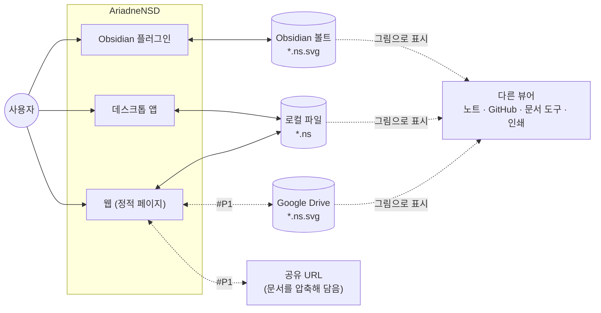
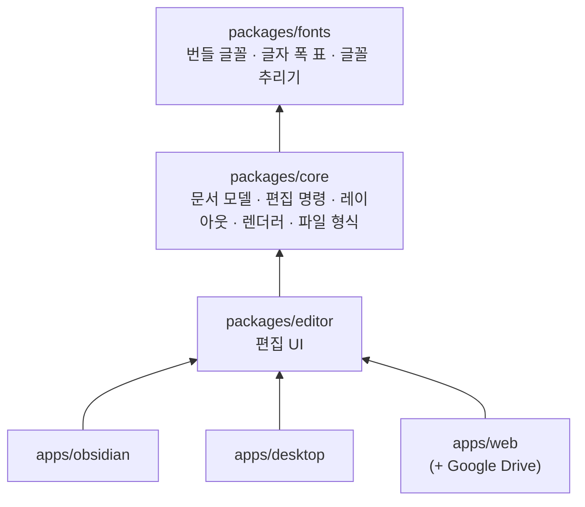
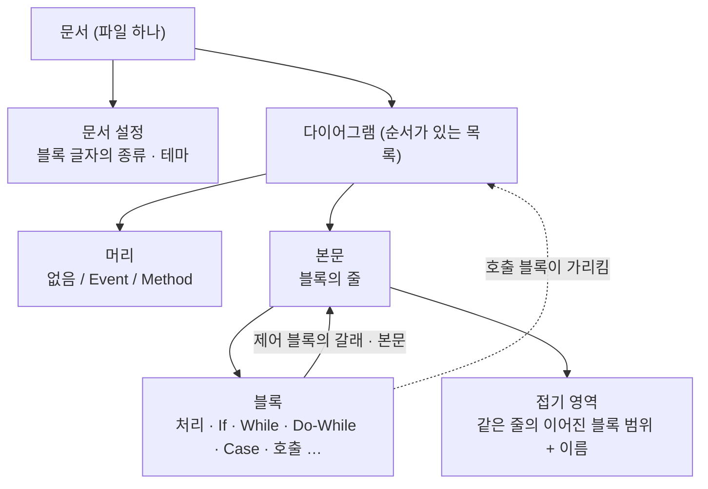
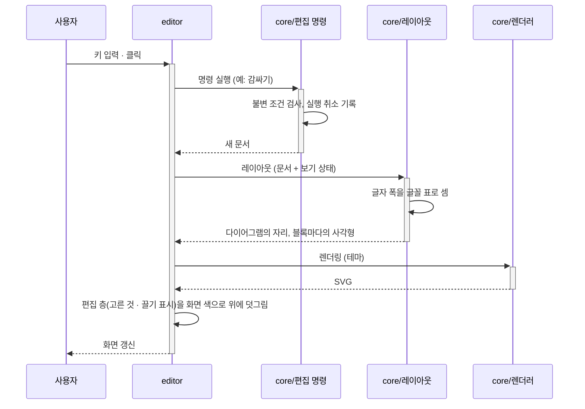
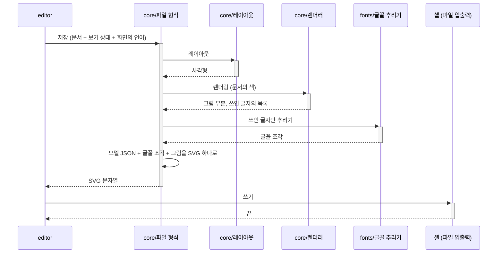

# AriadneNSD 아키텍처 개요

현재 아키텍처를 한눈에 보여 주는 문서입니다. 각 결정의 근거는 ADR에 있고, 세부 설계는 설계 문서에 있습니다. → [[docs/README|문서 색인]]

> [!info] 이 판은
> 2026-10-13에 다시 쓴 초안입니다. 2026-10-07의 첫 판 뒤에 요구사항이 많이 늘었습니다(여러 다이어그램, Event와 Method, 호출 블록, Case, 접기 영역, 저장되는 보기 상태, 다국어, 글꼴 번들). 그것을 담았습니다. **메인테이너가 아직 보지 않은 제안**은 [[#8. 확인받지 못한 제안]]에 모았습니다.

## 1. 목표와 제약

**누구를 위한 것인가.** 주 사용자는 실무에서 설계 문서를 쓰는 사람입니다([[01-requirements#1. 핵심 원칙]]). 그림은 문서에 들어가고, git으로 관리되고, 인쇄됩니다. 그래서 "어디서 저장해도 같은 파일", "어디서 열어도 같은 그림"이 품질 목표의 앞자리에 옵니다.

**품질 목표** ([[01-requirements#4. 비기능 요구사항|비기능 요구사항]])

1. 문서는 어떤 편집 후에도 항상 유효하다. [[01-requirements#^nfr-integrity]]
2. 배포 대상들이 같은 파일을 주고받고, 같은 모델과 같은 보기 상태는 같은 SVG가 된다. [[01-requirements#^nfr-compat]], [[01-requirements#^fmt-deterministic]]
3. 저장된 그림은 플러그인도 글꼴도 없는 곳에서 그대로 보인다. [[01-requirements#^fmt-svg]], [[01-requirements#^fmt-text]]
4. 핵심 로직(모델 · 레이아웃 · 렌더링)은 화면 없이 단위 테스트할 수 있다. [[01-requirements#^nfr-test]]
5. 블록 500개에서 편집 반응 100ms 이내. [[01-requirements#^nfr-perf]]

**제약**

| 제약 | 근거 |
| --- | --- |
| 구현 언어는 TypeScript | [[0003-typescript\|ADR-0003]] |
| Obsidian 플러그인 · 데스크톱 · 웹 세 대상. Google Drive는 웹 위에 얹고, Confluence가 뒤에 붙는다 | [[0002-three-targets-shared-core\|ADR-0002]], [[0012-google-drive-integration\|ADR-0012]] |
| 개발 순서는 웹 → Obsidian → 데스크톱 | [[dr-0002-development-order\|DR-0002]] |
| 저장 형식은 모델 내장 SVG, 모델은 JSON | [[0005-model-embedded-svg\|ADR-0005]], [[0007-json-serialization\|ADR-0007]] |
| 웹은 서버 없는 정적 페이지 | [[01-requirements#^web-static]] |
| 사용자는 좌표를 다루지 않는다. 구조를 고치면 그림은 자동으로 그려진다 | [[0004-structure-editor\|ADR-0004]] |
| 글꼴을 번들하고, 글자 폭은 그 글꼴 파일로 셈한다 | [[0026-bundled-font-metrics\|ADR-0026]] |

## 2. 시스템 컨텍스트

오른쪽의 "다른 뷰어"가 이 제품에서 특별한 손님입니다. 우리 코드가 하나도 돌지 않는 곳에서 파일이 그림으로 열립니다. 그래서 그림에 필요한 것(색, 글꼴 조각)은 모두 파일 안에 들어 있어야 합니다.

## 3. 구성 요소

공통 패키지와 배포 대상별 셸로 나눈 모노레포입니다. → [[0002-three-targets-shared-core|ADR-0002]]

| 구성 요소 | 책임 | 설계 문서 |
| --- | --- | --- |
| `fonts` | 번들 글꼴 파일, 글자마다의 폭을 적은 표, 쓰인 글자만 추려 글꼴 조각을 만드는 함수 | [[02-layout]] |
| `core` / 문서 모델 | 문서 · 다이어그램 · 블록의 데이터 구조, 불변 조건 검사 | [[01-model]] |
| `core` / 편집 명령 | 내용을 바꾸는 명령과 실행 취소, 보기 상태를 바꾸는 명령 | [[01-model]] |
| `core` / 글자 다루기 | 글자 폭 셈하기, 블록 글자의 구문 강조(종류마다의 낱말 가르기), 그림에 적는 글자의 번역 | [[02-layout]] |
| `core` / 레이아웃 | 문서 → 다이어그램의 자리와 블록마다의 사각형 (순수 함수) | [[02-layout]] |
| `core` / 렌더러 | 두 단계. **장면 만들기**: 레이아웃 결과 + 테마 → 장면(그릴 사각형 · 선 · 글자의 목록, 저마다 블록 id가 붙음). 색과 모양의 판단은 모두 여기서 한다. **그리기**: 장면 → SVG 문자열 | [[02-layout]] |
| `core` / 파일 형식 | 모델 내장 SVG 읽기 · 쓰기, 버전 변환 | [[01-file-format]] |
| `editor` | 화면 표시, 고르기, 글자 고치기, 키보드 · 마우스 · 끌기, 메뉴와 도구 모음, 화면의 언어 | [[03-editor]] |
| `apps/obsidian` | 파일 뷰 등록, `.ns.svg` 판별, 볼트 입출력, 노트의 그림 갱신 | [[04-obsidian-plugin]] |
| `apps/desktop` | 창, 파일 대화상자, OS 파일 연결 | [[05-desktop]] |
| `apps/web` | 정적 페이지, 브라우저 파일 입출력, 임시 저장, 공유 URL, Drive 연동 | [[06-web]] |

**의존 규칙**

- 의존은 위 그림의 화살표 방향으로만 흐른다. `core`는 `editor`와 셸을 모른다.
- `core`와 `fonts`는 **DOM과 브라우저 API에 의존하지 않는다.** Node에서 그대로 돌고 그대로 시험한다.
- 글자 폭은 `core`가 `fonts`의 글자 폭 표로 직접 셈한다. 브라우저에 묻지 않는다. → [[0026-bundled-font-metrics|ADR-0026]]
- 배포 대상마다 다른 기능은 인터페이스 둘이다. `editor`가 정의하고 셸이 구현을 넣는다. → [[0031-shell-interfaces|ADR-0031]]
	- **문서 파일**: 이 문서를 읽는다 · 쓴다 · 다른 이름으로 쓴다, 다른 문서를 읽는다(다른 문서의 Method 부르기 → [[01-requirements#^blk-call-external]]). 다른 문서를 읽지 못하면 그 호출 블록은 "이어진 곳 없음"으로 보인다. 웹은 사용자가 고른 파일이나 폴더 안에서만 읽는다.
	- **설정 보관**: 사용자의 설정(화면의 언어, 화면 색)을 읽고 쓴다.
- `editor`는 화면에 **장면을 그린다**는 인터페이스 하나로만 그린다. 지금의 구현은 렌더러가 만든 SVG를 그대로 화면에 놓는 것이다([[0030-swappable-drawing|ADR-0030]]). 클릭한 곳이 어느 블록인지, 고른 표시를 어디에 덧그릴지는 화면의 SVG를 뒤지지 않고 레이아웃 결과(블록 id → 사각형)로 안다. 그래서 화면을 UI 프레임워크로 따로 그리게 바꾸더라도 "그리기" 구현 하나만 갈아 끼운다.
- 편집기는 파일 밖에 문서의 상태를 두지 않는다. 문서에 대한 것은 모두 파일 안에 있다. 파일 밖에 두는 것은 사용자의 설정(화면의 언어, 화면 색)뿐이다.

### 3.1 문서 모델

모델이 2026-10-10과 11에 크게 달라졌습니다. 파일 하나가 그림 하나였던 것이, 파일 하나가 다이어그램 여러 개를 담은 문서가 됐습니다.

- **문서**는 다이어그램의 목록과 문서 설정을 갖는다. 다이어그램은 적어도 하나 있다.
- **다이어그램**은 머리와 본문을 갖는다. 머리가 Event이면 이벤트 처리기, Method이면 부를 수 있는 것이다. → [[0021-event-and-method|ADR-0021]]
- **본문**은 블록의 줄이다. 줄은 비지 않는다(빈 갈래는 빈 처리 블록 하나로 채운다).
- **제어 블록**은 줄을 하나 이상 품는다: While은 본문 하나, If는 갈래 둘, Case는 갈래 여럿과 default.
- **호출 블록**은 부르는 Method를 **id로** 가리킨다(다른 문서의 Method는 그 파일과 id로). 이름을 글자로 갖지 않는다. 한 문서 안에서 머리의 이름은 겹칠 수 없다([[02-interaction-rules#Event 머리]]). 그래서 머리의 이름을 고치면 호출 블록이 모두 따라 바뀐다. 가리키던 Method가 없어지면 보이던 글자를 품고 "이어진 곳 없음"이 된다. → [[0022-call-name-follows-head|ADR-0022]]
- **접기 영역**은 한 줄 안의 이어진 블록 범위에 이름을 붙인 것이다. 겹쳐 품을 수 있다. 블록을 감싸는 블록이 아니라 줄에 붙은 표시다. → [[0017-fold-name-in-model|ADR-0017]]
- 블록과 다이어그램, 접기 영역은 모두 **바뀌지 않는 id**를 갖는다. 고른 것, 접힌 것, 호출이 가리키는 것을 id로 적는다.

### 3.2 내용과 보기 상태

파일에는 두 가지가 구분되어 들어갑니다. → [[0018-save-as-shown|ADR-0018]]

| | 내용 | 보기 상태 |
| --- | --- | --- |
| 무엇 | 블록, 글자, 구조, 접기 영역과 그 이름, 머리와 종류, 다이어그램의 순서, 문서 설정(블록 글자의 종류, 테마) | 어느 접기 영역과 어느 갈래가 접혀 있는지, 어느 호출 블록을 펴 보였는지, 이름 띠를 보이는지, 결과 기호(`←` / `=`, [[05-ux-decisions#Q9. 실행 취소의 대상 (R7)\|Q9]]) |
| 바꾸면 | 실행 취소의 대상이다 | 실행 취소의 대상이 아니다 |
| 저장 | 파일에 저장 | 파일에 저장 (저장되는 그림은 지금 화면 그대로) |
| "저장 안 됨" 표시 | 뜬다 | 뜬다 |

- 보기 상태는 내용의 id를 가리키는 따로 된 묶음이다. 떼어 내면 "모두 펼친 그림"이 된다.
- 펴 보인 호출 블록 안에서 만든 접기 영역([[01-requirements#^edit-fold-site]])은 그 호출 블록에 딸린 **내용**이다. Method의 블록을 id로 가리킨다.
- 화면의 확대와 위치, 고른 것은 파일에 저장하지 않는다. `editor`가 갖는다.

## 4. 주요 흐름

### 4.1 편집

- 문서는 고치지 않고 새로 만든다(불변). 명령은 "문서를 받아 새 문서를 돌려주는 함수"다. 실행 취소는 앞의 문서로 돌아가는 것이다. 바뀌지 않은 부분은 앞의 문서와 함께 쓴다 → [[0029-immutable-document-undo|ADR-0029]]
- 접고 펴기 같은 보기 명령도 같은 길을 가지만, 실행 취소 기록에는 남지 않는다.
- 고른 테두리처럼 편집 중에만 뜨는 표시는 렌더러가 그리지 않는다. `editor`가 렌더러의 SVG 위에 따로 그린다. 그래서 화면의 그림과 저장되는 그림이 같은 렌더러에서 나온다.
- 펴 보인 호출 블록은 레이아웃이 Method의 블록을 그 자리에 다시 배치해 그린다. 문서는 바뀌지 않는다.

### 4.2 저장과 열기

- **저장되는 그림의 색은 문서의 색이다.** 편집 화면이 어두워도 같다. 화면의 그림(문서 층)도 같은 테마로 그리므로 화면용과 저장용은 같은 렌더링 결과다. 화면 색을 따르는 것은 `editor`가 덧그리는 편집 층뿐이다. → [[01-requirements#^fmt-color]], [[04-visual-design#2. 층과 출력]]
- 편집기가 그림에 적는 글자("참", "거짓", "블록 n개")는 **저장할 때의 화면 언어**로 적는다. → [[01-requirements#^nfr-i18n]]
- 글꼴 조각은 같은 글자들에서 늘 같은 바이트가 나온다. 그래서 같은 문서는 어디서 저장해도 같은 파일이 된다.
- **열기:** SVG에서 모델 JSON만 꺼내 읽는다. 그림 부분과 글꼴 조각은 읽지 않고, 그림은 모델에서 새로 그린다. 옛 형식 버전이면 단계별 변환을 거친다. 모델이 없거나 깨졌으면 편집할 수 없다고 알리고 원본은 건드리지 않는다.
- 자세한 형식은 [[01-file-format]]에 있다.

## 5. 공통 관심사

| 관심사 | 방침 |
| --- | --- |
| 실행 취소 | 내용을 바꾸는 일은 모두 편집 명령으로만 한다. 명령 하나가 실행 취소 하나다. 보기 상태는 대상이 아니다. → [[02-interaction-rules#6. 실행 취소]] |
| 정합성 | 명령이 새 문서를 만들 때마다 불변 조건을 검사한다. 어긴 문서는 만들어지지 않는다. 파일을 읽을 때도 같은 검사를 한다 |
| 같은 문서는 같은 파일 | 레이아웃과 렌더러는 순수 함수다. 폭은 글꼴 표로 셈하고 정수 px로 올린다. JSON의 키 순서와 줄바꿈을 고정한다. 시각, 기기, 난수를 쓰지 않는다 |
| 텍스트 폭 측정 | 글꼴을 번들하고, 그 글꼴 파일의 글자 폭으로 `core`가 셈한다. 커닝과 합자를 끈다. 편집기가 그림에 적는 기호는 번들 글꼴에 있는 글자만 쓰거나 도형으로 그린다. 저장되는 그림에는 쓰인 글자만 추린 글꼴 조각을 넣는다. → [[0026-bundled-font-metrics\|ADR-0026]] |
| 색과 테마 | 색은 "토큰 이름 → 값"의 표로 렌더러에 넘긴다. 테마(그림의 색, 문서 층)와 화면 색(편집 화면, 편집 층)은 다른 표다. 테마는 색만 바꾸고 레이아웃은 그대로다(글꼴과 선 굵기는 테마가 아님). → [[dr-0003-default-visual-style\|DR-0003]], [[04-visual-design#3. 디자인 토큰]] |
| 블록 글자의 종류 | 문서마다 하나를 고른다(문장 / C / Java / Python / Bash 등). 종류마다 "글자를 낱말로 가르는 함수"를 하나씩 두고 구문 강조에만 쓴다. 예약어 · 글자열 · 주석 · 숫자만 가르고 문법은 읽지 않는다. 편집기는 글자의 뜻을 검사하지 않는다. → [[01-requirements#^lay-text-kind]], [[0032-token-highlighting\|ADR-0032]] |
| 다국어 | 화면의 글자는 `editor`가, 그림에 적는 글자는 `core`가 한 곳씩에서 관리한다. 기본은 영어이고 한국어를 지원하며, 언어를 더할 수 있게 둔다 |
| 키 입력 | 키 배열은 하나이고 표준 키 위에 Vim 키를 더한다. 키와 명령의 짝은 표 하나에 둔다. → [[dr-0009-vim-keys\|DR-0009]], [[03-keymap]] |
| 오류 처리 | 깨진 파일은 편집 불가 안내로 끝내고, 원본 파일은 덮어쓰지 않는다. 예상 못 한 오류는 문제 알리기 보고서에 담는다. → [[01-requirements#^rep-issue]] |

## 6. 배포 구성

| 대상 | 셸 | 저장 확장자 | 결정 |
| --- | --- | --- | --- |
| 웹 | 정적 호스팅 (GitHub Pages 등) | `.ns` | [[0006-file-extensions\|ADR-0006]] |
| Google Drive | 웹 위에 얹음 | `.ns.svg` | [[0012-google-drive-integration\|ADR-0012]], [[0014-drive-file-extension\|ADR-0014]] |
| Obsidian 플러그인 | Obsidian 플러그인 API | `.ns.svg` | [[0006-file-extensions\|ADR-0006]] |
| 데스크톱 | Electron 또는 Tauri | `.ns` | [[0009-desktop-framework\|ADR-0009]] (제안됨) |
| Confluence (#P2) | Forge 앱의 iframe 안에 웹 화면 | 정하지 않음 | [[01-requirements#^cf-app]] |
| IDE 플러그인 (#P2) | VSCode 확장의 웹뷰, 그다음 IntelliJ | 소스 코드 (코드가 원본) | [[01-requirements#2.7 IDE 플러그인 (나중에)]] |
| Claude skill (#P3) | 셸이 아님. Claude가 모델을 쓰고 웹 버전이 그린다 | `.ns.svg`와 공유 URL | [[01-requirements#2.6 Claude skill (나중에)]] |

셸이 하는 일은 두 인터페이스(문서 파일, 설정 보관 → [[0031-shell-interfaces|ADR-0031]])를 구현하고 그 플랫폼의 메뉴 · 창에 붙이는 것뿐입니다. 셸은 위 표의 대상마다 하나씩이고(Claude skill은 빼고), 뒤에 붙는 대상도 같은 인터페이스를 구현하면 붙습니다. IDE 플러그인은 예외일 수 있습니다. 읽고 쓰는 것이 `.ns` 파일이 아니라 소스 코드라서, 코드와 모델을 오가는 일(→ [[01-requirements#3.6 코드 연동]])이 셸과 `core` 사이에 더 필요합니다. 그 자리는 아직 설계하지 않았습니다.

## 7. 위험과 검증이 필요한 사항

> [!success] 텍스트 폭 측정과 "같은 모델 → 같은 SVG" (2026-10-13 스파이크로 확인)
> 레이아웃은 텍스트 폭에 따라 달라지는데, 텍스트 폭은 실행 환경(Obsidian, 브라우저 종류, 데스크톱 웹뷰, OS 글꼴)마다 다릅니다. 기기의 글꼴로 재면 같은 줄이 33px까지 달랐습니다.
> **글꼴을 번들하고 폭을 글꼴 파일로 셈하면 저장되는 파일은 환경과 상관없이 같습니다.** 브라우저가 그린 폭은 셈한 폭과 0.1px 안에서 맞았습니다(Chrome과 Edge / Windows, Chrome / Android).
> 남은 위험: Firefox와 Safari는 확인하지 못했습니다. → [[0026-bundled-font-metrics|ADR-0026]]

> [!warning] 글꼴 조각의 크기
> 저장되는 그림마다 쓰인 글자의 글꼴 조각이 들어갑니다. 글자 41종에 12 KB, 서로 다른 한글이 수백 자면 200 KB를 넘습니다. 그리고 편집기에는 글꼴(187~762 KB)과 글꼴 추리기(652 KB)가 실립니다.
> 대응 후보: 조각을 압축해 넣기, 한글을 추려 싣기. → [[02-layout]]에서 결정

> [!warning] Obsidian 플러그인에 wasm과 글꼴을 싣기
> Obsidian 플러그인은 `main.js` 파일 하나로 배포합니다. 글꼴과 wasm을 그 안에 글자로 바꿔 넣어야 하고, 그러면 `main.js`가 2 MB쯤 됩니다. 되는지, 플러그인을 여는 시간이 얼마나 느는지 확인해야 합니다. → Obsidian 셸을 만들 때 스파이크

> [!success] Obsidian에서 `.ns.svg`만 가로채기 (2026-10-10 스파이크로 확인)
> 파일을 여는 순간 이미지 보기를 가로채는 방식으로 `.ns.svg`만 편집기로 열 수 있습니다. 일반 `.svg`는 그대로입니다. 편집 후 노트의 그림 갱신, 그림 우클릭 메뉴도 됩니다.
> 남은 위험: 모두 Obsidian의 공개되지 않은 내부 동작에 기대므로, Obsidian이 업데이트되면 깨질 수 있습니다. → [[04-obsidian-plugin#1. `.ns.svg` 파일 열기]]

> [!question] 펴 보인 호출 블록과 성능
> 호출 블록을 펴 보이면 Method의 블록이 그 자리에 한 번 더 그려집니다. 겹쳐 펴면 그려지는 블록이 문서의 블록 수보다 훨씬 많아질 수 있습니다. "블록 500개에서 100ms"를 문서의 블록 수로 셀지, 그려지는 블록 수로 셀지 정해야 합니다. → [[02-layout#4. 성능]]

> [!question] 웹의 파일 덮어쓰기 지원 범위
> 원래 파일에 덮어쓰기는 Chromium 계열에서만 됩니다. 다른 브라우저에서의 사용 흐름을 [[06-web]]에서 정합니다.

## 8. 확인받지 못한 제안

이 판을 쓰며 Claude가 정해 적은 일곱 가지는 모두 확인받아 본문과 ADR로 옮겼습니다. 1~5는 2026-10-17: 글꼴 패키지(3장, [[0026-bundled-font-metrics|ADR-0026]]), 호출 블록은 id로(3.1, [[0022-call-name-follows-head|ADR-0022]]), 접기 영역은 줄에 붙은 표시(3.1, [[0017-fold-name-in-model|ADR-0017]]), 불변 문서와 실행 취소([[0029-immutable-document-undo|ADR-0029]]), 같은 렌더러와 갈아 끼우는 그리기([[0030-swappable-drawing|ADR-0030]]). 6~7은 2026-10-18: 셸의 두 인터페이스(3장, [[0031-shell-interfaces|ADR-0031]]), 낱말 가르는 함수로 구문 강조(5장, [[0032-token-highlighting|ADR-0032]]). 그림은 시안 M20에 있습니다.

## 9. 결정 목록

모든 ADR은 [[atelier/README#아키텍처 결정 기록 (ADR)]]에 있습니다. 아키텍처가 아닌 결정은 결정 기록(DR)에 있습니다 → [[atelier/README#결정 기록 (DR)]]. 아직 "제안됨"인 것은 UI 프레임워크([[0010-ui-framework|ADR-0010]])와 데스크톱 프레임워크([[0009-desktop-framework|ADR-0009]])입니다.
