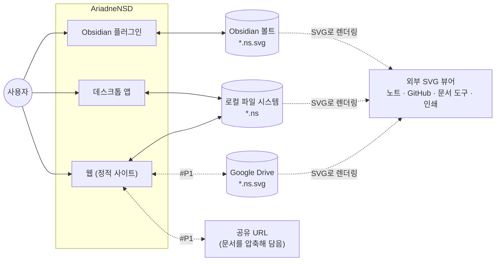
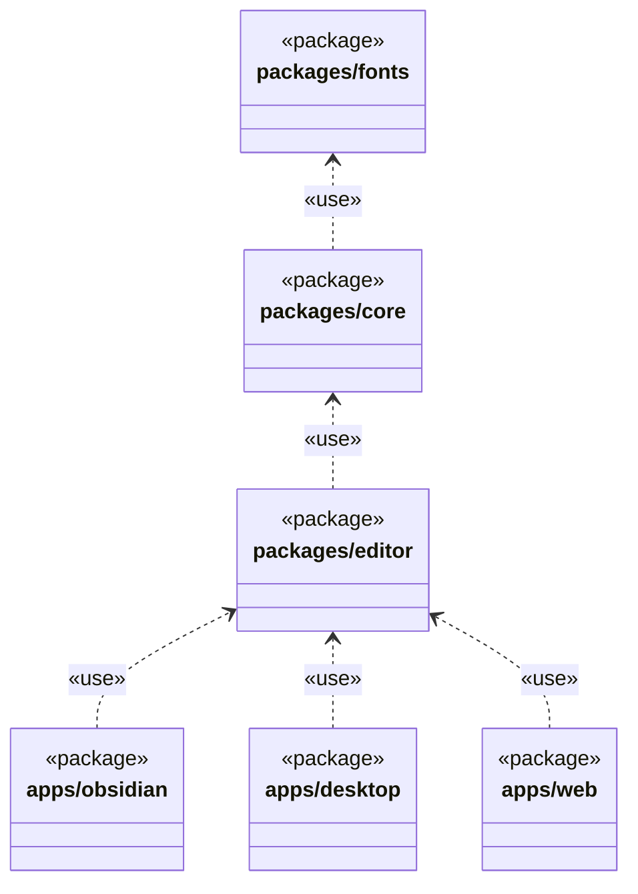
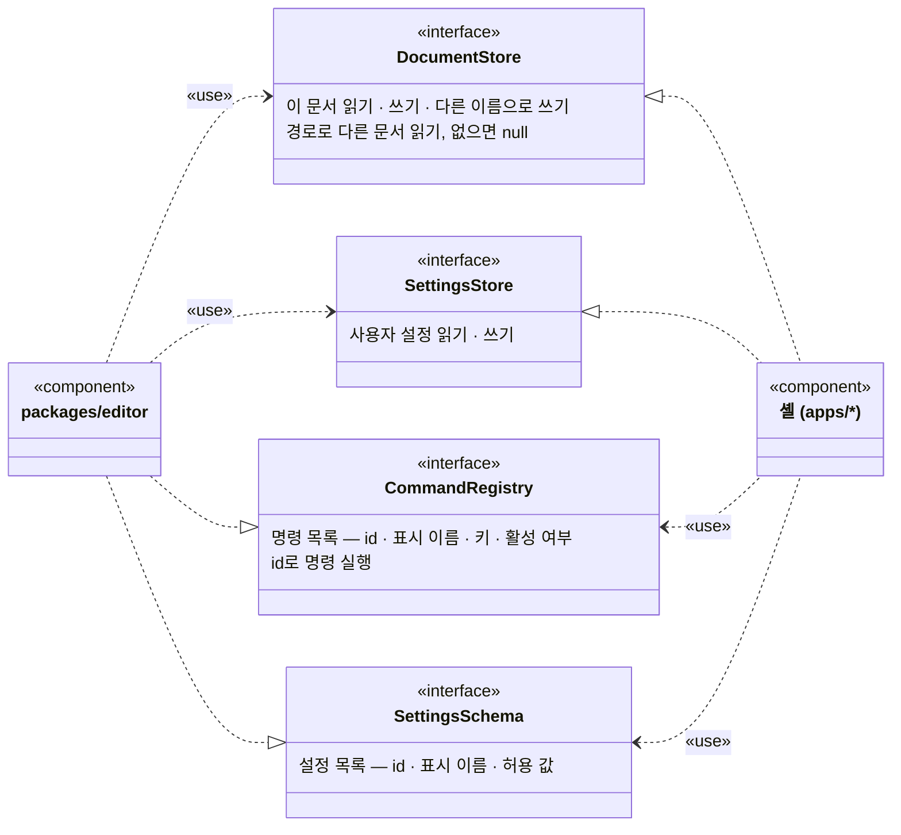
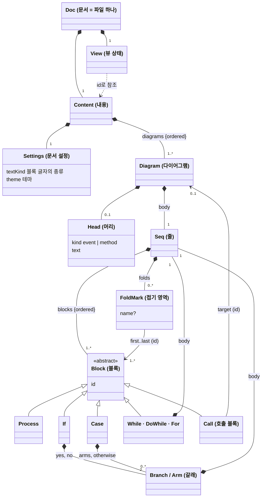
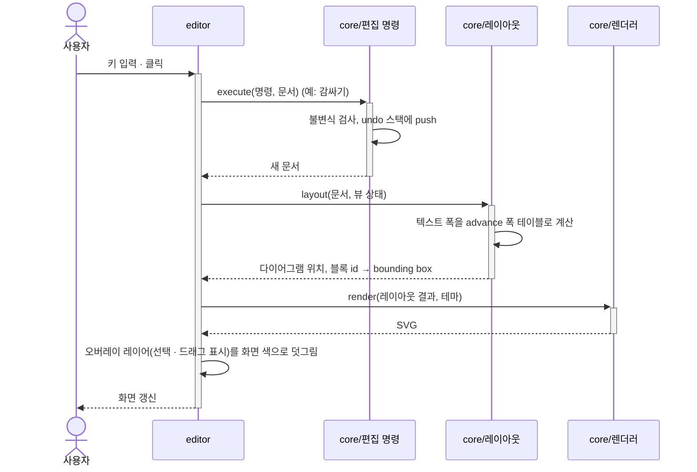
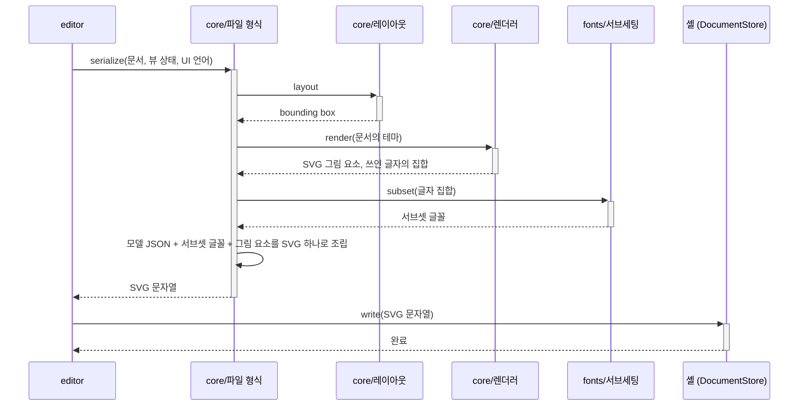

# AriadneNSD 아키텍처 개요

현재 아키텍처를 한눈에 보여 주는 문서입니다. 각 결정의 근거는 ADR에 있고, 세부 설계는 설계 문서에 있습니다. → [[docs/README|문서 색인]]

> [!info] 이 판은
> 2026-10-13에 다시 쓴 초안입니다. 2026-10-07의 첫 판 뒤에 요구사항이 많이 늘었습니다(여러 다이어그램, Event와 Method, 호출 블록, Case, 접기 영역, 저장되는 뷰 상태, 다국어, 글꼴 번들). 그것을 담았습니다. 2026-10-22에 독자(SW 엔지니어)의 용어로 고쳐 쓰고 그림을 UML로 바꿨습니다. 뜻은 바꾸지 않았습니다.

> [!note] 용어와 표기
> - 이 문서와 ADR, 설계 문서는 **SW 엔지니어의 용어**로 씁니다. 블록 · 갈래 · 머리 · 접기 영역 같은 **도메인 용어**는 [[06-glossary|용어집]]을 따르고, 처음 나올 때 코드의 식별자(`Seq`, `FoldMark` …, [[01-model]])를 붙입니다.
> - 그림은 UML을 씁니다(Mermaid의 `classDiagram` · `sequenceDiagram`). UML이 아닌 그림에는 그림 바로 아래에 범례를 둡니다.

## 1. 목표와 제약

**누구를 위한 것인가.** 주 사용자는 실무에서 설계 문서를 쓰는 사람입니다([[01-requirements#1. 핵심 원칙]]). 그림은 문서에 들어가고, git으로 관리되고, 인쇄됩니다. 그래서 "어디서 저장해도 같은 파일(결정적 출력)", "어디서 열어도 같은 그림"이 품질 목표의 앞자리에 옵니다.

**품질 목표** ([[01-requirements#4. 비기능 요구사항|비기능 요구사항]])

1. **정합성:** 문서는 어떤 편집 후에도 불변식(invariant)을 만족한다. [[01-requirements#^nfr-integrity]] (QA-01, QA-02)
2. **호환성 · 결정성:** 배포 대상들이 같은 파일을 주고받고, 같은 모델과 같은 뷰 상태는 바이트 단위로 같은 SVG가 된다. [[01-requirements#^nfr-compat]], [[01-requirements#^fmt-deterministic]] (QA-03~05)
3. **이식성:** 저장된 그림은 플러그인도 글꼴도 없는 SVG 뷰어에서 그대로 렌더링된다. [[01-requirements#^fmt-svg]], [[01-requirements#^fmt-text]] (QA-06)
4. **시험 가능성:** 도메인 로직(모델 · 레이아웃 · 렌더링)은 DOM 없이 단위 테스트할 수 있다. [[01-requirements#^nfr-test]] (QA-14)
5. **성능:** 블록 500개에서 편집 응답 100ms 이내. [[01-requirements#^nfr-perf]] (QA-07~09)
6. **변경 용이성:** 새 배포 대상, 렌더링 백엔드, 블록 종류, 화면 언어를 더할 때 고치는 곳이 정해진 한 곳이다. [[0002-three-targets-shared-core|ADR-0002]], [[0030-swappable-drawing|ADR-0030]] (QA-10~13)

품질 목표마다 잴 수 있는 시나리오와 합격 기준, 그것을 만족시키는 이 문서의 구조, 확인할 시험은 [[03-quality-attribute-scenarios|품질 속성 시나리오(QAS)]]에 있습니다. 구조를 바꿀 때는 그 문서에서 영향받는 시나리오를 찾아 봅니다.

**제약**

| 제약 | 근거 |
| --- | --- |
| 구현 언어는 TypeScript | [[0003-typescript\|ADR-0003]] |
| Obsidian 플러그인 · 데스크톱 · 웹 세 대상. Google Drive는 웹 위에 얹고, Confluence가 뒤에 붙는다 | [[0002-three-targets-shared-core\|ADR-0002]], [[0012-google-drive-integration\|ADR-0012]] |
| 개발 순서는 웹 → Obsidian → 데스크톱 | [[dr-0002-development-order\|DR-0002]] |
| 저장 형식은 모델을 내장한 SVG, 모델의 직렬화 형식은 JSON | [[0005-model-embedded-svg\|ADR-0005]], [[0007-json-serialization\|ADR-0007]] |
| 웹은 백엔드 서버 없는 정적 사이트 | [[01-requirements#^web-static]] |
| 구조 편집기: 사용자는 좌표를 다루지 않는다. 트리를 고치면 자동 레이아웃이 그림을 다시 그린다 | [[0004-structure-editor\|ADR-0004]] |
| 글꼴을 번들하고, 텍스트 폭은 그 글꼴 파일의 메트릭으로 계산한다 | [[0026-bundled-font-metrics\|ADR-0026]] |

## 2. 시스템 컨텍스트

> [!note] 범례 (UML이 아닌 컨텍스트 그림)
> - 모양: 원 = 사람(액터), 사각형 = 시스템(AriadneNSD의 배포 대상, 외부 시스템), 원통 = 저장소.
> - **실선 화살표** `-->`: 사용자가 그 앱을 쓴다. **실선 양방향** `<-->`: 앱이 그 저장소의 파일을 읽고 쓴다.
> - **점선 양방향(#P1)**: 같은 읽기 · 쓰기이지만 #P1이라 MVP 뒤에 붙는다.
> - **점선 "SVG로 렌더링"**: 우리 코드 없이, 그 저장소의 파일을 외부 뷰어가 일반 SVG로 표시한다(데이터 흐름이지 호출이 아니다).

오른쪽의 "외부 SVG 뷰어"가 이 제품에서 특별한 손님입니다. 우리 코드가 하나도 돌지 않는 곳에서 파일이 그림으로 열립니다. 그래서 렌더링에 필요한 것(색, 서브셋 글꼴)은 모두 파일 안에 자기 완결적으로 들어 있어야 합니다.

## 3. 구성 요소

공통 패키지와 배포 대상별 셸(shell: 플랫폼마다 `editor`를 감싸는 호스트 애플리케이션)로 나눈 모노레포입니다. → [[0002-three-targets-shared-core|ADR-0002]]

### 3.1 패키지 의존

UML 패키지 다이어그램입니다. 점선 열린 화살표(`..>`)는 **의존**(«use»: 화살표 꼬리 쪽이 머리 쪽을 import한다)입니다.

| 패키지 / 모듈 | 책임 | 설계 문서 |
| --- | --- | --- |
| `fonts` | 번들 글꼴 파일, 글리프마다의 advance 폭 테이블, 쓰인 글자만 남기는 글꼴 서브세팅 | [[02-layout]] |
| `core` / 모델 | 문서 · 다이어그램 · 블록의 데이터 구조(불변 객체), 불변식 검사 | [[01-model]] |
| `core` / 편집 명령 | 내용을 바꾸는 명령(undo 대상)과 뷰 상태를 바꾸는 명령 | [[01-model]] |
| `core` / 텍스트 | 텍스트 폭 계산, 블록 글자의 구문 강조(종류마다의 토크나이저), 그림에 적는 고정 문구의 다국어 처리 | [[02-layout]] |
| `core` / 레이아웃 | 문서 → 다이어그램의 위치와 블록마다의 bounding box (순수 함수) | [[02-layout]] |
| `core` / 렌더러 | 두 단계 파이프라인. **씬 빌드**: 레이아웃 결과 + 테마 → 씬(그릴 사각형 · 선 · 글자의 목록. 요소마다 블록 id가 붙은 디스플레이 리스트). 색과 모양의 판단은 모두 여기서 한다. **출력**: 씬 → SVG 문자열 | [[02-layout]] |
| `core` / 파일 형식 | 모델 내장 SVG의 직렬화 · 역직렬화, 스키마 버전 마이그레이션 | [[01-file-format]] |
| `editor` | 화면 표시, 선택, 텍스트 편집, 키보드 · 마우스 · 드래그 앤 드롭 입력, 메뉴와 도구 모음(React → [[0010-ui-framework\|ADR-0010]]), UI 다국어 | [[03-editor]] |
| `apps/obsidian` | 파일 뷰 등록, `.ns.svg` 판별, 볼트 파일 I/O, 노트에 삽입된 그림 갱신 | [[04-obsidian-plugin]] |
| `apps/desktop` | 창, 파일 대화상자, OS 파일 연결 | [[05-desktop]] |
| `apps/web` | 정적 사이트, 브라우저 파일 I/O(File System Access API), 자동 임시 저장, 공유 URL, Drive 연동 | [[06-web]] |

### 3.2 editor와 셸의 인터페이스

UML 컴포넌트 · 인터페이스 그림입니다(Mermaid에 컴포넌트 다이어그램이 없어 `classDiagram`의 스테레오타입으로 그림). 왼쪽 선은 모두 `editor`의 것, 오른쪽 선은 모두 셸의 것입니다. 점선 열린 화살표(`..>`)는 **의존**(«use»), 점선 빈 삼각형(`..|>`)은 **실현**(realization: 그 인터페이스를 구현한다)입니다. 인터페이스 안의 줄은 메서드의 시그니처가 아니라 책임입니다. 시그니처는 [[03-editor#5. 셸과의 연결]]에서 정합니다.

`editor`와 셸 사이의 인터페이스는 방향이 다른 두 쌍입니다.

| 방향 | 인터페이스 | 정의 | 구현 | 사용 | 결정 |
| --- | --- | --- | --- | --- | --- |
| **필요 인터페이스** (required, 포트) | `DocumentStore`, `SettingsStore` | `editor` | 셸 (어댑터) | `editor` | [[0031-shell-interfaces\|ADR-0031]] |
| **제공 인터페이스** (provided) | `CommandRegistry`, `SettingsSchema` | `editor` | `editor` | 셸 | [[0033-command-list-for-shells\|ADR-0033]] |

- **필요 인터페이스**는 포트와 어댑터(헥사고날) 패턴입니다. 플랫폼마다 다른 I/O를 `editor`가 인터페이스로 정의하고, 셸이 구현체를 만들어 시작할 때 주입합니다.
	- `DocumentStore`: 이 문서를 읽는다 · 쓴다 · 다른 이름으로 쓴다, 다른 문서를 경로로 읽는다(다른 문서의 Method 호출 → [[01-requirements#^blk-call-external]]). 읽지 못하면 `null`을 돌려주고, 그 호출 블록은 "이어진 곳 없음"으로 보인다. 웹은 사용자가 권한을 준 파일이나 폴더 안에서만 읽는다.
	- `SettingsStore`: 사용자 설정(UI 언어, 화면 색)을 읽고 쓴다.
- **제공 인터페이스**로 `editor`는 명령 레지스트리와 설정 스키마를 노출합니다. 셸은 이것을 자기 도구 모음 · 메뉴 · 설정 창으로 렌더링하거나, 호스트 프로그램의 확장 지점(명령 팔레트 · 컨텍스트 메뉴 · 설정 화면: Obsidian, VSCode, IntelliJ)에 등록합니다. 명령의 실행 진입점은 하나(`id`로 실행)입니다.

### 3.3 의존 규칙

- 의존은 3.1 그림의 화살표 방향으로만 흐른다(단방향, 순환 없음). `core`는 `editor`와 셸을 모른다.
- `core`와 `fonts`는 **DOM과 브라우저 API에 의존하지 않는다.** Node에서 그대로 실행하고 테스트한다.
- 텍스트 폭은 `core`가 `fonts`의 advance 폭 테이블로 직접 계산한다. 브라우저의 텍스트 측정 API(Canvas `measureText` 등)를 쓰지 않는다. → [[0026-bundled-font-metrics|ADR-0026]]
- 플랫폼 의존 기능은 3.2의 필요 인터페이스 두 개로만 들어온다. → [[0031-shell-interfaces|ADR-0031]]
- `editor`는 **렌더링 백엔드 인터페이스 하나**를 통해서만 화면에 그린다. 지금의 구현체는 렌더러가 만든 SVG 문자열을 DOM에 그대로 삽입한다([[0030-swappable-drawing|ADR-0030]]). 히트 테스트(클릭한 곳이 어느 블록인가)와 선택 오버레이의 위치는 DOM을 조회하지 않고 레이아웃 결과(블록 id → bounding box 맵)로 계산한다. 그래서 화면 렌더링을 UI 프레임워크로 바꾸더라도 백엔드 구현체 하나만 교체한다.
- `editor`는 문서에 대한 상태를 파일 밖에 영속하지 않는다. 파일 밖에 영속하는 것은 사용자 설정(UI 언어, 화면 색)뿐이다.

### 3.4 문서 모델

모델이 2026-10-10과 11에 크게 달라졌습니다. 파일 하나가 그림 하나였던 것이, 파일 하나가 다이어그램 여러 개를 담은 문서가 됐습니다. 아래는 개념 모델이고, 타입 정의는 [[01-model#1. 타입]]에 있습니다.

UML 클래스 다이어그램입니다. 채운 마름모(`*--`)는 **합성**(부분은 전체에 속하고 함께 사라진다), 빈 삼각형(`<|--`)은 **일반화**(상속; TypeScript에서는 판별 유니온 `kind`), 실선 열린 화살표(`-->`)는 **연관**(id로 가리키는 참조), 점선 열린 화살표(`..>`)는 의존입니다. 숫자는 다중성입니다. 반복 블록 셋(While · DoWhile · For)은 짜임이 같아 상자 하나로 그렸습니다(모델에서는 따로 된 타입).

- **문서**(`Doc`)는 다이어그램의 목록과 문서 설정을 갖는다. 다이어그램은 적어도 하나 있다.
- **다이어그램**(`Diagram`)은 머리(`Head`)와 본문(`Seq`)을 갖는다. 머리가 Event이면 이벤트 핸들러, Method이면 호출할 수 있는 서브루틴이다. → [[0021-event-and-method|ADR-0021]]
- **줄**(`Seq`)은 블록의 순서 있는 목록이다. 비지 않는다(빈 갈래는 빈 처리 블록 하나로 채운다).
- **제어 블록**은 줄을 하나 이상 합성한다: While · Do-While · For는 본문 하나, If는 갈래 둘, Case는 갈래 여럿과 default.
- **호출 블록**(`Call`)은 호출 대상 Method를 **id로 참조**한다(다른 문서의 Method는 파일 경로와 id로). 이름 문자열을 복사해 갖지 않는다. 한 문서 안에서 머리의 이름은 유일하다([[02-interaction-rules#Event 머리]]). 그래서 머리의 이름을 바꾸면 호출 블록의 표시가 모두 따라 바뀐다. 참조 대상이 없어지면 마지막으로 보이던 이름을 보존하고 "이어진 곳 없음"(dangling reference)이 된다. → [[0022-call-name-follows-head|ADR-0022]]
- **접기 영역**(`FoldMark`)은 한 줄 안의 연속된 블록 범위에 이름을 붙인 마커다. 중첩될 수 있다. 블록을 감싸는 컨테이너 노드가 아니라 줄에 붙은 주석(annotation)이라, 블록 트리는 접기 영역과 무관하게 같다. → [[0017-fold-name-in-model|ADR-0017]]
- 블록과 다이어그램, 접기 영역은 모두 **안정 id**(문서가 바뀌어도 유지되는 식별자)를 갖는다. 선택, 접힘, 호출 대상은 모두 id로 참조한다.

### 3.5 내용과 뷰 상태

파일에는 두 가지가 구분되어 들어갑니다. → [[0018-save-as-shown|ADR-0018]]

| | 내용 (`Content`) | 뷰 상태 (`View`) |
| --- | --- | --- |
| 무엇 | 블록, 글자, 구조, 접기 영역과 그 이름, 머리와 종류, 다이어그램의 순서, 문서 설정(블록 글자의 종류, 테마) | 어느 접기 영역과 어느 갈래가 접혀 있는지, 어느 호출 블록을 인라인으로 펴 보였는지, 이름 띠를 보이는지, 결과 기호(`←` / `=`, [[ux-decisions#Q9. 실행 취소의 대상 (R7)\|Q9]]) |
| 바꾸면 | undo 대상이다 | undo 대상이 아니다 |
| 저장 | 파일에 저장 | 파일에 저장 (저장되는 그림은 지금 화면 그대로) |
| dirty 표시("저장 안 됨") | 뜬다 | 뜬다 |

- 뷰 상태는 내용의 id를 참조하는 별도 구조다. 떼어 내면 "모두 펼친 그림"이 된다.
- 인라인으로 펴 보인 호출 블록 안에서 만든 접기 영역([[01-requirements#^edit-fold-site]])은 그 호출 블록에 속한 **내용**이다. Method의 블록을 id로 참조한다.
- 화면의 줌과 스크롤 위치, 선택은 파일에 저장하지 않는다. `editor`의 메모리 상태다.

## 4. 주요 흐름

### 4.1 편집

- 문서는 불변 객체다. 명령은 "문서를 받아 새 문서를 돌려주는 순수 함수"이고, undo는 앞의 문서(스냅숏)로 돌아가는 것이다. 바뀌지 않은 하위 트리는 앞의 문서와 공유한다(구조적 공유, structural sharing). → [[0029-immutable-document-undo|ADR-0029]]
- 접고 펴기 같은 뷰 명령도 같은 경로를 지나지만 undo 스택에는 남지 않는다.
- 선택 테두리처럼 편집 중에만 보이는 표시는 렌더러가 그리지 않는다. `editor`가 렌더러의 SVG 위에 오버레이 레이어로 따로 그린다. 그래서 화면의 그림과 저장되는 그림이 같은 렌더러에서 나온다.
- 펴 보인 호출 블록은 레이아웃이 Method의 블록을 그 자리에 다시 배치해 그린다. 문서는 바뀌지 않는다.

### 4.2 저장과 열기

- **저장되는 그림의 색은 문서의 테마다.** 편집 화면이 어두워도 같다. 화면의 그림(문서 레이어)도 같은 테마로 렌더링하므로 화면용과 저장용은 같은 렌더링 결과다. 화면 색을 따르는 것은 `editor`가 덧그리는 오버레이 레이어뿐이다. → [[01-requirements#^fmt-color]], [[04-visual-design#2. 층과 출력]]
- 편집기가 그림에 적는 고정 문구("참", "거짓", "블록 n개")는 **저장 시점의 UI 언어**로 적는다. → [[01-requirements#^nfr-i18n]]
- 서브세팅은 결정적이다: 같은 글자 집합에서 늘 같은 바이트가 나온다. 그래서 같은 문서는 어디서 저장해도 같은 파일이 된다.
- **열기:** SVG에서 모델 JSON만 역직렬화한다. 그림 요소와 서브셋 글꼴은 읽지 않고, 그림은 모델에서 다시 렌더링한다. 옛 스키마 버전이면 버전별 마이그레이션을 차례로 적용한다. 모델이 없거나 깨졌으면 편집할 수 없다고 알리고 원본 파일은 건드리지 않는다.
- 자세한 형식은 [[01-file-format]]에 있다.

## 5. 공통 관심사

| 관심사 | 방침 |
| --- | --- |
| Undo | 내용을 바꾸는 일은 모두 편집 명령으로만 한다(커맨드 패턴). 명령 하나가 undo 한 단계다. 뷰 상태는 대상이 아니다. → [[02-interaction-rules#6. 실행 취소]] |
| 정합성 | 명령이 새 문서를 만들 때마다 불변식을 검사한다. 위반하는 문서는 만들어지지 않는다. 파일을 역직렬화할 때도 같은 검사를 한다 |
| 결정적 출력 | 레이아웃과 렌더러는 순수 함수다. 폭은 글꼴 메트릭으로 계산하고 정수 px로 올린다. JSON의 키 순서와 줄바꿈을 고정한다. 현재 시각, 기기 정보, 난수를 쓰지 않는다 |
| 텍스트 측정 | 글꼴을 번들하고, 그 글꼴 파일의 advance 폭으로 `core`가 계산한다. 커닝과 합자를 끈다. 편집기가 그림에 적는 기호는 번들 글꼴에 있는 글리프만 쓰거나 도형으로 그린다. 저장되는 그림에는 쓰인 글자만 남긴 서브셋 글꼴을 넣는다. → [[0026-bundled-font-metrics\|ADR-0026]] |
| 색과 테마 | 색은 "디자인 토큰 이름 → 값"의 맵으로 렌더러에 넘긴다. 테마(그림의 색, 문서 레이어)와 화면 색(편집 화면, 오버레이 레이어)은 다른 맵이다. 테마는 색만 바꾸고 레이아웃에는 영향이 없다(글꼴과 선 굵기는 테마가 아님). → [[dr-0003-default-visual-style\|DR-0003]], [[04-visual-design#3. 디자인 토큰]] |
| 블록 글자의 종류 | 문서마다 하나를 고른다(문장 / C / Java / Python / Bash 등). 종류마다 토크나이저를 하나씩 두고 구문 강조에만 쓴다. 예약어 · 문자열 리터럴 · 주석 · 숫자만 분류하고 파싱은 하지 않는다. 편집기는 글자의 의미를 검사하지 않는다. → [[01-requirements#^lay-text-kind]], [[0032-token-highlighting\|ADR-0032]] |
| 다국어 | UI 문자열은 `editor`가, 그림에 적는 고정 문구는 `core`가 각각 한 곳(메시지 카탈로그)에서 관리한다. 기본 로캘은 영어이고 한국어를 지원하며, 로캘을 더할 수 있게 둔다 |
| 키 입력 | 키맵은 하나이고 표준 키 위에 Vim 키를 더한다. 키 바인딩은 표 하나에 둔다. 메뉴와 도구 모음도 같은 명령 레지스트리에서 생성한다. → [[dr-0009-vim-keys\|DR-0009]], [[03-keymap]], [[0033-command-list-for-shells\|ADR-0033]] |
| 오류 처리 | 깨진 파일은 "편집 불가" 안내로 끝내고, 원본 파일은 덮어쓰지 않는다. 예상하지 못한 예외는 문제 알리기 보고서에 담는다. → [[01-requirements#^rep-issue]] |

## 6. 배포 구성

| 대상 | 셸 | 저장 확장자 | 결정 |
| --- | --- | --- | --- |
| 웹 | 정적 호스팅 (GitHub Pages 등) | `.ns` | [[0006-file-extensions\|ADR-0006]] |
| Google Drive | 웹 위에 얹음 | `.ns.svg` | [[0012-google-drive-integration\|ADR-0012]], [[0014-drive-file-extension\|ADR-0014]] |
| Obsidian 플러그인 | Obsidian 플러그인 API | `.ns.svg` | [[0006-file-extensions\|ADR-0006]] |
| 데스크톱 | Electron 또는 Tauri | `.ns` | [[0009-desktop-framework\|ADR-0009]] (제안됨) |
| Confluence (#P2) | Forge 앱의 iframe 안에 웹 화면 | 정하지 않음 | [[01-requirements#^cf-app]] |
| IDE 플러그인 (#P2) | VSCode 확장의 웹뷰, 그다음 IntelliJ | 소스 코드 (코드가 원본) | [[01-requirements#2.7 IDE 플러그인 (나중에)]] |
| Claude skill (#P3) | 셸이 아님. Claude가 모델을 쓰고 웹 버전이 렌더링한다 | `.ns.svg`와 공유 URL | [[01-requirements#2.6 Claude skill (나중에)]] |

셸이 하는 일은 3.2의 필요 인터페이스(`DocumentStore`, `SettingsStore` → [[0031-shell-interfaces|ADR-0031]])를 구현하고, 제공 인터페이스(`CommandRegistry`, `SettingsSchema` → [[0033-command-list-for-shells|ADR-0033]])를 호스트 플랫폼의 메뉴 · 설정 화면에 등록하는 것뿐입니다. 셸은 위 표의 대상마다 하나씩이고(Claude skill은 빼고), 뒤에 붙는 대상도 같은 인터페이스를 구현하면 붙습니다. IDE 플러그인은 예외일 수 있습니다. 읽고 쓰는 것이 `.ns` 파일이 아니라 소스 코드라서, 코드와 모델 사이의 양방향 변환(→ [[01-requirements#3.6 코드 연동]])이 셸과 `core` 사이에 더 필요합니다. 그 자리는 아직 설계하지 않았습니다.

## 7. 위험과 검증이 필요한 사항

> [!success] 텍스트 폭 측정과 "같은 모델 → 같은 SVG" (2026-10-13 스파이크로 확인)
> 레이아웃은 텍스트 폭에 따라 달라지는데, 텍스트 폭은 실행 환경(Obsidian, 브라우저 종류, 데스크톱 웹뷰, OS 글꼴)마다 다릅니다. 기기의 글꼴로 재면 같은 줄이 33px까지 달랐습니다.
> **글꼴을 번들하고 폭을 글꼴 파일로 계산하면 저장되는 파일은 환경과 상관없이 같습니다.** 브라우저가 렌더링한 폭은 계산한 폭과 0.1px 안에서 맞았습니다(Chrome과 Edge / Windows, Chrome / Android).
> 남은 위험: Firefox와 Safari는 확인하지 못했습니다. → [[0026-bundled-font-metrics|ADR-0026]]

> [!warning] 서브셋 글꼴의 크기
> 저장되는 그림마다 쓰인 글자의 서브셋 글꼴이 들어갑니다. 글자 41종에 12 KB, 서로 다른 한글이 수백 자면 200 KB를 넘습니다. 그리고 편집기 번들에는 글꼴(187~762 KB)과 서브세팅 라이브러리(wasm, 652 KB)가 실립니다.
> 대응 후보: 서브셋을 압축해 넣기, 한글 글리프를 추려 번들하기. → [[02-layout]]에서 결정

> [!warning] Obsidian 플러그인에 wasm과 글꼴을 싣기
> Obsidian 플러그인은 `main.js` 파일 하나로 배포합니다. 글꼴과 wasm을 그 안에 base64로 인라인해야 하고, 그러면 `main.js`가 2 MB쯤 됩니다. 되는지, 플러그인 로드 시간이 얼마나 느는지 확인해야 합니다. → Obsidian 셸을 만들 때 스파이크

> [!success] Obsidian에서 `.ns.svg`만 가로채기 (2026-10-10 스파이크로 확인)
> 파일을 여는 순간 이미지 뷰를 가로채는 방식으로 `.ns.svg`만 편집기로 열 수 있습니다. 일반 `.svg`는 그대로입니다. 편집 후 노트의 그림 갱신, 그림 컨텍스트 메뉴도 됩니다.
> 남은 위험: 모두 Obsidian의 비공개 내부 API에 기대므로, Obsidian이 업데이트되면 깨질 수 있습니다. → [[04-obsidian-plugin#1. `.ns.svg` 파일 열기]]

> [!question] 펴 보인 호출 블록과 성능
> 호출 블록을 펴 보이면 Method의 블록이 그 자리에 한 번 더 그려집니다. 겹쳐 펴면 렌더링되는 블록이 문서의 블록 수보다 훨씬 많아질 수 있습니다. "블록 500개에서 100ms"를 문서의 블록 수로 셀지, 렌더링되는 블록 수로 셀지 정해야 합니다. → [[02-layout#4. 성능]]

> [!question] 웹의 파일 덮어쓰기 지원 범위
> 원래 파일에 덮어쓰기(File System Access API)는 Chromium 계열에서만 됩니다. 다른 브라우저에서의 사용 흐름을 [[06-web]]에서 정합니다.

## 8. 확인받지 못한 제안

이 판을 쓰며 Claude가 정해 적은 일곱 가지는 모두 확인받아 본문과 ADR로 옮겼습니다. 1~5는 2026-10-17: 글꼴 패키지(3장, [[0026-bundled-font-metrics|ADR-0026]]), 호출 블록은 id로(3.4, [[0022-call-name-follows-head|ADR-0022]]), 접기 영역은 줄에 붙은 마커(3.4, [[0017-fold-name-in-model|ADR-0017]]), 불변 문서와 undo([[0029-immutable-document-undo|ADR-0029]]), 같은 렌더러와 교체 가능한 렌더링 백엔드([[0030-swappable-drawing|ADR-0030]]). 6~7은 2026-10-18: 셸의 필요 인터페이스 둘(3.2, [[0031-shell-interfaces|ADR-0031]]), 토크나이저로 구문 강조(5장, [[0032-token-highlighting|ADR-0032]]). 그림은 시안 M20에 있습니다.

> [!question] 확인받지 못한 것 (2026-10-22)
> 용어를 고치며 Claude가 인터페이스의 이름을 붙였습니다: `DocumentStore`, `SettingsStore`, `CommandRegistry`, `SettingsSchema`. 뜻은 ADR-0031 · 0033 그대로이고, 이름만 새로 붙인 것입니다.

## 9. 결정 목록

모든 ADR은 [[atelier/README#아키텍처 결정 기록 (ADR)]]에 있습니다. 아키텍처가 아닌 결정은 결정 기록(DR)에 있습니다 → [[atelier/README#결정 기록 (DR)]]. 아직 "제안됨"인 것은 데스크톱 프레임워크([[0009-desktop-framework|ADR-0009]])입니다. UI 프레임워크는 React로 정했습니다([[0010-ui-framework|ADR-0010]], 2026-10-18).
