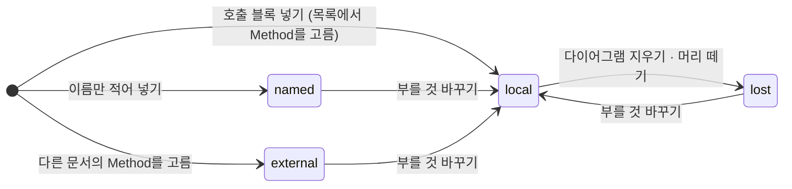
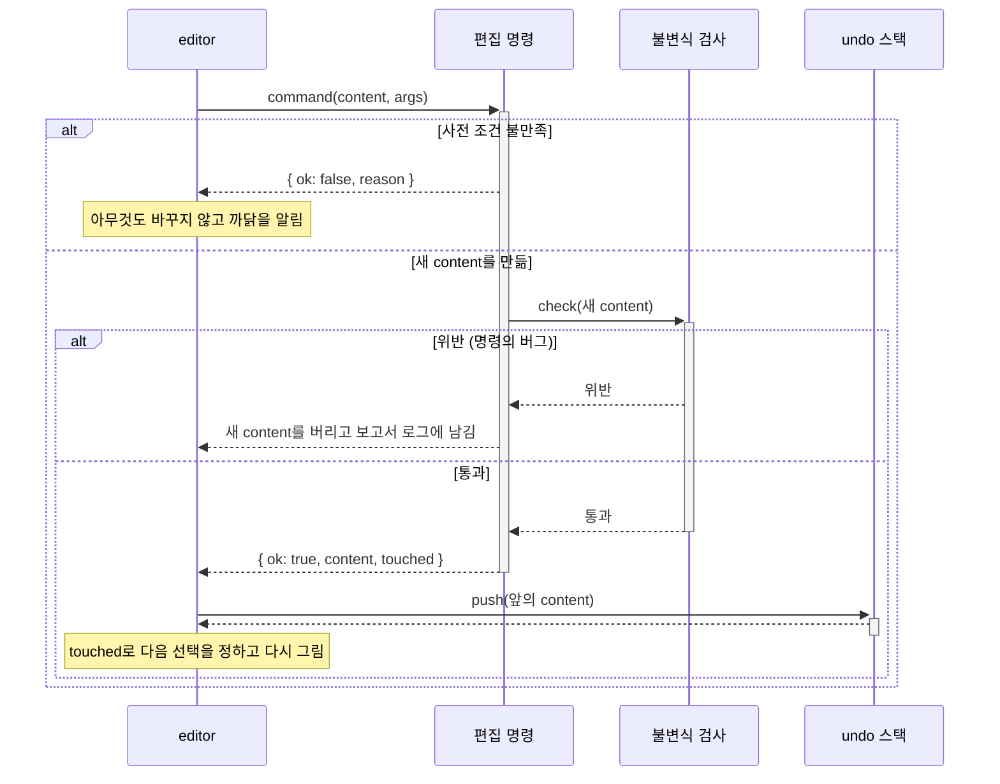

# 설계: 모델 (`packages/core`)

문서 모델의 데이터 구조, 불변식(invariant), 편집 명령을 정의합니다. → [[0004-structure-editor|ADR-0004]]

모델의 개념 구조(문서 → 다이어그램 여럿 → 머리 · 본문, 호출 블록은 Method를 id로 참조, 접기 영역은 줄에 붙은 마커, 내용과 뷰 상태)는 UML 클래스 다이어그램으로 [[03-architecture#3.4 문서 모델]]과 [[03-architecture#3.5 내용과 뷰 상태]]에서 정했습니다. 이 문서는 그 구조를 TypeScript 타입과 불변식과 명령으로 구체화합니다. 파일에 쓰는 모양은 [[01-file-format#3. 모델 JSON]]에 있습니다.

## 관련 요구사항

- 블록 종류: [[01-requirements#3.1 블록 종류]]
- 정합성: [[01-requirements#^nfr-integrity]]
- 실행 취소: [[01-requirements#^edit-undo]], [[02-interaction-rules#6. 실행 취소]]
- 감싸기 · 풀기: [[01-requirements#^edit-wrap]], [[01-requirements#^edit-unwrap]], [[01-requirements#^edit-call-inline]]
- 여러 다이어그램, Event · Method, 호출 블록: [[01-requirements#^edit-multi-diagram]], [[01-requirements#^blk-event]], [[01-requirements#^blk-method]], [[01-requirements#^blk-call]], [[01-requirements#^blk-call-named]], [[01-requirements#^blk-call-external]]
- 접기 영역과 뷰 상태: [[01-requirements#^edit-fold]], [[01-requirements#^edit-fold-range]], [[01-requirements#^edit-fold-site]], [[0018-save-as-shown|ADR-0018]]

## 1. 타입

TypeScript로 적습니다. 모든 값은 불변 객체(readonly)로 다룹니다. 명령은 고친 새 값을 만들고, 바뀌지 않은 하위 트리는 앞의 값과 공유합니다(구조적 공유). → [[0029-immutable-document-undo|ADR-0029]]

### 1.1 문서

```ts
type Doc = {
  content: Content;   // 내용: undo 대상
  view: View;         // 뷰 상태: undo 대상이 아님 (2장)
};

type Content = {
  settings: Settings;
  diagrams: Diagram[];   // 순서가 있다. 적어도 하나
};

type Settings = {
  textKind: TextKind;    // 블록 글자의 종류 → [[0032-token-highlighting|ADR-0032]]
  theme: ThemeId;        // 그림의 색 묶음 → [[04-visual-design#8. 테마]]
  headStyle: 'shape' | 'title';  // 머리 모양: 모자 · 아치 그대로, 또는 제목처럼 → [[01-requirements#^lay-head-style]]
};
type TextKind = 'plain' | 'c' | 'java' | 'python' | 'bash';  // 처음에 지원할 목록은 미결정
```

- 내용과 뷰 상태를 처음부터 나눠 둡니다. undo 스택에는 `content`의 스냅숏만 쌓입니다.
- 화면의 줌 · 스크롤 위치, 선택, UI 언어는 모델에 없습니다. `editor`의 메모리 상태입니다.

### 1.2 다이어그램과 머리

```ts
type Diagram = {
  id: Id;
  head: Head | null;   // null이면 머리 없음: 종류가 없고 호출할 수 없다
  body: Seq;
};

type Head = {
  kind: 'event' | 'method';
  text: string;        // Event는 글자 전체가 이름. Method는 첫 '(' 앞이 이름, 괄호 안이 받는 것
};
```

- Method 머리의 이름과 매개변수는 `text`에서 필요할 때 파싱해 얻습니다(파생 값이라 저장하지 않음). 규칙은 [[02-interaction-rules#Method 머리]]에 있습니다. → [[0022-call-name-follows-head|ADR-0022]]

### 1.3 줄

블록의 순서 있는 시퀀스(`Seq`)입니다. 다이어그램의 본문, 갈래의 본문, 반복 블록의 본문이 모두 `Seq`입니다.

```ts
type Seq = {
  blocks: Block[];       // 비지 않는다
  folds: FoldMark[];     // 이 줄에 붙은 접기 영역
};

type FoldMark = {
  id: Id;
  first: Id;             // 묶은 범위의 처음 블록
  last: Id;              // 끝 블록 (처음과 같을 수 있음)
  name?: string;         // 없으면 기본 이름("첫 블록의 글자 외 n개")을 보인다
};
```

- 접기 영역은 블록을 감싸는 컨테이너 노드가 아니라 **줄에 붙은 마커**(annotation)입니다. 블록 트리는 접기 영역이 있든 없든 같습니다. → [[0017-fold-name-in-model|ADR-0017]]
- 범위를 인덱스(몇 번째)가 아니라 **블록의 안정 id**로 적습니다. 블록을 넣고 지워도 마커를 갱신할 일이 적습니다. 범위 안의 블록이 줄 밖으로 나가면 범위가 줄어듭니다 → 3장의 규칙 F

### 1.4 블록

```ts
type Block = Process | If | Case | While | DoWhile | For | Call;

type Process = { id: Id; kind: 'process'; text: string };

type If = {
  id: Id; kind: 'if'; text: string;   // 조건
  yes: Branch; no: Branch;            // 참 갈래, 거짓 갈래
};

type Case = {
  id: Id; kind: 'case'; text: string; // 견줄 값
  arms: Arm[];                        // default가 아닌 갈래들. 순서가 있다
  otherwise: Branch | null;           // default 갈래. 있으면 늘 맨 끝
};

type Branch = { id: Id; label?: string; body: Seq };  // If의 갈래와 default 갈래. 이름이 없으면 편집기가 정한 글자를 보인다
type Arm = { id: Id; label: string; body: Seq };      // Case의 갈래. 이름 (예: 1, 'a'..'z')

type While   = { id: Id; kind: 'while';   text: string; body: Seq };
type DoWhile = { id: Id; kind: 'doWhile'; text: string; body: Seq };  // Do-While과 Repeat-Until은 모양이 같고 글자만 다르다
type For     = { id: Id; kind: 'for';     text: string; body: Seq };
```

- 조건이나 반복의 글자는 모두 `text` 필드 하나에 둡니다. 글자 고치기 명령이 블록 종류(`kind`)마다 다른 필드로 분기하지 않아도 됩니다.
- **빈 블록**은 글자가 없는 처리 블록입니다(`{ kind: 'process', text: '' }`). 빈 갈래, 새 반복의 본문은 빈 블록 하나로 채웁니다.
- If의 갈래 이름은 고칠 수 있습니다(`label`). 고치지 않았으면 비어 있고, 편집기가 저장할 때의 화면 언어로 "참" · "거짓"을 적습니다 → [[01-requirements#^edit-if-label]], [[01-requirements#^nfr-i18n]]. default 갈래의 이름은 고치지 않으며 늘 "default"입니다.
- 갈래(`Branch`)에도 id가 있습니다. If와 Case는 갈래별로 접히므로, 뷰 상태가 갈래를 id로 참조합니다.
- **Case는 모델이 편집 명령보다 넓습니다.** 모델(타입과 불변식)은 default가 없는 Case와 default만 있는 Case도 표현할 수 있습니다. 코드에서 가져온 `switch`(리버스 엔지니어링 → [[01-requirements#^ide-reverse]])가 그런 모양일 수 있기 때문입니다. 사용자가 고칠 때는 편집 명령이 더 좁은 사전 조건을 지킵니다: 새 Case에는 늘 default가 있고, default는 뺄 수 없고, default가 아닌 갈래는 하나까지 줄일 수 있습니다 → [[02-interaction-rules#Case 블록]] → [[ux-decisions#MD3. Case 갈래의 최소 수|MD3]]

> [!info] 미완성: 탈출(Exit / Break / Return), 병렬 처리, 주석 블록
> 모두 #P2입니다. 넣을 때 이 판별 유니온(`kind`)에 멤버를 더합니다. 병렬 처리는 Case처럼 갈래 여럿을 합성하고, 탈출과 주석은 처리 블록처럼 `text` 하나를 갖는 꼴이 될 것입니다.

### 1.5 호출 블록

```ts
type Call = {
  id: Id; kind: 'call';
  target: CallTarget;
  args: string;          // 인자. 한 줄
  result: string;        // 반환값을 받는 것. 한 줄. 비어 있으면 결과 기호도 보이지 않는다
  siteFolds: SiteFold[]; // 인라인으로 펴 보인 이 호출 지점에만 있는 접기 영역 (1.6)
};

type CallTarget =
  | { kind: 'local'; diagram: Id }                                   // 같은 문서의 Method
  | { kind: 'named'; name: string }                                  // 이름을 적어 부름
  | { kind: 'external'; file: string; diagram: Id; lastName: string } // 다른 문서의 Method
  | { kind: 'lost'; lastName: string; file?: string };               // 이어진 곳을 잃음
```

- 같은 문서의 Method는 **id로만** 참조합니다. 표시할 이름은 그 Method의 머리에서 조회합니다. → [[0022-call-name-follows-head|ADR-0022]]
- 참조하던 Method가 없어지면(다이어그램을 지움, 머리를 뗌) 그 명령이 호출 블록을 `lost`로 바꾸고 보이던 이름을 `lastName`에 보존합니다. 그래서 `local`은 언제나 존재하는 Method를 참조합니다(불변식 6). 상태 전이는 아래 그림과 같습니다.
- `named`는 처음부터 이름만 적은 것입니다. 참조를 잃은 것(`lost`, 점선과 `?`)과 모양이 다르므로 variant를 나눕니다.
- 다른 문서의 Method(`external`)는 그 파일을 읽을 수 없을 수 있으므로(`DocumentStore`가 `null`을 돌려줌 → [[03-architecture#3.2 editor와 셸의 인터페이스]]) 마지막에 본 이름(`lastName`)을 캐시해 둡니다. `file`에 무엇을 적는지(상대 경로 등)는 정하지 않았습니다 → 미결정 사항
- 결과 기호(`←` / `=`)는 호출 블록마다가 아니라 문서마다 하나이고, 뷰 상태에 있습니다(2장).



UML 상태 다이어그램입니다. 상태는 `CallTarget.kind`이고, 화살표 위의 글은 전이를 일으키는 편집 명령입니다. "부를 것 바꾸기"는 어느 상태에서든 `target`을 새로 정하므로 어느 상태로든 갈 수 있으나, 그림에는 `local`로 가는 것만 그렸습니다. 머리 이름 고치기는 전이가 아닙니다(id로 참조하므로 `local` 그대로). `external`의 파일을 읽지 못하는 것도 전이가 아닙니다. 모델은 `external` 그대로이고 화면에만 "이어진 곳 없음"으로 보입니다.

### 1.6 펴 보인 곳의 접기 영역

```ts
type SiteFold = {
  id: Id;
  via: Id[];       // 이 호출 블록에서 중첩해 펴 보인 안쪽 호출 블록들의 id 경로. 바로 안이면 []
  first: Id;       // 호출 대상 Method의 블록 id
  last: Id;
  name?: string;
};
```

- 펴 보인 블록은 문서에 사본으로 있지 않습니다(인라인 전개는 레이아웃 단계의 일이며 모델을 바꾸지 않음). 레이아웃이 Method의 블록을 그 자리에 다시 배치해 그릴 뿐입니다 → [[03-architecture#4.1 편집]]
- 그래서 이 자리의 접기 영역은 **가장 바깥 호출 블록**에 합성되고, 중첩해 편 안쪽이면 `via`로 경로를 적습니다. 호출 블록을 지우면 함께 사라집니다.
- Method가 바뀌어 `first`나 `last`가 dangling id가 되어도 갱신하지 않습니다. 레이아웃 때 남은 블록으로 범위를 줄이고, 하나도 남지 않으면 그리지 않습니다 → [[02-interaction-rules#펴 보인 곳의 접기 영역]]

### 1.7 id

```ts
type Id = string;  // 예: "d1"(다이어그램), "b17"(블록), "r3"(갈래), "f2"(접기 영역)
```

- 문서 안에서 유일합니다. 종류마다 접두사를 붙이고 뒤는 정수입니다.
- 새 id는 **문서에서 가장 큰 수 + 1**로 발급합니다(UUID · 시각 · 난수를 쓰지 않음). 같은 문서에 같은 명령을 하면 같은 id가 나오므로 결정적입니다(테스트하기 쉽고 파일이 늘 같음).
- 붙여넣기, 호출 블록 풀기, 다른 문서에서 가져오기처럼 블록이 복사되어 들어오면 새 id로 다시 매깁니다. 복사본 안의 접기 영역의 `first` · `last`도 새 id로 매핑합니다.

## 2. 뷰 상태

```ts
type View = {
  folded: Id[];        // 접힌 것: 접기 영역(FoldMark · SiteFold), 갈래(If · Case), 반복 블록(본문)
  opened: Path[];      // 인라인으로 펴 보인 호출 블록. 중첩해 편 것은 경로로 적는다
  bands: boolean;      // 이름 띠를 보이는가
  resultSymbol: '←' | '=';
};
type Path = Id[];      // [바깥 호출 블록 id, 그 안에서 편 호출 블록 id, …]
```

- 뷰 상태는 내용의 id를 참조하는 별도 구조입니다. 떼어 내면 "모두 펼친 그림"이 됩니다.
- **dangling id를 참조해도 오류가 아닙니다**(약한 참조). undo로 내용이 앞으로 돌아가면, 뷰 상태에 지금 없는 id가 남을 수 있습니다. 레이아웃은 없는 id를 무시하고, 직렬화할 때는 있는 id만 적습니다. 그래서 뷰 상태는 undo 스택과 독립적으로 바뀌어도 일관성이 깨지지 않습니다.
- 펴 보인 블록 안의 접힘은 Method에 저장된 접힘을 따릅니다(호출 지점마다 따로 갖지 않음). 이 자리의 접기 영역(`SiteFold`)의 접힘만 그 자리의 것입니다.
- 결과 기호를 뷰 상태에 두는 까닭은 [[ux-decisions#Q9. 실행 취소의 대상 (R7)|Q9]]에 있습니다.

## 3. 불변식

문서의 불변식(invariant)입니다. 명령이 새 문서를 만들 때마다(사후 조건), 그리고 파일을 역직렬화할 때마다 검사합니다. 위반하는 문서는 만들어지지 않습니다 → [[03-architecture#5. 공통 관심사]]

| # | 조건 |
| --- | --- |
| 1 | 다이어그램이 적어도 하나 있다 |
| 2 | 모든 줄은 비지 않는다 |
| 3 | 문서 안의 id(다이어그램, 블록, 갈래, 접기 영역)는 모두 다르다 |
| 4 | If는 갈래가 둘이다. Case는 갈래(default를 포함해)가 적어도 하나 있다 |
| 5 | 접기 영역의 `first`와 `last`는 그 줄의 블록이고, `first`가 `last`보다 앞이거나 같다. 한 줄의 접기 영역들은 서로 떨어져 있거나 하나가 다른 하나를 온전히 품는다(걸쳐 겹치지 않음). 범위가 똑같은 접기 영역은 둘이 없다 |
| 6 | `local` 호출 블록이 가리키는 다이어그램은 있고, 그 머리는 Method다 |
| 7 | 머리도 내용도 없는 다이어그램(머리가 없고 본문이 빈 블록 하나)은 문서에 다이어그램이 그것 하나일 때만 있다 |

- 7은 "머리도 내용도 없는 다이어그램은 저절로 사라진다"([[02-interaction-rules#5. 여러 다이어그램의 배치]])를 불변식으로 적은 것입니다. 명령이 끝날 때 그런 다이어그램을 지워 정규화합니다.
- **머리 이름의 규칙**(유일함, 비지 않음)은 불변식이 아닙니다. 다른 도구나 손으로 고친 파일에는 이름이 겹친 머리가 있을 수 있고, 그런 파일도 열어야 하기 때문입니다([[02-interaction-rules#Event 머리]]). 이름을 바꾸는 명령이 사전 조건 검증으로 겹치는 이름을 거부할 뿐이고, 겹친 머리는 화면에 표시해 알립니다.
- 파일을 열 때 1~7을 위반하면 "편집할 수 없다"고 알리고 원본은 건드리지 않습니다. 자동 복구하지 않습니다.

## 4. 편집 명령

명령은 모두 **문서의 내용을 받아 새 내용을 돌려주는 순수 함수**입니다(커맨드 패턴). 실행 흐름은 아래 시퀀스 다이어그램과 같습니다.



UML 시퀀스 다이어그램입니다. 실선 화살표는 호출, 점선 화살표는 반환, `alt`는 조건 분기, 세로 막대는 실행 중(activation)입니다. 뷰 명령(4.2)은 같은 길을 가지만 undo 스택에 push하지 않습니다.

```ts
type Command<A> = (content: Content, args: A) => Result;
type Result =
  | { ok: true; content: Content; touched: Id[] }   // touched: 새로 생기거나 바뀐 노드의 id. 명령 뒤의 선택을 editor가 정하는 데 쓴다
  | { ok: false; reason: Reason };                   // 사전 조건 불만족. 아무것도 바꾸지 않고 까닭을 알린다 ("막지 않고 알린다")
```

- 명령 하나가 undo 한 단계입니다. 감싸기, 풀기, 새 Method로 빼기처럼 여러 노드를 바꾸는 명령도 원자적으로 한 단계입니다.
- 명령이 끝나면 불변식을 검사합니다. 위반하면 그것은 명령의 버그이므로, 새 내용을 버리고(롤백) 문제 알리기 보고서의 로그에 남깁니다.
- 명령이 끝난 뒤의 선택은 `editor`가 정합니다(`touched`를 보고) → [[ux-decisions#1. 결정 모음|Q19]]
- 명령의 표시 이름과 키 바인딩, 메뉴는 명령 레지스트리(`CommandRegistry`) 하나에서 생성됩니다 → [[0033-command-list-for-shells|ADR-0033]]

### 4.1 내용을 바꾸는 명령

| 묶음 | 명령 | 규칙 |
| --- | --- | --- |
| 블록 | 넣기 (앞 · 뒤 · 빈 블록 자리) | [[02-interaction-rules#키보드로 이동하고 넣기]] |
| | 지우기 | 줄이 비게 되면 빈 블록 하나를 남긴다 |
| | 글자 고치기 | 블록의 `text`, 호출 블록의 `args` · `result`, 머리, 갈래 이름, 접기 영역 이름 |
| | 옮기기 · 끌어 놓기 | [[02-interaction-rules#Q6. 순서 바꾸기를 명령 하나로 (R4)\|Q6]]에서 정함 |
| | 붙여넣기 | [[02-interaction-rules#붙여넣기]]. 새 id를 받는다 |
| | 감싸기 | [[02-interaction-rules#감싸기 · 풀기]] |
| | 풀기 (제어 블록) | 내용이 있는 갈래를 순서대로 이어 붙인다 |
| | 풀기 (호출 블록) | Method의 블록을 새 id로 깊은 복사해 그 자리에 인라인한다. 이 자리의 접기 영역은 보통 접기 영역이 된다. `lost`이면 풀 수 없다 |
| | 새 Method로 빼기 | 고른 블록이 새 Method의 본문이 되고, 그 자리에 `local` 호출 블록이 남는다 |
| 갈래 | 갈래 넣기 · 지우기 · 맞바꾸기 | [[02-interaction-rules#Case 블록]], [[02-interaction-rules#갈래 순서 바꾸기]]. default가 아닌 갈래는 하나까지 줄인다. default는 넣지도 지우지도 않는다 |
| | If를 Case로 · Case를 If로 바꾸기 | 갈래가 하나만 남은 Case, `+`를 누른 If에서 바꿀지 묻는다. 글자를 옮기는 법은 미결정 |
| 호출 | 부를 것 바꾸기 | `target`만 바꾸고 `args` · `result`는 남긴다 |
| 다이어그램 | 새 다이어그램 (Event · Method) | 그 종류의 맨 뒤에 놓는다 |
| | 지우기 | 이 Method를 부르던 호출 블록을 `lost`로 바꾼다 |
| | 머리 달기 · 떼기 · 종류 바꾸기 | 떼면 부르던 호출 블록이 `lost`가 된다. 부르는 호출 블록이 있는 Method는 Event로 바꿀 수 없다 |
| | 머리 이름 고치기 | 겹치거나 빈 이름은 받지 않는다. 호출 블록은 id로 가리키므로 따로 고칠 것이 없다. 괄호를 지우면 부르는 호출 블록의 `args`를 비운다 |
| | 순서 바꾸기 | Event는 Event끼리, Method는 Method끼리 |
| 접기 영역 | 만들기 · 풀기 · 이름 고치기 | [[02-interaction-rules#접기 · 펼치기]]. 펴 보인 곳이면 `SiteFold`로 |
| 문서 설정 | 블록 글자의 종류, 테마 | |

### 4.2 보기 명령

뷰 상태(`View`)만 바꿉니다. undo 스택에 남지 않지만 dirty 표시("저장 안 됨")는 뜹니다.

| 명령 | 규칙 |
| --- | --- |
| 접기 · 펴기 | 듣는 곳은 [[02-interaction-rules#접기 · 펼치기]] |
| 모두 접기 · 모두 펴기 | 같은 곳 |
| 호출 블록 펴 보기 · 접기 | [[02-interaction-rules#호출 블록 펴 보기]] |
| 이름 띠 켜고 끄기 | |
| 결과 기호 바꾸기 | |

### 4.3 규칙 F: 접기 영역의 범위가 줄 밖으로 나갈 때

블록을 지우거나 줄 밖으로 옮기면, 그 블록을 `first`나 `last`로 가리키던 접기 영역은 **남은 블록으로 줄어듭니다**. 범위 안의 블록이 모두 나가면 접기 영역은 사라집니다. 범위의 처음과 끝 **사이**에 넣은 블록은 범위에 포함됩니다. 펴 보인 곳의 접기 영역과 같은 규칙입니다([[02-interaction-rules#펴 보인 곳의 접기 영역]]).

범위의 **바로 앞이나 바로 뒤**에 넣은 블록은 **고른 것을 따릅니다**. 영역 안의 블록을 골라 넣었으면 영역에 묶고(겹친 영역이면 그 블록을 담은 영역 모두), 영역 전체(이름 띠, 접힌 칸)를 골라 넣었으면 묶지 않습니다. 넣기 명령은 선택을 인자로 받아 `first` · `last`를 갱신합니다. → [[ux-decisions#MD1. 접기 영역의 끝에 넣은 블록|MD1]]

### 4.4 텍스트 편집과 undo

글자 칸(텍스트 입력 요소)을 열고 닫을 때까지가 **명령 하나, undo 한 단계**입니다. 칸을 닫을 때 `editor`가 글자 고치기 명령을 한 번 실행합니다. 글자가 처음과 같으면 실행하지 않습니다. 칸이 열려 있는 동안의 되돌리기는 그 입력 요소의 자체 undo가 맡고 모델은 모릅니다 → [[02-interaction-rules#6. 실행 취소]] → [[ux-decisions#MD2. 글자 고치기의 실행 취소 단위|MD2]]

## 5. 직렬화

모델과 JSON 사이의 직렬화 · 역직렬화입니다. 모양은 [[01-file-format#3. 모델 JSON]]에 있습니다.

- 1장의 타입을 그대로 JSON으로 매핑합니다. `Doc.content`의 `settings` · `diagrams`가 맨 위에, `view`가 그 옆에 놓입니다.
- 객체 키의 순서는 이 문서의 타입에 적은 순서로 고정합니다(결정적 출력).
- 기본값과 같아 생략하는 필드: `FoldMark.name`(없음), `Branch.label`(없음), `Call.siteFolds`(빈 목록), `Seq.folds`(빈 목록). 그 밖에는 늘 적습니다.
- 타입별 필드를 굳히면 JSON Schema로 [[01-file-format#3. 모델 JSON]]에 옮깁니다.

## 미결정 사항

- [ ] If를 Case로, Case를 If로 바꿀 때 글자를 옮기는 법(예: Case `key`의 갈래 `1` → If의 조건 `key == 1`인가) → 4.1
- [ ] 코드의 fall-through(`break` 없이 다음 갈래로 이어지는 `case`)를 모델에 어떻게 담을지 → [[01-requirements#3.6 코드 연동]]
- [ ] 다른 문서를 가리키는 값(`external.file`): 상대 경로인지, 무엇에 대한 상대인지 → [[02-interaction-rules#호출 블록]]
- [ ] 처음에 지원할 블록 글자의 종류 목록 → [[01-requirements#6. 미결정 사항]]
- [ ] 프로토타입이 저장한 파일(`version: 0`, 접기 영역이 블록을 품는 꼴)을 열지
