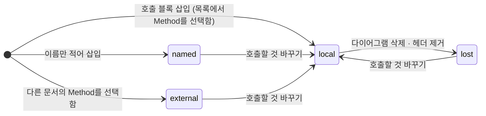
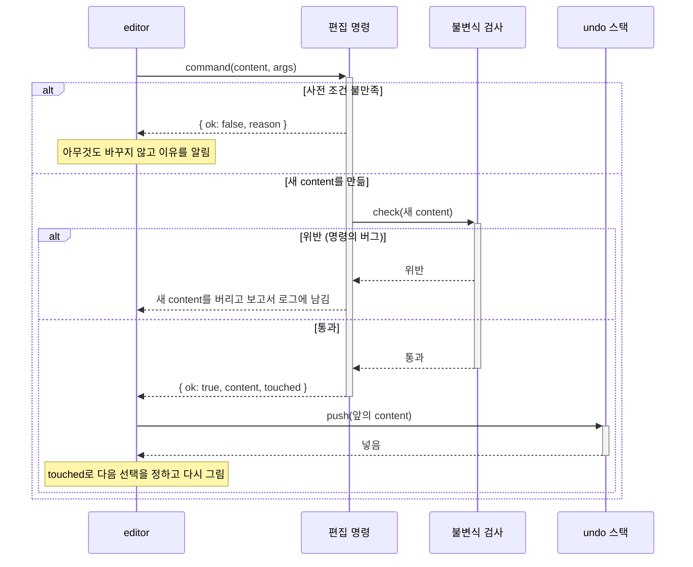

# 모델

문서 모델의 데이터 구조, 불변식(invariant), 편집 명령을 정의합니다. → [[0004-structure-editor|ADR-0004]]

코드: `src/packages/core` (→ [[0036-code-layout|ADR-0036]])

모델의 개념 구조(문서 → 다이어그램 여럿 → 헤더 · 본문, 호출 블록은 Method를 id로 참조, 접기 영역은 줄에 붙은 마커, 내용과 뷰 상태)는 UML 클래스 다이어그램으로 [[03-architecture#3.4 문서 모델]]과 [[03-architecture#3.5 내용과 뷰 상태]]에서 정했습니다. 이 문서는 그 구조를 TypeScript 타입과 불변식과 명령으로 구체화합니다. 파일에 쓰는 모양은 [[01-file-format#3. 모델 JSON]]에 있습니다.

## 관련 요구사항

- 블록 종류: [[01-requirements#3.1 블록 종류]]
- 정합성: [[01-requirements#^r-nfr|R-NFR-01]]
- 실행 취소: [[01-requirements#^r-edit|R-EDIT-02]], [[02-interaction-rules#6. 실행 취소]]
- 감싸기 · 풀기: [[01-requirements#^r-edit|R-EDIT-06]], [[01-requirements#^r-edit|R-EDIT-07]], [[01-requirements#^r-edit|R-EDIT-08]]
- 이동 · 붙여넣기 · 분기: [[01-requirements#^r-edit|R-EDIT-09]], [[01-requirements#^r-edit|R-EDIT-10]], [[01-requirements#^r-edit|R-EDIT-11]]
- 새 Method로 빼기: [[01-requirements#^r-edit|R-EDIT-19]]
- 문서 설정(블록 텍스트의 언어, 헤더 모양): [[01-requirements#^r-lay|R-LAY-06]], [[01-requirements#^r-lay|R-LAY-07]], [[01-requirements#^r-lay|R-LAY-10]]
- 여러 다이어그램, Event · Method, 호출 블록: [[01-requirements#^r-edit|R-EDIT-18]], [[01-requirements#^r-blk|R-BLK-10]], [[01-requirements#^r-blk|R-BLK-11]], [[01-requirements#^r-blk|R-BLK-07]], [[01-requirements#^r-blk|R-BLK-08]], [[01-requirements#^r-blk|R-BLK-09]]
- 접기 영역과 뷰 상태: [[01-requirements#^r-edit|R-EDIT-13]], [[01-requirements#^r-edit|R-EDIT-14]], [[01-requirements#^r-edit|R-EDIT-16]], [[0018-save-as-shown|ADR-0018]]

## 1. 타입

TypeScript로 적습니다. 모든 값은 불변 객체(readonly)로 다룹니다. 명령은 수정한 새 값을 만들고, 바뀌지 않은 하위 트리는 앞의 값과 공유합니다(구조적 공유). → [[0029-immutable-document-undo|ADR-0029]]

### 1.1 문서

```ts
type Doc = {
  content: Content;   // 내용: undo 대상
  view: View;         // 뷰 상태: undo 대상이 아님 (2장)
};

type Content = {
  settings: Settings;
  diagrams: Diagram[];   // 순서가 있다. 적어도 하나
};

type Settings = {
  textKind: TextKind;    // 블록 텍스트의 언어: 구문 강조의 문법. 글꼴과 레이아웃은 바꾸지 않는다 → [[0042-text-kind-keeps-block-font|ADR-0042]]
  theme: ThemeId;        // 그림의 색 묶음 → [[04-visual-design#8. 테마]]
  headStyle: 'shape' | 'title';  // 헤더 모양: 모자 · 아치 그대로, 또는 제목처럼 → [[01-requirements#^r-lay|R-LAY-10]]
  locale: Locale;        // 그림 문구의 언어: 그림에 적는 고정 문구("참" · "거짓" 등)의 언어 → [[0041-drawing-locale-in-document|ADR-0041]]
};
type TextKind = 'plain' | 'c' | 'cpp' | 'java' | 'javascript' | 'python' | 'bash';  // 일반 텍스트, C, C++, Java, JavaScript · TypeScript, Python, Bash
type ThemeId = string;   // 테마의 이름: 'default' · 'dark' · 'high-contrast' · 'print'. 모르는 이름은 기본 테마로 그리고 그대로 둔다 (ADR-0044)
type Locale = 'en' | 'ko';  // core의 locales와 같은 목록(화면 언어의 목록)
```

- `TextKind`는 유니온이라 파일에 적힌 모르는 값을 담지 못합니다. 그런 파일을 열면 모델에는 `'plain'`을 두고, 받은 값은 모델 밖에 따로 두었다가 저장할 때 되돌려 적습니다 → [[01-file-format#3.3 노드별 필드]]. `ThemeId`는 문자열이라 모르는 이름도 그대로 담습니다. `Locale`도 유니온이라, 모르는 언어가 적힌 파일은 연 사람의 화면 언어로 그리고 받은 값은 `TextKind`처럼 모델 밖에 두었다가 되돌려 적습니다. `locale`이 없는 파일(ADR-0041 전에 저장한 파일)은 연 사람의 화면 언어로 엽니다.

- 내용과 뷰 상태를 처음부터 나눠 둡니다. undo 스택에는 `content`의 스냅숏만 쌓입니다.
- 화면의 줌 · 스크롤 위치, 선택, UI 언어(화면 언어)는 모델에 없습니다. `editor`의 메모리 상태입니다. 그림에 적는 고정 문구의 언어는 화면 언어와 따로, 문서 설정 `locale`입니다.

### 1.2 다이어그램과 헤더

```ts
type Diagram = {
  id: Id;
  head: Head | null;   // null이면 헤더 없음: 종류가 없고 호출할 수 없다
  body: Seq;
};

type Head = {
  kind: 'event' | 'method';
  text: string;        // Event는 텍스트 전체가 이름. Method는 첫 '(' 앞이 이름, 괄호 안이 받는 것
};
```

- Method 헤더의 이름과 매개변수는 `text`에서 필요할 때 파싱해 얻습니다(파생 값이라 저장하지 않음). 규칙은 [[02-interaction-rules#Method 헤더]]에 있습니다. → [[0022-call-name-follows-head|ADR-0022]]

### 1.3 줄

블록의 순서 있는 시퀀스(`Seq`)입니다. 다이어그램의 본문, 분기의 본문, 반복 블록의 본문이 모두 `Seq`입니다.

```ts
type Seq = {
  blocks: Block[];       // 비지 않는다
  folds: FoldMark[];     // 이 줄에 붙은 접기 영역
};

type FoldMark = {
  id: Id;
  first: Id;             // 묶은 범위의 처음 블록
  last: Id;              // 끝 블록 (처음과 같을 수 있음)
  name?: string;         // 없으면 기본 이름("첫 블록의 텍스트 외 n개")을 보인다
};
```

- 접기 영역은 블록을 감싸는 컨테이너 노드가 아니라 **줄에 붙은 마커**(annotation)입니다. 블록 트리는 접기 영역이 있든 없든 같습니다. → [[0017-fold-name-in-model|ADR-0017]]
- 범위를 인덱스(몇 번째)가 아니라 **블록의 안정 id**로 적습니다. 블록을 삽입하고 삭제해도 마커를 갱신할 일이 적습니다. 범위 안의 블록이 줄 밖으로 나가면 범위가 줄어듭니다 → 3장의 규칙 F

### 1.4 블록

```ts
type Block = Process | If | Case | While | DoWhile | For | Call;

type Process = { id: Id; kind: 'process'; text: string };

type If = {
  id: Id; kind: 'if'; text: string;   // 조건
  yes: Branch; no: Branch;            // 참 분기, 거짓 분기
};

type Case = {
  id: Id; kind: 'case'; text: string; // 견줄 값
  arms: Arm[];                        // default가 아닌 분기들. 순서가 있다
  otherwise: Branch | null;           // default 분기. 있으면 늘 맨 끝
};

type Branch = { id: Id; label?: string; body: Seq };  // If의 분기와 default 분기. 라벨이 없으면 편집기가 정한 텍스트를 보인다
type Arm = { id: Id; label: string; body: Seq };      // Case의 분기. 라벨 (예: 1, 'a'..'z')

type While   = { id: Id; kind: 'while';   text: string; body: Seq };
type DoWhile = { id: Id; kind: 'doWhile'; text: string; body: Seq };  // Do-While과 Repeat-Until은 모양이 같고 텍스트만 다르다
type For     = { id: Id; kind: 'for';     text: string; body: Seq };
```

- 조건이나 반복의 텍스트는 모두 `text` 필드 하나에 둡니다. 텍스트 편집 명령이 블록 종류(`kind`)마다 다른 필드로 분기하지 않아도 됩니다.
- **빈 블록**은 텍스트가 없는 처리 블록입니다(`{ kind: 'process', text: '' }`). 빈 분기, 새 반복의 본문은 빈 블록 하나로 채웁니다.
- If의 분기 라벨은 편집할 수 있습니다(`label`). 편집하지 않았으면 비어 있고, 편집기가 문서 설정 `locale`의 언어로 "참" · "거짓"을 적습니다 → [[01-requirements#^r-edit|R-EDIT-12]], [[01-requirements#^r-nfr|R-NFR-04]], [[0041-drawing-locale-in-document|ADR-0041]]. default 분기의 라벨은 편집하지 않으며 늘 "default"입니다.
- 분기(`Branch`)에도 id가 있습니다. If와 Case는 분기별로 접히므로, 뷰 상태가 분기를 id로 참조합니다.
- **Case는 모델이 편집 명령보다 넓습니다.** 모델(타입과 불변식)은 default가 없는 Case와 default만 있는 Case도 표현할 수 있습니다. 코드에서 가져온 `switch`(리버스 엔지니어링 → [[01-requirements#^r-ide|R-IDE-03]])가 그런 모양일 수 있기 때문입니다. 사용자가 편집할 때는 편집 명령이 더 좁은 사전 조건을 지킵니다: 새 Case에는 늘 default가 있고, default는 삭제할 수 없고, default가 아닌 분기는 하나까지 줄일 수 있습니다 → [[02-interaction-rules#Case 블록]] → [[ux-decisions#MD3. Case 갈래의 최소 수|MD3]]

> [!info] 미완성: 탈출(Exit / Break / Return), 병렬 처리, 주석 블록
> 모두 `P2`입니다. 넣을 때 이 판별 유니온(`kind`)에 멤버를 더합니다. 병렬 처리는 Case처럼 분기 여럿을 합성하고, 탈출과 주석은 처리 블록처럼 `text` 하나를 갖는 꼴이 될 것입니다.

### 1.5 호출 블록

```ts
type Call = {
  id: Id; kind: 'call';
  target: CallTarget;
  args: string;          // 인자. 한 줄
  result: string;        // 반환값을 받는 것. 한 줄. 비어 있으면 결과 기호도 보이지 않는다
  siteFolds: SiteFold[]; // 인라인으로 펴 보인 이 호출 지점에만 있는 접기 영역 (1.6)
};

type CallTarget =
  | { kind: 'local'; diagram: Id }                                   // 같은 문서의 Method
  | { kind: 'named'; name: string }                                  // 이름을 적어 부름
  | { kind: 'external'; file: string; diagram: Id; lastName: string } // 다른 문서의 Method
  | { kind: 'lost'; lastName: string; file?: string };               // 참조 대상을 잃음
```

- 같은 문서의 Method는 **id로만** 참조합니다. 표시할 이름은 그 Method의 헤더에서 조회합니다. → [[0022-call-name-follows-head|ADR-0022]]
- 참조하던 Method가 없어지면(다이어그램을 삭제함, 헤더를 제거함) 그 명령이 호출 블록을 `lost`로 바꾸고 보이던 이름을 `lastName`에 보존합니다. 그래서 `local`은 언제나 존재하는 Method를 참조합니다(불변식 6). 상태 전이는 아래 그림과 같습니다.
- `named`는 처음부터 이름만 적은 것입니다. 참조를 잃은 것(`lost`, 점선과 `?`)과 모양이 다르므로 variant를 나눕니다.
- 다른 문서의 Method(`external`)는 그 파일을 읽을 수 없을 수 있으므로(`DocumentStore`가 `null`을 반환함 → [[03-architecture#3.2 editor와 셸의 인터페이스]]) 마지막에 본 이름(`lastName`)을 캐시해 둡니다. `file`에 무엇을 적는지(상대 경로 등)는 정하지 않았습니다 → 미결정 사항
- 결과 기호(`←` / `=`)는 호출 블록마다가 아니라 문서마다 하나이고, 뷰 상태에 있습니다(2장).



UML 상태 다이어그램입니다. 상태는 `CallTarget.kind`이고, 화살표 위의 글은 전이를 일으키는 편집 명령입니다. "호출할 것 바꾸기"는 어느 상태에서든 `target`을 새로 정하므로 어느 상태로든 갈 수 있으나, 그림에는 `local`로 가는 것만 그렸습니다. 헤더 이름 편집은 전이가 아닙니다(id로 참조하므로 `local` 그대로). `external`의 파일을 읽지 못하는 것도 전이가 아닙니다. 모델은 `external` 그대로이고 화면에만 "참조 대상 없음"으로 보입니다.

### 1.6 펴 보인 곳의 접기 영역

```ts
type SiteFold = {
  id: Id;
  via: Id[];       // 이 호출 블록에서 중첩해 펴 보인 안쪽 호출 블록들의 id 경로. 바로 안이면 []
  first: Id;       // 호출 대상 Method의 블록 id
  last: Id;
  name?: string;
};
```

- 펴 보인 블록은 문서에 사본으로 있지 않습니다(인라인 전개는 레이아웃 단계의 일이며 모델을 바꾸지 않음). 레이아웃이 Method의 블록을 그 자리에 다시 배치해 그릴 뿐입니다 → [[03-architecture#4.1 편집]]
- 그래서 이 자리의 접기 영역은 **가장 바깥 호출 블록**에 합성되고, 중첩해 편 안쪽이면 `via`로 경로를 적습니다. 호출 블록을 삭제하면 함께 사라집니다.
- Method가 바뀌어 `first`나 `last`가 dangling id가 되어도 갱신하지 않습니다. 레이아웃 때 남은 블록으로 범위를 줄이고, 하나도 남지 않으면 그리지 않습니다 → [[02-interaction-rules#펴 보인 곳의 접기 영역]]

### 1.7 id

```ts
type Id = string;  // 예: "d1"(다이어그램), "b17"(블록), "r3"(분기), "f2"(접기 영역)
```

- 문서 안에서 유일합니다. 종류마다 접두사를 붙이고 뒤는 정수입니다.
- 새 id는 **문서에서 그 접두사로 쓴 가장 큰 수 + 1**로 발급합니다(UUID · 시각 · 난수를 쓰지 않음). 같은 문서에 같은 명령을 하면 같은 id가 나오므로 결정적입니다(테스트하기 쉽고 파일이 늘 같음).
- id 생성기(`createIdGenerator(content, alsoAvoid)`)는 명령의 인자로 받습니다. `alsoAvoid`는 내용에는 없지만 다시 쓰면 안 되는 id입니다. `editor`는 뷰 상태가 가리키는 id를 여기에 넣어, undo로 사라진 블록의 접힘이 새 블록에 옮겨 붙지 않게 합니다(2장의 약한 참조). 인자를 주지 않으면 명령이 내용만으로 만듭니다.
- 붙여넣기, 호출 블록 풀기, 다른 문서에서 가져오기처럼 블록이 복사되어 들어오면 새 id로 다시 매깁니다. 복사본 안의 접기 영역의 `first` · `last`도 새 id로 매핑합니다.

## 2. 뷰 상태

```ts
type View = {
  folded: Id[];        // 접힌 것: 접기 영역(FoldMark · SiteFold), 분기(If · Case), 반복 블록(본문)
  opened: Path[];      // 인라인으로 펴 보인 호출 블록. 중첩해 편 것은 경로로 적는다
  bands: boolean;      // 이름 띠를 보이는가
  resultSymbol: '←' | '=';
};
type Path = Id[];      // [바깥 호출 블록 id, 그 안에서 편 호출 블록 id, …]
```

- 뷰 상태는 내용의 id를 참조하는 별도 구조입니다. 떼어 내면 "모두 펼친 그림"이 됩니다.
- **dangling id를 참조해도 오류가 아닙니다**(약한 참조). undo로 내용이 앞으로 돌아가면, 뷰 상태에 지금 없는 id가 남을 수 있습니다. 레이아웃은 없는 id를 무시하고, 직렬화할 때는 있는 id만 적습니다. 그래서 뷰 상태는 undo 스택과 독립적으로 바뀌어도 일관성이 깨지지 않습니다.
- 펴 보인 블록 안의 접힘은 Method에 저장된 접힘을 따릅니다(호출 지점마다 따로 갖지 않음). 이 자리의 접기 영역(`SiteFold`)의 접힘만 그 자리의 것입니다.
- 결과 기호를 뷰 상태에 두는 이유는 [[ux-decisions#Q9. 실행 취소의 대상 (R7)|Q9]]에 있습니다.

## 3. 불변식

문서의 불변식(invariant)입니다. 명령이 새 문서를 만들 때마다(사후 조건), 그리고 파일을 역직렬화할 때마다 검사합니다. 위반하는 문서는 만들어지지 않습니다 → [[03-architecture#5. 공통 관심사]]

| # | 조건 |
| --- | --- |
| 1 | 다이어그램이 적어도 하나 있다 |
| 2 | 모든 줄은 비지 않는다 |
| 3 | 문서 안의 id(다이어그램, 블록, 분기, 접기 영역)는 모두 다르다 |
| 4 | If는 분기가 둘이다. Case는 분기(default를 포함해)가 적어도 하나 있다 |
| 5 | 접기 영역의 `first`와 `last`는 그 줄의 블록이고, `first`가 `last`보다 앞이거나 같다. 한 줄의 접기 영역들은 서로 떨어져 있거나 하나가 다른 하나를 온전히 품는다(걸쳐 겹치지 않음). 범위가 똑같은 접기 영역은 둘이 없다 |
| 6 | `local` 호출 블록이 가리키는 다이어그램은 있고, 그 헤더는 Method다 |
| 7 | 헤더도 내용도 없는 다이어그램(헤더가 없고 본문이 빈 블록 하나)은 문서에 다이어그램이 그것 하나일 때만 있다 |

- 7은 "헤더도 내용도 없는 다이어그램은 자동으로 사라진다"([[02-interaction-rules#5. 여러 다이어그램의 배치]])를 불변식으로 적은 것입니다. 명령이 끝날 때 그런 다이어그램을 삭제해 정규화합니다.
- **헤더 이름의 규칙**(유일함, 비지 않음)은 불변식이 아닙니다. 다른 도구나 손으로 수정한 파일에는 이름이 겹친 헤더가 있을 수 있고, 그런 파일도 열어야 하기 때문입니다([[02-interaction-rules#Event 헤더]]). 이름을 바꾸는 명령이 사전 조건 검증으로 겹치는 이름을 거부할 뿐이고, 겹친 헤더는 화면에 표시해 알립니다.
- 파일을 열 때 1~7을 위반하면 "편집할 수 없다"고 알리고 원본은 건드리지 않습니다. 자동 복구하지 않습니다.

## 4. 편집 명령

명령은 모두 **문서의 내용을 받아 새 내용을 반환하는 순수 함수**입니다(커맨드 패턴). 실행 흐름은 아래 시퀀스 다이어그램과 같습니다.



UML 시퀀스 다이어그램입니다. 실선 화살표는 호출, 점선 화살표는 반환, `alt`는 조건 분기, 세로 막대는 실행 중(activation)입니다. 뷰 명령(4.2)은 같은 길을 가지만 undo 스택에 push하지 않습니다.

```ts
type Command<A> = (content: Content, args: A) => Result;
type Result =
  | { ok: true; content: Content; touched: Id[]; note?: Note }  // touched: 새로 생기거나 바뀐 노드의 id. 명령 뒤의 선택을 editor가 정하는 데 쓴다
  | { ok: false; reason: Reason };                   // 사전 조건 불만족. 아무것도 바꾸지 않고 이유를 알린다 ("막지 않고 알린다")
type Reason = { code: ReasonCode; node?: Id };       // node: 이유가 가리키는 노드. editor가 code를 카탈로그의 문장으로 바꾼다
type Note = { kind: 'offerConvertCaseToIf' | 'checkCondition'; node: Id };  // 성공한 뒤 editor가 알리거나 물을 것
type Target =                                        // 명령이 적용되는 곳. editor가 선택을 이것으로 바꿔 넘긴다
  | { kind: 'blocks'; first: Id; last: Id }          // 한 줄 안의 연속 범위 (순서는 아무래도 됨). 줄은 따로 적지 않고 블록에서 찾는다
  | { kind: 'fold'; fold: Id }                       // 접기 영역 전체. 그 곁에 삽입한 블록은 영역 밖 (4.3)
  | { kind: 'diagramEnd'; diagram: Id };             // 선택한 것이 없을 때: 그 다이어그램의 끝에 삽입
```

- **바꿀 것이 없으면** `ok: true`에 받은 `content`를 그대로(같은 객체) 돌려줍니다(예: 빈 블록에 처리 블록 삽입, 같은 텍스트로 편집). `editor`는 같은 객체이면 undo 스택에 넣지 않습니다.
- `ReasonCode`는 `notFound` · `wrongKind` · `notContiguous` · `unsupported` · `atTop` · `atBottom` · `atLeftmost` · `atRightmost` · `defaultBranchFixed` · `lastArm` · `ifBranchesFixed` · `emptyLabel` · `defaultLabelFixed` · `cannotWrapWithProcess` · `noControlBlock` · `notConvertible` · `emptyClip` · `intoItself`(끌어 놓은 블록을 그 안쪽에 놓음) · `noHead`(헤더가 없는 다이어그램의 이름을 편집함) · `emptyHeadName` · `duplicateHeadName`(헤더의 이름이 비거나 다른 헤더와 겹침) · `methodHasCallers`(호출하는 호출 블록이 있는 Method를 Event로 바꿈) · `lastDiagram`(하나뿐인 다이어그램을 삭제함) · `lostTarget`(참조 대상을 잃은 호출 블록을 편집함) 등입니다. `askConvertIfToCase`는 거절이 아니라 물음입니다: If에 분기를 삽입하면 이것으로 돌아오고, `editor`가 Case로 바꿀지 묻고 "예"이면 `convertIfToCase`를 실행합니다([[ux-decisions#MD3. Case 갈래의 최소 수|MD3]]).
- `Note`: `offerConvertCaseToIf`는 Case에 default가 아닌 분기가 하나 남았을 때 If로 바꿀지 묻게 하고("예"이면 `convertCaseToIf`가 따로 undo 한 단계), `checkCondition`은 If의 분기를 맞바꾼 뒤 조건을 고치라고 알리게 합니다.
- **undo 스택은 `core`가 아니라 `editor`에 있습니다**(`core`에는 history가 없음). 명령은 새 내용을 돌려줄 뿐이고, `editor`가 앞의 내용을 쌓습니다. 500단계까지 두고 그보다 오랜 것은 버립니다 → [[03-editor#2. 상태와 선택]]
- 새 id가 드는 명령은 id 생성기를 인자(`ids`)로 받습니다(1.7).
- 명령 안에서 줄(`Seq`)은 따로 id가 없으므로 그 주인(다이어그램 · 분기 · 반복 블록)의 id로 가리킵니다.

- 명령 하나가 undo 한 단계입니다. 감싸기, 풀기, 새 Method로 빼기처럼 여러 노드를 바꾸는 명령도 원자적으로 한 단계입니다.
- 명령이 끝나면 불변식을 검사합니다. 위반하면 그것은 명령의 버그이므로, 새 내용을 버리고(롤백) 문제 알리기 보고서의 로그에 남깁니다.
- 명령이 끝난 뒤의 선택은 `editor`가 정합니다(`touched`를 보고) → [[02-interaction-rules#키보드로 이동하고 삽입하기|명령 뒤의 선택]], [[03-editor#2.3 명령 뒤의 선택]]
- 명령의 표시 이름과 키 바인딩, 메뉴는 명령 레지스트리(`CommandRegistry`) 하나에서 생성됩니다 → [[0033-command-list-for-shells|ADR-0033]]

### 4.1 내용을 바꾸는 명령

| 묶음 | 명령 | 규칙 |
| --- | --- | --- |
| 블록 | 삽입 (앞 · 뒤 · 빈 블록 자리) | [[02-interaction-rules#키보드로 이동하고 삽입하기]] |
| | 삭제 | 줄이 비게 되면 빈 블록 하나를 남긴다 |
| | 복사 · 잘라내기 | 복사(`copy`)는 내용을 바꾸지 않으므로 명령이 아니라, 범위의 블록(과 범위 안의 접기 영역)을 클립으로 돌려주는 함수다. 잘라내기(`cut`)는 삭제의 결과에 그 클립을 더해 돌려준다 |
| | 텍스트 편집 | 블록의 `text`, 호출 블록의 `args` · `result`, 헤더, 분기 라벨, 접기 영역 이름. If의 분기 라벨을 비우면 `label`을 지워 기본 라벨("참" · "거짓")로 돌아간다. Case의 분기 라벨은 비울 수 없고(`emptyLabel`), default의 라벨은 편집하지 않는다(`defaultLabelFixed`) |
| | 이동 (`move`) | [[02-interaction-rules#이동\|이동]]. 위 · 아래로는 이웃 블록과 자리를 바꾸고, 줄 끝에서는 담은 제어 블록 바로 앞 · 뒤로 나간다. 이웃 제어 블록 안으로는 들어가지 않는다. 왼쪽 · 오른쪽은 담은 분기를 옮긴다 |
| | 드래그 앤 드롭으로 이동 (`moveTo`) | 블록을 문서의 아무 블록 곁으로 옮긴다. id는 그대로이고 이웃 제어 블록 안으로도 들어간다. 빈 줄에는 빈 블록을 남기고, 놓은 곳이 빈 블록이면 그것을 바꾼다. 제자리에 놓으면 바뀌는 것이 없고, 자기 안쪽에 놓으면 `intoItself`로 거절한다 |
| | 붙여넣기 | [[02-interaction-rules#붙여넣기]]. 새 id를 받는다. 이 문서에 없는 Method를 부르던 호출 블록은 `lost`가 된다(불변식 6) |
| | 감싸기 | [[02-interaction-rules#감싸기 · 풀기]]. 블록은 반복의 본문, If의 참 분기, Case의 첫 분기로 들어간다. 새 블록의 텍스트는 비어 있고(`editor`가 바로 편집을 연다), 새 Case의 분기는 `1` · `2` · default다(새로 삽입한 Case도 같음). 처리 블록으로는 감싸지 않는다 |
| | 풀기 (제어 블록) | 내용이 있는 분기를 순서대로 이어 붙인다 |
| | 풀기 (호출 블록) | Method의 블록을 새 id로 깊은 복사해 그 자리에 인라인한다. 이 자리의 접기 영역은 보통 접기 영역이 된다. `lost`이면 풀 수 없다 |
| | 새 Method로 빼기 (`extractMethod`) | 한 줄에 이어진 블록(또는 접기 영역 하나)이 새 Method의 본문이 되고, 그 자리에 그 Method를 부르는 `local` 호출 블록 하나가 남는다(인자 · 결과는 빈 채, 이름에 괄호가 있으면 인자를 채움). 새 Method는 뺀 Method 바로 뒤, Event나 헤더 없는 다이어그램에서 뺐으면 Method의 맨 뒤에 놓인다([[ux-decisions#XM1. 새 Method의 자리\|XM1]]). 이름은 `Method n`, 접기 영역 하나를 뺐으면 그 이름(새 이름이 될 수 있을 때)이고 그 접기 영역은 없어진다. 범위 안의 접기 영역은 따라가고, 범위를 품은 것은 호출 블록을 품으며(규칙 F), 범위의 경계에 걸친 것은 없애고 그 수(`removedFolds`)를 돌려준다. 안의 호출 블록은 부르던 것을 그대로 부른다(재귀 포함). `touched`는 새 다이어그램, 호출 블록. `diagramEnd`는 `wrongKind` |
| 분기 | 분기 삽입 · 삭제 · 맞바꾸기 | [[02-interaction-rules#Case 블록]], [[02-interaction-rules#이동]], [[02-interaction-rules#분기 라벨 선택]]. default가 아닌 분기는 하나까지 줄인다. default는 삭제하지 않고 늘 맨 뒤에 있다("default 뒤에 삽입"은 default 바로 앞에 삽입). 새 분기는 빈 블록 하나를 담고, 그 Case에서 아직 쓰지 않은 가장 작은 양의 정수를 라벨로 받는다 |
| | default 분기 달기 (`addDefaultBranch`) | default가 없는 Case에 빈 default 분기를 단다([[ux-decisions#CD1. default가 없는 Case\|CD1]]). 그려 둔 빈 default 칸에 텍스트를 적거나 삽입하면 `editor`가 그 편집과 함께 undo 한 단계로 실행한다 |
| | If 분기 맞바꾸기 | 분기의 id는 블록을 따라가고, 라벨은 제자리(참 · 거짓 자리)에 남는다. 조건은 바꾸지 않고 `checkCondition`으로 알린다 |
| | If를 Case로 · Case를 If로 바꾸기 | 분기가 하나만 남은 Case, 분기를 삽입하려 한 If(분기 라벨을 선택하고 삽입)에서 바꿀지 묻는다. If → Case는 참 분기가 첫 분기(라벨이 없으면 `1`), 새 빈 분기가 둘째, 거짓 분기가 default(라벨은 버림)가 된다. Case → If는 그 분기가 참(라벨도), default가 거짓이 된다. 블록과 분기의 id는 그대로다. 텍스트를 옮기는 법은 미결정 |
| 호출 | 호출할 것 바꾸기 | `target`만 바꾸고 `args` · `result`는 남긴다 |
| 다이어그램 | 새 다이어그램 (Event · Method) | 그 종류의 맨 뒤에 놓는다. 새 Method로 빼기로 만든 Method만 예외다(위) |
| | 삭제 | 이 Method를 호출하던 호출 블록을 `lost`로 바꾼다 |
| | 헤더 달기 · 제거 · 종류 바꾸기 | 제거하면 호출하던 호출 블록이 `lost`가 된다. 호출하는 호출 블록이 있는 Method는 Event로 바꿀 수 없다 |
| | 헤더 이름 편집 | 겹치거나 빈 이름은 받지 않는다. 호출 블록은 id로 가리키므로 따로 수정할 것이 없다. 괄호를 삭제하면 호출하는 호출 블록의 `args`를 비운다 |
| | 순서 바꾸기 | Event는 Event끼리, Method는 Method끼리 |
| 접기 영역 | 만들기 · 풀기 · 이름 편집 | [[02-interaction-rules#접기 · 펼치기]]. 펴 보인 곳이면 `SiteFold`로 |
| 문서 설정 | 블록 텍스트의 언어, 그림 문구의 언어, 테마, 헤더 모양 | |
| 문서 | 새 문서 | 헤더 없는 다이어그램 하나와 빈 블록 하나. 설정은 `textKind: 'plain'`, `theme: 'default'`, 헤더 모양은 사용자가 마지막에 고른 것(없으면 `'title'` → [[ux-decisions#HS1. 머리 모양을 기억하고 기본은 제목처럼\|HS1]]), 그림 문구의 언어는 만든 사람의 화면 언어([[0041-drawing-locale-in-document\|ADR-0041]]). 뷰 상태는 이름 띠 켬, 결과 기호 `←` |

### 4.2 보기 명령

뷰 상태(`View`)만 바꿉니다. undo 스택에 남지 않지만 dirty 표시("저장 안 됨")는 뜹니다.

| 명령 | 규칙 |
| --- | --- |
| 접기 · 펴기 | 적용되는 곳은 [[02-interaction-rules#접기 · 펼치기]] |
| 모두 접기 · 모두 펴기 | 같은 곳 |
| 호출 블록 펴 보기 · 접기 | [[02-interaction-rules#호출 블록 펴 보기]] |
| 이름 띠 켜고 끄기 | |
| 결과 기호 바꾸기 | |

### 4.3 규칙 F: 접기 영역의 범위가 줄 밖으로 나갈 때

블록을 삭제하거나 줄 밖으로 이동하면, 그 블록을 `first`나 `last`로 가리키던 접기 영역은 **남은 블록으로 줄어듭니다**. 범위 안의 블록이 모두 나가면 접기 영역은 사라집니다. 범위의 처음과 끝 **사이**에 삽입한 블록은 범위에 포함됩니다. 펴 보인 곳의 접기 영역과 같은 규칙입니다([[02-interaction-rules#펴 보인 곳의 접기 영역]]).

이동 · 감싸기 · 풀기 때의 접기 영역:

- **이동(`move`):** 접기 영역은 제어 블록처럼 다룹니다. 영역 끝의 블록은 먼저 영역 밖으로 나가고, 이동하는 블록 곁의 영역은 통째로 건너뜁니다.
- **드래그 앤 드롭으로 이동(`moveTo`) · 잘라내기 · 붙여넣기:** 범위 안에 온전히 든 접기 영역은 블록과 함께 갑니다.
- **감싸기:** 범위 안의 접기 영역은 블록과 함께 새 제어 블록 안으로 들어갑니다. 범위와 똑같은 접기 영역은 밖에 남아, 이제 새 제어 블록 하나를 묶습니다.
- **풀기:** 안의 접기 영역은 블록과 함께 밖으로 나옵니다.

범위의 **바로 앞이나 바로 뒤**에 삽입한 블록은 **선택한 것을 따릅니다**. 영역 안의 블록을 선택해 삽입했으면 영역에 묶고(겹친 영역이면 그 블록을 담은 영역 모두), 영역 전체(이름 띠, 접힌 칸)를 선택해 삽입했으면 묶지 않습니다. 삽입 명령은 선택을 인자로 받아 `first` · `last`를 갱신합니다. → [[ux-decisions#MD1. 접기 영역의 끝에 넣은 블록|MD1]]

### 4.4 텍스트 편집과 undo

인라인 에디터(텍스트 입력 요소)를 열고 닫을 때까지가 **명령 하나, undo 한 단계**입니다. 칸을 닫을 때 `editor`가 텍스트 편집 명령을 한 번 실행합니다. 텍스트가 처음과 같으면 실행하지 않습니다. 칸이 열려 있는 동안의 되돌리기는 그 입력 요소의 자체 undo가 맡고 모델은 모릅니다 → [[02-interaction-rules#6. 실행 취소]] → [[ux-decisions#MD2. 글자 고치기의 실행 취소 단위|MD2]]

## 5. 직렬화

모델과 JSON 사이의 직렬화 · 역직렬화입니다. 모양은 [[01-file-format#3. 모델 JSON]]에 있습니다.

- 1장의 타입을 그대로 JSON으로 매핑합니다. `Doc.content`의 `settings` · `diagrams`가 맨 위에, `view`가 그 옆에 놓입니다.
- 다른 곳은 줄(`Seq`) 하나입니다. 줄은 언제나 한 주인의 하나뿐인 본문이라 파일에서는 객체를 두지 않고, `blocks`를 주인의 `body`에, `folds`를 주인의 `folds`에 펼쳐 둡니다.
- 객체 키의 순서는 이 문서의 타입에 적은 순서로 고정합니다(결정적 출력).
- 생략하는 필드: `Diagram.head`(헤더 없음), `FoldMark.name`(없음), `Branch.label`(없음), `Case.otherwise`(없음), `Call.siteFolds`(빈 목록), `Seq.folds`(빈 목록). 그 밖에는 늘 적습니다.
- 노드별 필드의 표와 예는 [[01-file-format#3.3 노드별 필드]]에 있습니다.

## 미결정 사항

- [ ] If를 Case로, Case를 If로 바꿀 때 텍스트를 옮기는 법(예: Case `key`의 분기 `1` → If의 조건 `key == 1`인가) → 4.1. 정할 때까지 MVP는 조건 텍스트를 그대로 둔다(`src/packages/core/src/commands/branch.ts`)
- [ ] 코드의 fall-through(`break` 없이 다음 분기로 이어지는 `case`)를 모델에 어떻게 담을지 → [[01-requirements#3.6 코드 연동]]
- [ ] 다른 문서를 가리키는 값(`external.file`): 상대 경로인지, 무엇에 대한 상대인지 → [[02-interaction-rules#호출 블록]]
- [ ] 논리 · 물리 뷰([[01-requirements#^r-ide|R-IDE-08]])를 담는 자리. 블록에 선택 필드 하나(예: 설명 문장이나 코드 가운데 지금의 `text`가 아닌 쪽)를 더하고, 어느 얼굴을 보이는지는 뷰 상태에 둔다. 필드를 더하는 일이라 지금의 타입 · 레이아웃 · 렌더러의 구조는 바꾸지 않아도 된다. 레이아웃은 보이는 얼굴의 글자를 잴 뿐이다
