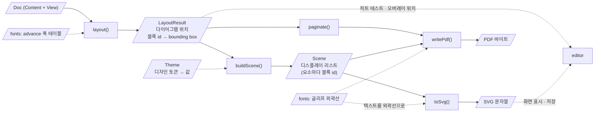

# 레이아웃 · 렌더링

문서 모델에서 각 블록의 위치와 크기(bounding box)를 계산하고, 그 결과를 SVG로 렌더링하는 방법을 정의합니다. 모습의 값(색, 선 굵기, 글자 크기, 여백과 치수)은 디자인 토큰으로 [[04-visual-design]]에만 있고, 이 문서는 그 토큰을 쓰는 방법을 정합니다.

코드: `src/packages/core`, 글꼴은 `src/packages/fonts` (→ [[0036-code-layout|ADR-0036]])

## 관련 요구사항

- [[01-requirements#3.3 레이아웃 · 렌더링]] ([[01-requirements#^r-lay|R-LAY-01]] 여러 줄 텍스트, [[01-requirements#^r-lay|R-LAY-05]] → [[04-visual-design]]), 구문 강조 [[01-requirements#^r-lay|R-LAY-06]] · [[01-requirements#^r-lay|R-LAY-07]] → 3.1
- 내보내기: [[01-requirements#^r-exp|R-EXP-01]] (`P0`), [[01-requirements#^r-exp|R-EXP-03]], [[01-requirements#^r-exp|R-EXP-02]]
- [[01-requirements#^r-fmt|R-FMT-07]], [[01-requirements#^r-fmt|R-FMT-10]], [[01-requirements#^r-fmt|R-FMT-03]]
- [[01-requirements#^r-nfr|R-NFR-03]], [[01-requirements#^r-nfr|R-NFR-02]]

## 렌더링 파이프라인

> [!note] 범례 (UML 액티비티 다이어그램에 가까운 flowchart)
> - 사각형 = 처리 단계(`core`의 순수 함수), 평행사변형 = 데이터(단계의 입력 · 출력 객체).
> - **실선 화살표**: 주 데이터 흐름(앞 단계의 출력이 다음 단계의 입력).
> - **점선 화살표**: 보조 입력(메트릭, 테마, 글리프 외곽선), 또는 `editor`가 결과를 소비하는 곳.
> - 아래 줄(`paginate` → `writePdf`)은 PDF 내보내기의 경로입니다(5장). 인쇄는 `paginate`의 페이지에 SVG 문자열을 넣습니다.
> - 함수 이름(`layout`, `buildScene`, `toSvg`)은 단계를 가리키려고 붙인 가칭입니다. 시그니처는 정하지 않았습니다.

- 세 단계는 모두 순수 함수입니다. 같은 입력이면 같은 출력이 나옵니다(결정적 출력 → [[01-requirements#^r-fmt|R-FMT-03]]).
- 색과 모양의 판단은 모두 씬 빌드(`buildScene`)에서 합니다. SVG 출력(`toSvg`)은 씬을 문자열로 옮길 뿐입니다. 그래서 출력 단계만 교체할 수 있습니다(렌더링 백엔드 → [[0030-swappable-drawing|ADR-0030]]).
- `editor`는 히트 테스트와 선택 오버레이의 위치를 SVG DOM이 아니라 `LayoutResult`로 계산합니다 → [[03-architecture#3.3 의존 규칙]]
- 같은 장면(`Scene`)이 출력 셋으로 갑니다: 화면과 저장 파일의 SVG(`toSvg`), 텍스트를 외곽선으로 바꾼 SVG(`toSvg(scene, { outlines })`, 3장), PDF(`writePdf`, 5장). 장면을 두 번 만들지 않으므로 셋의 모습이 같습니다 → [[0045-export-pipeline|ADR-0045]]

## 1. 레이아웃 알고리즘

관련 요구사항: [[01-requirements#^r-lay|R-LAY-01]], [[01-requirements#^r-lay|R-LAY-02]], [[01-requirements#^r-edit|R-EDIT-18]]

이 장의 값은 모두 [[04-visual-design#5. 기하와 해부도]]의 토큰입니다.

### 1.1 두 단계

레이아웃은 트리를 두 번 지나갑니다 → [[0037-two-pass-full-layout|ADR-0037]]

| 단계 | 방향 | 하는 일 | 결과 |
| --- | --- | --- | --- |
| 크기 측정 (`measure`) | 안쪽부터 (상향식) | 블록마다 내용이 들어가는 **가장 작은** 폭과 높이를 측정한다 | 블록 id → 최소 크기 |
| 배치 (`place`) | 바깥부터 (하향식) | 부모가 정한 자리(x, y)와 **실제** 폭 · 높이를 자식에게 나눠 준다 | 블록 id → bounding box |

- 크기 측정은 자식의 최소 크기만 보고 부모의 최소 크기를 정합니다. 배치는 부모가 받은 폭을 자식에게 나눕니다. 그래서 어느 분기가 깊어져도 전체가 직사각형으로 남습니다([[01-requirements#^r-lay|R-LAY-02]]).
- 모든 좌표와 크기는 **정수 px**입니다. 나누어 떨어지지 않는 폭은 반올림하고, 마지막 자식이 나머지를 받습니다. 그래서 같은 모델이면 같은 좌표가 나옵니다([[01-requirements#^r-fmt|R-FMT-03]]).
- 접힌 것, 펴 보인 호출 블록, 이름 띠를 보이는지는 뷰 상태([[01-model#2. 뷰 상태]])에서 읽습니다. 뷰 상태가 가리키는 id가 없으면 무시합니다.

`LayoutResult`에 담는 것:

- 다이어그램마다의 자리와 그림 전체의 폭 · 높이
- 블록 id → bounding box. 접힌 분기 안의 블록은 그 접힌 줄의 상자를 받습니다(선택하면 분기 전체가 선택되므로)
- **클릭 영역**: 상자와 따로, 그 블록을 누르는 곳. 제어 블록은 조건 칸만, 펴진 접기 영역과 펴 보인 호출 블록은 띠만, 분기 라벨은 그 칸의 이름 줄. `editor`가 클릭과 호버를 이것으로 구분합니다

### 1.2 텍스트의 크기

- 텍스트는 줄 바꿈 문자(`\n`)에서만 줄을 나눕니다. 폭은 가장 긴 줄의 폭, 높이는 줄 수 × `space.line`입니다.
- 줄의 폭은 번들 글꼴의 폭 표로 계산하고 정수 px로 올립니다(2장 → [[0026-bundled-font-metrics|ADR-0026]]). 굵은 텍스트(호출 블록의 Method 이름)의 폭을 어떻게 계산할지는 정하지 않았습니다(→ 미결정 사항).
- 빈 텍스트도 한 줄로 계산합니다. 빈 블록이 납작해지지 않습니다.

- **긴 줄은 자동으로 바꾸지 않습니다.** 사용자가 적은 줄 그대로 그리고, 줄이 길면 블록이 그만큼 넓어집니다. 가장 넓은 폭도, 말줄임(`…`)도 없습니다. 줄은 사용자가 텍스트를 편집하는 중에 `Shift`+`Enter`로 바꿉니다 → [[ux-decisions#LT1. 긴 글자|LT1]]

### 1.3 줄 (`Seq`)

줄의 블록은 위에서 아래로 **틈 없이** 맞붙습니다(NS 차트의 표기).

- 크기 측정: 폭은 블록들의 최소 폭 가운데 가장 큰 것, 높이는 블록들의 최소 높이의 합입니다.
- 배치: 모든 블록이 줄의 폭 전체를 받습니다. 높이는 각자의 최소 높이이고, **줄이 받은 높이가 더 크면 남는 높이를 블록 수로 똑같이 나눠 블록마다 더합니다**(If의 짧은 분기가 긴 분기와 바닥을 맞추는 경우) → [[ux-decisions#SB1. 짧은 갈래|SB1]]
	- 나누어 떨어지지 않는 나머지는 마지막 블록이 받습니다(정수 px).
	- 블록의 텍스트는 늘어난 블록의 위쪽에 그대로 있습니다(`space.pad-y`).
	- 제어 블록이 더 받은 높이는 조건 칸이 아니라 안쪽 줄에 갑니다. If · Case는 분기마다 같은 높이를 더 받아 그 분기의 줄이 다시 나누고, 반복은 본문의 줄이 나눕니다. 펴진 접기 영역과 펴 보인 호출 블록도 안쪽 줄이 나눕니다.
- 테두리가 있는 것(펴진 접기 영역, 펴 보인 호출 블록)은 1.6에서 들여쓰기와 틈을 더합니다.

### 1.4 블록

텍스트의 폭 · 높이를 `tw` · `th`라고 씁니다.

| 블록 | 최소 폭 | 최소 높이 |
| --- | --- | --- |
| 처리 | max(`size.block-min-w`, `tw` + 2·`space.pad-x`) | `th` + 2·`space.pad-y` |
| 호출 | 결과 · 이름 · 인자 텍스트의 폭 + 2·`space.pad-x` + 2·`size.call-bar` | `space.line` + 2·`space.pad-y` (한 줄) |
| While · Do-While · For | max(`tw` + 2·`space.pad-x`, `size.loop-strip` + 본문의 폭) | 조건 칸(`th` + 2·`space.pad-y`) + 본문의 높이 |
| If | max(조건 칸의 폭, 참 분기의 폭 + 거짓 분기의 폭) | 조건 칸의 높이 + max(두 분기의 높이) |
| Case | max(조건 칸의 폭, 분기들의 폭의 합) | 조건 칸의 높이 + max(분기들의 높이) |

- **반복:** 본문은 `size.loop-strip`만큼 오른쪽에 놓입니다. While과 For는 조건 칸이 위, Do-While은 조건 칸이 아래입니다. For는 While과 크기 계산도 그림도 같습니다([[ux-decisions#FB1. For 블록의 모양|FB1]]).
- **If · Case의 분기 폭:** 배치에서 받은 폭이 분기들의 최소 폭의 합보다 크면, 남는 폭을 **최소 폭에 비례해** 나눠 줍니다. 마지막 분기가 나머지를 받습니다.
- **If의 조건 칸:** 높이는 조건 텍스트 + 2·`space.pad-y` + `size.if-label`(분기 라벨 줄)이고, 최소 폭은 `tw` + 2·`space.pad-x` + `size.if-head-extra`입니다. 참 · 거짓 분기마다 최소 폭은 Case처럼 max(그 분기 줄의 폭, 분기 라벨의 폭 + `size.label-room`)입니다. 라벨이 긴 분기도 라벨이 칸 안에 들어갑니다. 빗금의 꼭짓점은 참 분기와 거짓 분기의 경계 위에 있습니다. 조건 텍스트는 꼭짓점 위 가운데에 두되 블록 밖으로 나가지 않게 밉니다.
- **조건 텍스트와 빗금:** 조건 칸을 텍스트에 맞춰 넓히거나 높이지 않습니다. 조건이 길면 빗금이 텍스트에 닿을 수 있고, 그리는 단계에서 텍스트 뒤에 조건 칸 배경색의 테두리(`size.text-halo`)를 깔아 가립니다. 레이아웃의 계산에는 영향이 없습니다 → [[ux-decisions#BH1. If · Case 머리의 폭과 높이|BH1]], [[04-visual-design#5. 기하와 해부도|배치 규칙]]
- **Case의 조건 칸:** 높이는 조건 텍스트 + 2·`space.pad-y` + `size.case-label`이고, 최소 폭은 `tw` + 2·`space.pad-x` + `size.case-head-extra`입니다. 긴 빗금은 왼쪽 위에서 default 분기의 왼쪽 아래로, 짧은 빗금은 오른쪽 위에서 같은 점으로 갑니다. 분기 사이의 세로선은 긴 빗금에서 내려옵니다. 분기마다 최소 폭은 max(그 분기 줄의 폭, 분기 라벨의 폭 + `size.label-room`)입니다.
- **분기 라벨:** If는 "참"을 왼쪽 아래 구석에, "거짓"을 오른쪽 아래 구석에 둡니다. Case는 분기 라벨을 칸의 왼쪽에, default의 라벨만 오른쪽에 붙입니다([[ux-decisions#Q25. Case의 default 이름의 자리|Q25]]). 구석과의 거리는 `size.label-inset`(default도 같음)입니다. 사용자가 라벨을 적지 않은 분기는 그림의 고정 문구로 적습니다: If는 "참" · "거짓"(영어 `true` · `false`), Case의 default는 한국어 · 영어 모두 `default`입니다.
- **이름 없는 호출 블록**(부르는 Method의 이름이 비어 있음)은 이름 자리에 고정 문구 "(이름 없음)"(영어 `(no name)`)을 적습니다.
- **분기 라벨의 클릭 영역**은 그 칸 위의 라벨 줄입니다. 높이는 If가 `size.if-label`(16px), Case가 `size.case-label`(28px)입니다(프로토타입은 둘 다 20px).
- **빈 분기:** If · Case의 분기에 빈 블록 하나만 있으면 그 블록 가운데에 `∅`를 그립니다. 크기 측정에는 영향이 없습니다(빈 블록의 크기 그대로) → [[ux-decisions#E1. 빈 갈래의 기호|E1]]
- **접힌 분기 · 접힌 본문:** "⋯ 블록 n개" 한 줄의 크기(텍스트 + 2·`space.pad-x`, 텍스트 + 2·`space.pad-y`)로 측정합니다. 배치에서는 그 분기(본문)의 자리를 다 채웁니다.

- **default가 없는 Case**(코드에서 가져온 것, `otherwise: null`)는 **빈 default 칸을 그려 둡니다.** 모델에는 분기가 없지만, 레이아웃은 default 칸이 빈 블록 하나인 것처럼 측정하고 놓으며 칸 가운데에 `∅`를 그립니다. 그래서 보통 Case와 모양이 같습니다. 이 칸은 `LayoutResult`에 "없는 default"로 표시해 `editor`가 구분할 수 있게 합니다 → [[ux-decisions#CD1. default가 없는 Case|CD1]]
- **default만 있는 Case**(분기 없음)는 default 칸이 블록 전체입니다. 긴 빗금은 길이가 없어 그리지 않고, **짧은 빗금 하나**(오른쪽 위에서 왼쪽 아래로)만 남습니다 → [[ux-decisions#CD2. default만 있는 Case|CD2]]

### 1.5 헤더

| 헤더 모양 | 높이 | 최소 폭 |
| --- | --- | --- |
| 모양 그대로 (`headStyle: 'shape'`) | `size.hat` + `th` + 2·`space.pad-y` | `tw` + 2·`space.pad-x` + `size.hat-room` |
| 제목처럼 (`headStyle: 'title'`) | `size.title-tag` + `space.line` + `size.title-gap` = 40px | 라벨과 이름 가운데 넓은 것. 텍스트는 다이어그램의 왼쪽 선에 맞추므로 `space.pad-x`를 더하지 않음 |

- 다이어그램의 폭은 max(본문의 폭, 헤더의 최소 폭, `size.diagram-min-w`)입니다. 헤더와 본문이 같은 폭을 받습니다.
- 헤더가 없는 다이어그램은 본문만 있습니다.
- Event의 모자는 왼쪽에 `size.hat-w` 폭으로, Method의 아치는 폭 전체에 걸쳐 솟습니다.

### 1.6 테두리가 있는 것

펴진 접기 영역(이름 띠를 보일 때)과 펴 보인 호출 블록은 둘레에 테두리를 두르고 맨 위에 띠(`size.band`)를 붙입니다.

| 무엇 | 최소 폭 | 최소 높이 | 안쪽 줄의 들여쓰기 |
| --- | --- | --- | --- |
| 펴진 접기 영역 | max(안쪽 줄의 폭, 띠 텍스트의 폭 + `size.band-text-x` + `space.pad-x`) | `size.band` + 안쪽 줄의 높이 | `size.nest-inset` |
| 펴 보인 호출 블록 | max(안쪽 줄의 폭, 띠 텍스트의 폭 + `size.band-text-x` + `space.pad-x`) | `size.band` + 안쪽 줄의 높이 | `size.peek-inset` |
| 접힌 접기 영역 | 이름의 폭 + 2·`space.pad-x` + `size.fold-icon-room` | 이름의 높이 + 2·`space.pad-y` + `size.fold-extra-h` | — |

- **들여쓰기는 테두리가 있는 자식에만** 줍니다. 안쪽 줄의 보통 블록은 테두리에 붙고(양옆과 아래로 들여 쓰지 않음), 테두리가 있는 자식만 양옆과 아래에서 들여쓰기만큼 들어갑니다. 그래서 테두리가 겹쳐도 상자가 따로 보입니다 → [[02-interaction-rules#접기 · 펼치기]]
- **이어진 테두리:** 한 줄에서 테두리가 있는 것 둘이 맞붙으면 그 사이를 띄워 `size.nest-gap`(1px)의 빈 줄이 보이게 합니다. 맞붙은 블록은 경계선 한 줄을 나눠 쓰므로, 높이에는 경계선 1px + 틈 1px = 2px을 더합니다.
- 이름 띠를 끄면 펴진 접기 영역은 테두리도 띠도 없이, 접기 영역이 없는 것과 똑같이 측정합니다.
- **펴 보인 호출 블록의 안쪽**은 호출하는 Method의 본문을 그 자리에서 다시 측정하고 놓은 것입니다(모델에는 사본이 없음 → [[01-model#1.6 펴 보인 곳의 접기 영역]]). 펴 보인 안쪽의 접힘은 Method에 저장된 접힘을 따르고, 이 자리의 접기 영역(`SiteFold`)은 그 자리에서 더합니다. 묶어 둔 블록이 없어졌으면 남은 블록으로 범위를 줄이고, 하나도 없으면 그리지 않습니다.

### 1.7 여러 다이어그램의 배치

규칙은 [[02-interaction-rules#5. 여러 다이어그램의 배치]]에 있습니다. 레이아웃은 그것을 이렇게 계산합니다.

1. 다이어그램을 두 그룹으로 나눕니다: **왼쪽 그룹**(Event와 헤더 없는 다이어그램), **오른쪽 그룹**(Method). 그룹 안의 순서는 문서의 순서입니다.
2. 그룹마다 다이어그램을 위에서 아래로 쌓고(사이 `space.diagram`), 다음 다이어그램이 **줄 높이**를 넘으면 오른쪽 새 줄로 넘깁니다. 한 줄의 폭은 그 줄의 가장 넓은 다이어그램이고, 줄 사이도 `space.diagram`입니다.
3. 왼쪽 그룹 오른쪽에 오른쪽 그룹을 놓습니다. 두 그룹 사이는 `space.kind-gap`(`space.diagram`의 두 배)만큼 띄웁니다. 구분선이나 텍스트는 넣지 않습니다 → [[ux-decisions#DA1. Event 무리와 Method 무리 사이|DA1]]. 한 그룹이 비어 있으면 띄우지 않습니다.
4. **줄 높이 선택:** 줄 높이의 후보는 "가장 높은 다이어그램의 높이"와 `size.column-min` 가운데 큰 것에서 시작해, 4px씩 올려 그룹 하나를 한 줄에 다 쌓는 높이까지입니다. 후보마다 그림 전체의 폭 · 높이를 계산해 가로 : 세로가 **16 : 10에 가장 가까운** 것을 선택합니다. 같으면 낮은 줄 높이를 선택합니다. 두 그룹은 같은 줄 높이를 씁니다.
5. 그림 둘레에 `space.paper`를 둡니다.

> [!info] 미완성: MVP 코드의 레이아웃은 헤더(1.5)와 여러 다이어그램의 배치(1.7)를 따르지만, 접기(1.6)는 아직 따르지 않습니다. 접기 영역은 이름 띠를 끈 것처럼, 접힌 것은 편 것처럼 그립니다. 접기는 MVP 뒤의 기능입니다([[dr-0015-mvp-scope|DR-0015]]).

### 1.8 지금 프로토타입과 다른 곳

프로토타입(66번째 버전)은 버리는 코드이고, 개발은 이 문서를 따릅니다.

- 텍스트 폭을 브라우저(`canvas.measureText`)로 측정합니다. 글꼴도 IBM Plex입니다(이 문서는 번들한 D2Coding의 폭 표).
- default가 없는 Case(CD1)와 default만 있는 Case(CD2)는 편집 명령으로 만들 수 없어(코드에서 가져올 때만 생김) 그리지 않습니다.
- 접기 영역의 이름을 보이는 실험용 모양 둘("왼쪽 여백에 이름", "구석에 이름")이 남아 있습니다. 정한 것은 이름 띠를 켜고 끄는 것뿐입니다.
- 펴 보기의 흰 배경과 흰 줄이 토큰이 아니라 코드에 적힌 값입니다.

## 2. 텍스트 폭 측정

정한 것: 글꼴을 번들하고, 그 글꼴 파일의 글리프 advance 폭 테이블로 `core`가 계산한다. 셸이 주입하지 않는다(브라우저의 텍스트 측정 API를 쓰지 않음). 커닝을 끄고 정수 px로 올림한다 → [[0026-bundled-font-metrics|ADR-0026]]

정한 것: 기본 블록 글꼴은 D2Coding 보통 하나이고, 한자를 뺀 문자를 싣는다 → [[0034-default-block-font|ADR-0034]]

### 2.1 advance 폭 테이블

D2Coding 1.4.0(unitsPerEm 1000)의 문자 폭은 **두 가지뿐**입니다: 반각 500(라틴 등, 13px에서 6.5px)과 전각 1000(한글 등, 13px에서 13px). 싣는 문자 12,824자 가운데 1,259자가 반각, 11,565자가 전각입니다.

- **싣는 문자**는 아래 유니코드 블록 17개 안에서 D2Coding에 글리프가 있는 것입니다(한자는 싣지 않음 → [[0034-default-block-font|ADR-0034]]): ASCII(U+0020–007E), Latin-1(U+00A0–00FF), 라틴 확장 A · B(U+0100–024F), 그리스(U+0370–03FF), 키릴(U+0400–04FF), 일반 구두점(U+2000–206F), 화살표(U+2190–21FF), 수학 연산자(U+2200–22FF), 상자 그리기(U+2500–257F), 도형(U+25A0–25FF), CJK 기호와 구두점(U+3000–303F), 히라가나(U+3040–309F), 가타카나(U+30A0–30FF), 한글 호환 자모(U+3130–318F), 한글 음절(U+AC00–D7A3), 반각 · 전각 형태(U+FF00–FFEF).
- 번들한 글꼴과 폭 테이블은 D2Coding 릴리스 파일(sha256으로 확인)에서 스크립트가 만들어 저장소에 넣어 둡니다(`src/packages/fonts/scripts/build-fonts.py`). 글꼴 파일 안의 이름은 `AriadneNSD Mono`입니다(D2Coding은 OFL의 예약 글꼴 이름 → [[04-visual-design#4.3 글꼴]]).

- 테이블은 "같은 폭이 이어지는 코드 포인트 구간"의 목록으로 적습니다: 기본 폭(전각 1000)과, 기본 폭이 아닌 구간들 `[시작, 끝, 폭]`. 구간은 50개이고 JSON으로 약 0.8 KB라 `core`에 그대로 싣습니다.
- **굵게(D2Coding Bold)의 폭은 보통과 모든 문자에서 같습니다.** 굵은 텍스트도 같은 테이블로 계산합니다.
- **테이블에 없는 문자는 전각(1000)으로 계산합니다**(→ [[0037-two-pass-full-layout|ADR-0037]]). 번들 글꼴에 없는 문자(한자, 이모지, 싣지 않은 문자)는 그리는 쪽이 다른 글꼴로 그리므로 폭을 알 수 없습니다. 넓게 계산하면 텍스트가 블록 밖으로 나가지 않고, 한자와 이모지는 대개 전각입니다. 반각 문자가 테이블에 없으면 블록이 조금 넓어질 뿐입니다.
- 줄의 폭은 문자 폭의 합을 픽셀로 바꾼 뒤 정수 px로 올립니다. 예: `n > 0`은 33px, `a[j] <= pivot && j < hi`는 150px, `i ← i + 1`은 59px.

### 2.2 서브셋 글꼴의 크기

저장 파일에는 문서에 쓰인 문자만 추린 서브셋을 포함합니다(커닝 · 합자 · 힌팅 없음). 이름 레코드(name 테이블)는 모두 남깁니다: 글꼴 이름(`AriadneNSD Mono`)과 저작권 · OFL 고지가 그림 안의 글꼴에도 따라가야 하기 때문입니다. 문서에 쓰인 서로 다른 문자 수에 따라:

| 문서 | 압축하지 않은 TTF | WOFF (저장 파일) | woff2 |
| --- | --- | --- | --- |
| 영어만 (ASCII 95자) | 9.6 KB | 6.9 KB | 5.2 KB |
| 한글 100자 + ASCII | 23 KB | 15 KB | 12 KB |
| 한글 300자 + ASCII | 51 KB | 29 KB | 23 KB |
| 한글 800자 + ASCII | 118 KB | 61 KB | 48 KB |
| (편집기에 싣는 글꼴 전체, 12,824자) | 1,335 KB | 532 KB | 327 KB (편집기에 싣는 형식) |

한글은 이 저장소의 `docs/`에서 자주 쓰는 순서로 선택했습니다. 자주 쓰는 음절은 자모 글리프를 함께 쓰는 복합 글리프라 작게 나옵니다. 같은 300자를 한글 음절 전체에서 고르게 흩어 고르면 TTF 81 KB, WOFF 44 KB로 커집니다(2026-11-01, `src/packages/fonts/node/subset.test.ts`). 측정한 스크립트: `journal/assets/2026-10-25-d2coding-metrics-spike.py`(결과 `…-spike.json`)

저장 파일에는 **WOFF**로 포함합니다. 압축은 버전을 고정한 JS zlib 라이브러리로 하고, 브라우저에 든 압축기는 쓰지 않습니다(브라우저마다 바이트가 달라질 수 있어 "같은 모델이면 같은 파일"([[01-requirements#^r-fmt|R-FMT-03]])을 지키지 못함) → [[0039-woff-subset-font|ADR-0039]]

## 3. SVG 렌더링

MVP 코드(2026-11-01)에서 정한 그림 부분의 형식입니다.

- **SVG 요소와 클래스:** 그림 요소는 `<g class="ans-render">` 하나이고, 전체를 반 픽셀 옮기며(`translate(.5 .5)` → [[04-visual-design#9.1 픽셀에 맞추기]]), `font-family`(번들 글꼴 다음에 폴백 목록)와 `font-kerning:none`을 그 요소에 적습니다. 안에는 `<rect>`(칸) · `<path>`(선, 빗금) · `<circle>`(`∅`) · `<text>`(굵은 부분과 구문 강조의 색은 `<tspan>` → 3.1)만 두고, 색은 클래스가 아니라 `fill` · `stroke` 값으로 적습니다(`src/packages/core/src/render/to-svg.ts`) → [[01-file-format#4. 그림 부분]]
- **디자인 토큰 맵:** `buildScene()`이 테마(토큰 이름 → 색 값, `src/packages/core/src/render/theme.ts`)를 받아 문서 레이어를 그립니다. 테마는 넷(`themes`: `default` · `dark` · `high-contrast` · `print`)이고, 저마다 종이의 종류(`kind`: `light` · `dark`)를 가집니다. `themeFor(id)`는 모르는 이름에 기본 테마를 줍니다. 오버레이 레이어는 `editor`가 테마의 종류에 맞는 편집 색으로 따로 덧그립니다(`src/packages/editor/src/dom/overlay.ts`, [[0044-document-themes|ADR-0044]]) → [[04-visual-design#2. 레이어와 출력]], [[04-visual-design#9. 렌더링 규칙|9. 렌더링 규칙]](픽셀 스냅)
- **고정 문구의 로캘:** `layout()`이 문서 설정의 그림 문구의 언어(`settings.locale`)를 읽어, 그림에 적는 고정 문구("참" · "거짓" 등)를 `core`의 메시지 카탈로그(`src/packages/core/src/i18n/messages.ts`)에서 고릅니다. 화면 언어는 받지 않습니다. 그래서 같은 문서는 화면 언어와 상관없이 같은 그림이 됩니다 → [[01-requirements#^r-nfr|R-NFR-04]], [[0041-drawing-locale-in-document|ADR-0041]]

- **텍스트를 외곽선으로**([[01-requirements#^r-fmt|R-FMT-10]], 문서 설정 `textOutlines`): `toSvg`가 텍스트 요소를 번들 글꼴의 글리프 외곽선으로 적습니다(`src/packages/core/src/render/outline-text.ts`). 글리프는 advance 폭대로 나란히 놓습니다(커닝 · 셰이핑 없음, 2.1과 같은 폭). 한 요소가 `<path>`가 되고(`Q` 곡선, 좌표는 소수 둘째 자리), 테두리(`halo`, UX BH1)는 그 아래에 같은 모양을 획으로 먼저 그립니다. 굵은 글자는 같은 모양에 글자색 획을 더합니다(브라우저의 합성 굵게와 같은 두께: 크기의 1/24(9px 이하) ~ 1/32(36px 이상)). 번들 글꼴에 없는 문자가 든 요소는 텍스트로 남고, 서브셋 글꼴에는 그런 요소의 문자만 넣습니다. 글리프 외곽선은 `fonts`의 `readGlyphOutlines`가 번들 TTF의 `glyf` · `cmap` · `hmtx`에서 읽습니다 → [[01-file-format#4.3 텍스트 외곽선]]
- **PNG**는 웹 셸이 저장 파일의 SVG를 캔버스에 그려 만듭니다 → [[06-web#1.2 PNG 내보내기]]. **PDF**는 같은 장면을 5장의 페이지로 나눠 씁니다.

### 3.1 구문 강조

블록 텍스트를 문서 설정의 블록 텍스트의 언어(`settings.textKind` → [[01-requirements#^r-lay|R-LAY-06]])로 칠합니다([[01-requirements#^r-lay|R-LAY-07]]). 화면과 저장 파일 · PNG가 같은 색입니다([[0018-save-as-shown|ADR-0018]]).

- **어디서:** `buildScene()`이 `settings.textKind`를 받아 칠합니다(`src/packages/core/src/render/build-scene.ts`). 레이아웃은 언어를 읽지 않습니다. 언어와 상관없이 글꼴과 굵기가 같아 폭이 같으므로, 언어를 바꾸면 색만 바뀝니다 → [[0042-text-kind-keeps-block-font|ADR-0042]]
- **무엇을:** 처리 블록의 텍스트와 반복 · If · Case의 조건 칸입니다. 헤더의 이름, 분기 라벨, 호출 블록은 칠하지 않습니다 → [[ux-decisions#SY1. 칠하는 텍스트|SY1]]
- **렉서:** 언어마다 하나이고(`src/packages/core/src/text/syntax.ts` → [[0032-token-highlighting|ADR-0032]]), 텍스트를 키워드 · 문자열 · 숫자 · 주석 · 그 밖으로 가릅니다. 블록 하나의 텍스트 전체를 한 번에 가른 뒤 줄로 나누므로, 블록 주석은 여러 줄에 걸쳐 칠해집니다. 블록 사이로는 이어지지 않습니다.
- **SVG:** 색이 있는 토큰은 `<text>` 안의 `<tspan fill="…">`입니다. 그 밖의 토큰은 `<text>`의 `fill`(`text.primary`)을 따릅니다. 색은 테마의 `syntax.keyword`(키워드) · `syntax.comment`(주석) · `syntax.literal`(문자열과 숫자) 토큰입니다 → [[04-visual-design#3.3 밝은 기본 테마]]

언어마다의 규칙입니다. 블록의 텍스트는 문법상 완전하지 않은 조각이라 렉서는 실패하지 않습니다.

| 언어 (`textKind`) | 주석 | 문자열 | 그 밖 |
| --- | --- | --- | --- |
| 일반 텍스트 (`plain`) | 칠하지 않음 | 칠하지 않음 | 칠하지 않음 |
| C (`c`) | `//` · `/* */` | `"…"` · `'…'` | 줄 처음의 `#include` 같은 지시문은 키워드. C23의 키워드까지 |
| C++ (`cpp`) | `//` · `/* */` | `"…"` · `'…'` | 지시문은 키워드. 숫자 안의 `'`(`1'000`)는 숫자의 일부 |
| Java (`java`) | `//` · `/* */` | `"…"` · `'…'` · `"""…"""`(여러 줄) | `$`는 이름의 일부 |
| JavaScript · TypeScript (`javascript`) | `//` · `/* */` | `"…"` · `'…'` · `` `…` ``(여러 줄) | TypeScript의 키워드(`interface` · `type` 등)도 키워드. 타입 이름(`number` · `string`)은 변수 이름으로도 흔해 칠하지 않음 |
| Python (`python`) | `#` | `"…"` · `'…'` · `"""…"""` · `'''…'''`(여러 줄). 접두사(`f"…"` · `rb'…'`)까지 한 문자열 | `//`는 나눗셈이라 주석이 아님 |
| Bash (`bash`) | 낱말 처음의 `#`만(`${#a}` · `a#b`는 주석이 아님) | `"…"` · `'…'`(둘 다 여러 줄. `'…'` 안의 백슬래시는 이스케이프가 아님) | 예약어와 그처럼 쓰는 내장 명령(`local` · `export` · `return` 등). `$`는 이름의 일부 |

- 닫지 않은 문자열은 그 줄의 끝까지(여러 줄 문자열은 텍스트의 끝까지), 닫지 않은 블록 주석은 텍스트의 끝까지입니다.
- 숫자는 낱말의 처음에서만 셉니다(`x1`의 `1`은 이름). `0x1F` · `1.5e-3f` · `.5`처럼 접두사 · 지수 · 접미사까지 한 숫자이고, 범위 `1..10`의 점은 숫자가 아닙니다.
- 이름은 모든 문자(한글 포함)로 이루어질 수 있고, 키워드와 글자가 같을 때만 키워드입니다(`합계if`는 이름).

## 4. 성능

목표: 블록 500개 문서에서 편집 한 번이 100ms 안에 화면에 반영된다([[03-quality-attribute-scenarios#QA-07 편집 반응 시간|QA-07]]).

정한 것: **편집할 때마다 문서 전체를 처음부터 다시 계산합니다**(→ [[0037-two-pass-full-layout|ADR-0037]]). 바뀐 하위 트리만 다시 계산하는 증분 레이아웃(메모이제이션)은 하지 않습니다. 측정해 보니 레이아웃과 SVG 만들기는 1ms 안팎이고, 시간의 대부분은 만든 SVG를 화면에 넣는 단계였습니다. 빨라져야 하면 줄일 곳은 레이아웃이 아니라 화면 갱신(바뀐 요소만 바꾸기)입니다.

| 블록 수 | 레이아웃 | 장면 + SVG 문자열 | 화면에 반영 | 합계 | 합계 (느린 5%) |
| --- | --- | --- | --- | --- | --- |
| 500 | 0.2 ~ 0.3 ms | 0.2 ~ 0.4 ms | 8 ~ 10 ms | 9 ~ 11 ms | 16 ~ 29 ms |
| 1,000 | 0.4 ms | 0.6 ms | 19 ~ 20 ms | 21 ms | 33 ~ 58 ms |
| 2,000 | 0.7 ms | 1.2 ~ 1.3 ms | 37 ~ 45 ms | 39 ~ 47 ms | 63 ~ 137 ms |

- 측정한 곳: 메인테이너의 컴퓨터, Microsoft Edge 156(Chromium) / Windows, 세 번 측정한 값의 범위. 스파이크 M39(https://claude.ai/artifact/SRbqzTEA12ZVKc61YcKCXd, 사본 `journal/assets/2026-10-25-layout-perf-spike.html`, 결과 `…-results.txt`)
- 스파이크는 이 문서의 두 단계(1.1)와 분기 폭 · 짧은 분기의 규칙을 그대로 실행했습니다. 접기 영역의 테두리, 펴 보기, 구문 강조, 클릭 영역은 넣지 않았습니다.
- 기준 기기(4년 된 보급형 노트북)에서는 아직 측정하지 않았습니다. 그래도 500개에서 느린 5%가 목표의 3분의 1 아래라 여유가 있습니다.
- 펴 보인 호출 블록 때문에 그려지는 블록이 2,000개가 되어도 중앙값은 50ms 아래였습니다 → [[03-architecture#7. 위험과 검증이 필요한 사항]]
- 제품 코드의 벤치마크는 `src/packages/core/src/render/render.bench.ts`이고 `pnpm --filter @ariadne-nsd/core exec vitest bench --run`으로 돌립니다 → [[07-testing#5. 도구와 CI]]

## 5. 인쇄와 PDF의 페이지

PDF와 인쇄([[01-requirements#^r-exp|R-EXP-03]])는 같은 페이지 나누기를 씁니다(`src/packages/core/src/export/paginate.ts`). 정한 과정 → [[ux-decisions#PD2. 종이와 방향은 묻지 않는다|PD2]], [[ux-decisions#PD3. 줄이지 않고 블록 사이에서 자른다|PD3]]

- **크기:** 그림을 줄이지 않습니다. 1px = 0.75pt(CSS 기준 픽셀, 96dpi)라서 가장 가는 선 0.75pt, 가장 작은 텍스트 9pt가 지켜집니다 → [[04-visual-design#9.2 배율과 출력]]
- **종이와 여백:** A4(595.28 × 841.89pt) 또는 Letter(612 × 792pt). 여백은 네 쪽 모두 36pt(12.7mm)이고, 그 안이 그림의 자리입니다(A4 세로: 698 × 1026px).
- **방향:** 세로와 가로로 각각 나눠 보고 페이지가 적은 쪽을 씁니다. 같으면 세로입니다. 한 문서의 페이지는 모두 같은 방향입니다.
- **자르는 곳:** 자르면 안 되는 상자는 텍스트가 든 칸입니다: 처리 · 호출 블록, 제어 블록의 헤더(If · Case의 갈래 이름 줄 포함), 다이어그램의 헤더, Case의 빈 default 칸. 제어 블록의 옆 벽은 잘려도 됩니다. 한 페이지가 들일 수 있는 데까지에서 **어느 칸도 가로지르지 않는 가장 먼 칸의 경계**에서 자릅니다. 그런 경계가 페이지의 4분의 1보다 앞에만 있으면(칸 하나가 페이지보다 큼) 페이지 끝에서 그대로 자릅니다.
- **넓은 그림:** 그림의 폭이 한 페이지를 넘으면 같은 규칙으로 세로 줄(열)로 먼저 나누고, 열마다 위의 규칙으로 페이지를 나눕니다. 페이지의 차례는 첫 열을 위에서 아래로, 그다음 열입니다(스프레드시트의 "아래로, 그다음 옆으로"). 종이만 있는 페이지(그 열의 그 높이에 칸이 없음)는 뺍니다.
- **자른 곳의 선:** 페이지는 오른쪽 · 아래로 1px을 더 보여, 자른 곳의 선이 두 페이지 모두에 보입니다.
- **쪽 번호:** 페이지가 둘 이상이면 아래 여백 가운데에 "n / N"을 9pt, `text.muted` 색으로 적습니다. 하나면 적지 않습니다.
- **PDF의 그리기**(`src/packages/core/src/export/pdf.ts`): PDF 1.4, 페이지마다 그 부분만 잘라(clip) 장면의 요소 가운데 그 페이지에 걸치는 것만 씁니다. 텍스트는 글리프 외곽선이고, 글리프마다 한 번 폼 XObject로 두고 쓰는 곳에서 부릅니다(채움 · 테두리용 획 · 합성 굵게를 따로). 번들 글꼴에 없는 문자는 빈 상자(전각 폭)입니다. 스트림은 저장 파일의 WOFF와 같은 zlib 설정으로 압축합니다. 날짜를 넣지 않아 같은 그림이면 같은 바이트입니다. 제목(`/Title`)은 문서 이름입니다.

## 미결정 사항

- [ ] 굵은 텍스트: 기본 블록 글꼴은 D2Coding 보통 하나입니다. 굵게 쓰는 곳(호출 블록의 Method 이름, 접기 영역의 이름 띠, "제목처럼" 헤더의 이름)은 MVP 뒤로 미뤘으므로([[0034-default-block-font|ADR-0034]]), 그것들을 넣을 때 굵은 글꼴을 더 실을지, 그리는 쪽이 굵게 만든 텍스트(합성 굵게)로 그릴지 정합니다. D2Coding Bold의 폭은 보통과 같습니다(2.1) → 1.2
