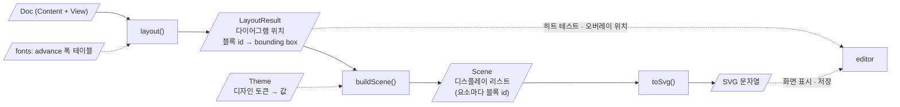

# 레이아웃 · 렌더링 (`packages/core`)

문서 모델에서 각 블록의 위치와 크기(bounding box)를 계산하고, 그 결과를 SVG로 렌더링하는 방법을 정의합니다. 모습의 값(색, 선 굵기, 글자 크기, 여백과 치수)은 디자인 토큰으로 [[04-visual-design]]에만 있고, 이 문서는 그 토큰을 쓰는 방법을 정합니다.

## 관련 요구사항

- [[01-requirements#3.3 레이아웃 · 렌더링]] ([[01-requirements#^lay-autosize]] 여러 줄 글자, [[01-requirements#^lay-default-style]] → [[04-visual-design]])
- 내보내기: [[01-requirements#^exp-png]] (#P0), [[01-requirements#^exp-pdf]], [[01-requirements#^exp-plain-svg]]
- [[01-requirements#^fmt-text]], [[01-requirements#^fmt-outline]], [[01-requirements#^fmt-deterministic]]
- [[01-requirements#^nfr-perf]], [[01-requirements#^nfr-compat]]

## 렌더링 파이프라인

> [!note] 범례 (UML 액티비티 다이어그램에 가까운 flowchart)
> - 사각형 = 처리 단계(`core`의 순수 함수), 평행사변형 = 데이터(단계의 입력 · 출력 객체).
> - **실선 화살표**: 주 데이터 흐름(앞 단계의 출력이 다음 단계의 입력).
> - **점선 화살표**: 보조 입력(메트릭, 테마), 또는 `editor`가 결과를 소비하는 곳.
> - 함수 이름(`layout`, `buildScene`, `toSvg`)은 단계를 가리키려고 붙인 가칭입니다. 시그니처는 정하지 않았습니다.

- 세 단계는 모두 순수 함수입니다. 같은 입력이면 같은 출력이 나옵니다(결정적 출력 → [[01-requirements#^fmt-deterministic]]).
- 색과 모양의 판단은 모두 씬 빌드(`buildScene`)에서 합니다. SVG 출력(`toSvg`)은 씬을 문자열로 옮길 뿐입니다. 그래서 출력 단계만 교체할 수 있습니다(렌더링 백엔드 → [[0030-swappable-drawing|ADR-0030]]).
- `editor`는 히트 테스트와 선택 오버레이의 위치를 SVG DOM이 아니라 `LayoutResult`로 계산합니다 → [[03-architecture#3.3 의존 규칙]]

## 1. 레이아웃 알고리즘

> [!info] 미완성: 크기 계산과 배치
> - 2패스 방식(상향식으로 최소 크기 계산 → 하향식으로 너비 분배) 검토
> - 갈래 너비 분배 규칙
> - 블록별 도형 규격과 여백 · 최소 크기 상수 → [[04-visual-design#5. 기하와 해부도]]의 `size.*` · `space.*` 토큰을 쓴다
> - 여러 줄 글자의 줄 바꿈(line breaking)과 높이 ([[01-requirements#^lay-autosize]])
> - 여러 다이어그램의 배치 → [[02-interaction-rules#5. 여러 다이어그램의 배치]]
> - 펴 보인 호출 블록을 그 자리에 다시 배치(인라인 전개)하는 비용 → [[03-architecture#7. 위험과 검증이 필요한 사항]]

## 2. 텍스트 폭 측정

정한 것: 글꼴을 번들하고, 그 글꼴 파일의 글리프 advance 폭 테이블로 `core`가 계산한다. 셸이 주입하지 않는다(브라우저의 텍스트 측정 API를 쓰지 않음). 커닝을 끄고 정수 px로 올림한다 → [[0026-bundled-font-metrics|ADR-0026]]

> [!info] 미완성: advance 폭 테이블과 서브셋 글꼴
> - advance 폭 테이블의 형식과 크기, 번들 글꼴에 없는 글리프(fallback)의 폭
> - 저장 파일에 넣을 서브셋 글꼴을 만드는 방법(서브세팅)과 크기 → [[03-architecture#7. 위험과 검증이 필요한 사항]], [[01-file-format#2. 문서 구조]]

## 3. SVG 렌더링

> [!info] 미완성: 그림 부분의 형식
> - SVG 요소 구성과 클래스 이름 → [[01-file-format#4. 그림 부분]]에 반영
> - 디자인 토큰 맵을 렌더러에 넘기는 방식. 문서 레이어는 테마, 오버레이 레이어는 `editor`가 화면 색으로 덧그림 → [[04-visual-design#2. 층과 출력]], [[04-visual-design#9. 렌더링 규칙|9. 렌더링 규칙]](픽셀 스냅)
> - 구문 강조: 블록 글자의 종류마다 토크나이저 → [[03-architecture#5. 공통 관심사]]
> - 그림에 적는 고정 문구("참" · "거짓" 등)의 로캘 → [[01-requirements#^nfr-i18n]]
> - 텍스트를 외곽선 path로 변환하는 옵션 ([[01-requirements#^fmt-outline]])
> - PNG · PDF 내보내기: 같은 SVG를 래스터화 · 인쇄용으로 변환하는 경로와 배율 ([[01-requirements#^exp-png]]는 #P0)

## 4. 성능

> [!info] 미완성: 블록 500개에서 100ms 이내
> - 변경된 하위 트리만 다시 계산할지(증분 레이아웃, 구조적 공유를 이용한 메모이제이션), 전체 재계산으로 충분한지 측정

## 미결정 사항

- [ ]
