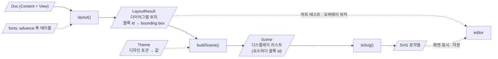

# 레이아웃 · 렌더링

문서 모델에서 각 블록의 위치와 크기(bounding box)를 계산하고, 그 결과를 SVG로 렌더링하는 방법을 정의합니다. 모습의 값(색, 선 굵기, 글자 크기, 여백과 치수)은 디자인 토큰으로 [[04-visual-design]]에만 있고, 이 문서는 그 토큰을 쓰는 방법을 정합니다.

코드: `src/packages/core`, 글꼴은 `src/packages/fonts` (→ [[0036-code-layout|ADR-0036]])

## 관련 요구사항

- [[01-requirements#3.3 레이아웃 · 렌더링]] ([[01-requirements#^lay-autosize]] 여러 줄 글자, [[01-requirements#^lay-default-style]] → [[04-visual-design]])
- 내보내기: [[01-requirements#^exp-png]] (`P0`), [[01-requirements#^exp-pdf]], [[01-requirements#^exp-plain-svg]]
- [[01-requirements#^fmt-text]], [[01-requirements#^fmt-outline]], [[01-requirements#^fmt-deterministic]]
- [[01-requirements#^nfr-perf]], [[01-requirements#^nfr-compat]]

## 렌더링 파이프라인

> [!note] 범례 (UML 액티비티 다이어그램에 가까운 flowchart)
> - 사각형 = 처리 단계(`core`의 순수 함수), 평행사변형 = 데이터(단계의 입력 · 출력 객체).
> - **실선 화살표**: 주 데이터 흐름(앞 단계의 출력이 다음 단계의 입력).
> - **점선 화살표**: 보조 입력(메트릭, 테마), 또는 `editor`가 결과를 소비하는 곳.
> - 함수 이름(`layout`, `buildScene`, `toSvg`)은 단계를 가리키려고 붙인 가칭입니다. 시그니처는 정하지 않았습니다.

- 세 단계는 모두 순수 함수입니다. 같은 입력이면 같은 출력이 나옵니다(결정적 출력 → [[01-requirements#^fmt-deterministic]]).
- 색과 모양의 판단은 모두 씬 빌드(`buildScene`)에서 합니다. SVG 출력(`toSvg`)은 씬을 문자열로 옮길 뿐입니다. 그래서 출력 단계만 교체할 수 있습니다(렌더링 백엔드 → [[0030-swappable-drawing|ADR-0030]]).
- `editor`는 히트 테스트와 선택 오버레이의 위치를 SVG DOM이 아니라 `LayoutResult`로 계산합니다 → [[03-architecture#3.3 의존 규칙]]

## 1. 레이아웃 알고리즘

관련 요구사항: [[01-requirements#^lay-autosize]], [[01-requirements#^lay-branch-width]], [[01-requirements#^edit-multi-diagram]]

이 장의 값은 모두 [[04-visual-design#5. 기하와 해부도]]의 토큰입니다.

### 1.1 두 단계

레이아웃은 트리를 두 번 지나갑니다.

| 단계 | 방향 | 하는 일 | 결과 |
| --- | --- | --- | --- |
| 크기 재기 (`measure`) | 안쪽부터 (상향식) | 블록마다 내용이 들어가는 **가장 작은** 폭과 높이를 잰다 | 블록 id → 최소 크기 |
| 자리 잡기 (`place`) | 바깥부터 (하향식) | 부모가 정한 자리(x, y)와 **실제** 폭 · 높이를 자식에게 나눠 준다 | 블록 id → bounding box |

- 크기 재기는 자식의 최소 크기만 보고 부모의 최소 크기를 정합니다. 자리 잡기는 부모가 받은 폭을 자식에게 나눕니다. 그래서 어느 갈래가 깊어져도 전체가 직사각형으로 남습니다([[01-requirements#^lay-branch-width]]).
- 모든 좌표와 크기는 **정수 px**입니다. 나누어 떨어지지 않는 폭은 반올림하고, 마지막 자식이 나머지를 받습니다. 그래서 같은 모델이면 같은 좌표가 나옵니다([[01-requirements#^fmt-deterministic]]).
- 접힌 것, 펴 보인 호출 블록, 이름 띠를 보이는지는 뷰 상태([[01-model#2. 뷰 상태]])에서 읽습니다. 뷰 상태가 가리키는 id가 없으면 무시합니다.

`LayoutResult`에 담는 것:

- 다이어그램마다의 자리와 그림 전체의 폭 · 높이
- 블록 id → bounding box. 접힌 갈래 안의 블록은 그 접힌 줄의 상자를 받습니다(고르면 갈래 전체가 골라지므로)
- **누르는 자리**: 상자와 따로, 그 블록을 누르는 곳. 제어 블록은 머리만, 펴진 접기 영역과 펴 보인 호출 블록은 띠만, 갈래 이름은 그 칸의 이름 줄. `editor`가 클릭과 마우스 올림을 이것으로 가립니다

### 1.2 글자의 크기

- 글자는 줄 바꿈 문자(`\n`)에서만 줄을 나눕니다. 폭은 가장 긴 줄의 폭, 높이는 줄 수 × `space.line`입니다.
- 줄의 폭은 번들 글꼴의 폭 표로 셈하고 정수 px로 올립니다(2장 → [[0026-bundled-font-metrics|ADR-0026]]). 굵은 글자(호출 블록의 Method 이름)의 폭을 어떻게 셀지는 정하지 않았습니다(→ 미결정 사항).
- 빈 글자도 한 줄로 셉니다. 빈 블록이 납작해지지 않습니다.

- **긴 줄은 저절로 바꾸지 않습니다.** 사용자가 적은 줄 그대로 그리고, 줄이 길면 블록이 그만큼 넓어집니다. 가장 넓은 폭도, 말줄임(`…`)도 없습니다. 줄은 사용자가 글자를 고치는 중에 `Shift`+`Enter`로 바꿉니다 → [[ux-decisions#LT1. 긴 글자|LT1]]

### 1.3 줄 (`Seq`)

줄의 블록은 위에서 아래로 **틈 없이** 맞붙습니다(NS 차트의 표기).

- 크기 재기: 폭은 블록들의 최소 폭 가운데 가장 큰 것, 높이는 블록들의 최소 높이의 합입니다.
- 자리 잡기: 모든 블록이 줄의 폭 전체를 받습니다. 높이는 각자의 최소 높이이고, **줄이 받은 높이가 더 크면 남는 높이를 블록 수로 똑같이 나눠 블록마다 더합니다**(If의 짧은 갈래가 긴 갈래와 바닥을 맞추는 경우) → [[ux-decisions#SB1. 짧은 갈래|SB1]]
	- 나누어 떨어지지 않는 나머지는 마지막 블록이 받습니다(정수 px).
	- 블록의 글자는 늘어난 블록의 위쪽에 그대로 있습니다(`space.pad-y`).
	- 제어 블록이 더 받은 높이는 머리가 아니라 안쪽 줄에 갑니다. If · Case는 갈래마다 같은 높이를 더 받아 그 갈래의 줄이 다시 나누고, 반복은 본문의 줄이 나눕니다. 펴진 접기 영역과 펴 보인 호출 블록도 안쪽 줄이 나눕니다.
- 테두리가 있는 것(펴진 접기 영역, 펴 보인 호출 블록)은 1.6에서 들임과 틈을 더합니다.

### 1.4 블록

글자의 폭 · 높이를 `tw` · `th`라고 씁니다.

| 블록 | 최소 폭 | 최소 높이 |
| --- | --- | --- |
| 처리 | max(`size.block-min-w`, `tw` + 2·`space.pad-x`) | `th` + 2·`space.pad-y` |
| 호출 | 결과 · 이름 · 인자 글자의 폭 + 2·`space.pad-x` + 2·`size.call-bar` | `space.line` + 2·`space.pad-y` (한 줄) |
| While · Do-While · For | max(`tw` + 2·`space.pad-x`, `size.loop-strip` + 본문의 폭) | 머리(`th` + 2·`space.pad-y`) + 본문의 높이 |
| If | max(머리의 폭, 참 갈래의 폭 + 거짓 갈래의 폭) | 머리의 높이 + max(두 갈래의 높이) |
| Case | max(머리의 폭, 갈래들의 폭의 합) | 머리의 높이 + max(갈래들의 높이) |

- **반복:** 본문은 `size.loop-strip`만큼 오른쪽에 놓입니다. While과 For는 머리가 위, Do-While은 머리가 아래입니다. For는 While과 크기 셈도 그림도 같습니다([[ux-decisions#FB1. For 블록의 모양|FB1]]).
- **If · Case의 갈래 폭:** 자리 잡기에서 받은 폭이 갈래들의 최소 폭의 합보다 크면, 남는 폭을 **최소 폭에 비례해** 나눠 줍니다. 마지막 갈래가 나머지를 받습니다.
- **If의 머리:** 높이는 조건 글자 + 2·`space.pad-y` + `size.if-label`(갈래 이름 줄)이고, 최소 폭은 `tw` + 2·`space.pad-x` + `size.if-head-extra`입니다. 빗금의 꼭짓점은 참 갈래와 거짓 갈래의 경계 위에 있습니다. 조건 글자는 꼭짓점 위 가운데에 두되 블록 밖으로 나가지 않게 밉니다.
- **조건 글자와 빗금:** 머리를 글자에 맞춰 넓히거나 높이지 않습니다. 조건이 길면 빗금이 글자에 닿을 수 있고, 그리는 단계에서 글자 뒤에 머리 바탕색의 테두리(`size.text-halo`)를 깔아 가립니다. 레이아웃의 셈에는 영향이 없습니다 → [[ux-decisions#BH1. If · Case 머리의 폭과 높이|BH1]], [[04-visual-design#5. 기하와 해부도|배치 규칙]]
- **Case의 머리:** 높이는 조건 글자 + 2·`space.pad-y` + `size.case-label`이고, 최소 폭은 `tw` + 2·`space.pad-x` + `size.case-head-extra`입니다. 긴 빗금은 왼쪽 위에서 default 갈래의 왼쪽 아래로, 짧은 빗금은 오른쪽 위에서 같은 점으로 갑니다. 갈래 사이의 세로선은 긴 빗금에서 내려옵니다. 갈래마다 최소 폭은 max(그 갈래 줄의 폭, 갈래 이름의 폭 + `size.label-room`)입니다.
- **갈래 이름:** If는 "참"을 왼쪽 아래 구석에, "거짓"을 오른쪽 아래 구석에 둡니다. Case는 갈래 이름을 칸의 왼쪽에, default의 이름만 오른쪽에 붙입니다([[ux-decisions#Q25. Case의 default 이름의 자리|Q25]]). 구석과의 거리는 `size.label-inset`입니다.
- **빈 갈래:** If · Case의 갈래에 빈 블록 하나만 있으면 그 블록 가운데에 `∅`를 그립니다. 크기 재기에는 영향이 없습니다(빈 블록의 크기 그대로) → [[ux-decisions#E1. 빈 갈래의 기호|E1]]
- **접힌 갈래 · 접힌 본문:** "⋯ 블록 n개" 한 줄의 크기(글자 + 2·`space.pad-x`, 글자 + 2·`space.pad-y`)로 잽니다. 자리 잡기에서는 그 갈래(본문)의 자리를 다 채웁니다.

- **default가 없는 Case**(코드에서 가져온 것, `otherwise: null`)는 **빈 default 칸을 그려 둡니다.** 모델에는 갈래가 없지만, 레이아웃은 default 칸이 빈 블록 하나인 것처럼 재고 놓으며 칸 가운데에 `∅`를 그립니다. 그래서 보통 Case와 모양이 같습니다. 이 칸은 `LayoutResult`에 "없는 default"로 표시해 `editor`가 가릴 수 있게 합니다 → [[ux-decisions#CD1. default가 없는 Case|CD1]]
- **default만 있는 Case**(갈래 없음)는 default 칸이 블록 전체입니다. 긴 빗금은 길이가 없어 그리지 않고, **짧은 빗금 하나**(오른쪽 위에서 왼쪽 아래로)만 남습니다 → [[ux-decisions#CD2. default만 있는 Case|CD2]]

### 1.5 머리

| 머리 모양 | 높이 | 최소 폭 |
| --- | --- | --- |
| 모양 그대로 (`headStyle: 'shape'`) | `size.hat` + `th` + 2·`space.pad-y` | `tw` + 2·`space.pad-x` + `size.hat-room` |
| 제목처럼 (`headStyle: 'title'`) | `size.title-tag` + `space.line` + `size.title-gap` = 40px | 딱지와 이름 가운데 넓은 것. 글자는 다이어그램의 왼쪽 선에 맞추므로 `space.pad-x`를 더하지 않음 |

- 다이어그램의 폭은 max(본문의 폭, 머리의 최소 폭, `size.diagram-min-w`)입니다. 머리와 본문이 같은 폭을 받습니다.
- 머리가 없는 다이어그램은 본문만 있습니다.
- Event의 모자는 왼쪽에 `size.hat-w` 폭으로, Method의 아치는 폭 전체에 걸쳐 솟습니다.

### 1.6 테두리가 있는 것

펴진 접기 영역(이름 띠를 보일 때)과 펴 보인 호출 블록은 둘레에 테두리를 두르고 맨 위에 띠(`size.band`)를 붙입니다.

| 무엇 | 최소 폭 | 최소 높이 | 안쪽 줄의 들임 |
| --- | --- | --- | --- |
| 펴진 접기 영역 | max(안쪽 줄의 폭, 띠 글자의 폭 + `size.band-text-x` + `space.pad-x`) | `size.band` + 안쪽 줄의 높이 | `size.nest-inset` |
| 펴 보인 호출 블록 | max(안쪽 줄의 폭, 띠 글자의 폭 + `size.band-text-x` + `space.pad-x`) | `size.band` + 안쪽 줄의 높이 | `size.peek-inset` |
| 접힌 접기 영역 | 이름의 폭 + 2·`space.pad-x` + `size.fold-icon-room` | 이름의 높이 + 2·`space.pad-y` + `size.fold-extra-h` | — |

- **들임은 테두리가 있는 자식에만** 줍니다. 안쪽 줄의 보통 블록은 테두리에 붙고(양옆과 아래로 들이지 않음), 테두리가 있는 자식만 양옆과 아래에서 들임만큼 들어갑니다. 그래서 테두리가 겹쳐도 상자가 따로 보입니다 → [[02-interaction-rules#접기 · 펼치기]]
- **이어진 테두리:** 한 줄에서 테두리가 있는 것 둘이 맞붙으면 그 사이를 띄워 `size.nest-gap`(1px)의 빈 줄이 보이게 합니다. 맞붙은 블록은 경계선 한 줄을 나눠 쓰므로, 높이에는 경계선 1px + 틈 1px = 2px을 더합니다.
- 이름 띠를 끄면 펴진 접기 영역은 테두리도 띠도 없이, 접기 영역이 없는 것과 똑같이 잽니다.
- **펴 보인 호출 블록의 안쪽**은 부르는 Method의 본문을 그 자리에서 다시 재고 놓은 것입니다(모델에는 사본이 없음 → [[01-model#1.6 펴 보인 곳의 접기 영역]]). 펴 보인 안쪽의 접힘은 Method에 저장된 접힘을 따르고, 이 자리의 접기 영역(`SiteFold`)은 그 자리에서 더합니다. 묶어 둔 블록이 없어졌으면 남은 블록으로 범위를 줄이고, 하나도 없으면 그리지 않습니다.

### 1.7 여러 다이어그램의 배치

규칙은 [[02-interaction-rules#5. 여러 다이어그램의 배치]]에 있습니다. 레이아웃은 그것을 이렇게 계산합니다.

1. 다이어그램을 두 무리로 나눕니다: **왼쪽 무리**(Event와 머리 없는 다이어그램), **오른쪽 무리**(Method). 무리 안의 순서는 문서의 순서입니다.
2. 무리마다 다이어그램을 위에서 아래로 쌓고(사이 `space.diagram`), 다음 다이어그램이 **줄 높이**를 넘으면 오른쪽 새 줄로 넘깁니다. 한 줄의 폭은 그 줄의 가장 넓은 다이어그램이고, 줄 사이도 `space.diagram`입니다.
3. 왼쪽 무리 오른쪽에 오른쪽 무리를 놓습니다. 두 무리 사이는 `space.kind-gap`(`space.diagram`의 두 배)만큼 띄웁니다. 가르는 줄이나 글자는 넣지 않습니다 → [[ux-decisions#DA1. Event 무리와 Method 무리 사이|DA1]]. 한 무리가 비어 있으면 띄우지 않습니다.
4. **줄 높이 고르기:** 줄 높이의 후보는 "가장 높은 다이어그램의 높이"와 `size.column-min` 가운데 큰 것에서 시작해, 4px씩 올려 무리 하나를 한 줄에 다 쌓는 높이까지입니다. 후보마다 그림 전체의 폭 · 높이를 셈해 가로 : 세로가 **16 : 10에 가장 가까운** 것을 고릅니다. 같으면 낮은 줄 높이를 고릅니다. 두 무리는 같은 줄 높이를 씁니다.
5. 그림 둘레에 `space.paper`를 둡니다.

### 1.8 지금 프로토타입과 다른 곳

프로토타입(61번째 판)은 버리는 코드이고, 개발은 이 문서를 따릅니다.

- 글자 폭을 브라우저(`canvas.measureText`)로 잽니다. 글꼴도 IBM Plex입니다(이 문서는 번들한 D2Coding의 폭 표).
- 여러 다이어그램을 **문서 순서 하나로** 쌓고, 줄 높이는 max(`size.column-min`, 가장 높은 다이어그램)으로 고정입니다. Event와 Method를 나누지 않고 16 : 10을 맞추지 않습니다(1.7).
- Case의 갈래 이름을 칸의 오른쪽에, default의 이름을 왼쪽에 붙입니다. 이 문서는 반대입니다(1.4, [[ux-decisions#Q25. Case의 default 이름의 자리|Q25]]).
- If · Case의 조건 글자 뒤에 바탕색 테두리가 없어, 긴 조건이면 빗금이 글자를 가로지릅니다(1.4).
- 짧은 갈래의 남는 높이를 마지막 블록이 다 받습니다(1.3은 블록마다 고르게).
- 빈 갈래의 `∅`, 머리 모양 "제목처럼"이 없습니다. For 블록이 없습니다.
- 접기 영역의 이름을 보이는 실험용 모양 둘("왼쪽 여백에 이름", "구석에 이름")이 남아 있습니다. 정한 것은 이름 띠를 켜고 끄는 것뿐입니다.
- 펴 보기의 흰 바탕과 흰 줄이 토큰이 아니라 코드에 적힌 값입니다.

## 2. 텍스트 폭 측정

정한 것: 글꼴을 번들하고, 그 글꼴 파일의 글리프 advance 폭 테이블로 `core`가 계산한다. 셸이 주입하지 않는다(브라우저의 텍스트 측정 API를 쓰지 않음). 커닝을 끄고 정수 px로 올림한다 → [[0026-bundled-font-metrics|ADR-0026]]

정한 것: 기본 블록 글꼴은 D2Coding 보통 하나이고, 한자를 뺀 문자를 싣는다 → [[0034-default-block-font|ADR-0034]]

### 2.1 advance 폭 테이블

D2Coding(unitsPerEm 1000)의 글자 폭은 **두 가지뿐**입니다: 반각 500(라틴 등, 13px에서 6.5px)과 전각 1000(한글 등, 13px에서 13px). 싣는 문자 12,824자 가운데 1,262자가 반각, 11,562자가 전각입니다.

- 테이블은 "같은 폭이 이어지는 코드 포인트 구간"의 목록으로 적습니다: 기본 폭(전각 1000)과, 기본 폭이 아닌 구간들 `[시작, 끝, 폭]`. 구간은 50개이고 JSON으로 약 0.8 KB라 `core`에 그대로 싣습니다.
- **굵게(D2Coding Bold)의 폭은 보통과 모든 글자에서 같습니다.** 굵은 글자도 같은 테이블로 셉니다.
- **테이블에 없는 글자는 전각(1000)으로 셉니다.** 번들 글꼴에 없는 글자(한자, 이모지, 실지 않은 문자)는 그리는 쪽이 다른 글꼴로 그리므로 폭을 알 수 없습니다. 넓게 세면 글자가 블록 밖으로 나가지 않고, 한자와 이모지는 대개 전각입니다. 반각 글자가 테이블에 없으면 블록이 조금 넓어질 뿐입니다.
- 줄의 폭은 글자 폭의 합을 픽셀로 바꾼 뒤 정수 px로 올립니다. 예: `n > 0`은 33px, `a[j] <= pivot && j < hi`는 150px, `i ← i + 1`은 59px.

### 2.2 서브셋 글꼴의 크기

저장 파일에는 문서에 쓰인 글자만 추린 서브셋을 넣습니다(커닝 · 합자 · 힌팅 없음). 문서에 쓰인 서로 다른 글자 수에 따라:

| 문서 | 압축하지 않은 TTF | woff2 |
| --- | --- | --- |
| 영어만 (ASCII 95자) | 9.6 KB | 5.2 KB |
| 한글 100자 + ASCII | 23 KB | 12 KB |
| 한글 300자 + ASCII | 51 KB | 23 KB |
| 한글 800자 + ASCII | 114 KB | 46 KB |
| (편집기에 싣는 글꼴 전체, 12,824자) | 1,335 KB | 327 KB |

한글은 이 저장소의 `docs/`에서 자주 쓰는 순서로 골랐습니다. 잰 스크립트: `journal/assets/2026-10-25-d2coding-metrics-spike.py`(결과 `…-spike.json`)

> [!question] 미결정: 서브셋 글꼴의 형식
> woff2는 TTF의 절반쯤입니다. 다만 woff2는 압축기(brotli)의 판에 따라 바이트가 달라질 수 있어, "같은 모델이면 같은 파일"([[01-requirements#^fmt-deterministic]])을 지키려면 압축기의 판을 고정해야 합니다. SVG를 읽는 다른 도구가 woff2를 읽는지도 봐야 합니다 → [[01-file-format#6. 미결정 사항]]

## 3. SVG 렌더링

> [!info] 미완성: 그림 부분의 형식
> - SVG 요소 구성과 클래스 이름 → [[01-file-format#4. 그림 부분]]에 반영
> - 디자인 토큰 맵을 렌더러에 넘기는 방식. 문서 레이어는 테마, 오버레이 레이어는 `editor`가 화면 색으로 덧그림 → [[04-visual-design#2. 층과 출력]], [[04-visual-design#9. 렌더링 규칙|9. 렌더링 규칙]](픽셀 스냅)
> - 구문 강조: 블록 글자의 종류마다 토크나이저 → [[03-architecture#5. 공통 관심사]]
> - 그림에 적는 고정 문구("참" · "거짓" 등)의 로캘 → [[01-requirements#^nfr-i18n]]
> - 텍스트를 외곽선 path로 변환하는 옵션 ([[01-requirements#^fmt-outline]])
> - PNG · PDF 내보내기: 같은 SVG를 래스터화 · 인쇄용으로 변환하는 경로와 배율 ([[01-requirements#^exp-png]]는 `P0`)

## 4. 성능

> [!info] 미완성: 블록 500개에서 100ms 이내
> - 변경된 하위 트리만 다시 계산할지(증분 레이아웃, 구조적 공유를 이용한 메모이제이션), 전체 재계산으로 충분한지 측정

## 미결정 사항

- [ ] 굵은 글자: 기본 블록 글꼴은 D2Coding 보통 하나입니다. 굵게 쓰는 곳(호출 블록의 Method 이름, 접기 영역의 이름 띠, "제목처럼" 머리의 이름)은 MVP 뒤로 미뤘으므로([[0034-default-block-font|ADR-0034]]), 그것들을 넣을 때 굵은 글꼴을 더 실을지, 그리는 쪽이 굵게 만든 글자(합성 굵게)로 그릴지 정합니다. D2Coding Bold의 폭은 보통과 같습니다(2.1) → 1.2
- [ ] 저장 파일에 넣는 서브셋 글꼴의 형식: 압축하지 않은 TTF인가, woff2인가 → 2.2, [[01-file-format#6. 미결정 사항]]
