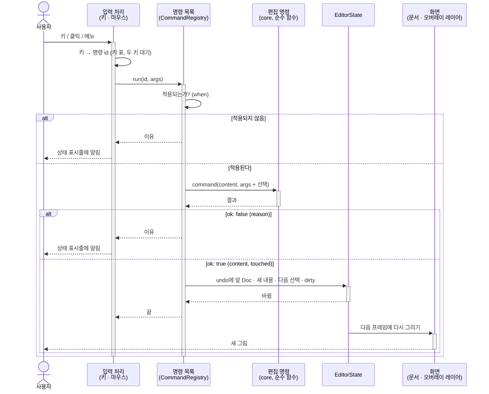
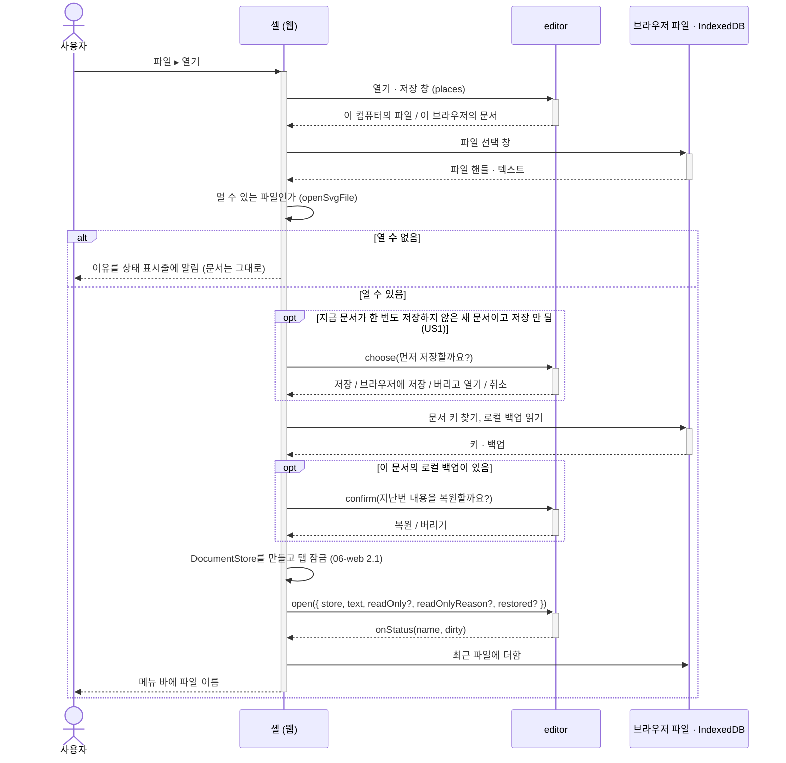

# 편집기

편집 화면과 사용자 입력 처리를 정의합니다. 주변 UI 컴포넌트(툴바, 메뉴, 설정 창, 대화창)는 React로 구현합니다. 다이어그램 영역, 선택 오버레이, 키 입력 처리, 텍스트 입력 요소는 React 밖의 TypeScript입니다 → [[0010-ui-framework|ADR-0010]]

코드: `src/packages/editor` (→ [[0036-code-layout|ADR-0036]])

이 문서는 **어떻게 만드는가**를 기술합니다. 무엇이 어떻게 움직여야 하는지(조작 규칙)는 [[02-interaction-rules]], 키는 [[03-keymap]], 모습은 [[04-visual-design]], 웹의 화면 배치는 [[05-screen-layout|화면 배치]]에 있습니다.

## 관련 요구사항

- [[01-requirements#3.2 편집]], 그 가운데 드래그 앤 드롭 [[01-requirements#^r-edit|R-EDIT-09]], 커맨드 팔레트 [[01-requirements#^r-edit|R-EDIT-24]]
- 호출 블록에서 Method 만들기: [[01-requirements#^r-edit|R-EDIT-26]], Method 풀어 넣고 지우기: [[01-requirements#^r-edit|R-EDIT-27]]
- 줌 · 팬: [[01-requirements#^r-lay|R-LAY-03]]
- [[01-requirements#^r-nfr|R-NFR-03]], [[01-requirements#^r-nfr|R-NFR-04]], [[01-requirements#^r-nfr|R-NFR-05]]

## 1. 화면 구성

편집 화면은 **레이어 넷**을 겹쳐 렌더링합니다. 아래 레이어일수록 자주 바뀌지 않습니다.

| 레이어 | 무엇 | 누가 렌더링하나 | 언제 다시 렌더링하나 |
| --- | --- | --- | --- |
| 문서 레이어 | 저장되는 렌더링 결과와 같은 SVG(블록, 텍스트, 접기 영역의 테두리와 이름 띠) | `core`의 렌더러(`layout` → `buildScene` → `toSvg`) → 렌더링 백엔드 → [[0030-swappable-drawing\|ADR-0030]] | 내용이나 뷰 상태가 바뀔 때 |
| 오버레이 레이어 | 선택 하이라이트, 키보드 포커스, 드롭 위치, 펼침 삼각형(`▸` `▾`), 이름이 중복된 헤더의 표시 | `editor`가 `LayoutResult`의 상자로 렌더링하는 SVG 하나 | 선택 · 드래그 · 포커스가 바뀔 때, 인라인 에디터가 열리거나 닫힐 때 |
| 인라인 에디터 | 텍스트를 편집하는 동안의 `<textarea>` 하나 | `editor` | 편집을 시작 · 끝낼 때 |
| 팝업 레이어 | 컨텍스트 메뉴, 키 힌트, 커맨드 팔레트, 모달 | React | 열고 닫을 때 |

- 문서 레이어와 오버레이 레이어는 같은 좌표계(문서 좌표, px)를 씁니다. 오버레이 레이어는 문서 레이어 위에 같은 크기로 겹친 SVG이고, 저장할 때는 문서 레이어만 씁니다. 그래서 "편집 중에만 뜨는 표시는 저장되는 그림에 넣지 않는다"([[0018-save-as-shown|ADR-0018]])가 구조로 지켜집니다.
- 화면 색(라이트 · 다크, 고대비)은 팝업 레이어와 캔버스의 바깥에 적용됩니다. 문서 레이어는 문서의 테마로 렌더링합니다. 오버레이와 인라인 에디터는 종이 위에 렌더링하므로 화면 색이 아니라 테마의 종류(`Theme.kind`: 밝음 · 어두움)를 따릅니다: `CanvasView`가 렌더링 결과가 바뀔 때마다 `editColorsFor(kind)`를 오버레이에 전달하고, 인라인 에디터의 색(테마의 `paper` · `text.primary` · `text.muted`, `edit.field` · `edit.error`)을 캔버스의 CSS 변수로 둡니다 → [[04-visual-design#2. 레이어와 출력]], [[04-visual-design#3.4 화면 색]], [[0044-document-themes|ADR-0044]]
- 오버레이 레이어의 색과 굵기는 시각 디자인의 편집 레이어 토큰(`edit.*`, 밝은 종이용과 어두운 종이용)을 씁니다 → [[04-visual-design#7.1 상태 표]]
- 문서 레이어의 둘레에는 화면에서만 그림자를 두릅니다(모서리 반지름 4px, CSS `box-shadow`). 저장 파일에는 들어가지 않습니다 → [[04-visual-design#원칙 4. 문서는 종이다]]

**컨텍스트 메뉴**(팝업 레이어)는 블록 위의 오른쪽 클릭, `Shift`+`F10`, 메뉴 키(`ContextMenu`)로 엽니다. 규칙 → [[02-interaction-rules#컨텍스트 메뉴]]

- 항목은 명령 목록에서 `CommandSpec.context`에 지금 선택의 종류(`Selection.kind`)가 든 명령입니다(5장). 순서와 하위 메뉴(삽입 ▸ · 감싸기 ▸)는 메뉴 바(5.1)를 따르고, 메뉴마다 묶음 사이에 가로줄을 둡니다. 메뉴와 하위 메뉴는 창 안에 둡니다. 하위 메뉴는 오른쪽에 공간이 없으면 왼쪽으로 열고, 양쪽 모두 없으면 메뉴 위로 겹쳐 엽니다.
- 다이어그램(React 밖)이 오른쪽 클릭 · 키를 받아 선택을 정한 뒤 `onContextMenu`로 열 위치(페이지 좌표)를 알리고, 주변 UI(React)가 메뉴를 렌더링합니다(6장). `Shift`+`F10` · 메뉴 키의 위치는 선택한 것의 아래, 왼쪽 끝에서 최대 24px 안쪽입니다.
- 창 밖으로 나갈 자리면 왼쪽 · 위로 당겨 창 안에 둡니다. 닫으면 키보드 포커스가 다이어그램으로 돌아갑니다.

### 1.1 줌과 팬

- 캔버스는 브라우저의 스크롤 영역(`overflow: auto`)이고, 팬은 그 스크롤입니다(휠, 터치패드, 스크롤바). 따로 손(팬) 도구를 두지 않습니다.
- 줌은 40% ~ 300%, 10% 단위입니다(키는 [[03-keymap]]). 문서 · 오버레이 레이어와 인라인 에디터를 감싼 요소에 배율을 곱하고(CSS `scale`), 줌한 뒤 기준점이 제자리에 남도록 스크롤을 맞춥니다. 기준점은 `Ctrl`+휠이면 마우스 아래, 키 · 메뉴로 했으면 선택한 것(없으면 화면 가운데)입니다. `Ctrl`+휠은 한 칸에 10%입니다.
- 정수가 아닌 배율(줌 × `devicePixelRatio`)에서는 캔버스가 크리스프 도형의 `stroke-width`를 `max(1, round(굵기 × 배율)) / 배율`로 바꿔 선이 정수 장치 픽셀로 그려지게 합니다(`dom/crisp-lines.ts`). 화면에서만 고치며 저장하는 SVG는 그대로이고, 그림을 다시 그리거나 줌 · `devicePixelRatio`가 바뀔 때 다시 맞춥니다 → [[04-visual-design#9.2 배율과 출력]]
- 블록을 선택한 채 굴리는 휠은 50px마다 `↑` `↓` 한 번입니다(줄 단위 · 페이지 단위의 휠은 px로 바꿔 셈). 줌은 뷰 상태라 파일에도 실행 취소에도 들어가지 않습니다(그 브라우저의 환경 설정에도 남기지 않음).
- 선택한 것이 화면 밖으로 나가면 가장 가까운 쪽으로만 스크롤합니다(`scrollIntoView({ block: 'nearest' })`와 같음). 줌 중에는 배율을 곱한 상자로 계산합니다.

### 1.2 다시 렌더링

- 편집할 때마다 문서 전체를 처음부터 다시 계산합니다(→ [[0037-two-pass-full-layout|ADR-0037]]). 문서 레이어는 SVG 문자열을 전체 교체합니다. 블록 500개에서 10ms 안팎이라 나누어 고치지 않습니다 → [[02-layout#4. 성능]]
- 한 프레임에 한 번만 렌더링합니다. 명령이 여럿 이어져도(예: 붙여넣은 뒤 선택) `requestAnimationFrame` 하나로 모읍니다.
- 오버레이 레이어는 선택만 바뀌면 문서 레이어를 건드리지 않고 다시 렌더링합니다. 키로 블록 사이를 오갈 때 문서 레이어를 다시 그리지 않으려는 것입니다.

## 2. 상태와 선택

`editor`가 기억하는 것은 아래 하나입니다. 파일에 들어가는 것은 `doc`뿐이고, 나머지는 메모리에만 있습니다(→ [[01-architecture#4.3 의존 규칙]]).

```ts
type EditorState = {
  doc: Doc;                       // 내용 + 뷰 상태 → [[01-model]]
  undo: Doc[]; redo: Doc[];       // 내용과 뷰 상태의 스냅숏. 되돌릴 때 이름 띠 · 결과 기호는 지금 값 → [[0048-folding-is-undoable|ADR-0048]]. 500단계까지
  selection: Selection | null;
  lastSelected: Id | null;        // 선택한 것을 푼 뒤 이동 키를 누르면 여기서 시작
  editing: Editing | null;        // 인라인 에디터가 열려 있으면
  dirty: boolean;                 // 마지막 저장 뒤 내용이나 뷰 상태가 바뀌었는가 (저장 안 됨 표시 ●)
  readOnly: boolean;              // 보기만 함 (웹: 같은 파일을 다른 탭이 편집하고 있을 때) → 6.4
  zoom: number;                   // 줌 배율 0.4 ~ 3
  layout: LayoutResult;           // 마지막으로 센 결과. 히트 테스트와 오버레이 레이어가 쓴다
  revision: number;               // 내용이나 뷰 상태가 바뀔 때마다 1씩 오름 (DocStatus.revision)
  mode: 'normal' | 'visual';      // visual: v로 영역을 선택하는 중 → [[03-keymap]]
  pendingKeys: string | null;     // 두 키 조합의 첫 키를 받고 둘째를 기다리는 중
};

type Selection =
  | { kind: 'blocks'; seq: SeqRef; anchor: Id; focus: Id }   // 같은 줄 안의 연속 범위 → ADR-0008
  | { kind: 'head'; diagram: Id }
  | { kind: 'branchLabel'; branch: Id }                      // 분기 라벨 (If · Case) → 조작 규칙 "분기 라벨 선택"
  | { kind: 'fold'; fold: Id; path?: Path }                  // 접기 영역 전체 (이름 띠나 접힌 칸). 펴 보인 호출 블록 안이면 그 경로
  | { kind: 'missingDefault'; block: Id }                    // default가 없는 Case에 그려 둔 빈 default 칸 (UX CD1)
  | { kind: 'peek'; path: Path; anchor: Id; focus: Id; branch?: Id }; // 펴 보인 호출 블록 안의 블록들: 경로와 Method의 한 줄 안의 범위. `branch`는 If · Case `anchor`의 분기 라벨을 선택한 것
type SeqRef = { owner: Id; slot: string };                   // 그 줄을 가진 노드(다이어그램 · 블록 · 분기)와 자리
```

- `missingDefault`를 선택하고 텍스트를 적거나 블록을 삽입하면, `editor`가 `addDefaultBranch`와 그 편집을 undo 한 단계로 실행합니다 → [[01-model#4.1 내용을 바꾸는 명령]], [[ux-decisions#CD1. default가 없는 Case|CD1]]
- 상태 밖에, 세션은 연 파일에서 모델이 담지 못한 설정 값(지원하지 않는 `textKind`)을 별도로 보유했다가 저장할 때 다시 기록합니다 → [[01-file-format#3.3 노드별 필드]]

- 선택은 언제나 **id**로 기록합니다. 내용이 바뀌어 id가 사라지면 그 선택은 풀립니다(`null`). 위치(몇 번째)로 기록하지 않는 이유는 undo · 이동 뒤에도 같은 것을 가리키게 하려는 것입니다.
- 펴 보인 블록(호출 블록 안에 보이는 Method의 블록)의 **화면 id**는 펴 보인 호출 블록의 경로를 `/`로 이은 뒤에 모델의 id를 붙인 문자열입니다(예: `b4/b17`, 겹쳐 폈으면 `b4/b9/b17`). 모델의 id가 아니라 화면(`LayoutResult`, 보이는 나무)에만 있는 id입니다. 선택은 화면 id가 아니라 경로와 모델의 id로 기록합니다(`peek`의 `path` · `anchor` · `focus`, `fold`의 `path`) → [[01-model#2. 뷰 상태]], [[ux-decisions#CB3. 펴 보인 블록의 화면 id|CB3]]
- 펴 보인 블록을 선택했을 때 내용을 바꾸는 명령(`edits: true`)은 적용되지 않고 "편집할 수 없다"고 알립니다. 그 자리의 접기 영역(처음 펼 때 Method에서 복사한 것 포함)을 만들고 풀고 이름을 바꾸는 명령만 됩니다(`CommandSpec`을 만들 때 `onPeek`). 복사 · 접기 · 펴기 · 이동은 됩니다.
- 펴 보인 곳에서 분기, 반복 블록의 본문을 접으면 뷰 상태의 `folded`에 경로를 앞에 붙인 항목(`b4/r3`)을 넣고 빼고, 그 자리의 접기 영역을 접으면 그 id를 넣고 빼므로 Method와 다른 호출 블록은 바뀌지 않습니다. 분기나 본문 전체가 그 자리의 접기 영역 하나이면 그 접기 영역을 접습니다. 접기 명령의 대상은 펴 보인 곳 밖과 같은 차례로 찾고, 맨 끝에 그것을 담은 호출 블록을 둡니다(`commands/fold-commands.ts`의 `foldTargets`). 세션은 문서를 받거나 뷰 상태 · 내용이 바뀔 때마다 그려지는 호출 경로에 접힘을 채우고 Method의 접기 영역을 복사합니다. 이 복사는 펼 때 그 펴 보기와 실행 취소 한 단계가 되고, 명령 · 실행 취소 뒤에는 그 단계에 묶이며, 열 때와 보기 모드에서는 단계가 아닙니다 → [[01-model#2. 뷰 상태]], [[0047-copy-method-folds-at-first-open|ADR-0047]]

### 2.1 범위를 넓히기 (자동 확장)

`Shift`+클릭과 `Shift`+`↑` `↓`는 다른 함수를 씁니다. 둘 다 결과는 한 줄에 이어진 범위입니다 → [[0008-contiguous-selection|ADR-0008]], [[02-interaction-rules#여러 블록 선택]]

- `Shift`+클릭은 `extendTo`입니다. 두 블록의 조상을 견주어 둘을 함께 담는 가장 가까운 줄까지 범위를 넓힙니다(깊이가 달라도 됩니다).
- `Shift`+`↑` `↓`(와 범위 선택의 `j` `k`)는 `extendBy`입니다. 지금 줄 안에서 범위의 끝을 한 블록 옮기고, 줄의 끝이면 넓히지 않고 "같은 부모 안에서만 영역을 넓힐 수 있습니다."를 알립니다.

1. 처음 선택한 블록 `a`와 새로 가리킨 블록 `b`의 조상 목록(자기부터 다이어그램까지, 블록과 줄이 번갈아)을 구합니다.
2. 두 목록이 처음 엇갈리는 곳 바로 위의 **같은 줄**을 찾습니다.
3. 그 줄 안에서 `a` 쪽 조상과 `b` 쪽 조상이 범위의 두 끝입니다(`anchor`, `focus`).
4. 둘이 다른 다이어그램이면 넓히지 않고 `b`만 선택합니다.

접기 영역은 줄에 붙은 표시라(→ [[0017-fold-name-in-model|ADR-0017]]) 조상 목록에 들어가지 않습니다. 접힌 접기 영역 안을 가리키면 그 접힌 칸 전체가 끝이 됩니다.

### 2.2 이동

- 키보드 이동(`h` `j` `k` `l`, 방향키, `Ctrl`+방향키, `gg` `G`, `[[` `]]`)은 **화면에 보이는 것**으로 계산합니다. `editor`는 문서와 뷰 상태에서 **보이는 나무**(`src/packages/editor/src/model/shown-index.ts`)를 만듭니다. 레이아웃이 렌더링하는 구조([[02-layout#1.6 테두리가 있는 것]]의 "보이는 구조")와 같은 것을 내용(`Content`) 타입으로 다시 기술한 것이고, id는 화면 id입니다.
	- 접힌 줄은 그 분기의 블록 대신 들어간 블록 하나(`~` + 분기 id), 접힌 칸은 접기 영역의 id를 가진 블록 하나입니다.
	- 펴진 접기 영역(이름 띠를 켰을 때)과 펴 보인 호출 블록은 안의 블록을 본문으로 가진 반복 블록처럼 들어갑니다. 그래서 띠는 반복 블록의 조건 칸처럼 한 칸이고, 그 안으로 `↓`로 들어갑니다.
	- 만든 블록마다 무엇을 대신하는지(접힌 줄, 접기 영역, 펴 보인 블록)를 기록해 둡니다. 이동 키는 선택을 보이는 나무의 선택으로 바꾼 뒤 규칙([[02-interaction-rules#키보드로 이동하고 삽입하기]])대로 움직이고, 그 결과를 모델의 선택으로 되돌립니다(`navigation/shown-selection.ts`). 접힌 줄은 그 분기의 블록 전체, 접힌 칸과 이름 띠는 그 접기 영역(`fold`)이 됩니다.
- 이 함수들은 DOM을 쓰지 않고 `Doc`만 받습니다. 그래서 Node에서 단위 테스트를 합니다 → [[02-test-architecture]]

### 2.3 명령 뒤의 선택

편집 명령은 `touched`(새로 생기거나 바뀐 노드의 id)를 반환합니다 → [[01-model#4. 편집 명령]]. `editor`는 명령의 종류와 `touched`로 다음 선택을 정합니다. 규칙은 [[02-interaction-rules#키보드로 이동하고 삽입하기]]에 있습니다.

| 명령 | 다음 선택 |
| --- | --- |
| 삽입 · 붙여넣기 · 감싸기 · 이동 | `touched`(삽입한 것, 감싼 새 블록, 이동한 것) |
| 삭제 · 잘라내기 | 삭제한 범위의 다음 블록 → 앞 블록 → 담고 있던 블록 (삭제 **전**에 계산해 둔다) |
| 풀기 | 남은 안의 블록들. 안쪽에서 풀었으면 선택한 것 그대로(접기 영역도 그대로). 분기 라벨 · 빈 default 칸에서 풀었으면 남은 안의 블록들 |
| Method 풀어 넣고 지우기 | 들어온 블록들: 호출 블록에서 했으면 그 자리의 것, Method 헤더에서 했으면 문서 순서로 첫 자리의 것(`sites`) → [[ux-decisions#CB16. Method 풀어 넣고 지우기\|CB16]] |
| 새 Method로 빼기 | 새 Method의 헤더(이름 칸을 엶). 이름 칸을 닫으면 그 위치에 남은 호출 블록(`touched`의 둘째) → [[ux-decisions#XM2. 빼고 난 뒤의 선택과 화면\|XM2]] |
| 실행 취소 · 다시 하기 | 선택한 것이 남아 있으면 그대로, 없으면 `null` |

### 2.4 인라인 에디터의 상태

`EditorState.editing`은 인라인 에디터가 열려 있는 동안의 상태입니다(`state/editor-state.ts`).

```ts
type Editing = {
  field: EditField;                 // 어느 칸을 편집하는가
  initial: string;                  // 칸을 연 때의 텍스트. 닫을 때 같으면 명령을 실행하지 않는다
  text: string;                     // 칸이 시작하는 텍스트: initial, 또는 비우고 새로 쓰기(cc)의 ''
  caret: Caret;
  call?: { args: string; result: string; name?: string };  // 호출 블록의 칸들에 지금까지 입력한 것. 닫을 때 editCall 한 번으로 기록
  isRejected?: boolean;             // 이름이 중복되어 다시 연 칸. Esc는 편집 전의 이름으로 되돌림
  extracted?: Extracted;            // 새 Method로 빼기가 연 이름 칸. 이름을 빼기의 undo 단계에 합침
  joinsLast?: true;                 // 만든 직후의 접기 영역 이름. 만들기의 undo 단계에 합침
};
type EditField =
  | { kind: 'block'; block: Id }                     // 처리 블록의 텍스트, 제어 블록의 조건
  | { kind: 'branchLabel'; branch: Id }              // If · Case의 분기 라벨
  | { kind: 'missingDefault'; block: Id }            // 빈 default 칸. 입력하면 default 분기가 생김
  | { kind: 'head'; diagram: Id }                    // 다이어그램의 헤더
  | { kind: 'call'; block: Id; part: CallPart }      // 호출 블록의 칸 하나
  | { kind: 'fold'; fold: Id; path?: Path };         // 접기 영역의 이름. path는 펴 보인 곳의 접기 영역
type CallPart = 'args' | 'result' | 'name';          // 이름 칸은 이름을 적는 호출 블록에만
type Caret = 'selectAll' | 'start' | 'end';          // 커서의 시작 위치
type Extracted = { call: Id; count: number };        // 그 위치에 남은 호출 블록, 뺀 블록의 수
```

### 2.5 세션

`EditorSession`(`session/session.ts`)이 편집의 중심입니다. `EditorState`를 하나 보유하고, 문서를 바꾸는 모든 경로가 이 클래스를 지납니다. 명령의 실행은 명령 목록이 담당하고(3장), 세션은 명령이 호출하는 기능을 제공합니다.

| 메서드 | 하는 일 |
| --- | --- |
| `commit(result, after)` | 편집 명령의 결과를 반영합니다. `ok: false`면 이유를 알리고, 성공하면 `apply`합니다. 결과의 `note`(Case를 If로 바꿀지 묻기, 조건을 확인하라는 알림)도 처리합니다 |
| `apply(content, after)` | 내용을 undo 한 단계로 바꿉니다. 내용이 바뀌었으면 먼저 불변식을 검사하고(3장), 다음 선택 · 뷰 상태와 인라인 에디터(`After`)를 적용합니다 |
| `setView(view, selection?)` | 뷰 상태만 바꿉니다. 접힘 · 펴 보기(`folded` · `opened`)가 값으로 달라지면 undo 한 단계를 만들고 redo를 비웁니다. 이름 띠 · 결과 기호만 바뀌면 단계를 만들지 않습니다. 읽기 전용이면 단계도 dirty도 없습니다 |
| `select(selection)` | 선택을 바꿉니다. 없어진 id를 가리키는 선택은 버립니다(`validSelection`) |
| `handleKey(stroke)` | 다이어그램 영역의 키 하나를 읽습니다. 처리했는지를 반환합니다(4장) |
| `startEditing` · `commitEditing` · `cancelEditing` · `switchCallPart` | 인라인 에디터를 열고, 닫고, 호출 블록의 칸을 바꿉니다(3.4) |
| `history(direction)` | 실행 취소 · 다시 하기. 스냅숏의 내용과 접힘 · 펴 보기로 돌아가고, 이름 띠 · 결과 기호는 지금 값을 둡니다 |
| `load(doc, options)` | 문서를 전체 교체합니다. undo를 비우고 선택은 옵션의 값으로 둡니다 |
| `notify(message, level?)` · `refuse(reason)` · `ask(question, choices)` | 상태 표시줄의 알림, 명령이 거절한 이유, 버튼이 달린 물음 |
| `index()` · `shown()` | 모델의 색인과 보이는 나무(2.2)를 계산합니다. 문서가 바뀔 때까지 재사용합니다 |

세션을 만드는 옵션(`SessionOptions`)은 클립보드, 타이머, 키 힌트를 보일지, 로그, 키 표, 시간 측정기입니다. 문서를 받을 때의 옵션(`LoadOptions`)은 파일에서 읽어 보유할 설정 값(`kept`), 처음 선택, 저장 안 됨 여부, 읽기 전용 여부입니다. 명령이 끝난 뒤의 처리(`After`)는 다음 선택, 함께 바꿀 뷰 상태, 바로 열 인라인 에디터입니다.

## 3. 입력에서 명령까지

키 · 메뉴 · 툴바 · 컨텍스트 메뉴 · 커맨드 팔레트는 모두 **명령 id 하나**로 모입니다. 실행은 한 곳(`run(id, args)`)에서 합니다 → [[0033-command-list-for-shells|ADR-0033]]

명령 목록을 거치지 않는 입력이 셋 있습니다. 드롭은 대상을 드래그 중에 이미 검사하므로 `runDrop`이 세션의 `commit`을 직접 호출하고, 더블클릭 편집은 세션의 `startEditing`으로 칸을 열며, 문서 설정 창은 `EditorHandle.setDocumentSetting`을 호출합니다.



UML 시퀀스 다이어그램입니다. 실선 화살표는 호출, 점선 화살표는 반환, `alt`는 조건 분기, 세로 막대는 그 참여자가 실행 중인 구간(activation)입니다.

- 편집 명령은 `core`의 순수 함수입니다. `when`을 지나도 명령이 사전 조건으로 거절할 수 있습니다(`{ ok: false, reason }`). 결과의 타입은 [[01-model#4. 편집 명령]]에 있습니다. 선택은 명령의 인자로 전달하고, 명령은 선택을 바꾸지 않습니다. 선택은 2.3의 규칙으로 `editor`가 정합니다.
- "적용되는가"(`when`)는 지금의 `EditorState`를 받는 함수입니다. 메뉴의 흐린 항목, 커맨드 팔레트의 흐린 줄, 툴바의 꺼진 버튼이 모두 이것을 씁니다.
- 실행하면 안 되는 상태(펴 보인 블록에 내용 명령)는 명령이 아니라 `when`이 차단하고, 이유를 알립니다("막지 않고 알린다" → [[01-ux-overview#2. UX 원칙]]).
- `run` 앞뒤의 처리입니다.
	- **앞(`beforeRun`):** 인라인 에디터가 열려 있으면 먼저 입력한 대로 편집을 완료합니다. 그래서 명령은 항상 편집이 끝난 문서에서 실행됩니다.
	- **내용을 바꾸기 전(`apply`):** 새 내용의 불변식을 검사합니다(`checkInvariants`). 위반이면 버그이므로 문서를 그대로 두고, 로그에 남기고 "내부 오류" 알림(`notice.internalError`)을 보입니다.
	- **예외(`onError`):** 명령이 던진 예외(비동기 명령의 거부 포함)를 받아 로그에 남기고 같은 알림을 보입니다 → [[07-coding-guide#5. 오류 처리]]

### 3.1 히트 테스트

마우스가 무엇을 가리키는지는 DOM이 아니라 `LayoutResult`로 계산합니다(→ [[01-architecture#4.3 의존 규칙]]).

- 마우스 좌표를 문서 좌표로 바꿉니다(스크롤, 확대 배율, 캔버스의 여백을 뺌).
- 상자는 [[02-layout]]이 `LayoutResult`에 담는 **클릭 영역**입니다. 제어 블록은 조건 칸만, 펴진 접기 영역과 펴 보인 호출 블록은 띠만, 분기 라벨은 그 칸의 라벨 줄입니다 → [[02-layout#1.1 두 단계]]
- 그 점을 담는 **가장 안쪽** 상자를 찾습니다. 상자의 종류: 블록, 조건 칸, 다이어그램 헤더, 분기 라벨 칸, 접힌 줄, 접힌 칸, 이름 띠, 펴 보기의 띠, 펼침 삼각형, 펴 보인 블록. 펼침 삼각형과 분기 라벨 칸처럼 작은 상자가 그 아래 블록보다 먼저입니다. 찾은 상자의 id는 보이는 나무의 id라, 클릭은 2.2와 같은 경로로 모델의 선택이 됩니다.
- 펼침 삼각형을 누르면 그것이 붙은 것을 선택하고 접기 · 펴기를 실행합니다. 접힌 줄을 더블클릭하면 펼칩니다(편집할 텍스트가 없음). 접힌 칸과 이름 띠의 더블클릭은 접기 영역의 이름 편집입니다 → [[ux-decisions#Q1 · Q2. 고치기를 시작하는 방법과 더블클릭|Q2]]
- 드래그는 모델의 블록만 시작합니다. 접힌 칸 · 이름 띠 · 펴 보인 블록을 누르면 선택만 합니다.
- 블록 500개까지는 모든 상자를 차례로 보아도 1ms 안쪽이라, 공간 색인(R-tree 등)은 두지 않습니다.

### 3.2 드래그 앤 드롭

규칙은 [[02-interaction-rules#7. 드래그 앤 드롭]], 모습은 [[04-visual-design#7.1 상태 표]]에 있습니다.

- 드래그는 HTML5 드래그 앤 드롭(`dragstart`)이 아니라 포인터 이벤트(`pointerdown` → `pointermove` → `pointerup`)로 직접 만듭니다. 드롭 위치를 블록 사이 · 블록 위로 나눠 보이고, 드래그하는 동안 오버레이 레이어를 렌더링해야 하기 때문입니다. 터치에서도 같은 코드가 동작합니다.
- 4px 넘게 움직여야 드래그로 판정합니다. 그 전에 떼면 클릭입니다.
- **드롭 위치 계산:** 가리킨 블록 상자의 위쪽 8px과 아래쪽 8px 띠는 "그 블록의 앞 · 뒤 사이", 나머지는 "블록 위"입니다. 블록의 높이가 24px보다 작으면 위아래를 반씩 나눠 "사이"만 둡니다. 본문의 맨 앞 · 맨 끝은 `bodyEndOf`가 블록보다 먼저 판정합니다: 헤더 상자(`diagramHead`)의 아래쪽 8px(`betweenBand`)은 본문의 맨 앞, 다이어그램 본문 바로 아래 12px(`bodyEndBand`, 본문 폭, 다이어그램 사이의 간격보다 좁아 다음 다이어그램에 닿지 않음)은 본문의 맨 끝입니다. 그 자리는 첫 · 마지막 블록의 종류와 관계없이 그 블록의 앞 · 뒤 사이로 취급하고, 삽입 · 이동에 `outsideFolds`를 켜서 그 끝의 접기 영역에 들어가지 않게 합니다(코어의 `insertBlock` · `moveTo`, `diagramEnd` 삽입과 같음). 빈 본문은 빈 블록 위 규칙으로, 이미 그 끝에 있는 블록을 옮기면 드롭할 수 없고, 가로줄은 본문의 윗선 · 다이어그램의 아랫선에 그립니다 → [[ux-decisions#DE1. 본문의 맨 앞 · 맨 끝에 놓기|DE1]] 분기의 빈 블록(`∅`)은 전체가 "빈 블록 위"입니다.
- 드래그하는 동안 오버레이 레이어에 놓을 결과를 렌더링합니다: 사이면 가로줄 + 양 끝 눈금, 블록 위면 그 블록의 테두리 + 커서 곁의 텍스트("If로 감싸기"). 드롭할 수 없으면 아무것도 렌더링하지 않고 커서를 금지 모양으로 바꿉니다.
- 놓으면 `runDrop`이 이동 · 삽입 · 감싸기 편집 명령 가운데 하나를 세션의 `commit`으로 실행합니다(명령 목록의 `run`과 `when`을 거치지 않습니다. 대상은 드래그 중에 검사합니다). 드래그 자체는 명령이 아니라서, 놓기 전에 `Esc`를 누르면 아무 일도 없습니다.
- 캔버스 가장자리 32px 안으로 드래그하면 그쪽으로 자동 스크롤합니다.

### 3.3 클립보드

- 복사 · 잘라내기는 시스템 클립보드에 둘을 함께 씁니다:
	- `text/plain`: 블록의 텍스트를 들여쓰기한 줄로(다른 프로그램에 붙여넣으면 의사코드처럼 보이게). 호출 블록은 렌더링된 대로 `ys ← MergeSort(xs)`
	- `web application/x-ariadne-nsd+json`: 블록 목록의 모델 JSON(Chromium의 웹 사용자 정의 형식). 첫 다이어그램(헤더 없음)이 복사한 블록이고, 그 블록의 호출 블록이 호출하는 Method마다 헤더만 있는 빈 Method가 뒤따릅니다. 그래서 클립이 그 자체로 올바른 문서이고(불변식 6), 호출 블록이 부르던 Method의 이름이 따라갑니다. 붙여넣으면 호출 블록은 붙이는 문서에서 **이름이 같은 Method**를 호출하고, 없으면 그 이름을 적은 호출 블록이 됩니다 → [[ux-decisions#CB11. 다른 문서에 붙인 호출 블록|CB11]]
- 붙여넣기는 사용자 정의 형식이 있으면 그것을 씁니다. 없으면(다른 브라우저, 다른 프로그램에서 복사) `text/plain`의 줄마다 처리 블록 하나를 만듭니다.
- 셸이 `pastedDocument`(6장의 `createEditor` 옵션)를 전달했고 사용자 정의 형식이 없으며 `pastedDocument.isDocument(text)`가 참이면(AriadneNSD 문서인 텍스트, [[01-requirements#^r-web|R-WEB-11]] → [[06-web#3.2 붙여넣은 문서]]), 블록을 만들기 전에 모달(`Dialog`, 제목 "AriadneNSD")로 묻습니다. "새 문서로 열기"(확인 버튼)면 `pastedDocument.open(text)`를 호출하고 지금 문서는 바꾸지 않으며, "텍스트로 붙여넣기"(넷째 버튼, 선택한 것이 없으면 `isSecondDisabled`)면 위의 규칙대로 붙이고, 취소면 아무것도 하지 않습니다 → [[ux-decisions#JP2. 알아본 뒤의 동작|JP2]]
	- 그래서 `pastedDocument`가 있으면 붙여넣기 명령의 `when`은 선택한 것이 없어도 참입니다. 문서가 아닌 텍스트이면 그때 "먼저 블록을 선택하세요."(`reason.nothingSelected`)를 알립니다. 헤더 · 분기 라벨 · 읽기 전용에서의 거절은 그대로입니다.
	- 저장은 진행 중인 붙여넣기를 기다리지만(`Ctrl`+`V` 뒤의 `Ctrl`+`S`), 문서인 텍스트를 알아본 순간 더 기다리지 않습니다. 그 뒤의 모달(US1의 "저장")이 저장을 호출하기 때문입니다.
- 브라우저가 시스템 클립보드를 막으면(권한 거절, 지원하지 않음) 편집기 안의 클립보드(메모리)를 씁니다. 그때 다른 탭과는 나누지 못하고, 그렇다고 상태 표시줄에 알립니다.
- 분기 라벨을 선택했을 때의 복사 · 잘라내기 · 감싸기는 아직 정하지 않아([[02-interaction-rules#분기 라벨을 선택했을 때의 복사 · 감싸기]]) "분기 라벨에서는 아직 되지 않습니다"라고 알립니다.
- 붙여넣은 블록은 모두 새 id를 받습니다 → [[01-model#4.1 내용을 바꾸는 명령]]

### 3.4 텍스트 편집

- 인라인 에디터는 `<textarea>` 하나를 다시 씁니다. 편집할 상자의 위치(`LayoutResult`)에 배율을 곱해 놓고, 블록 글꼴과 같은 글꼴 · 크기로 둡니다.
- 칸을 열고 닫을 때까지가 명령 하나입니다. 닫을 때 세션이 텍스트 편집 명령을 한 번 실행합니다(명령 목록의 `run`을 거치지 않습니다). 처음과 같으면 실행하지 않습니다 → [[01-model#4.4 텍스트 편집과 undo]]
- 비울 수 없는 칸을 비우면 기본 텍스트로 되돌리고 닫습니다. 헤더의 이름이 중복될 때만 칸을 다시 엽니다 → [[02-interaction-rules#텍스트 편집]]. 다시 연 칸은 테두리를 `edit.error`로 그리고(→ [[04-visual-design#7.1 상태 표]]), 그 칸의 `Esc`만 편집 전의 이름으로 되돌리고 닫습니다.
- 새 Method로 빼기가 연 이름 칸(`Editing.extracted`)은 닫을 때의 `editHead`를 빼기의 실행 취소 단계에 합칩니다(새 단계를 추가하지 않음). 그래서 빼기와 이름이 실행 취소 한 단계입니다. 칸을 닫으면(`Enter` · `Esc` · 다른 곳 클릭) 남은 호출 블록을 선택하고, 중복되는 이름이면 다른 헤더처럼 칸을 다시 엽니다 → [[02-interaction-rules#새 Method로 빼기와 새 다이어그램]]
- 호출 블록의 칸(인자 · 결과)도 같은 `<textarea>`를 씁니다. 위치는 세로 이중선의 안쪽이고, 빈 칸에는 칸의 이름("인자" · "결과")을 흐리게 보입니다. `Tab`으로 칸을 바꾸면 적은 것을 기억해 두고, 닫을 때 두 칸을 `editCall` 한 번으로 실행합니다. 그래서 두 칸을 고쳐도 실행 취소 한 단계입니다 → [[02-interaction-rules#호출 블록]]
- 한글 입력(IME) 조합 중의 `Enter`(`isComposing`)는 편집 완료로 보지 않습니다.
- 편집하는 중에도 처리하는 키가 넷 있습니다: `Ctrl`+`S`(저장), `Ctrl`+`Shift`+`S`(다른 이름으로 저장), `Ctrl`+`Shift`+`P` · `F1`(커맨드 팔레트). 문자를 넣지 않는 키라서, 다른 곳을 클릭한 것처럼 편집을 완료한 뒤 그 명령을 실행합니다. IME 조합 중에는 듣지 않습니다. 그 밖의 키는 인라인 에디터가 받습니다(4장) → [[03-keymap]]

## 4. 단축키

키 표는 [[03-keymap]]에 있습니다. 이 절은 키 이벤트를 명령 id로 바꾸는 구현입니다.

- 문자 키는 **자판의 위치**(`KeyboardEvent.code`, 예: `KeyJ`)로 읽습니다. 그래서 한글 입력 상태에서도 `j`가 동작합니다. 대문자는 `Shift`를 함께 본 것입니다 → [[keyboard-keys-and-ime]]
- 인라인 에디터 · 입력 상자 · 메뉴에 포커스가 있으면 편집 키를 처리하지 않습니다(그 요소가 키를 받음).
- **키 시퀀스**(두 키 조합: `dd` `za` `a` + 종류 …): 첫 키를 받으면 "대기 중"이 되고, 둘째 키를 기다리는 시간에 끝은 없습니다. 0.4초가 지나면 선택 바로 아래에 키 힌트(이어 누를 키의 목록)를 띄웁니다. 위치는 `EditorHandle.popupAnchor()`(키보드로 연 컨텍스트 메뉴와 같은 위치)에서 받습니다. 맞지 않는 키나 `Esc`, 캔버스의 클릭, 캔버스를 떠나는 것은 대기를 끝냅니다 → [[ux-decisions#K3. 두 키 조합의 안내 자리 (다시)|K3]], [[ux-decisions#K4. 클릭하면 기다리던 키를 버린다|K4]]
- 키 표는 데이터(`{ keys: 'd d', command: 'cut' }` 목록) 하나이고, 컨텍스트 메뉴 · 커맨드 팔레트 · 도움말의 키 표가 같은 데이터를 보입니다.
- `Backspace`는 `Delete`와 같습니다.
- 다이어그램 영역 안의 키 입력은 어느 배포 대상에서든 `editor`가 처리합니다. 호스트 프로그램(Obsidian, IDE)의 단축키와 충돌하는 키는 그 셸을 설계할 때 정합니다 → [[0033-command-list-for-shells|ADR-0033]]
- `Alt`+방향키(이동), `Ctrl`+`Shift`+`P`(커맨드 팔레트)처럼 브라우저 · 운영체제가 선점하는 키는 셸마다 확인해 두고, 선점되면 다른 키를 함께 둡니다(예: 맥의 `Option`).

## 5. 명령 목록과 메뉴

명령 목록(`CommandRegistry`)은 명령 하나에 항목 하나입니다. 메뉴 · 툴바 · 컨텍스트 메뉴 · 커맨드 팔레트 · 키 표는 모두 이 목록에서 만듭니다 → [[0033-command-list-for-shells|ADR-0033]]

```ts
type CommandSpec = {
  id: string;                         // 'block.insert.if', 'edit.cut', 'view.zoom.in' …
  title: Message | ((ctx: CommandContext) => Message);  // 화면 언어마다의 이름 (R-NFR-04). 상황에 따라 바뀌면 함수
  keys: string[];                     // 키 표의 키 ('a i', 'Ctrl+X') — 표시용. editor의 명령은 4장의 키 표가 채운다
  menu?: MenuPlace;                   // 메뉴 바의 자리
  toolbar?: { group: number; order: number; icon: string };  // icon: 툴바 아이콘의 id ('file.save', 'block.if' …)
  context?: SelectionKind[];          // 컨텍스트 메뉴에 보일 선택의 종류
  inContext?(ctx: CommandContext): boolean;    // 그 종류 가운데서도 지금 선택에 컨텍스트 메뉴로 보일지. 없으면 늘 ("Method 만들기"는 이름을 적는 호출 블록에서만)
  edits: boolean;                     // 문서를 바꾸는가. 읽기 전용이면 적용되지 않는다 → 6.4
  when(ctx: CommandContext): true | Message;   // 적용되는가, 아니면 이유
  run(ctx: CommandContext, args?: unknown): void | Promise<void>;
  checked?(ctx: CommandContext): boolean;      // 체크 표시가 있는 메뉴 항목 ("접기 영역 보기 ✓")
};
type MenuPlace = { menu: MenuId; group: number; order: number; submenu?: SubmenuId };  // 같은 group이 가로줄 사이의 한 묶음
type MenuId = 'file' | 'edit' | 'diagram' | 'view' | 'help';
type SubmenuId = 'recent' | 'export' | 'insert' | 'insertBefore' | 'wrap';  // 최근 파일 ▸ · 내보내기 ▸ · 삽입 ▸ · 앞에 삽입 ▸ · 감싸기 ▸
type CommandContext = { state: EditorState; store: DocumentStore; settings: SettingsStore };
```

- 메뉴 · 커맨드 팔레트의 흐린 항목(`when`이 이유를 반환함)도 누를 수 있습니다. 누르면 실행하지 않고 그 이유를 상태 표시줄에 알립니다. 메뉴(컨텍스트 메뉴 포함)의 흐린 항목은 마우스를 올리면 같은 이유를 툴팁으로 바로 보이고(`@media (hover: hover)`일 때만, 브라우저의 `title`이 아니라 `aria-describedby`로 연결한 요소), 제목과 키를 `ui.disabled`로 칠하며 hover 배경은 없습니다(키보드 포커스의 배경은 유지). 커맨드 팔레트는 글자 색만, 툴바 버튼은 글자 색만 흐립니다("막지 않고 알린다" → [[01-ux-overview#2. UX 원칙]]).
- `Modal`의 `size="narrow"`는 짧은 안내를 위한 좁은 창(폭 440px)이고 정보 창이 씁니다. 정보 창의 로고(그림 · 문자)는 `ui/about-logo.ts`의 별도 모듈이라 창을 열 때 동적 `import`로 받고(첫 다운로드에 들지 않음), 오기 전에는 같은 크기의 빈 상자가 자리를 지킵니다. 그림 로고는 장식(`alt=""`), 문자 로고의 대체 글자가 "AriadneNSD"입니다 → [[ux-decisions#AL1. 정보 창의 로고|AL1]]
- UI의 한 부분을 여는 명령(환경 설정 · 커맨드 팔레트 · 문서 설정 · 사용법 · 알고리즘 갤러리 · AI에게 그려 달라고 하기 · 단축키 목록 · 이 버전에서 바뀐 것 · AriadneNSD에 대하여)은 그 UI(`editor`의 React 주변 UI)가 직접 등록합니다. 메뉴의 `group`을 90으로 두어 같은 메뉴의 다른 묶음 뒤에 옵니다. 키(`Ctrl`+`,` · `Ctrl`+`Shift`+`P` · `F1` · `?`)는 4장의 키 표가 이 명령 id로 보냅니다.

- 이름이 상황에 따라 바뀌는 예: 원래 파일에 쓸 수 없는 브라우저(`store.canWriteInPlace`가 false)에서는 "저장"을 "내려받기"로 표시합니다 → [[06-web#1. 파일 열기·저장]]
- 명령의 대부분은 `editor`가 만듭니다. 저장 · 다른 이름으로 저장도 `editor`의 명령이고(`DocumentStore`를 거쳐 셸에 전달됨), 셸은 새로 · 열기 · 최근 파일 · 내보내기(웹은 공유 링크 복사도)만 만들어 같은 목록에 더합니다 → 6.1

### 5.1 메뉴 구성

웹과 데스크톱이 같은 메뉴를 씁니다(웹은 페이지 안의 메뉴 바, 데스크톱은 운영체제의 메뉴 바 → [[05-screen-layout|화면 배치]]). Obsidian은 메뉴 바 대신 명령 팔레트와 컨텍스트 메뉴에 올립니다.

| 메뉴 | 묶음 (가로줄로 나눔) |
| --- | --- |
| 파일 | 새로 · 열기… · 붙여넣은 JSON으로 열기…(웹 → [[06-web#3.2 붙여넣은 문서]]) · 최근 파일 ▸ ／ 저장 · 다른 이름으로 저장… ／ 내보내기 ▸ (PNG · SVG(그림만) · PDF) · 인쇄… · 공유 링크 복사(웹 → [[06-web#3. 공유 URL과 보기 모드]]) ／ 환경 설정… |
| 편집 | 실행 취소 · 다시 하기 ／ 잘라내기 · 복사 · 붙여넣기 · 앞에 붙여넣기 · 삭제 ／ 텍스트 편집 ／ 위로 · 아래로 · 왼쪽으로 · 오른쪽으로 이동 ／ 커맨드 팔레트… |
| 다이어그램 | 삽입 ▸ (처리 · If · Case · While · For · Do-While · 호출…) · 앞에 삽입 ▸ ／ 감싸기 ▸ · 풀기 ／ 분기 삽입 · 앞에 분기 삽입 · 분기 삭제 ／ 호출할 Method 바꾸기… · 새 Method로 빼기 · 호출하는 Method로 가기 · Method 만들기 · Method 풀어 넣고 지우기 ／ Event 헤더 · Method 헤더 · 헤더 제거 ／ 새 Event 다이어그램 · 새 Method 다이어그램 · 다이어그램 삭제 ／ 문서 설정… |
| 보기 | 접기 · 펴기 · 모두 접기 · 모두 펴기 ／ 접기 영역 만들기 · 접기 영역 풀기 ／ 접기 영역 보기 ✓ ／ 확대 · 축소 · 100% |
| 도움말 | 사용법 · 알고리즘 갤러리 · AI에게 그려 달라고 하기 · 단축키 목록 · 예제… ／ 이 버전에서 바뀐 것 · AriadneNSD에 대하여 |

- "알고리즘 갤러리"(`help.gallery`)는 사이트의 갤러리를 새 탭으로 엽니다. 화면 언어의 것(셸이 준 갤러리 주소, 웹은 `gallery/` · `gallery/ko/`)입니다 → [[06-web#5.1 알고리즘 갤러리]], [[ux-decisions#GL2. 갤러리로 가는 링크|GL2]]
- "AI에게 그려 달라고 하기"(`help.askAi`)는 사용법의 "AI에게 그려 달라고 하기" 꼭지(`#ai`)를 새 탭으로 엽니다. 사용법처럼 화면 언어의 것(셸이 준 사용법 주소 + `#ai`)입니다. AI가 화면을 조작하려 할 때 사용자가 할 일(AI에게 공유 링크를 청함)을 찾게 합니다 → [[ux-decisions#LG7. 화면을 조작하는 AI에게도 안내가 보이게|LG7]]
- "Event 헤더" · "Method 헤더"는 선택한 것에 따라 이름이 바뀝니다: 헤더 없는 다이어그램에서는 "… 헤더 달기", 헤더에서는 "…로 바꾸기"입니다. 헤더가 있는 다이어그램의 블록에서는 흐리게 보입니다(헤더를 선택하라고 알림) → [[02-interaction-rules#새 Method로 빼기와 새 다이어그램]]
- "새 Method로 빼기"(`diagram.extractMethod`)는 블록이나 접기 영역을 선택했을 때 됩니다. 메뉴 · 컨텍스트 메뉴 · 커맨드 팔레트에서는 묻지 않고 뺍니다. 키 `m`으로 실행하면(인자 `fromKey`) 헤더 없는 다이어그램에서만 고르는 목록(`ChromeState.picker`, 6장) "1 새 Method로 빼기 · 2 Method 헤더 달기"를 먼저 엽니다 → [[ux-decisions#XM3. 헤더 없는 다이어그램에서 블록에 m은 고르는 목록|XM3]]
- "호출…" · "호출할 Method 바꾸기…"는 고르는 목록(`ChromeState.picker`, 6장)을 엽니다. 목록은 문서의 Method 전부(렌더링된 순서), "새 Method를 만들고 호출", "이름을 적어 호출하기"입니다.
- "호출하는 Method로 가기"(`call.goTo`, `gd`)는 다이어그램 메뉴의 "새 Method로 빼기" 다음에 둡니다. 선택을 바꾸는 명령이라 읽기 전용에서도 됩니다. 이름을 적는 호출 블록에서는 "Method 만들기"를 실행합니다(읽기 전용이면 거절).
- "Method 만들기"(`call.makeMethod`, [[01-requirements#^r-edit|R-EDIT-26]])는 이름을 적는 호출 블록 하나를 선택했을 때 됩니다. `core`의 `makeMethod`로 Method를 만들고 같은 이름의 호출 블록을 이은 뒤(실행 취소 한 단계), 선택을 새 Method의 헤더로 옮깁니다. 컨텍스트 메뉴에는 이름을 적는 호출 블록에서만 보이고(`inContext`), 그때 "호출하는 Method로 가기"는 컨텍스트 메뉴에서 빠집니다 → [[ux-decisions#CB15. Method 만들기|CB15]]
- "Method 풀어 넣고 지우기"(`diagram.inlineMethod`, [[01-requirements#^r-edit|R-EDIT-27]])는 같은 문서의 Method를 호출하는 호출 블록이나 Method 헤더를 선택했을 때 그 Method에 적용됩니다. `core`의 `inlineMethod`를 실행하고(실행 취소 한 단계), 자리마다 펴 보기 · 접힘(`view.opened` · `view.folded`)을 호출 블록 풀기처럼 사본으로 옮긴 뒤, 들어온 블록을 선택하고 "호출 n곳에 풀어 넣고 {이름}을(를) 지웠습니다."를 알립니다. `when`은 `core`와 같은 검사로 `recursiveMethod` · `noCallers`를 미리 돌려주어 메뉴에서 흐리게 합니다. 컨텍스트 메뉴(`context: ['blocks', 'head']`)에는 호출 블록 · Method 헤더에서만 보입니다(`inContext`). 키는 없습니다 → [[ux-decisions#CB16. Method 풀어 넣고 지우기|CB16]]
- 보기 메뉴의 접기 명령: "접기 · 펴기"(`view.fold.toggle`), "접기 영역 만들기"(`fold.make`), "접기 영역 풀기"(`fold.remove`), "접기 영역 보기 ✓"(`view.bands`, 이름 띠 켜고 끄기). 키로만 실행하는 "펴기"(`view.fold.open`, `zo`)와 "접기"(`view.fold.close`, `zc`)는 커맨드 팔레트에도 있습니다. 모두 접기 · 모두 펴기([[01-requirements#^r-edit|R-EDIT-17]], `P2`)는 아직 없습니다.
- 뷰 상태를 바꾸는 명령(`edits: false`)은 세션의 `setView`로 뷰 상태만 바꿉니다. 접기 · 펴기 · 펴 보기는 실행 취소 한 단계이고, 이름 띠 켜고 끄기는 실행 취소 스택에 저장하지 않습니다([[0048-folding-is-undoable|ADR-0048]]). 읽기 전용이 아니면 저장 안 됨(`dirty`)을 켭니다(읽기 전용이면 단계도 만들지 않음). 접기 영역을 만들면 내용을 바꾸는 명령 하나가 그 영역을 접은 뷰 상태까지 함께 정하고(`After.view`), 이름 칸을 엽니다. 그 칸에서 적은 이름은 만들기의 실행 취소 단계에 합칩니다(`Editing.joinsLast` → [[ux-decisions#FD4. 만들 때 적은 이름은 만들기와 한 단계|FD4]]).
- 메뉴 항목 옆에는 키를 표시합니다. 키가 둘이면(`dd`와 `Ctrl`+`X`) 표준 키를 표시하고, Vim 키는 커맨드 팔레트와 단축키 목록에서 보입니다.

### 5.2 툴바

[[05-screen-layout|화면 배치]]의 순서대로: 새로 · 열기 · 저장 · 내보내기 ／ 실행 취소 · 다시 하기 ／ 잘라내기 · 복사 · 붙여넣기 ／ 블록 아이콘 다섯(For 없음 → [[ux-decisions#TB1. 툴바에 For를 두지 않는다|TB1]]) ／ 감싸기 ▾ · 확대 ▾ · 예제(예제 모달을 엶). "확대 ▾" 버튼에는 텍스트 대신 지금 배율(`100%`)을 표시합니다. "감싸기 ▾"(`DropdownButton`의 `isDimmedWhenNoneApply`)는 감싸기 명령 다섯이 모두 `when`에서 이유를 반환하면 `aria-disabled`로 흐려지고, 툴팁은 첫 감싸기 명령의 이유입니다. 누르면 목록을 열지 않고 그 명령을 실행해, 레지스트리가 이유를 상태 표시줄에 알립니다(흐린 메뉴 항목과 같음 → [[ux-decisions#TB3. 감쌀 것이 없을 때의 감싸기 ▾|TB3]]). 블록 아이콘의 누르기 · `Shift`+클릭 · `Ctrl`+클릭 · 드래그는 [[02-interaction-rules#블록 아이콘으로 삽입 · 감싸기]]에 있습니다.

### 5.3 명령 id 목록

| 묶음 | 명령 id |
| --- | --- |
| 삽입 | `block.insert.<kind>` · `block.insertBefore.<kind>` (`process` `if` `case` `while` `for` `doWhile`), `block.insert.call` · `block.insertBefore.call` |
| 감싸기 · 풀기 | `block.wrap.<kind>` (`if` `case` `while` `for` `doWhile`), `block.unwrap` |
| 분기 | `branch.insert` · `branch.insertBefore` · `branch.delete`, `branch.convertIfToCase` · `branch.convertCaseToIf` |
| 편집 | `edit.undo` · `edit.redo`, `edit.cut` · `edit.copy` · `edit.paste` · `edit.pasteBefore` · `edit.delete`, `edit.text` · `edit.textStart` · `edit.textClear` · `edit.branchLabel`, `edit.move.up` · `edit.move.down` · `edit.move.left` · `edit.move.right`, `edit.commandPalette` |
| 선택 · 이동 | `select.up` · `select.down` · `select.left` · `select.right`, `select.unitUp` · `select.unitDown`, `select.branchLeft` · `select.branchRight`, `select.first` · `select.last`, `select.previousDiagram` · `select.nextDiagram`, `select.extendUp` · `select.extendDown`, `select.visual`, `select.clear` |
| 호출 | `call.setTarget` · `call.goTo` · `call.makeMethod` |
| 다이어그램 | `diagram.event` · `diagram.method` · `diagram.removeHead`, `diagram.extractMethod` · `diagram.inlineMethod`, `diagram.newEvent` · `diagram.newMethod` · `diagram.delete`, `diagram.documentSettings` |
| 접기 · 보기 | `view.fold.toggle` · `view.fold.open` · `view.fold.close`, `fold.make` · `fold.remove`, `view.bands`, `view.zoom.in` · `view.zoom.out` · `view.zoom.reset` |
| 파일 | `file.save` · `file.saveAs`, `file.preferences`. 웹 셸이 더하는 것: `file.new` · `file.open` · `file.recent.<n>`, `file.export.png` · `file.export.svg` · `file.export.pdf`, `file.print`, `file.share`, `file.openPasted` |
| 도움말 | `help.shortcuts` · `help.manual` · `help.askAi` · `help.whatsNew` · `help.about` · `help.examples`, `example.<id>`(예제 하나를 여는 명령. 커맨드 팔레트에 보임) |

## 6. 셸과의 연결

`editor`와 셸 사이의 인터페이스는 방향이 다른 두 쌍입니다 → [[01-architecture#4.2 editor와 셸의 인터페이스]]

| 방향 | 인터페이스 | 정의 | 구현 | 사용 | 결정 |
| --- | --- | --- | --- | --- | --- |
| 필요 인터페이스 (required, 포트) | `DocumentStore`, `SettingsStore` | `editor` | 셸 (어댑터) | `editor` | [[0031-shell-interfaces\|ADR-0031]] |
| 제공 인터페이스 (provided) | `CommandRegistry`, `SettingsSchema`, `EditorHandle` | `editor` | `editor` | 셸 | [[0033-command-list-for-shells\|ADR-0033]] |

```ts
// 시작: 셸이 editor를 만든다
function createEditor(options: {
  host: HTMLElement;                             // editor가 그릴 자리
  settings: SettingsStore;
  appearance: Appearance;                        // 화면 밝기와 UI 글꼴 (호스트에서 받음)
  doc: OpenedDocument;                           // 처음 보일 문서
  fonts: SaveFonts;                              // 저장 파일의 서브셋 글꼴을 만들 것. 처음 저장할 때 한 번 호출한다
  locale?: Locale;                               // 환경 설정에 화면 언어가 없을 때의 언어. 없으면 영어. 새 문서의 그림 문구의 언어도 화면 언어다
  screenFontUrl?: string;                        // 화면에 쓸 블록 글꼴(woff2)의 주소
  clipboard?: ClipboardPort;                     // 없으면 시스템 클립보드(막히면 메모리)
  pastedDocument?: PastedDocumentPort;           // 붙여넣은 텍스트가 AriadneNSD 문서이면 새 문서로 여는 셸 (R-WEB-11 → 3.3). 없으면 텍스트는 항상 블록
  log?: (text: string, detail?: unknown) => void; // 예상하지 못한 오류 → 문제 알리기 보고서의 로그 (R-REP-01)
  time?: PhaseTimer;                             // 편집의 부분(명령 · 검사 · 레이아웃 · 그림 · 알림 · DOM)마다 시간을 잼. 점검 모드만 줌 (06-web 9)
}): EditorHandle;

type OpenedDocument = {
  store: DocumentStore;                          // 이 문서의 읽기 · 쓰기
  text: string | null;                           // .ns.svg · .ns 문자열. null이면 새 문서 (R-ALL-03)
  readOnly?: boolean;                            // 보기만 함 → 6.4
  readOnlyReason?: ReadOnlyReason;               // 보기만 하는 까닭 (readOnly일 때만 읽음) → 6.4
  restored?: string;                             // 로컬 백업에서 복원한 내용(스냅숏). 있으면 text 대신 열고 dirty로 둔다 → 6.3
  doc?: Doc;                                     // 만들어 둔 문서(예제 → R-EDIT-25). 있으면 text 대신 새 문서로 열고, 저장 안 됨이 아니며 선택한 것이 없다
};
type PastedDocumentPort = {                    // 붙여넣은 문서를 여는 셸 (R-WEB-11, 웹 → 06-web 3.2)
  isDocument(text: string): boolean;             // 텍스트 전체가 셸이 여는 문서인가 (JP1). 동기
  open(text: string): Promise<void>;             // 새 문서로 연다. US1 · LG6의 모달은 셸이 띄운다
};
type Appearance = { scheme: 'light' | 'dark'; uiFont: string };
type SaveFonts = () => Promise<{ subsetter: Subsetter; ttf: Uint8Array }>;  // 웹: hb-subset wasm과 번들 TTF를 받아 온다

// 필요 인터페이스: 셸이 구현해 전달한다
interface DocumentStore {
  readonly name: string;                         // 파일 이름 (화면의 "예제.ns.svg"). 다른 이름으로 저장하면 바뀐다
  readonly canWriteInPlace: boolean;             // 원래 파일에 쓸 수 있는가 (웹의 Firefox · Safari는 false)
  readonly place?: 'file' | 'browser';           // 문서가 사는 곳. 'browser'면 이름 옆에 "브라우저" 딱지 (웹의 브라우저 문서 → 06-web 1.3). 없으면 파일
  read(): Promise<string>;                       // .ns.svg 문자열
  write(svg: string): Promise<WriteResult>;      // 원래 자리에. 못 쓰면 셸이 내려받기 등으로 대신한다
  writeAs(svg: string, suggestedName: string): Promise<WriteResult>;
}
type WriteResult = { ok: true; name: string } | { ok: false; reason: 'cancelled' | 'denied' | 'failed'; detail?: string; message?: Message };  // message: 셸의 문장 (브라우저의 저장 공간이 모자람). 있으면 editor의 일반 알림 대신 보인다

interface SettingsStore {
  get<T>(key: string): T | undefined;            // 동기: 시작할 때 셸이 모두 읽어 둔다
  set<T>(key: string, value: T): void;           // 저장은 셸이 알아서 (늦게 써도 됨)
  onChange(listener: (key: string) => void): () => void;  // 다른 창에서 바뀐 것 (Obsidian 설정 화면 등)
}

// 제공 인터페이스: editor가 만들어 셸에 건넨다
interface CommandRegistry {
  list(): CommandSpec[];                         // 키 표의 키를 채운 명령 전부
  run(id: string, args?: unknown): void;         // 적용되지 않으면 이유를 상태 표시줄에
  register(spec: CommandSpec): () => void;       // 셸의 명령을 추가한다 (새로 · 열기 · 최근 파일 · 내보내기). 반환된 함수로 뺀다
  onChange(listener: () => void): () => void;    // "적용되는가"가 바뀌었을 때 (셸이 메뉴를 다시 그림)
  context(): CommandContext;                     // when · title · checked를 지금 계산할 때 넘길 것
}
interface SettingsSchema {
  list(): SettingSpec[];                         // id · 표시 이름 · 흐린 한 줄 설명(있으면) · 허용 값(과 그 표시 이름) · 기본값 · 범위('user' | 'document')
}
interface EditorHandle {
  readonly commands: CommandRegistry;
  readonly settingsSchema: SettingsSchema;
  open(doc: OpenedDocument): boolean;            // 문서를 바꾼다. undo · 선택은 비운다. 열 수 없으면 false (문서는 그대로)
  status(): DocStatus;
  onStatus(listener: (s: DocStatus) => void): () => void;  // 상태가 바뀔 때마다 (셸이 이름 · ● · 로컬 백업을 다룸)
  state(): EditorState;                          // 주변 UI가 읽는 상태 전부
  onChange(listener: (state: EditorState) => void): () => void;  // 선택 · 문서 · 줌 · 편집 … 무엇이든 바뀌었을 때
  chromeState(): ChromeState;                    // 상태 표시줄과 키 힌트가 보일 것
  onChromeState(listener: () => void): () => void;
  serialize(): Promise<string>;                  // 지금 문서의 .ns.svg 문자열 (저장 · 자동 저장). 서브셋 글꼴을 만들므로 비동기
  serializeImage(): Promise<string>;             // 모델을 뺀 순수 SVG (R-EXP-02): serialize()와 같은 그림 · 글꼴에서 <metadata>만 없음
  rendering(): Rendering;                        // 지금 그린 것(레이아웃 · 장면 · 그림): 셸의 인쇄 · PDF가 쓴다 (R-EXP-03)
  snapshot(): string;                            // 지금 문서의 모델 JSON (로컬 백업에 씀. 서브셋 글꼴을 만들지 않아 가볍다)
  save(): Promise<WriteResult>;                  // "저장" 명령과 같음: serialize → store.write → 성공하면 dirty를 끈다
  setReadOnly(readOnly: boolean, reason?: ReadOnlyReason): void;  // reason은 메뉴 바 오른쪽 라벨에 보일 까닭. readOnly가 false면 버린다 → 6.4
  setAppearance(a: Appearance): void;            // 호스트의 밝기가 바뀌었을 때
  documentSetting(id: string): unknown;          // 문서 설정(scope: 'document')의 지금 값
  setDocumentSetting(id: string, value: unknown): void;  // 문서 설정을 바꾼다. 내용에 드는 것이면 undo 대상 (W5)
  startBlockDrag(kind: ToolbarBlockKind, event: PointerEvent): void;  // 툴바의 블록 아이콘에서 드래그를 시작 (4px 넘게 움직인 뒤)
  focus(): void;                                 // 키보드 포커스를 다이어그램에, 편집 중이면 인라인 에디터에 (모달을 닫은 뒤)
  notify(message: Message, level?: 'info' | 'warn'): void;  // 셸의 알림을 상태 표시줄에 (알림은 이곳 하나 → 06-web 7)
  confirm(message: Message, buttons?: { confirm?: Message; cancel?: Message; title?: Message }): Promise<boolean>;  // 모달로 예/아니오를 묻는다. 확인 버튼이면 true. title은 묻지 않고 알리는 모달의 제목 (LG6의 "AriadneNSD")
  choose(message: Message, buttons: { confirm: Message; other: Message; second?: Message; cancel?: Message }): Promise<'confirm' | 'other' | 'second' | 'cancel'>;  // 모달로 답이 셋(second가 있으면 넷)인 것을 묻는다 (US1의 저장 · 브라우저에 저장 · 버리고 열기 · 취소). 확인 버튼이 기본
  prompt(message: Message, value: string, options?: { title?: Message; confirm?: Message; isMultiline?: boolean }): Promise<string | null>;  // 모달로 텍스트를 묻는다 (value로 시작). 취소하면 null. options는 제목 · 확인 버튼의 이름 · 여러 줄 입력 칸 (JP3의 "붙여넣은 JSON으로 열기")
  onContextMenu(listener: (request: ContextMenuRequest) => void): () => void;  // 다이어그램이 컨텍스트 메뉴를 청했다 (오른쪽 클릭, Shift+F10 → 1장)
  popupAnchor(): { x: number; y: number; top: number };  // 키보드로 여는 팝업의 위치(페이지 좌표): 선택한 것의 바로 아래, 선택이 없으면 캔버스의 왼쪽 위. top은 선택의 위쪽 끝으로, 아래에 공간이 없는 팝업은 이 위로 뒤집는다
  dispose(): void;
}
type DocStatus = { name: string; dirty: boolean; readOnly: boolean; readOnlyReason?: ReadOnlyReason; revision: number; place: 'file' | 'browser' };  // readOnlyReason: 셸이 알린 까닭(보기만 할 때만). revision: 내용 · 뷰 상태가 바뀔 때마다 1씩 오름. place: store의 place
type ReadOnlyReason = 'otherTab';               // 다른 탭이 같은 문서를 편집하고 있음 (웹 → 06-web 2)
type ChromeState = {
  selection: Message | null;                     // 선택한 것 ("If 블록", "블록 3개")
  notice: Notice | null;                         // 상태 표시줄의 알림 { id, message, level: 'info' | 'warn' }
  question: Question | null;                     // 상태 표시줄의 물음과 버튼 (If ↔ Case → MD3)
  pendingKeys: string | null;                    // 둘째 키를 기다리는 첫 키
  mode: 'normal' | 'editing' | 'visual';
  isKeyHintShown: boolean;                       // 첫 키 뒤 0.4초가 지났고 설정이 켜져 있다 (K1)
  keyHintTitle: Message | null;                  // 키 힌트의 제목 ("뒤에 삽입")
  zoom: number;
  dialog: Dialog | null;                         // 셸이 청한 모달(confirm · prompt). 주변 UI가 모달로 보인다
  picker: Picker | null;                         // 고르는 목록(호출할 Method). 주변 UI가 컨텍스트 메뉴처럼 보인다
};
type Picker = {
  id: number;
  title: Message;                                // 무엇을 고르나 ("호출할 Method")
  items: { title: Message; isLiteral: boolean }[];  // isLiteral: 사용자가 적은 텍스트(헤더)라 카탈로그에서 찾지 않음
  x: number; y: number;                          // 열 자리 (페이지 좌표). 선택한 것의 아래, 왼쪽 끝에서 최대 24px 안쪽. 없으면 캔버스의 왼쪽 위
  active: number;                                // 처음 가리키는 줄 (지금 호출하는 Method)
  choose(index: number | null): void;            // 고른 줄. 닫으면 null
};
type Dialog = {
  id: number;
  message: Message;                              // 줄바꿈(\n)은 그대로 줄을 바꾼다
  title?: Message;                               // 제목 막대의 글. 없으면 "질문"
  input: string | null;                          // null이면 예/아니오 물음, 아니면 이 값으로 시작하는 입력 칸
  confirm: Message;                              // 확인 버튼의 이름 ("복원")
  cancel: Message;                               // 취소 버튼의 이름 ("버리기")
  other: Message | null;                         // 셋째 버튼의 이름 (choose의 "버리고 열기"). 없으면 null. 셋째 · 취소 · 넷째 · 확인의 순서로 놓는다
  second?: Message;                              // 넷째 버튼의 이름 (choose의 "브라우저에 저장"). 없으면 없음
  isSecondDisabled?: boolean;                    // 넷째 버튼을 흐리게, 누를 수 없게 (JP2: 선택한 것이 없을 때의 "텍스트로 붙여넣기")
  isMultiline?: boolean;                         // 입력 칸이 여러 줄 (JP3). Enter는 줄 바꿈, Ctrl+Enter가 확인
  answer(value: string | null): void;            // 사용자의 답: 입력한 글자(예/아니오면 ''), 취소면 null
  answerOther(): void;                           // 사용자가 셋째 버튼을 눌렀다
  answerSecond?(): void;                         // 사용자가 넷째 버튼을 눌렀다
};
type ContextMenuRequest = { x: number; y: number };  // 컨텍스트 메뉴를 열 자리 (페이지 좌표)
type ToolbarBlockKind = 'process' | 'if' | 'case' | 'while' | 'for' | 'doWhile';
```

- 읽기 · 쓰기는 비동기(`Promise`)입니다. 파일 · 네트워크 · 권한 묻기가 끼기 때문입니다. 설정 읽기는 시작할 때 다 읽어 두어 동기입니다(렌더링해야 할 때 기다리지 않게).
- 오류는 던지지 않고 값(`WriteResult`, `null`)으로 반환합니다. 사용자가 저장 창을 닫은 것(`cancelled`)은 오류가 아닙니다.
- 설정의 범위가 둘입니다: `user`(환경 설정, `SettingsStore`)와 `document`(문서 설정, 모델의 `settings`와 뷰 상태의 결과 기호) → [[ux-decisions#W5. 설정|W5]]
- 문서 설정의 결과 기호(`document.resultSymbol`, 모델의 `view.resultSymbol`)는 뷰 상태입니다. `setDocumentSetting`이 세션의 `setView`로 바꾸므로 실행 취소 스택에 저장하지 않고, 다른 뷰 상태처럼 저장 안 됨(`dirty`)을 켭니다. 읽기 전용이면 다른 문서 설정처럼 거절합니다.
- 문서 설정의 블록 텍스트의 언어(`document.textKind`, 모델의 `settings.textKind`)는 문서 설정 목록의 맨 위입니다. 값은 `core`의 `textKinds` 목록이고, 렌더러만 이 값을 읽습니다(구문 강조 → [[02-layout#3.1 구문 강조]]). 새 문서는 언제나 `'plain'`입니다 → [[ux-decisions#TK2. 문서 설정의 자리와 이름|TK2]]
- 문서 설정의 그림 문구의 언어(`document.locale`, 모델의 `settings.locale`)는 렌더링 결과에 표시하는 고정 문구("참" · "거짓" 등)의 언어입니다. 레이아웃 · 렌더러 · 텍스트로 복사가 이 값을 읽고, 화면 언어(`ui.locale`)는 메뉴 · 알림에만 씁니다. 새 문서(`text: null`)와 예제는 지금의 화면 언어로 시작하고, `locale`이 없는 파일과 로컬 백업은 지금의 화면 언어로 엽니다. 이 값은 사용자 설정에 기억하지 않습니다 → [[0041-drawing-locale-in-document|ADR-0041]]
- 문서 설정의 텍스트를 외곽선으로 저장(`document.textOutlines`, 모델의 `settings.textOutlines`, 기본은 끔)을 켜면 `serialize()` · `serializeImage()`가 렌더링 결과의 텍스트를 번들 글꼴의 외곽선(path)으로 직렬화합니다. 화면은 그대로 텍스트로 그리고, 외곽선을 읽는 코드(글리프 읽기)는 그때 처음 로드합니다. 내용에 드는 설정이라 undo 대상입니다 → [[01-file-format#4. 그림 부분]], [[0045-export-pipeline|ADR-0045]]
- 파일을 연 `open`(처음 문서 포함)은 그 파일의 그림 지문을 확인해, 다른 도구가 그림 부분을 고쳤으면 상태 표시줄에 경고합니다: "“{이름}”의 그림이 다른 도구로 고쳐져 모델과 다를 수 있습니다. 편집기는 모델을 보여 줍니다. 저장하면 그림을 모델로 다시 그리므로, 그림에서만 고친 것은 사라집니다." 문서는 저장 안 됨이 되지 않습니다. 로컬 백업 · 예제 · 새 문서는 확인하지 않습니다 → [[01-requirements#^r-fmt|R-FMT-09]], [[01-file-format#4.1 그림 지문]]
- 문서 설정의 헤더 모양(`document.headStyle`)을 바꾸면 `editor`가 그 값을 사용자 설정 `editor.headStyle`에도 기록하고, 새 문서(`text: null`)는 그 값으로 시작합니다(없으면 `'title'`). 파일을 열 때는 파일의 값을 따르고 이 사용자 설정은 바꾸지 않습니다. 환경 설정 창에는 보이지 않는 값입니다 → [[ux-decisions#HS1. 머리 모양을 기억하고 기본은 제목처럼|HS1]]
- 텍스트 폭은 셸이 주입하지 않습니다. `core`가 번들 글꼴의 advance 폭 테이블로 계산합니다 → [[0026-bundled-font-metrics|ADR-0026]]
- `Message`는 카탈로그의 키(와 값)이거나, 셸이 자기 카탈로그로 만든 문자열입니다 → [[07-coding-guide#8. 화면의 문자열]]
- 처음 문서(`doc`)를 열 수 없으면 `editor`는 새 문서를 **읽기 전용**으로 보이고 이유를 상태 표시줄에 알립니다. 열 수 없는 파일 위에 편집한 내용을 쓰지 않게 하려는 것입니다.
- 저장이 성공해도 알리지 않습니다(자동 저장이 자주 하므로). 실패(`denied` · `failed`)와 "다른 이름으로 저장"의 성공만 상태 표시줄에 알립니다.
- 알림 · 확인 · 입력은 셸도 `editor`의 것을 씁니다. 셸은 자기 토스트나 브라우저의 `window.confirm` · `window.prompt`를 두지 않고 `notify` · `confirm` · `choose` · `prompt`를 호출합니다. 그래서 알림은 상태 표시줄 한 곳에 모이고(`info`는 6초 뒤 사라지고 `warn`은 다음 알림이나 `✕`까지 남음 → [[05-screen-layout|화면 배치]]), 물음은 다른 모달과 같은 모습입니다. 웹 셸을 만드는 옵션에도 알림판 · `confirm` · `prompt`가 없습니다. 웹의 예: "지난번 내용을 복원할까요?"(복원 / 버리기), 내려받을 파일 이름 → [[06-web#2. 로컬 백업과 자동 저장]]
- 화면 색의 밝기(라이트/다크)와 UI 글꼴은 호스트 플랫폼에서 받습니다(Obsidian이면 Obsidian의 테마 밝기) → [[04-visual-design#8. 테마]]. 설정이 아니라 호스트의 상황이라 `SettingsStore`에 넣지 않고, 시작할 때 `appearance`로 전달하고 바뀌면 `setAppearance`로 알립니다.

### 6.1 새로 · 열기 · 최근 파일

`editor`는 문서 하나만 관리합니다. 어떤 파일을 열지, 최근 파일을 어디에 기억할지, 창이나 탭을 몇 개 둘지는 셸이 정합니다(웹은 항상 하나 → [[05-screen-layout|화면 배치]], 데스크톱은 탭마다 `editor` 하나).

- 새로 · 열기 · 최근 파일 · 내보내기(PNG · SVG · PDF) · 인쇄 · 공유 링크 복사(웹) · 붙여넣은 JSON으로 열기(웹) 명령은 셸이 `commands.register`로 더합니다. 인쇄의 키 `Ctrl`+`P`는 4장의 키 표가 `file.print`로 보냅니다(그 명령을 더하지 않은 셸에서는 아무 일도 하지 않음). 그래서 메뉴 · 커맨드 팔레트 · 키 표에는 `editor`의 명령과 같이 보입니다.
- 셸은 파일을 고르고 읽은 뒤 그 파일의 `DocumentStore`를 만들어 `open({ store, text })`을 호출합니다. 새 문서는 `text: null`이고, `editor`가 다이어그램 하나와 빈 블록 하나를 만듭니다([[01-requirements#^r-all|R-ALL-03]]).
- 예제([[01-requirements#^r-edit|R-EDIT-25]])는 `editor`가 내보내는 예제 목록에서 셸이 문서를 만들어 `open({ store, text: null, doc })`로 엽니다. 파일 이름은 화면 언어로 적은 예제의 이름(`병합 정렬.ns.svg`, `Merge sort.ns.svg`)이고 원래 파일은 없습니다. 예제의 텍스트도 화면 언어를 따릅니다: 문장 · 주석 · 메시지 · 헤더의 이름처럼 말이 든 예제 일곱(UART 명령 · 타이머 인터럽트 · 이진 탐색 · 미로 찾기 · 자판기 · 엘리베이터 · Raft 합의)은 한국어판과 영어판이 있고 블록의 위치는 같습니다. 코드만 든 셋(병합 정렬 · 다익스트라 · 퀵소트)은 하나입니다. 셸이 전달하는 `locale`(그림 문구의 언어와 같은 값)로 고릅니다. 예제 모달과 그것을 여는 도움말 › 예제… · 툴바의 "예제"는 `editor`의 화면에 있고, 셸은 예제를 여는 법과 첫 방문인지를 전달합니다 → [[05-screen-layout|화면 배치]]
- 열기 · 저장 창(어디서 열고 어디에 저장할지: 이 컴퓨터의 파일 / 이 브라우저)도 `editor`의 화면(`EditorApp`의 `places`, `PlacesModal`)에 있습니다. 셸이 요청(열기 · 저장, 처음 보일 쪽, 이름 칸의 값)을 두면 모달이 뜨고, 사용자의 답(이 컴퓨터 · 이 브라우저 문서 열기 · 이 이름으로 저장 · 닫기)을 셸이 받아 처리합니다. 목록의 이름 바꾸기 · 내보내기 · 삭제 · 모두 내보내기 · 가져오기도 셸의 함수를 호출합니다. 이것을 전달하지 않는 셸(Obsidian, 데스크톱)에는 이 창이 없습니다 → [[06-web#1.3 브라우저 문서]]
- 지금 문서가 저장 안 됨이면, 문서를 바꾸기 전에 셸이 묻습니다("저장할까요?"). 웹은 로컬 백업이 있어, 파일로 연 문서는 묻지 않고 바꾸고 원래 파일에는 들어가지 않았음을 알립니다(그 파일을 다시 열면 복원을 묻습니다). 한 번도 저장하지 않은 새 문서(새 문서, 예제)는 복구할 방법이 없어 `choose`로 묻습니다: 저장 · 버리고 열기 · 취소(웹은 브라우저에 저장을 더해 넷 → [[06-web#2. 로컬 백업과 자동 저장]]). 저장이 끝나지 않으면(저장 창을 닫음, 실패) 바꾸지 않고, 버리면 그 로컬 백업을 지웁니다 → [[ux-decisions#US1. 저장하지 않은 새 문서를 두고 다른 문서를 열 때|US1]], [[02-interaction-rules#다른 문서를 열 때]]
- 열 수 없는 텍스트(모델이 없는 SVG, 프로토타입의 파일, 깨진 파일, 더 새 버전의 형식)를 받으면 `open`은 문서를 바꾸지 않고 `false`를 반환하며 이유를 상태 표시줄에 보입니다 → [[01-file-format#1. 확장자와 판별]]



### 6.2 editor가 셸에 알리는 것

셸은 `onStatus`로 문서의 상태를 받습니다. 내용이나 뷰 상태가 바뀔 때마다, 저장한 뒤, 읽기 전용이 바뀔 때 옵니다.

| 셸이 하는 일 | 쓰는 것 |
| --- | --- |
| 파일 이름과 저장 안 됨 표시(`●`), 창 제목 | `name`, `dirty` |
| 브라우저 탭이나 창을 닫을 때 묻기 | `status().dirty` |
| 로컬 백업 (웹) | `revision`이 바뀌면 `snapshot()` |
| 자동 저장 | `dirty`가 켜지면 `save()` |

### 6.3 자동 저장과 로컬 백업은 셸이 담당한다

타이머는 셸에 둡니다. 언제 어디에 쓸지가 대상마다 다르기 때문입니다(웹은 원래 파일에 쓸 수 있는 브라우저에서만, Obsidian은 Obsidian의 저장 규칙). `editor`는 "바뀌었다"를 알리고 `save()` · `snapshot()`을 내줄 뿐입니다.

- 웹의 자동 저장: `dirty`가 켜진 뒤 2초 동안 더 바뀌지 않으면 `save()`. 저장하는 사이에 또 바뀌면 끝난 뒤 다시 2초를 기다립니다 → [[06-web#2. 로컬 백업과 자동 저장]]
- 웹의 로컬 백업: `revision`이 바뀌면 0.5초 안의 것을 모아 `snapshot()`을 IndexedDB에 씁니다. `save()`가 성공하면 그 칸을 삭제합니다.
- 복원: 셸이 시작할 때 로컬 백업 칸을 찾으면 묻고, 복원하기로 하면 `open({ store, text, restored })`로 엽니다. 그 문서는 `dirty`로 열립니다.
- 로컬 백업이 `serialize()`가 아니라 `snapshot()`을 쓰는 이유: 저장 텍스트는 서브셋 글꼴을 만들어 넣어 무겁고([[02-layout#2.2 서브셋 글꼴의 크기]]), 로컬 백업은 편집할 때마다 씁니다.

### 6.4 읽기 전용

`readOnly`이면 `edits: true`인 명령이 모두 "보기만 하는 중"이라는 이유로 적용되지 않습니다. 선택 · 이동 · 복사 · 줌 · 접기와 펴기(뷰 상태)는 됩니다. 뷰 상태는 바뀌어도 `dirty`를 켜지 않습니다(저장할 수 없으므로).

- 웹: 같은 파일을 다른 탭이 편집하고 있으면 셸이 까닭과 함께 `setReadOnly(true, 'otherTab')`를 호출합니다(처음 열 때는 `open`의 `readOnly` · `readOnlyReason`). 그 탭이 닫히면 `false`로 되돌리고 알립니다 → [[06-web#2. 로컬 백업과 자동 저장]]
- 메뉴 바 오른쪽(이름 뒤)과 상태 표시줄 오른쪽에 "보기만 하는 중"을 둡니다. 까닭이 `otherTab`이면(`DocStatus.readOnlyReason`) 메뉴 바의 라벨은 "보기만 하는 중 · 다른 탭에서 편집 중"이고 툴팁은 "그 탭을 닫으면 여기서 편집할 수 있습니다."입니다 → [[ux-decisions#RO1. 다른 탭이 편집 중일 때의 보기만 하는 중|RO1]]

### 6.5 주변 UI와 셸의 계약

주변 UI(메뉴 바 · 툴바 · 모달)는 React 컴포넌트 `EditorApp` 하나이고, 셸은 이것을 렌더링할 때 아래를 전달합니다(`ui/editor-app.tsx`, `ui/places-modal.tsx`).

```ts
type EditorAppProps = {
  handle: EditorHandle;             // createEditor가 만든 것
  canvas: HTMLElement;              // createEditor의 host. 캔버스 위치로 옮긴다
  locale: Locale;                   // 화면 언어
  appearance: Appearance;
  settings: SettingsStore;          // 파일 › 환경 설정…이 읽고 쓰는 사용자 설정
  formatMessage?: MessageFormatter; // 메시지를 문자열로 바꾸는 함수. 없으면 기본
  manualUrl?: string;               // 도움말 › 사용법이 새 탭으로 여는 주소
  examples?: ExamplesHost;          // 없으면 예제 모달이 없다
  viewMode?: { onEdit(): void };    // 있으면 보기 모드: 메뉴 바 · 툴바 · 상태 표시줄 대신 막대 하나
  places?: PlacesHost;              // 없으면 열기 · 저장 창이 없다
};
type ExamplesHost = {
  open(id: string): void;           // 예제 하나를 새 문서로 연다
  isFirstVisit: boolean;            // 처음 온 사람이면 환영 모달을 띄운다
  onWelcomed(): void;               // 환영 모달을 닫았다
  thumbnailUrl?(id: string, locale: Locale): string | undefined;  // 미리 렌더링한 썸네일. 없으면 모달이 직접 렌더링
};
type PlaceSide = 'computer' | 'browser';
type BrowserDocumentInfo = { key: string; name: string; savedAt: number; size: number };
type PlacesRequest = {
  id: number;                       // 새 요청이면 모달을 새로 시작한다
  mode: 'open' | 'save';
  side: PlaceSide;                  // 처음 보일 쪽
  name: string;                     // 저장: 이름 칸의 처음 값
  currentKey: string | null;        // 지금 연 문서의 키 (목록에서 굵게)
  isDownload: boolean;              // 저장: 이 컴퓨터 쪽이 내려받기인가 (Firefox · Safari)
};
type PlacesAnswer =
  | { kind: 'computer' } | { kind: 'open'; key: string } | { kind: 'save'; name: string } | null;  // null: 닫음
type PlacesHost = {
  request(): PlacesRequest | null;
  onRequest(listener: () => void): () => void;
  answer(answer: PlacesAnswer): void;
  documents(): Promise<ReadonlyArray<BrowserDocumentInfo>>;  // 최신순
  rename(key: string): Promise<void>;
  exportDocument(key: string): Promise<void>;
  remove(key: string): Promise<void>;   // 묻고 나서 삭제
  exportAll(): Promise<void>;
  importFiles(): Promise<void>;
};
```

### 6.6 설정 목록

`SettingsSchema.list()`가 반환하는 설정입니다. 사용자 설정은 `SettingsStore`에, 문서 설정은 모델의 `settings`에(결과 기호만 뷰 상태 `view.resultSymbol`에) 저장합니다. 문서 설정은 문서 설정 창에 이 순서로 보입니다.

```ts
type SettingSpec = {
  id: string;
  title: Message;
  hint?: Message;                   // 이름 아래의 흐린 한 줄 설명
  values: unknown[];                // 허용 값
  valueTitles?: Message[];          // 값의 표시 이름
  defaultValue: unknown;
  scope: 'user' | 'document';
};
```

| id | 범위 | 값 | 기본값 |
| --- | --- | --- | --- |
| `ui.locale` (화면 언어) | `user` | `en` · `ko` | `en` |
| `editor.keyHint` (키 힌트) | `user` | 켬 · 끔 | 켬 |
| `editor.focusOutline` (캔버스 포커스 테두리 항상 보이기) | `user` | 켬 · 끔 | 끔 |
| `file.autoSave` (자동 저장) | `user` | 켬 · 끔 | 켬 |
| `document.textKind` (블록 텍스트의 언어) | `document` | `core`의 `textKinds` | `plain` |
| `document.locale` (그림 문구의 언어) | `document` | `en` · `ko` | `en` |
| `document.headStyle` (헤더 모양) | `document` | `title` · `shape` | `title` |
| `document.textOutlines` (텍스트를 외곽선으로 저장) | `document` | 켬 · 끔 | 끔 |
| `document.resultSymbol` (결과 기호) | `document` | `core`의 `resultSymbols` (`←` · `=`) | `←` |
| `document.theme` (테마) | `document` | `core`의 `themeIds` | `default` |

## 미결정 사항

- [ ] 맥에서 `Alt`(`Option`)+방향키, `Ctrl`+`Shift`+`P`가 운영체제 · 브라우저와 충돌하는지 → 4장
