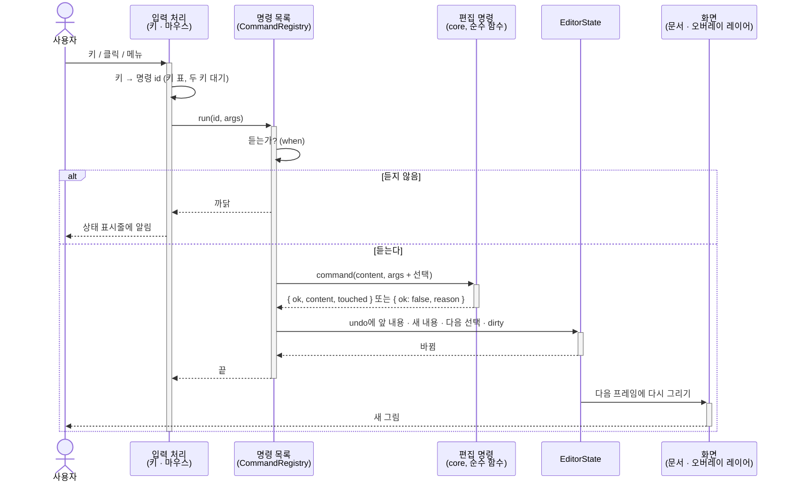

# 편집기

편집 화면과 사용자 입력 처리를 정의합니다. 주변 UI 컴포넌트(툴바, 메뉴, 설정 창, 대화창)는 React로 구현합니다. 다이어그램 영역, 선택 오버레이, 키 입력 처리, 텍스트 입력 요소는 React 밖의 TypeScript입니다 → [[0010-ui-framework|ADR-0010]]

코드: `src/packages/editor` (→ [[0036-code-layout|ADR-0036]])

이 문서는 **어떻게 만드는가**를 적습니다. 무엇이 어떻게 움직여야 하는지(조작 규칙)는 [[02-interaction-rules]], 키는 [[03-keymap]], 모습은 [[04-visual-design]], 웹의 화면 배치는 [[06-web#7. 화면 배치]]에 있습니다.

## 관련 요구사항

- [[01-requirements#3.2 편집]]
- [[01-requirements#^r-lay|R-LAY-03]]
- [[01-requirements#^r-nfr|R-NFR-05]], [[01-requirements#^r-nfr|R-NFR-04]], [[01-requirements#^r-nfr|R-NFR-03]]

## 1. 화면 구성

편집 화면은 **레이어 넷**을 겹쳐 그립니다. 아래 레이어일수록 자주 바뀌지 않습니다.

| 레이어 | 무엇 | 누가 그리나 | 언제 다시 그리나 |
| --- | --- | --- | --- |
| 문서 레이어 | 저장되는 그림과 같은 SVG(블록, 글자, 접기 영역의 테두리와 이름 띠) | `core`의 렌더러(`layout` → `buildScene` → `toSvg`) → 렌더링 백엔드 → [[0030-swappable-drawing\|ADR-0030]] | 내용이나 뷰 상태가 바뀔 때 |
| 오버레이 레이어 | 선택 하이라이트, 키보드 포커스, 드롭 위치, 펼침 삼각형(`▸` `▾`), 이름이 겹친 머리의 표시 | `editor`가 `LayoutResult`의 상자로 그리는 SVG 하나 | 선택 · 드래그 · 포커스가 바뀔 때 |
| 인라인 에디터 | 글자를 고치는 동안의 `<textarea>` 하나 | `editor` | 고치기를 시작 · 끝낼 때 |
| 팝업 레이어 | 컨텍스트 메뉴, 키 힌트, 커맨드 팔레트, 모달 | React | 열고 닫을 때 |

- 문서 레이어와 오버레이 레이어는 같은 좌표계(문서 좌표, px)를 씁니다. 오버레이 레이어는 문서 레이어 위에 같은 크기로 겹친 SVG이고, 저장할 때는 문서 레이어만 씁니다. 그래서 "편집 중에만 뜨는 표시는 저장되는 그림에 넣지 않는다"([[0018-save-as-shown|ADR-0018]])가 구조로 지켜집니다.
- 화면 색(라이트 · 다크)은 오버레이 · 인라인 에디터 · 팝업 레이어에만 듣습니다. 문서 레이어는 문서의 테마로 그립니다 → [[04-visual-design#2. 레이어와 출력]]
- 오버레이 레이어의 색과 굵기는 시각 디자인의 편집 레이어 토큰(`edit.*`)을 씁니다 → [[04-visual-design#7.1 상태 표]]

### 1.1 줌과 팬

- 캔버스는 브라우저의 스크롤 영역(`overflow: auto`)이고, 팬은 그 스크롤입니다(휠, 터치패드, 스크롤바). 따로 손(팬) 도구를 두지 않습니다.
- 줌은 40% ~ 300%, 10% 단위입니다. 문서 · 오버레이 레이어와 인라인 에디터를 감싼 요소에 배율을 곱하고, 줌한 뒤 마우스 아래(키로 했으면 선택한 것)가 제자리에 남도록 스크롤을 맞춥니다. 줌은 보기 상태라 파일에도 실행 취소에도 들어가지 않습니다(그 브라우저의 환경 설정에도 남기지 않음).
- 선택한 것이 화면 밖으로 나가면 가장 가까운 쪽으로만 스크롤합니다(`scrollIntoView({ block: 'nearest' })`와 같음). 줌 중에는 배율을 곱한 상자로 셉니다.

### 1.2 다시 그리기

- 고칠 때마다 문서 전체를 처음부터 다시 셉니다(→ [[0037-two-pass-full-layout|ADR-0037]]). 문서 레이어는 SVG 문자열을 통째로 바꿔 넣습니다. 블록 500개에서 10ms 안팎이라 나누어 고치지 않습니다 → [[02-layout#4. 성능]]
- 한 프레임에 한 번만 그립니다. 명령이 여럿 이어져도(예: 붙인 뒤 선택) `requestAnimationFrame` 하나로 모읍니다.
- 오버레이 레이어는 선택만 바뀌면 문서 레이어를 건드리지 않고 다시 그립니다. 키로 블록 사이를 오갈 때 문서 레이어를 다시 그리지 않으려는 것입니다.

## 2. 상태와 선택

`editor`가 기억하는 것은 아래 하나입니다. 파일에 들어가는 것은 `doc`뿐이고, 나머지는 메모리에만 있습니다(→ [[03-architecture#3.3 의존 규칙]]).

```ts
type EditorState = {
  doc: Doc;                       // 내용 + 뷰 상태 → [[01-model]]
  undo: Content[]; redo: Content[]; // 내용의 스냅숏만. 뷰 상태는 넣지 않는다 → [[01-model#4.4 텍스트 편집과 undo]]
  selection: Selection | null;
  lastSelected: Id | null;        // 선택한 것을 푼 뒤 이동 키를 누르면 여기서 시작
  editing: Editing | null;        // 인라인 에디터가 열려 있으면
  dirty: boolean;                 // 마지막 저장 뒤 내용이나 뷰 상태가 바뀌었는가 (저장 안 됨 표시 ●)
  zoom: number;                   // 줌 배율 0.4 ~ 3
  layout: LayoutResult;           // 마지막으로 센 결과. 히트 테스트와 오버레이 레이어가 쓴다
};

type Selection =
  | { kind: 'blocks'; seq: SeqRef; anchor: Id; focus: Id }   // 같은 줄 안의 연속 범위 → ADR-0008
  | { kind: 'head'; diagram: Id }
  | { kind: 'branchLabel'; branch: Id }                      // 갈래 이름 (If · Case) → 조작 규칙 "갈래 이름 선택"
  | { kind: 'fold'; fold: Id };                              // 접기 영역 전체 (이름 띠나 접힌 칸)
type SeqRef = { owner: Id; slot: string };                   // 그 줄을 가진 노드(다이어그램 · 블록 · 갈래)와 자리
```

- 선택은 언제나 **id**로 적습니다. 내용이 바뀌어 id가 사라지면 그 선택은 풀립니다(`null`). 위치(몇 번째)로 적지 않는 까닭은 undo · 옮기기 뒤에도 같은 것을 가리키게 하려는 것입니다.
- 펴 보인 블록(호출 블록 안에 보이는 Method의 블록)은 `경로/id`로 적습니다(예: `b4/b17`). 모델의 id가 아니라 화면에만 있는 id입니다 → [[01-model#2. 뷰 상태]]

### 2.1 범위를 넓히기 (자동 확장)

`Shift`+클릭과 `Shift`+`↑` `↓`는 같은 함수를 씁니다 → [[0008-contiguous-selection|ADR-0008]], [[02-interaction-rules#여러 블록 선택]]

1. 처음 선택한 블록 `a`와 새로 가리킨 블록 `b`의 조상 목록(자기부터 다이어그램까지, 블록과 줄이 번갈아)을 구합니다.
2. 두 목록이 처음 갈라지는 곳 바로 위의 **같은 줄**을 찾습니다.
3. 그 줄 안에서 `a` 쪽 조상과 `b` 쪽 조상이 범위의 두 끝입니다(`anchor`, `focus`).
4. 둘이 다른 다이어그램이면 넓히지 않고 `b`만 선택합니다.

접기 영역은 줄에 붙은 표시라(→ [[0017-fold-name-in-model|ADR-0017]]) 조상 목록에 들어가지 않습니다. 접힌 접기 영역 안을 가리키면 그 접힌 칸 전체가 끝이 됩니다.

### 2.2 이동

- 키보드 이동(`h` `j` `k` `l`, 방향키, `Ctrl`+방향키, `gg` `G`, `[[` `]]`)은 **화면에 보이는 순서**로 계산합니다. `LayoutResult`에서 다이어그램마다 "보이는 순서"(접힌 것은 하나로, 펴 보인 것은 그 자리에) 목록을 만들고, 규칙([[02-interaction-rules#키보드로 이동하고 넣기]])은 그 목록 위의 함수로 짭니다.
- 이 함수들은 DOM을 쓰지 않고 `Doc`과 `LayoutResult`만 받습니다. 그래서 Node에서 단위 시험을 합니다 → [[07-testing]]

### 2.3 명령 뒤의 선택

편집 명령은 `touched`(새로 생기거나 바뀐 노드의 id)를 돌려줍니다 → [[01-model#4. 편집 명령]]. `editor`는 명령의 종류와 `touched`로 다음 선택을 정합니다. 규칙은 [[02-interaction-rules#키보드로 이동하고 넣기]]에 있습니다.

| 명령 | 다음 선택 |
| --- | --- |
| 넣기 · 붙이기 · 감싸기 · 옮기기 | `touched`(넣은 것, 감싼 새 블록, 옮긴 것) |
| 지우기 · 잘라내기 | 지운 범위의 다음 블록 → 앞 블록 → 담고 있던 블록 (지우기 **전**에 계산해 둔다) |
| 풀기 | 남은 안의 블록들. 안쪽에서 풀었으면 선택한 것 그대로 |
| 실행 취소 · 다시 하기 | 선택한 것이 남아 있으면 그대로, 없으면 `null` |

## 3. 입력에서 명령까지

키 · 마우스 · 메뉴 · 툴바 · 커맨드 팔레트는 모두 **명령 id 하나**로 모입니다. 실행은 한 곳(`run(id, args)`)에서 합니다 → [[0033-command-list-for-shells|ADR-0033]]



UML 시퀀스 다이어그램입니다. 실선 화살표는 호출, 점선 화살표는 반환, `alt`는 조건 분기, 세로 막대는 그 참여자가 일하는 동안(activation)입니다.

- 편집 명령은 `core`의 순수 함수입니다. 선택은 명령의 인자로 넘기고, 명령은 선택을 바꾸지 않습니다. 선택은 2.3의 규칙으로 `editor`가 정합니다.
- "듣는가"(`when`)는 지금의 `EditorState`를 받는 함수입니다. 메뉴의 흐린 항목, 커맨드 팔레트의 흐린 줄, 툴바의 꺼진 단추가 모두 이것을 씁니다.
- 실행하면 안 되는 상태(펴 보인 블록에 내용 명령)는 명령이 아니라 `when`이 막고, 까닭을 알립니다("막지 않고 알린다" → [[01-ux-overview#2. UX 원칙]]).

### 3.1 히트 테스트

마우스가 무엇을 가리키는지는 DOM이 아니라 `LayoutResult`로 셉니다(→ [[03-architecture#3.3 의존 규칙]]).

- 마우스 좌표를 문서 좌표로 바꿉니다(스크롤, 확대 배율, 캔버스의 여백을 뺌).
- 그 점을 담는 **가장 안쪽** 상자를 찾습니다. 상자의 종류: 블록, 머리, 갈래 이름 칸, 접힌 칸, 이름 띠, 펼침 삼각형, 펴 보인 블록. 펼침 삼각형과 갈래 이름 칸처럼 작은 상자가 그 아래 블록보다 먼저입니다.
- 블록 500개까지는 모든 상자를 차례로 보아도 1ms 안쪽이라, 공간 색인(R-tree 등)은 두지 않습니다.

### 3.2 드래그 앤 드롭

규칙은 [[02-interaction-rules#7. 드래그 앤 드롭]], 모습은 [[04-visual-design#7.1 상태 표]]에 있습니다.

- 드래그는 HTML5 드래그 앤 드롭(`dragstart`)이 아니라 포인터 이벤트(`pointerdown` → `pointermove` → `pointerup`)로 직접 만듭니다. 드롭 위치를 블록 사이 · 블록 위로 나눠 보이고, 드래그하는 동안 레이어 2을 그려야 하기 때문입니다. 터치에서도 같은 코드가 듣습니다.
- 4px 넘게 움직여야 드래그로 봅니다. 그 전에 떼면 클릭입니다.
- **드롭 위치 계산:** 가리킨 블록 상자의 위쪽 8px과 아래쪽 8px 띠는 "그 블록의 앞 · 뒤 사이", 나머지는 "블록 위"입니다. 블록의 높이가 24px보다 작으면 위아래를 반씩 나눠 "사이"만 둡니다. 갈래의 빈 블록(`∅`)은 전체가 "빈 블록 위"입니다.
- 드래그하는 동안 오버레이 레이어에 놓을 결과를 그립니다: 사이면 가로줄 + 양 끝 눈금, 블록 위면 그 블록의 테두리 + 커서 곁의 글자("If로 감싸기"). 드롭할 수 없으면 아무것도 그리지 않고 커서를 금지 모양으로 바꿉니다.
- 놓으면 옮기기 · 넣기 · 감싸기 명령 가운데 하나를 `run`합니다. 드래그 자체는 명령이 아니라서, 놓기 전에 `Esc`를 누르면 아무 일도 없습니다.
- 캔버스 가장자리 32px 안으로 드래그하면 그쪽으로 자동 스크롤합니다.

### 3.3 클립보드

- 복사 · 잘라내기는 시스템 클립보드에 둘을 함께 씁니다:
	- `text/plain`: 블록의 글자를 들여쓰기한 줄로(다른 프로그램에 붙이면 의사코드처럼 보이게)
	- `web application/x-ariadne-nsd+json`: 블록 목록의 모델 JSON(Chromium의 웹 맞춤 형식)
- 붙이기는 맞춤 형식이 있으면 그것을 씁니다. 없으면(다른 브라우저, 다른 프로그램에서 복사) `text/plain`의 줄마다 처리 블록 하나를 만듭니다.
- 브라우저가 시스템 클립보드를 막으면(권한 거절, 지원하지 않음) 편집기 안의 클립보드(메모리)를 씁니다. 그때 다른 탭과는 나누지 못합니다.
- 붙인 블록은 모두 새 id를 받습니다 → [[01-model#4.1 내용을 바꾸는 명령]]

### 3.4 글자 고치기

- 인라인 에디터는 `<textarea>` 하나를 다시 씁니다. 고칠 상자의 자리(`LayoutResult`)에 배율을 곱해 놓고, 블록 글꼴과 같은 글꼴 · 크기로 둡니다.
- 칸을 열고 닫을 때까지가 명령 하나입니다. 닫을 때 글자 고치기 명령을 한 번 `run`합니다. 처음과 같으면 실행하지 않습니다 → [[01-model#4.4 텍스트 편집과 undo]]
- 비울 수 없는 칸을 비우면 기본 글자로 되돌리고 닫습니다. 머리의 이름이 겹칠 때만 칸을 다시 엽니다 → [[02-interaction-rules#글자 고치기]]
- 한글 입력(IME) 조합 중의 `Enter`(`isComposing`)는 받아들이기로 보지 않습니다.

## 4. 단축키

키 표는 [[03-keymap]]에 있습니다. 이 절은 키 이벤트를 명령 id로 바꾸는 구현입니다.

- 글자 키는 **자판의 자리**(`KeyboardEvent.code`, 예: `KeyJ`)로 읽습니다. 그래서 한글 입력 상태에서도 `j`가 듣습니다. 대문자는 `Shift`를 함께 본 것입니다 → [[keyboard-keys-and-ime]]
- 인라인 에디터 · 입력 상자 · 메뉴에 포커스가 있으면 편집 키를 처리하지 않습니다(그 요소가 키를 받음).
- **키 시퀀스**(두 키 조합: `dd` `za` `a` + 종류 …): 첫 키를 받으면 "대기 중"이 되고, 둘째 키를 기다리는 시간에 끝은 없습니다. 0.4초가 지나면 키 힌트(이어 누를 키의 목록)를 띄웁니다. 맞지 않는 키나 `Esc`는 대기를 끝냅니다 → [[ux-decisions#K1. 두 키 조합의 안내|K1]]
- 키 표는 데이터(`{ keys: 'd d', command: 'cut' }` 목록) 하나이고, 컨텍스트 메뉴 · 커맨드 팔레트 · 도움말의 키 표가 같은 데이터를 보입니다.
- `Alt`+방향키(옮기기), `Ctrl`+`Shift`+`P`(커맨드 팔레트)처럼 브라우저 · 운영체제가 먼저 가져가는 키는 셸마다 확인해 두고, 가져가면 다른 키를 함께 둡니다(예: 맥의 `Option`).

## 5. 명령 목록과 메뉴

명령 목록(`CommandRegistry`)은 명령 하나에 항목 하나입니다. 메뉴 · 툴바 · 컨텍스트 메뉴 · 커맨드 팔레트 · 키 표는 모두 이 목록에서 만듭니다 → [[0033-command-list-for-shells|ADR-0033]]

```ts
type CommandSpec = {
  id: string;                         // 'block.insert.if', 'edit.cut', 'view.fold.toggle' …
  title: Message;                     // 화면 언어마다의 이름 (R-NFR-04)
  keys: string[];                     // 키 표의 키 ('a i', 'Ctrl+X') — 표시용. 디스패치는 4장의 키 표
  menu?: { menu: MenuId; group: number; order: number };  // 메뉴 바의 자리
  toolbar?: { group: number; order: number; icon: IconId };
  context?: SelectionKind[];          // 컨텍스트 메뉴에 보일 선택의 종류
  when(state: EditorState): true | Reason;   // 듣는가, 아니면 까닭
  run(state: EditorState, args?: unknown): void;
};
type MenuId = 'file' | 'edit' | 'diagram' | 'view' | 'help';
```

### 5.1 메뉴 구성

웹과 데스크톱이 같은 메뉴를 씁니다(웹은 페이지 안의 메뉴 바, 데스크톱은 운영체제의 메뉴 바 → [[06-web#7. 화면 배치]]). Obsidian은 메뉴 바 대신 명령 팔레트와 컨텍스트 메뉴에 올립니다.

| 메뉴 | 묶음 (가로줄로 나눔) |
| --- | --- |
| 파일 | 새로 · 열기… · 최근 파일 ▸ ／ 저장 · 다른 이름으로 저장… ／ 내보내기 ▸ (PNG) ／ 환경 설정… |
| 편집 | 실행 취소 · 다시 하기 ／ 잘라내기 · 복사 · 붙이기 · 앞에 붙이기 · 지우기 ／ 글자 고치기 ／ 위로 · 아래로 · 왼쪽으로 · 오른쪽으로 옮기기 ／ 커맨드 팔레트… |
| 다이어그램 | 넣기 ▸ (처리 · If · Case · While · For · Do-While) · 앞에 넣기 ▸ ／ 감싸기 ▸ · 풀기 ／ 갈래 넣기 · 앞에 갈래 넣기 · 갈래 지우기 ／ 문서 설정… |
| 보기 | 접기 · 펴기 · 모두 접기 · 모두 펴기 ／ 접기 영역 만들기 · 접기 영역 풀기 ／ 접기 영역 보기 ✓ ／ 확대 · 축소 · 100% |
| 도움말 | 사용법 · 단축키 한눈에 ／ 이 판에서 바뀐 것 · AriadneNSD에 대하여 |

- MVP 밖의 명령(Event · Method · 호출 블록 · Method로 빼기)은 그 기능이 들어올 때 다이어그램 메뉴에 더합니다. 접기는 MVP 밖이지만 보기 메뉴의 자리를 먼저 정해 둡니다.
- 메뉴 항목 옆에는 키를 적습니다. 키가 둘이면(`dd`와 `Ctrl`+`X`) 표준 키를 적고, Vim 키는 커맨드 팔레트와 단축키 한눈에서 보입니다.

### 5.2 툴바

[[06-web#7. 화면 배치]]의 순서대로: 새로 · 열기 · 저장 · 내보내기 ／ 실행 취소 · 다시 하기 ／ 잘라내기 · 복사 · 붙이기 ／ 블록 아이콘 여섯 ／ 감싸기 ▾ · 확대 ▾. 블록 아이콘의 누르기 · `Shift`+클릭 · `Ctrl`+클릭 · 드래그는 [[02-interaction-rules#블록 아이콘으로 넣기 · 감싸기]]에 있습니다.

## 6. 셸과의 연결

`editor`와 셸 사이의 인터페이스는 방향이 다른 두 쌍입니다 → [[03-architecture#3.2 editor와 셸의 인터페이스]]

| 방향 | 인터페이스 | 정의 | 구현 | 사용 | 결정 |
| --- | --- | --- | --- | --- | --- |
| 필요 인터페이스 (required, 포트) | `DocumentStore`, `SettingsStore` | `editor` | 셸 (어댑터) | `editor` | [[0031-shell-interfaces\|ADR-0031]] |
| 제공 인터페이스 (provided) | `CommandRegistry`, `SettingsSchema` | `editor` | `editor` | 셸 | [[0033-command-list-for-shells\|ADR-0033]] |

```ts
// 필요 인터페이스: 셸이 구현해 시작할 때 넘긴다
interface DocumentStore {
  readonly name: string;                         // 파일 이름 (화면의 "예제.ns.svg")
  readonly canWriteInPlace: boolean;             // 원래 파일에 쓸 수 있는가 (웹의 Firefox · Safari는 false)
  read(): Promise<string>;                       // .ns.svg 글자
  write(svg: string): Promise<WriteResult>;      // 원래 자리에. 못 쓰면 셸이 내려받기 등으로 대신한다
  writeAs(svg: string, suggestedName: string): Promise<WriteResult>;
  readOther(path: string): Promise<string | null>; // 다른 문서 (R-BLK-09). 읽지 못하면 null
}
type WriteResult = { ok: true; name: string } | { ok: false; reason: 'cancelled' | 'denied' | 'failed'; detail?: string };

interface SettingsStore {
  get<T>(key: string): T | undefined;            // 동기: 시작할 때 셸이 모두 읽어 둔다
  set<T>(key: string, value: T): void;           // 저장은 셸이 알아서 (늦게 써도 됨)
  onChange(listener: (key: string) => void): () => void;  // 다른 창에서 바뀐 것 (Obsidian 설정 화면 등)
}

// 제공 인터페이스: editor가 만들어 셸에 건넨다
interface CommandRegistry {
  list(): CommandSpec[];
  run(id: string, args?: unknown): void;
  onChange(listener: () => void): () => void;    // "듣는가"가 바뀌었을 때 (셸이 메뉴를 다시 그림)
}
interface SettingsSchema {
  list(): SettingSpec[];                         // id · 표시 이름 · 허용 값 · 기본값 · 범위('user' | 'document')
}
```

- 읽기 · 쓰기는 비동기(`Promise`)입니다. 파일 · 네트워크 · 권한 묻기가 끼기 때문입니다. 설정 읽기는 시작할 때 다 읽어 두어 동기입니다(그려야 할 때 기다리지 않게).
- 오류는 던지지 않고 값(`WriteResult`, `null`)으로 돌려줍니다. 사용자가 저장 창을 닫은 것(`cancelled`)은 오류가 아닙니다.
- 설정의 범위가 둘입니다: `user`(환경 설정, `SettingsStore`)와 `document`(문서 설정, 모델의 `settings`) → [[ux-decisions#W5. 설정|W5]]
- 텍스트 폭은 셸이 주입하지 않습니다. `core`가 번들 글꼴의 advance 폭 테이블로 계산합니다 → [[0026-bundled-font-metrics|ADR-0026]]
- 화면 색의 밝기(라이트/다크)와 UI 글꼴은 호스트 플랫폼에서 받습니다(Obsidian이면 Obsidian의 테마 밝기) → [[04-visual-design#8. 테마]]

## 미결정 사항

- [ ] 화면 밝기 · UI 글꼴을 호스트에서 받는 길: `SettingsStore`로 넘길지, 인터페이스를 더할지 → 6장, [[03-architecture#3.3 의존 규칙]]
- [ ] 펴 보인 블록의 화면 id(`경로/id`)를 모델의 `Path`와 어떻게 맞출지(글자로 이을지, 배열로 둘지) → 2장
- [ ] 맥에서 `Alt`(`Option`)+방향키, `Ctrl`+`Shift`+`P`가 운영체제 · 브라우저와 겹치는지 → 4장
