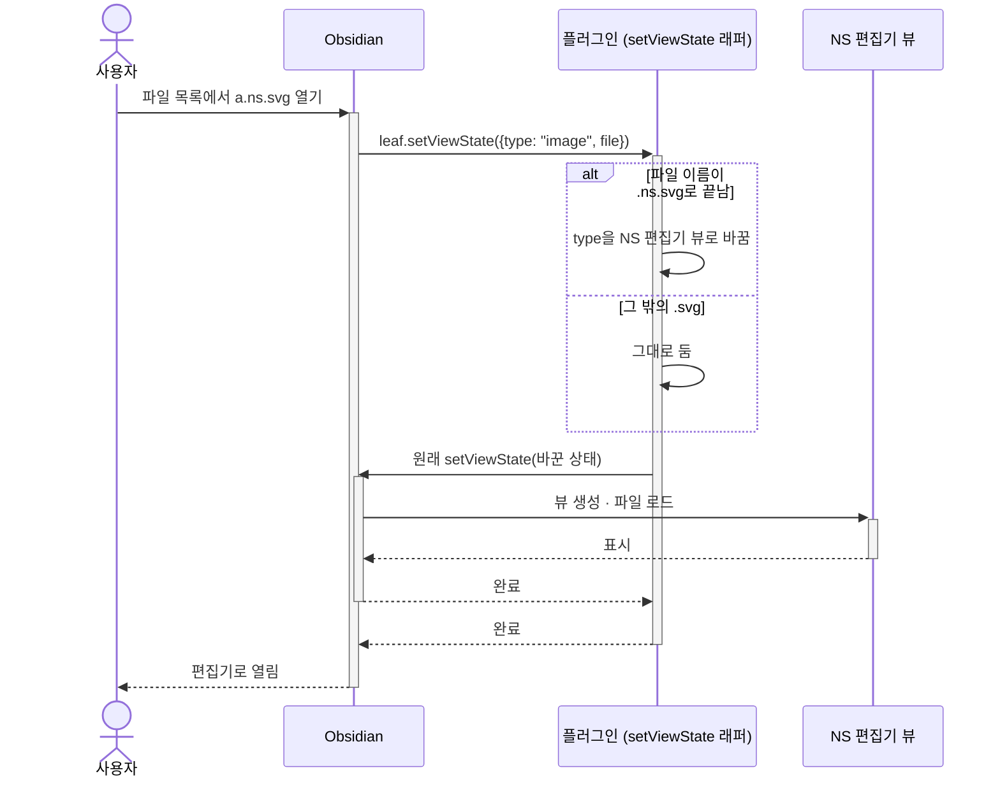
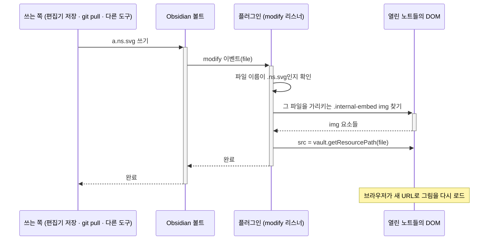

# Obsidian 플러그인 (`apps/obsidian`)

Obsidian 셸입니다. 셸은 `editor`를 감싸는 어댑터로, [[03-architecture#3.2 editor와 셸의 인터페이스|아키텍처 3.2]]의 필요 인터페이스(`DocumentStore`, `SettingsStore`)를 구현하고 제공 인터페이스(`CommandRegistry`, `SettingsSchema`)를 Obsidian의 확장 지점에 등록합니다. Obsidian에서의 구현은 [[0031-shell-interfaces|ADR-0031]] · [[0033-command-list-for-shells|ADR-0033]]에서 정했습니다.

| 인터페이스 | 방향 | Obsidian에서 |
| --- | --- | --- |
| `DocumentStore` | 필요 (셸이 구현) | 볼트 파일 I/O. 다른 문서도 볼트에서 경로로 읽는다 (4장) |
| `SettingsStore` | 필요 (셸이 구현) | 플러그인 설정(`loadData` · `saveData`) |
| `CommandRegistry` | 제공 (셸이 사용) | Obsidian 명령 팔레트, Obsidian 컨텍스트 메뉴 (+ 우리 도구 모음) |
| `SettingsSchema` | 제공 (셸이 사용) | 플러그인 설정 탭 |

## 관련 요구사항

- [[01-requirements#2.1 Obsidian 플러그인]]
- [[0006-file-extensions|ADR-0006]]

## 1. `.ns.svg` 파일 열기

> [!success] 스파이크로 확인함 (2026-10-10)
> 실험 플러그인으로 메인테이너의 Obsidian에서 확인했습니다. 코드: `journal/assets/2026-10-10-obsidian-spike-main.js`

| 확인한 것 | 결과 | 방법 |
| --- | --- | --- |
| 파일 목록에서 `.ns.svg`를 열면 편집기 뷰로 열림 | 됨 | 아래 "가로채기" |
| 일반 `.svg`는 기본 이미지 뷰로 열림 | 됨 | 가로채기 조건을 `.ns.svg`로 한정 |
| 노트의 `![[이름.ns.svg]]`가 그림으로 보임 (읽기·편집 모드) | 됨 | Obsidian 기본 동작. 플러그인이 할 일 없음 |
| 편집기에서 저장하면 노트를 다시 열지 않아도 그림이 바뀜 | 처음엔 안 됨 → 고쳐서 됨 | 아래 "노트 그림 갱신" |
| 노트의 `.ns.svg` 그림 컨텍스트 메뉴에 "Edit NS diagram" | 됨 | 아래 "그림 우클릭 메뉴" |

**확장자 등록만으로는 안 된다.** `registerExtensions(["ns.svg"])`는 오류 없이 등록되지만 효과가 없습니다. Obsidian은 `a.ns.svg`의 확장자를 마지막 점 뒤의 `svg`로 보고, `svg`에 등록된 이미지 뷰 타입(`image`)으로 엽니다.

**가로채기:** `WorkspaceLeaf.prototype.setViewState`를 래핑(몽키 패치)해서, 열려는 뷰 타입이 `image`이고 파일 이름이 `.ns.svg`로 끝나면 뷰 타입을 NS 편집기 뷰로 바꿔 원래 메서드에 넘깁니다. Excalidraw 플러그인이 `.excalidraw.md`를 여는 방식과 같습니다.

**노트 그림 갱신 ([[01-requirements#^obs-refresh]]):** Obsidian은 노트의 그림을 ``로 한 번 렌더링한 뒤, 파일이 바뀌어도 다시 로드하지 않습니다(캐시된 URL). 그래서 볼트의 `modify` 이벤트를 구독해 `.ns.svg`가 바뀌면, 열린 모든 탭에서 그 파일을 가리키는 `.internal-embed` 안의 ``의 `src`를 `vault.getResourcePath(file)`(수정 시각이 쿼리로 붙어 URL이 바뀌므로 캐시를 우회)로 교체합니다. 편집기의 저장이 아니라 볼트 이벤트를 구독하므로 git pull이나 다른 도구로 바뀌어도 갱신됩니다.

- 이 요구사항이 나온 까닭 (2026-10-12에 요구사항에서 옮김):
	- drawio-obsidian은 편집을 마쳐도 노트를 다시 열어야 바뀐 그림이 보인다. 사용자는 이 때문에 [obsidian-refresh-any-view](https://github.com/mnaoumov/obsidian-refresh-any-view) 플러그인을 따로 쓰고 있다. AriadneNSD는 별도 플러그인 없이 갱신되어야 한다.

**그림 우클릭 메뉴 ([[01-requirements#^obs-edit-embed]]):** Obsidian의 공개 API인 `file-menu` 이벤트를 구독해 기존 컨텍스트 메뉴에 항목을 더합니다. 노트의 그림 우클릭은 `source`가 `link-context-menu`, 파일 목록 우클릭은 `file-explorer-context-menu`로 옵니다. 항목은 `setSection('system')`으로 system 구역(기본 앱에서 열기, 폴더에서 보기 …)의 맨 아래에 둡니다. 그 바로 아래가 삭제 항목이 있는 danger 구역입니다.
- 처음에는 DOM의 `contextmenu` 이벤트를 가로채 우리 메뉴만 띄웠는데, Obsidian의 기존 메뉴가 모두 사라졌습니다. 메인테이너의 지적으로 `file-menu` 방식으로 바꿨습니다. 이 부분은 비공개 내부 API에 기대지 않습니다.
- 같은 구역에 항목을 넣는 다른 플러그인이 있으면 우리 항목이 그 뒤로 밀릴 수 있습니다.
- 메뉴 항목의 자리 (2026-10-12에 요구사항에서 옮김):
	- Obsidian의 기존 우클릭 메뉴는 그대로 두고 이 항목만 더한다. 자리는 "이미지 삭제" 바로 위 구역의 맨 아래("파일 탐색기에서 파일 보기" 아래)다.
	- 파일 목록에서 `.ns.svg`를 우클릭해도 같은 항목이 나온다. 자리는 "삭제" 바로 위 구역의 맨 아래("폴더에서 보기" 아래)다.

> [!warning] 남은 위험
> 가로채기(`setViewState` 몽키 패치), 노트 그림 갱신에 쓰는 `.internal-embed`의 `src` 속성과 `` DOM 구조는 Obsidian의 비공개 내부 API입니다. Obsidian이 업데이트되면 깨질 수 있습니다. 본 구현에서는 이 부분을 한 모듈에 격리하고, Obsidian 새 버전마다 돌릴 회귀 테스트 목록을 둡니다.

## 2. 노트에 새 다이어그램 넣기 ("Insert new NS diagram")

요구사항: [[01-requirements#^obs-insert]], [[01-requirements#^obs-insert-command]]. drawio-obsidian의 흐름을 따른다.

> [!info] 미완성
> - 노트 편집 화면의 컨텍스트 메뉴에 항목을 추가하는 방법
> - 탭을 닫을 때까지 삽입 대상(어느 노트의 어느 커서 위치)을 유지하는 방법 (그사이 노트가 수정되거나 닫힌 경우 포함)
> - 새 파일의 이름 규칙과 저장 위치 (제안: 첨부 파일 폴더 설정 따름)
> - 빈 채로 닫았을 때 처리 (제안: 파일 삭제, 삽입 안 함)

## 3. 삽입된 다이어그램 편집 ("Edit NS diagram")

요구사항: [[01-requirements#^obs-edit-embed]], [[01-requirements#^obs-detect]]

우클릭 메뉴와 그림 갱신은 스파이크로 방법을 확인했다. → [[#1. `.ns.svg` 파일 열기]]

> [!info] 미완성
> - `.ns`가 빠진 `.svg`를 내용(모델 요소의 유무)으로 판별해 메뉴를 띄우는 방법 ([[01-requirements#^obs-detect]])

## 4. 볼트 입출력

`DocumentStore`의 Obsidian 구현체입니다. 이 문서와 다른 문서(다른 문서의 Method 호출)를 모두 볼트에서 경로로 읽습니다 → [[0031-shell-interfaces|ADR-0031]]

> [!info] 미완성: 읽기/쓰기 구현, 저장 시점(탭 닫을 때 / 자동 저장), 외부 변경(다른 곳에서 파일이 바뀌었을 때)의 충돌 처리

## 5. 테마 연동

정한 것: 편집 화면(화면 색, 오버레이 레이어 포함)은 Obsidian의 밝기를 따르고, 그림(문서의 테마)은 따르지 않는다 → [[04-visual-design#8. 테마]], [[01-requirements#^fmt-color]]

> [!info] 미완성: Obsidian의 밝기 변경 이벤트를 받아 화면 색을 바꾸는 방법 ([[01-requirements#^obs-theme]])

> [!warning] 위험: 번들 글꼴과 서브세팅 wasm을 `main.js`에 인라인하면 플러그인 번들이 커진다 → [[03-architecture#7. 위험과 검증이 필요한 사항]]

## 미결정 사항

2026-10-12에 요구사항 2.1에서 옮긴 것입니다.

- [ ] 새 파일의 이름과 저장 위치 (제안: Obsidian의 "첨부 파일 폴더" 설정을 따르고, 이름은 `노트이름-diagram-1.ns.svg`처럼 자동 생성)
- [ ] 아무것도 그리지 않고 탭을 닫았을 때 (제안: 파일을 지우고 노트에 삽입하지 않음)
- [ ] 편집 중 저장 시점 (탭을 닫을 때만 / 편집할 때마다 자동 저장)

