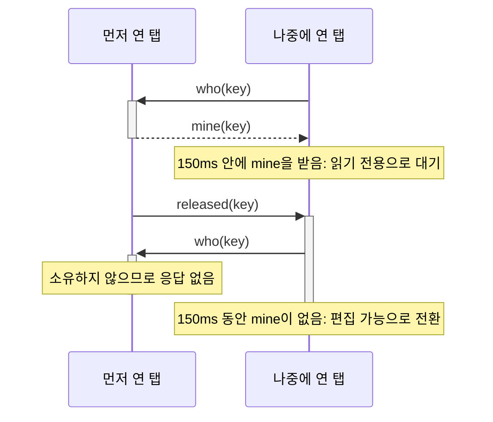

# 웹

웹 셸입니다. 셸은 `editor`를 감싸는 어댑터로, [[01-architecture#4.2 editor와 셸의 인터페이스|아키텍처 4.2]]의 필요 인터페이스를 구현하고 제공 인터페이스를 사용합니다. 웹에서의 구현은 [[0031-shell-interfaces|ADR-0031]] · [[0033-command-list-for-shells|ADR-0033]]에서 정했습니다. 백엔드 서버가 없는 정적 사이트입니다([[01-requirements#^r-web|R-WEB-01]]).

코드: `src/apps/web`, Google Drive 연동도 여기에 둡니다 (→ [[0036-code-layout|ADR-0036]])

| 인터페이스 | 방향 | 웹에서 |
| --- | --- | --- |
| `DocumentStore` | 필요 (셸이 구현) | 브라우저 파일 I/O (1장)와 브라우저 문서 (1.3) |
| `SettingsStore` | 필요 (셸이 구현) | 그 브라우저의 저장소 |
| `CommandRegistry` | 제공 (셸이 사용) | 우리 메뉴 바 · 툴바 · 컨텍스트 메뉴 · 커맨드 팔레트 |
| `SettingsSchema` | 제공 (셸이 사용) | 우리 설정 창 |

## 관련 요구사항

- [[01-requirements#2.3 웹 (정적 페이지)]]: [[01-requirements#^r-web|R-WEB-02]](파일 열기 · 저장), [[01-requirements#^r-web|R-WEB-03]](로컬 백업), [[01-requirements#^r-web|R-WEB-09]](브라우저 문서)
- [[01-requirements#^r-exp|R-EXP-04]](자동 저장, 최근 파일)
- 내보내기 · 인쇄: [[01-requirements#^r-exp|R-EXP-01]](PNG), [[01-requirements#^r-exp|R-EXP-02]](SVG), [[01-requirements#^r-exp|R-EXP-03]](PDF · 인쇄)
- 화면: [[01-requirements#^r-edit|R-EDIT-21]](도움말), [[01-requirements#^r-edit|R-EDIT-24]](커맨드 팔레트), [[01-requirements#^r-nfr|R-NFR-04]](화면 언어)
- 공유 URL과 보기 모드: [[01-requirements#^r-web|R-WEB-05]], [[01-requirements#^r-web|R-WEB-06]] (3장)
- LLM · 에이전트를 위한 안내서: [[01-requirements#^r-web|R-WEB-10]] (3.1)
- AI가 준 텍스트로 열기: [[01-requirements#^r-web|R-WEB-11]] (3.2)
- 알고리즘 갤러리: [[01-requirements#^r-web|R-WEB-12]] (5.1)
- Google Drive, AI 대화창: [[01-requirements#2.4 Google Drive]], [[01-requirements#^r-web|R-WEB-07]]

## 1. 파일 열기·저장

`DocumentStore`([[03-editor#6. 셸과의 연결]])의 웹 구현은 브라우저에 따라 둘입니다. 어느 쪽인지는 시작할 때 `window.showOpenFilePicker`가 있는지로 선택합니다. 열기… · 다른 이름으로 저장… · 새로 만든 문서의 첫 저장은 먼저 앱의 열기 · 저장 창(1.3)을 띄우고, 그 창의 "이 컴퓨터의 파일" 쪽에서 아래 표의 운영체제 창으로 넘어갑니다. 다른 쪽은 브라우저 문서(1.3)입니다.

| | 원래 파일에 쓰기 (Chrome · Edge 등 Chromium 계열) | 내려받기 (Firefox · Safari) |
| --- | --- | --- |
| 열기 | 파일 선택 창(`showOpenFilePicker`). 선택한 파일의 핸들(`FileSystemFileHandle`)를 받는다 | 파일 선택(`<input type="file">`). 내용만 받고, 원래 파일은 모른다 |
| 저장 (`Ctrl`+`S`) | 그 파일에 바로 쓴다. 처음 쓸 때 브라우저가 쓰기 권한을 묻는다 | 같은 이름으로 내려받는다(브라우저의 내려받기 폴더) |
| 다른 이름으로 저장 | 저장 창(`showSaveFilePicker`). 그 뒤로는 새 파일이 "원래 파일" | 이름을 묻고 내려받는다 |
| 자동 저장 | 쓰기 권한을 받은 파일이면 편집하고 2초 뒤. 방금 연 파일은 아직 쓰기 권한이 없어 첫 저장 뒤부터 → [[#2. 로컬 백업과 자동 저장]] | 없음 |
| 새로 만든 문서의 첫 저장 | 열기 · 저장 창, 이 컴퓨터 쪽이면 저장 창 | 열기 · 저장 창, 이 컴퓨터 쪽이면 이름을 묻고 내려받기 |

- 열 수 있는 파일은 `.ns.svg`와 `.ns`입니다([[01-requirements#^r-web|R-WEB-02]]). 선택 창의 필터에 두 확장자를 둡니다. 편집할 수 없는 파일은 지금 문서를 바꾸지 않고, 열지 못한 이유 넷(모델 없음 · 프로토타입의 파일 · 손상 · 더 새 버전 → [[01-file-format#1. 확장자와 판별]])마다 파일 이름을 넣은 문장으로 알립니다.
- 저장 · 다른 이름으로 저장은 `editor`의 명령이고, 웹 셸은 그 `DocumentStore`(위 표)만 구현합니다. 셸이 더하는 명령은 새로 · 열기 · 최근 파일 · 내보내기입니다 → [[03-editor#6.1 새로 · 열기 · 최근 파일]]. 열기에는 키를 두지 않습니다([[03-keymap]]).
- 파일을 이 페이지에 드래그해 놓아도 엽니다(두 흐름 모두). Chromium에서는 놓은 파일의 핸들(`DataTransferItem.getAsFileSystemHandle`)를 받아 원래 파일에 씁니다.
- 내려받기 흐름의 차이는 숨기지 않습니다. 처음 저장할 때 한 번 "이 브라우저는 원래 파일에 쓸 수 없어 내려받습니다"를 알리고, 파일 메뉴의 "저장"을 "내려받기"로 표시합니다.
- 저장되는 텍스트는 `editor`가 만든 SVG 문자열 그대로입니다(같은 모델이면 같은 텍스트 → [[01-requirements#^r-fmt|R-FMT-03]]).
- 문서마다 키 하나(UUID)를 둡니다. 로컬 백업, 최근 파일, 두 탭 잠금, 브라우저 문서(1.3)가 같은 키를 씁니다. 연 파일이 최근 파일에 이미 있으면 그 키를 다시 씁니다: Chromium은 파일 핸들이 같은 파일인지(`isSameEntry`)로, Firefox · Safari의 브라우저 사본은 파일 이름으로 찾습니다.

### 1.1 최근 파일

파일 메뉴의 "최근 파일 ▸"([[01-requirements#^r-exp|R-EXP-04]])는 열거나 저장한 파일을 열 개까지 기억합니다(그 브라우저의 IndexedDB).

- Chromium 계열은 파일의 핸들을 기억합니다. 다시 열면 브라우저가 읽기 권한을 다시 물을 수 있습니다. 파일이 이동되었거나 삭제되었으면 목록에서 흐리게 보이고 이유를 알립니다.
- Firefox · Safari는 원래 파일을 기억할 수 없어, 마지막에 편집한 내용의 **사본**을 기억합니다(로컬 백업과 같은 저장소). 다시 열면 그 사본이 열리고, 저장은 내려받기입니다. 목록에 "브라우저 사본"이라고 표시합니다.
- 브라우저 문서(1.3)는 이름 뒤에 "(브라우저)"를 붙여 보입니다. 다시 열면 그 브라우저 문서가 열립니다. 목록에서 삭제하면 최근 파일에서도 빠집니다.
- 목록은 그 브라우저에만 있습니다. 다른 기기 · 다른 브라우저와 나누지 않습니다.

### 1.2 PNG 내보내기

파일 메뉴의 "내보내기 ▸ PNG"([[01-requirements#^r-exp|R-EXP-01]])는 저장 파일과 같은 SVG를 PNG 이미지로 변환합니다. SVG에 서브셋 글꼴이 들어 있어 화면과 같은 글꼴로 렌더링됩니다.

1. `editor.serialize()`로 저장 파일의 SVG 문자열을 받습니다.
2. 그것을 Blob URL로 `Image`에 읽힙니다.
3. `canvas`에 2배 배율로 렌더링합니다. 배율은 명령의 인자(`{ scale }`, 8배까지)로 바꿀 수 있습니다. 한 변이 16,384px(브라우저가 믿고 렌더링하는 가장 큰 캔버스, Safari가 가장 작음)를 넘으면 배율을 그만큼 낮춥니다.
4. `canvas.toBlob`으로 PNG를 만듭니다. Chromium은 저장 창으로 문서 곁에 저장하고, Firefox · Safari는 내려받습니다. 이름은 문서 이름에서 확장자를 바꾼 것입니다(`예제.ns.svg` → `예제.png`).

내보내기 셋(PNG · SVG · PDF)은 같은 순서로 동작합니다: 저장 창을 먼저 띄우고(누른 순간의 사용자 활성화가 필요해서), 그다음 파일을 만들어 쓰거나 내려받고, 상태 표시줄에 "“{이름}”(으)로 내보냈습니다."를 알립니다. 실패하면 로그에 남기고 형식마다 "… 내보내지 못했습니다."를 알립니다. 저장 창을 닫으면 아무것도 하지 않습니다.

### 1.3 브라우저 문서

파일 없이 문서에 이름을 붙여 그 브라우저에 저장하고, 목록에서 열고 삭제합니다([[01-requirements#^r-web|R-WEB-09]]). 정한 과정 → [[ux-decisions#BS1. 브라우저 안의 문서는 열기 · 저장 창 안에서 고른다|BS1]] ~ [[ux-decisions#BS4. 함께 지워진다는 경고와 백업|BS4]], 시안 M55(https://claude.ai/artifact/CLz2Y1yXLYJfdn6q27Y1PV, 사본 `journal/assets/2026-11-03-browser-storage-study.html`)

**저장하는 곳.** 로컬 백업 · 최근 파일과 같은 IndexedDB 데이터베이스(`ariadne-nsd-web`)의 저장소 `documents`에 문서 하나에 레코드 하나를 둡니다. 레코드는 문서 키(1장), 이름(확장자 없이, "병합 정렬"), 텍스트, 마지막으로 저장한 때, 크기(UTF-8 바이트)입니다. 텍스트는 파일 저장과 같은 SVG 문자열이라(같은 모델이면 같은 텍스트 → [[01-requirements#^r-fmt|R-FMT-03]]) 파일로 내보내면 `.ns.svg` 그대로 열립니다. 데이터베이스의 버전 2가 이 저장소를 더했고, 버전 1(최근 파일 · 로컬 백업)에서 올라갈 때 그 둘의 내용은 그대로 남습니다. localStorage는 쓰지 않습니다(5 MB쯤에서 막힘).

**열기 · 저장 창.** 파일 › 열기…, 다른 이름으로 저장…, 새로 만든 문서의 첫 저장(`Ctrl`+`S`)은 먼저 앱의 모달 "열기" · "다른 이름으로 저장"을 띄웁니다. 맨 위에 두 쪽 "이 컴퓨터의 파일 / 이 브라우저"가 있고, 그 브라우저에서 마지막에 고른 쪽으로 열립니다(처음에는 이 컴퓨터의 파일. 사용자 설정 `web.placeSide`).

- 이 컴퓨터의 파일: 안내 한 줄과 버튼 하나("파일 고르기…" · "저장할 곳 고르기…" · Firefox · Safari의 저장은 "내려받기…"). 버튼을 누르면 1장의 표대로 운영체제의 창이 열립니다. 모달의 클릭이 운영체제의 창이 요구하는 사용자의 동작이 됩니다.
- 이 브라우저(열기): 브라우저 문서의 표(이름 · 고친 때 · 크기, 고친 때 최신순, 지금 연 문서는 굵게, 첫 줄이 선택됨), 경고 한 줄 "이 브라우저 안에만 있습니다. 브라우저의 사이트 데이터를 지우면 함께 지워지니, 가끔 파일로 내보내 두세요.", 버튼 이름 바꾸기… · 파일로 내보내기 · 삭제 · 열기, 그 아래 모두 파일로 내보내기 (.zip) · 파일에서 가져오기….
- 이 브라우저(저장): 이름 칸, 같은 표(줄을 누르면 그 이름이 이름 칸에 들어감), 경고 한 줄 "이 브라우저 안에만 저장됩니다. 브라우저의 사이트 데이터를 지우면 함께 지워집니다.", 버튼 취소 · 저장.
- 고친 때는 오늘이면 시각(14:02), 어제면 "어제", 올해면 월 · 일, 그 전이면 날짜 전체입니다. 크기는 KB 정수(적어도 1 KB), 1 MB부터 MB입니다.
- 좁은 화면(폭 600px 이하)에서는 크기 열을 감추고, 버튼은 여러 줄로 접힙니다.

**이름.** 이름 칸은 브라우저 문서면 그 이름, 아니면 첫 다이어그램의 헤더 이름(Method는 첫 여는 괄호 앞까지, Event는 헤더 전체 → [[0022-call-name-follows-head|ADR-0022]]), 헤더가 없으면 "제목 없음"으로 채워 둡니다. 비워 두고 저장하면 "제목 없음"입니다. 이름은 대소문자와 앞뒤 공백을 무시하고 견줍니다. 다른 문서가 이미 쓰는 이름이면 "“병합 정렬”이(가) 이 브라우저에 이미 있습니다. 바꿀까요?"를 묻습니다(바꾸기 · 취소). 바꾸면 그 문서의 키에 덮어쓰고, 취소하면 열기 · 저장 창으로 돌아갑니다.

**브라우저가 그 문서의 저장 위치.** 브라우저 문서는 "원래 파일"의 한 종류입니다 → [[ux-decisions#BS2. 브라우저가 그 문서의 자리|BS2]]

- `Ctrl`+`S`와 자동 저장(2장)은 그 브라우저 문서에 씁니다. 쓰기 권한이 필요 없어 모든 브라우저에서 자동 저장합니다(설정의 자동 저장 켬/끔을 따름).
- 메뉴 바의 이름 옆에 "브라우저" 딱지를 답니다(`DocumentStore.place`가 `'browser'` → [[03-editor#6. 셸과의 연결]]). 브라우저 탭 제목은 `병합 정렬 – AriadneNSD`입니다.
- 다른 이름으로 저장…에서 이 컴퓨터의 파일을 고르면 파일로 옮겨 가고, 그 뒤로 원래 위치는 그 파일입니다. 브라우저 문서는 목록에 그대로 남습니다. 다른 이름으로 브라우저에 저장하면 새 브라우저 문서가 생기고 앞의 것도 남습니다.
- 브라우저 문서에 저장되면 파일 저장 때처럼 그 문서의 로컬 백업 칸을 삭제합니다. 로컬 백업은 여전히 저장 안 된 편집만 담당하고, 복원하면 그 브라우저 문서로 돌아옵니다.
- 같은 브라우저 문서를 두 탭에서 열면 파일과 같은 규칙입니다(나중 탭은 보기만, BroadcastChannel → 2장).

**목록에서 하는 일.**

- 열기: 줄을 더블클릭, `Enter`, "열기". 다른 문서를 열 때와 같아, 한 번도 저장하지 않은 새 문서면 먼저 묻습니다(2장의 US1).
- 이름 바꾸기…: 새 이름을 `editor`의 모달(`prompt`)로 묻습니다. 다른 문서가 쓰는 이름이면 바꾸지 않고 알립니다. 지금 연 문서면 메뉴 바의 이름도 바뀝니다. 고친 때는 그대로입니다.
- 파일로 내보내기: 그 문서를 `이름.ns.svg`로 저장합니다(Chromium은 저장 창, Firefox · Safari는 내려받기).
- 삭제: "“병합 정렬”을(를) 이 브라우저에서 삭제할까요? 되돌릴 수 없습니다."(삭제 · 취소). `Delete` 키도 같습니다. 그 문서의 최근 파일 항목과 로컬 백업도 지웁니다. 지금 연 문서를 삭제하면 편집 화면은 그대로 두고, 저장하지 않은 새 문서(`병합 정렬.ns.svg`, 저장 안 됨)가 됩니다.
- 모두 파일로 내보내기 (.zip): 모든 브라우저 문서를 `.ns.svg` 파일들로 묶은 zip 하나(`AriadneNSD-2026-11-03.zip`, 날짜는 UTC)로 저장합니다. 파일 이름이 중복되면 번호를 붙입니다.
- 파일에서 가져오기…: `.ns.svg` · `.ns` 파일 여러 개나 그 zip을 골라 브라우저 문서로 들여옵니다(다른 기기 · 브라우저로 옮길 때). 이름은 파일 이름에서 확장자를 뺀 것이고, 이미 있는 이름이면 "이름 (2)"처럼 번호를 붙입니다(덮어쓰지 않음). 편집할 수 없는 파일은 들여오지 않고 그 이름들을 알립니다.
- zip은 `fflate`로 압축하고 해제합니다. 저장 파일의 서브셋 글꼴을 WOFF로 만드는 데 이미 쓰는 라이브러리입니다(→ [[01-architecture#9.1 제품에 들어가는 것]]).

**지워지지 않게.** 처음 브라우저에 저장할 때 한 번 `navigator.storage.persist()`를 요청합니다(저장 공간이 모자랄 때 브라우저가 이 사이트의 데이터를 먼저 지우지 않게. Firefox는 이때 사용자에게 묻습니다). 허락되지 않아도 저장은 하고, 경고 문구는 그대로입니다. 저장이 브라우저의 저장 공간 한도로 실패하면(`QuotaExceededError`) "브라우저의 저장 공간이 모자라 저장하지 못했습니다. 파일로 저장해 주세요."를 알리고 저장 안 됨(`●`)으로 둡니다.

### 1.4 SVG 내보내기 (그림만)

파일 메뉴의 "내보내기 ▸ SVG로 내보내기(그림만)…"([[01-requirements#^r-exp|R-EXP-02]])는 모델을 뺀 순수 SVG를 `이름.svg`로 저장합니다(`.ns.svg`가 아님: 다시 열면 모델이 없어 편집할 수 없음). 내용은 `editor.serializeImage()`의 문자열 그대로이고, 저장 파일에서 `<metadata>` 요소만 뺀 것과 바이트까지 같습니다 → [[01-file-format#4.2 순수 SVG]], [[ux-decisions#XS1. 순수 SVG는 저장 파일에서 모델만 뺀 것|XS1]]

### 1.5 PDF 내보내기

파일 메뉴의 "내보내기 ▸ PDF로 내보내기…"([[01-requirements#^r-exp|R-EXP-03]])는 지금 렌더링한 것(`editor.rendering()`)을 페이지로 나눠(`core`의 `paginate` → [[02-layout#5. 인쇄와 PDF의 페이지]]) 벡터 PDF로 씁니다(`@ariadne-nsd/core/pdf`의 `writePdf`). 라이브러리를 쓰지 않는 작은 작성기이고, 텍스트는 번들 글꼴의 외곽선으로 렌더링합니다 → [[0045-export-pipeline|ADR-0045]]

- 종이는 브라우저의 언어(`navigator.language`)의 지역으로 고릅니다: 미국 · 캐나다 · 멕시코 등 Letter를 쓰는 지역(CLDR)은 Letter, 그 밖은 A4입니다. 정하는 창은 두지 않습니다 → [[ux-decisions#PD2. 종이와 방향은 묻지 않는다|PD2]]
- 작성기와 글리프 읽기는 처음 PDF로 내보낼 때 로드합니다(첫 방문의 내려받기에 들지 않음, 5장). 번들 글꼴(TTF)은 저장과 같은 것을 같은 때에 받습니다.
- 이름은 `이름.pdf`, PDF의 제목(뷰어의 제목 표시줄)은 확장자를 뺀 문서 이름입니다.

### 1.6 인쇄

파일 메뉴의 "인쇄…"와 `Ctrl`+`P`([[01-requirements#^r-exp|R-EXP-03]])는 인쇄 전용 보기를 페이지에 넣고 `window.print()`를 호출합니다(`src/apps/web/src/print/print-view.ts`).

- 인쇄 전용 보기는 `body` 끝의 `<div class="ans-print">` 하나입니다. 페이지마다 `<section>`에 그 페이지가 보일 렌더링 결과의 부분을 인라인 SVG로 넣습니다(PDF와 같은 페이지 나누기). 문자는 화면 글꼴로 그려지므로 번들 글꼴에 없는 문자도 대체 글꼴로 보입니다(PDF와 다른 점).
- 그 요소의 `<style>`이 `@page`의 크기를 정하고(여백 0, 여백은 페이지 안에 둠), `@media print`에서 `body`의 다른 자식을 모두 숨깁니다. 화면에서는 항상 숨어 있습니다. 배경색이 빠지지 않게 `print-color-adjust: exact`를 둡니다.
- 인쇄 창이 닫히면(`afterprint`) 보기를 뺍니다. 브라우저의 메뉴로 인쇄해도(`beforeprint`) 같은 보기를 넣어, 편집 화면이 아니라 다이어그램이 인쇄됩니다.
- 페이지를 만들지 못하면 인쇄하지 않고 "인쇄할 페이지를 만들지 못했습니다."를 알립니다.

## 2. 로컬 백업과 자동 저장

둘은 다른 일입니다. 정한 과정 → [[ux-decisions#W3-b. 임시 보관과 자동 저장|W3-b]]. 두 타이머는 셸에 있고, `editor`는 바뀐 것을 알리고 저장 텍스트와 스냅숏을 제공합니다 → [[03-editor#6.3 자동 저장과 로컬 백업은 셸이 담당한다]]

| | 로컬 백업 ([[01-requirements#^r-web\|R-WEB-03]]) | 자동 저장 ([[01-requirements#^r-exp\|R-EXP-04]]) |
| --- | --- | --- |
| 어디에 | 그 브라우저의 저장소 | 원래 파일(브라우저 문서면 그 브라우저 문서 → 1.3) |
| 언제 | 편집할 때마다, 항상 | 편집하고 2초 뒤. **기본으로 켬**, 설정에서 끔 |
| 어느 브라우저 | 모두 | 원래 파일에 쓸 수 있는 Chromium 계열(Chrome · Edge)에서, 쓰기 권한을 받은 파일만. 방금 연 파일은 읽기 권한만 있으므로 처음 한 번 저장(`Ctrl`+`S`)해 쓰기 권한을 받은 뒤부터. 브라우저 문서는 모든 브라우저에서 |
| 무엇을 막나 | 새로 고침 · 탭 닫기 · 브라우저가 꺼짐으로 잃는 것 | 저장을 잊는 것 (IntelliJ와 같음) |

- 새로 고치거나 다시 열었을 때 로컬 백업에 저장 안 된 내용이 있으면 "지난번 내용을 복원할까요?"를 모달로 묻습니다(버튼 "복원" / "버리기"). 버리면 그 로컬 백업을 지웁니다. 모달은 `editor`의 것(`confirm` → [[03-editor#6. 셸과의 연결]])이고, 브라우저의 `window.confirm`은 쓰지 않습니다. 내려받기 흐름에서 다른 이름을 물을 때도 같은 `editor`의 모달(`prompt`)입니다.
- 자동 저장이 적용되는 동안 저장 안 됨 표시(`●`, [[#7. 화면 배치]])는 편집한 뒤 잠깐만 보입니다.
- Firefox · Safari는 원래 파일에 쓸 수 없어 파일에는 자동 저장이 없습니다. 저장은 내려받기이고, `●`는 내려받을 때까지 남습니다. 브라우저 문서(1.3)는 자동 저장합니다.

- 로컬 백업은 IndexedDB에 문서 하나에 레코드 하나(1장의 문서 키로)로 둡니다. 최근 파일(1.1), 브라우저 문서(1.3)와 같은 데이터베이스입니다. 편집할 때마다 쓰되, 0.5초 안에 이어진 편집은 한 번에 씁니다.
- 페이지는 이 저장소를 연 뒤에 렌더링합니다. 3초 안에 열리지 않거나 다른 탭이 막으면 이 페이지에서만 메모리에 두고 계속합니다(로그에 남김). 그래서 저장소가 응답하지 않아도 화면은 뜹니다.
- 원래 파일이나 브라우저 문서에 저장되면 그 문서의 로컬 백업 칸을 삭제합니다. 그래서 "복원할까요?"는 저장되지 않은 편집이 있을 때만 묻습니다.
- 다른 문서를 열 때(새로 · 열기 · 최근 파일 · 예제 · 끌어 놓기) 지금 문서의 로컬 백업은 남습니다. 파일로 연 문서는 그 파일을 다시 열면 복원을 묻습니다. 페이지를 다시 열 때는 가장 최근의 로컬 백업 하나만 묻기 때문에, 한 번도 저장하지 않은 새 문서는 다른 문서를 열어 고친 뒤에는 복구할 방법이 없습니다. 그래서 그런 문서에 저장 안 된 편집이 있으면 열기 전에 `editor`의 모달(`choose`)로 묻습니다: "“{이름}”은(는) 한 번도 저장하지 않은 새 문서입니다. 다른 문서를 열면 다시 꺼낼 수 없습니다. 먼저 저장할까요?"(버튼 "버리고 열기" / "취소" / "브라우저에 저장" / "저장"). "버리고 열기"는 그 로컬 백업을 지웁니다. "저장"은 첫 저장이라 열기 · 저장 창(1.3)을 띄우고, "브라우저에 저장"은 창 없이 그 이름(1.3의 이름 규칙, 이미 있으면 "이름 (2)")으로 브라우저 문서에 저장한 뒤 열고 "“이름”을(를) 이 브라우저에 저장했습니다."를 알립니다. Firefox · Safari에서는 "저장"이 내려받기라 브라우저 쪽이 더 가볍습니다. 열 수 없는 파일을 골랐으면 묻지 않습니다 → [[ux-decisions#US1. 저장하지 않은 새 문서를 두고 다른 문서를 열 때|US1]], [[02-interaction-rules#다른 문서를 열 때]]
- 같은 파일이나 브라우저 문서를 두 탭에서 열면, 나중에 연 탭에 "다른 탭에서 이 파일을 편집하고 있습니다"를 알리고 보기만 하게 합니다(BroadcastChannel로 서로 알림). 알림이 사라진 뒤에도 까닭이 보이게, 셸은 보기만 하는 까닭 `'otherTab'`을 편집기에 넘기고(`open`의 `readOnlyReason`, `setReadOnly(true, 'otherTab')` → [[03-editor#6.4 읽기 전용]]) 메뉴 바 오른쪽의 라벨이 "보기만 하는 중 · 다른 탭에서 편집 중"(툴팁 "그 탭을 닫으면 여기서 편집할 수 있습니다.")이 됩니다. 셸 시작(`start`)과 문서 전환(`switchTo`)에서 잠금을 얻지 못하면 넘기고, 그 탭이 닫혀 잠금을 되찾으면 지웁니다. 공유 링크의 보기 모드에는 까닭을 넘기지 않습니다 → [[ux-decisions#RO1. 다른 탭이 편집 중일 때의 보기만 하는 중|RO1]]
- 쓰기 권한이 끊기면(브라우저를 다시 열었을 때 등) 자동 저장을 멈추고 저장 안 됨(`●`)으로 둡니다. 다음에 `Ctrl`+`S`를 누를 때 권한을 다시 묻습니다.

> [!info] 미완성: 로컬 백업의 크기 한도(브라우저가 저장소를 비울 때)와, 보관할 문서 수의 한도.

### 2.1 브라우저 저장소의 구조

**IndexedDB.** 데이터베이스는 `ariadne-nsd-web`(버전 2)이고 저장소는 셋이며, 모두 `keyPath`가 `key`(문서 키, 1장)입니다.

| 저장소 | 레코드 | 쓰는 곳 |
| --- | --- | --- |
| `recent` | `key`, `name`, `usedAt`(밀리초), `source`(`{ kind: 'handle', handle }` · `{ kind: 'copy', text }` · `{ kind: 'browser' }`) | 최근 파일(1.1) |
| `backups` | `key`, `name`, `snapshot`(`editor.snapshot()`의 모델 JSON), `savedAt`(밀리초), `handle?`(Chromium: 복원한 문서를 원래 파일에 저장하려고 보유) | 로컬 백업(2장) |
| `documents` | `key`, `name`(확장자 없이), `text`(파일과 같은 SVG 문자열), `savedAt`(밀리초), `size`(UTF-8 바이트) | 브라우저 문서(1.3) |

**localStorage.** 키는 접두사 `ariadne-nsd.setting.` 뒤에 설정의 id를 쓰고, 값은 JSON입니다. 사용자 설정([[03-editor#6.6 설정 목록]])과 웹 셸의 값 `web.downloadNoticeShown`(내려받기 안내를 보였는가), `web.placeSide`(마지막에 고른 쪽), `web.persistAsked`(영구 저장을 요청했는가), `examples.welcomed`(환영 모달에 답했는가), `editor.headStyle`(마지막에 고른 헤더 모양)을 둡니다. 다른 탭이 값을 바꾸면 `storage` 이벤트로 받아 같은 값을 보입니다. 깨진 값은 로그에 남기고 무시합니다. 저장소를 쓸 수 없으면(사이트 데이터 차단) 그 페이지의 메모리에서만 동작합니다.

**두 탭 잠금.** 같은 문서를 두 탭에서 편집하지 않게 `BroadcastChannel`(`ariadne-nsd-documents`)로 통신합니다(`shell/tab-lock.ts`). 메시지는 셋이고 모두 문서 키와 보낸 탭의 id를 담습니다.

| 메시지 | 뜻 |
| --- | --- |
| `who` | 이 문서를 누가 편집하는가 |
| `mine` | 내가 편집한다(소유한 탭의 응답) |
| `released` | 놓았다 |



- 문서를 열 때 `claim`이 `who`를 보내고 150ms 기다립니다. 그동안 `mine`이 오지 않으면 소유합니다. 오면 읽기 전용으로 열고 기다립니다.
- 기다리는 탭은 `released`를 받으면 다시 물어 확인한 뒤에 소유합니다. 여러 탭이 기다려도 한 탭만 소유하게 하려는 것입니다.
- 다른 문서로 바꾸거나 탭을 닫으면 `released`를 보냅니다. "다른 이름으로 저장"으로 키가 바뀌면 묻지 않고 소유를 옮깁니다(`rename`).
- 페이지가 뒤로 · 앞으로 캐시에 들어가면(`pagehide`의 `persisted`) 잠금을 놓지 않습니다. 돌아왔을 때 그대로 이어 편집하기 위해서입니다.
- `BroadcastChannel`이 없는 브라우저에서는 항상 소유합니다.

**시작할 때의 복원.** 공유 링크로 열지 않았으면 셸이 로컬 백업 가운데 `savedAt`이 가장 큰 것 하나를 복원할지 묻습니다. 버리면 그 백업을 지웁니다. 복원하면 그 문서의 원래 위치를 차례로 찾습니다: 백업의 파일 핸들, 같은 키의 브라우저 문서, 최근 파일의 브라우저 사본, 없으면 원래 위치가 없는 문서입니다.

## 3. 공유 URL과 보기 모드

파일 › 공유 링크 복사([[01-requirements#^r-web|R-WEB-05]])는 다이어그램 전체를 링크 하나에 담아 클립보드에 복사합니다. 링크를 연 사람은 보기 모드([[01-requirements#^r-web|R-WEB-06]])로 보고, "편집하기"를 눌러 자기 새 문서로 고칩니다. 서버는 링크를 보지 않습니다. 형식과 그렇게 정한 이유 → [[0043-share-link-in-fragment|ADR-0043]], 조작의 결정 → [[ux-decisions#2026-11-03 공유 URL · 보기 모드 (밤사이 에이전트가 만듦, 메인테이너가 추천안을 받아들임)|SH1 ~ SH6]]

```text
https://ariadnensd.com/#ns1.d.7VZtb9s2EP4rhD5tgO3Ksp0XfxnSdF0LrF2xFRiwYRhoibK4yqRKUnGNov99R0qy...
```

`#` 뒤가 링크의 페이로드입니다: `ns1`(링크 형식과 그 버전) · `d`(인코딩 방식) · 내용, 그 사이는 `.`입니다. 앱이 만드는 링크는 언제나 `d`(또는 `j`)이고, 다른 AI가 손으로 쓰는 `u`는 읽기만 합니다(3.1 → [[ux-decisions#LG2. LLM이 만드는 링크의 꾸림|LG2]], [[ux-decisions#LG5. 사용자가 준 링크를 LLM이 읽는 길|LG5]]).

| | 무엇 |
| --- | --- |
| 위치 | URL의 fragment(`#` 뒤). 브라우저가 서버로 보내지 않아 GitHub Pages의 로그에도 다른 사이트로 가는 리퍼러에도 방문 집계(5.2)에도 실리지 않는다. 페이지 주소는 지금 페이지의 `origin` + `pathname`(query는 뺌) |
| 내용 | UTF-8 JSON `{"name": "정렬.ns.svg", "model": {…}}`. `model`은 파일의 모델 JSON([[01-file-format]])을 들여쓰기 없이 쓴 것으로, 뷰 상태(접힘, 이름 띠 등)도 들어 있다. 렌더링 결과와 서브셋 글꼴은 넣지 않는다(받는 쪽이 같은 렌더러로 다시 렌더링한다) |
| 인코딩 방식 | 브라우저의 `CompressionStream('deflate-raw')`로 압축하고 base64url(패딩 없음)로 기록한다(`d`). CompressionStream이 없는 브라우저는 압축하지 않고 기록한다(`j`). 라이브러리를 더하지 않는다. 읽을 때는 셋째 인코딩 방식 `u`(JSON을 `encodeURIComponent`로 퍼센트 인코딩한 것)도 받는다. 압축이 없어 코드 없이 손으로 쓸 수 있고, 사람과 LLM이 그대로 읽는다. 앱은 `u`를 만들지 않는다 |
| 버전 | `ns1.`이 링크 형식의 버전이다. `ns` + 다른 숫자로 시작하면 "더 새 버전의 AriadneNSD가 만든 링크"라고 알린다. 모델의 버전 규칙(옛 버전은 옮기고 더 새 버전은 거절)은 파일과 같다 |

**링크를 만들 때**(`src/apps/web/src/files/share-command.ts`)

1. `editor.snapshot()`(모델 JSON)과 문서 이름으로 링크를 만든다.
2. 클립보드에 복사한다. `ClipboardItem`이 있으면 링크가 만들어지기 전에(클릭 안에서) Promise로 전달한다. Safari는 클릭 안에서 시작한 복사만 받기 때문이다. 없으면 `writeText`.
3. 길이에 따라 알린다(상태 표시줄 → [[ux-decisions#SH2. 긴 링크|SH2]]).

| 링크 길이 | 하는 일 |
| --- | --- |
| 8 KB 이하 | 복사하고 "공유 링크를 복사했습니다. 링크가 있으면 누구나 이 다이어그램을 볼 수 있습니다."(`info`) |
| 8 KB 넘음 | 복사하고 "공유 링크를 복사했지만 깁니다({크기} KB). 긴 링크를 자르는 앱이 있어 파일로 공유하는 것을 추천합니다."(`warn`) |
| 1 MB 넘음 | 복사하지 않고 "이 다이어그램은 링크에 담기에 너무 큽니다({크기} KB). 파일로 공유해 주세요(파일 › 저장)."(`warn`) |
| 클립보드가 거절함 | `editor`의 모달(`prompt`)에 링크를 넣어 보이고 "클립보드를 쓸 수 없습니다. 이 공유 링크를 복사하세요:" |

8 KB는 메신저 · 메일 · 이슈 트래커가 링크를 자르거나 접기 시작하는 길이를 넉넉히 밑돈다. 블록 150개쯤의 다이어그램이 이 안에 든다. 1 MB는 브라우저가 주소로 받는 한도(Chromium 2 MB, Safari · Firefox는 그보다 작은 경우가 있다)의 안쪽이다.

**링크를 열 때**(`src/apps/web/src/files/share-link.ts`, 셸의 `start` · `openShareLink`)

- 페이지가 fragment가 `ns` + 숫자 + `.`로 시작하는 주소로 열리면 공유 링크다. 그 밖의 fragment는 보지 않는다.
- 링크는 누구나 만들 수 있는 입력이다(QA-21). 링크 길이가 1 MB를 넘으면 풀지 않는다. 스트림으로 풀며 16 MB를 넘는 순간 멈춘다(작은 링크가 크게 풀리는 zip bomb). `u`는 `decodeURIComponent`로 디코딩한다. 디코딩된 텍스트는 링크보다 길 수 없어 길이 한도가 그대로 크기 한도다. 퍼센트 인코딩이 틀리면 손상이다. JSON 봉투는 `name`(문자열)과 `model` 두 키만 받는다. `model`은 파일과 같은 검증 파서(`parseModel`)를 거치고, 이름은 파일 이름 규칙으로 다듬는다(비면 "제목 없음.ns.svg").
- 열 수 없으면 지금 문서를 바꾸지 않고 `editor`의 모달(`confirm`, 제목은 "AriadneNSD")로 이유를 알린다: 첫 줄은 손상(잘렸을 수 있음) · 너무 큼 · 더 새 버전 · 이 브라우저가 압축을 풀 수 없음 가운데 하나, 둘째 줄은 "오류 내용: …"(파서의 detail, 영어), 셋째 줄은 "이 링크를 AI가 만들었다면 오류 내용을 복사해 그 AI에게 붙여 주세요. 고친 링크를 다시 받을 수 있습니다." 버튼은 "닫기" / "오류 내용 복사"(기본). "오류 내용 복사"는 `AriadneNSD could not open the share link (<reason>): <detail>`과 안내서의 주소(`How to make a link that opens: …/llms.txt`)를 클립보드에 넣고 "오류 내용을 복사했습니다. 링크를 만든 AI에게 붙여 주세요."(`info`)를 알린다. 클립보드가 거절하면 그 텍스트를 모달(`prompt`)에 넣어 손으로 복사하게 한다. JSON이 읽히지 않을 때 detail의 끝에는 문자열 밖의 괄호 수가 맞지 않음을 덧붙인다(`; it has 6 "{" but 5 "}"`). 손으로 쓴 링크의 흔한 실수가 닫는 괄호 하나라서다 → [[ux-decisions#LG6. 열지 못한 링크의 까닭|LG6]]
- 페이지를 처음 열 때였으면 그 모달을 닫은 뒤에 평소처럼 시작한다(로컬 백업의 복원을 묻는다).
- 열면 **한 번도 저장하지 않은 새 문서**로, 보기 모드에서 연다(문서 키도 새것). 로컬 백업을 쓰지 않고, 두 탭 잠금에 걸리지 않는다.
- 페이지를 처음 열 때의 공유 링크는 로컬 백업의 "복원할까요?"보다 앞선다. 그 백업은 지우지 않고 다음에 링크 없이 열 때 묻는다. 처음 온 사람의 예제 모달도 띄우지 않는다 → [[ux-decisions#SH5. 링크를 열 때|SH5]]
- 열린 탭의 주소창에 다른 공유 링크를 붙여 넣으면 fragment만 바뀐다(`hashchange`). 다른 문서를 열 때처럼 저장하지 않은 새 문서는 먼저 묻고([[ux-decisions#US1. 저장하지 않은 새 문서를 두고 다른 문서를 열 때|US1]]) 보기 모드로 연다.

**보기 모드**(화면 → [[05-screen-layout#보기 모드]])

- 셸이 보기 모드인지를 가진다(`isViewing`, `onViewMode`). `editor`의 `EditorApp`은 `viewMode`(편집하기 버튼의 처리)를 받으면 메뉴 바 · 툴바 · 상태 표시줄 대신 보기 막대(`ViewBar`)를 렌더링한다. 문서는 읽기 전용(`readOnly`)으로 열리므로 `editor`의 편집 명령은 "보기만 하는 중"의 이유로 거절된다. 선택 이동 · 접기 · 펴기 · 확대 · 스크롤은 된다(뷰 상태라서).
- "편집하기"(`startEditing`)는 같은 문서를 다시 열지 않고 읽기 전용만 해제한다. 그 뒤로는 저장하지 않은 새 문서의 규칙(로컬 백업, [[ux-decisions#US1. 저장하지 않은 새 문서를 두고 다른 문서를 열 때|US1]])을 따른다.
- 보기 모드가 끝나면(편집하기, 또는 다른 문서를 엶) 주소창에서 fragment를 지운다(`history.replaceState`). 편집한 뒤 새로 고치면 링크가 아니라 로컬 백업을 복원하게 하려는 것이다 → [[ux-decisions#SH4. 편집하기|SH4]]

### 3.1 LLM · 에이전트를 위한 안내서

다른 AI(ChatGPT · Claude · Gemini 같은 채팅 LLM, 코드 에이전트)는 이 편집기를 조작하지 못합니다. 대신 사용자에게 공유 링크를 만들어 주고, 사용자가 붙여 준 공유 링크를 읽게 합니다([[01-requirements#^r-web|R-WEB-10]]). 사람에게는 공유 링크 복사를, AI에게는 공유 링크를 주라고 추천하므로 둘이 같은 "누르면 열리는 링크"가 됩니다. 정한 과정 → [[ux-decisions#2026-11-10 LLM · 에이전트 안내서 (M56, 메인테이너가 추천안을 받아들임)|LG1 ~ LG7]]

| 위치 | 무엇 | 원본 |
| --- | --- | --- |
| `/llms.txt` | 영어 안내서 하나(마크다운). 링크를 만드는 법(봉투 `{"name","model"}` → 코드를 실행할 수 있으면 `d`나 `#ns1.u.` + `encodeURIComponent`를 코드로, 실행할 수 없을 때만 손으로 인코딩할 문자와 괄호 수 확인), 링크를 마크다운 링크와 코드 블록에 함께 쓰고 모델 JSON도 코드 블록으로 줄 것(링크가 열리지 않으면 사용자가 JSON을 붙여넣어 연다, 3.2), 모델 JSON과 블록 일곱 가지의 표(횟수를 세는 반복은 For), 규칙 넷(id, 빈 `body` 없음, 보인 키만, 문자열 이스케이프), 예제(최댓값 찾기와 그 링크, Case), 링크가 열리지 않을 때 "까닭"을 받아 고치는 법, 사용자가 준 링크를 읽는 법(`u` · `j` · `d`), 코드를 실행할 수 있으면 `d`를 만드는 법, 큰 문서는 파일로 | 틀 `src/apps/web/guide/llms.txt`. 빌드(웹의 Vite 플러그인)가 값 목록의 슬롯(`{{textKinds}}` 등)을 core의 목록으로 채워 사이트 루트에 낸다. 개발 서버도 같은 주소로 제공한다 |
| `/model.schema.json` | 모델 JSON의 JSON Schema(draft 2020-12). 모양만 검사하고, 이 버전이 지원하는 값(텍스트 종류 · 테마 · 그림 문구의 언어)만 나열한다. 불변식(id는 한 번, 로컬 호출은 Method를, 접기 영역의 끝 블록, 빈 다이어그램)은 앱이 검사한다고 명시한다. 안내서가 한 줄로 가리킨다 | `src/packages/core/schema/model.schema.json` (파서 곁에 둔다. 웹 빌드의 Vite 플러그인이 사이트 루트에 내고, 개발 서버도 같은 주소로 제공한다). 사람이 읽는 풀이는 [[02-model-schema\|모델 JSON 스키마]](스크립트가 스키마에서 만듦) |
| 첫 화면 `index.html` | `<meta name="description">`(AI는 `/llms.txt`를 읽으라는 한 줄), `<link rel="alternate" type="text/markdown" href="/llms.txt">`, 그리고 `#root` 안의 `<section id="for-ai" hidden>`: "이 편집기는 조작할 수 없으니 공유 링크를 주라"는 말, 링크를 만드는 법의 요약, 규칙 넷, 아주 작은 예제(`abs(x)`의 모델과 링크), `/llms.txt`와 스키마의 주소. 또 `#root` 밖(body 끝)의 보이지 않는 텍스트 `#for-ai-note`: "AI assistants and agents: do not operate this editor. Read https://ariadnensd.com/llms.txt and give the user a share link that opens the diagram here." | `src/apps/web/index.html` (블록 종류의 목록은 빌드가 같은 방법으로 채운다) |

- **첫 화면 안에 두는 이유:** 첫 화면 HTML만 읽고 링크를 따라가지 않는 도구가 있다(2026-11-09, ChatGPT가 "로딩 화면만 확인되어" 그리지 못했다고 답함). 그래서 그 HTML 안에 링크를 만들 수 있는 요약을 바로 둔다. `hidden`이라 사람에게는 보이지 않고, 앱이 뜨면 React가 `#root`를 바꾸며 사라진다. 그만큼 첫 내려받기가 늘지만 번들 사이즈 체크(5장)의 한도 안이다. `<link rel="alternate">`는 브라우저가 받지 않아 첫 내려받기에 세지 않는다(`scripts/check-size.mjs`).
- **`#root` 밖에도 두는 이유:** 자바스크립트를 실행하는 브라우저로 페이지를 띄워 화면을 조작하려는 도구가 있다(2026-11-10, Grok이 링크 대신 "Blank document" · "Export as PNG" 같은 화면의 텍스트로 손으로 따라 할 순서를 안내함). 그런 도구는 앱이 뜬 뒤의 DOM을 읽으므로 `#for-ai`를 보지 못한다. 그래서 `#root` 밖에 한두 문장을 보이지 않는 텍스트(visually-hidden: 1px로 잘라 화면에는 없고 DOM과 접근성 트리에는 남음. `hidden`이나 `display: none`이면 접근성 트리와 `innerText`에서 빠진다)로 남긴다. 앱은 `#root` 안만 그리고, body에 붙이는 것(파일 선택 · 인쇄용 요소)은 따로 붙였다 떼므로 이 텍스트를 지우지 않는다. 인쇄할 때는 인쇄용 요소 밖의 body 자식이 모두 숨는다. 스크린 리더도 읽으므로 짧게 두고, 링크를 만드는 법은 `#for-ai`와 `/llms.txt`에 위임한다. 사람에게는 도움말 › AI에게 그려 달라고 하기(사용법의 그 꼭지)가 있다([[03-editor#5.1 메뉴 구성]]) → [[ux-decisions#LG7. 화면을 조작하는 AI에게도 안내가 보이게|LG7]]
- **영어 하나:** 모든 LLM이 가장 정확히 따르는 말이고 필드 이름 · 예제가 이미 영어다. 실험에서 모델들은 영어 안내서를 읽고 한국어 사용자에게 한국어로 답하며 블록 텍스트도 한국어로 썼다. 메뉴 이름은 영어와 한국어 화면의 것을 함께 표기한다.
- **코드를 실행하지 못하는 AI와 `d` 링크:** 공유 링크 복사는 `d` 하나다([[ux-decisions#LG5. 사용자가 준 링크를 LLM이 읽는 길|LG5]]). 안내서는 코드를 실행하지 못하면 `d`의 내용을 짐작하지 말고 저장 파일(파일 › 저장, 모델 JSON이 `<metadata>` 안에 텍스트로 있음)이나 모델 JSON을 요청하라고 안내한다.
- **값 목록은 코드에서:** 안내서에 기록하는 값의 목록(블록 종류, `textKind` · `theme` · `headStyle` · `locale` · 헤더의 `kind` · `resultSymbol`의 값)은 손으로 기록하지 않고 틀의 슬롯으로 둔다. 빌드가 core의 목록(`blockKinds` · `textKinds` · `themeIds` · `headStyles` · `locales` · `headKinds` · `resultSymbols`)으로 채운다(`src/apps/web/src/files/llms-guide.ts`). 형식이 고정된 값의 목록은 core의 `format/model-values.ts` 하나가 원본이고, `satisfies`로 모델의 타입과 맞춰 두어 종류를 더하고 목록을 잊으면 컴파일되지 않는다. 파서도 헤더의 `kind` · `headStyle` · `resultSymbol`을 이 목록으로 검사한다. 스키마의 `enum`은 손으로 적되, core의 테스트가 이 목록들과 같은지(순서까지) 본다.
- **문서 속 예제를 테스트로(doctest):** `src/apps/web/src/files/doc-examples.test.ts`가 `/llms.txt`(채운 뒤), 첫 화면의 안내(채운 뒤), 파일 형식 명세(`docs/05-spec/`의 모든 문서)에서 ```` ```json ```` 블록과 공유 링크(`ns1.u.` · `ns1.j.` · `ns1.d.`)를 꺼내 앱과 같이 연다(`parseModel`, 링크는 `readShareLink` → `parseModel`). 모델 전체는 그대로, 봉투는 그 `model`을, 블록 하나는 모델로 감싸 열고, 스키마도 통과해야 한다. 그 밖의 블록("…"가 든 개요 등)은 바로 앞 줄에 `<!-- doctest: skip: 까닭 -->`을 달아야 하고, 달지 않으면 실패한다. 그래서 형식이 바뀌어 예제가 틀리면 `pnpm test`가 실패한다. 그 밖에 예제 링크가 옆에 보인 모델 그대로로 만든 것인지, 안내서가 적은 메뉴 · 버튼 이름이 셸 카탈로그의 것과 같은지, 링크 대신 제공하는 파일의 틀이 열리는지도 본다. core의 테스트는 골든 파일의 모델이 모두 스키마를 통과하는지, 파서가 거절하는 모양을 스키마도 거절하는지를 본다(`src/packages/core/node/model-schema.test.ts`).
- **다른 AI 기능과의 관계:** 앱 안의 AI 대화창([[01-requirements#^r-web|R-WEB-07]], `P3`)은 사용자의 API 키로 앱이 직접 모델 API를 호출하는 것이고, 이 안내서는 앱 밖의 AI가 링크로 다이어그램을 전달하는 것이다. Claude skill([[01-requirements#^r-skill|R-SKILL-01]] → [[07-claude-skill]])은 이 안내서와 같은 모델 JSON을 쓰고, 링크는 앱의 공유 링크 모듈로 `d` 링크를 생성한다.

### 3.2 붙여넣은 문서

다른 AI가 준 모델 JSON이나 공유 링크를 붙여넣어 새 문서로 엽니다([[01-requirements#^r-web|R-WEB-11]]). AI가 쓴 모델 JSON은 거의 항상 올바르고, 실패하는 곳은 JSON을 링크로 인코딩하는 단계(손 인코딩)와 채팅 앱이 링크를 바꾸는 일(Google 검색 링크로 감쌈)입니다(2026-11-10, AI 네 곳으로 한 테스트). 그래서 링크가 깨져도 코드 블록의 JSON으로 다이어그램을 엽니다. 조작 규칙 → [[02-interaction-rules#붙여넣기]], 결정 → [[ux-decisions#2026-11-21 AI가 준 텍스트로 열기 (M57, 메인테이너가 추천안을 받아들임)|JP1 ~ JP3]]

| | 규칙 |
| --- | --- |
| 인식 (`src/apps/web/src/files/pasted-document.ts`) | 앞뒤 공백과 텍스트 전체를 감싼 코드 펜스(```` ```json ```` … ```` ``` ````)를 제거한 텍스트 **전체**가 다음 가운데 하나일 때만 문서다. ① `"format": "ariadne-nsd"`가 든 JSON 객체(모델 JSON) ② 그런 모델을 `model`로 가진 봉투 `{"name": …, "model": {…}}`(두 키만, `name`은 문자열) ③ `https://ariadnensd.com/#ns1.`이나 지금 페이지의 주소(`origin` + `pathname`) + `#ns1.`로 시작하는 공백 없는 한 줄. `https://www.google.com/search?`(또는 `https://google.com/search?`)의 `q`는 디코딩해 ③으로만 다시 검증한다. 그 밖(설명이 섞인 AI의 답 전체, 다른 JSON, 블록 하나의 JSON, 문장 속의 링크)은 문서가 아니다. 사람이 쓴 텍스트가 우연히 맞지 않게 표지를 형식 이름과 사이트 주소로 둔다 → [[ux-decisions#JP1. 붙여넣기에서 문서를 알아보는 기준\|JP1]] |
| `editor`와의 연결 | 셸이 `pastedDocument`(`isDocument` · `open`)를 `createEditor`의 옵션으로 전달한다. `editor`의 붙여넣기는 클립보드에 사용자 정의 형식이 없고 `text/plain`을 `isDocument`가 인식하면 모달로 묻고, "새 문서로 열기"이면 `open`을 호출한다 → [[03-editor#3.3 클립보드]], [[ux-decisions#JP2. 알아본 뒤의 동작\|JP2]] |
| 열기 (셸의 `openPasted`) | 링크는 공유 링크를 열 때와 같은 경로(`readShareLink` → `parseModel`), 모델 JSON과 봉투는 `parseModel`(파일과 같은 검증, QA-02)을 거친다. 이름은 봉투의 `name`을 파일 이름 규칙으로 다듬은 것, 모델 JSON만이면 "제목 없음.ns.svg"다. **한 번도 저장하지 않은 새 문서**로, 보기 모드가 아니라 편집할 수 있게 연다(문서 키도 새것). 저장하지 않은 새 문서에 편집이 있으면 먼저 묻는다([[ux-decisions#US1. 저장하지 않은 새 문서를 두고 다른 문서를 열 때\|US1]]). 여는 것이라 실행 취소로 되돌리지 않는다 |
| 열 수 없을 때 | 지금 문서를 바꾸지 않고 공유 링크와 같은 모달(`confirm`, 제목 "AriadneNSD", "닫기" / "오류 내용 복사")로 이유를 알린다(3장, [[ux-decisions#LG6. 열지 못한 링크의 까닭\|LG6]]). 링크면 공유 링크의 문구 그대로다. 모델 JSON · 봉투면 첫 줄은 "이 모델 JSON은 손상되어 열 수 없습니다."(또는 "이 문서는 더 새 버전의 AriadneNSD가 만든 것입니다. 페이지를 새로 고친 뒤 여세요."), 셋째 줄은 "이 텍스트를 AI가 썼다면 오류 내용을 복사해 그 AI에게 붙여 주세요. 고친 JSON을 다시 받을 수 있습니다."다. 복사하는 텍스트는 `AriadneNSD could not open the pasted text (<reason>): <detail>`과 안내서의 주소이고, 복사한 뒤 "오류 내용을 복사했습니다. 그 텍스트를 쓴 AI에게 붙여 주세요."(`info`)를 알린다 |
| 파일 › 붙여넣은 JSON으로 열기… (`file.openPasted`) | 셸의 명령(파일 메뉴의 열기… 바로 아래, 키 없음, 커맨드 팔레트에도 있음). `editor`의 `prompt`를 여러 줄 입력 칸(`isMultiline`)으로 호출한다: 제목 "붙여넣은 JSON으로 열기", "AI가 준 모델 JSON이나 공유 링크를 붙여넣으세요.", 버튼 "취소" · "열기"(`Ctrl`+`Enter`도 열기, `Enter`는 줄 바꿈). 받은 텍스트를 위와 같은 규칙으로 연다. 비었거나 취소하면 아무것도 하지 않는다. 인식하지 못하면 같은 모달로 "이 텍스트는 AriadneNSD 문서(모델 JSON이나 공유 링크)가 아닙니다."와 이유(`the text is neither the model JSON nor a share link`, JSON에 형식 이름이 없음, JSON이 읽히지 않으면 파서의 오류와 괄호 수)를 보인다. 클립보드 권한이 필요 없어 클립보드를 읽지 못하는 브라우저(휴대폰)에서도 된다 → [[ux-decisions#JP3. 메뉴로 여는 길\|JP3]] |

- **안내서와 사용법:** `/llms.txt`(3.1)는 링크를 코드 블록에도 그대로 적고 모델 JSON을 함께 주라고, 링크가 열리지 않으면 사용자가 JSON을 붙여넣어 열 수 있다고 안내한다. 사용법의 "AI에게 그려 달라고 하기" 꼭지(`#ai`)에는 사용자가 AI에게 보낼 요청문(안내서의 주소와 "공유 링크와 모델 JSON을 주세요", 그릴 것의 자리 ○○)과 그것을 복사하는 버튼("요청문 복사", `src/apps/manual/pages/copy.js`)이 있다. 페이지를 열지 않는 AI도 요청문의 주소로 안내서를 읽는다 → [[ux-decisions#RQ1. 요청문 복사\|RQ1]], [[ux-decisions#GD1. 안내서 손질\|GD1]]

## 4. Google Drive

> [!info] 미완성: 웹 셸에 통합하는 Drive 연동 ([[0012-google-drive-integration|ADR-0012]]): 새로 만들기 · 연결 앱으로 열기 · 저장 · 미리보기 ([[01-requirements#^r-gd|R-GD-02]], [[01-requirements#^r-gd|R-GD-01]], [[01-requirements#^r-gd|R-GD-03]], [[01-requirements#^r-gd|R-GD-04]]). 확장자는 `.ns.svg` ([[0014-drive-file-extension|ADR-0014]])

## 5. 배포

웹 버전은 GitHub Pages의 사용자 도메인 `https://ariadnensd.com/`의 첫 화면(`/`)에 놓인다(옛 주소 `reddiana.github.io/AriadneNSD/app/`은 첫 화면으로 리다이렉트한다 → [[dr-0021-domain-and-front-page|DR-0021]]). 같은 사이트에 소개(`/about` 영어, `/about/ko` 한국어. 저장소의 `README.md` · `README.ko.md`로 만든다), 설계 문서(`/docs/`, `/atelier/`)와 사용법(`/manual/` 영어, `/manual/ko/` 한국어 → [[dr-0020-user-guide|DR-0020]]), 알고리즘 갤러리(`/gallery/` 영어, `/gallery/ko/` 한국어, 5.1)가 함께 놓이고, 한 GitHub Actions 워크플로(`.github/workflows/pages.yml`)가 모두 빌드해 한 번에 배포한다. 앱 빌드의 base path는 상대 경로 `./`라서(`src/apps/web/vite.config.ts`) 산출물이 서로를 상대 경로로 가리키고, 사이트의 어느 위치에 넣어도 그대로 동작한다. → [[dr-0013-publish-docs-github-pages|DR-0013]]

빌드 산출물(Vite)은 셋으로 나뉘어 내려옵니다.

| 언제 | 무엇 |
| --- | --- |
| 페이지를 열 때 | JS 넷(React와 `core` · `editor` · 셸, 지연 로드하는 PDF 작성기와 함께 쓰는 모듈 두 청크, 그리고 `fflate`. `fflate`는 `fonts`의 WOFF와 브라우저 문서의 zip이 함께 쓰는 청크) |
| 〃 | 화면 글꼴의 슬라이스 0(라틴 · 문장 부호 · 기호, woff2) |
| 예제 모달을 열 때(첫 방문이면 바로) | 미리 렌더링해 둔 예제의 썸네일(화면 언어의 것, WebP 그림). 페이지가 렌더링하지 않고 브라우저가 이미지로 받아 렌더링한다 |
| 화면에 그 문자가 나올 때 | 화면 글꼴의 다른 슬라이스(라틴 확장 · 그리스 · 키릴, 가나 · 자모, 한글) → [[0040-screen-font-slices\|ADR-0040]] |
| 처음 저장 · 내보내기를 할 때(자동 저장이면 첫 편집 뒤) | 서브세팅 wasm(`hb-subset`) |
| 〃 | 서브셋을 떠낼 번들 글꼴(TTF) |
| 처음 PDF로 내보낼 때 | PDF 작성기와 글리프 읽기(번들 글꼴은 위의 것) |
| 텍스트를 외곽선으로 저장하는 문서를 처음 저장할 때 | 글리프 읽기 |

크기는 코드가 바뀔 때마다 달라지므로 이 문서에 기록하지 않습니다. 청크마다의 크기(원래 크기와 gzip)는 웹 빌드(`src/`에서 `pnpm --filter @ariadne-nsd/web build`)가 출력하고, 첫 방문에 내려받는 파일과 그 합은 번들 사이즈 체크(`node apps/web/scripts/check-size.mjs`, CI `check` job의 "번들 사이즈 체크" 단계)가 출력합니다.

CI의 번들 사이즈 체크(bundle size budget)는 첫 방문에 내려받는 것(HTML · JS · CSS · 화면 글꼴의 슬라이스 0, gzip)이 230 KB 안인지 검증합니다(`src/apps/web/scripts/check-size.mjs`, QA-09). 한도는 그것이 필요한 커밋에서 일부러 올리고, 올린 경과는 그 스크립트의 머리 주석에 기록합니다.

> [!info] 미완성: 코드 스플리팅, 캐시 전략

### 5.1 알고리즘 갤러리

잘 알려진 알고리즘을 NS 차트로 보여 주는 정적 페이지입니다([[01-requirements#^r-web|R-WEB-12]]). 편집기를 쓰지 않는 사람에게 NS 차트와 AriadneNSD를 소개하는 자리라서, 앱과 따로 빌드하고 앱의 첫 방문 내려받기에 들지 않습니다. 화면의 규칙 → [[ux-decisions#GL1. 알고리즘 갤러리의 화면|GL1]]

| 무엇 | 원본 · 규칙 |
| --- | --- |
| 알고리즘 22개 | `editor`의 `gallery`(`src/packages/editor/src/gallery/`): 예제([[01-requirements#^r-edit\|R-EDIT-25]]) 가운데 알고리즘인 6개(예제 항목을 그대로 씀)와 갤러리만의 16개. 칸은 고전 · 어려운 것 · 재미 셋. 예제 모달에는 나오지 않는다. 글은 예제와 같다: 코드는 코드 그대로, 주석과 접기 영역의 이름은 화면 언어 |
| 그림과 링크 | `pnpm --filter @ariadne-nsd/web gallery-images`(`src/apps/web/scripts/gallery-images.script.ts`)가 항목 · 언어마다 앱이 저장하는 것과 같은 `.ns.svg`(헤더 모양 "제목")와 그것을 여는 공유 링크(`d`, 앱의 공유 링크 모듈)를 `src/apps/gallery/generated/`에 쓰고, 목록 `gallery.json`(이름 · 설명 · 칸 · 파일 · 링크 · 그림 크기)을 함께 쓴다. 갤러리나 그리기가 바뀌면 다시 실행해 커밋한다 |
| 페이지 | `src/apps/gallery/build.mjs`가 `gallery.json`과 그림을 읽어 `dist/index.html`(`/gallery/`)과 `dist/ko/index.html`(`/gallery/ko/`)을 만들고, 그림을 `dist/files/`에 복사한다. 스크립트(`pages/gallery.js`)와 스타일(`pages/style.css`)은 HTML에 넣는다. 사용법과 같은 방식이다(→ [[dr-0020-user-guide\|DR-0020]]). 공유 카드용 Open Graph 그림은 `pages/og-image.png`(`scripts/make-og-image.mjs`가 만듦) |
| 배포 | 사이트 워크플로(`.github/workflows/pages.yml`)와 로컬 사이트 빌드(`site/build.sh`)가 `dist/`를 사이트의 `/gallery/`에 넣는다 |
| 그림의 검증 | `src/apps/gallery/verify/`(배포하지 않는 개발 도구): 갤러리만의 16개의 블록 텍스트를 Python으로 한 줄씩 옮겨 실행하고 참조 구현과 견준다. 사용법은 그 폴더의 `README.md` |

- **사용법과의 연결:** 사용법의 예제 항목이 알고리즘 갤러리로 링크하고, 갤러리의 머리에는 편집기 · 사용법 · GitHub · 다른 언어로 가는 링크가 있다.

### 5.2 방문 수

사이트의 모든 페이지는 Cloudflare Web Analytics로 방문 수를 셉니다. 쿠키를 쓰지 않고, 보내는 주소는 `origin` + `pathname`뿐이라 공유 링크의 fragment와 query는 나가지 않습니다. → [[0051-cloudflare-web-analytics|ADR-0051]]

| 무엇 | 규칙 |
| --- | --- |
| 신호기 | `https://static.cloudflareinsights.com/beacon.min.js`, 토큰은 `data-cf-beacon`. `location.hostname`이 `ariadnensd.com`(또는 그 하위 도메인)일 때만 스크립트 요소를 만들어 `body` 끝에 붙인다. 로컬 개발 · E2E는 요청을 보내지 않는다 |
| 넣는 곳 | 앱 `src/apps/web/index.html`, 사용법 `src/apps/manual/pages/en.html` · `ko.html`, 갤러리 `src/apps/gallery/build.mjs`의 틀, Quartz 페이지(`site/patch-quartz.mjs`가 `renderPage.tsx`의 `</body>` 앞에 넣음). `/app/` 넘겨주기 페이지에는 넣지 않는다 |
| 세지 않을 브라우저 | 주소에 `?nocount`가 있으면 `localStorage`의 `ariadne-nsd.setting.nocount`를 `true`로, `?count`가 있으면 지운다. 이 값이 `true`이면 신호기를 붙이지 않는다. 저장소를 쓸 수 없으면 센다. 메인테이너가 자기 방문을 빼려고 쓴다 |
| Cloudflare 설정 | Web Analytics의 사이트 `ariadnensd.com`, RUM은 "Enable with JS Snippet installation"(DNS only라 자동으로 넣을 수 없음) |

## 6. PWA

> [!info] 미완성: 오프라인 사용(서비스 워커), 설치 ([[01-requirements#^r-web|R-WEB-04]])

## 7. 웹에서의 화면

편집 화면의 배치(메뉴 바 · 툴바 · 캔버스 · 상태 표시줄, 좁은 화면, 설정 창, 도움말)는 [[05-screen-layout|화면 배치]]에 있습니다. 여기는 웹에서만의 것입니다.

- **시작 화면:** 편집 화면이 뜨기 전에는 "AriadneNSD 불러오는 중…"을 보입니다. 시작하다 오류가 나거나 15초가 지나도 뜨지 않으면, 그 위치에 "시작하지 못했습니다"와 어느 단계에서 멈췄는지, 오류, 브라우저 정보를 표시합니다. 사용자가 그 화면을 찍어 알릴 수 있게 하려는 것입니다(`index.html`)
- 브라우저 탭 제목에도 파일 이름과 저장 안 됨 표시를 넣습니다(`● 예제.ns.svg – AriadneNSD`).
- 처음 온 사람에게 예제 모달을 한 번 띄웁니다([[05-screen-layout|화면 배치]]의 예제). 그 브라우저에서 답했는지는 사용자 설정 `examples.welcomed`(localStorage)에 둡니다. 모달이 떠 있는 동안 키보드 포커스는 모달에 있어 `Esc`로 닫힙니다. 예제의 썸네일은 셸이 미리 렌더링해 둔 이미지(`src/apps/web/src/examples/thumbnails/`, 예제 · 화면 언어마다 하나)를 `ExamplesHost.thumbnailUrl`로 전달해, 모달이 예제 열 개를 레이아웃하지 않게 합니다. 첫 방문의 편집 화면이 CPU 6배 느림에서 0.5초 넘게 빨리 뜹니다. 이미지는 렌더러가 생성한 SVG(쓰인 문자의 서브셋 글꼴이 든)를 Chromium으로 WebP로 바꾼 것입니다(최대 440 × 248 픽셀, 노트북 화면의 썸네일 칸의 두 배). SVG를 그대로 두면 브라우저가 그 안의 문자를 메인 스레드에서 배치하고 그려, 썸네일 열 개가 채워지기까지 CPU 6배 느림에서 1.5초쯤 더 걸리고 그동안 글꼴 슬라이스도 늦게 왔습니다. WebP는 메인 스레드 밖에서 풀립니다. 크기는 같습니다(한 언어 열 개에 약 84 KB). 어느 SVG로 만들었는지는 `sources.json`에 해시로 남겨, 예제나 렌더러가 바뀌어 썸네일이 최신 상태가 아니면 테스트가 브라우저 없이 실패하고, `pnpm --filter @ariadne-nsd/web thumbnails`로 다시 만듭니다. 미리 렌더링한 이미지가 없는 셸에서는 모달이 직접 렌더링합니다.
- 저장 안 된 채 브라우저 탭을 닫으려 하면 묻습니다(브라우저의 "나가시겠습니까?"). 로컬 백업이 있어 내용을 잃지는 않습니다.
- 환경 설정은 그 브라우저의 저장소(`localStorage`)에 남습니다.
- **툴바 아이콘**은 명령의 `toolbar.icon` id로 고릅니다: `file.new` · `file.open` · `file.save` · `file.export`, `edit.undo` · `edit.redo`, `edit.cut` · `edit.copy` · `edit.paste`, `block.process` · `block.if` · `block.case` · `block.while` · `block.for` · `block.doWhile`, 그리고 드롭다운의 `zoom`과 예제 모달을 여는 `examples`. 블록 아이콘은 블록의 모양과 색을 줄인 22 × 16 그림(`BlockIcon`, 밝은 테마의 색)이고, "감싸기 ▾"의 아이콘(`WrapIcon`)도 같은 방식으로 분기 색의 테두리 안에 처리 색의 블록을 그립니다 → [[ux-decisions#TB2. 감싸기 ▾의 아이콘|TB2]]. 나머지는 24 × 24 격자의 선 아이콘입니다(임시). 아이콘이 없는 id는 명령 이름을 텍스트로 보입니다. 툴팁은 명령 이름과 키이고, 지금 적용되지 않으면 그 이유입니다.

> [!info] 미완성: 툴바 아이콘(블록 아이콘과 감싸기 말고)의 디자인을 정하는 것. 지금 아이콘은 임시입니다.

## 8. 로그

문제 알리기 보고서([[02-interaction-rules#8. 문제 알리기 보고서]])에 넣을 로그는 셸이 메모리에 둡니다. 최근 200줄만 남기고, 줄마다 시각(ISO 8601)을 앞에 붙입니다. `editor`의 예상하지 못한 오류(`createEditor`의 `log`)와 셸의 실패(파일 읽기, PNG 내보내기 등)가 여기에 옵니다.

## 9. 점검 모드

앱 주소에 `?perf`를 붙여 열면(`https://ariadnensd.com/?perf`) 편집기 대신 점검 모드가 뜹니다. 개발 환경이 없는 기기(오래된 노트북, 휴대폰)에서 사람이 인수 테스트 [[01-requirements#^at|AT-05]](블록 500개 문서에서 편집 응답, [[03-quality-attribute-scenarios#QA-07 편집 반응 시간|QA-07]])를 측정하는 페이지입니다. 개발 · 점검용이라 메뉴에 진입 경로는 없고 사용법에도 포함하지 않습니다. 측정 방법은 [[02-test-architecture#5.1 기준 기기에서 AT-05 측정하기]]에 있습니다.

- **로드:** `main.tsx`가 맨 앞에서 `?perf`를 보고, 그때만 점검 모드의 모듈(`src/apps/web/src/perf/`)을 동적 import로 로드합니다. 첫 방문의 내려받기에는 주소를 보는 작은 함수만 듭니다. 점검 모드가 앱의 영역을 차지하면 `main.tsx`의 나머지는 실행되지 않습니다.
- **화면:** 실제 편집기(`EditorApp`, 앱과 같은 메뉴 · 툴바 · 다이어그램) 위 오른쪽 아래에 패널 하나를 띄웁니다. 무엇을 측정하는지, 기준(명령마다 p95 100ms 이하), 다른 탭과 앱을 닫고 측정하는 동안 손대지 말라는 안내, 아무것도 저장하지 않는다는 말, "측정 시작" 버튼, 진행 막대, 결과입니다. 화면 언어는 사용자 설정을 따르고(영어 · 한국어), 문구는 점검 모드만의 카탈로그(`perf-messages.ts`)에 있어 첫 방문에는 내려오지 않습니다. 모양은 편집기 UI의 것(모달 · 표 · 버튼, 화면 색 토큰)을 씁니다.
- **문서:** 처리 블록 500개짜리 한 다이어그램을 스스로 만들어 엽니다. 만드는 함수(`large-document.ts`)는 브라우저 테스트 T-0007과 같은 것입니다.
- **명령:** 8가지입니다. 처리 블록 넣기(`o`), 블록 지우기(`x`), 실행 취소(`u`), 다시 실행(`U`), 조건 블록으로 감싸기(`s i`), 아래로 이동(`Alt+j`), 블록 붙여넣기(`p`), 고친 텍스트 받아들이기(인라인 에디터에서 `Enter`). 문서의 앞(블록 2) · 가운데(250) · 끝(499)에서 명령마다 10번씩, 모두 30번 측정합니다. 위치마다 앞의 2번은 웜업으로 버립니다. 시간을 측정하지 않는 준비 키(지우기 뒤의 실행 취소, `s`, `y y`, 인라인 에디터 열기)는 앞에 누르고, 한 번 측정한 뒤에는 실행 취소로 같은 문서와 같은 선택으로 돌아갑니다(돌아가지 못하면 문서를 다시 엽니다).
- **시간:** T-0007과 같은 정의입니다. 키 이벤트를 보내기 직전의 `performance.now()`부터, 문서 레이어(`.ans-document`)가 바뀐 뒤의 프레임까지(`requestAnimationFrame` 두 번)입니다. 편집기는 첫 프레임에 렌더링하므로 화면 주사율에 묶여, 60Hz 화면에서는 아무리 빨라도 17 ~ 33ms쯤이 나옵니다. 레이어가 바뀌지 않은 명령은 시간이 뜻이 없으므로 측정을 멈추고 알립니다.
- **구간:** 같은 실행을 [[03-quality-attribute-scenarios#QA-07 편집 반응 시간|QA-07]]의 측정 구간(입력 · 편집 명령 · 불변식 검사 · 레이아웃 · 그림 · 알림 · DOM 반영 · 브라우저)으로 나눕니다. 점검 모드만 편집기에 단계 타이머(`createEditor`의 `time`)를 전달하고, 편집기와 `core`가 그 타이머로 제 부분을 감쌉니다. 측정할 때 한 부분의 시간에서는 그 안의 부분을 빼므로 구간을 더하면 전체 시간이 됩니다. 입력은 키 처리의 동기 시간에서, 브라우저는 그 뒤 두 프레임의 시간에서 측정한 구간을 뺀 나머지입니다(`perf-segments.ts`). 타이머가 없으면(앱) 부분을 그대로 실행만 합니다.
- **결과:** 맨 위에 전체 판정(모든 명령의 p95가 100ms 이하이면 합격), 명령마다 중앙값 · p95(가장 가까운 순위) · 최댓값 · 판정의 표, 명령마다 구간별 p95의 표(제목 아래에 C&C 뷰의 커넥터, 구간마다 제 p95라서 한 줄을 더해도 명령의 p95가 되지 않음), 앱 버전, 날짜, 문서와 횟수, 브라우저(`userAgent`), 기기(`navigator.hardwareConcurrency`, 있으면 `navigator.deviceMemory`, 화면 크기와 픽셀 비율)입니다. "결과 복사"는 같은 것을 마크다운(목록과 표)으로 클립보드에 넣습니다. 클립보드를 쓸 수 없으면 텍스트 상자에 보여 손으로 복사하게 합니다.
- **아무것도 쓰지 않음:** 웹 셸을 만들지 않으므로 로컬 백업 · 자동 저장 · 최근 파일 · 브라우저 문서 · 탭 사이의 알림이 없고, IndexedDB를 열지도 않습니다. 설정은 `localStorage`에서 읽기만 하고 바꾼 것은 메모리에 둡니다. 문서의 `DocumentStore`는 저장을 거절하고(`denied`), 저장 글꼴을 받지 않으며, 클립보드는 메모리 안의 것이라 사용자의 클립보드를 건드리지 않습니다. 측정한 문서는 끝나면 버리고 빈 새 문서를 엽니다. 이것은 단위 테스트와 E2E(점검 전후로 `localStorage`와 IndexedDB 전체가 같은지)가 지킵니다.
- 주소의 `rounds=`(1 ~ 100)는 위치마다의 측정 횟수를, `blocks=`(4 ~ 2000)는 문서의 블록 수를 바꿉니다. 브라우저 테스트가 짧고 가볍게 실행하려고 씁니다(AT-05의 측정은 둘 다 없이).

## 10. 모듈과 시작 순서

`src/apps/web/src`의 구성입니다.

| 위치 | 담당 |
| --- | --- |
| `main.tsx` | 시작 순서. 설정 · 데이터베이스 · 편집기 · 셸을 만들어 서로 연결한다 |
| `app.tsx` | 최상위 React 컴포넌트. `EditorApp`과 파일을 끌어 올 때의 안내를 렌더링한다 |
| `editor-contract.ts` | 셸이 사용하는 `editor`의 좁은 계약. 셸의 모듈은 이 타입만 읽고, `main.tsx`가 실제 `editor`와 연결한다 |
| `shell/` | 웹 셸: 명령과 문서 전환(`web-shell.ts`), 열기 · 저장 창(`places.ts`), 두 탭 잠금(`tab-lock.ts`), 페이지 이벤트(`page-events.ts`), 화면 밝기(`appearance.ts`), 셸의 문구(`messages.ts`) |
| `storage/` | 브라우저 저장소: IndexedDB(`browser-db.ts`), 최근 파일 · 브라우저 문서의 규칙(`recent-files.ts` · `browser-documents.ts`), 설정(`settings-store.ts`) |
| `files/` | 파일과 내보내기: `DocumentStore` 구현(`web-document-store.ts`), File System Access와 내려받기(`file-system-access.ts` · `file-fallback.ts`), PNG · PDF, 공유 링크, 붙여넣은 문서의 인식(`pasted-document.ts`), zip |
| `print/` · `examples/` · `fonts/` · `perf/` | 인쇄 전용 보기(1.6), 예제와 썸네일, 글꼴의 로드, 점검 모드(9장) |

시작 순서입니다. 단계마다 이름을 남겨, 시작하지 못하면 어느 단계에서 멈췄는지 시작 화면에 표시합니다(7장).

1. 설정: `SettingsStore`를 만들고 화면 언어를 정합니다. `?perf`면 점검 모드로 가고 여기서 끝납니다.
2. 데이터베이스: IndexedDB를 엽니다(2장의 3초 제한).
3. 편집기와 셸: 공유 링크(URL의 프래그먼트)를 읽고, `editor`와 웹 셸을 만듭니다.
4. 렌더링: React 화면을 렌더링합니다.
5. 셸 시작(`shell.start`): 셸의 명령을 등록하고, 최근 파일을 읽고, 탭 잠금을 얻은 뒤, 공유 링크를 열거나 로컬 백업의 복원을 묻습니다(2.1).
6. 글꼴: 블록 글꼴을 기다립니다.
7. 준비 완료: `<html data-ready="true">`로 표시합니다.

## 미결정 사항

아직 없음. 웹 화면의 질문(W1 ~ W6)은 2026-11-01에 모두 정했습니다 → [[ux-decisions#11. 웹 화면 (2026-11-01)]]
