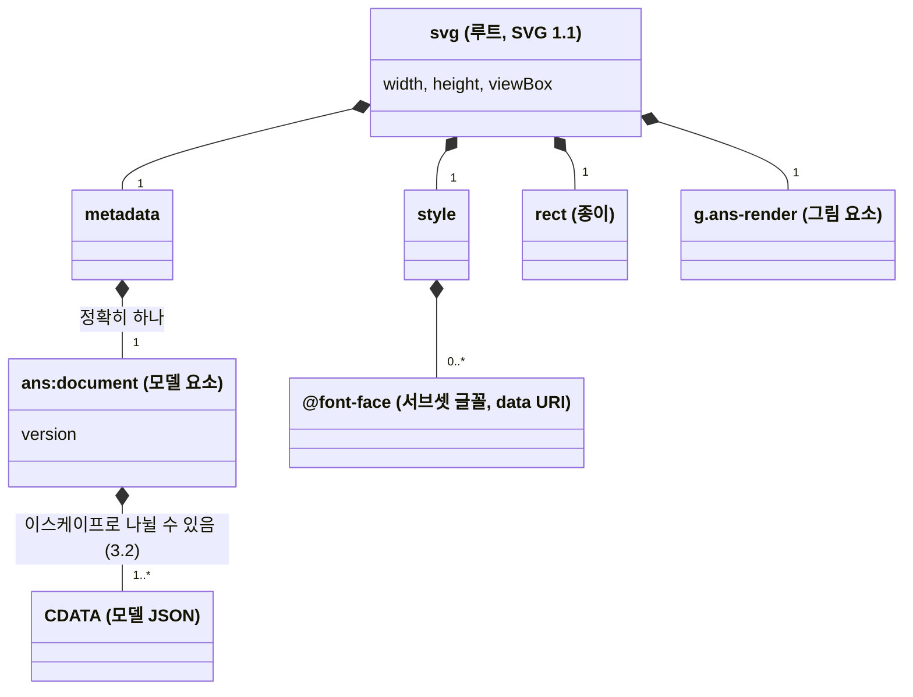
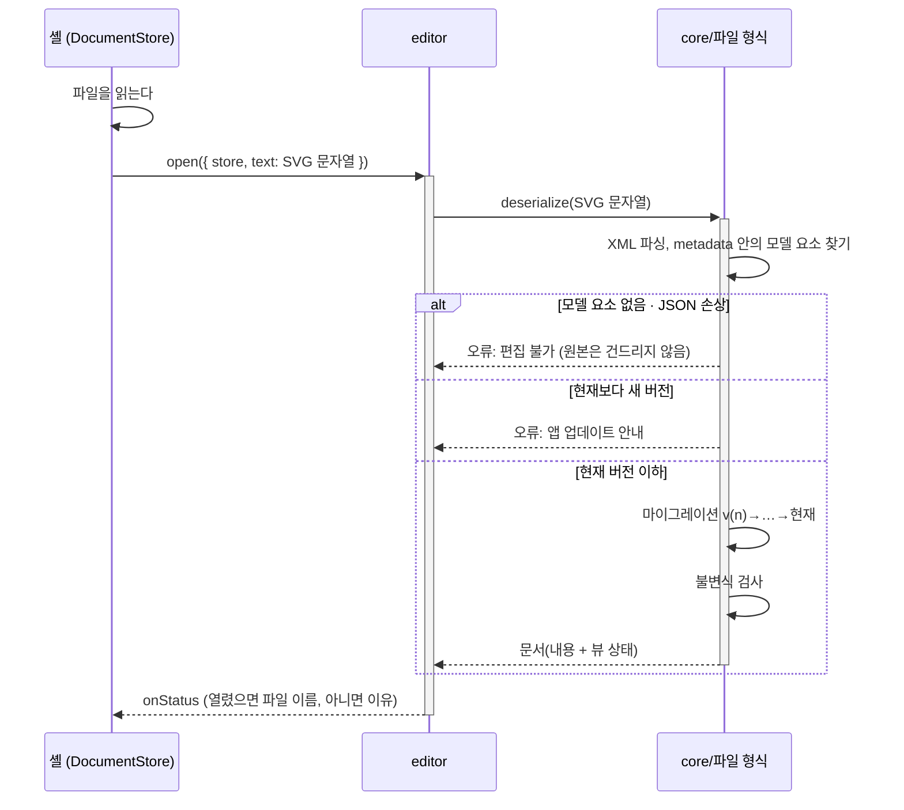

# 파일 형식 명세

배포 대상들이 주고받는 저장 파일, 곧 모델을 내장한 SVG의 형식입니다. 앱들 사이의 계약(호환성 계약)이므로, 첫 출시 뒤에는 **형식 버전이 바뀔 때만** 수정합니다.

- 관련 요구사항: [[01-requirements#3.4 파일 형식]]
- 관련 결정: [[0005-model-embedded-svg|ADR-0005]](모델 내장 SVG), [[0006-file-extensions|ADR-0006]](확장자), [[0007-json-serialization|ADR-0007]](JSON), [[0014-drive-file-extension|ADR-0014]](Drive), [[0017-fold-name-in-model|ADR-0017]](접기 영역의 이름), [[0018-save-as-shown|ADR-0018]](화면 그대로 저장, 뷰 상태), [[0021-event-and-method|ADR-0021]](Event와 Method), [[0022-call-name-follows-head|ADR-0022]](호출 블록), [[0026-bundled-font-metrics|ADR-0026]](서브셋 글꼴), [[0034-default-block-font|ADR-0034]](기본 블록 글꼴), [[0035-model-namespace-and-v0|ADR-0035]](모델 네임스페이스, 프로토타입 파일)
- 모델의 구조는 [[03-architecture#3.4 문서 모델]]과 [[03-architecture#3.5 내용과 뷰 상태]]를 따릅니다. 필드 이름과 스키마는 [[01-model]] 설계에서 굳힙니다.

> [!warning] 지금 상태
> 2장(문서 구조)과 3장의 구조는 아키텍처를 따르고, **필드 이름은 안**입니다. 프로토타입이 쓰는 파일(`version: 0`)은 이 형식과 다릅니다(7장).

## 1. 확장자와 판별

| 확장자 | 쓰는 곳 |
| --- | --- |
| `이름.ns.svg` | Obsidian 플러그인(만드는 파일), Google Drive에서 만드는 파일([[0014-drive-file-extension\|ADR-0014]]), Claude skill이 내놓는 파일. 데스크톱 · 웹도 연다 |
| `이름.ns` | 데스크톱 · 웹에서 만드는 파일. 내용은 `.ns.svg`와 같다 |

1. 확장자는 1차 판별에만 쓴다.
2. 실제로 열 때는 `<metadata>` 안의 모델 요소가 있는지로 확인한다(내용 기반 판별).
3. 모델 요소가 없거나 JSON이 손상되었으면 편집 불가로 처리한다. 원본 파일은 덮어쓰지 않는다. 그림 요소를 역해석해 모델을 복원하지 않는다([[01-requirements#^r-fmt|R-FMT-06]]).
4. `.nsd`(Structorizer)는 이 형식이 아니다. 가져오기 대상으로만 취급한다.

## 2. 문서 구조



UML 클래스 다이어그램으로 그린 XML 요소의 포함 관계입니다. 채운 마름모(`*--`)는 **합성**(자식 요소), 숫자는 다중성입니다. 위아래 순서는 문서 안의 순서가 아닙니다. 순서는 아래 예시를 따릅니다.

```xml
<svg xmlns="http://www.w3.org/2000/svg" version="1.1" width="…" height="…" viewBox="…">
  <metadata>
    <ans:document xmlns:ans="https://github.com/reddiana/AriadneNSD" version="1"><![CDATA[
{ "format": "ariadne-nsd", "version": 1, … }
    ]]></ans:document>
  </metadata>
  <style>
    @font-face { font-family: "…"; src: url(data:font/woff;base64,…); }  /* 서브셋 글꼴 (WOFF) */
  </style>
  <rect width="100%" height="100%" fill="#ffffff"/>  <!-- 종이 -->
  <g class="ans-render"> … </g>                       <!-- 모델에서 생성한 그림 -->
</svg>
```

- 루트는 SVG 1.1 `<svg>` 요소다([[01-requirements#^r-fmt|R-FMT-01]]).
- 모델 요소의 네임스페이스 URI는 `https://github.com/reddiana/AriadneNSD`이고 접두어는 `ans`다. 버전 번호는 넣지 않는다. 주소가 아니라 이름이므로, 저장소의 자리가 바뀌어도 그대로 둔다 → [[0035-model-namespace-and-v0|ADR-0035]]
- 모델 요소의 이름은 `ans:document`다. 모델 요소는 `<metadata>` 안에 **정확히 하나** 있다. 모델 요소의 `version` 속성과 JSON의 `version` 필드는 같은 값이다.
- **서브셋 글꼴:** 번들한 글꼴을 그 그림에 쓰인 문자만 남기도록 서브세팅해 `<style>`의 `@font-face`에 data URI로 넣는다. 그림의 `font-family`는 이 글꼴 다음에 폴백 글꼴 목록을 적는다 → [[0026-bundled-font-metrics|ADR-0026]], [[01-requirements#^r-fmt|R-FMT-07]]. 서브셋 글꼴도 같은 모델이면 같은 바이트여야 한다(3.1). 서브셋 글꼴의 형식은 **WOFF**(`font/woff`)다. 압축은 버전을 고정한 JS zlib 라이브러리로 한다 → [[0039-woff-subset-font|ADR-0039]]
- **종이:** 테마의 종이 색 사각형을 둔다(밝은 기본 테마는 흰색). 투명하게 두지 않는다. 그림의 색은 늘 테마의 색이다 → [[01-requirements#^r-fmt|R-FMT-08]], [[04-visual-design#2. 레이어와 출력]]
- 그림 요소는 모델에서 생성한 파생 데이터일 뿐이며, 읽을 때 무시한다(단일 원천은 모델: [[01-requirements#^r-fmt|R-FMT-05]]). 저장되는 그림은 지금 화면 그대로이고 오버레이 레이어의 표시(선택 표시 등)는 넣지 않는다 → [[0018-save-as-shown|ADR-0018]]

## 3. 모델 JSON

맨 위의 구조는 아래와 같습니다.

```json
{
  "format": "ariadne-nsd",
  "version": 1,
  "settings": { "textKind": "plain", "theme": "default", "headStyle": "shape" },
  "diagrams": [
    {
      "id": "d1",
      "head": { "kind": "method", "text": "partition(a, lo, hi)" },
      "body": [ … 블록 … ]
    }
  ],
  "view": {
    "folded": [ … 접힌 접기 영역 · 갈래의 id … ],
    "opened": [ … 인라인으로 펴 보인 호출 블록의 경로 … ],
    "bands": true,
    "resultSymbol": "←"
  }
}
```

| 묶음 | 무엇 | undo |
| --- | --- | --- |
| `settings` | 문서 설정: 블록 텍스트의 종류([[01-requirements#^r-lay\|R-LAY-06]]), 테마, 헤더 모양([[01-requirements#^r-lay\|R-LAY-10]]) | 대상 |
| `diagrams` | 다이어그램의 목록(순서가 있음). 헤더(없음 / Event / Method, [[0021-event-and-method\|ADR-0021]])와 본문 | 대상 |
| 블록 | 처리 · If · Case · While · Do-While · For · 호출 등(`kind`로 판별하는 유니온). 제어 블록은 분기나 본문으로 블록의 줄(`Seq`)을 합성한다. 줄은 비지 않는다 | 대상 |
| 호출 블록 | 호출 대상 Method의 **id**(참조), 인자, 결과. 이름을 적는 호출 블록은 id 대신 적은 이름을, 다른 문서의 Method를 호출하면 그 파일을 가리키는 값과 그 안의 Method id를 가진다(필드는 [[01-model#1.5 호출 블록\|모델 1.5]]에 있고, `external.file`에 무엇을 적는지만 정하지 않음 → [[01-requirements#^r-blk\|R-BLK-08]], [[01-requirements#^r-blk\|R-BLK-09]]). 이름 문자열을 복사해 갖지 않는다. 참조 대상이 없으면(dangling) 마지막에 보이던 이름을 보존한다 → [[0022-call-name-follows-head\|ADR-0022]] | 대상 |
| 접기 영역 | 한 줄 안의 연속된 블록 범위(처음 · 끝 블록의 id)와 이름(없을 수 있음) → [[0017-fold-name-in-model\|ADR-0017]]. 펴 보인 곳의 접기 영역은 그 호출 블록에 속한다([[01-requirements#^r-edit\|R-EDIT-16]]) | 대상 |
| `view` | 뷰 상태: 접힘, 펴 보기, 이름 띠 보기, 결과 기호 → [[0018-save-as-shown\|ADR-0018]], [[02-interaction-rules#6. 실행 취소]] | 대상 아님 |

- 블록, 다이어그램, 접기 영역은 모두 **안정 id**(문서가 바뀌어도 유지되는 식별자)를 갖는다. 뷰 상태와 호출 블록은 id로 참조한다.
- 화면의 줌과 스크롤 위치, 선택은 저장하지 않는다.
- 노드별 필드는 3.3에 있다.

### 3.1 출력 규칙

직렬화는 결정적이어야 한다: 같은 모델이면 항상 바이트 단위로 같은 파일이 나온다([[01-requirements#^r-fmt|R-FMT-03]]).

- UTF-8, 줄바꿈은 LF, 2칸 들여쓰기.
- 객체 키의 순서는 스키마에 정한 순서로 고정한다.
- 기본값과 같은 속성을 생략할지는 스키마에서 속성마다 정하고, 늘 그대로 따른다.
- `view`의 목록(`folded`, `opened`)은 id를 문서 순서(다이어그램 순서, 그 안의 깊이 우선 순서)로 늘어놓는다. 접고 편 차례에 따라 달라지지 않는다.
- 서브셋 글꼴은 문자를 코드 포인트 순으로 서브세팅하고, 같은 버전의 서브세팅 도구와 같은 버전 · 같은 수준의 압축 라이브러리로 만든다.
- 그림 안의 텍스트 가운데 편집기가 적는 고정 문구("참" · "거짓", "⋯ 블록 n개")는 저장 시점의 UI 언어를 따른다([[01-requirements#^r-nfr|R-NFR-04]]). 그래서 같은 모델이라도 UI 언어가 다르면 그림 요소가 달라진다. 이것은 이 규칙의 예외이고, 모델 JSON은 언제나 같다.

### 3.2 CDATA 이스케이프

JSON 텍스트에 `]]>`가 나오면 CDATA를 나눠서 쓴다([[01-requirements#^r-fmt|R-FMT-04]]).

```
]]>   →   ]]]]><![CDATA[>
```

읽을 때는 XML 파서가 여러 CDATA 조각을 하나의 텍스트로 합쳐 주므로 따로 처리할 필요가 없다.

### 3.3 노드별 필드

필드는 표의 순서대로 적는다(3.1의 키 순서). "생략"은 그 값일 때 키를 적지 않는다는 뜻이다. 타입은 [[01-model#1. 타입]]과 같고, 다른 곳은 줄(`Seq`) 하나다(아래 표 뒤).

| 노드 | 필드 (순서대로) | 생략 |
| --- | --- | --- |
| 문서 | `format`(늘 `"ariadne-nsd"`) · `version` · `settings` · `diagrams` · `view` | 없음 |
| `settings` | `textKind` · `theme` · `headStyle`(`"shape"` \| `"title"`) | 없음 |
| 다이어그램 | `id` · `head` · `body` · `folds` | `head`는 헤더가 없으면, `folds`는 비면 |
| `head` | `kind`(`"event"` \| `"method"`) · `text` | 없음 |
| 처리 | `id` · `kind: "process"` · `text` | 없음 (빈 블록은 `text: ""`) |
| If | `id` · `kind: "if"` · `text` · `yes` · `no` | 없음 |
| Case | `id` · `kind: "case"` · `text` · `arms` · `otherwise` | `otherwise`는 default 분기가 없으면 |
| 분기 (`yes` · `no` · `otherwise`) | `id` · `label` · `body` · `folds` | `label`은 편집하지 않았으면, `folds`는 비면 |
| Case의 분기 (`arms`의 원소) | `id` · `label` · `body` · `folds` | `folds`는 비면 |
| While · Do-While · For | `id` · `kind`(`"while"` \| `"doWhile"` \| `"for"`) · `text` · `body` · `folds` | `folds`는 비면 |
| 호출 | `id` · `kind: "call"` · `target` · `args` · `result` · `siteFolds` | `siteFolds`는 비면 |
| `target` | `kind` 다음에 그 종류의 필드 ([[01-model#1.5 호출 블록]]) | 없음 |
| 접기 영역 (`folds`의 원소) | `id` · `first` · `last` · `name` | `name`은 없으면 |
| 펴 보인 곳의 접기 영역 | `id` · `via` · `first` · `last` · `name` | `name`은 없으면 |
| `view` | `folded` · `opened` · `bands` · `resultSymbol`(`"←"` \| `"="`) | 없음 (빈 목록도 적음) |

- **줄(`Seq`)은 따로 객체를 두지 않는다.** 줄은 언제나 한 주인(다이어그램 · 분기 · 반복 블록)의 하나뿐인 본문이라, 블록의 배열을 주인의 `body`에, 그 줄의 접기 영역을 주인의 `folds`에 둔다. 그래서 파일이 한 겹 얕고, 접기 영역이 없는 문서에는 `folds`가 보이지 않는다.
- **id**는 종류마다의 접두사와 정수다: 다이어그램 `d`, 블록 `b`, 분기 `r`, 접기 영역 `f`(펴 보인 곳의 것도) → [[01-model#1.7 id]]
- **`textKind`**: v1에서 쓰는 값은 `"plain"` 하나다(블록 텍스트의 종류는 MVP 뒤 → [[dr-0015-mvp-scope|DR-0015]]). 모르는 값을 만나면 `"plain"`으로 보이고, 저장할 때는 받은 값 그대로 적는다.
- **`theme`**: v1에서 쓰는 값은 `"default"` 하나다. 모르는 값은 기본 테마로 그리고, 값은 그대로 둔다.
- 헤더 · 호출 블록 · 여러 다이어그램 · 접기 영역은 MVP 뒤의 기능이지만 v1 형식에 들어 있다. 그 기능을 낼 때 뜻이 바뀌면(예: `external.file`에 무엇을 적는지 → [[01-model#미결정 사항]]) 버전을 올리고 마이그레이션을 둔다(5장).

작은 예입니다. 처리 블록 하나와 If 하나가 든, 헤더 없는 다이어그램입니다.

```json
{
  "format": "ariadne-nsd",
  "version": 1,
  "settings": { "textKind": "plain", "theme": "default", "headStyle": "shape" },
  "diagrams": [
    {
      "id": "d1",
      "body": [
        { "id": "b1", "kind": "process", "text": "x = read()" },
        {
          "id": "b2", "kind": "if", "text": "x > 0",
          "yes": { "id": "r1", "body": [ { "id": "b3", "kind": "process", "text": "print(x)" } ] },
          "no": { "id": "r2", "body": [ { "id": "b4", "kind": "process", "text": "" } ] }
        }
      ]
    }
  ],
  "view": { "folded": [], "opened": [], "bands": true, "resultSymbol": "←" }
}
```

(예는 읽기 좋게 줄을 줄였습니다. 실제 파일은 3.1대로 2칸 들여쓰기로 한 키에 한 줄입니다.)

## 4. 그림 부분

그림 요소의 모습(색, 선, 타이포그래피, 치수)은 [[04-visual-design]]을 따른다. 요소 구성(`<rect>`, `<path>`, `<text>`), 클래스 이름, 텍스트 외곽선 옵션([[01-requirements#^r-fmt|R-FMT-10]])은 [[02-layout]] 설계에서 정한다.

## 5. 버전 관리

- 형식 버전은 정수이며 1부터 시작한다.
- 읽기: 이전 버전 파일은 버전별 마이그레이션 함수(v1→v2→…)를 차례로 적용해 현재 버전의 모델로 바꾼다.
- 쓰기: 항상 현재 버전으로 직렬화한다.
- 현재보다 **새 버전** 파일을 만나면(전방 호환 없음) 편집 불가로 처리하고, 앱 업데이트를 안내한다.

열기의 전체 흐름은 다음과 같다(1장의 판별과 이 장의 마이그레이션). 불변식 검사는 [[03-architecture#5. 공통 관심사]]의 "정합성"이다.




## 6. 미결정 사항


## 7. 프로토타입과 다른 곳

프로토타입(`journal/assets/2026-10-10-ns-prototype.html`)은 버리는 코드이고, 그 파일은 이 형식의 v1이 아닙니다. **제품은 프로토타입의 `version: 0` 파일을 열지 않습니다.** 모델 요소가 없는 파일과 같이 편집할 수 없음으로 다룹니다(1장 3) → [[0035-model-namespace-and-v0|ADR-0035]]

- 모델을 `<metadata id="ariadne-nsd-model">` 안에 바로 넣는다(네임스페이스가 있는 모델 요소 없음). `version: 0`이다.
- 헤더 텍스트를 Method도 `event` 필드에 둔다. 분기는 `yes` · `no` · `c0`…, 접기 영역은 블록처럼 `type: "range"`와 `children`을 가진 컨테이너 노드로 둔다(아키텍처는 "줄에 붙은 마커").
- 펴 보인 곳의 접기 영역을 문서 맨 위의 `siteFolds`에 둔다(이 명세는 호출 블록에 딸림).
- 서브셋 글꼴을 넣지 않고, 블록 텍스트의 종류와 결과 기호를 저장하지 않는다.
