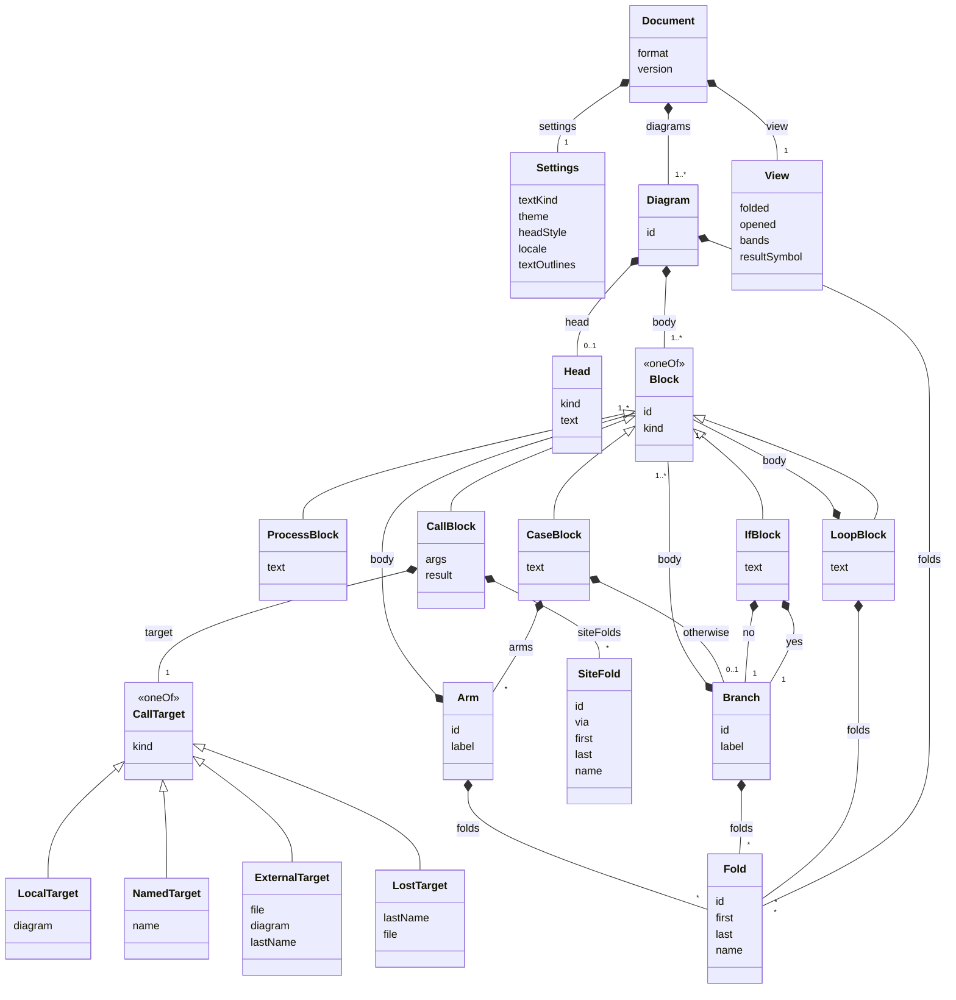

# 모델 JSON 스키마

모델 JSON(저장 파일의 `<ans:document>` 안과 공유 링크에 담기는 JSON)의 JSON Schema(draft 2020-12)를 사람이 읽도록 풀어 쓴 것입니다. 원본은 `src/packages/core/schema/model.schema.json`이고, 사이트에는 다른 AI와 프로그램을 위해 `/model.schema.json`으로 놓입니다 → [[06-web#3.1 LLM · 에이전트를 위한 안내서]]

- 필드의 뜻, 적는 순서, 생략 규칙, 모르는 값을 만났을 때는 [[01-file-format#3. 모델 JSON]]이 원본입니다. 이 문서는 그 모양을 스키마의 눈으로 다시 보입니다.
- 모델의 TypeScript 타입과 불변식은 [[01-model#1. 타입]]과 [[01-model#3. 불변식]]에 있습니다.
- 스키마는 모양만 봅니다. 이 판이 아는 값(텍스트의 언어, 테마, 그림 문구의 언어)만 나열하고, 파일이 지켜야 하지만 모양으로는 적을 수 없는 규칙은 앱의 파서가 봅니다(3장).

> [!info] 이 문서는 손으로 고치지 않습니다
> `src/scripts/model-schema-doc.mjs`가 스키마에서 만듭니다(`src/`에서 `pnpm schema-doc`). 스키마의 설명은 다른 프로그램을 위한 영어이고, 이 문서의 한국어 설명은 `src/packages/core/schema/model.schema.ko.json`에 있습니다. 설명이 빠진 객체나 필드가 있거나 이 문서가 스키마와 다르면 `pnpm check`가 실패합니다.

## 1. 객체의 관계

채운 마름모(◆)는 담는 것과 그 수, 빈 삼각형(△)은 `oneOf`의 꼴입니다(`kind`로 가름). 상자 안은 다른 객체를 담지 않는 필드입니다.



## 2. 객체마다의 필드

"필수"는 반드시 적는 키, "생략 가능"은 정해진 경우에 적지 않는 키입니다(언제 생략하는지는 설명 칸과 [[01-file-format#3.3 노드별 필드]]). 어느 객체든 표에 없는 키가 있으면 스키마도 파서도 거절합니다(`additionalProperties: false`).

### 2.1 문서

모델 JSON의 맨 위 객체입니다. 저장 파일의 `<ans:document>` 안에, 공유 링크에는 봉투의 `model`로 담깁니다.

| 필드 | 타입 | 필수 | 허용 값 | 설명 |
| --- | --- | :---: | --- | --- |
| `format` | string | 필수 | `"ariadne-nsd"`만 | 형식의 이름. 늘 `"ariadne-nsd"` |
| `version` | integer | 필수 | `1`만 | 형식 버전. 이 판은 1이다. 더 높으면 앱이 새 판을 받으라고 알리고, 0은 프로토타입의 파일이라 열지 않는다 |
| `settings` | [[#2.2 settings (문서 설정)\|settings]] | 필수 | - | 문서 설정 |
| `diagrams` | [[#2.3 다이어그램\|다이어그램]]의 배열, 1개 이상 | 필수 | - | 다이어그램의 목록. 그리는 순서다 |
| `view` | [[#2.5 view (뷰 상태)\|view]] | 필수 | - | 뷰 상태. 실행 취소의 대상이 아니다 |

### 2.2 settings (문서 설정)

문서와 함께 저장되어 파일을 받은 사람에게도 같게 보이는 설정입니다.

| 필드 | 타입 | 필수 | 허용 값 | 설명 |
| --- | --- | :---: | --- | --- |
| `textKind` | string | 필수 | `"plain"` · `"c"` · `"cpp"` · `"java"` · `"javascript"` · `"python"` · `"bash"` | 블록 텍스트의 언어. 구문 강조의 색만 정하고 글꼴과 레이아웃은 바꾸지 않는다 |
| `theme` | string | 필수 | `"default"` · `"dark"` · `"high-contrast"` · `"print"` | 테마의 이름. 색 값은 적지 않는다 |
| `headStyle` | string | 필수 | `"title"` · `"shape"` | 헤더를 그리는 모양: 다이어그램 위의 제목처럼(`title`), 또는 모양으로(`shape`) |
| `locale` | string | 생략 가능 | `"en"` · `"ko"` | 편집기가 그림에 적는 문구(참 · 거짓, default 등)의 언어. 없으면 연 사람의 화면 언어로 읽는다 |
| `textOutlines` | boolean | 생략 가능 | - | 텍스트를 외곽선으로 저장한다. `true`일 때만 적는다 |

### 2.3 다이어그램

헤더 하나(없을 수 있음)와 본문 블록들입니다.

| 필드 | 타입 | 필수 | 허용 값 | 설명 |
| --- | --- | :---: | --- | --- |
| `id` | string | 필수 | `d1`, `d2` … (`^d[1-9][0-9]*$`) | 다이어그램의 id |
| `head` | [[#2.4 head (헤더)\|head]] | 생략 가능 | - | 헤더. 헤더가 없는 다이어그램은 이 키를 적지 않는다 |
| `body` | [[#2.6 블록\|블록]]의 배열, 1개 이상 | 필수 | - | 본문의 블록들. 위에서 아래로 그린다 |
| `folds` | [[#2.14 접기 영역 (folds의 원소)\|접기 영역]]의 배열 | 생략 가능 | - | 본문 줄의 접기 영역. 비면 적지 않는다 |

### 2.4 head (헤더)

다이어그램의 머리입니다. Event는 일이 일어날 때의 흐름, Method는 호출 블록이 부를 수 있는 흐름입니다.

| 필드 | 타입 | 필수 | 허용 값 | 설명 |
| --- | --- | :---: | --- | --- |
| `kind` | string | 필수 | `"method"` · `"event"` | 헤더의 종류 |
| `text` | string | 필수 | - | 헤더의 이름. Method면 그것을 부르는 호출 블록이 이 이름을 보인다 |

### 2.5 view (뷰 상태)

문서를 어떻게 보고 있었는지입니다. 문서의 id를 약하게 가리켜, 없는 id가 있어도 깨진 파일이 아닙니다. 새 문서는 `{"folded":[],"opened":[],"bands":true,"resultSymbol":"←"}`입니다.

| 필드 | 타입 | 필수 | 허용 값 | 설명 |
| --- | --- | :---: | --- | --- |
| `folded` | string의 배열 | 필수 | - | 접힌 것(접기 영역, 펴 보인 곳의 접기 영역, If · Case의 분기, 반복 블록)의 id |
| `opened` | string의 배열의 배열 | 필수 | `b1`, `b2` … (`^b[1-9][0-9]*$`) | 그 자리에서 펴 보인 호출 블록의 경로. 바깥 호출 블록부터 안쪽으로 적는다 |
| `bands` | boolean | 필수 | - | 접기 영역 · 펴 보기의 이름 띠를 보이는가 |
| `resultSymbol` | string | 필수 | `"←"` · `"="` | 호출 블록에서 결과와 호출 사이에 그리는 기호 |

### 2.6 블록

`kind`로 가르는 다섯 꼴 가운데 하나입니다. 블록의 배열(`body`)은 비지 않습니다: 빈 분기에도 빈 처리 블록이 하나 있습니다.

꼴: [[#2.7 처리 블록|처리 블록]] · [[#2.8 If 블록|If 블록]] · [[#2.9 Case 블록|Case 블록]] · [[#2.10 반복 블록 (While · Do-While · For)|반복 블록]] · [[#2.11 호출 블록|호출 블록]]

### 2.7 처리 블록

글 한 줄 이상을 적는 상자입니다.

| 필드 | 타입 | 필수 | 허용 값 | 설명 |
| --- | --- | :---: | --- | --- |
| `id` | string | 필수 | `b1`, `b2` … (`^b[1-9][0-9]*$`) | 블록의 id |
| `kind` | string | 필수 | `"process"`만 | 블록의 종류 |
| `text` | string | 필수 | - | 블록의 텍스트. 빈 블록은 `""` |

### 2.8 If 블록

조건과 두 분기입니다.

| 필드 | 타입 | 필수 | 허용 값 | 설명 |
| --- | --- | :---: | --- | --- |
| `id` | string | 필수 | `b1`, `b2` … (`^b[1-9][0-9]*$`) | 블록의 id |
| `kind` | string | 필수 | `"if"`만 | 블록의 종류 |
| `text` | string | 필수 | - | 조건 |
| `yes` | [[#2.12 분기 (yes · no · otherwise)\|분기]] | 필수 | - | 조건이 참일 때의 분기 |
| `no` | [[#2.12 분기 (yes · no · otherwise)\|분기]] | 필수 | - | 조건이 거짓일 때의 분기 |

### 2.9 Case 블록

가를 값과 값마다의 분기, 그리고 default 분기입니다.

| 필드 | 타입 | 필수 | 허용 값 | 설명 |
| --- | --- | :---: | --- | --- |
| `id` | string | 필수 | `b1`, `b2` … (`^b[1-9][0-9]*$`) | 블록의 id |
| `kind` | string | 필수 | `"case"`만 | 블록의 종류 |
| `text` | string | 필수 | - | 가를 값 |
| `arms` | [[#2.13 Case의 분기 (arms의 원소)\|Case의 분기]]의 배열 | 필수 | - | 값마다의 분기. 왼쪽부터 그린다 |
| `otherwise` | [[#2.12 분기 (yes · no · otherwise)\|분기]] | 생략 가능 | - | default 분기. 없으면 적지 않는다 |

### 2.10 반복 블록 (While · Do-While · For)

조건 칸과 반복할 블록들입니다. While은 조건 칸이 위, Do-While은 아래입니다.

| 필드 | 타입 | 필수 | 허용 값 | 설명 |
| --- | --- | :---: | --- | --- |
| `id` | string | 필수 | `b1`, `b2` … (`^b[1-9][0-9]*$`) | 블록의 id |
| `kind` | string | 필수 | `"while"` · `"doWhile"` · `"for"` | 블록의 종류 |
| `text` | string | 필수 | - | 조건(For는 반복의 머리) |
| `body` | [[#2.6 블록\|블록]]의 배열, 1개 이상 | 필수 | - | 반복할 블록들 |
| `folds` | [[#2.14 접기 영역 (folds의 원소)\|접기 영역]]의 배열 | 생략 가능 | - | 본문 줄의 접기 영역. 비면 적지 않는다 |

### 2.11 호출 블록

다른 흐름을 부르는 블록입니다. 부르는 것의 이름은 복사해 갖지 않고 대상으로 가리킵니다.

| 필드 | 타입 | 필수 | 허용 값 | 설명 |
| --- | --- | :---: | --- | --- |
| `id` | string | 필수 | `b1`, `b2` … (`^b[1-9][0-9]*$`) | 블록의 id |
| `kind` | string | 필수 | `"call"`만 | 블록의 종류 |
| `target` | [[#2.16 호출 대상\|호출 대상]] | 필수 | - | 호출 대상 |
| `args` | string | 필수 | - | 인자 |
| `result` | string | 필수 | - | 반환값을 받는 곳. 없으면 `""` |
| `siteFolds` | [[#2.15 펴 보인 곳의 접기 영역 (siteFolds의 원소)\|펴 보인 곳의 접기 영역]]의 배열 | 생략 가능 | - | 이 호출 블록을 펴 보인 곳(안에 보이는 Method의 블록) 위의 접기 영역. 비면 적지 않는다 |

### 2.12 분기 (yes · no · otherwise)

If의 두 분기와 Case의 default 분기입니다.

| 필드 | 타입 | 필수 | 허용 값 | 설명 |
| --- | --- | :---: | --- | --- |
| `id` | string | 필수 | `r1`, `r2` … (`^r[1-9][0-9]*$`) | 분기의 id |
| `label` | string | 생략 가능 | - | 그려지는 참 · 거짓이나 default 대신 쓰는 이름. 편집하지 않았으면 적지 않는다 |
| `body` | [[#2.6 블록\|블록]]의 배열, 1개 이상 | 필수 | - | 분기의 블록들 |
| `folds` | [[#2.14 접기 영역 (folds의 원소)\|접기 영역]]의 배열 | 생략 가능 | - | 분기 줄의 접기 영역. 비면 적지 않는다 |

### 2.13 Case의 분기 (arms의 원소)

Case에서 값 하나의 분기입니다.

| 필드 | 타입 | 필수 | 허용 값 | 설명 |
| --- | --- | :---: | --- | --- |
| `id` | string | 필수 | `r1`, `r2` … (`^r[1-9][0-9]*$`) | 분기의 id |
| `label` | string | 필수 | - | 분기의 값. 그 분기의 라벨로 그린다 |
| `body` | [[#2.6 블록\|블록]]의 배열, 1개 이상 | 필수 | - | 분기의 블록들 |
| `folds` | [[#2.14 접기 영역 (folds의 원소)\|접기 영역]]의 배열 | 생략 가능 | - | 분기 줄의 접기 영역. 비면 적지 않는다 |

### 2.14 접기 영역 (folds의 원소)

한 줄 안의 연속된 블록 범위와 그 이름입니다.

| 필드 | 타입 | 필수 | 허용 값 | 설명 |
| --- | --- | :---: | --- | --- |
| `id` | string | 필수 | `f1`, `f2` … (`^f[1-9][0-9]*$`) | 접기 영역의 id |
| `first` | string | 필수 | `b1`, `b2` … (`^b[1-9][0-9]*$`) | 범위의 처음 블록의 id |
| `last` | string | 필수 | `b1`, `b2` … (`^b[1-9][0-9]*$`) | 범위의 끝 블록의 id |
| `name` | string | 생략 가능 | - | 이름. 없으면 적지 않는다 |

### 2.15 펴 보인 곳의 접기 영역 (siteFolds의 원소)

펴 보인 호출 블록 안에 보이는 Method의 블록 위에 만든 접기 영역입니다. 가장 바깥의 호출 블록에 속합니다.

| 필드 | 타입 | 필수 | 허용 값 | 설명 |
| --- | --- | :---: | --- | --- |
| `id` | string | 필수 | `f1`, `f2` … (`^f[1-9][0-9]*$`) | 접기 영역의 id |
| `via` | string의 배열 | 필수 | `b1`, `b2` … (`^b[1-9][0-9]*$`) | 이 호출 블록 안에서 거쳐 펴 보인 안쪽 호출 블록의 id. 바로 안이면 `[]` |
| `first` | string | 필수 | `b1`, `b2` … (`^b[1-9][0-9]*$`) | 범위의 처음 블록(부르는 Method의 블록)의 id. 없어지면 범위가 줄어든다 |
| `last` | string | 필수 | `b1`, `b2` … (`^b[1-9][0-9]*$`) | 범위의 끝 블록의 id |
| `name` | string | 생략 가능 | - | 이름. 없으면 적지 않는다 |

### 2.16 호출 대상

`kind`로 가르는 네 꼴 가운데 하나입니다.

꼴: [[#2.17 호출 대상: local|호출 대상: local]] · [[#2.18 호출 대상: named|호출 대상: named]] · [[#2.19 호출 대상: external|호출 대상: external]] · [[#2.20 호출 대상: lost|호출 대상: lost]]

### 2.17 호출 대상: local

이 문서 안의 Method 다이어그램입니다.

| 필드 | 타입 | 필수 | 허용 값 | 설명 |
| --- | --- | :---: | --- | --- |
| `kind` | string | 필수 | `"local"`만 | 대상의 종류 |
| `diagram` | string | 필수 | `d1`, `d2` … (`^d[1-9][0-9]*$`) | 부르는 Method 다이어그램의 id |

### 2.18 호출 대상: named

다이어그램이 아니라 블록에 적은 이름입니다(라이브러리 함수 등).

| 필드 | 타입 | 필수 | 허용 값 | 설명 |
| --- | --- | :---: | --- | --- |
| `kind` | string | 필수 | `"named"`만 | 대상의 종류 |
| `name` | string | 필수 | - | 블록에 적은 이름 |

### 2.19 호출 대상: external

다른 파일의 Method입니다.

| 필드 | 타입 | 필수 | 허용 값 | 설명 |
| --- | --- | :---: | --- | --- |
| `kind` | string | 필수 | `"external"`만 | 대상의 종류 |
| `file` | string | 필수 | - | 그 파일을 가리키는 값(무엇을 적는지는 아직 정하지 않음) |
| `diagram` | string | 필수 | `d1`, `d2` … (`^d[1-9][0-9]*$`) | 그 파일 안 Method 다이어그램의 id |
| `lastName` | string | 필수 | - | 마지막으로 본 Method의 이름. 파일을 읽지 못할 때 보인다 |

### 2.20 호출 대상: lost

가리키던 Method가 없어진 호출 블록입니다(다이어그램을 지움, 헤더를 뗌).

| 필드 | 타입 | 필수 | 허용 값 | 설명 |
| --- | --- | :---: | --- | --- |
| `kind` | string | 필수 | `"lost"`만 | 대상의 종류 |
| `lastName` | string | 필수 | - | 마지막으로 보인 이름 |
| `file` | string | 생략 가능 | - | 다른 파일의 Method였으면 그 파일을 가리키던 값 |

## 3. 스키마가 보지 못하는 규칙

아래는 스키마를 통과해도 앱이 깨진 파일(`damaged`)로 거절하는 것입니다. 파서(`src/packages/core/src/format/parse-model.ts`)가 모양을 읽은 뒤 모델의 불변식(`src/packages/core/src/model/invariants.ts`)을 검사합니다. 번호는 [[01-model#3. 불변식]]의 번호입니다. 테스트가 이 규칙마다 스키마는 통과하고 파서는 거절하는 모델을 만들어 봅니다(`src/packages/core/node/model-schema.test.ts`).

| 규칙 | 불변식 |
| --- | :---: |
| 문서 안의 id(다이어그램, 블록, 분기, 접기 영역, 펴 보인 곳의 접기 영역)는 모두 다르다 | 3 |
| Case는 분기가 적어도 하나 있다: `arms`가 비었으면 `otherwise`가 있어야 한다 | 4 |
| 접기 영역의 `first`와 `last`는 그 접기 영역이 붙은 줄(같은 `body`)의 블록이고, `first`가 `last`보다 앞이거나 같다 | 5 |
| 한 줄의 접기 영역들은 서로 떨어져 있거나 하나가 다른 하나를 온전히 품는다(걸쳐 겹치지 않음). 범위가 똑같은 접기 영역은 둘이 없다 | 5 |
| `local` 호출 대상의 `diagram`은 이 문서의 다이어그램이고, 그 헤더는 Method다 | 6 |
| 헤더도 내용도 없는 다이어그램(`head`가 없고 본문이 빈 처리 블록 하나)은 다이어그램이 그것 하나일 때만 있다 | 7 |

스키마가 이미 보는 불변식도 있습니다: 다이어그램이 적어도 하나(1, `diagrams`의 `minItems`), 비지 않는 줄(2, `body`의 `minItems`), If의 두 분기(4, `yes` · `no`가 필수).

거꾸로 파서가 스키마보다 너그러운 곳도 있습니다. 뒤의 판이 쓴 파일을 이 판이 열 수 있게 하려는 것입니다 → [[01-file-format#3.3 노드별 필드]]

- `textKind` · `locale`이 이 판이 모르는 문자열이면 파서는 일반 텍스트 · 연 사람의 화면 언어로 그리고, 받은 값은 저장할 때 그대로 적는다. `theme`이 모르는 이름이면 기본 테마로 그리고 값은 그대로 둔다. 스키마는 이 판이 아는 값만 받는다.
- `version`이 1보다 낮으면 파서는 마이그레이션해 읽는다(0은 프로토타입이라 열지 않음). 스키마는 지금 판(1)만 받는다.
- 블록을 가리키는 id(접기 영역의 `first` · `last`, `via`, `view`의 목록)는 꼴만 본다. `view`와 펴 보인 곳의 접기 영역은 없는 id를 가리켜도 된다(약한 참조).

## 4. 스키마 원문

> [!example]- `model.schema.json` (펼쳐 보기)
> ```json
> {
>   "$schema": "https://json-schema.org/draft/2020-12/schema",
>   "$id": "https://ariadnensd.com/model.schema.json",
>   "title": "AriadneNSD model JSON, format version 1",
>   "description": "The shape of an AriadneNSD document's model JSON: the JSON inside a saved .ns.svg file and inside a share link. Spec: https://github.com/reddiana/AriadneNSD/blob/main/docs/05-spec/01-file-format.md (section 3). How to make a share link from it: https://ariadnensd.com/llms.txt. This schema checks the shape only, with the values this version knows; the app also checks the invariants: every id is used once in the whole document, a local call names a Method diagram, a fold's first and last blocks are in its sequence in that order, and a diagram with neither a header nor blocks is the only diagram.",
>   "type": "object",
>   "additionalProperties": false,
>   "required": ["format", "version", "settings", "diagrams", "view"],
>   "properties": {
>     "format": { "const": "ariadne-nsd" },
>     "version": { "const": 1 },
>     "settings": {
>       "type": "object",
>       "additionalProperties": false,
>       "required": ["textKind", "theme", "headStyle"],
>       "properties": {
>         "textKind": {
>           "description": "The language of the text in blocks, for syntax colors only.",
>           "enum": ["plain", "c", "cpp", "java", "javascript", "python", "bash"]
>         },
>         "theme": { "enum": ["default", "dark", "high-contrast", "print"] },
>         "headStyle": {
>           "description": "How headers are drawn: as a title above the diagram, or as a shape.",
>           "enum": ["title", "shape"]
>         },
>         "locale": {
>           "description": "The language of the words the editor draws (True/False, default). Left out: the opener's screen language.",
>           "enum": ["en", "ko"]
>         },
>         "textOutlines": {
>           "description": "Save the text as outlines. Written only when true.",
>           "type": "boolean"
>         }
>       }
>     },
>     "diagrams": {
>       "type": "array",
>       "minItems": 1,
>       "items": {
>         "type": "object",
>         "additionalProperties": false,
>         "required": ["id", "body"],
>         "properties": {
>           "id": { "$ref": "#/$defs/diagramId" },
>           "head": {
>             "description": "Left out for a diagram without a header.",
>             "type": "object",
>             "additionalProperties": false,
>             "required": ["kind", "text"],
>             "properties": {
>               "kind": { "enum": ["method", "event"] },
>               "text": { "type": "string" }
>             }
>           },
>           "body": { "$ref": "#/$defs/body" },
>           "folds": { "$ref": "#/$defs/folds" }
>         }
>       }
>     },
>     "view": {
>       "description": "How the document was being viewed. For a new document: {\"folded\":[],\"opened\":[],\"bands\":true,\"resultSymbol\":\"←\"}.",
>       "type": "object",
>       "additionalProperties": false,
>       "required": ["folded", "opened", "bands", "resultSymbol"],
>       "properties": {
>         "folded": { "type": "array", "items": { "type": "string" } },
>         "opened": {
>           "type": "array",
>           "items": { "type": "array", "items": { "$ref": "#/$defs/blockId" } }
>         },
>         "bands": { "type": "boolean" },
>         "resultSymbol": { "enum": ["←", "="] }
>       }
>     }
>   },
>   "$defs": {
>     "diagramId": { "type": "string", "pattern": "^d[1-9][0-9]*$" },
>     "blockId": { "type": "string", "pattern": "^b[1-9][0-9]*$" },
>     "branchId": { "type": "string", "pattern": "^r[1-9][0-9]*$" },
>     "foldId": { "type": "string", "pattern": "^f[1-9][0-9]*$" },
>     "body": {
>       "description": "Blocks drawn top to bottom. Never empty: an empty branch holds an empty process block.",
>       "type": "array",
>       "minItems": 1,
>       "items": { "$ref": "#/$defs/block" }
>     },
>     "folds": {
>       "description": "Fold regions over blocks of this sequence. May be left out when empty.",
>       "type": "array",
>       "items": {
>         "type": "object",
>         "additionalProperties": false,
>         "required": ["id", "first", "last"],
>         "properties": {
>           "id": { "$ref": "#/$defs/foldId" },
>           "first": { "$ref": "#/$defs/blockId" },
>           "last": { "$ref": "#/$defs/blockId" },
>           "name": { "type": "string" }
>         }
>       }
>     },
>     "branch": {
>       "type": "object",
>       "additionalProperties": false,
>       "required": ["id", "body"],
>       "properties": {
>         "id": { "$ref": "#/$defs/branchId" },
>         "label": { "description": "Replaces the drawn True/False or default.", "type": "string" },
>         "body": { "$ref": "#/$defs/body" },
>         "folds": { "$ref": "#/$defs/folds" }
>       }
>     },
>     "arm": {
>       "type": "object",
>       "additionalProperties": false,
>       "required": ["id", "label", "body"],
>       "properties": {
>         "id": { "$ref": "#/$defs/branchId" },
>         "label": { "type": "string" },
>         "body": { "$ref": "#/$defs/body" },
>         "folds": { "$ref": "#/$defs/folds" }
>       }
>     },
>     "siteFold": {
>       "description": "A fold region over blocks seen inside an opened call block.",
>       "type": "object",
>       "additionalProperties": false,
>       "required": ["id", "via", "first", "last"],
>       "properties": {
>         "id": { "$ref": "#/$defs/foldId" },
>         "via": { "type": "array", "items": { "$ref": "#/$defs/blockId" } },
>         "first": { "$ref": "#/$defs/blockId" },
>         "last": { "$ref": "#/$defs/blockId" },
>         "name": { "type": "string" }
>       }
>     },
>     "callTarget": {
>       "oneOf": [
>         {
>           "description": "A Method diagram in this document.",
>           "type": "object",
>           "additionalProperties": false,
>           "required": ["kind", "diagram"],
>           "properties": {
>             "kind": { "const": "local" },
>             "diagram": { "$ref": "#/$defs/diagramId" }
>           }
>         },
>         {
>           "description": "A name written in the block, not a diagram.",
>           "type": "object",
>           "additionalProperties": false,
>           "required": ["kind", "name"],
>           "properties": {
>             "kind": { "const": "named" },
>             "name": { "type": "string" }
>           }
>         },
>         {
>           "description": "A Method in another file.",
>           "type": "object",
>           "additionalProperties": false,
>           "required": ["kind", "file", "diagram", "lastName"],
>           "properties": {
>             "kind": { "const": "external" },
>             "file": { "type": "string" },
>             "diagram": { "$ref": "#/$defs/diagramId" },
>             "lastName": { "type": "string" }
>           }
>         },
>         {
>           "description": "A Method that is no longer there.",
>           "type": "object",
>           "additionalProperties": false,
>           "required": ["kind", "lastName"],
>           "properties": {
>             "kind": { "const": "lost" },
>             "lastName": { "type": "string" },
>             "file": { "type": "string" }
>           }
>         }
>       ]
>     },
>     "block": {
>       "oneOf": [
>         {
>           "type": "object",
>           "additionalProperties": false,
>           "required": ["id", "kind", "text"],
>           "properties": {
>             "id": { "$ref": "#/$defs/blockId" },
>             "kind": { "const": "process" },
>             "text": { "type": "string" }
>           }
>         },
>         {
>           "type": "object",
>           "additionalProperties": false,
>           "required": ["id", "kind", "text", "yes", "no"],
>           "properties": {
>             "id": { "$ref": "#/$defs/blockId" },
>             "kind": { "const": "if" },
>             "text": { "type": "string" },
>             "yes": { "$ref": "#/$defs/branch" },
>             "no": { "$ref": "#/$defs/branch" }
>           }
>         },
>         {
>           "type": "object",
>           "additionalProperties": false,
>           "required": ["id", "kind", "text", "arms"],
>           "properties": {
>             "id": { "$ref": "#/$defs/blockId" },
>             "kind": { "const": "case" },
>             "text": { "type": "string" },
>             "arms": { "type": "array", "items": { "$ref": "#/$defs/arm" } },
>             "otherwise": { "$ref": "#/$defs/branch" }
>           }
>         },
>         {
>           "type": "object",
>           "additionalProperties": false,
>           "required": ["id", "kind", "text", "body"],
>           "properties": {
>             "id": { "$ref": "#/$defs/blockId" },
>             "kind": { "enum": ["while", "doWhile", "for"] },
>             "text": { "type": "string" },
>             "body": { "$ref": "#/$defs/body" },
>             "folds": { "$ref": "#/$defs/folds" }
>           }
>         },
>         {
>           "type": "object",
>           "additionalProperties": false,
>           "required": ["id", "kind", "target", "args", "result"],
>           "properties": {
>             "id": { "$ref": "#/$defs/blockId" },
>             "kind": { "const": "call" },
>             "target": { "$ref": "#/$defs/callTarget" },
>             "args": { "type": "string" },
>             "result": {
>               "description": "Receives the return value; empty for none.",
>               "type": "string"
>             },
>             "siteFolds": { "type": "array", "items": { "$ref": "#/$defs/siteFold" } }
>           }
>         }
>       ]
>     }
>   }
> }
> ```
