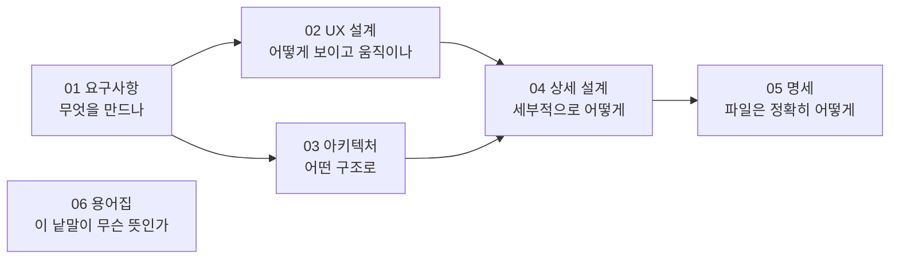

# 문서

NS 차트(Nassi-Shneiderman Diagram)를 그리는 프로그램입니다. 웹(정적 페이지), Obsidian 플러그인, 데스크톱 앱을 먼저 만들고, 그 위에 Google Drive · Confluence · IDE 플러그인 · Claude skill이 붙습니다 → [[01-requirements#2. 배포 대상]].

이 폴더에는 **지금의 모습**만 둡니다: 무엇을 만드는지, 사용자에게 어떻게 보이는지, 어떻게 만드는지. 거기에 이르기까지의 결정 기록(아키텍처는 ADR, 그 밖은 DR)과 논의는 `atelier/`에 있습니다. → [[atelier/README|아틀리에]]

## 문서 지도

폴더마다 읽는 순서대로 번호를 붙였습니다. 요구사항이 UX 설계와 아키텍처의 입력이고, 이 둘이 상세 설계의 입력입니다. 파일 형식 명세는 상세 설계에서 나옵니다. 지도의 모양은 시안 M31에서 골랐습니다(→ [[sketchbook]]).

### 01 요구사항: 무엇을 만드나?

| 문서 | 답하는 질문 | 상태 | 바뀌는 때 |
| --- | --- | --- | --- |
| [[01-requirements\|요구사항]] | 무엇을 만드나? | 초안 | 계속 |
| [[02-use-cases\|유즈케이스]] | 사용자는 무엇을 이루려고 그 기능들을 잇달아 쓰나? | 초안 | 요구사항과 함께 |
| [[03-quality-attribute-scenarios\|품질 속성 시나리오]] | 비기능 요구사항을 어떻게 재고, 어느 구조와 시험이 맡나? | 초안 | 요구사항 · 아키텍처와 함께 |

### 02 UX 설계: 어떻게 보이고 움직이나?

| 문서 | 답하는 질문 | 상태 | 바뀌는 때 |
| --- | --- | --- | --- |
| [[01-ux-overview\|UX 개요]] | 누구를 위해, 어떤 원칙으로? 공통 규칙은? | 초안 | 원칙이 바뀔 때 |
| [[02-interaction-rules\|조작 규칙]] | 기능 하나하나가 어떻게 움직이나? | 초안 | 계속 |
| [[03-keymap\|단축키]] | 어떤 키가 어떤 명령인가? | 초안 | 써 보며 |
| [[04-visual-design\|시각 디자인]] | 색 · 선 · 글자 · 치수는? 그렇게 정한 원칙은? | 초안 | 시안으로 정하며 |

### 03 아키텍처: 어떤 구조로 만드나?

| 문서 | 답하는 질문 | 상태 | 바뀌는 때 |
| --- | --- | --- | --- |
| [[03-architecture\|아키텍처 개요]] | 전체 구조는? 부품은 무엇이고 어떻게 이어지나? | 초안 | 계속 |

### 04 상세 설계: 세부적으로 어떻게?

| 문서 | 답하는 질문 | 상태 | 바뀌는 때 |
| --- | --- | --- | --- |
| [[01-model\|모델]] | 문서 모델(다이어그램 여럿, 보기 상태), 노드 타입, 불변 조건, 편집 명령은? 짜임은 [[03-architecture#3.4 문서 모델]]에 먼저 있음 | 작성 중 | 구현과 함께 |
| [[02-layout\|레이아웃 · 렌더링]] | 크기와 자리는 어떻게 셈하나? 글자 폭(번들 글꼴), SVG 렌더링, 내보내기는? 모습의 값은 [[04-visual-design]] | 작성 중 | 구현과 함께 |
| [[03-editor\|편집기]] | 편집 UI, 선택, 감싸기, 단축키는 어떻게 짜나? | 작성 중 | 구현과 함께 |
| [[04-obsidian-plugin\|Obsidian 플러그인]] | Obsidian 셸은 어떻게 짜나? | 작성 전 | 구현과 함께 |
| [[05-desktop\|데스크톱 앱]] | 데스크톱 셸은 어떻게 짜나? | 작성 전 | 구현과 함께 |
| [[06-web\|웹]] | 웹 셸은 어떻게 짜나? | 작성 전 | 구현과 함께 |
| [[07-testing\|테스트 전략]] | 층마다 무엇을 시험하나? 골든 파일, MVP의 인수 시험, 도구와 CI는? | 초안 | 구현과 함께 |

### 05 명세: 파일은 정확히 어떻게 생겼나?

| 문서 | 답하는 질문 | 상태 | 바뀌는 때 |
| --- | --- | --- | --- |
| [[01-file-format\|파일 형식 명세]] | 저장되는 `.ns` · `.ns.svg` 파일은 정확히 어떻게 생겼나? | 초안 | 형식 버전이 바뀔 때만 |

### 06 용어집: 이 낱말이 무슨 뜻인가?

| 문서 | 답하는 질문 | 상태 | 바뀌는 때 |
| --- | --- | --- | --- |
| [[06-glossary\|용어집]] | 문서에 나오는 낱말이 무슨 뜻인가? | | 필요할 때 더함 |

> [!tip] 문서를 쓸 때의 원칙
> - 요구사항에는 **무엇을**만 한두 줄로 쓰고, 세부 규칙은 UX 설계로, 근거는 ADR이나 DR로, 만드는 방법은 설계 문서로 링크합니다.
> - 요구사항 항목은 ID(`EDIT-06` 등)로 가리킵니다. 예: [[01-requirements#EDIT-06]]
> - **왜** 그렇게 정했는지는 결정 기록에 있습니다. 아키텍처 결정은 ADR(`atelier/adr/`), 그 밖의 결정은 DR(`atelier/decisions/`)이고, 목록은 [[atelier/adr/README|ADR 목록]]과 [[atelier/decisions/README|DR 목록]]에 있습니다.
