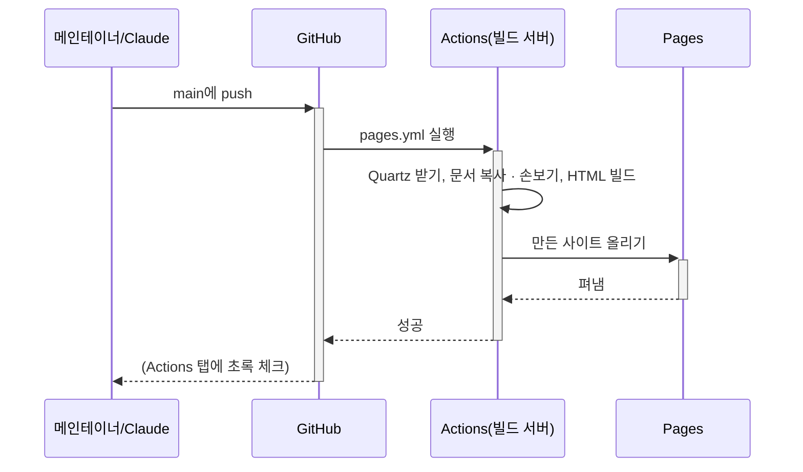

# GitHub Pages로 문서 사이트 펴내기

2026-10-18, 설계 문서를 웹으로 펴내며 메인테이너와 나눈 이야기입니다. → [[2026-10-18-02-pages-visual-design]], 결정은 [[dr-0013-publish-docs-github-pages|DR-0013]]

> "마무리할 때 `docs/`를 publishing해주세요. github page가 적절할까요?"

## GitHub Pages: 저장소 하나에 사이트 하나

GitHub Pages는 저장소의 파일을 **정적 웹 사이트**로 무료로 올려 주는 곳입니다. 서버 코드는 돌지 않고 HTML · CSS · JS · 그림 파일만 내줍니다. 백엔드에 견주면 Nginx가 폴더 하나를 그대로 내주는 것과 같습니다.

- 주소는 `https://<계정>.github.io/<저장소>/`입니다. 우리는 `https://reddiana.github.io/AriadneNSD/`
- **저장소 하나에 사이트 하나**입니다. 그래서 설계 문서, 웹 앱, 사용자 매뉴얼은 한 사이트를 주소로 나눠 씁니다: `/docs/…`, `/atelier/…`, 나중에 `/app/`, `/manual/`
- 셋을 따로 올리면 나중에 올린 것이 앞의 것을 덮어씁니다. 그래서 한 빌드에서 모두 모아 한 번에 올립니다

## 정적 사이트 생성기: Quartz

Obsidian 문서(`.md`)는 브라우저가 그대로 그리지 못합니다. **정적 사이트 생성기**가 마크다운을 HTML로 바꿔 줍니다. 템플릿 엔진으로 HTML을 미리 다 만들어 두는 것과 같습니다.

우리는 **Quartz**를 씁니다. Obsidian 노트를 웹으로 펴내려고 만든 도구라서 `[[위키링크]]`, 콜아웃, Mermaid, 속성을 손대지 않고 그립니다. 검색과 문서 사이의 그래프도 만들어 줍니다.

- Quartz는 저장소에 넣지 않습니다. 빌드할 때 정해 둔 판(`v4.5.2`)을 받아 오고, 우리 설정만 `site/`에 둡니다
- 원본 문서는 고치지 않습니다. 빌드 직전에 `site/prepare-content.mjs`가 **복사본에서만** 손봅니다. 예를 들어 펴내지 않는 `journal/`로 가는 링크는 GitHub의 파일 주소로 바꿉니다

## GitHub Actions: 커밋하면 사이트가 따라온다

**GitHub Actions**는 GitHub이 빌려주는 빌드 서버입니다. Jenkins 같은 CI를 GitHub이 직접 돌려 준다고 보면 됩니다. 할 일은 `.github/workflows/pages.yml`에 적혀 있습니다.



이것이 돌려면 저장소의 Settings → Pages → Build and deployment의 Source를 **GitHub Actions**로 한 번 바꿔 둬야 합니다. 메인테이너가 이번에 바꿨습니다.

## 첫 화면은 README로

> "첫 화면을 최상단 README를 기반으로 만들지 않은 이유가 있을 것 같네요."

처음에는 첫 화면을 `site/index.md`로 따로 썼습니다. README에는 "받아서 Obsidian으로 열어 보라"처럼 GitHub에서만 맞는 말이 있어서였습니다. 하지만 소개 글이 두 곳에 있으면 한쪽만 고치다 어긋나기 쉽습니다. 그래서 **README를 원본**으로 하고, GitHub에서만 맞는 곳은 표시를 달아 빌드 때 빼기로 했습니다.

```markdown
<!-- site:skip -->
> [!TIP] 받아서 Obsidian으로 열면 …
<!-- /site:skip -->
```

`<!-- … -->`는 HTML 주석이라 GitHub에서는 보이지 않습니다. 빌드 스크립트는 이 두 표시 사이를 지웁니다.

## 모양을 고치는 곳: custom.scss

로고 사이의 여백이나 가운데 맞춤은 CSS로 고칩니다. Quartz는 `custom.scss`라는 파일을 마지막에 읽어 기본 모양을 덮어쓸 수 있게 해 둡니다. 우리 파일은 `site/custom.scss`이고, 빌드 때 Quartz의 자리에 복사됩니다.

- `body[data-slug="index"]`로 시작하는 규칙은 **첫 화면에만** 듣습니다. Quartz가 페이지마다 `data-slug`에 주소를 적어 두기 때문입니다
- 문자 로고가 가운데에서 비켜 있던 까닭: Quartz는 제목마다 옆에 링크 아이콘(🔗)을 붙입니다. 보이지 않아도 폭을 차지해서 로고를 왼쪽으로 밀었습니다. 그 아이콘을 감춰 맞췄습니다

## 주소가 저절로 링크가 될 때

> "최초README와 index에 깨진 링크가 있습니다: https://github.com/reddiana/AriadneNSD)%22%EB%A1%9C"

GitHub과 Quartz는 글 속의 `https://…`를 **저절로 링크로** 만듭니다(autolink). 이때 주소가 어디서 끝나는지는 짐작으로 정합니다. `"AriadneNSD (https://github.com/reddiana/AriadneNSD)"로`에서는 주소 뒤의 `)"로`까지 주소로 읽었습니다. 주소의 `%22%EB%A1%9C`는 `"로`를 주소에 넣으려고 바꾼 글자(퍼센트 인코딩)입니다.

고치는 법은 둘입니다.

- 주소를 코드 모양(`` `…` ``)으로 감쌉니다. 코드 안은 링크로 만들지 않습니다. 사람들이 그대로 베껴 쓸 출처 문구라 이번에는 이것으로 했습니다
- 링크로 두려면 `[이름](주소)`나 `<주소>`처럼 끝을 분명히 적습니다

## Mermaid 그림이 사이트에서만 깨질 때

> "AriadneNSD 아키텍처 개요"에서 클래스다이어그램 머메이드가 렌더링되지 않았습니다. "Syntax error in text mermaid version 11.4.0"라고 나옵니다.

Obsidian에서는 되는데 사이트에서만 깨지면, 까닭은 대개 둘 중 하나입니다.

- **Mermaid의 판이 다르다.** 사이트는 Mermaid 11.4.0을 쓰고 Obsidian은 더 옛 판을 씁니다. 옛 판이 너그럽게 넘어가던 것을 새 판은 오류로 봅니다. 예: 시퀀스 그림에서 글자 없는 응답(`H-->>-E:`)
- **사이트로 옮기는 도구가 원문을 바꾼다.** Quartz(v4.5.2)는 그림을 그리기 직전에 원문을 `innerHTML`로 넣습니다. `innerHTML`은 글을 **HTML로 읽기** 때문에, 클래스 그림의 스테레오타입 `<<interface>>`가 `<interface>`라는 태그로 바뀌어 원문이 망가집니다. 글자 그대로 넣는 `textContent`를 썼어야 하는 곳입니다

두 번째는 우리 문서로 고칠 수 없어서, 빌드할 때 받은 Quartz의 그 한 줄을 고칩니다(`site/patch-quartz.mjs`). 이렇게 남의 코드를 쓰기 직전에 고치는 것을 **패치**라고 합니다. Quartz를 새 판으로 올려서 고칠 줄이 없어지면 스크립트가 빌드를 멈춥니다. 그때 새 판에서 고쳐졌는지 보고 패치를 뺄지 정합니다.
