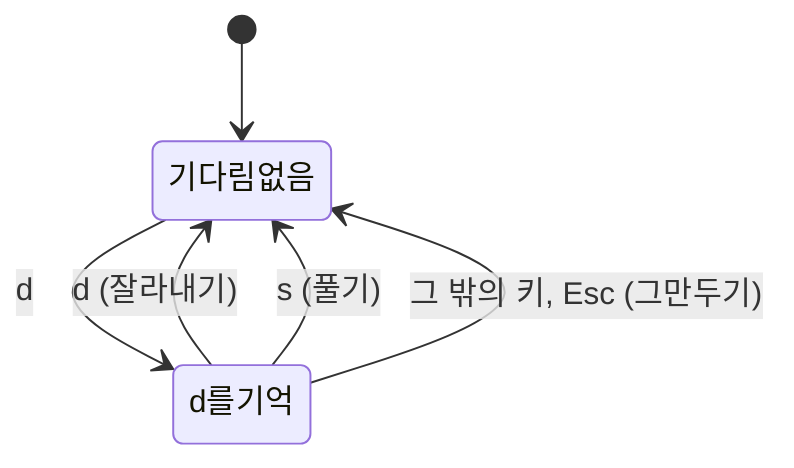

# 키보드 입력 읽기: 글자와 자리, 한글 입력기, 브라우저가 가져가는 키

2026-10-13에 단축키를 Vim 키로 바꾸면서 나온 것을 정리한다. "한글 입력 상태에서도 `j`가 듣는가", "`Ctrl`+`R`을 써도 되는가", "두 번 누르는 키는 어떻게 읽는가"이다. → [[0025-vim-keys|ADR-0025]], [[03-editor#4. 단축키]]

## 키 하나를 누르면 브라우저가 알려 주는 것

키를 누르면 브라우저는 페이지에 "키가 눌렸다"는 사건(`keydown` 이벤트)을 보낸다. 백엔드로 치면 요청 하나가 들어오는 것이고, 그 안에 값이 여럿 들어 있다. 단축키에서 보는 것은 둘이다.

| 값 | 뜻 | `J` 자리의 키를 눌렀을 때 |
| --- | --- | --- |
| `key` | 그 키로 **들어가는 글자** | 영문 상태에서는 `j`, `Shift`와 함께면 `J`, 한글 상태에서는 `ㅓ`이거나 "입력기가 처리 중"이라는 표시 |
| `code` | 자판에서 그 키의 **자리** | 언제나 `KeyJ` |

`key`는 자판 배열과 입력기에 따라 달라지고, `code`는 달라지지 않는다. 프로토타입은 `code`로 읽는다. 그래서 한글 입력 상태에서도 `j` 자리의 키는 아래로 간다. 메인테이너가 브라우저에서 `j`, `dd`, `zf`로 확인했다.

대문자와 소문자는 `code`만으로는 알 수 없다. 자리는 같기 때문이다. 그래서 "`Shift`가 함께 눌렸는가"를 따로 본다. `KeyG`에 `Shift`가 있으면 `G`, 없으면 `g`다. `Caps Lock`은 보지 않는다.

> [!warning] 자리로 읽을 때 잃는 것
> 자판 배열이 QWERTY가 아닌 사람(Dvorak, 프랑스의 AZERTY 등)은 키에 적힌 글자와 `code`가 맞지 않는다. Dvorak에서 `j`라고 적힌 키는 QWERTY의 `c` 자리에 있어서, 그 키를 누르면 `KeyC`가 온다. 한글 두벌식은 QWERTY와 자리가 같아서 이 문제가 없다. 제품에서 어떻게 할지는 정하지 않았다. 길은 둘이다: 글자(`key`)로 읽되 한글 상태일 때만 자리로 읽거나, 키 배열을 사용자가 바꿀 수 있게 하거나.

## 한글 입력기가 끼어드는 곳

한글은 키 하나가 글자 하나가 아니다. `ㅎ` `ㅏ` `ㄴ`을 차례로 눌러 "한"을 만든다. 만드는 동안의 글자는 아직 정해지지 않은 상태이고, 이 과정을 조합(composition)이라고 한다. 조합은 운영체제의 입력기(IME)가 맡는다.

- **블록을 고른 상태**(글자를 적는 칸이 아닌 곳)에서는 조합이 일어나지 않는다. 키 사건이 그대로 페이지에 온다. `code`로 읽으면 된다.
- **글자를 고치는 중**(입력 칸 안)에는 조합이 일어난다. 조합 중에 누른 `Enter`나 `Esc`는 먼저 입력기가 받아서 조합을 끝내는 데 쓴다. 이때 페이지에도 키 사건이 오는데, "조합 중"이라는 표시(`isComposing`)가 붙어 있다. 이 표시가 붙은 키를 단축키로 처리하면 `Enter` 한 번에 두 번 받아들이는 것 같은 잘못이 생긴다. 프로토타입은 이 표시가 붙은 키를 건너뛴다.

그래서 한글을 적다가 `Esc`를 누르면 한 번에 받아들여지지 않고 두 번 눌러야 할 수 있다. 첫 번째는 입력기가 조합을 끝내는 데 쓰고, 두 번째가 페이지에 온다. 이것은 아직 눌러 보지 않았다 → [[prototype#시험한 곳과 못 한 곳]]

## 두 번 누르는 키

`dd`, `zf`, `gd`는 키 둘을 차례로 누른다. 브라우저는 키를 하나씩만 알려 주므로, 페이지가 "방금 `d`를 눌렀다"를 기억하고 있다가 다음 키를 보고 정한다.

- `Shift`나 한/영 키만 누른 것은 "그 밖의 키"로 치지 않는다. 그러지 않으면 `zR`의 `R`을 누르려고 `Shift`를 누르는 순간 그만두게 된다.
- 기억하고 있는 키는 상태 줄 왼쪽에 보여 준다. 화면에 보이지 않는 상태가 있으면 다음 키가 왜 엉뚱하게 움직이는지 알 수 없기 때문이다.
- Vim은 여기에 횟수(`3j`)와 이동(`d2j`)까지 얹는다. 이 프로젝트는 들이지 않았다.

## 브라우저가 가져가는 키

웹 페이지는 브라우저 안에서 돌기 때문에, 브라우저가 먼저 쓰는 키가 있다.

| 키 | 브라우저에서 | 페이지가 막을 수 있는가 |
| --- | --- | --- |
| `Ctrl`+`R` | 새로 고침 | 막을 수 있다. 페이지가 "내가 처리했다"(`preventDefault`)고 하면 새로 고쳐지지 않는다 |
| `Ctrl`+`F`, `Ctrl`+`S`, `Ctrl`+`P` | 찾기, 저장, 인쇄 | 막을 수 있다 |
| `Ctrl`+`W`, `Ctrl`+`T`, `Ctrl`+`N` | 탭 닫기, 새 탭, 새 창 | **막을 수 없다** |
| `Alt`+`←` `→` | 뒤로, 앞으로 | 브라우저에 따라 다르다 |

`Ctrl`+`R`은 Vim의 다시 하기다. Vim에 익은 손은 생각 없이 누르므로, 페이지가 잡지 않으면 화면이 새로 고쳐진다. 그래서 프로토타입은 `Ctrl`+`R`을 다시 하기로 받는다. 다만 포커스가 캔버스 밖(주소 표시줄 등)에 있으면 페이지는 그 키를 받지 못하고 그대로 새로 고쳐진다. 글자 키 `U`를 다시 하기로 하나 더 둔 까닭이다.

Obsidian과 데스크톱 앱에서는 사정이 다르다. Obsidian은 자기 단축키(`Ctrl`+`P` 명령 팔레트, `Ctrl`+`O` 빠른 전환, `Ctrl`+`Shift`+`F` 전체 검색)를 먼저 쓰고, 데스크톱 앱에는 브라우저의 탭 키가 없다. 셸마다 겹치는 키를 따로 확인해야 한다 → [[03-editor#4. 단축키]]의 "남은 일"

## 시험할 수 있는 것과 없는 것

프로토타입의 시험은 화면 없는 Chrome(헤드리스)에 "이 자리의 키가 눌렸다"는 사건을 만들어 보내는 방식이다. `code`를 직접 적어 보내므로 단축키의 논리는 시험할 수 있다. 하지만 입력기는 운영체제에 있어서 이 방법으로는 흉내 낼 수 없다. 한글 입력 상태의 동작은 사람이 눌러 봐야 안다.
