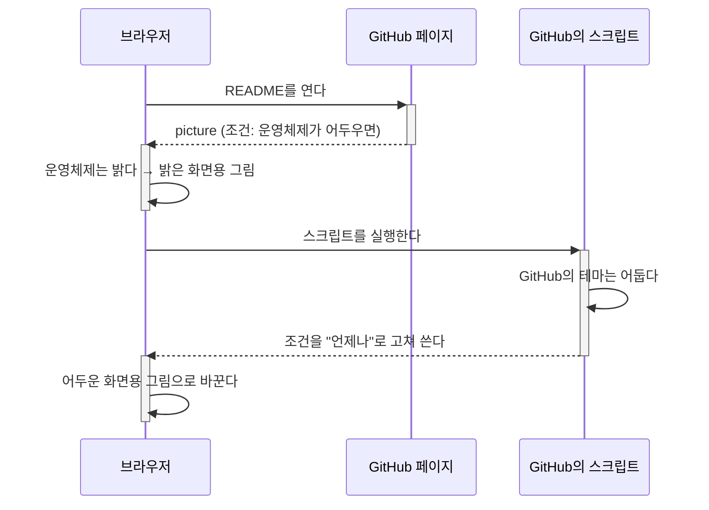

# 테마에 따라 그림 바꾸기와 그 한계

## 한 줄 요약

"어두운 화면이면 이 그림"이라는 조건은 **앱의 테마가 아니라 운영체제의 밝기**를 본다. 그래서 앱만 어둡게 쓰는 사람에게는 틀린 그림이 나올 수 있다. 가장 튼튼한 길은 그림 하나를 어느 바탕에서나 읽히게 만드는 것이다.

## 무슨 일이 있었나

README의 문자 로고를 밝은 화면용(검은 글자)과 어두운 화면용(밝은 글자) 두 파일로 두고, 화면에 맞는 쪽이 나오게 했다. 그런데 GitHub를 어두운 테마로 보는데도 검은 글자가 나왔고, Obsidian에서도 같았다. → [[2026-10-11-01-inbox-samples#어두운 테마에서 문자 로고가 검게 보이는 문제]]

## 조건은 누가 판단하나

README에는 이렇게 적었다.

```html
<picture>
  <source media="(prefers-color-scheme: dark)" srcset="wordmark-dark.svg">
  
</picture>
```

`prefers-color-scheme`은 브라우저가 답하는 물음이고, 브라우저는 **운영체제의 설정**(Windows의 "앱 모드")을 보고 답한다. 웹 페이지가 자기 색을 어둡게 칠했는지는 브라우저가 알지 못한다.

백엔드에 견주면 이렇다. 서버가 요청 헤더의 `Accept-Language`를 보고 언어를 고르는데, 사용자는 사이트 안의 설정에서 다른 언어를 골라 둔 경우다. 헤더(운영체제)와 사이트 설정(앱의 테마)이 다르면, 헤더만 보는 쪽은 틀린다.

| 보는 곳 | 운영체제 | 앱의 테마 | 조건의 답 | 나오는 그림 |
| --- | --- | --- | --- | --- |
| 어디든 | 어두움 | 어두움 | 어두움 | 어두운 화면용 (맞음) |
| GitHub, Obsidian | **밝음** | **어두움** | 밝음 | 밝은 화면용 (틀림) |

## GitHub는 스크립트로 고쳐 준다

GitHub는 이 틈을 메우려고 README의 `<picture>`를 `themed-picture`라는 요소로 감싸고, 페이지가 뜬 뒤 스크립트가 조건을 GitHub의 테마에 맞게 고쳐 쓴다.



- 스크립트가 돌면 GitHub의 테마를 따른다.
- **스크립트가 돌지 않으면** 앞의 절반만 일어나서 운영체제의 밝기를 따른다. 메인테이너의 화면이 이 경우였다. 왜 돌지 않았는지는 알아내지 못했다.
- GitHub의 테마를 "시스템과 맞춤"으로 두고 낮 테마를 어두운 것으로 고른 경우에는, 스크립트가 돌아도 운영체제를 따른다. GitHub가 원래 그렇게 만들었다.
- 그림 주소 끝에 `#gh-dark-mode-only`를 붙이는 옛 방법도 같은 규칙을 쓴다.

Obsidian에는 이런 스크립트가 없다. 그리고 `![[그림.svg]]`로 넣은 그림은 테마에 따라 파일을 바꿀 방법 자체가 없다.

## 페이지의 상태를 직접 읽기

Claude는 메인테이너가 로그인한 화면을 볼 수 없다. 그럴 때는 그 화면에서 값을 읽어 온다.

1. 브라우저에서 `F12`를 눌러 개발자 도구를 연다.
2. **Console** 탭의 입력 줄에 한 줄을 붙여 넣고 `Enter`를 누른다.
3. 나온 글자를 Claude에게 알려 준다.

콘솔은 지금 열린 페이지 안에서 JavaScript를 실행하는 창이다. 서버에 SSH로 들어가 상태를 찍어 보는 것과 비슷하다. 이번에는 두 번 읽었다.

| 읽은 것 | 나온 값 | 알게 된 것 |
| --- | --- | --- |
| GitHub의 테마 상태 | `dark / light / dark` | 테마 설정은 맞다. Claude의 추정이 틀렸다 |
| 그려진 그림, 조건, 스크립트가 켜졌는지 | `…-light.svg ; (prefers-color-scheme: dark) ; false ; …` | 스크립트가 켜지지 않았고 조건이 처음 그대로다 |

> [!warning] 콘솔에 붙여 넣는 것은 믿을 수 있는 곳에서 받은 것만
> 콘솔에 넣은 코드는 그 페이지에서 로그인한 나의 권한으로 실행된다. 모르는 사람이 준 코드를 붙여 넣으면 계정을 빼앗길 수 있다. 그래서 브라우저가 처음에 "allow pasting"을 치게 한다.

## 그래서 어떻게 했나

조건으로 고르는 방식을 버리고 **파일 하나**로 바꿨다. 글자 색을 흰 바탕과 검은 바탕의 중간 밝기로 맞춰 두 바탕 모두에서 읽히게 했다(시안 N1). 누가 판단하든, 스크립트가 돌든 말든 같은 그림이 나온다. → [[logo-source#파일 하나로 바꾼 일 (2026-10-11)]]

고를 수 있던 다른 길:

- **글자 뒤에 판을 깐다.** 글자 색을 그대로 둘 수 있다. 판이 눈에 띈다.
- **그대로 둔다.** 흔한 설정에서는 맞게 보인다. 앱만 어둡게 쓰는 사람에게는 틀린다.

## AriadneNSD에서 다시 만날 곳

저장된 `.ns.svg` 그림의 색을 고정할지, 보는 환경의 테마를 따를지가 아직 열려 있다([[0013-default-visual-style|ADR-0013]]). 그림 안에 `prefers-color-scheme` 조건을 넣어 "테마를 따르게" 하면 이번과 같은 일이 생긴다. Obsidian에서 어두운 테마를 쓰는데 운영체제는 밝은 사용자에게 밝은 그림이 나온다. 그 결정을 할 때 이 노트를 다시 본다.
