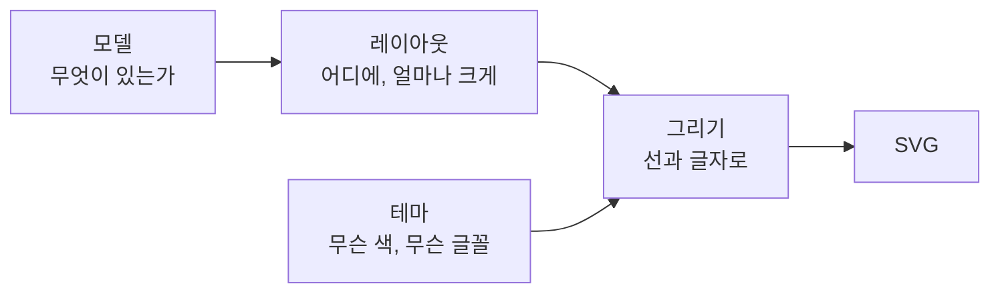

# 모양을 바꾸는 일의 크기 — 모델, 레이아웃, 그리기, 테마

메인테이너의 물음에서 시작했습니다 (2026-10-11).

> 나중에 마음이 바뀌어 왼쪽 막대를 굵은 둘레선으로 바꾼다면 이키텍처나 코드의 변경이 클까요?

> 하지만 우리는 theme 기능이 있으니 나중에 사용자가 바꿀 수 있겠지요?

답은 "작다"와 "색은 그렇다, 폭은 아니다"였습니다. 그 까닭은 그림이 네 단계를 거쳐 만들어지기 때문입니다.

## 그림이 만들어지는 네 단계

| 단계 | 정하는 것 | 접기 영역의 예 |
| --- | --- | --- |
| **모델** | 무엇이 있는가. 파일에 저장되는 원본 | "이 블록부터 저 블록까지가 접기 영역이고 이름은 '입력 검사'" |
| **레이아웃** | 블록마다의 자리와 크기 | "접기 영역 안의 블록은 왼쪽에서 8만큼 들여 놓고, 위에 18만큼 띠 자리를 둔다" |
| **그리기** | 자리에 맞춰 선, 면, 글자를 그림 | "왼쪽에 폭 8의 막대를 채워 그리고, 위에 띠를 그리고 이름을 적는다" |
| **테마** | 색, 글꼴, 선 굵기 | "막대는 짙은 파랑, 띠는 옅은 파랑" |

백엔드에 견주면 모델은 DB의 레코드, 레이아웃은 그것을 화면에 맞게 가공한 응답, 그리기는 템플릿, 테마는 CSS와 비슷합니다.

## 무엇을 바꾸면 어디가 바뀌는가

바꾸려는 것이 어느 단계의 것인지를 보면 일의 크기가 보입니다. 뒤 단계만 바꾸는 일은 작고, 앞 단계까지 닿는 일은 큽니다.

| 바꾸려는 것 | 닿는 단계 | 크기 |
| --- | --- | --- |
| 막대의 색 | 테마 | 값 하나. 사용자가 테마에서 바꿀 수 있음 |
| 막대를 굵은 둘레선으로 | 레이아웃(들임 8 → 0), 그리기(함수 하나) | 작음. 코드를 고쳐야 함 |
| 막대의 폭 | 레이아웃 | 값 하나지만, 블록의 자리가 모두 달라짐 |
| 접기 영역을 겹칠 수 없게 | 모델 | 큼. 파일 형식과 편집 명령까지 닿음 |

**테마로 바꿀 수 있는 것은 레이아웃에 닿지 않는 것뿐입니다.** 요구사항 [[01-requirements#^r-lay|R-LAY-08]]의 "테마를 바꿔도 레이아웃은 그대로"가 이 금입니다. 색은 자리를 바꾸지 않으므로 테마이고, 폭은 자리를 바꾸므로 테마가 아닙니다.

## 저장된 파일은 어떻게 되는가

파일에는 그림과 모델이 함께 들어 있지만, **열 때는 모델만 읽고 저장할 때마다 그림을 새로 그립니다** ([[01-requirements#^r-fmt|R-FMT-05]]). 그래서 그리는 방식을 바꿔도 옛 파일이 깨지지 않습니다. 옛 파일은 열어서 다시 저장하면 새 모습이 됩니다.

모델을 바꾸는 일이 큰 까닭도 여기에 있습니다. 모델이 바뀌면 옛 파일을 읽어 새 모델로 옮기는 코드(형식 버전 변환, [[01-requirements#^r-fmt|R-FMT-02]])가 필요합니다.

## 설계에서 지킬 것

- 모델에는 "무엇이 있는가"만 넣습니다. 막대인지 둘레선인지는 넣지 않습니다.
- 꾸밈의 크기(왼쪽 들임, 위쪽 띠의 높이)는 레이아웃의 한 자리에서 값으로 받습니다. 그러면 모양을 바꾸는 일이 값 하나를 고치는 것으로 끝납니다. → [[status]]의 레이아웃 설계 할 일
- 색은 그리는 코드에 적지 않고 테마에서 받습니다. → [[dr-0003-default-visual-style|DR-0003]]

## 함께 바뀌는 것: 그림을 견주는 시험

"이 모델이면 이 SVG가 나온다"를 확인하는 시험이 있으면, 그리는 방식을 바꿀 때마다 기대하는 그림을 다시 만들어야 합니다. 기계적으로 되는 일이지만, 바뀐 그림을 사람이 한 번은 눈으로 봐야 합니다.

지금은 코드가 없으므로 이 글은 요구사항과 아키텍처 문서([[03-architecture]])가 나눈 대로 만들었을 때의 이야기입니다.
