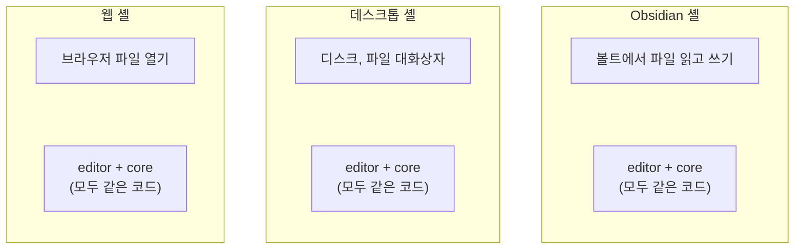

# wasm과 셸

2026-10-17, 아키텍처 제안을 확인하다(시안 M20의 A1 · A6) 메인테이너가 물은 두 낱말입니다. → [[2026-10-17-02-atelier-readme]]

## wasm (WebAssembly)

> "wasm이 무엇인가요?"

**브라우저 안에서 돌아가는 기계어 비슷한 실행 파일 형식**입니다. 백엔드에 견주면 **JVM 바이트코드**와 비슷합니다.

| | Java | WebAssembly |
| --- | --- | --- |
| 소스 | `.java` | C · C++ · Rust 등 |
| 컴파일 결과 | `.class` (바이트코드) | `.wasm` |
| 실행하는 곳 | 어느 OS의 JVM이든 | 브라우저, Node, Obsidian(안이 브라우저라서) |

- JavaScript보다 빠르고, 이미 C++로 잘 만들어진 라이브러리를 웹에서 그대로 쓸 수 있습니다.
- 그 대신 파일이 큽니다. 처음 한 번 내려받아 컴파일하는 시간이 듭니다.

### 우리가 쓰는 곳

저장할 때, 그림에 쓰인 글자만 글꼴에서 추려 `.ns.svg`에 넣는 일 하나입니다([[0026-bundled-font-metrics|ADR-0026]]).

- 이 일을 하는 검증된 도구가 **HarfBuzz**(C++)입니다. Chrome, Android, LibreOffice가 글자를 그릴 때 씁니다.
- HarfBuzz를 wasm으로 컴파일한 파일이 약 652 KB입니다. 같은 글자에서 늘 같은 바이트를 내므로 "같은 문서는 같은 파일"이 지켜집니다.
- 2026-10-13 스파이크에서 Node로 10ms쯤에 된다는 것을 확인했습니다. 브라우저와 Obsidian 안에서는 아직 돌려 보지 않았습니다.
- 화면에 그리거나 레이아웃을 셈할 때는 필요 없습니다(글자 폭 표만 있으면 됨). 그래서 wasm과 글꼴 파일을 `packages/fonts`(저장소에서는 `src/packages/fonts` → [[0036-code-layout|ADR-0036]])에 따로 모았습니다(A1).

## 셸 (shell)

> "셀은 블록을 말하나요?"

아닙니다. **셸**(shell, 껍데기)은 같은 편집기를 각 배포 대상에 붙이는 **배포 대상마다의 바깥 프로그램**입니다. 먼저 만드는 것은 웹 · Obsidian · 데스크톱의 셋(`apps/web`, `apps/obsidian`, `apps/desktop`)이고, 나중에 Confluence와 IDE 플러그인(VSCode, IntelliJ)이 더해집니다. 셸은 셋이 아니라 배포 대상의 수만큼 있습니다([[03-architecture#6. 배포 구성]]). 아래 그림은 먼저 만드는 셋만 그렸습니다. 표의 칸을 뜻하는 "셀(cell)"과 소리가 비슷해 헷갈리기 쉽습니다.

- 백엔드에 견주면 **비즈니스 로직은 하나이고, 저장소 어댑터(MySQL용, S3용)를 갈아 끼우는 것**과 같습니다. `editor`가 인터페이스를 정하고, 셸이 그 플랫폼에 맞는 구현을 넣습니다.
- 시안 M20의 A6은 "이 어댑터 인터페이스에 무엇을 넣을까"였습니다. 2026-10-18에 둘로 정했습니다: 문서 파일(이 문서 읽기 · 쓰기 · 다른 이름으로 쓰기, 다른 문서 읽기)과 설정 보관(화면의 언어, 화면 색) → [[0031-shell-interfaces|ADR-0031]]
- 용어집에도 있습니다 → [[06-glossary]]
